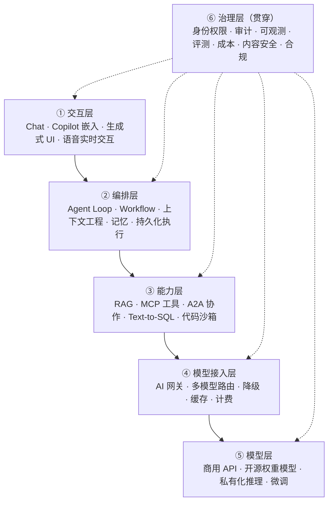
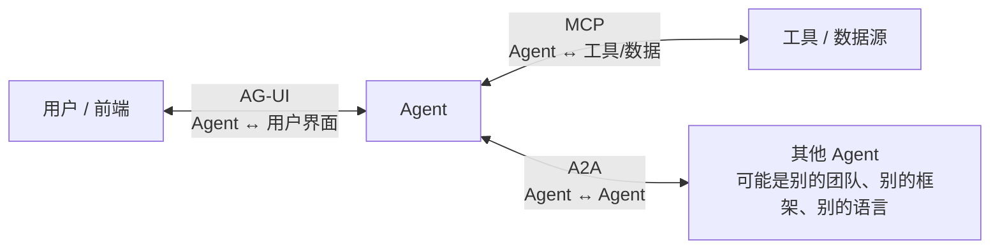
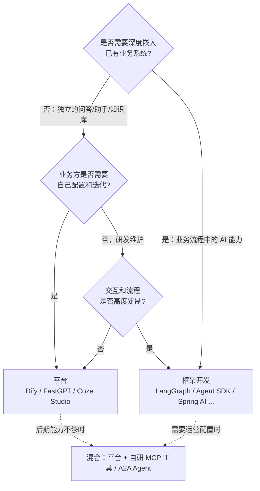
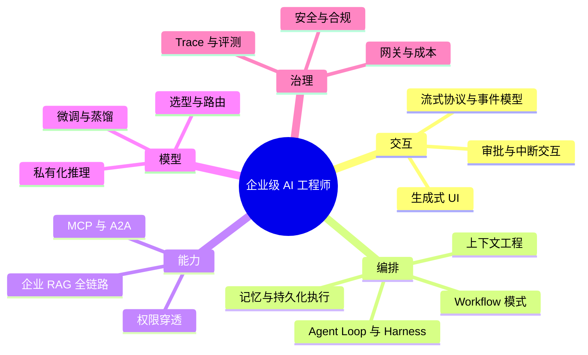

# 01 全景地图与技术选型

> 本章目标：建立企业级 AI 应用的**分层心智模型**，看清各层的关键技术与开源项目在行业中的地位，掌握**跨语言生态**的对应关系，并能在"用平台 / 用框架 / 自研"之间做出有依据的决策。
>
> 各个项目的详细介绍见 [02 开源项目与生态图谱](./02-开源项目与生态图谱.md)。

---

## 一、企业级 AI 应用的六层架构

| 层 | 核心问题 | 关键技术 / 标准 | 详见 |
|---|---|---|---|
| ① 交互层 | 流式渲染、工具调用可视化、中断/重试、审批交互、生成式 UI | SSE、AG-UI、A2UI、MCP Apps | [04 章](./04-AI交互层-流式协议与生成式UI.md) |
| ② 编排层 | 固定流程还是自主决策；上下文怎么组织；长任务怎么不丢 | Agent Loop、状态图、Checkpoint、Durable Execution | [06 章](./06-Agent工程化-从Loop到生产.md) |
| ③ 能力层 | 知识检索准不准；工具怎么标准化；权限怎么穿透 | 混合检索、Rerank、MCP、A2A | [05](./05-MCP与Agent互操作协议.md) / [07 章](./07-企业级RAG落地.md) |
| ④ 接入层 | 统一协议、密钥、限流计费、故障切换 | OpenAI 兼容协议、AI 网关 | [09 章](./09-LLMOps-可观测评测与AI网关.md) |
| ⑤ 模型层 | 选哪个模型；要不要私有化；要不要微调 | vLLM / SGLang、LoRA、蒸馏、RFT | [03 章](./03-模型层-选型私有化推理与微调.md) |
| ⑥ 治理层 | 能不能上线、敢不敢给业务用 | OTel GenAI、评测、OWASP、OAuth | [09](./09-LLMOps-可观测评测与AI网关.md) / [10 章](./10-安全权限与上线清单.md) |

> 🎯 **落地要点**：方案评审里最能体现"企业级"的，不是你会调哪个 API，而是你能讲清 **⑥ 治理层** 在每一层分别怎么落。

---

## 二、三大开放协议：2026 年 Agent 生态的骨架

2025~2026 年最重要的结构性变化，是 Agent 生态围绕**三个开放协议**完成了分工。理解它们，就理解了现代 Agent 系统的接口边界。

| 协议 | 解决的问题 | 发起方 | 治理 | 成熟度（2026-11） |
|---|---|---|---|---|
| **MCP** | Agent 如何调用工具、读取数据 | Anthropic | Linux 基金会 AAIF | 事实标准，规范 `2026-07-28` 改为无状态 |
| **A2A** | 不同 Agent 之间如何发现、委托任务、协作 | Google | Linux 基金会（2026-08 并入 AAIF） | v1.0（2026-03），五种语言官方 SDK |
| **AG-UI** | Agent 如何与前端实时交互（流式、状态、审批、生成式 UI） | CopilotKit | 社区 | 主流框架普遍支持，生态仍在竞争 |

> 📖 **AAIF（Agentic AI Foundation）**：Linux 基金会于 2025 年 12 月成立的智能体基金会，托管 MCP、AGENTS.md、goose 等项目，成员包括 Anthropic、OpenAI、Google、Microsoft、AWS 等。协议进入中立基金会，意味着**企业可以放心基于它们做长期投入**。

此外还有两个"约定级"标准值得了解：

- **AGENTS.md**：放在代码仓库中、写给 AI 编码 Agent 的项目说明（类似 README 之于人类），已被主流编码 Agent 支持
- **Agent Skills**：把指令、脚本、资源打包为可按需加载的"技能包"，让 Agent 获得特定领域的做事方法

---

## 三、开源项目分级（2026 视角）

按"**学习投入产出比**"分三级：**S 级深入实践或精读源码，A 级理解架构与设计，B 级知道定位即可**。完整清单与每个项目的学习要点见 [02 章](./02-开源项目与生态图谱.md)。

### 3.1 S 级：范式级，必须深入

| 项目 | 层 | 为什么是 S 级 | 深入章节 |
|---|---|---|---|
| **MCP**（协议 + 官方 SDK） | ③ | 工具集成的行业标准，所有主流模型厂商、IDE、Agent 框架都支持；企业"把内部系统 AI 化"的主路径 | [05 章](./05-MCP与Agent互操作协议.md) |
| **LangGraph** | ② | 有状态 Agent 编排的事实标准（Python / TS）；State、Checkpoint、Interrupt 等概念被其他框架广泛借鉴 | LangChain 系列 [08](../LangChain-LangGraph入门到进阶/08-LangGraph核心概念.md) ~ [10 章](../LangChain-LangGraph入门到进阶/10-LangGraph高级模式-流式子图多Agent.md) |
| **编码 Agent Harness**（Claude Code / Codex CLI / OpenHands） | ② | 当前**工程化最成熟的 Agent**：上下文管理、权限、沙箱、子 Agent、Skills、Hooks 的设计都是行业标杆。Claude Code 是设计标杆，Codex CLI 与 OpenHands 是可精读源码的开源实现 | [12 章](./12-编码Agent-Harness深度拆解.md) |
| **Dify** | ②③⑥ | 企业私有化 LLM 平台的头部选择；多租户、插件、工作流引擎、沙箱的设计完整 | [08 章第二节](./08-LLM平台源码导读.md#二dify最完整的企业-llm-平台) |
| **RAGFlow** | ③ | 企业 RAG 最难的"深度文档理解"的开源标杆 | [08 章第五节](./08-LLM平台源码导读.md#五ragflow深度文档理解) |
| **Langfuse** | ⑥ | 开源 LLM 可观测与评测的标杆，Tracing 数据模型是 LLMOps 的基础 | [09 章 2.6](./09-LLMOps-可观测评测与AI网关.md#26-langfuse-深入重点) |
| **vLLM** | ⑤ | 私有化推理的事实标准，理解它才能评估私有化部署的成本与可行性 | [03 章 3.6](./03-模型层-选型私有化推理与微调.md#36-vllm-深入架构部署与调优重点) |

### 3.2 A 级：理解架构

| 类别 | 项目 |
|---|---|
| 各语言主力 Agent 框架 | OpenAI Agents SDK、Google ADK、Microsoft Agent Framework、Pydantic AI、Vercel AI SDK、Mastra、Spring AI / Spring AI Alibaba、LangChain4j、Eino |
| 互操作协议 | A2A、AG-UI |
| 平台 | FastGPT、Coze Studio、n8n |
| RAG 组件 | MinerU / Docling（文档解析）、LlamaIndex、Milvus / Qdrant |
| 基础设施 | LiteLLM / Higress（AI 网关）、SGLang、Temporal（持久化执行） |
| 记忆 | Mem0、Letta |
| 评测与安全 | Ragas、promptfoo |

### 3.3 B 级：知道定位

Open WebUI、LobeHub、LibreChat、CopilotKit、assistant-ui、LightRAG、GraphRAG、WrenAI、browser-use、Stagehand、CrewAI、Agno、Flowise、Langflow、Ollama、LLaMA-Factory、E2B、NeMo Guardrails、LiveKit Agents 等。

> ⚠️ **注意**：不要把精力平均分配。**S 级 7 个吃透，胜过 A、B 级 50 个各看一眼**。

---

## 四、多语言生态对照

企业的技术栈各不相同。**同一套概念在每个语言生态里都有对应实现**，学会概念后换语言只是换 API。

| 能力 | Python | TypeScript | Java | Go | .NET |
|---|---|---|---|---|---|
| **状态图 / Workflow 编排** | LangGraph | LangGraph.js、Mastra | Spring AI Alibaba Graph、LangChain4j Agentic | Eino | Microsoft Agent Framework |
| **Agent SDK** | OpenAI Agents SDK、Claude Agent SDK、Google ADK、Pydantic AI、MAF | Vercel AI SDK、OpenAI Agents SDK、Claude Agent SDK、Google ADK | Spring AI、LangChain4j、Google ADK | Google ADK、Eino | MAF |
| **MCP 官方 SDK** | `mcp`（v2，`MCPServer`） | `@modelcontextprotocol/server`（v2） | MCP Java SDK（Spring AI 集成） | 官方 Go SDK | 官方 C# SDK |
| **A2A 官方 SDK** | ✅ | ✅ | ✅ | ✅ | ✅ |
| **前端交互** | — | AI SDK UI、CopilotKit（AG-UI）、assistant-ui | — | — | — |
| **RAG** | LlamaIndex、Haystack、LangChain | LangChain.js、LlamaIndex.TS | LangChain4j、Spring AI | Eino | Semantic Kernel 生态 |

> 🎯 **落地要点**：
> - **Python 是 AI 的"母语"**：模型、数据处理、评测、新论文的参考实现几乎都先出现在 Python 生态，必须能读能写
> - **TypeScript 主导交互层**：流式 UI、生成式 UI、Copilot 嵌入是 TS 的主场
> - **Java / Go 是国内企业后端的主力**：Spring AI Alibaba、Eino 是大厂在这两个生态的主推方案，存量系统 AI 化时绕不开
> - **跨语言靠协议**：Python 写的 Agent 可以通过 MCP 调 Java 写的工具，通过 A2A 与 Go 写的 Agent 协作，通过 AG-UI 驱动 TS 写的前端

---

## 五、关键决策：用平台、用框架，还是自研？

这是企业 AI 项目立项时第一个被问到的问题。

| 维度 | 平台（Dify 等） | 框架开发 |
|---|---|---|
| 上线速度 | 天级 | 周级 |
| 定制深度 | 受限于节点和插件能力 | 无上限 |
| 与业务系统集成 | 通过 API / 插件，有隔阂 | 原生集成，共享鉴权和数据 |
| 业务自助迭代 | 强（可视化编排、Prompt 调试） | 弱，需要自建配置后台 |
| 运维成本 | 多组件（PG、Redis、向量库、沙箱、Worker） | 按需引入 |
| 适合场景 | 知识库问答、客服、内部工具、POC | Copilot、业务流程 AI 化、差异化产品 |

框架层面的选择原则：

1. **跟随团队主力语言**：Java 团队优先 Spring AI / Spring AI Alibaba，Go 团队优先 Eino / ADK Go，不要为了 AI 引入一门团队不熟悉的语言作为核心链路
2. **复杂状态流程选状态图框架**：LangGraph、MAF Workflow、Spring AI Alibaba Graph
3. **绑定某家模型深度能力时选厂商 SDK**：OpenAI Agents SDK、Claude Agent SDK、Google ADK
4. **交互重的产品选全栈 TS**：Vercel AI SDK + AG-UI 生态

> 🎯 **落地要点**：最常见的成熟形态是**混合架构**——平台负责通用问答与业务方自助配置，核心业务链路用框架开发，两者通过 **MCP** 共享工具层、通过 **A2A** 互相调用。理解这一点，选型讨论就不会陷入"二选一"。

---

## 六、2026 年的技术趋势判断

> 🔭 **先锋视角**：以下是判断"技术代际"的关键信号。学新东西时，先看它站在哪一边。

### 6.1 已成定局的范式

| 从 | 到 | 含义 |
|---|---|---|
| Prompt Engineering | **Context Engineering** | 关键不再是写一句好 prompt，而是**每一步给模型放进什么上下文** |
| 链式调用（Chain） | **Agent Loop + 原生工具调用** | 模型自己决定调用哪个工具、何时停止；固定流程只用于确定性强的环节 |
| 自己写 Agent 循环 | **Harness 工程** | Agent = 模型 + Harness（工具、上下文管理、权限、沙箱）。竞争力在 Harness，而不在循环本身 |
| 各家私有插件协议 | **MCP + A2A + AG-UI** | 工具、协作、交互三层标准化，并进入中立基金会治理 |
| 朴素向量 RAG | **混合检索 + Agentic RAG** | 检索成为 Agent 的一个工具，可多轮、可改写、可组合 |
| 同步请求-响应 | **持久化执行** | Agent 长任务可暂停、可恢复、可等待人工审批数小时甚至数天 |
| 人工看日志 | **Trace + Eval 驱动迭代** | 每次改 prompt / 换模型都有评测集回归；OTel GenAI 语义约定统一了遥测格式 |
| 闭源模型一家独大 | **开源权重模型逼近前沿** | DeepSeek、Qwen、GLM、Kimi 等开源权重模型能力大幅提升，私有化部署从"能用"变成"好用" |

### 6.2 正在形成、值得提前布局

| 方向 | 代表 | 成熟度 | 建议 |
|---|---|---|---|
| **Agent Skills** | Anthropic Agent Skills；Spring AI Alibaba、LangChain4j、AI SDK 等陆续支持 | 快速普及 | 把团队 SOP 封装为 Skill，低成本高收益 |
| **生成式 UI** | A2UI（Google）、MCP Apps、AG-UI | 早期可用 | 工具返回可交互界面而不是纯文本；交互层的差异化方向 |
| **Harness 复用** | Claude Agent SDK、AI SDK `HarnessAgent`、MAF Agent Harness | 早期 | 编码 / 文件 / 研究类任务直接复用成熟 Harness |
| **沙箱化自主 Agent** | E2B、Daytona、云厂商托管 Agent 运行时 | 可用 | 让 Agent 在隔离环境中长时间自主执行 |
| **实时语音 Agent** | 各家 Realtime API、LiveKit Agents、Pipecat | 可用 | 客服、外呼、语音助手场景成本已可接受 |
| **任务专用小模型** | 蒸馏 + 强化微调（RFT） | 可用 | 高频、窄域任务用小模型替代大模型，大幅降本 |
| **Agent 身份与授权** | MCP OAuth、Cross App Access、A2A 签名 Agent Card | 标准化中 | "这个 Agent 代表谁、能做什么"是企业落地的下一个核心问题 |
| **计算机 / 浏览器操作** | Computer Use、browser-use、Stagehand | 可用但不稳定 | 只用于无 API 的遗留系统，必须沙箱 + 审批 |

### 6.3 正在被淘汰的写法

- 手写循环解析模型输出里的 `Action: xxx` 文本（ReAct 文本解析）→ 用原生 tool calling
- LangChain 0.x 的 `LLMChain` / `initialize_agent` / `ConversationBufferMemory` → 见已有系列说明
- MCP 的 HTTP+SSE 传输、会话状态、`initialize` 握手 → 规范 `2026-07-28` 已改为无状态 Streamable HTTP
- Python MCP SDK 的 `from mcp.server.fastmcp import FastMCP` → v2 改为 `from mcp.server import MCPServer`
- 新项目用 Semantic Kernel / AutoGen → 已由 Microsoft Agent Framework 接替
- 把所有文档塞进超长上下文代替检索 → 成本、延迟和"中间遗忘"问题依然存在，长上下文是 RAG 的补充而非替代

---

## 七、能力模型：企业级 AI 工程师要会什么

自检清单（能讲清楚就算掌握）：

- [ ] 一次带工具调用的流式对话，客户端与服务端之间传了哪些事件？
- [ ] Workflow 和 Agent 的区别是什么？给出一个你会坚持用 Workflow 的场景
- [ ] MCP、A2A、AG-UI 分别解决什么问题？一个企业场景里它们如何配合？
- [ ] RAG 如何保证用户只能检索到自己有权限的文档？权限变更后多久生效？
- [ ] MCP Server 的鉴权怎么做？用户身份如何传递到下游业务系统？
- [ ] 什么情况下应该微调而不是做 RAG？私有化部署一个 70B 级别的模型大概需要多少显存？
- [ ] 换一个更便宜的模型前，你如何证明效果没有下降？
- [ ] Agent 能执行删除操作时，你设计了哪几道防线？

后续各章会逐一回答这些问题。

---

## 本章小结

- 企业级 AI 应用 = 六层架构，**治理层是 demo 与生产的分水岭**
- 生态骨架：**MCP（工具）+ A2A（协作）+ AG-UI（交互）**，均已进入或趋向中立治理
- S 级必学：**MCP、LangGraph、编码 Agent Harness、Dify、RAGFlow、Langfuse、vLLM**
- 概念跨语言通用：Python 是 AI 母语，TS 主导交互层，Java / Go 支撑企业后端，**协议把它们连起来**
- 选型不是二选一：**平台做通用、框架做核心、MCP / A2A 做连接**

## 练习

1. 以你所在公司的一个业务系统为例，按六层架构画出"给它加 AI 能力"的架构图，标出每层选用的技术
2. 用第五节的决策树，判断以下需求该用平台还是框架：① HR 制度问答 ② 工单系统里的"一键生成处理方案" ③ 销售日报自动汇总
3. 假设公司后端是 Java、数据团队用 Python、前端是 React，设计一个智能客服系统的技术选型，说明各部分如何通过协议协作
