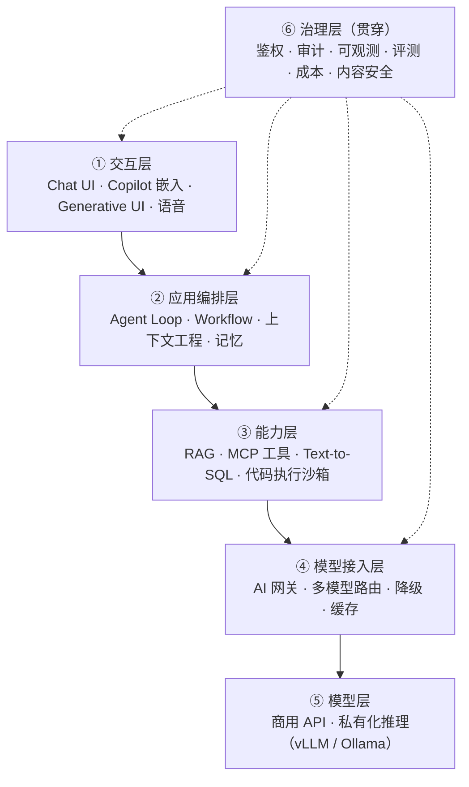
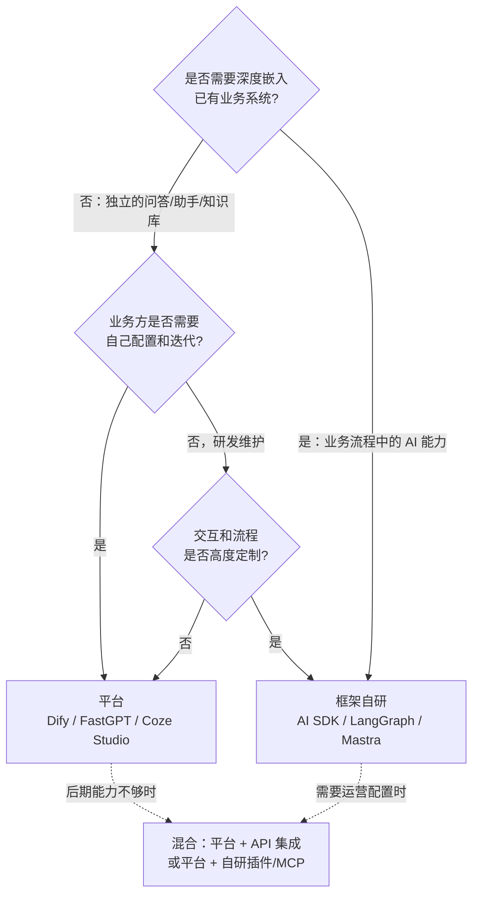
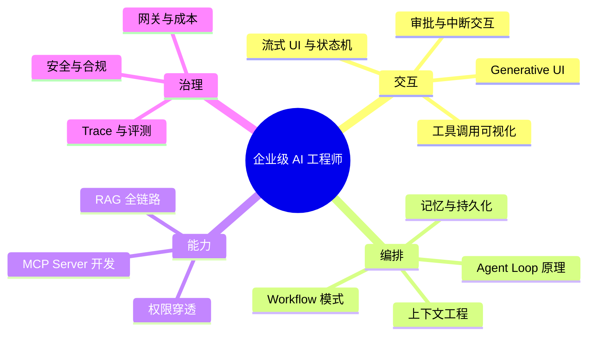

# 01 全景地图与技术选型

> 本章目标：建立企业级 AI 应用的**分层心智模型**，知道每一层有哪些值得学的开源项目、各自处于什么地位，并能在"用平台 / 用框架 / 自研"之间做出有依据的决策。

---

## 一、企业级 AI 应用的六层架构

| 层 | 核心问题 | 前端/全栈的切入难度 |
|---|---|---|
| ① 交互层 | 流式渲染、工具调用可视化、中断/重试、审批交互 | ⭐ 主场 |
| ② 编排层 | 什么时候用固定流程、什么时候让模型自主决策；上下文怎么组织 | ⭐⭐ Node/TS 可完全胜任 |
| ③ 能力层 | 知识检索准不准；工具怎么标准化接入；权限怎么穿透 | ⭐⭐ RAG 数据处理偏 Python |
| ④ 接入层 | 统一协议、Key 管理、限流计费、故障切换 | ⭐⭐ 典型网关开发 |
| ⑤ 模型层 | 选型、私有化部署、推理成本 | ⭐⭐⭐ 了解即可，交给算法/运维 |
| ⑥ 治理层 | 能不能上线、敢不敢给业务用 | ⭐⭐ 决定项目成败 |

> 🎯 **落地要点**：面试和方案评审里最能体现"企业级"的，不是你会调哪个 API，而是你能讲清 **⑥ 治理层** 在每一层分别怎么落。

---

## 二、开源项目分级清单（2026 视角）

按"学习投入产出比"分三级。**S 级精读源码或深度实践，A 级理解架构与设计，B 级知道定位即可。**

### 2.1 S 级：必须深入

| 项目 | 层 | 技术栈 | 为什么是 S 级 |
|---|---|---|---|
| **Vercel AI SDK** | ①② | TS | TS 生态 AI 应用的事实标准；流式协议、工具调用、Agent、审批全部覆盖。前端转 AI 的第一站 → [02 章](./02-AI-SDK与AI前端工程.md) |
| **MCP**（协议 + TS SDK） | ③ | TS / 多语言 | 工具集成的行业标准，所有主流模型厂商和 IDE 都支持。企业"把内部系统 AI 化"的主路径 → [03 章](./03-MCP协议与企业工具集成.md) |
| **Dify** | ②③⑥ | Python + Next.js | 国内企业私有化部署 LLM 平台的头部选择，多租户、插件、工作流引擎、RAG Pipeline 设计完整 → [06 章](./06-LLM平台源码导读.md) |
| **FastGPT** | ②③ | 全栈 TS（Next.js + MongoDB + PG） | 前端最容易读懂的完整 LLM 平台；知识库、工作流、计费、团队权限一应俱全 → [06 章](./06-LLM平台源码导读.md) |
| **Langfuse** | ⑥ | 全栈 TS | LLM 可观测与评测的开源标杆，Tracing 数据模型是所有 LLMOps 的基础 → [07 章](./07-LLMOps-可观测评测与AI网关.md) |

### 2.2 A 级：理解架构

| 项目 | 层 | 学什么 |
|---|---|---|
| **LangGraph** | ② | 状态图编排、Checkpointer 持久化、`interrupt` 人机协同（已有系列 [08-10 章](../LangChain-LangGraph入门到进阶/08-LangGraph核心概念.md)） |
| **Mastra** | ② | TS 原生 Agent 框架：Agent + Workflow + Memory + Eval 一体化，适合对比 AI SDK 的设计取舍 |
| **RAGFlow** | ③ | 深度文档解析（版面分析、表格识别、OCR），企业文档 RAG 最难的一环 |
| **Coze Studio** | ②③ | 字节开源的 Agent 平台（Go + React），学习大厂 DDD 分层和插件体系 |
| **LobeHub (LobeChat)** | ① | Next.js 大型 AI 前端工程：多模型适配、插件市场、客户端/服务端双数据库模式 |
| **Cline / OpenCode / Codex CLI** | ② | 编码 Agent：长上下文管理、工具循环、diff 应用、权限确认交互 |
| **LiteLLM / New API** | ④ | AI 网关：统一 OpenAI 协议、多 Key 负载、限流计费、故障转移 |
| **n8n** | ② | 节点式工作流引擎 + AI 节点，企业自动化场景常见 |

### 2.3 B 级：知道定位

| 项目 | 一句话定位 |
|---|---|
| Open WebUI / LibreChat | 私有化部署的 ChatGPT 替代，带 RBAC 和 SSO |
| CopilotKit / assistant-ui | 在已有 React 应用里嵌入 Copilot 的组件库（AG-UI 协议推动者） |
| LightRAG / GraphRAG | 知识图谱增强 RAG，适合"关系推理型"问题 |
| WrenAI / Vanna | Text-to-SQL / GenBI 问数 |
| browser-use / Stagehand | 浏览器自动化 Agent |
| OpenHands | 自主编码 Agent + 沙箱执行 |
| vLLM / Ollama | 私有化推理服务 / 本地模型运行 |
| Flowise / Langflow | 低代码 LLM 编排，适合原型 |

> ⚠️ **注意**：不要把精力平均分配。**S 级 5 个吃透 > A/B 级 20 个都看一眼**。

---

## 三、关键决策：用平台、用框架，还是自研？

这是企业 AI 项目立项时第一个被问到的问题。

| 维度 | 平台（Dify 等） | 框架自研（AI SDK 等） |
|---|---|---|
| 上线速度 | 天级 | 周级 |
| 定制深度 | 受限于节点和插件能力 | 无上限 |
| 与业务系统集成 | 通过 API / 插件，有隔阂 | 原生集成，共享鉴权和数据 |
| 业务自助迭代 | 强（可视化编排、Prompt 调试） | 弱，需要自建配置后台 |
| 运维成本 | 多组件（PG、Redis、向量库、沙箱、Worker） | 按需引入 |
| 适合场景 | 知识库问答、客服、内部工具、POC | Copilot、业务流程 AI 化、差异化产品 |

> 🎯 **落地要点**：最常见的成熟形态是**混合架构**——平台负责通用问答与业务方自助配置，核心业务链路用框架自研，两者通过 **MCP / OpenAPI** 共享工具层。理解这一点，选型讨论就不会陷入"二选一"。

---

## 四、2026 年的技术趋势判断

> 🔭 **先锋视角**：以下是判断"技术代际"的关键信号。学新东西时，先看它站在哪一边。

### 4.1 已成定局的范式

| 从 | 到 | 含义 |
|---|---|---|
| Prompt Engineering | **Context Engineering** | 关键不再是写一句好 prompt，而是**每一步给模型放进什么上下文**（工具结果、记忆、检索、压缩） |
| 链式调用（Chain） | **Agent Loop + 工具** | 模型自己决定调用哪个工具、何时停止；固定流程只用于确定性强的环节 |
| 各家私有插件协议 | **MCP** | 工具集成标准化，一次实现、所有客户端可用 |
| 朴素向量 RAG | **混合检索 + Agentic RAG** | 检索成为 Agent 的一个工具，可多轮、可改写、可组合 |
| 同步请求-响应 | **持久化执行（Durable Execution）** | Agent 长任务可暂停、可恢复、可等待人工审批数小时 |
| 人工看日志 | **Trace + Eval 驱动迭代** | 每次改 prompt / 换模型都有评测集回归 |

### 4.2 正在形成、值得提前布局

| 方向 | 代表 | 成熟度 | 建议 |
|---|---|---|---|
| **Agent Skills** | Anthropic Agent Skills、AI SDK `uploadSkill` | 快速普及中 | 把团队知识和 SOP 封装为 Skill，是低成本高收益的实践 |
| **Generative UI / MCP Apps** | AI SDK MCP Apps、AG-UI 协议 | 早期可用 | 前端工程师的差异化方向：工具返回可交互 UI 而不是纯文本 |
| **Agent Harness 复用** | AI SDK `HarnessAgent`（封装 Claude Code / Codex） | 早期 | 不再从零写 Agent Loop，而是复用成熟 Coding Agent 作为执行器 |
| **Agent 间协作协议** | A2A（Agent2Agent） | 标准化中 | 了解即可，多数企业场景单 Agent + 工具已够 |
| **计算机/浏览器操作** | Computer Use、browser-use | 可用但不稳定 | 只用于无 API 的遗留系统，必须沙箱 + 审批 |

### 4.3 正在被淘汰的写法

- 手写 `while` 循环解析模型输出里的 `Action: xxx` 文本（ReAct 文本解析）→ 用原生 tool calling
- LangChain 0.x 的 `LLMChain` / `initialize_agent` / `ConversationBufferMemory` → 见已有系列说明
- 自定义 HTTP+SSE 的 MCP 传输、MCP 会话状态 → MCP `2026-07-28` 已改为无状态 Streamable HTTP
- 把所有文档塞进超长上下文代替检索 → 成本、延迟和"中间遗忘"问题依然存在，长上下文是 RAG 的补充而非替代

---

## 五、能力模型：企业级 AI 工程师要会什么

自检清单（能讲清楚就算掌握）：

- [ ] 一次带工具调用的流式对话，前后端之间传了哪些事件？前端如何渲染"工具执行中"？
- [ ] Workflow 和 Agent 的区别是什么？给出一个你会坚持用 Workflow 的场景
- [ ] RAG 如何保证用户只能检索到自己有权限的文档？权限变更后多久生效？
- [ ] MCP Server 的鉴权怎么做？内部系统的用户身份如何传递到工具调用？
- [ ] 换一个更便宜的模型前，你如何证明效果没有下降？
- [ ] Agent 能执行删除操作时，你设计了哪几道防线？

后面每一章都会回答其中一到两个问题。

---

## 本章小结

- 企业级 AI 应用 = 六层架构，**治理层是 demo 与生产的分水岭**
- S 级必学：AI SDK、MCP、Dify、FastGPT、Langfuse
- 选型不是二选一：**平台做通用、框架做核心、MCP 做共享工具层**
- 判断技术代际：Context Engineering、原生 tool calling、MCP、持久化执行、Eval 驱动

## 练习

1. 以你所在公司的一个业务系统为例，按六层架构画出"给它加 AI 能力"的架构图，标出每层选用的技术
2. 用第三节的决策树，判断以下需求该用平台还是自研：① HR 制度问答 ② 工单系统里的"一键生成处理方案" ③ 销售日报自动汇总
