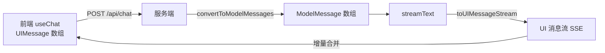
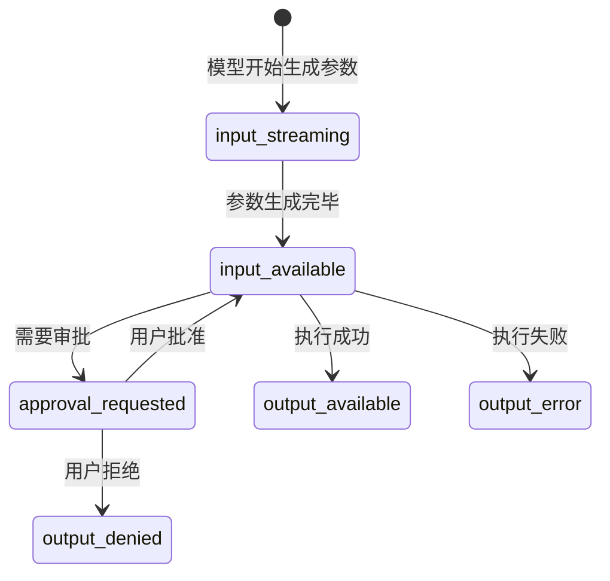
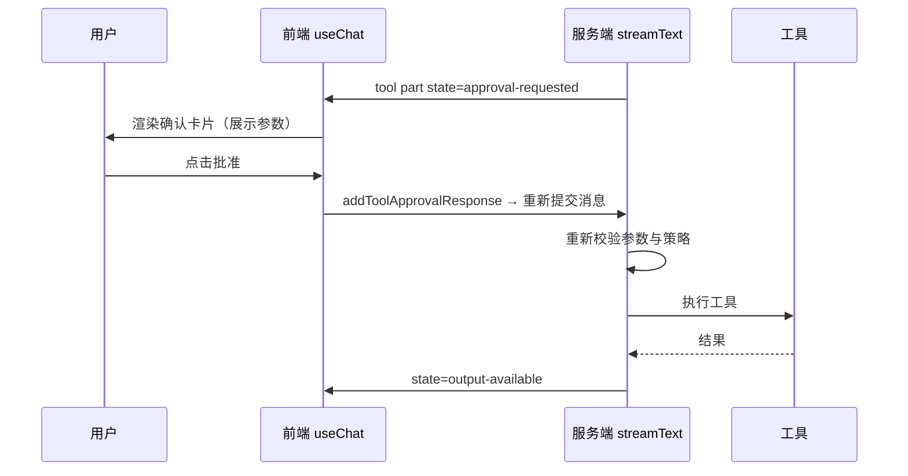
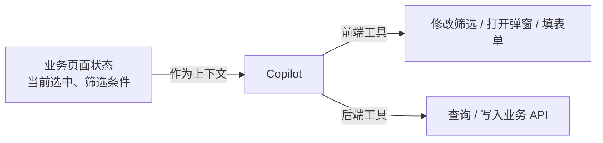

# 02 AI SDK 与 AI 前端工程

> 本章目标：吃透 Vercel AI SDK 7 的核心设计——**模型抽象、工具循环、UI 消息流、审批**，并掌握 AI 前端在生产环境的关键工程问题。这是前端工程师进入 AI 应用开发杠杆最高的一章。
>
> 版本基线：`ai@7.x`、`@ai-sdk/react@7.x`。v7 要求 **Node.js ≥ 22 + 纯 ESM**。
>
> ⚠️ 本章重在讲清设计与模式。v7 新增 API 的部分细节（`toolApproval` 策略取值、审批 part 字段名、`createUIMessageStream` writer、`onEnd` 回调参数）请以已安装版本的 TS 类型定义和 [官方文档](https://ai-sdk.dev/docs) 为准。从 v6 升级可运行 `npx @ai-sdk/codemod v7`。

---

## 一、为什么是 AI SDK

| 对比项 | AI SDK | LangChain.js | 直接调厂商 SDK |
|---|---|---|---|
| 定位 | TS 原生的 AI 应用工具包（含 UI） | 通用 LLM 编排框架 | 单一厂商 |
| 多模型切换 | 改一行 `model` | 改一行 | 重写 |
| 前端流式 UI | **内置 `useChat` + UI 消息协议** | 需自己对接或用 `useStream` | 自己写 |
| 工具循环 / Agent | `ToolLoopAgent` / `WorkflowAgent` | `createAgent` / LangGraph | 自己写 |
| 复杂状态图编排 | 弱（用 Workflow 或接 LangGraph） | **强（LangGraph）** | — |

> 🎯 **落地要点**：**交互层和中等复杂度的 Agent 用 AI SDK，复杂多分支状态机用 LangGraph**，两者可以共存（AI SDK 前端 + LangGraph 后端）。已有系列 [13 章第十节](../LangChain-LangGraph入门到进阶/13-JS-TS版本速查.md) 有更细的对比。

包结构一览：

```text
ai                    核心：generateText / streamText / tool / ToolLoopAgent / UI 消息流
@ai-sdk/react         useChat / useObject 等 React hooks（另有 vue / svelte / angular）
@ai-sdk/openai 等      各厂商 provider
@ai-sdk/openai-compatible  任意 OpenAI 兼容服务（国内模型、自建网关）
@ai-sdk/otel          OpenTelemetry 遥测（v7 起从 ai 包拆出）
@ai-sdk/workflow      WorkflowAgent：持久化执行的长任务 Agent
@ai-sdk/mcp           MCP 客户端（把 MCP Server 的工具接给模型）
```

---

## 二、模型接入与 Provider 抽象

AI SDK 的核心抽象是 `LanguageModel`：上层代码只依赖它，厂商差异由 provider 吸收。

```ts
// lib/model.ts
import { createOpenAICompatible } from '@ai-sdk/openai-compatible';

// 企业内通常经由自建 AI 网关（见 07 章）统一出口，而不是业务直连厂商
const gateway = createOpenAICompatible({
  name: 'corp-gateway',
  baseURL: process.env.AI_GATEWAY_BASE_URL!, // 如 https://ai-gw.corp.com/v1
  apiKey: process.env.AI_GATEWAY_KEY!,
});

export const model = gateway('deepseek-chat');
export const cheapModel = gateway('qwen-turbo');
```

几种接入方式的取舍：

| 方式 | 写法 | 适用 |
|---|---|---|
| 官方 provider | `import { anthropic } from '@ai-sdk/anthropic'` | 需要厂商特有能力（prompt caching、推理参数） |
| OpenAI 兼容 | `createOpenAICompatible(...)` | 国内模型、自建网关、vLLM 私有化 |
| 字符串模型 ID | `model: 'openai/gpt-5.5'` | 走 Vercel AI Gateway（海外部署场景） |

### 2.1 中间件：在模型层做横切逻辑

`wrapLanguageModel` 可以在不改业务代码的情况下加缓存、脱敏、日志、guardrail：

```ts
import { wrapLanguageModel, type LanguageModelMiddleware } from 'ai';

const redactPII: LanguageModelMiddleware = {
  transformParams: async ({ params }) => {
    // 发给外部模型前脱敏手机号；生产中应覆盖证件号、邮箱等并做单测
    const prompt = JSON.parse(
      JSON.stringify(params.prompt).replace(/1[3-9]\d{9}/g, '[PHONE]'),
    );
    return { ...params, prompt };
  },
};

export const safeModel = wrapLanguageModel({ model, middleware: redactPII });
```

> 🎯 **落地要点**：模型选择、降级、脱敏这类逻辑**收敛到 `lib/model.ts` 一处**，业务代码只 import `model`。换模型、加审计时就不用全局搜索。

---

## 三、核心 API：生成、结构化输出、工具

### 3.1 generateText / streamText

```ts
import { generateText, streamText } from 'ai';

// 非流式：后台任务、批处理
const { text, usage } = await generateText({
  model,
  instructions: '你是资深前端架构师，回答简洁。', // v7：system 已更名为 instructions
  prompt: '解释 React Server Components 的边界',
});

// 流式：面向用户的交互
const result = streamText({ model, prompt: '...' });
for await (const delta of result.textStream) process.stdout.write(delta);
```

v7 重要变化速记：

| v6 | v7 |
|---|---|
| `system` | `instructions` |
| `onFinish` | `onEnd`（另有 `onStart` / `onStepEnd`） |
| `fullStream` | `stream` |
| `experimental_telemetry` | `telemetry`（需 `@ai-sdk/otel`） |
| `experimental_prepareStep` / `experimental_output` | `prepareStep` / `output` |
| `result.toUIMessageStreamResponse()` | `createUIMessageStreamResponse({ stream: toUIMessageStream(...) })` |
| 工具上的 `needsApproval` | 调用级的 `toolApproval` |
| 顶层 `usage` 是最后一步 | 顶层 `usage` 汇总全部步骤，最后一步用 `finalStep` |

### 3.2 结构化输出

企业场景大量需求本质是**信息抽取 / 分类**，要的是稳定 JSON 而不是自然语言：

```ts
import { generateText, Output } from 'ai';
import * as z from 'zod/v4';

const TicketSchema = z.object({
  category: z.enum(['bug', 'feature', 'question']),
  priority: z.enum(['P0', 'P1', 'P2', 'P3']),
  summary: z.string().max(50),
  affectedModules: z.array(z.string()),
});

const { output } = await generateText({
  model,
  output: Output.object({ schema: TicketSchema }),
  prompt: `对以下工单分类：\n${ticketText}`,
});
// output 已通过 zod 校验，类型为 z.infer<typeof TicketSchema>
```

> ⚠️ **注意**：schema 里的 `.describe()` 会进入模型上下文，**它就是 prompt 的一部分**。字段语义不清时，先补 describe，再考虑改 prompt。

### 3.3 工具调用与多步循环

```ts
import { streamText, tool, isStepCount } from 'ai';
import * as z from 'zod/v4';

const result = streamText({
  model,
  instructions: '你是订单助手。涉及订单数据必须调用工具，不要编造。',
  messages,
  stopWhen: isStepCount(5), // 默认 1 步；多步才会"调用工具 → 读结果 → 继续回答"
  tools: {
    queryOrders: tool({
      description: '按条件查询当前用户的订单。时间用 ISO 日期。',
      inputSchema: z.object({
        status: z.enum(['paid', 'refunded', 'shipped']).optional(),
        from: z.string().describe('起始日期，如 2026-11-01'),
        to: z.string(),
      }),
      // 用户身份等敏感上下文通过 contextSchema 声明，不让模型生成
      contextSchema: z.object({ userId: z.string(), token: z.string() }),
      execute: async (input, { context }) =>
        orderApi.search({ ...input, ownerId: context.userId }, context.token),
    }),
  },
  toolsContext: {
    queryOrders: { userId: session.userId, token: session.token },
  },
});
```

这里有三个企业级关键点：

1. **`description` 是写给模型的接口文档**：说明何时用、参数格式、边界，质量直接决定调用准确率
2. **身份不能由模型提供**：`userId` 必须来自服务端 session，经 `toolsContext` 注入；模型生成的参数一律视为不可信输入
3. **`stopWhen` 必须有上限**：防止模型陷入工具调用死循环烧钱

### 3.4 prepareStep：每一步动态调整

`prepareStep` 在每一步调用模型前执行，是做**上下文工程**的入口（04 章展开）：

```ts
streamText({
  model,
  messages,
  tools: allTools,
  prepareStep: ({ stepNumber, steps }) => {
    // 第一步只允许检索，强制先查资料再回答
    if (stepNumber === 0) return { activeTools: ['searchDocs'], toolChoice: 'required' };
    // 步数多了换便宜模型做总结
    if (stepNumber >= 3) return { model: cheapModel, activeTools: [] };
  },
});
```

---

## 四、UI 消息流协议（重点）

这是 AI SDK 最值得前端深入理解的部分：**它定义了 AI 对话在前后端之间如何传输和渲染**。

### 4.1 两种消息：UIMessage vs ModelMessage



| | UIMessage | ModelMessage |
|---|---|---|
| 用途 | 前端渲染与持久化 | 发给模型 |
| 结构 | `{ id, role, parts[], metadata }` | `{ role, content }` |
| 内容 | 文本、推理过程、工具调用状态、自定义数据、来源引用 | 模型能理解的内容 |
| 持久化 | **存这个** | 每次从 UIMessage 转换 |

> 🎯 **落地要点**：数据库里**存 UIMessage**。它是"应用真相"，包含工具调用状态和 UI 元数据；ModelMessage 只是发给模型时的投影。

### 4.2 parts：一条消息由多个片段组成

```ts
type UIMessagePart =
  | { type: 'text'; text: string }
  | { type: 'reasoning'; text: string }                      // 推理过程
  | { type: `tool-${string}`; toolCallId: string; state: ToolState; input?: unknown; output?: unknown; errorText?: string }
  | { type: `data-${string}`; id?: string; data: unknown }   // 自定义数据，如进度、卡片
  | { type: 'source-url'; url: string; title?: string }      // 引用来源
  | { type: 'file'; mediaType: string; url: string }
  | { type: 'step-start' };                                  // 多步之间的分隔
```

工具 part 的状态机，是渲染"工具执行中"体验的核心：



> 写代码时状态值为连字符形式：`input-streaming`、`approval-requested`、`output-available` 等。

### 4.3 服务端：返回 UI 消息流

```ts
// app/api/chat/route.ts
import {
  streamText, convertToModelMessages, toUIMessageStream,
  createUIMessageStreamResponse, isStepCount, type UIMessage,
} from 'ai';
import { model } from '@/lib/model';
import { tools } from '@/lib/tools';

export const maxDuration = 60; // Serverless 平台需显式放宽超时

export async function POST(req: Request) {
  const session = await auth(req); // 鉴权放在最前面
  const { messages, id }: { messages: UIMessage[]; id: string } = await req.json();

  const result = streamText({
    model,
    instructions: SYSTEM_PROMPT,
    messages: await convertToModelMessages(messages),
    tools,
    stopWhen: isStepCount(5),
    abortSignal: req.signal, // 前端点"停止"时中断模型调用，避免继续计费
  });

  return createUIMessageStreamResponse({
    stream: toUIMessageStream({
      stream: result.stream,
      originalMessages: messages,
      onEnd: async ({ messages: finalMessages }) => {
        await saveChat({ id, userId: session.userId, messages: finalMessages });
      },
    }),
  });
}
```

### 4.4 自定义数据 part：进度、卡片、引用

工具执行耗时较长时，用 `data-*` part 推送进度，比让用户干等体验好得多：

```ts
import { createUIMessageStream, createUIMessageStreamResponse, toUIMessageStream } from 'ai';

const stream = createUIMessageStream({
  execute: async ({ writer }) => {
    // 同一 id 的 data part 会被前端原地更新，适合做进度条
    writer.write({ type: 'data-progress', id: 'search', data: { step: '检索知识库', percent: 30 } });
    const docs = await retrieve(query);
    writer.write({ type: 'data-progress', id: 'search', data: { step: '生成回答', percent: 70 } });

    for (const d of docs) writer.write({ type: 'source-url', sourceId: d.id, url: d.url, title: d.title });

    const result = streamText({ model, messages: buildMessages(query, docs) });
    writer.merge(toUIMessageStream({ stream: result.stream }));
  },
});

return createUIMessageStreamResponse({ stream });
```

> ⚠️ **注意**：`createUIMessageStream` 的 writer API 在 v5→v7 之间有过调整，以你安装版本的类型定义为准。

---

## 五、前端：useChat 的生产级用法

```tsx
'use client';
import { useChat } from '@ai-sdk/react';
import { useState } from 'react';

export function Chat({ chatId, initialMessages }: Props) {
  const [input, setInput] = useState('');
  const { messages, sendMessage, status, stop, regenerate, error, addToolApprovalResponse } =
    useChat({ id: chatId, messages: initialMessages });

  return (
    <>
      {messages.map((m) => (
        <div key={m.id} data-role={m.role}>
          {m.parts.map((part, i) => {
            const key = `${m.id}-${i}`;
            switch (part.type) {
              case 'text':
                return <Markdown key={key}>{part.text}</Markdown>;
              case 'reasoning':
                return <Collapsible key={key} title="思考过程">{part.text}</Collapsible>;
              case 'data-progress':
                return <Progress key={key} {...part.data} />;
              case 'source-url':
                return <SourceChip key={key} url={part.url} title={part.title} />;
              case 'tool-queryOrders':
                return <OrderToolView key={key} part={part} onApprove={addToolApprovalResponse} />;
              default:
                return null;
            }
          })}
        </div>
      ))}

      {error && <ErrorBar onRetry={() => regenerate()} />}

      <form onSubmit={(e) => { e.preventDefault(); sendMessage({ text: input }); setInput(''); }}>
        <input value={input} onChange={(e) => setInput(e.target.value)} disabled={status !== 'ready'} />
        {status === 'streaming' || status === 'submitted'
          ? <button type="button" onClick={stop}>停止</button>
          : <button type="submit">发送</button>}
      </form>
    </>
  );
}
```

`status` 的四个值决定了交互状态：

| status | 含义 | UI 建议 |
|---|---|---|
| `submitted` | 已发送，等待首个 token | 显示"思考中"骨架屏（首 token 延迟可能 1~5 秒） |
| `streaming` | 正在接收 | 显示停止按钮，自动滚动 |
| `ready` | 完成，可继续输入 | 恢复输入框 |
| `error` | 出错 | 展示重试按钮 |

### 5.1 工具调用的渲染

```tsx
function OrderToolView({ part, onApprove }) {
  switch (part.state) {
    case 'input-streaming':
      return <Skeleton text="正在准备查询条件…" />;
    case 'input-available':
      return <Spinner text={`查询 ${part.input.from} ~ ${part.input.to} 的订单…`} />;
    case 'approval-requested':
      return (
        <ConfirmCard
          title="确认执行查询？"
          detail={part.input}
          onConfirm={() => onApprove({ id: part.approval.id, approved: true })}
          onReject={() => onApprove({ id: part.approval.id, approved: false, reason: '用户拒绝' })}
        />
      );
    case 'output-available':
      return <OrderTable rows={part.output} />; // 结构化结果直接渲染为组件
    case 'output-error':
      return <Alert type="error">{part.errorText}</Alert>;
  }
}
```

> 🎯 **落地要点**：**工具结果直接渲染成业务组件**（表格、卡片、图表），而不是让模型把 JSON 复述成文字。这样更快、更省 token，也不会被模型篡改数字。这就是最朴素也最实用的 Generative UI。

---

## 六、工具审批：Human-in-the-Loop（重点）

企业场景中，**任何有副作用的工具（写库、发消息、删除、支付）都必须可审批**。AI SDK 7 把审批策略从工具定义上移到了调用级：

```ts
const result = streamText({
  model,
  messages: await convertToModelMessages(messages),
  tools: { queryOrders, refundOrder, sendEmail },
  toolApproval: {
    queryOrders: 'auto-approve',                 // 只读：自动放行
    sendEmail: 'user-approval',                  // 外发：必须用户确认
    // 按参数动态决策：小额自动、大额人工
    refundOrder: async ({ input }) => (input.amount <= 100 ? 'auto-approve' : 'user-approval'),
  },
});
```

审批的完整往返流程：



> ⚠️ **注意**：审批与执行之间存在时间差，攻击者可能篡改请求里的工具参数。v7 支持在恢复前**重新校验输入与策略**，并可启用 **HMAC 签名**防篡改——企业场景应开启。另外，审批策略和权限校验**必须在服务端**，前端的确认卡片只是交互，不是安全边界。

为什么审批策略放在调用级而不是工具定义上：同一个 `refundOrder` 工具，客服后台可能自动执行，面向 C 端用户则必须审批。**策略属于场景，不属于工具**。

---

## 七、Agent 抽象：ToolLoopAgent 与 WorkflowAgent

当同一套"模型 + 指令 + 工具 + 策略"需要在多处复用（API 路由、定时任务、测试），把它封装成 Agent：

```ts
// agents/order-agent.ts
import { ToolLoopAgent, isStepCount } from 'ai';

export const orderAgent = new ToolLoopAgent({
  model,
  instructions: ORDER_AGENT_PROMPT,
  tools: { queryOrders, refundOrder },
  toolApproval: { refundOrder: 'user-approval' },
  stopWhen: isStepCount(8),
  runtimeContext: { channel: 'web' },
  prepareStep: ({ runtimeContext }) => ({
    instructions: `${ORDER_AGENT_PROMPT}\n当前渠道：${runtimeContext.channel}`,
  }),
});

// 在路由中
const result = await orderAgent.stream({ messages: await convertToModelMessages(messages) });
// 在离线评测中
const { text } = await orderAgent.generate({ prompt: testCase.input });
```

| | ToolLoopAgent | WorkflowAgent（`@ai-sdk/workflow`） |
|---|---|---|
| 执行模型 | 进程内循环 | 每步状态持久化 |
| 进程重启 / 部署 | 中断 | **自动恢复** |
| 等待审批 | 依赖前端重新提交 | 可挂起数小时到数天 |
| 适用 | 对话式交互、秒级到分钟级 | 长任务：报告生成、批处理、审批流 |

> 🔭 **先锋视角**：v7 的 `HarnessAgent` 可以把 Claude Code、Codex 等成熟 Coding Agent 包装成同一个 `Agent` 接口，配合沙箱执行。这意味着"代码修复 / 仓库分析"类需求不必自己写 Agent Loop，复用成熟 Harness 即可。

---

## 八、Generative UI 与 MCP Apps

Generative UI 有三个层次：

| 层次 | 做法 | 成本 | 推荐度 |
|---|---|---|---|
| L1 工具结果映射组件 | 前端按 `tool-xxx` 类型渲染预制组件（第五节） | 低 | ⭐⭐⭐ 企业首选 |
| L2 模型选择组件 + 填充数据 | 定义一组"展示类工具"（如 `showChart`），模型决定调用哪个 | 中 | ⭐⭐ |
| L3 MCP Apps | MCP Server 自带 UI 资源，在沙箱 iframe 中渲染，可双向交互 | 高 | ⭐ 平台型产品 |

MCP Apps 让**工具提供方同时提供 UI**。例如 BI 系统的 MCP Server 直接返回一个可交互仪表盘，由宿主在沙箱 iframe 中渲染：

```tsx
import { experimental_MCPAppRenderer as MCPAppRenderer } from '@ai-sdk/react';
import { isToolUIPart } from 'ai';

{message.parts.map((part) =>
  isToolUIPart(part) ? (
    <MCPAppRenderer
      key={part.toolCallId}
      part={part}
      sandbox={{ url: '/mcp-app-sandbox' }}  // 独立源的沙箱页面，隔离第三方 UI
      loadResource={(app) => fetch(`/api/mcp-apps?uri=${app.resourceUri}`)}
      handlers={{ allowedTools: ['refreshDashboard'] }} // 白名单：iframe 只能回调这些工具
    />
  ) : null,
)}
```

> 🎯 **落地要点**：L1 能解决 80% 的企业需求。L3 适合"AI 工作台 / 平台型产品"，需要额外处理 iframe 隔离（独立域名、CSP）、工具白名单与 UI 资源审核。

---

## 九、在已有业务系统中嵌入 Copilot

很多企业需求不是"做一个聊天应用"，而是"**给已有后台加一个 AI 助手**"。关键在于让 AI 感知当前页面状态并操作页面：



- **前端工具**（client-side tools）：不定义 `execute`，工具调用到达前端后由页面执行（如"把筛选条件设为上周退款"），执行结果通过 `addToolOutput` 回传
- **后端工具**：在服务端执行，走正常鉴权
- **组件库选择**：
  - **assistant-ui**：偏底层的 headless 组件，与 AI SDK 深度集成，适合自定义设计系统
  - **CopilotKit**：提供"页面状态共享 + 前端动作"的高层抽象，推动 AG-UI 协议

> 🎯 **落地要点**：Copilot 的上下文要**按需提供**，而不是把整个页面 state 塞进 prompt。只传当前视图的关键字段（ID、筛选条件、选中项摘要），详细数据让模型通过工具查。

---

## 十、生产环境的工程问题

### 10.1 流式传输被缓冲

最常见的线上问题：本地流式正常，部署后变成"一次性吐出"。

| 环节 | 现象 | 处理 |
|---|---|---|
| Nginx 反代 | 默认缓冲响应 | `proxy_buffering off;` 或响应头 `X-Accel-Buffering: no` |
| 网关 / CDN | 压缩或缓冲 SSE | 对 `/api/chat` 关闭压缩与缓存 |
| 公司代理 / WAF | 长连接被切断 | 调大空闲超时，必要时发心跳 |
| Serverless | 函数超时 | 设置 `maxDuration`；长任务改用 WorkflowAgent |

### 10.2 超时控制

v7 提供分层超时（总时长、单步、单 chunk、单工具），超时抛出 `TimeoutError`。企业场景建议都设置，尤其是**单工具超时**——下游业务接口卡住时不能拖垮整个对话。

### 10.3 中断与恢复

- **用户主动停止**：`stop()` → 服务端 `abortSignal` 中断模型请求，**避免后台继续计费**
- **网络断开后恢复**：需要服务端把流写入 Redis 等存储，前端重连后续传（AI SDK 提供 resumable stream 方案）；成本较高，按需引入

### 10.4 Markdown 渲染

- **增量渲染**：流式输出中，代码块和表格常处于"未闭合"状态，要选支持不完整 Markdown 的渲染器（如 Vercel 的 Streamdown），否则会闪烁和错位
- **XSS**：模型输出不可信，禁止 `dangerouslySetInnerHTML` 渲染原始 HTML，链接要校验协议（禁止 `javascript:`）
- **性能**：长对话列表要虚拟化，已完成的消息 memo 化，只重渲染流式中的最后一条

### 10.5 消息持久化与上下文长度

- 存 UIMessage 全量，**发给模型时裁剪**：保留系统提示 + 最近 N 轮 + 早期对话摘要（04 章"上下文工程"）
- 图片、文件 part 存对象存储，消息里只存 URL
- 前端每次 POST 全量 messages 会越来越大：长对话可改为只发最新一条，由服务端从库中加载历史

---

## 本章小结

- AI SDK 的三个核心抽象：**LanguageModel**（模型无关）、**Tool + Loop**（Agent）、**UIMessage Stream**（前后端协议）
- 数据库存 **UIMessage**；身份经 **toolsContext** 注入，不由模型生成；审批策略放在**调用级**、在**服务端**校验
- 工具结果**直接渲染为业务组件**，这是性价比最高的 Generative UI
- 上线三件事：**关缓冲、设超时、停止即中断**

## 练习

1. 用 Next.js + AI SDK 7 实现一个带 `queryOrders`（自动执行）和 `refundOrder`（金额 > 100 需审批）的订单助手，完整渲染工具的五种状态
2. 给第 1 题加 `data-progress` 进度推送，并把对话持久化到 SQLite / PG，刷新页面后可恢复
3. 用 `wrapLanguageModel` 写一个中间件，记录每次调用的模型名、token 用量和耗时到日志
