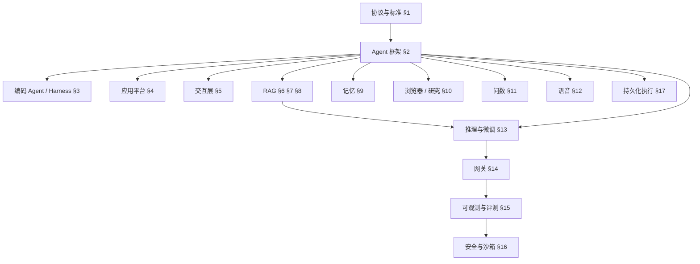

# 02 开源项目与生态图谱

> 本章定位：**查阅型工具书**。按 17 个领域整理企业级 AI 应用开发值得关注的开源项目与标准，每项给出语言、定位、**学什么**和推荐等级，便于按需深入。
>
> 等级：**S** 深入实践 / 精读源码 ｜ **A** 理解架构与设计 ｜ **B** 知道定位
>
> ⚠️ 项目状态变化很快（版本、许可证、维护情况、收购），引入生产前请核对仓库的最新状态与 LICENSE。

---

## 怎么用这张图谱

- **建立全局视野**：通读每节的"一句话"列和 S / A 级项目
- **解决具体问题**：直接跳到对应领域，按"学什么"列挑 1~2 个深入
- **评估选型**：结合 [01 章](./01-全景地图与技术选型.md#五关键决策用平台用框架还是自研) 的决策方法，注意**许可证**（部分平台对多租户 SaaS 商用有限制）

---

## §1 开放协议与标准

**这一节是整个生态的"接口层"**，优先级高于任何具体框架。

| 标准 | 发起 / 治理 | 一句话 | 学什么 | 等级 |
|---|---|---|---|---|
| **MCP** | Anthropic / Linux 基金会 AAIF | Agent ↔ 工具、数据的标准协议 | 原语、无状态传输、OAuth、工具设计（[05 章](./05-MCP与Agent互操作协议.md)） | S |
| **A2A** | Google / Linux 基金会 AAIF | Agent ↔ Agent 的发现与任务委托协议，v1.0 | Agent Card、Task 生命周期、跨组织协作（[05 章](./05-MCP与Agent互操作协议.md)） | A |
| **AG-UI** | CopilotKit / 社区 | Agent ↔ 前端的事件流协议 | 事件类型、状态同步、前端工具（[04 章](./04-AI交互层-流式协议与生成式UI.md)） | A |
| **A2UI** | Google | 生成式 UI 的声明式组件规范，常经 AG-UI 传输 | Agent 如何安全地"下发界面" | B |
| **MCP Apps** | MCP 扩展 | MCP 工具自带可交互 UI，沙箱 iframe 渲染 | 工具提供方如何同时提供 UI | B |
| **OpenAI 兼容 API** | 事实标准 | Chat Completions / Responses 接口格式 | 几乎所有模型服务、网关、推理引擎都兼容它 | A |
| **OTel GenAI 语义约定** | OpenTelemetry | LLM 调用的 Trace / Metrics 统一字段 | 可观测数据跨平台互通（[09 章](./09-LLMOps-可观测评测与AI网关.md)） | A |
| **AGENTS.md** | OpenAI / AAIF | 写给编码 Agent 的仓库说明文件 | 团队如何为 AI 编码沉淀项目约定 | B |
| **Agent Skills** | Anthropic 发起，多框架跟进 | 指令 + 脚本 + 资源的可按需加载能力包 | 渐进式加载、Skill 与 MCP 的分工 | A |

---

## §2 Agent 框架（按语言生态）

### Python

| 项目 | 一句话 | 学什么 | 等级 |
|---|---|---|---|
| **LangGraph** | 有状态 Agent 编排的事实标准 | State / Node / Edge、Checkpointer、`interrupt`、子图（已有系列 [08~10 章](../LangChain-LangGraph入门到进阶/08-LangGraph核心概念.md)） | S |
| **OpenAI Agents SDK** | 轻量 Agent 框架：Agent、Handoff、Guardrail、Session | Handoff 多 Agent、输入输出护栏的抽象 | A |
| **Claude Agent SDK** | 把 Claude Code 的 Harness 作为库使用 | 文件 / 命令工具、子 Agent、Skills、权限与 Hooks | A |
| **Google ADK** | Google 的 Agent 开发套件，五种语言，原生 MCP + A2A | 多 Agent 层级、内置评测、Dev UI | A |
| **Microsoft Agent Framework** | Semantic Kernel + AutoGen 的继任者，1.0 GA（.NET / Python） | 图式 Workflow、中间件、企业级遥测 | A |
| **Pydantic AI** | 类型安全的 Agent 框架，Pydantic 团队出品 | 结构化输出、依赖注入、类型驱动的工具定义 | A |
| **LlamaIndex** | 以数据 / RAG 见长，提供事件驱动的 Workflows | 数据连接器、索引抽象、Agentic RAG | A |
| **CrewAI** | 基于"角色 + 任务"的多 Agent 编排 | 角色化协作的抽象（适合原型） | B |
| **Agno** | 高性能多 Agent 框架，内置记忆与知识库 | 轻量运行时设计 | B |
| **smolagents** | Hugging Face 的极简 Agent，主打"代码即行动" | CodeAct：模型输出代码而非 JSON 工具调用 | B |
| **AgentScope** | 阿里开源的多 Agent 框架 | 消息驱动的多 Agent 通信 | B |
| **AWS Strands Agents** | AWS 的模型驱动 Agent SDK | 与 Bedrock AgentCore 托管运行时的结合 | B |
| **Deep Agents** | LangChain 的"深度 Agent"Harness | 规划工具、文件系统、子 Agent 的组合方式 | B |

### TypeScript

| 项目 | 一句话 | 学什么 | 等级 |
|---|---|---|---|
| **Vercel AI SDK** | TS 生态 AI 应用的事实标准，含 UI 层 | Provider 抽象、UI 消息流、工具审批、`ToolLoopAgent`（[04 章](./04-AI交互层-流式协议与生成式UI.md)） | A |
| **Mastra** | TS 原生 Agent + Workflow + Memory + Eval 一体化 | 一体化框架的模块划分 | A |
| **LangGraph.js** | LangGraph 的 TS 版 | 与 Python 版概念一致（已有系列 [13 章](../LangChain-LangGraph入门到进阶/13-JS-TS版本速查.md)） | B |
| OpenAI Agents SDK / Claude Agent SDK / Google ADK（TS 版） | 与 Python 版对应 | — | B |

### Java

| 项目 | 一句话 | 学什么 | 等级 |
|---|---|---|---|
| **Spring AI** | Spring 官方 AI 框架，2.0 GA（需 Spring Boot 4.1） | ChatClient、Advisors、`@McpTool` 注解式 MCP Server | A |
| **Spring AI Alibaba** | 阿里基于 Spring AI 的 Agent 框架 + Graph 运行时 | 国内 Java 企业的主推方案：Graph、HITL、A2A + Nacos 服务发现 | A |
| **LangChain4j** | 不绑定框架的 Java LLM 库，含 Agentic 模块 | AI Services 声明式接口、Agent 工作流组合 | A |

### Go / .NET

| 项目 | 一句话 | 学什么 | 等级 |
|---|---|---|---|
| **Eino**（Go） | 字节开源的 LLM 编排框架，Coze Studio 的底座 | 组件化编排、Graph 编译执行 | A |
| **Google ADK Go** | ADK 的 Go 实现 | 与 Python 版功能对齐 | B |
| **Microsoft Agent Framework**（.NET） | .NET 生态的首选 | 同上 | A（.NET 团队） |

---

## §3 编码 Agent 与 Agent Harness

> 🔭 编码 Agent 是**当前最成熟、最复杂的 Agent 系统**。即使不做编码场景，它们的上下文管理、权限、子 Agent 设计也值得精读。

| 项目 | 语言 | 一句话 | 学什么 | 等级 |
|---|---|---|---|---|
| **Claude Code** | 闭源（SDK 开放） | 终端编码 Agent 的标杆 | 权限模式、Hooks、Skills、子 Agent、上下文压缩 | S |
| **Codex CLI** | Rust | OpenAI 开源的终端编码 Agent | 沙箱执行策略、审批模式 | A |
| **Gemini CLI** | TS | Google 开源的终端 Agent | 超长上下文下的工具设计 | B |
| **OpenCode** | TS | 开源、多模型的终端编码 Agent | 多 Provider 适配、客户端 / 服务端分离架构 | A |
| **Cline / Roo Code** | TS | VS Code 中的自主编码 Agent | Plan / Act 模式、逐步审批交互、diff 应用 | A |
| **Continue** | TS | IDE 编码助手，开源可自托管 | 补全 + 对话 + Agent 的 IDE 集成 | B |
| **Aider** | Python | 终端结对编程，深度集成 git | repo map（代码库地图）压缩上下文的方法 | B |
| **OpenHands** | Python | 自主软件工程 Agent + 沙箱运行时 | 沙箱化执行、事件流架构 | A |
| **goose** | Rust | Block 开源、AAIF 托管的本地 Agent | MCP 原生的扩展机制 | B |

---

## §4 LLM 应用平台（低代码 / 可视化编排）

| 项目 | 语言 | 一句话 | 学什么 | 等级 |
|---|---|---|---|---|
| **Dify** | Python + Next.js | 企业私有化部署的头部 LLM 平台 | 多租户、工作流引擎、插件体系、沙箱与 SSRF 防护（[08 章](./08-LLM平台源码导读.md)） | S |
| **FastGPT** | 全栈 TS | 知识库 + 工作流平台 | 训练队列、位运算权限、React Flow 画布（[08 章](./08-LLM平台源码导读.md)） | A |
| **Coze Studio** | Go + React | 字节开源的 Agent 平台（配套 Coze Loop 做评测与观测） | DDD 分层、插件体系（[08 章](./08-LLM平台源码导读.md)） | A |
| **RAGFlow** | Python + React | 以深度文档理解为核心的 RAG 引擎 + Agent 画布 | deepdoc、按文档类型的切片模板（[08 章](./08-LLM平台源码导读.md)） | S |
| **n8n** | TS | 工作流自动化 + AI 节点 | 节点执行引擎、凭证管理；注意其 fair-code 许可证 | A |
| **MaxKB** | Python + Vue | 飞致云开源的知识库问答平台 | 轻量企业知识库的产品形态 | B |
| **Langflow / Flowise** | Python / TS | 低代码 LLM 编排 | 适合原型验证 | B |

---

## §5 对话前端与交互层

| 项目 | 语言 | 一句话 | 学什么 | 等级 |
|---|---|---|---|---|
| **Vercel AI SDK UI + ai-chatbot 模板** | TS | `useChat` + 完整的 Next.js 聊天应用模板 | 流式协议、工具状态渲染、消息持久化（[04 章](./04-AI交互层-流式协议与生成式UI.md)） | A |
| **CopilotKit** | TS | 在应用中嵌入 Copilot，AG-UI 发起者 | 页面状态共享、前端动作、生成式 UI | A |
| **assistant-ui** | TS | Headless 的 AI 对话 React 组件库 | 可组合的对话 UI 原语 | B |
| **LobeHub（LobeChat）** | TS | 大型开源 AI 对话应用 | 多模型运行时、Zustand 状态拆分、双数据库模式 | B |
| **Open WebUI** | Svelte + Python | 私有化 ChatGPT 替代，RBAC、SSO 完善 | 企业私有化对话门户的功能清单；注意许可证的品牌条款 | B |
| **LibreChat** | TS | 多模型私有化对话平台 | 多 Provider、Agent、权限 | B |

---

## §6 RAG 框架与引擎

| 项目 | 语言 | 一句话 | 学什么 | 等级 |
|---|---|---|---|---|
| **RAGFlow** | Python | 见 §4 | — | S |
| **LlamaIndex** | Python / TS | 数据连接与索引抽象最丰富的 RAG 框架 | 各类索引、查询引擎、路由 | A |
| **Haystack** | Python | deepset 的生产级 RAG / Agent 管线框架 | 组件化 Pipeline 设计 | B |
| **LightRAG** | Python | 轻量图增强 RAG | 实体关系抽取 + 双层检索 | B |
| **GraphRAG** | Python | 微软的知识图谱 RAG | 社区摘要，适合"全局总结"类问题 | B |
| **Kotaemon** | Python | 开源的文档问答 UI + RAG 管线 | 完整 RAG 应用的参考实现 | B |
| **AnythingLLM** | JS | 桌面 / Docker 一体化私有知识库 | 工作区隔离、开箱即用的产品形态 | B |

---

## §7 文档解析

| 项目 | 语言 | 一句话 | 等级 |
|---|---|---|---|
| **MinerU** | Python | PDF → Markdown，公式、表格效果好，中文友好 | A |
| **Docling** | Python | IBM 开源，多格式解析为结构化文档 | A |
| **Unstructured** | Python | 格式覆盖最广，按元素切分 | B |
| **PaddleOCR** | Python | 百度开源 OCR 与版面分析 | B |

详见 [07 章第三节](./07-企业级RAG落地.md#三文档解析重点)。

---

## §8 向量数据库与检索模型

| 项目 | 语言 | 一句话 | 等级 |
|---|---|---|---|
| **pgvector** | C（PG 扩展） | 在 PostgreSQL 中做向量检索，中小规模首选 | A |
| **Milvus** | Go / C++ | 分布式向量数据库，亿级规模 | A |
| **Qdrant** | Rust | 过滤检索性能优秀 | B |
| **Elasticsearch / OpenSearch** | Java | 全文检索最成熟，向量 + BM25 混合检索 | A |
| **Weaviate / Chroma / LanceDB** | Go / Rust | 各有特色；LanceDB 适合多模态与嵌入式场景 | B |
| **BGE-M3 / Qwen3-Embedding** | 模型 | 中文友好的开源 Embedding 模型 | A |
| **BGE-Reranker / Qwen3-Reranker** | 模型 | 开源重排模型 | A |

---

## §9 记忆

| 项目 | 语言 | 一句话 | 学什么 | 等级 |
|---|---|---|---|---|
| **Mem0** | Python / TS | 通用的长期记忆层 | 记忆提取、去重、更新的流程 | A |
| **Letta**（原 MemGPT） | Python | "有状态 Agent"服务，模型自主管理记忆 | 分层记忆（核心记忆 / 归档记忆）的思想 | A |
| **Graphiti**（Zep） | Python | 带时间维度的知识图谱记忆 | 事实随时间变化时如何更新 | B |
| **LangMem** | Python | LangGraph 生态的记忆工具 | 与 LangGraph Store 的集成 | B |

---

## §10 浏览器操作与深度研究

| 项目 | 语言 | 一句话 | 等级 |
|---|---|---|---|
| **browser-use** | Python | 让 Agent 操作浏览器 | B |
| **Stagehand** | TS | 代码 + 自然语言混合的浏览器自动化 | B |
| **Playwright MCP** | TS | 微软提供的浏览器操作 MCP Server | A |
| **open_deep_research** | Python | LangChain 的开源深度研究 Agent | B |
| **GPT Researcher** | Python | 自主调研并生成报告 | B |
| **DeerFlow** | Python | 字节开源的深度研究 / 通用 Agent Harness | B |

---

## §11 Text-to-SQL / 问数

| 项目 | 语言 | 一句话 | 等级 |
|---|---|---|---|
| **WrenAI** | Python / TS | 带语义层的 GenBI | A |
| **Vanna** | Python | 基于 RAG 的 Text-to-SQL 库 | B |
| **DB-GPT** | Python | 蚂蚁开源的数据领域 AI 框架 | B |

详见 [07 章第十一节](./07-企业级RAG落地.md#十一text-to-sql问数场景)。

---

## §12 语音与实时交互

| 项目 | 语言 | 一句话 | 等级 |
|---|---|---|---|
| **LiveKit Agents** | Python / TS | 基于 WebRTC 的实时语音 / 视频 Agent 框架 | A（语音场景） |
| **Pipecat** | Python | 语音 Agent 管线框架（ASR → LLM → TTS） | B |
| **TEN Framework** | 多语言 | 声网开源的实时多模态 Agent 框架 | B |
| **FunASR / SenseVoice、CosyVoice** | Python | 阿里开源的语音识别与语音合成 | B |

> 📖 **ASR / TTS**：自动语音识别（语音转文字）/ 语音合成（文字转语音）。语音 Agent 的核心指标是**端到端延迟**（用户说完到听到回复，通常要求 1 秒内）和**打断处理**。

---

## §13 模型推理与微调

| 项目 | 语言 | 一句话 | 学什么 | 等级 |
|---|---|---|---|---|
| **vLLM** | Python | 高吞吐推理引擎的事实标准 | PagedAttention、连续批处理、OpenAI 兼容服务（[03 章](./03-模型层-选型私有化推理与微调.md)） | S |
| **SGLang** | Python | 高性能推理引擎，共享前缀场景优势明显 | RadixAttention 前缀缓存、结构化输出 | A |
| **Ollama** | Go | 本地一键运行模型 | 开发调试、离线场景 | B |
| **llama.cpp** | C++ | CPU / 端侧推理，GGUF 量化格式 | 量化与边缘部署 | B |
| **LMDeploy / Xinference** | Python | 国内常用的推理部署与模型服务平台 | 多模型统一管理 | B |
| **LLaMA-Factory** | Python | 一站式微调框架，支持上百种模型 | LoRA / QLoRA、DPO 的工程流程 | A |
| **Unsloth / ms-swift / TRL** | Python | 高效微调 / 魔搭微调框架 / HF 官方训练库 | — | B |
| **verl / OpenRLHF** | Python | 大模型强化学习训练框架 | RL 微调的工程架构 | B |

---

## §14 AI 网关

| 项目 | 语言 | 一句话 | 等级 |
|---|---|---|---|
| **LiteLLM** | Python | 支持厂商最多的模型代理，路由、降级、计费 | A |
| **New API**（One API 系） | Go | 模型分发与计费运营平台 | A |
| **Higress** | Go | 阿里开源的云原生 AI 网关，兼做 MCP 网关 | A |
| **Portkey Gateway** | TS | 轻量高性能 AI 网关 | B |
| **Kong AI Gateway / Envoy AI Gateway / APISIX** | — | 传统 API 网关的 AI 扩展，适合已有网关体系的企业 | B |

详见 [09 章第五节](./09-LLMOps-可观测评测与AI网关.md#五ai-网关控得住重点)。

---

## §15 可观测与评测

| 项目 | 语言 | 一句话 | 等级 |
|---|---|---|---|
| **Langfuse** | TS | 开源 Tracing + 评测 + Prompt 管理 | S |
| **Arize Phoenix** | Python | 基于 OpenTelemetry 的开源可观测与评测 | A |
| **Opik** | Java / Python | Comet 开源的可观测与评测平台 | B |
| **OpenLLMetry** | Python / TS | 基于 OTel 的 LLM 自动埋点库 | B |
| **Ragas** | Python | RAG 评测指标库 | A |
| **DeepEval** | Python | 单元测试风格的 LLM 评测框架 | B |
| **promptfoo** | TS | 命令行评测 + 红队测试，适合放进 CI | A |
| LangSmith | 闭源 | LangChain 官方平台（参考已有系列 [12 章](../LangChain-LangGraph入门到进阶/12-调试评估与生产部署.md)） | B |

---

## §16 安全护栏与沙箱

| 项目 | 语言 | 一句话 | 等级 |
|---|---|---|---|
| **NeMo Guardrails** | Python | NVIDIA 的可编程护栏框架 | A |
| **Llama Guard / Qwen3Guard** | 模型 | 开源的输入 / 输出安全分类模型 | A |
| **LLM Guard / Guardrails AI** | Python | 输入输出扫描、结构校验 | B |
| **garak / PyRIT** | Python | LLM 漏洞扫描 / 红队测试工具 | B |
| **E2B / Daytona** | — | 面向 Agent 的云沙箱，秒级启动隔离环境 | A |
| **gVisor / Firecracker** | Go / Rust | 容器级 / 微虚拟机级隔离技术 | B |

详见 [10 章](./10-安全权限与上线清单.md)。

---

## §17 持久化执行（Durable Execution）

| 项目 | 语言 | 一句话 | 等级 |
|---|---|---|---|
| **Temporal** | Go（多语言 SDK） | 工业级持久化工作流引擎，多家 Agent 框架提供集成 | A |
| **Restate / DBOS** | Rust / 多语言 | 更轻量的持久化执行方案 | B |
| **Inngest / Trigger.dev / Hatchet** | TS / Go | 开发者友好的后台任务与工作流平台 | B |

详见 [06 章第六节](./06-Agent工程化-从Loop到生产.md#六人机协同与持久化执行)。

---

## 附：与首轮推荐清单的对应

首轮对话中推荐的五大类项目全部收录在本图谱中：

| 首轮分类 | 本章位置 |
|---|---|
| 一、LLM 应用平台（FastGPT、Dify、Coze Studio、RAGFlow、n8n） | §4 |
| 二、对话类前端（LobeChat、AI SDK 模板、Open WebUI、LibreChat、assistant-ui、CopilotKit） | §5 |
| 三、Agent 框架与编码 Agent（Mastra、LangGraph、OpenAI Agents SDK、Cline、Continue、Roo Code、Gemini CLI、Codex CLI、OpenHands、browser-use、Stagehand） | §2、§3、§10 |
| 四、RAG 专项（LightRAG、GraphRAG、Kotaemon、AnythingLLM、WrenAI、Vanna） | §6、§11 |
| 五、基础设施（Langfuse、LiteLLM、New API、MCP servers、Ollama、vLLM） | §1、§13、§14、§15 |

在此基础上新增了：协议与标准、多语言 Agent 框架、文档解析、向量库与检索模型、记忆、语音、微调、安全护栏与沙箱、持久化执行。
