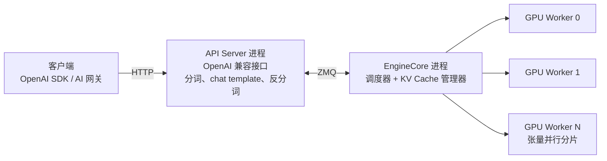
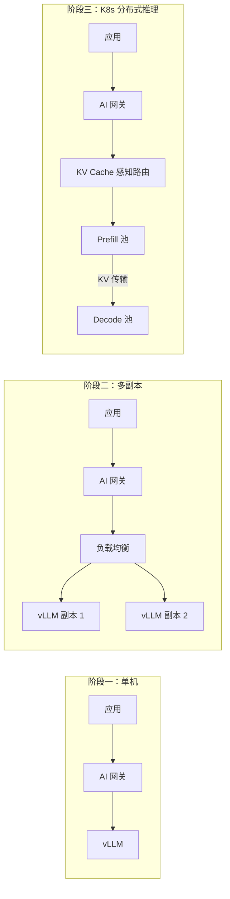
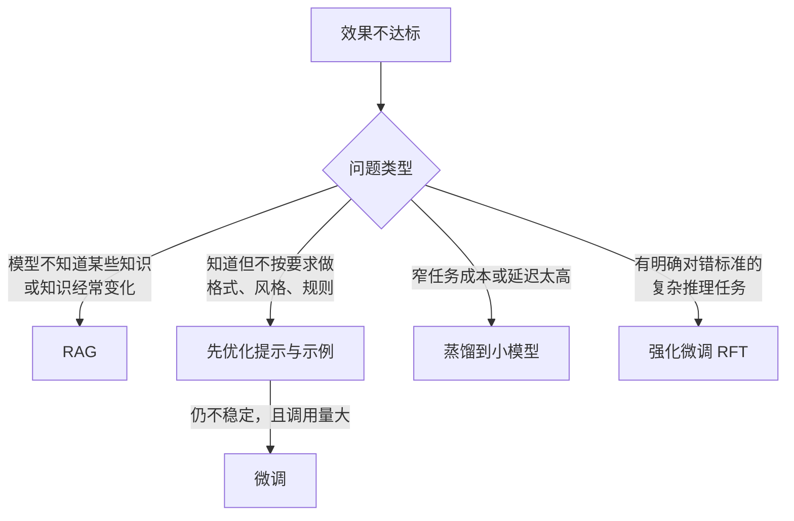
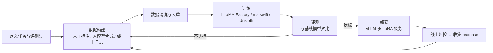

# 03 模型层：选型、私有化推理与微调

> 本章目标：作为应用工程师，掌握模型层**必须懂的决策知识**：怎么选模型、私有化部署需要多少资源、推理引擎的核心原理，以及什么时候该微调、怎么微调。不深入训练算法，重在**能做技术决策、能和算法 / 运维团队对话**。

---

## 一、模型层要回答的四个问题


| 问题 | 决策依据 | 本章章节 |
|---|---|---|
| 用哪个模型 | 自己的评测集 + 成本 + 延迟 + 合规 | 二 |
| 调 API 还是私有化 | 数据密级、调用规模、合规要求、团队运维能力 | 三 |
| 要不要微调 | 问题出在"知识"还是"行为" | 四、五 |
| 怎么组合 | 任务难度分布、成本目标 | 六 |

---

## 二、模型选型

### 2.1 不要看榜单选模型

公开榜单测的是通用能力，且部分分数由厂商自报。企业选型的唯一可靠依据是**用自己的评测集跑分**（评测方法见 [09 章第三节](./09-LLMOps-可观测评测与AI网关.md#三评测量得准重点)）。

评估维度：

| 维度 | 关注点 | 怎么测 |
|---|---|---|
| **任务效果** | 你的场景下的正确率 | 业务评测集 |
| **工具调用** | 选对工具、参数正确、多步不跑偏 | Agent 评测集：任务完成率、平均步数 |
| **指令遵循** | 长系统提示中的规则是否被遵守 | 构造规则冲突、格式约束用例 |
| **长上下文** | 长文档中段信息的利用率 | "大海捞针"类测试 + 真实长文档问答 |
| **中文与领域知识** | 中文表达、行业术语 | 领域用例 |
| **延迟** | 首 token 延迟（TTFT）、输出速度 | 压测 P50 / P95 |
| **成本** | 输入 / 输出 / 缓存单价 × 实际 token 分布 | 按真实流量估算 |
| **合规** | 部署地域、数据是否用于训练、许可证 | 法务与安全评审 |

### 2.2 模型格局（2026 年下半年）

> ⚠️ 模型迭代以月计，下表只描述格局，具体型号以发布时的评测为准。

| 类别 | 代表 | 特点 |
|---|---|---|
| **闭源前沿** | Anthropic Claude、OpenAI GPT、Google Gemini | 综合能力与 Agent 能力领先，生态完善 |
| **开源权重前沿** | DeepSeek、Qwen（通义）、GLM（智谱）、Kimi（月之暗面）、MiniMax 等 | 能力已逼近闭源前沿，多为超大 MoE 架构，私有化需要多卡集群 |
| **开源中小模型** | Qwen 中小尺寸、Gemma、各家 Flash / Lite 版本 | 单卡可部署，适合分类、抽取、改写等窄任务，以及微调底座 |
| **专用模型** | Embedding、Rerank、ASR / TTS、安全分类（Guard） | 在各自任务上性价比远高于通用大模型 |

**许可证**：MIT、Apache 2.0 的商用最清晰；部分模型使用自定义许可证（附加使用限制或署名要求），私有化商用前需要法务评审。

### 2.3 推理模型与推理强度

推理模型（会先"思考"再回答）显著提升复杂任务效果，但会成倍增加延迟和输出 token。

- 简单任务（分类、抽取、改写）：关闭或调低推理强度
- 复杂任务（规划、代码、多步分析）：开启推理
- 主流 SDK 已提供统一的推理强度参数（如 AI SDK 7 的 `reasoning`、OpenAI 的 `reasoning_effort`），**把推理强度当作一个可评测、可配置的参数**，而不是固定开关

### 2.4 建立"模型池"而不是选"一个模型"

| 角色 | 用途 | 选型重点 |
|---|---|---|
| 旗舰模型 | 复杂推理、Agent 主循环、代码 | 效果 |
| 主力模型 | 大部分对话与生成 | 效果与成本平衡 |
| 轻量模型 | 分类、路由、查询改写、摘要 | 延迟与成本 |
| Embedding / Rerank | 检索 | 中文效果、可私有化 |
| 评估模型 | LLM-as-Judge | 与被测模型**不同家族** |
| 备用模型 | 主模型故障时降级 | 已通过评测 |

---

## 三、私有化部署

### 3.1 什么时候需要私有化

| 驱动因素 | 说明 |
|---|---|
| **数据密级** | 机密数据不允许出域（最常见的原因） |
| **合规** | 行业监管要求（金融、政务、医疗） |
| **规模成本** | 调用量极大且稳定时，自建可能比 API 便宜 |
| **离线 / 内网** | 无法访问公网的环境 |
| **定制** | 需要部署微调后的模型 |

> ⚠️ **注意**：私有化的隐性成本常被低估：GPU 采购或租赁、推理引擎调优、模型升级、高可用、运维人力。**调用量不大时，私有化几乎总是比 API 贵**。更常见的做法是按数据密级混合使用（[10 章第七节](./10-安全权限与上线清单.md#72-按数据密级路由模型)）。

### 3.2 推理引擎的核心概念

理解这几个概念，才能看懂推理引擎的配置项和性能报告：

| 概念 | 一句话解释 | 影响 |
|---|---|---|
| **KV Cache** | 生成每个 token 时，把之前所有 token 的中间结果（Key / Value）缓存下来，避免重复计算 | 占用大量显存，决定能同时服务多少请求、多长上下文 |
| **PagedAttention** | 像操作系统的虚拟内存分页一样管理 KV Cache，消除显存碎片（vLLM 的核心创新） | 并发能力大幅提升 |
| **连续批处理（Continuous Batching）** | 请求随到随加入批次，完成即退出，而不是等一整批结束 | GPU 利用率与吞吐大幅提升 |
| **前缀缓存（Prefix Caching）** | 多个请求共享相同前缀（系统提示、工具定义）时复用 KV Cache | Agent、RAG 场景显著降低 TTFT（SGLang 的 RadixAttention 是代表） |
| **量化** | 用更低精度存储权重：FP16 → FP8 → INT4 | 显存减半或减至四分之一，效果略有损失 |
| **MoE（混合专家）** | 模型总参数很大，但每个 token 只激活其中一部分"专家" | **显存按总参数算，计算量按激活参数算** |
| **张量并行 / 流水线并行** | 把一个模型切分到多张卡 / 多台机器 | 单卡放不下时必需 |
| **推测解码（Speculative Decoding）** | 用小模型先猜多个 token，大模型一次验证 | 降低输出延迟 |

### 3.3 推理引擎选型

| 引擎 | 特点 | 适合 |
|---|---|---|
| **vLLM** | 生态最广、模型支持最快、OpenAI 兼容 | **生产默认选择** |
| **SGLang** | 前缀缓存与结构化输出性能突出 | Agent、RAG 等共享前缀多的高并发场景 |
| **TensorRT-LLM** | NVIDIA 官方，极致性能，调优成本高 | 对性能要求极高的大规模部署 |
| **llama.cpp / Ollama** | CPU / 消费级 GPU / Mac 可运行 | 开发调试、端侧、离线小模型 |
| **国产算力适配** | vLLM-Ascend（昇腾）等 | 信创要求的环境 |

> 🎯 **落地要点**：推理引擎都提供 OpenAI 兼容接口。**应用层只对接 OpenAI 兼容协议 + AI 网关**，换引擎、换模型对业务透明。

### 3.4 显存估算（重点）

做私有化方案时最常被问的问题："部署这个模型需要几张卡？"

**① 权重显存**

```text
权重显存 ≈ 总参数量 × 每参数字节数
          FP16/BF16 = 2 字节，FP8 = 1 字节，INT4 ≈ 0.5 字节
```

| 模型规模 | FP16 | FP8 | INT4 |
|---|---|---|---|
| 8B | ~16 GB | ~8 GB | ~4 GB |
| 32B | ~64 GB | ~32 GB | ~16 GB |
| 70B | ~140 GB | ~70 GB | ~35 GB |
| 700B 级 MoE | ~1.4 TB | ~700 GB | ~350 GB |

**② KV Cache 显存**

```text
每 token 的 KV Cache ≈ 2（K 和 V）× 层数 × KV 头数 × 头维度 × 每值字节数
```

以 Llama 3 70B（80 层、8 个 KV 头、头维度 128、FP16）为例：

```text
每 token：2 × 80 × 8 × 128 × 2 字节 ≈ 0.31 MB
单个 32K 上下文请求：32,000 × 0.31 MB ≈ 10 GB
同时服务 20 个这样的请求：≈ 200 GB
```

**③ 总量**

```text
总显存 ≈ 权重 + KV Cache（按目标并发 × 平均上下文估算）+ 10%~20% 运行时开销
```

> 🎯 **落地要点**：70B 级别的模型用 FP8 量化，权重约 70 GB，单张 80 GB 显卡**只能勉强放下权重**，几乎没有 KV Cache 空间，生产中至少需要 2 张卡。700B 级 MoE 模型即使 FP8 也需要一台 8 卡高端 GPU 服务器。**估算时永远不要只算权重。**

### 3.5 性能指标与压测

| 指标 | 含义 |
|---|---|
| **TTFT** | 首 token 延迟，受输入长度和排队影响 |
| **TPOT / ITL** | 每个输出 token 的间隔，决定"打字速度" |
| **吞吐** | 每秒处理的总 token 数，决定成本 |
| **并发** | 满足延迟 SLA 时能同时服务的请求数 |

吞吐和延迟此消彼长：批次越大，吞吐越高，单请求延迟越高。压测要用**真实的输入 / 输出长度分布**，用推理引擎自带的 benchmark 工具（vLLM 的用法见 [3.6 节](#36-vllm-深入架构部署与调优重点)），找到满足延迟 SLA 时的最大并发。

### 3.6 vLLM 深入：架构、部署与调优（重点）

> 版本基线：vLLM **v0.3x**（2026 年 11 月为 v0.33，按周发版）。V0 引擎已在 v0.11 移除，**下文全部基于 V1 引擎**。参数默认值随版本变化较快，以目标版本的 `vllm serve --help` 和 [Engine Arguments](https://docs.vllm.ai/en/stable/configuration/engine_args.html) 为准。

#### 3.6.1 V1 架构



| 设计 | 说明 | 带来的效果 |
|---|---|---|
| **API 层与引擎分进程** | HTTP 处理、分词等 CPU 工作和 GPU 调度循环在不同进程，经 ZMQ 通信 | CPU 开销不再拖慢 GPU，高并发下吞吐更稳 |
| **统一调度器** | 不再区分 prefill 阶段和 decode 阶段，每一步只给各请求分配"本步处理多少 token"的预算 | 天然支持**分块预填充**、前缀缓存、推测解码混合调度 |
| **分块预填充（Chunked Prefill）** | 长 prompt 被切成多块，和其他请求的 decode 混在同一批次 | 长输入不再"卡住"正在输出的请求，ITL 更平稳；默认开启 |
| **前缀缓存** | KV Cache 按块计算哈希，相同前缀的块直接复用 | 系统提示、工具定义相同的 Agent 请求 TTFT 大幅下降；默认开启 |
| **torch.compile + CUDA Graph** | 启动时编译并捕获计算图，运行时减少 kernel 启动开销 | 小批量 decode 更快；代价是启动更慢、额外占显存 |
| **数据并行** | 每个 DP rank 一个 EngineCore 进程 | 单机多副本，提高总吞吐 |

> 📖 **Prefill / Decode**：推理分两个阶段。Prefill 一次性处理整个输入，计算密集，决定 TTFT；Decode 每次生成一个 token，受显存带宽限制，决定 ITL。两者对硬件的诉求不同，这也是后面"P/D 分离"的出发点。

#### 3.6.2 启动与部署

**单卡起步**（容器化部署，生产推荐）：

```bash
docker run -d --gpus all --ipc=host -p 8000:8000 \
  -v /data/models:/models \
  vllm/vllm-openai:v0.33.0 \
  --model /models/Qwen3-32B-FP8 \
  --served-model-name qwen3-32b \
  --max-model-len 32768 \
  --gpu-memory-utilization 0.90 \
  --api-key "$VLLM_API_KEY"
```

**多卡 + Agent 场景**（工具调用、推理输出解析）：

```bash
vllm serve /models/Qwen3-235B-A22B-FP8 \
  --served-model-name qwen3-235b \
  --tensor-parallel-size 8 \
  --enable-expert-parallel \
  --max-model-len 65536 \
  --enable-auto-tool-choice --tool-call-parser hermes \
  --reasoning-parser qwen3 \
  --kv-cache-dtype fp8
```

**多 LoRA 服务**（一个底座承载多个业务的微调适配器）：

```bash
vllm serve /models/Qwen3-8B \
  --enable-lora --max-loras 4 --max-lora-rank 64 \
  --lora-modules ticket-cls=/adapters/ticket ner=/adapters/ner
# 请求时 model 字段填 "ticket-cls" 即使用对应适配器
```

> ⚠️ **注意**：
> - `--ipc=host`（或足够大的 `--shm-size`）是多卡张量并行的必需项，否则进程间通信会失败
> - **镜像版本要钉死**，不要用 `latest`；升级前用评测集和压测脚本回归
> - `--tool-call-parser` 和 `--reasoning-parser` **必须和模型的输出格式匹配**（各模型的推荐值见模型卡和 vLLM [Tool Calling](https://docs.vllm.ai/en/latest/features/tool_calling/) 文档）。配错时的典型症状是：模型"想调工具"，但返回的是一段包含工具调用文本的普通 content，`tool_calls` 为空
> - `--api-key` 只是最基本的防护。生产环境中 vLLM 应部署在内网，**统一由 AI 网关做鉴权、限流和计量**（[09 章第五节](./09-LLMOps-可观测评测与AI网关.md#五ai-网关控得住重点)）

**OpenAI 兼容接口**：`/v1/chat/completions`、`/v1/completions`、`/v1/embeddings`、`/v1/responses`、`/v1/models`，以及运维用的 `/health`、`/metrics`。结构化输出直接用 OpenAI 的 `response_format`（JSON Schema），后端默认由 **xgrammar** 做约束解码，可保证输出严格符合 schema。

#### 3.6.3 显存是怎么分配的

vLLM 启动时会**预先占满**一块显存，再在里面切 KV Cache。理解这个过程，才能看懂 OOM 报错：

```text
可用预算   = 单卡显存 × gpu-memory-utilization（默认约 0.9）
KV Cache  = 可用预算 − 模型权重 − 激活峰值（启动时 profiling 测得）− CUDA Graph
            ↓ 切成固定大小的块（block）
启动日志：GPU KV cache size: 1,234,567 tokens
         Maximum concurrency for 32,768 tokens per request: 37.7x
```

**最后两行日志是做容量规划的关键**：第一行是这张卡上所有请求的 KV Cache 总量，第二行是"每个请求都用满 `max-model-len` 时最多能同时服务多少个"。这个数字要和 [3.4 节](#34-显存估算重点)的估算对得上。

| 报错 / 现象 | 原因 | 处理顺序 |
|---|---|---|
| 启动时报 KV Cache 不足以容纳一个 `max-model-len` 请求 | 权重占掉大部分预算，剩余空间放不下一个最长请求 | ① 调小 `--max-model-len`（默认取模型的最大上下文，往往远超实际需要）② 适当调高 `--gpu-memory-utilization` ③ `--kv-cache-dtype fp8` ④ 量化权重或增加张量并行 |
| 运行中频繁出现抢占（preemption） | 并发请求的 KV Cache 总量超出容量，部分请求被暂停、重算 | 降低 `--max-num-seqs`、扩容副本，或在网关层限制并发 |
| 同机其他进程 OOM | vLLM 按比例预占显存 | 一张卡只跑一个 vLLM 实例；必须共卡时显式调低 `--gpu-memory-utilization` |
| 启动很慢 | torch.compile 编译、CUDA Graph 捕获、大模型加载 | 挂载编译缓存目录；调试时可用 `--enforce-eager` 跳过（会降低性能） |

#### 3.6.4 关键参数与调优方向

| 参数 | 作用 | 调优方向 |
|---|---|---|
| `--max-model-len` | 单请求最大上下文（输入 + 输出） | **按业务真实需要设置**，设大了白白挤占并发 |
| `--gpu-memory-utilization` | vLLM 可使用的显存比例 | 独占 GPU 时 0.9 左右；过高容易在峰值时 OOM |
| `--max-num-seqs` | 同时调度的最大请求数 | 调大提升吞吐，过大会导致抢占 |
| `--max-num-batched-tokens` | 每一步处理的 token 预算 | **调大**：prefill 更快、TTFT 更好、吞吐更高；**调小**：decode 受长 prefill 干扰少，ITL 更平稳 |
| `--kv-cache-dtype fp8` | KV Cache 用 FP8 存储 | KV 容量约翻倍，精度损失通常很小，需要用评测集确认 |
| `--enable-prefix-caching` | 前缀缓存（默认开启） | Agent / RAG 场景收益最大；配合"稳定前缀"的上下文组织（[06 章 4.3](./06-Agent工程化-从Loop到生产.md#43-实战技巧)） |
| `--speculative-config` | 推测解码配置（草稿模型、n-gram、EAGLE 等） | 低并发、对延迟敏感的场景收益明显；高并发下收益递减 |
| `--quantization` | 指定量化方法（多数情况下从模型配置自动识别） | 见 3.6.6 |

> 🎯 **落地要点**：**先确定延迟 SLA，再调吞吐**。常见做法是固定 `max-model-len`，用压测从低到高增加并发，找到 P95 TTFT 和 P95 ITL 仍满足 SLA 的最大并发数，把它作为单副本容量写进容量规划和网关限流配置。

#### 3.6.5 并行策略

| 策略 | 参数 | 切分对象 | 适合 |
|---|---|---|---|
| **张量并行（TP）** | `--tensor-parallel-size` | 每一层的矩阵切到多卡 | 单机多卡（依赖 NVLink 等高速互联），**单卡放不下时的首选** |
| **流水线并行（PP）** | `--pipeline-parallel-size` | 不同层放到不同卡 / 节点 | 跨节点部署，节点间带宽有限时 |
| **数据并行（DP）** | `--data-parallel-size` | 整个模型复制多份 | 单个副本放得下、需要更高吞吐 |
| **专家并行（EP）** | `--enable-expert-parallel` | MoE 的专家分布到不同卡 | 大型 MoE 模型，常与 DP 组合（注意力层 DP + 专家层 EP） |

经验规则：**机内 TP，跨机 PP**；能用单机解决的就不要跨机。跨节点部署默认需要 Ray（`--distributed-executor-backend ray`）。

#### 3.6.6 量化选型

| 方法 | 硬件要求 | 特点 |
|---|---|---|
| **FP8（W8A8）** | Hopper / Ada（H100、H20、L40S、4090 等） | **生产首选**：显存减半，精度损失很小，速度提升 |
| **NVFP4 / MXFP4** | Blackwell（B200 等） | 新一代 4-bit 浮点，兼顾显存与精度 |
| **AWQ / GPTQ（W4A16）** | Ampere 及以上（A100、A10、3090） | 权重 4-bit，适合显存紧张、无 FP8 支持的老卡 |
| **INT8（W8A8）** | Ampere 及以上 | 老卡上的折中方案 |
| **GGUF** | 通用 | 主要用于 llama.cpp 生态，vLLM 中支持有限，不推荐生产使用 |

量化模型优先使用模型厂商官方发布的版本；需要自己量化时，用 vLLM 官方的 **llm-compressor**（支持 FP8、AWQ、GPTQ 等算法及 KV Cache 量化），产出物可以直接被 vLLM 加载。**量化后必须用业务评测集对比效果**。

#### 3.6.7 监控指标

vLLM 在 `/metrics` 暴露 Prometheus 指标，接入 Grafana 即可：

| 指标 | 含义 | 告警思路 |
|---|---|---|
| `vllm:num_requests_running` / `vllm:num_requests_waiting` | 正在执行 / 排队的请求数 | **waiting 持续大于 0** 说明容量不足，需要扩容或限流 |
| `vllm:kv_cache_usage_perc` | KV Cache 占用率（0~1） | 持续高于 0.9 时容易发生抢占 |
| `vllm:time_to_first_token_seconds` | TTFT 分布 | P95 超出 SLA |
| `vllm:inter_token_latency_seconds` | ITL 分布 | P95 超出 SLA |
| `vllm:e2e_request_latency_seconds` | 端到端延迟分布 | — |
| `vllm:prefix_cache_queries` / `vllm:prefix_cache_hits` | 前缀缓存查询 / 命中次数 | 命中率 = `rate(hits) / rate(queries)`，Agent 场景命中率骤降通常意味着上下文前缀被破坏 |
| `vllm:prompt_tokens_total` / `vllm:generation_tokens_total` | 输入 / 输出 token 累计 | 计算吞吐和成本 |

#### 3.6.8 压测

使用官方的 `vllm bench serve`（替代旧的 `benchmark_serving.py` 脚本）：

```bash
vllm bench serve \
  --base-url http://vllm.internal:8000 --model qwen3-32b \
  --dataset-name random --random-input-len 3000 --random-output-len 500 \
  --max-concurrency 32 --num-prompts 640
```

- 依次把 `--max-concurrency` 设为 8 / 16 / 32 / 64，记录每档的吞吐、P95 TTFT、P95 ITL，画出"并发—延迟"曲线
- `--request-rate` 按泊松分布模拟真实到达；默认 `inf` 表示全部请求同时发出（测极限吞吐）
- 最终用**脱敏后的真实请求**（`--dataset-name custom`）复测一次，随机数据无法体现前缀缓存的收益

#### 3.6.9 从单机到集群



| 方案 | 做什么 | 适合 |
|---|---|---|
| **vLLM Production Stack** | 官方 Helm Chart：多副本 + Router（按会话 / 前缀路由，提高缓存命中）+ **LMCache**（KV Cache 分层卸载到 CPU 内存 / 磁盘）+ Grafana 看板 | K8s 上快速搭建生产集群 |
| **llm-d** | CNCF 项目（Red Hat、Google 等发起），基于 vLLM 和 K8s Gateway API Inference Extension，提供 KV Cache 感知路由与 P/D 分离，2026 年 10 月发布 v1.0 | 大规模、多租户的推理平台 |
| **P/D 分离** | Prefill 和 Decode 用不同的 GPU 池，通过 `--kv-transfer-config`（如 `NixlConnector`，基于 RDMA 传输 KV Cache）衔接 | 长输入、高并发，TTFT 与 ITL 都要严格达标的场景 |

> 📖 **KV Cache 感知路由**：普通负载均衡只看各副本的负载；KV Cache 感知路由会把同一会话或同一前缀的请求优先发到**已经缓存了这段前缀**的副本，避免重复计算。对多轮对话和 Agent 场景效果显著。

> 🎯 **落地要点**：多数企业的私有化规模在"阶段二"就足够了。**不要过早引入 P/D 分离**，它需要 RDMA 网络和更复杂的运维，只有在规模足够大、单纯加副本已经不划算时才值得。

#### 3.6.10 国产算力

vLLM 通过**硬件插件机制**把各硬件后端与核心代码解耦。华为昇腾使用社区维护的 **vllm-ascend** 插件（`pip install vllm vllm-ascend`），支持 Atlas 800I A2 / A3 等机型，接口与 GPU 版本一致，应用层无需改动。插件版本必须与 vLLM 主版本配套，模型支持和特性覆盖通常比 CUDA 版本滞后，**上线前按目标模型逐项验证**（量化格式、工具调用解析、长上下文性能）。

---

## 四、RAG、微调还是提示工程（重点）

最常见的误区是"效果不好就微调"。先判断问题出在哪：



| 方案 | 解决 | 不解决 | 成本 |
|---|---|---|---|
| **提示工程 + 少样本** | 格式、风格、简单规则 | 大量私有知识 | 最低，**永远先做** |
| **RAG** | 私有知识、实时知识、可溯源 | 行为模式、输出风格 | 中 |
| **SFT 微调** | 固定格式、领域风格、特定任务行为 | 频繁变化的知识（微调进去的知识难以更新、无法溯源） | 中高 |
| **偏好对齐（DPO 等）** | "哪种回答更好"的偏好 | 知识缺失 | 高 |
| **强化微调（RFT）** | 有可验证奖励的复杂任务（代码、数学、结构化抽取） | 无法自动判分的开放任务 | 高 |
| **蒸馏** | 把大模型在窄任务上的能力迁移到小模型 | — | 中，**降本利器** |

> 🎯 **落地要点**：**知识用 RAG，行为用微调**。两者不冲突，成熟系统常常是"微调过的模型 + RAG"。

---

## 五、微调工程流程

### 5.1 方法谱系

| 方法 | 原理 | 资源需求 |
|---|---|---|
| 全参数微调 | 更新所有参数 | 极高 |
| **LoRA** | 冻结原模型，只训练插入的小型低秩矩阵 | 低，**最常用** |
| **QLoRA** | 原模型 4-bit 量化 + LoRA | 更低，单卡可微调中等规模模型 |
| **DPO** | 用"好回答 vs 差回答"的成对数据直接优化偏好 | 中 |
| **GRPO 等 RL 方法** | 模型生成多个答案，按奖励函数打分并强化 | 高 |

> 📖 **LoRA（低秩适配）**：在原模型的部分权重旁加一对很小的矩阵，只训练它们。训练产物（适配器）通常只有几十到几百 MB，可以**一个底座模型 + 多个适配器**按需切换。

### 5.2 端到端流程



关键经验：

1. **先有评测集再训练**：没有评测集，就无法证明微调有效
2. **数据质量远比数量重要**：几千条高质量数据常常胜过几十万条噪声数据
3. **蒸馏的数据来源**：用旗舰模型在真实输入上生成高质量输出，人工抽检后作为训练数据（注意模型服务条款对"用输出训练其他模型"的限制）
4. **防止能力退化**：微调后要同时测通用能力，防止"学会新任务、忘了旧本事"
5. **多 LoRA 部署**：vLLM 支持一个底座模型同时挂载多个 LoRA 适配器，不同业务共享 GPU

---

## 六、模型路由与级联

| 策略 | 做法 | 适合 |
|---|---|---|
| **规则路由** | 按场景、租户、数据密级固定指定模型 | 合规要求、成本分级 |
| **分类路由** | 轻量模型判断任务难度或意图，分发到不同模型 | 请求难度差异大 |
| **级联（Cascade）** | 先用便宜模型回答，置信度低或校验失败再升级到大模型 | 大部分请求简单、少数困难 |
| **降级** | 主模型故障或超时，切换备用模型 | 可用性保障 |

路由逻辑放在 **AI 网关**或应用的统一模型模块中（[09 章第五节](./09-LLMOps-可观测评测与AI网关.md#五ai-网关控得住重点)），业务代码不感知。

---

## 本章小结

- 选模型靠**自己的评测集**，维护一个"模型池"而不是押注单一模型；推理强度是可配置参数
- 私有化的主要驱动是**数据密级与合规**，规模不大时 API 更便宜
- 推理引擎核心概念：**KV Cache、PagedAttention、连续批处理、前缀缓存、量化、MoE**；生产默认 vLLM
- vLLM V1：API 与引擎分进程、统一调度器；**看启动日志的 KV Cache 容量做容量规划**；`max-model-len` 按需设置；机内张量并行、跨机流水线并行；FP8 是 Hopper 及以上的首选量化；用 `vllm bench serve` 找到满足 SLA 的最大并发
- 显存 = **权重 + KV Cache + 开销**，永远不要只算权重
- **知识用 RAG，行为用微调**；窄任务高频调用用**蒸馏**降本；有明确判分标准的任务考虑 **RFT**

## 练习

1. 为你的一个业务场景构建 30 条评测用例，对比 3 个模型（含 1 个开源权重模型）的效果、TTFT 和单次成本
2. 计算：一个 32B 模型 FP8 量化，要求同时服务 50 个平均 8K 上下文的请求，需要多少显存？（查阅该模型的层数与 KV 头配置）
3. 用 Ollama 在本地运行一个小模型，再用 vLLM 部署同一模型，对比两者在 10 并发下的吞吐
4. 用 vLLM 部署一个模型，分别设置 `--max-model-len` 为 8K 和 32K，记录启动日志中的 KV Cache 容量与最大并发；再用 `vllm bench serve` 在 8 / 16 / 32 / 64 并发下压测，画出并发与 P95 TTFT、P95 ITL 的曲线
5. 接入 vLLM 的 `/metrics` 到 Prometheus + Grafana，构造一组共享系统提示的请求，观察前缀缓存命中率的变化
6. 用 LLaMA-Factory 对一个小模型做 LoRA 微调，完成"工单分类"任务，与"大模型 + 少样本提示"的效果和成本对比
