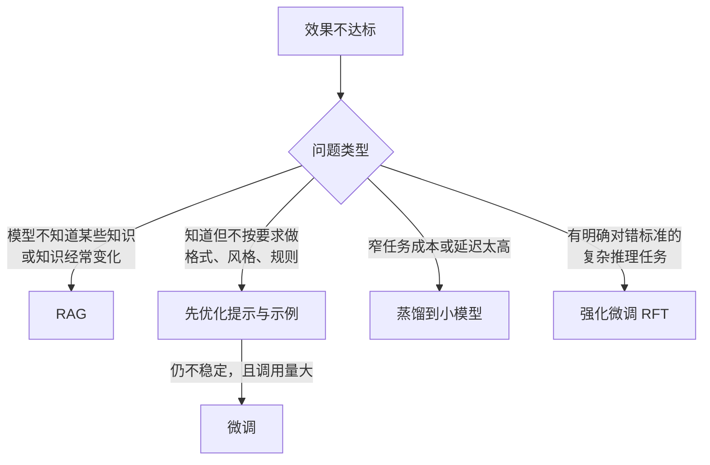
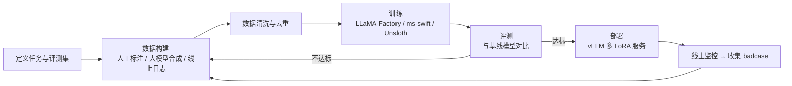

# 03 模型层：选型、私有化推理与微调

> 本章目标：作为应用工程师，掌握模型层**必须懂的决策知识**：怎么选模型、私有化部署需要多少资源、推理引擎的核心原理，以及什么时候该微调、怎么微调。不深入训练算法，重在**能做技术决策、能和算法 / 运维团队对话**。

---

## 一、模型层要回答的四个问题


| 问题 | 决策依据 | 本章章节 |
|---|---|---|
| 用哪个模型 | 自己的评测集 + 成本 + 延迟 + 合规 | 二 |
| 调 API 还是私有化 | 数据密级、调用规模、合规要求、团队运维能力 | 三 |
| 要不要微调 | 问题出在"知识"还是"行为" | 四、五 |
| 怎么组合 | 任务难度分布、成本目标 | 六 |

---

## 二、模型选型

### 2.1 不要看榜单选模型

公开榜单测的是通用能力，且部分分数由厂商自报。企业选型的唯一可靠依据是**用自己的评测集跑分**（评测方法见 [09 章第三节](./09-LLMOps-可观测评测与AI网关.md#三评测量得准重点)）。

评估维度：

| 维度 | 关注点 | 怎么测 |
|---|---|---|
| **任务效果** | 你的场景下的正确率 | 业务评测集 |
| **工具调用** | 选对工具、参数正确、多步不跑偏 | Agent 评测集：任务完成率、平均步数 |
| **指令遵循** | 长系统提示中的规则是否被遵守 | 构造规则冲突、格式约束用例 |
| **长上下文** | 长文档中段信息的利用率 | "大海捞针"类测试 + 真实长文档问答 |
| **中文与领域知识** | 中文表达、行业术语 | 领域用例 |
| **延迟** | 首 token 延迟（TTFT）、输出速度 | 压测 P50 / P95 |
| **成本** | 输入 / 输出 / 缓存单价 × 实际 token 分布 | 按真实流量估算 |
| **合规** | 部署地域、数据是否用于训练、许可证 | 法务与安全评审 |

### 2.2 模型格局（2026 年下半年）

> ⚠️ 模型迭代以月计，下表只描述格局，具体型号以发布时的评测为准。

| 类别 | 代表 | 特点 |
|---|---|---|
| **闭源前沿** | Anthropic Claude、OpenAI GPT、Google Gemini | 综合能力与 Agent 能力领先，生态完善 |
| **开源权重前沿** | DeepSeek、Qwen（通义）、GLM（智谱）、Kimi（月之暗面）、MiniMax 等 | 能力已逼近闭源前沿，多为超大 MoE 架构，私有化需要多卡集群 |
| **开源中小模型** | Qwen 中小尺寸、Gemma、各家 Flash / Lite 版本 | 单卡可部署，适合分类、抽取、改写等窄任务，以及微调底座 |
| **专用模型** | Embedding、Rerank、ASR / TTS、安全分类（Guard） | 在各自任务上性价比远高于通用大模型 |

**许可证**：MIT、Apache 2.0 的商用最清晰；部分模型使用自定义许可证（附加使用限制或署名要求），私有化商用前需要法务评审。

### 2.3 推理模型与推理强度

推理模型（会先"思考"再回答）显著提升复杂任务效果，但会成倍增加延迟和输出 token。

- 简单任务（分类、抽取、改写）：关闭或调低推理强度
- 复杂任务（规划、代码、多步分析）：开启推理
- 主流 SDK 已提供统一的推理强度参数（如 AI SDK 7 的 `reasoning`、OpenAI 的 `reasoning_effort`），**把推理强度当作一个可评测、可配置的参数**，而不是固定开关

### 2.4 建立"模型池"而不是选"一个模型"

| 角色 | 用途 | 选型重点 |
|---|---|---|
| 旗舰模型 | 复杂推理、Agent 主循环、代码 | 效果 |
| 主力模型 | 大部分对话与生成 | 效果与成本平衡 |
| 轻量模型 | 分类、路由、查询改写、摘要 | 延迟与成本 |
| Embedding / Rerank | 检索 | 中文效果、可私有化 |
| 评估模型 | LLM-as-Judge | 与被测模型**不同家族** |
| 备用模型 | 主模型故障时降级 | 已通过评测 |

---

## 三、私有化部署

### 3.1 什么时候需要私有化

| 驱动因素 | 说明 |
|---|---|
| **数据密级** | 机密数据不允许出域（最常见的原因） |
| **合规** | 行业监管要求（金融、政务、医疗） |
| **规模成本** | 调用量极大且稳定时，自建可能比 API 便宜 |
| **离线 / 内网** | 无法访问公网的环境 |
| **定制** | 需要部署微调后的模型 |

> ⚠️ **注意**：私有化的隐性成本常被低估：GPU 采购或租赁、推理引擎调优、模型升级、高可用、运维人力。**调用量不大时，私有化几乎总是比 API 贵**。更常见的做法是按数据密级混合使用（[10 章第七节](./10-安全权限与上线清单.md#72-按数据密级路由模型)）。

### 3.2 推理引擎的核心概念

理解这几个概念，才能看懂推理引擎的配置项和性能报告：

| 概念 | 一句话解释 | 影响 |
|---|---|---|
| **KV Cache** | 生成每个 token 时，把之前所有 token 的中间结果（Key / Value）缓存下来，避免重复计算 | 占用大量显存，决定能同时服务多少请求、多长上下文 |
| **PagedAttention** | 像操作系统的虚拟内存分页一样管理 KV Cache，消除显存碎片（vLLM 的核心创新） | 并发能力大幅提升 |
| **连续批处理（Continuous Batching）** | 请求随到随加入批次，完成即退出，而不是等一整批结束 | GPU 利用率与吞吐大幅提升 |
| **前缀缓存（Prefix Caching）** | 多个请求共享相同前缀（系统提示、工具定义）时复用 KV Cache | Agent、RAG 场景显著降低 TTFT（SGLang 的 RadixAttention 是代表） |
| **量化** | 用更低精度存储权重：FP16 → FP8 → INT4 | 显存减半或减至四分之一，效果略有损失 |
| **MoE（混合专家）** | 模型总参数很大，但每个 token 只激活其中一部分"专家" | **显存按总参数算，计算量按激活参数算** |
| **张量并行 / 流水线并行** | 把一个模型切分到多张卡 / 多台机器 | 单卡放不下时必需 |
| **推测解码（Speculative Decoding）** | 用小模型先猜多个 token，大模型一次验证 | 降低输出延迟 |

### 3.3 推理引擎选型

| 引擎 | 特点 | 适合 |
|---|---|---|
| **vLLM** | 生态最广、模型支持最快、OpenAI 兼容 | **生产默认选择** |
| **SGLang** | 前缀缓存与结构化输出性能突出 | Agent、RAG 等共享前缀多的高并发场景 |
| **TensorRT-LLM** | NVIDIA 官方，极致性能，调优成本高 | 对性能要求极高的大规模部署 |
| **llama.cpp / Ollama** | CPU / 消费级 GPU / Mac 可运行 | 开发调试、端侧、离线小模型 |
| **国产算力适配** | vLLM-Ascend（昇腾）等 | 信创要求的环境 |

> 🎯 **落地要点**：推理引擎都提供 OpenAI 兼容接口。**应用层只对接 OpenAI 兼容协议 + AI 网关**，换引擎、换模型对业务透明。

### 3.4 显存估算（重点）

做私有化方案时最常被问的问题："部署这个模型需要几张卡？"

**① 权重显存**

```text
权重显存 ≈ 总参数量 × 每参数字节数
          FP16/BF16 = 2 字节，FP8 = 1 字节，INT4 ≈ 0.5 字节
```

| 模型规模 | FP16 | FP8 | INT4 |
|---|---|---|---|
| 8B | ~16 GB | ~8 GB | ~4 GB |
| 32B | ~64 GB | ~32 GB | ~16 GB |
| 70B | ~140 GB | ~70 GB | ~35 GB |
| 700B 级 MoE | ~1.4 TB | ~700 GB | ~350 GB |

**② KV Cache 显存**

```text
每 token 的 KV Cache ≈ 2（K 和 V）× 层数 × KV 头数 × 头维度 × 每值字节数
```

以 Llama 3 70B（80 层、8 个 KV 头、头维度 128、FP16）为例：

```text
每 token：2 × 80 × 8 × 128 × 2 字节 ≈ 0.31 MB
单个 32K 上下文请求：32,000 × 0.31 MB ≈ 10 GB
同时服务 20 个这样的请求：≈ 200 GB
```

**③ 总量**

```text
总显存 ≈ 权重 + KV Cache（按目标并发 × 平均上下文估算）+ 10%~20% 运行时开销
```

> 🎯 **落地要点**：70B 级别的模型用 FP8 量化，权重约 70 GB，单张 80 GB 显卡**只能勉强放下权重**，几乎没有 KV Cache 空间，生产中至少需要 2 张卡。700B 级 MoE 模型即使 FP8 也需要一台 8 卡高端 GPU 服务器。**估算时永远不要只算权重。**

### 3.5 性能指标与压测

| 指标 | 含义 |
|---|---|
| **TTFT** | 首 token 延迟，受输入长度和排队影响 |
| **TPOT / ITL** | 每个输出 token 的间隔，决定"打字速度" |
| **吞吐** | 每秒处理的总 token 数，决定成本 |
| **并发** | 满足延迟 SLA 时能同时服务的请求数 |

吞吐和延迟此消彼长：批次越大，吞吐越高，单请求延迟越高。压测要用**真实的输入 / 输出长度分布**，用推理引擎自带的 benchmark 工具，找到满足延迟 SLA 时的最大并发。

---

## 四、RAG、微调还是提示工程（重点）

最常见的误区是"效果不好就微调"。先判断问题出在哪：



| 方案 | 解决 | 不解决 | 成本 |
|---|---|---|---|
| **提示工程 + 少样本** | 格式、风格、简单规则 | 大量私有知识 | 最低，**永远先做** |
| **RAG** | 私有知识、实时知识、可溯源 | 行为模式、输出风格 | 中 |
| **SFT 微调** | 固定格式、领域风格、特定任务行为 | 频繁变化的知识（微调进去的知识难以更新、无法溯源） | 中高 |
| **偏好对齐（DPO 等）** | "哪种回答更好"的偏好 | 知识缺失 | 高 |
| **强化微调（RFT）** | 有可验证奖励的复杂任务（代码、数学、结构化抽取） | 无法自动判分的开放任务 | 高 |
| **蒸馏** | 把大模型在窄任务上的能力迁移到小模型 | — | 中，**降本利器** |

> 🎯 **落地要点**：**知识用 RAG，行为用微调**。两者不冲突，成熟系统常常是"微调过的模型 + RAG"。

---

## 五、微调工程流程

### 5.1 方法谱系

| 方法 | 原理 | 资源需求 |
|---|---|---|
| 全参数微调 | 更新所有参数 | 极高 |
| **LoRA** | 冻结原模型，只训练插入的小型低秩矩阵 | 低，**最常用** |
| **QLoRA** | 原模型 4-bit 量化 + LoRA | 更低，单卡可微调中等规模模型 |
| **DPO** | 用"好回答 vs 差回答"的成对数据直接优化偏好 | 中 |
| **GRPO 等 RL 方法** | 模型生成多个答案，按奖励函数打分并强化 | 高 |

> 📖 **LoRA（低秩适配）**：在原模型的部分权重旁加一对很小的矩阵，只训练它们。训练产物（适配器）通常只有几十到几百 MB，可以**一个底座模型 + 多个适配器**按需切换。

### 5.2 端到端流程



关键经验：

1. **先有评测集再训练**：没有评测集，就无法证明微调有效
2. **数据质量远比数量重要**：几千条高质量数据常常胜过几十万条噪声数据
3. **蒸馏的数据来源**：用旗舰模型在真实输入上生成高质量输出，人工抽检后作为训练数据（注意模型服务条款对"用输出训练其他模型"的限制）
4. **防止能力退化**：微调后要同时测通用能力，防止"学会新任务、忘了旧本事"
5. **多 LoRA 部署**：vLLM 支持一个底座模型同时挂载多个 LoRA 适配器，不同业务共享 GPU

---

## 六、模型路由与级联

| 策略 | 做法 | 适合 |
|---|---|---|
| **规则路由** | 按场景、租户、数据密级固定指定模型 | 合规要求、成本分级 |
| **分类路由** | 轻量模型判断任务难度或意图，分发到不同模型 | 请求难度差异大 |
| **级联（Cascade）** | 先用便宜模型回答，置信度低或校验失败再升级到大模型 | 大部分请求简单、少数困难 |
| **降级** | 主模型故障或超时，切换备用模型 | 可用性保障 |

路由逻辑放在 **AI 网关**或应用的统一模型模块中（[09 章第五节](./09-LLMOps-可观测评测与AI网关.md#五ai-网关控得住重点)），业务代码不感知。

---

## 本章小结

- 选模型靠**自己的评测集**，维护一个"模型池"而不是押注单一模型；推理强度是可配置参数
- 私有化的主要驱动是**数据密级与合规**，规模不大时 API 更便宜
- 推理引擎核心概念：**KV Cache、PagedAttention、连续批处理、前缀缓存、量化、MoE**；生产默认 vLLM
- 显存 = **权重 + KV Cache + 开销**，永远不要只算权重
- **知识用 RAG，行为用微调**；窄任务高频调用用**蒸馏**降本；有明确判分标准的任务考虑 **RFT**

## 练习

1. 为你的一个业务场景构建 30 条评测用例，对比 3 个模型（含 1 个开源权重模型）的效果、TTFT 和单次成本
2. 计算：一个 32B 模型 FP8 量化，要求同时服务 50 个平均 8K 上下文的请求，需要多少显存？（查阅该模型的层数与 KV 头配置）
3. 用 Ollama 在本地运行一个小模型，再用 vLLM 部署同一模型，对比两者在 10 并发下的吞吐
4. 用 LLaMA-Factory 对一个小模型做 LoRA 微调，完成"工单分类"任务，与"大模型 + 少样本提示"的效果和成本对比
