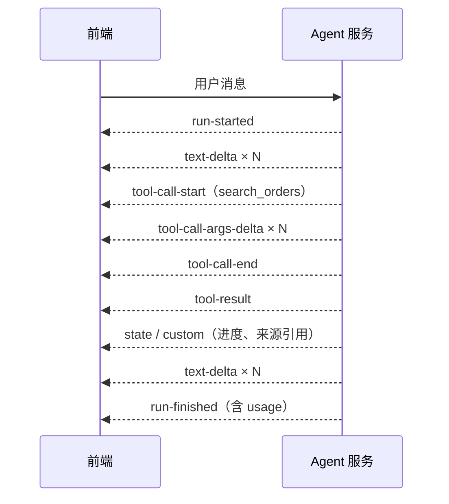
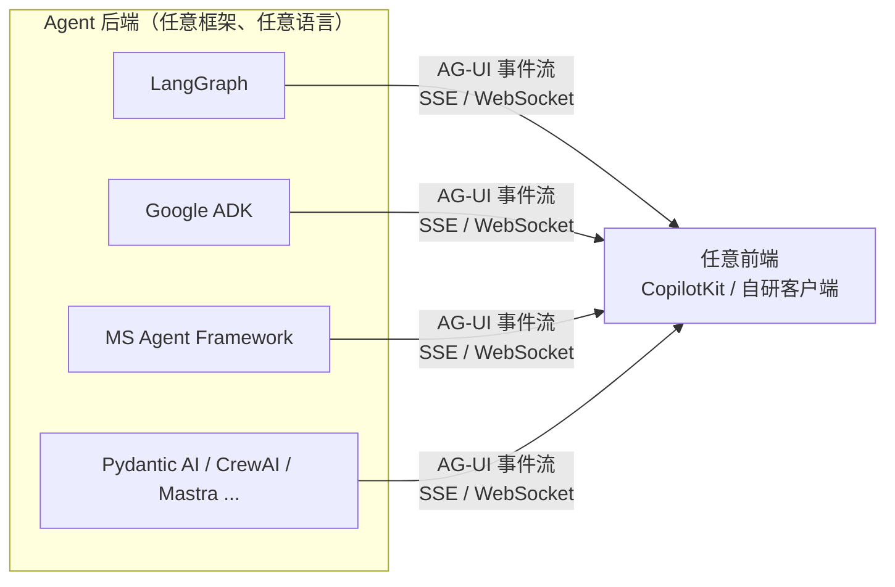
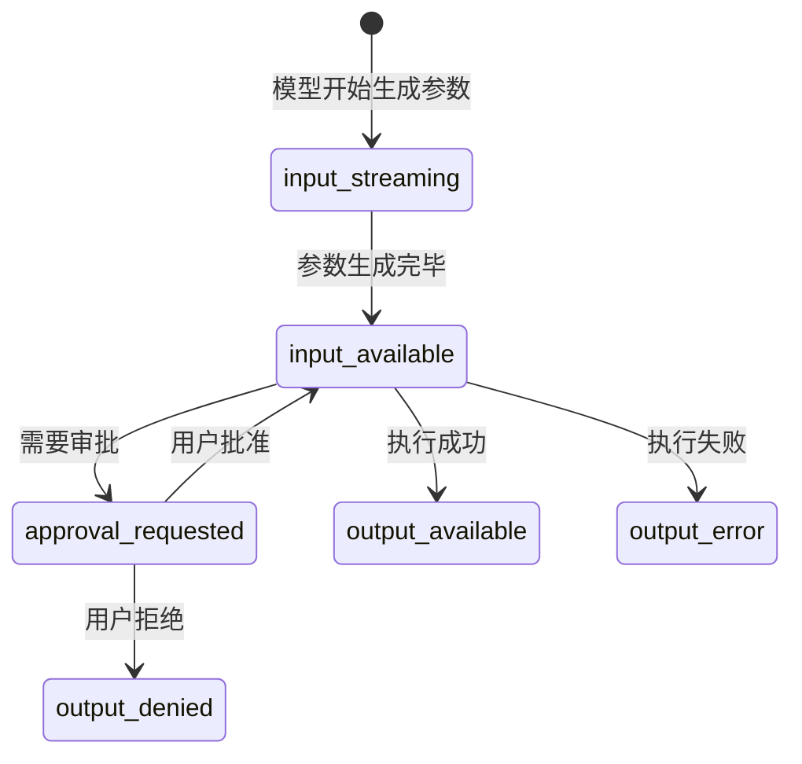
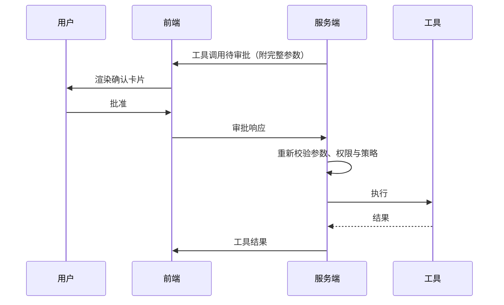
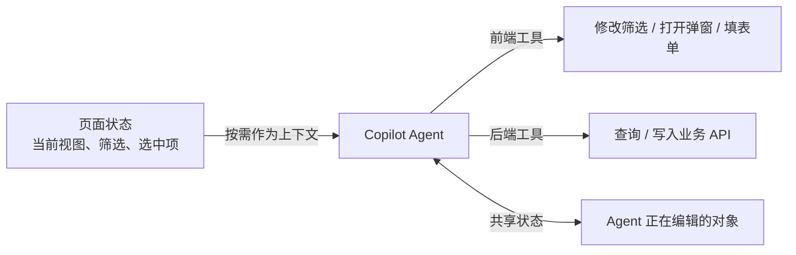

# 04 AI 交互层：流式协议、生成式 UI 与人机协同

> 本章目标：理解 AI 应用交互层的**通用原理**——流式传输、事件模型、工具状态、审批与中断——掌握跨框架的 **AG-UI 协议**与生成式 UI 标准，并以 **Vercel AI SDK 7** 为参考实现吃透一套完整的生产级方案。
>
> 结构：第一至四节是**与语言无关**的原理与协议；第五节是 TS 参考实现；第六至十节回到通用的交互设计与工程问题。

---

## 一、交互层要解决什么

传统 Web 应用是"请求 → 等待 → 完整响应"。AI 应用的交互有本质不同：

| 特征 | 带来的问题 |
|---|---|
| 生成慢（数秒到数分钟） | 必须**流式**输出，否则用户以为卡死 |
| 一次回答包含多种内容 | 文本、推理过程、工具调用、检索来源、进度、卡片……需要**多类型事件** |
| Agent 会调用工具 | 前端要展示"正在查询订单"，工具结果要渲染成组件 |
| 有副作用的操作 | 需要**暂停等用户审批**，再继续执行 |
| 用户随时可能打断 | 需要**中断**并停止后端计费 |
| 网络可能断开 | 长任务需要**断线续传**或后台继续执行 |
| Agent 与界面共享状态 | 例如 Agent 修改了表单、筛选条件，界面要同步 |

所以交互层的核心是一个**事件协议**：后端把 Agent 的执行过程编码为事件流，前端把事件流还原为界面。

---

## 二、流式传输基础

### 2.1 传输方式

| 方式 | 方向 | 特点 | 适合 |
|---|---|---|---|
| **SSE（Server-Sent Events）** | 服务端 → 客户端 | 基于普通 HTTP，自动重连，穿透代理友好 | **文本对话的默认选择**，几乎所有 LLM API 都用它 |
| **WebSocket** | 双向 | 长连接，需要单独的网关支持 | 实时协作、高频双向交互 |
| **WebRTC** | 双向音视频 | 低延迟媒体传输 | 实时语音 / 视频 Agent（第九节） |

SSE 的报文格式非常简单，每个事件以空行分隔：

```text
event: message
data: {"type":"text-delta","delta":"你好"}

data: {"type":"tool-call-start","toolName":"search_orders"}

```

### 2.2 模型 API 的流式事件

各家模型 API 的流式事件格式不同，应用层需要做一次**归一化**：

| 厂商 API | 文本增量 | 工具调用参数增量 | 结束 |
|---|---|---|---|
| OpenAI Responses | `response.output_text.delta` | `response.function_call_arguments.delta` | `response.completed` |
| Anthropic Messages | `content_block_delta`（`text_delta`） | `content_block_delta`（`input_json_delta`） | `message_stop` |
| OpenAI 兼容 Chat Completions | `choices[].delta.content` | `choices[].delta.tool_calls` | `finish_reason` |

> 🎯 **落地要点**：不要把某家模型的原始事件直接透传给前端，否则换模型就要改前端。应用层应定义**自己的事件模型**（或采用 AG-UI 等标准），模型差异由 SDK 或适配层吸收。

### 2.3 应用层事件模型

无论用什么框架，一个完整的 Agent 交互都可以归纳为以下事件：



### 2.4 最小实现：Python 服务端输出 SSE

```python
# FastAPI 示例：把任意 Agent 框架的执行过程归一化为应用事件
import json
from fastapi import FastAPI, Request
from fastapi.responses import StreamingResponse

app = FastAPI()

def sse(event: dict) -> str:
    return f"data: {json.dumps(event, ensure_ascii=False)}\n\n"

@app.post("/api/chat")
async def chat(req: Request):
    user = await authenticate(req)           # 鉴权放在最前面
    body = await req.json()

    async def stream():
        yield sse({"type": "run-started"})
        async for ev in run_agent(body["messages"], user=user):   # 框架相关部分
            if await req.is_disconnected():  # 用户关闭页面或点击停止：中断执行，停止计费
                break
            yield sse(normalize(ev))          # 归一化为应用事件
        yield sse({"type": "run-finished"})

    return StreamingResponse(stream(), media_type="text/event-stream",
                             headers={"X-Accel-Buffering": "no"})  # 关闭 Nginx 缓冲
```

---

## 三、AG-UI：跨框架的交互协议（重点）

### 3.1 为什么需要它

每个 Agent 框架都有自己的流式格式：LangGraph 的 `stream_mode`、AI SDK 的 UI 消息流、各家 Agent SDK 的事件。前端每接一个框架就要重写一套适配。**AG-UI（Agent-User Interaction Protocol）** 把这一层标准化：



截至 2026 年下半年，LangGraph、CrewAI、Google ADK、Microsoft Agent Framework、Pydantic AI、Mastra、LlamaIndex、AWS Strands、Claude Agent SDK 等主流框架都已提供 AG-UI 集成。

### 3.2 事件类型

| 类别 | 事件 | 用途 |
|---|---|---|
| 生命周期 | `RUN_STARTED` / `RUN_FINISHED` / `RUN_ERROR`、`STEP_STARTED` / `STEP_FINISHED` | 一次运行和其中的步骤 |
| 文本消息 | `TEXT_MESSAGE_START` / `TEXT_MESSAGE_CONTENT` / `TEXT_MESSAGE_END` | 流式文本 |
| 工具调用 | `TOOL_CALL_START` / `TOOL_CALL_ARGS` / `TOOL_CALL_END` / `TOOL_CALL_RESULT` | 工具调用的完整生命周期 |
| **状态同步** | `STATE_SNAPSHOT` / `STATE_DELTA`（JSON Patch） | Agent 与前端**共享状态**（如表单、待办、画布） |
| 消息同步 | `MESSAGES_SNAPSHOT` | 全量同步对话历史 |
| 扩展 | `CUSTOM` / `RAW` | 自定义事件、透传原始事件 |

> 📖 **JSON Patch（RFC 6902）**：描述 JSON 文档增量修改的标准格式，如 `[{"op":"replace","path":"/filters/status","value":"refunded"}]`。用它同步状态，只传变化部分而不是整个对象。

### 3.3 AG-UI 带来的三个关键能力

1. **共享状态（Shared State）**：Agent 的状态（比如它正在填写的报销单）实时同步到前端渲染；用户在界面上的修改也能回传给 Agent
2. **前端工具（Frontend Tools）**：前端声明一些工具（如"设置筛选条件""打开弹窗"），Agent 调用时由前端执行
3. **人机协同**：Agent 运行到需要审批的位置时中断，前端展示确认界面，用户响应后恢复运行

> 🎯 **落地要点**：如果后端用 Python / Java / Go 框架、前端是 Web 应用，**AG-UI 是目前最省力的连接方式**。如果是全栈 TS，Vercel AI SDK 自带的 UI 消息协议同样成熟（第五节）。两种方案的概念几乎一一对应。

---

## 四、消息模型：UI 消息 vs 模型消息

这是所有交互层实现都会遇到的设计问题，与框架无关。

| | UI 消息 | 模型消息 |
|---|---|---|
| 用途 | 前端渲染与持久化 | 发给模型 |
| 内容 | 文本、推理过程、工具调用**及其状态**、自定义数据、来源引用、附件、UI 元数据 | 模型能理解的角色与内容 |
| 持久化 | **存这个** | 每次请求时由 UI 消息转换而来 |

> 🎯 **落地要点**：数据库里存 **UI 消息**，它是"应用的真相"；模型消息只是发给模型时的投影，转换时可以裁剪历史、压缩早期对话、去掉 UI 专用字段。

---

## 五、TS 参考实现：Vercel AI SDK 7

> 版本基线：`ai@7.x`、`@ai-sdk/react@7.x`，要求 **Node.js ≥ 22 + 纯 ESM**。v7 新增 API 的部分细节（`toolApproval` 策略取值、审批 part 字段名、`createUIMessageStream` writer、`onEnd` 回调参数）以已安装版本的类型定义和 [官方文档](https://ai-sdk.dev/docs) 为准。

AI SDK 是 TS 生态 AI 应用的事实标准，它的设计把上面的通用概念落到了具体 API 上，值得作为参考实现精读。

### 5.1 包结构与 Provider 抽象

```text
ai                          核心：generateText / streamText / tool / ToolLoopAgent / UI 消息流
@ai-sdk/react               useChat 等 hooks（另有 vue / svelte / angular）
@ai-sdk/openai-compatible   任意 OpenAI 兼容服务（国内模型、自建网关、vLLM）
@ai-sdk/otel                OpenTelemetry 遥测（v7 起拆出）
@ai-sdk/workflow            WorkflowAgent：持久化执行
@ai-sdk/mcp                 MCP 客户端
```

```ts
// lib/model.ts：模型选择、降级、脱敏收敛到一处，业务代码只 import model
import { createOpenAICompatible } from '@ai-sdk/openai-compatible';

const gateway = createOpenAICompatible({
  name: 'corp-gateway',
  baseURL: process.env.AI_GATEWAY_BASE_URL!, // 经由企业 AI 网关统一出口（09 章）
  apiKey: process.env.AI_GATEWAY_KEY!,
});
export const model = gateway('main-chat');
export const cheapModel = gateway('light-chat');
```

v7 重要变化速记：

| v6 | v7 |
|---|---|
| `system` | `instructions` |
| `onFinish` | `onEnd`（另有 `onStart` / `onStepEnd`） |
| `fullStream` | `stream` |
| `experimental_telemetry` | `telemetry`（需 `@ai-sdk/otel`） |
| `result.toUIMessageStreamResponse()` | `createUIMessageStreamResponse({ stream: toUIMessageStream(...) })` |
| 工具上的 `needsApproval` | 调用级的 `toolApproval` |
| 顶层 `usage` 是最后一步 | 顶层 `usage` 汇总全部步骤，最后一步用 `finalStep` |

### 5.2 工具定义：身份不由模型提供

```ts
import { streamText, tool, isStepCount } from 'ai';
import * as z from 'zod/v4';

const result = streamText({
  model,
  instructions: '你是订单助手。涉及订单数据必须调用工具，不要编造。',
  messages,
  stopWhen: isStepCount(5), // 多步循环必须有上限
  tools: {
    queryOrders: tool({
      description: '按条件查询当前用户的订单。时间用 ISO 日期。',
      inputSchema: z.object({
        status: z.enum(['paid', 'refunded', 'shipped']).optional(),
        from: z.string().describe('起始日期，如 2026-11-01'),
        to: z.string(),
      }),
      // 用户身份通过 contextSchema 声明、由服务端注入，模型无法伪造
      contextSchema: z.object({ userId: z.string(), token: z.string() }),
      execute: async (input, { context }) =>
        orderApi.search({ ...input, ownerId: context.userId }, context.token),
    }),
  },
  toolsContext: { queryOrders: { userId: session.userId, token: session.token } },
});
```

### 5.3 服务端：返回 UI 消息流

```ts
// app/api/chat/route.ts
import {
  streamText, convertToModelMessages, toUIMessageStream,
  createUIMessageStreamResponse, isStepCount, type UIMessage,
} from 'ai';

export async function POST(req: Request) {
  const session = await auth(req);
  const { messages, id }: { messages: UIMessage[]; id: string } = await req.json();

  const result = streamText({
    model,
    instructions: SYSTEM_PROMPT,
    messages: await convertToModelMessages(messages), // UI 消息 → 模型消息
    tools,
    stopWhen: isStepCount(5),
    abortSignal: req.signal, // 用户点"停止"时中断模型调用
  });

  return createUIMessageStreamResponse({
    stream: toUIMessageStream({
      stream: result.stream,
      originalMessages: messages,
      onEnd: async ({ messages: finalMessages }) => {
        await saveChat({ id, userId: session.userId, messages: finalMessages }); // 存 UI 消息
      },
    }),
  });
}
```

UI 消息由多个 **part** 组成，对应第二节的通用事件模型：

```ts
type UIMessagePart =
  | { type: 'text'; text: string }
  | { type: 'reasoning'; text: string }
  | { type: `tool-${string}`; toolCallId: string; state: ToolState; input?: unknown; output?: unknown }
  | { type: `data-${string}`; id?: string; data: unknown }   // 自定义数据：进度、卡片
  | { type: 'source-url'; url: string; title?: string }      // 引用来源
  | { type: 'file'; mediaType: string; url: string };
```

### 5.4 工具调用的状态机



前端按状态渲染（代码中状态值为连字符形式，如 `approval-requested`）：

```tsx
function OrderToolView({ part, onApprove }) {
  switch (part.state) {
    case 'input-streaming':    return <Skeleton text="正在准备查询条件…" />;
    case 'input-available':    return <Spinner text={`查询 ${part.input.from} ~ ${part.input.to} 的订单…`} />;
    case 'approval-requested': return (
      <ConfirmCard detail={part.input}
        onConfirm={() => onApprove({ id: part.approval.id, approved: true })}
        onReject={() => onApprove({ id: part.approval.id, approved: false })} />
    );
    case 'output-available':   return <OrderTable rows={part.output} />; // 结果直接渲染为业务组件
    case 'output-error':       return <Alert type="error">{part.errorText}</Alert>;
  }
}
```

### 5.5 前端：useChat

```tsx
const { messages, sendMessage, status, stop, regenerate, error, addToolApprovalResponse } =
  useChat({ id: chatId, messages: initialMessages });
```

| status | 含义 | UI 建议 |
|---|---|---|
| `submitted` | 已发送，等待首个 token | "思考中"骨架屏 |
| `streaming` | 正在接收 | 显示停止按钮，自动滚动 |
| `ready` | 完成 | 恢复输入框 |
| `error` | 出错 | 重试按钮 |

### 5.6 Agent 封装

```ts
import { ToolLoopAgent, isStepCount } from 'ai';

export const orderAgent = new ToolLoopAgent({
  model,
  instructions: ORDER_AGENT_PROMPT,
  tools: { queryOrders, refundOrder },
  toolApproval: { refundOrder: 'user-approval' },
  stopWhen: isStepCount(8),
});
// 路由、定时任务、离线评测中复用同一个 Agent
const result = await orderAgent.stream({ messages: await convertToModelMessages(messages) });
```

| | ToolLoopAgent | WorkflowAgent（`@ai-sdk/workflow`） |
|---|---|---|
| 执行模型 | 进程内循环 | 每步状态持久化 |
| 进程重启 / 部署 | 中断 | 自动恢复 |
| 适用 | 秒级到分钟级的对话交互 | 长任务、异步审批 |

---

## 六、人机协同的交互设计（重点）

### 6.1 三种模式

| 模式 | 时机 | 例子 |
|---|---|---|
| **审批（Approve）** | 执行有副作用的工具前 | 发邮件、退款、删除、部署 |
| **编辑（Edit）** | 审批时允许修改参数 | 修改 Agent 拟好的邮件正文后再发送 |
| **追问（Clarify）** | 信息不足时主动询问 | "您说的'上个月'是自然月还是近 30 天？" |

### 6.2 各框架的实现方式

| 框架 | 审批 / 中断机制 |
|---|---|
| Vercel AI SDK 7 | 调用级 `toolApproval` 策略 + 前端 `addToolApprovalResponse` |
| LangGraph | 节点内 `interrupt()` 暂停，`Command(resume=...)` 恢复（已有系列 [09 章](../LangChain-LangGraph入门到进阶/09-LangGraph持久化-记忆与人机协同.md)） |
| OpenAI Agents SDK / MAF / ADK | 工具审批与运行中断机制（以各自文档为准） |
| AG-UI | 运行中断 → 前端渲染确认 → 携带用户响应恢复运行 |
| MCP | Elicitation（经 MRTR 向用户追问，[05 章](./05-MCP与Agent互操作协议.md)） |

### 6.3 审批策略

```ts
// AI SDK 7 示例：策略属于"场景"而非"工具"，同一工具在不同场景可配置不同策略
toolApproval: {
  queryOrders: 'auto-approve',
  sendEmail: 'user-approval',
  refundOrder: async ({ input }) => (input.amount <= 100 ? 'auto-approve' : 'user-approval'),
},
```



> ⚠️ **注意**：
> - **审批与权限校验必须在服务端**，前端确认卡片只是交互，不是安全边界
> - 审批到执行之间参数可能被篡改，恢复执行前要**重新校验**；AI SDK 7 支持 HMAC 签名防篡改
> - 确认卡片展示**实际要执行的参数**（收件人、金额），而不是模型的自然语言概述，后者可能被提示注入篡改
> - 低风险操作不要审批，避免**审批疲劳**（用户习惯性点"批准"）

---

## 七、生成式 UI

### 7.1 三个层次

| 层次 | 做法 | 成本 | 推荐度 |
|---|---|---|---|
| **L1 工具结果映射组件** | 前端按工具类型渲染预制组件（如第五节的 `OrderTable`） | 低 | ⭐⭐⭐ 企业首选 |
| **L2 声明式 UI 规范** | Agent 输出受约束的组件描述（A2UI），前端用自己的组件库渲染 | 中 | ⭐⭐ |
| **L3 工具自带 UI** | MCP Apps：工具提供方附带 UI 资源，在沙箱 iframe 中渲染，可双向交互 | 高 | ⭐ 平台型产品 |

> 🎯 **落地要点**：L1 能解决绝大多数企业需求。**工具结果直接渲染为业务组件**（表格、卡片、图表），比让模型把 JSON 复述成文字更快、更省 token，也不会被模型篡改数字。

### 7.2 标准格局

| 标准 | 思路 | 安全模型 |
|---|---|---|
| **A2UI**（Google） | Agent 发送声明式组件描述（创建界面、更新组件、更新数据模型），客户端用**本地可信组件**渲染；有 Web、Flutter、Angular 等多端渲染器 | 不执行远程代码，只能使用客户端已注册的组件 |
| **MCP Apps** | MCP Server 提供 UI 资源（HTML），宿主在沙箱 iframe 中渲染，通过 JSON-RPC 与宿主通信 | iframe 隔离 + 工具调用白名单 |
| **OpenAI Apps SDK** | 在 ChatGPT 中嵌入第三方应用界面 | 平台托管 |

> 🔭 **先锋视角**：生成式 UI 是目前**标准竞争最激烈**的一层。A2UI 常通过 AG-UI 传输，MCP Apps 由 MCP 生态推动，两者定位不同（前者是"描述界面"，后者是"提供界面"），短期内会并存。企业应用优先 L1，平台型产品再评估 L2 / L3。

AI SDK 7 渲染 MCP Apps 的示例：

```tsx
import { experimental_MCPAppRenderer as MCPAppRenderer } from '@ai-sdk/react';

<MCPAppRenderer
  part={part}
  sandbox={{ url: '/mcp-app-sandbox' }}   // 独立源的沙箱页面，隔离第三方 UI
  loadResource={(app) => fetch(`/api/mcp-apps?uri=${app.resourceUri}`)}
  handlers={{ allowedTools: ['refreshDashboard'] }} // 白名单：iframe 只能回调这些工具
/>
```

---

## 八、在已有业务系统中嵌入 Copilot

很多企业需求不是"做一个聊天应用"，而是"**给已有系统加一个 AI 助手**"。关键是让 AI 感知页面状态并操作页面：



- **前端工具**：服务端只声明 schema，由前端执行（AI SDK 不定义 `execute` 的工具；AG-UI 的 Frontend Tools）
- **共享状态**：AG-UI 的 `STATE_SNAPSHOT` / `STATE_DELTA`，或 CopilotKit 的状态共享
- **上下文按需提供**：只传当前视图的关键字段，详细数据让模型通过工具查询，不要把整个页面状态塞进 prompt

可选组件库：**CopilotKit**（高层抽象 + AG-UI）、**assistant-ui**（headless 组件）、AI SDK UI（hooks）。

---

## 九、语音与实时交互

语音 Agent 在客服、外呼、车载、硬件助手中需求旺盛，交互层与文本完全不同：

| 方面 | 文本对话 | 语音对话 |
|---|---|---|
| 传输 | SSE | **WebRTC** / WebSocket |
| 延迟要求 | 首 token 数秒可接受 | 端到端**通常要求 1 秒内** |
| 打断 | 点击停止 | 用户随时开口打断（barge-in），需要语音活动检测（VAD） |
| 架构 | LLM 直出 | **级联**（ASR → LLM → TTS）或**端到端**实时语音模型 |

| 架构 | 优点 | 缺点 |
|---|---|---|
| 级联 ASR → LLM → TTS | 每个环节可替换、可控、易审计 | 延迟叠加 |
| 端到端实时语音模型（各家 Realtime API） | 延迟低、语气自然 | 可控性和可审计性较弱，成本较高 |

框架：LiveKit Agents、Pipecat、TEN Framework（见 [02 章 §12](./02-开源项目与生态图谱.md#12-语音与实时交互)）。

---

## 十、生产环境的工程问题

### 10.1 流式被缓冲

最常见的线上问题：本地流式正常，部署后变成"一次性吐出"。

| 环节 | 处理 |
|---|---|
| Nginx 反代 | `proxy_buffering off;` 或响应头 `X-Accel-Buffering: no` |
| 网关 / CDN | 对流式接口关闭压缩与缓存 |
| 公司代理 / WAF | 调大空闲超时，必要时定期发心跳事件 |
| Serverless | 函数时长上限；长任务改为后台执行 + 前端订阅进度 |

### 10.2 超时、中断与恢复

- **分层超时**：总时长、单步、单工具都要有超时，下游接口卡住时不能拖垮整个对话
- **用户停止**：前端停止 → 服务端中断模型调用，**避免后台继续计费**
- **断线恢复**：长任务应与连接解耦——任务在后台持久化执行，前端断开后可重新订阅事件流（持久化执行见 [06 章第六节](./06-Agent工程化-从Loop到生产.md#六人机协同与持久化执行)）

### 10.3 Markdown 渲染

- **增量渲染**：流式输出中代码块、表格常处于未闭合状态，要选支持不完整 Markdown 的渲染器，否则会闪烁错位
- **XSS 与外泄**：模型输出不可信，禁止渲染原始 HTML；链接校验协议；**图片只允许白名单域名**（Markdown 图片是隐蔽的数据外泄通道，见 [10 章](./10-安全权限与上线清单.md)）
- **长列表性能**：虚拟化，已完成的消息不重复渲染

### 10.4 消息持久化与上下文长度

- 存 UI 消息全量，**发给模型时裁剪**：系统提示 + 最近 N 轮 + 早期对话摘要（[06 章第四节](./06-Agent工程化-从Loop到生产.md#四上下文工程重点)）
- 图片、文件存对象存储，消息里只存 URL
- 长对话不必每次上传全量历史：前端只发最新消息，服务端从数据库加载历史

---

## 本章小结

- 交互层的本质是**事件协议**：文本、推理、工具调用生命周期、状态、自定义数据、生命周期事件
- 传输默认 **SSE**；语音用 **WebRTC**；应用层要对模型事件做**归一化**
- **AG-UI** 让任意后端框架驱动任意前端，提供共享状态、前端工具、人机协同；全栈 TS 可直接用 **AI SDK** 的 UI 消息协议
- 数据库存 **UI 消息**；身份由服务端注入；**审批在服务端校验**
- 生成式 UI 优先 **L1（工具结果映射组件）**，A2UI 与 MCP Apps 是平台型产品的选项

## 练习

1. 用 Python（FastAPI）实现一个 SSE 接口，把 LangGraph Agent 的执行过程归一化为第二节的事件模型，前端用原生 `fetch` + `ReadableStream` 解析渲染
2. 用 AI SDK 7 实现带 `queryOrders`（自动执行）和 `refundOrder`（金额 > 100 需审批）的订单助手，完整渲染工具的五种状态
3. 选一个支持 AG-UI 的后端框架（LangGraph / ADK / Pydantic AI），用 CopilotKit 接入，实现"Agent 修改页面筛选条件"的共享状态示例
4. 对比 1、2、3 的实现，列出三种方案在事件模型、审批、状态同步上的对应关系
