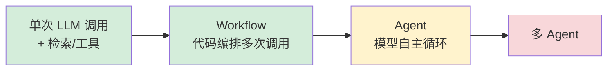
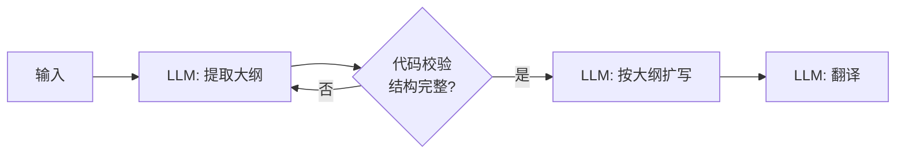
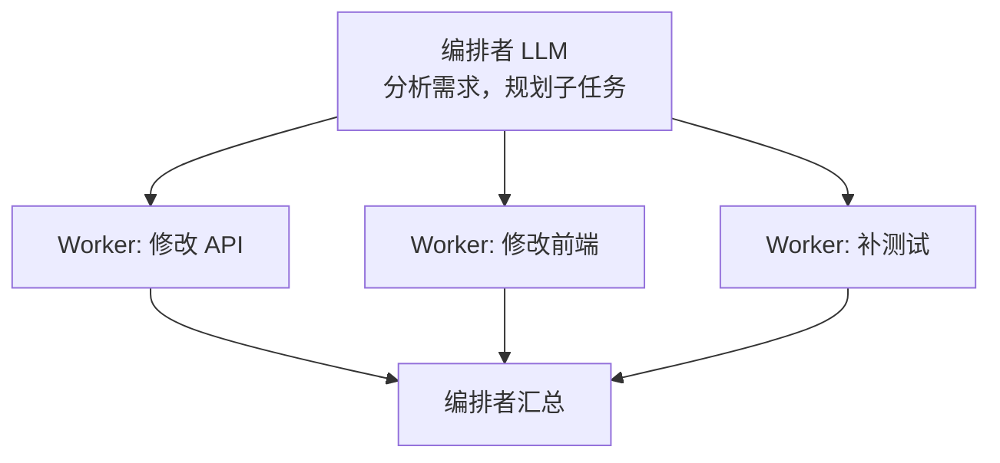
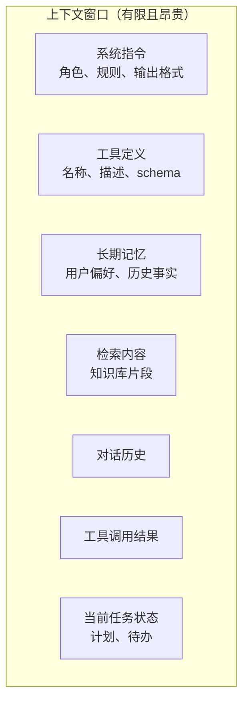
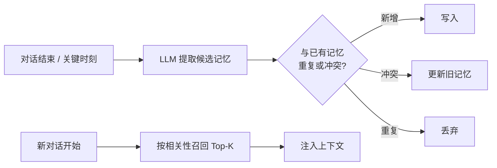
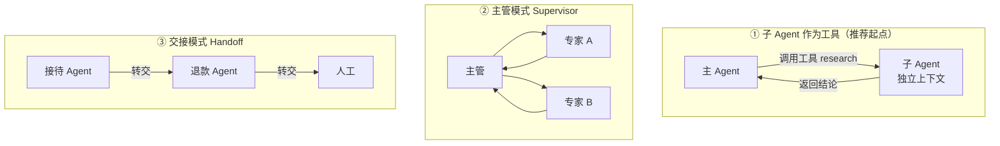

# 04 Agent 工程化：从 Loop 到生产

> 本章目标：看透 Agent 的本质，掌握 **Workflow 与 Agent 的取舍**、五种编排模式、**上下文工程**、记忆、人机协同与多 Agent 的适用边界，能设计出企业可控的 Agent 系统。
>
> 框架细节（LangGraph 的 State/Checkpointer/interrupt）见已有系列 [08](../LangChain-LangGraph入门到进阶/08-LangGraph核心概念.md) ~ [10 章](../LangChain-LangGraph入门到进阶/10-LangGraph高级模式-流式子图多Agent.md)，本章讲与框架无关的工程方法。

---

## 一、Agent 的本质：一个循环

剥掉所有框架，Agent 就是下面这几行：

```ts
async function agentLoop(task: string, tools: Tools, maxSteps = 10) {
  const context: Message[] = [{ role: 'user', content: task }];

  for (let step = 0; step < maxSteps; step++) {
    const response = await llm.call({ messages: context, tools }); // ① 模型决策
    context.push(response.message);

    if (response.toolCalls.length === 0) return response.text;      // ② 无工具调用 = 完成

    for (const call of response.toolCalls) {                        // ③ 执行工具
      const result = await executeWithGuards(call);                 //    审批、超时、权限
      context.push({ role: 'tool', toolCallId: call.id, content: result });
    }                                                               // ④ 结果回到上下文，继续循环
  }
  throw new Error('超出最大步数');
}
```

**所有 Agent 工程问题都能映射到这个循环的某一处**：

| 循环位置 | 工程问题 | 本章章节 |
|---|---|---|
| `context` 里放什么 | 上下文工程、记忆 | 三、四 |
| `tools` 给哪些 | 工具设计、权限 | [03 章](./03-MCP协议与企业工具集成.md#53-工具设计原则重点)、[08 章](./08-安全权限与上线清单.md) |
| `executeWithGuards` | 审批、人机协同、持久化 | 五 |
| 循环由谁控制 | Workflow vs Agent | 二 |
| 一个循环还是多个 | 多 Agent | 六 |
| `maxSteps` 与异常 | 可靠性 | 八 |

> 🎯 **落地要点**：选框架之前，先能**不用框架**写出这个循环。理解了它，任何框架都只是在帮你管理 `context`、`tools` 和状态持久化。

---

## 二、Workflow 还是 Agent（重点）

这是 Agent 系统设计中**最重要的决策**。

| | Workflow（工作流） | Agent（智能体） |
|---|---|---|
| 控制流 | **代码**预先定义步骤 | **模型**动态决定下一步 |
| 可预测性 | 高 | 低 |
| 可测试性 | 每步可单测 | 只能端到端评测 |
| 成本与延迟 | 可控 | 波动大 |
| 适合 | 步骤明确的业务流程 | 路径无法预知的开放任务 |
| 企业例子 | 合同审查、工单分类分派、日报生成 | 故障排查、数据分析探索、编码 |



> 🎯 **落地要点**：**从左往右逐级升级，能用左边解决就不要用右边。** 企业生产系统里最常见的形态是"**Workflow 为骨架，在少数需要灵活性的节点里嵌入 Agent**"。例如工单处理：分类（单次调用）→ 检索相似案例（代码）→ 生成处理方案（小 Agent，可查日志和知识库）→ 人工审核（代码）。

---

## 三、五种编排模式

业界公认的经典模式（源自 Anthropic《Building Effective Agents》），覆盖了绝大多数企业场景。

### 3.1 提示链（Prompt Chaining）

把任务拆成固定步骤，上一步的输出作为下一步的输入，中间可以加代码校验（gate）。



🎯 场景：营销文案生成、文档翻译与润色、报告撰写。

### 3.2 路由（Routing）

先分类，再交给专门的处理分支。各分支可以用不同的 prompt、工具，甚至不同的模型。

```ts
const { output: route } = await generateText({
  model: cheapModel, // 分类用便宜快速的模型
  output: Output.object({ schema: z.object({ intent: z.enum(['refund', 'tech', 'sales', 'other']) }) }),
  prompt: userMessage,
});

const handlers = { refund: refundAgent, tech: techAgent, sales: salesAgent, other: generalAgent };
return handlers[route.intent].stream({ prompt: userMessage });
```

🎯 场景：智能客服分流、按问题难度路由到不同价位的模型（**成本优化的核心手段**）。

### 3.3 并行（Parallelization）

两种变体：**分段**（拆成独立子任务并行处理）和**投票**（同一任务跑多次取共识）。

```ts
// 分段：合同从多个维度并行审查
const [legal, finance, compliance] = await Promise.all([
  reviewLegal(contract), reviewFinance(contract), reviewCompliance(contract),
]);
```

🎯 场景：多维度审查、内容安全检查与主任务并行（guardrail 不增加延迟）、关键判断多次投票。

### 3.4 编排者-工作者（Orchestrator-Workers）

由一个 LLM 动态拆解任务、分派给 worker，再汇总。与"并行"的区别是**子任务在运行时才确定**。



🎯 场景：深度研究（Deep Research）、跨多个文件的代码修改、多来源数据汇总。

### 3.5 评估者-优化者（Evaluator-Optimizer）

一个 LLM 生成，另一个 LLM 按标准评估并给反馈，循环直到达标。

```ts
let draft = await generate(task);
for (let i = 0; i < 3; i++) {
  const review = await evaluate(draft, criteria); // 结构化输出：{ pass, issues[] }
  if (review.pass) break;
  draft = await revise(draft, review.issues);
}
```

🎯 场景：SQL 生成后校验、代码生成后跑测试、文案按品牌规范审校。**评估标准越客观（能跑测试、能执行 SQL），效果越好。**

---

## 四、上下文工程（重点）

> 🔭 **先锋视角**：2025 年之后业界共识是，Agent 效果的上限主要由**上下文质量**决定，而不是 prompt 措辞。上下文工程（Context Engineering）就是"在每一步，把恰好需要的信息放进模型的上下文窗口"。

### 4.1 上下文由什么组成



**为什么不把所有东西都塞进去**：

- **上下文衰减（Context Rot）**：上下文越长，模型对其中信息的利用率越低，中间部分尤其容易被忽略
- **成本与延迟**：输入 token 线性计费，长上下文首 token 延迟显著增加
- **干扰**：无关信息会诱导模型调用错误工具或引用错误事实

### 4.2 四类核心操作

| 操作 | 含义 | 具体技术 |
|---|---|---|
| **写出（Write）** | 把信息存到上下文窗口之外 | 待办清单 / 草稿文件、长期记忆写入、工具结果落盘只返回摘要 |
| **选取（Select）** | 按需把信息拉进来 | RAG 检索、**即时检索**（给工具让模型自己查，而不是预先塞入）、按任务动态启用工具 |
| **压缩（Compress）** | 减少已有信息的 token | 历史对话摘要、工具结果裁剪、旧工具结果清理 |
| **隔离（Isolate）** | 把子任务放进独立上下文 | 子 Agent 处理后只返回结论；沙箱中执行代码，只回传输出 |

### 4.3 实战技巧

**① 稳定前缀，利用 Prompt Cache**

模型厂商对重复的 prompt 前缀有缓存折扣（通常输入价格降至一到二成）。上下文按"**越稳定越靠前**"排列：

```text
[系统指令] → [工具定义] → [长期记忆/知识] → [对话历史] → [最新消息]
  几乎不变      很少变         按会话变          逐轮追加        每次变
```

> ⚠️ **注意**：在系统提示里放"当前时间精确到秒"、或每次随机打乱工具顺序，会让缓存完全失效。时间等动态信息放到最后一条消息中。

**② 工具结果瘦身**

```ts
execute: async (input) => {
  const rows = await db.query(sql);
  if (rows.length > 50) {
    const file = await saveToStorage(rows); // 全量落盘
    return { preview: rows.slice(0, 20), total: rows.length, fullResultRef: file.id,
             hint: '结果已截断，如需统计请调用 analyze_result 并传入 fullResultRef' };
  }
  return rows;
}
```

**③ 对话压缩**

超过阈值（如上下文的 70%）时，把早期对话压缩为摘要：

```ts
prepareStep: async ({ messages }) => {
  if (estimateTokens(messages) < COMPACT_THRESHOLD) return;
  const [head, tail] = [messages.slice(0, -6), messages.slice(-6)];
  const summary = await summarize(head); // 保留：用户目标、已做决策、关键数据、未完成事项
  return { messages: [{ role: 'user', content: `<对话摘要>${summary}</对话摘要>` }, ...tail] };
},
```

**④ 显式任务状态（Todo / 计划）**

长任务中让 Agent 维护一个待办清单工具（`update_todos`），每步都能看到"做了什么、还剩什么"。这是 Claude Code 等编码 Agent 保持长任务不跑偏的关键手段。

**⑤ 动态工具集**

工具超过 20~30 个时选择准确率明显下降。按阶段或意图只暴露相关工具（AI SDK 的 `activeTools`），或者提供一个"工具搜索"元工具，让模型按需加载。

---

## 五、记忆

| 类型 | 生命周期 | 内容 | 存储 |
|---|---|---|---|
| **工作记忆** | 单次任务 | 当前步骤、中间结果 | 上下文 / Agent 状态 |
| **会话记忆** | 单个对话线程 | 对话历史 | 数据库（按 thread_id） |
| **长期记忆 · 语义** | 跨会话 | 用户事实与偏好："用户是前端组长，偏好 TS" | KV / 向量库 |
| **长期记忆 · 情景** | 跨会话 | 过往成功案例："上次这类故障是缓存击穿" | 向量库 + 元数据 |
| **长期记忆 · 程序** | 跨会话 | 怎么做事："提交前先跑 lint" | 系统指令 / Skill / 规则文件 |

### 5.1 长期记忆的设计要点



- **写入时机**：对话结束后异步提取（不阻塞响应），或给 Agent 一个 `remember` 工具主动写入
- **去重与更新**：新记忆要和旧记忆比对，"用户换组了"应更新而不是新增一条矛盾记录
- **召回要克制**：只召回与当前任务相关的少量记忆，否则就是在污染上下文
- **可见、可删**：企业场景中用户必须能查看和删除关于自己的记忆（隐私合规要求）

> ⚠️ **注意**：**召回的记忆是"背景信息"，不是"指令"**。如果记忆内容来自不可信来源（例如用户上传文档中的内容被写进了记忆），就形成了持久化的提示注入。记忆写入要有来源标记，召回时以数据形式包裹。

---

## 六、人机协同与持久化执行

### 6.1 三种人机协同模式

| 模式 | 时机 | 例子 |
|---|---|---|
| **审批（Approve）** | 执行有副作用的工具前 | 发邮件、退款、删除、部署 |
| **编辑（Edit）** | 审批时允许修改参数 | 修改 Agent 拟好的邮件正文后再发送 |
| **追问（Clarify）** | 信息不足时主动询问 | "您说的'上个月'是指自然月还是近 30 天？" |

AI SDK 的实现见 [02 章第六节](./02-AI-SDK与AI前端工程.md#六工具审批human-in-the-loop重点)，LangGraph 的 `interrupt` 见已有系列 [09 章](../LangChain-LangGraph入门到进阶/09-LangGraph持久化-记忆与人机协同.md)。

### 6.2 为什么需要持久化执行

审批可能要等几小时（审批人在开会），长任务可能跑几十分钟，期间服务会重新部署。如果 Agent 状态只在内存里，这些都会导致任务丢失。

> 📖 **持久化执行（Durable Execution）**：每完成一步就把执行状态写入持久存储，进程崩溃或重启后从最后一步继续，而不是从头再来。

| 方案 | 特点 | 适合 |
|---|---|---|
| LangGraph + Checkpointer（Postgres） | 状态图天然按节点存档，支持时间旅行 | 复杂流程，Python/TS |
| AI SDK `WorkflowAgent` | 与 AI SDK 一体，基于 Workflow SDK | TS 栈、Vercel 生态 |
| Temporal / Inngest / Trigger.dev | 通用持久化工作流引擎，Agent 作为其中的步骤 | 已有工作流基础设施的团队 |

> 🎯 **落地要点**：持久化之后，**工具调用必须幂等**。恢复执行时某一步可能被重放，退款工具要用 `idempotencyKey` 防止重复退款。

---

## 七、多 Agent：何时值得

### 7.1 代价先行

多 Agent 的 token 消耗通常是单 Agent 的**数倍到十几倍**，调试难度也成倍增加。业界经验是：**多数企业场景用"单 Agent + 好工具 + 好上下文"就够了**。

值得用多 Agent 的场景：

- **可并行的广度任务**：深度研究，多个子 Agent 同时调研不同方向
- **上下文隔离**：子任务会产生大量中间信息（读几十个文件），只需把结论带回主线
- **权限隔离**：不同 Agent 持有不同工具权限，切断"致命三要素"

### 7.2 三种常见架构



| 架构 | 控制权 | 适合 |
|---|---|---|
| ① 子 Agent 作为工具 | 始终在主 Agent | **最简单可控**，上下文隔离 |
| ② 主管模式 | 主管统筹多轮 | 需要协调多个专家的复杂任务 |
| ③ 交接模式 | 依次转移给下一个 Agent | 客服分流，每个 Agent 职责单一 |

> ⚠️ **注意**：子 Agent 返回给主 Agent 的应该是**精炼结论 + 引用**，而不是完整过程。否则就失去了上下文隔离的意义。

---

## 八、向编码 Agent 学习 Agent 工程

Claude Code、Codex CLI、Cline、OpenCode 是目前**工程化最成熟**的 Agent，它们的设计可以直接迁移到企业 Agent：

| 设计 | 编码 Agent 中的做法 | 迁移到企业 Agent |
|---|---|---|
| **少而通用的工具** | read / edit / bash / grep / glob，组合出无限能力 | 优先设计少量通用、可组合的工具，而不是几百个专用工具 |
| **权限模式** | 只读 / 每次确认 / 自动执行分级；危险命令拦截 | 按工具风险分级审批，按用户角色配置 |
| **待办清单** | 长任务维护 todo，逐项勾选 | 长流程显式维护任务状态 |
| **自动压缩** | 上下文将满时摘要历史 | 长对话压缩策略 |
| **子 Agent** | 探索代码库用独立上下文，只返回结论 | 检索、分析类子任务隔离 |
| **Hooks** | 工具执行前后触发脚本（格式化、拦截） | 工具调用前后的审计、校验、脱敏 |
| **项目规则文件** | CLAUDE.md / AGENTS.md 提供持久指令 | 租户级、业务线级的规则配置 |
| **Skills** | 按需加载的能力包（指令 + 脚本 + 资源） | SOP 产品化，按任务加载 |

> 🔭 **先锋视角**：如果你的需求本质是"在代码或文件上完成复杂任务"，优先考虑**复用成熟 Harness**（Claude Agent SDK、AI SDK `HarnessAgent`），而不是从零写 Agent Loop。自研的价值在于业务工具和上下文，而不是循环本身。

---

## 九、框架选型

| 框架 | 语言 | 强项 | 选择时机 |
|---|---|---|---|
| **AI SDK**（ToolLoopAgent / WorkflowAgent） | TS | 前后端一体、流式 UI、审批、多模型 | TS 团队、交互型 Agent，**前端/全栈首选** |
| **Mastra** | TS | Agent + Workflow + Memory + Eval + 本地 Playground 一体化 | 想要开箱即用的完整 TS Agent 框架 |
| **LangGraph** | Py / TS | 显式状态图、Checkpointer、时间旅行、子图 | 分支多、需要精细控制和回溯的复杂流程 |
| **OpenAI Agents SDK** | Py / TS | Handoff、Guardrails 抽象简洁 | 以 OpenAI 模型为主 |
| **Claude Agent SDK** | Py / TS | 复用 Claude Code 的 Harness：文件、命令、子 Agent、Skills | 编码 / 文件操作 / 研究类 Agent |

> 🎯 **落地要点**：框架会变，**工具设计、上下文策略、评测集**才是可沉淀的资产。把它们和框架代码解耦存放（工具定义独立成模块、prompt 版本化管理、评测集独立维护），换框架时成本就很低。

---

## 十、Agent 可靠性清单

- [ ] **步数上限**：每个 Agent 都设置 `stopWhen` / `maxSteps`
- [ ] **Token 预算**：单次任务的 token 和费用上限，超出即中止并告知用户
- [ ] **工具超时**：每个工具都有独立超时，超时返回可读错误让模型换策略
- [ ] **重复调用检测**：同一工具、同一参数连续调用 N 次即判定为卡死
- [ ] **确定性环节用代码**：日期计算、金额计算、权限判断不交给模型
- [ ] **工具幂等**：所有写操作支持幂等键
- [ ] **降级路径**：主模型不可用时切换备用模型；Agent 失败时转人工
- [ ] **完整 Trace**：每一步的输入、输出、工具调用、耗时都可追溯（07 章）
- [ ] **评测集回归**：改 prompt、换模型、加工具前后都要跑评测（07 章）

---

## 本章小结

- Agent = **模型决策 → 执行工具 → 结果回到上下文** 的循环，所有工程问题都映射到这个循环上
- **能用 Workflow 就不用 Agent**；企业主流形态是"Workflow 骨架 + 局部 Agent"
- 五种模式：**提示链、路由、并行、编排者-工作者、评估者-优化者**
- 上下文工程四操作：**写出、选取、压缩、隔离**；稳定前缀以利用 prompt cache
- 多 Agent 代价高，从"**子 Agent 作为工具**"开始；长任务需要**持久化执行 + 幂等工具**

## 练习

1. 把"工单处理"设计为 Workflow + 局部 Agent 的混合架构，画出流程图，标注每个节点是代码、单次 LLM 调用还是 Agent
2. 用 AI SDK 实现路由模式：便宜模型分类，按意图分发到三个不同的 `ToolLoopAgent`
3. 给一个 Agent 实现 `prepareStep` 对话压缩，对比压缩前后在 30 轮对话后的 token 用量和回答质量
4. 实现"评估者-优化者"模式生成 SQL：生成后在只读库中 `EXPLAIN` 校验，失败则带错误信息重写
