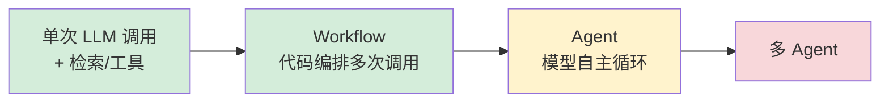
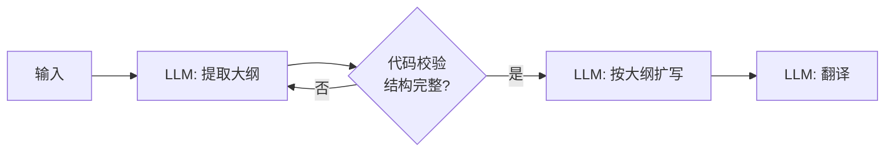
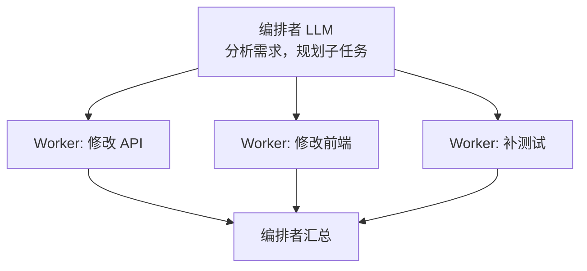
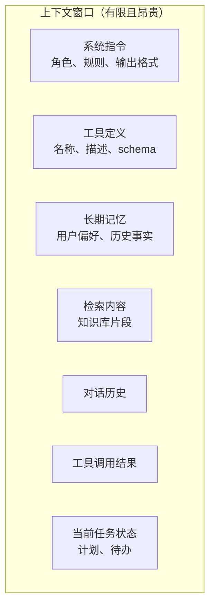
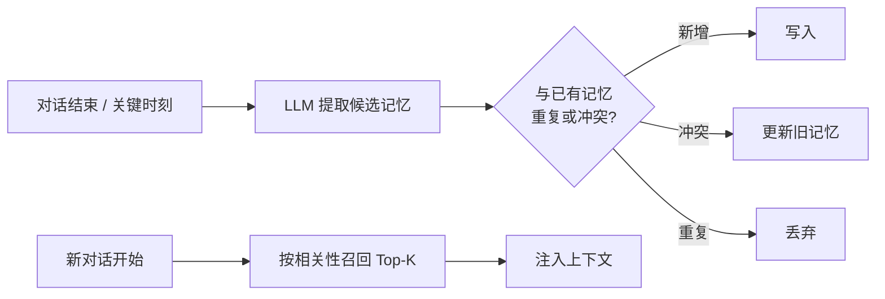
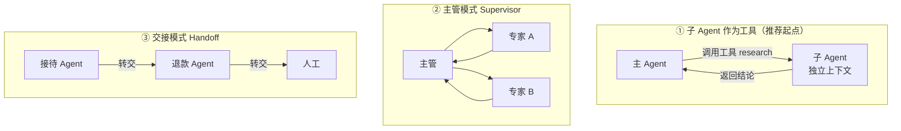

# 06 Agent 工程化：从 Loop 到生产

> 本章目标：看透 Agent 的本质，掌握 **Workflow 与 Agent 的取舍**、五种编排模式、**上下文工程**、记忆、人机协同、持久化执行与多 Agent 的适用边界，并能在**各语言生态**中选出合适的框架。
>
> 本章讲**与框架无关**的工程方法，代码以 Python 风格伪代码表达思路。LangGraph 的具体用法见已有系列 [08](../LangChain-LangGraph入门到进阶/08-LangGraph核心概念.md) ~ [10 章](../LangChain-LangGraph入门到进阶/10-LangGraph高级模式-流式子图多Agent.md)。

---

## 一、Agent 的本质：一个循环

剥掉所有框架，Agent 就是下面这几行：

```python
async def agent_loop(task: str, tools: list[Tool], max_steps: int = 10) -> str:
    context = [{"role": "user", "content": task}]

    for _ in range(max_steps):
        response = await llm.call(messages=context, tools=tools)   # ① 模型决策
        context.append(response.message)

        if not response.tool_calls:                                # ② 无工具调用 = 完成
            return response.text

        for call in response.tool_calls:                           # ③ 执行工具
            result = await execute_with_guards(call)               #    权限、审批、超时
            context.append({"role": "tool", "tool_call_id": call.id, "content": result})
                                                                   # ④ 结果回到上下文，继续循环
    raise StepLimitExceeded()
```

**所有 Agent 工程问题都能映射到这个循环的某一处**：

| 循环位置 | 工程问题 | 章节 |
|---|---|---|
| 循环由谁控制 | Workflow vs Agent、编排模式 | 本章二、三 |
| `context` 里放什么 | 上下文工程、记忆 | 本章四、五 |
| `tools` 给哪些 | 工具设计、权限 | [05 章 5.5](./05-MCP与Agent互操作协议.md#55-工具设计原则重点)、[10 章](./10-安全权限与上线清单.md) |
| `execute_with_guards` | 审批、人机协同、持久化 | 本章六 |
| 一个循环还是多个 | 多 Agent | 本章七 |
| 谁来实现这个循环 | Harness 与框架选型 | 本章八、九 |
| `max_steps` 与异常 | 可靠性 | 本章十 |

> 🎯 **落地要点**：选框架之前，先能**不用框架**写出这个循环。理解了它，任何框架都只是在帮你管理 `context`、`tools` 和状态持久化。

---

## 二、Workflow 还是 Agent（重点）

这是 Agent 系统设计中**最重要的决策**。

| | Workflow（工作流） | Agent（智能体） |
|---|---|---|
| 控制流 | **代码**预先定义步骤 | **模型**动态决定下一步 |
| 可预测性 | 高 | 低 |
| 可测试性 | 每步可单测 | 只能端到端评测 |
| 成本与延迟 | 可控 | 波动大 |
| 适合 | 步骤明确的业务流程 | 路径无法预知的开放任务 |
| 企业例子 | 合同审查、工单分类分派、日报生成 | 故障排查、数据分析探索、编码 |



> 🎯 **落地要点**：**从左往右逐级升级，能用左边解决就不要用右边。** 企业生产系统里最常见的形态是"**Workflow 为骨架，在少数需要灵活性的节点里嵌入 Agent**"。例如工单处理：分类（单次调用）→ 检索相似案例（代码）→ 生成处理方案（小 Agent，可查日志和知识库）→ 人工审核（代码）。

---

## 三、五种编排模式

业界公认的经典模式（源自 Anthropic《Building Effective Agents》），覆盖了绝大多数企业场景，**与框架无关**。

### 3.1 提示链（Prompt Chaining）

把任务拆成固定步骤，上一步的输出作为下一步的输入，中间可以加代码校验（gate）。



🎯 场景：营销文案生成、文档翻译与润色、报告撰写。

### 3.2 路由（Routing）

先分类，再交给专门的处理分支。各分支可以用不同的 prompt、工具，甚至不同的模型。

```python
class Route(BaseModel):
    intent: Literal["refund", "tech", "sales", "other"]

route = await light_llm.structured(Route, prompt=user_message)   # 分类用便宜快速的模型
handlers = {"refund": refund_agent, "tech": tech_agent, "sales": sales_agent, "other": general_agent}
return await handlers[route.intent].run(user_message)
```

🎯 场景：智能客服分流、按问题难度路由到不同价位的模型（**成本优化的核心手段**）。

### 3.3 并行（Parallelization）

两种变体：**分段**（拆成独立子任务并行处理）和**投票**（同一任务跑多次取共识）。

```python
# 分段：合同从多个维度并行审查
legal, finance, compliance = await asyncio.gather(
    review_legal(contract), review_finance(contract), review_compliance(contract),
)
```

🎯 场景：多维度审查、内容安全检查与主任务并行（护栏不增加延迟）、关键判断多次投票。

### 3.4 编排者-工作者（Orchestrator-Workers）

由一个 LLM 动态拆解任务、分派给 worker，再汇总。与"并行"的区别是**子任务在运行时才确定**。



🎯 场景：深度研究（Deep Research）、跨多个文件的代码修改、多来源数据汇总。

### 3.5 评估者-优化者（Evaluator-Optimizer）

一个 LLM 生成，另一个 LLM（或代码）按标准评估并给反馈，循环直到达标。

```python
draft = await generate(task)
for _ in range(3):
    review = await evaluate(draft, criteria)   # 结构化输出：{pass, issues[]}
    if review.passed:
        break
    draft = await revise(draft, review.issues)
```

🎯 场景：SQL 生成后校验、代码生成后跑测试、文案按品牌规范审校。**评估标准越客观（能跑测试、能执行 SQL），效果越好。**

### 3.6 各框架如何表达这些模式

| 模式 | LangGraph | Google ADK | Spring AI Alibaba | 通用写法 |
|---|---|---|---|---|
| 提示链 | 顺序边 | `SequentialAgent` | `SequentialAgent` | 顺序调用 |
| 路由 | 条件边 | LLM 驱动的子 Agent 委派 | `RoutingAgent` | 分类 + 分发 |
| 并行 | 并行分支 / `Send` | `ParallelAgent` | `ParallelAgent` | `gather` / `Promise.all` |
| 评估-优化 | 条件边形成循环 | `LoopAgent` | `LoopAgent` | `for` 循环 |

> 🎯 **落地要点**：模式名称在各框架中高度相似，说明它们是**通用的设计语言**。学会模式，看任何框架的文档都只是在找对应的 API。

---

## 四、上下文工程（重点）

> 🔭 **先锋视角**：业界共识是，Agent 效果的上限主要由**上下文质量**决定，而不是 prompt 措辞。上下文工程（Context Engineering）就是"在每一步，把恰好需要的信息放进模型的上下文窗口"。

### 4.1 上下文由什么组成



**为什么不把所有东西都塞进去**：

- **上下文衰减（Context Rot）**：上下文越长，模型对其中信息的利用率越低，中间部分尤其容易被忽略
- **成本与延迟**：输入 token 线性计费，长上下文首 token 延迟显著增加
- **干扰**：无关信息会诱导模型调用错误工具或引用错误事实

### 4.2 四类核心操作

| 操作 | 含义 | 具体技术 |
|---|---|---|
| **写出（Write）** | 把信息存到上下文窗口之外 | 待办清单 / 草稿文件、长期记忆写入、工具结果落盘只返回摘要 |
| **选取（Select）** | 按需把信息拉进来 | RAG 检索、**即时检索**（给工具让模型自己查，而不是预先塞入）、按任务动态启用工具、按需加载 Skill |
| **压缩（Compress）** | 减少已有信息的 token | 历史对话摘要、工具结果裁剪、旧工具结果清理 |
| **隔离（Isolate）** | 把子任务放进独立上下文 | 子 Agent 处理后只返回结论；沙箱中执行代码，只回传输出 |

### 4.3 实战技巧

**① 稳定前缀，利用 Prompt Cache**

模型厂商和推理引擎都会缓存重复的 prompt 前缀（商用 API 通常把缓存部分的输入价格降至一到二成；自建推理则直接节省计算）。上下文按"**越稳定越靠前**"排列：

```text
[系统指令] → [工具定义] → [长期记忆/知识] → [对话历史] → [最新消息]
  几乎不变      很少变         按会话变          逐轮追加        每次变
```

> ⚠️ **注意**：在系统提示里放"当前时间精确到秒"、或每次随机打乱工具顺序，会让缓存完全失效。时间等动态信息放到最后一条消息中。

**② 工具结果瘦身**

```python
async def query_data(sql: str) -> dict:
    rows = await db.fetch(sql)
    if len(rows) > 50:
        ref = await storage.save(rows)          # 全量落盘
        return {"preview": rows[:20], "total": len(rows), "full_result_ref": ref,
                "hint": "结果已截断，如需统计请调用 analyze_result 并传入 full_result_ref"}
    return {"rows": rows}
```

**③ 对话压缩**

超过阈值（如上下文的 70%）时，把早期对话压缩为摘要。各框架都提供了"每步调用模型前"的钩子（AI SDK 的 `prepareStep`、LangChain 1.x 的中间件等）：

```python
async def before_model_call(messages: list[dict]) -> list[dict]:
    if estimate_tokens(messages) < COMPACT_THRESHOLD:
        return messages
    head, tail = messages[:-6], messages[-6:]
    summary = await summarize(head)   # 保留：用户目标、已做决策、关键数据、未完成事项
    return [{"role": "user", "content": f"<对话摘要>{summary}</对话摘要>"}, *tail]
```

**④ 显式任务状态（Todo / 计划）**

长任务中让 Agent 维护一个待办清单工具（`update_todos`），每步都能看到"做了什么、还剩什么"。这是 Claude Code 等编码 Agent 保持长任务不跑偏的关键手段。

**⑤ 动态工具集**

工具超过 20~30 个时选择准确率明显下降。按阶段或意图只暴露相关工具，或者提供一个"工具搜索"元工具，让模型按需加载。

**⑥ 渐进式披露（Skills 的核心思想）**

上下文中只放每个 Skill 的名称和一句话描述；模型判断需要时，才加载完整的指令、脚本和参考资料。这让 Agent 可以"拥有"上百种能力，却只为当前用到的付出上下文成本。

---

## 五、记忆

| 类型 | 生命周期 | 内容 | 存储 |
|---|---|---|---|
| **工作记忆** | 单次任务 | 当前步骤、中间结果 | 上下文 / Agent 状态 |
| **会话记忆** | 单个对话线程 | 对话历史 | 数据库（按 thread_id） |
| **长期记忆 · 语义** | 跨会话 | 用户事实与偏好："用户是数据组组长，常用 Python" | KV / 向量库 |
| **长期记忆 · 情景** | 跨会话 | 过往成功案例："上次这类故障是缓存击穿" | 向量库 + 元数据 |
| **长期记忆 · 程序** | 跨会话 | 怎么做事："提交前先跑 lint" | 系统指令 / Skill / 规则文件 |

### 5.1 长期记忆的设计要点



- **写入时机**：对话结束后异步提取（不阻塞响应），或给 Agent 一个 `remember` 工具主动写入
- **去重与更新**：新记忆要和旧记忆比对，"用户换组了"应更新而不是新增一条矛盾记录
- **时间维度**：事实会过期，记录"何时成立"，召回时优先较新的事实
- **召回要克制**：只召回与当前任务相关的少量记忆，否则就是在污染上下文
- **可见、可删**：企业场景中用户必须能查看和删除关于自己的记忆（隐私合规要求）

### 5.2 现成方案

| 方案 | 思路 | 适合 |
|---|---|---|
| **Mem0** | 通用记忆层：自动提取、去重、更新、召回 | 快速给应用加长期记忆 |
| **Letta**（原 MemGPT） | 模型像操作系统管理内存一样，自主决定读写哪层记忆 | 长期陪伴型 Agent |
| **Graphiti**（Zep） | 带时间维度的知识图谱 | 事实频繁变化、需要关系推理 |
| 框架内置 | LangGraph Store、ADK Memory、Spring AI ChatMemory 等 | 已选定框架时优先 |

> ⚠️ **注意**：**召回的记忆是"背景信息"，不是"指令"**。如果记忆内容来自不可信来源（例如用户上传文档中的内容被写进了记忆），就形成了**持久化的提示注入**（OWASP Agentic Top 10 中的"记忆与上下文投毒"）。记忆写入要有来源标记，召回时以数据形式包裹。

---

## 六、人机协同与持久化执行

### 6.1 人机协同

三种模式（审批、编辑、追问）的交互设计与各框架实现见 [04 章第六节](./04-AI交互层-流式协议与生成式UI.md#六人机协同的交互设计重点)。从编排层看，关键是：**Agent 必须能在任意一步暂停，并在数小时后从同一位置恢复**。这就引出了持久化执行。

### 6.2 为什么需要持久化执行

审批可能要等几小时（审批人在开会），长任务可能跑几十分钟，期间服务会重新部署。如果 Agent 状态只在内存里，这些都会导致任务丢失。

> 📖 **持久化执行（Durable Execution）**：每完成一步就把执行状态写入持久存储，进程崩溃或重启后从最后一步继续，而不是从头再来。

| 方案 | 特点 | 适合 |
|---|---|---|
| **LangGraph + Checkpointer**（Postgres 等） | 状态图天然按节点存档，支持时间旅行（回到历史状态重跑） | 复杂流程，Python / TS |
| **框架内置** | MAF Workflow 检查点、Spring AI Alibaba Graph 持久化、LangChain4j Agentic 状态持久化、AI SDK `WorkflowAgent` | 已选定框架时优先 |
| **Temporal** | 工业级持久化工作流引擎，多语言 SDK，Agent 作为其中的活动步骤 | 已有工作流基础设施、强可靠性要求 |
| **Restate / DBOS / Inngest** | 更轻量的持久化执行 | 中小规模 |

> 🎯 **落地要点**：持久化之后，**工具调用必须幂等**。恢复执行时某一步可能被重放，退款工具要用幂等键（idempotency key）防止重复退款。

---

## 七、多 Agent：何时值得

### 7.1 代价先行

多 Agent 的 token 消耗通常是单 Agent 的**数倍到十几倍**，调试难度也成倍增加，还会引入新的风险（OWASP Agentic Top 10 中的"Agent 间通信不安全""级联故障"）。业界经验是：**多数企业场景用"单 Agent + 好工具 + 好上下文"就够了**。

值得用多 Agent 的场景：

- **可并行的广度任务**：深度研究，多个子 Agent 同时调研不同方向
- **上下文隔离**：子任务会产生大量中间信息（读几十个文件），只需把结论带回主线
- **权限隔离**：不同 Agent 持有不同工具权限，切断"致命三要素"
- **组织边界**：不同团队各自维护自己的 Agent，通过 A2A 协作（[05 章第十节](./05-MCP与Agent互操作协议.md#十a2aagent-之间的协作协议重点)）

### 7.2 三种常见架构



| 架构 | 控制权 | 适合 |
|---|---|---|
| ① 子 Agent 作为工具 | 始终在主 Agent | **最简单可控**，上下文隔离 |
| ② 主管模式 | 主管统筹多轮 | 需要协调多个专家的复杂任务 |
| ③ 交接模式 | 依次转移给下一个 Agent | 客服分流，每个 Agent 职责单一（OpenAI Agents SDK 的 Handoff 是典型实现） |

> ⚠️ **注意**：子 Agent 返回给主 Agent 的应该是**精炼结论 + 引用**，而不是完整过程。否则就失去了上下文隔离的意义。

---

## 八、Harness 工程：向编码 Agent 学习

> 📖 **Harness**：包裹在模型外面、让模型能可靠完成任务的全部工程设施——工具集、上下文管理、权限、沙箱、记忆、子 Agent、生命周期钩子。**Agent = 模型 + Harness**。

Claude Code、Codex CLI、OpenCode、Cline 是目前**工程化最成熟**的 Harness，它们的设计可以直接迁移到企业 Agent：

| 设计 | 编码 Agent 中的做法 | 迁移到企业 Agent |
|---|---|---|
| **少而通用的工具** | read / edit / bash / grep / glob，组合出无限能力 | 优先设计少量通用、可组合的工具，而不是几百个专用工具 |
| **代码即行动** | 让模型写脚本处理数据，而不是逐条调用工具 | 数据处理类任务提供沙箱代码执行（smolagents、MAF CodeAct 也采用此思路） |
| **权限模式** | 只读 / 每次确认 / 自动执行分级；危险命令拦截 | 按工具风险分级审批，按用户角色配置 |
| **待办清单** | 长任务维护 todo，逐项勾选 | 长流程显式维护任务状态 |
| **自动压缩** | 上下文将满时摘要历史 | 长对话压缩策略 |
| **子 Agent** | 探索代码库用独立上下文，只返回结论 | 检索、分析类子任务隔离 |
| **Hooks** | 工具执行前后触发脚本（格式化、拦截） | 工具调用前后的审计、校验、脱敏 |
| **项目规则文件** | CLAUDE.md / AGENTS.md 提供持久指令 | 租户级、业务线级的规则配置 |
| **Skills** | 按需加载的能力包（指令 + 脚本 + 资源） | SOP 产品化，按任务加载 |

> 🔭 **先锋视角**：如果需求本质是"在代码、文件或数据上完成复杂任务"，优先考虑**复用成熟 Harness**（Claude Agent SDK、AI SDK `HarnessAgent`、MAF Agent Harness、LangChain Deep Agents），而不是从零写 Agent Loop。自研的价值在于**业务工具、业务上下文和治理**，而不是循环本身。

---

## 九、框架选型（多语言）

### 9.1 按生态选

| 生态 | 首选 | 备选 | 说明 |
|---|---|---|---|
| **Python** | LangGraph | OpenAI Agents SDK、Google ADK、Pydantic AI、MAF、LlamaIndex | AI 生态最完整，新能力最先出现 |
| **TypeScript** | Vercel AI SDK | Mastra、LangGraph.js | 交互层与全栈应用 |
| **Java** | Spring AI / Spring AI Alibaba | LangChain4j、Google ADK Java | 国内企业后端主力；Spring AI 2.x 需要 Spring Boot 4.1 |
| **Go** | Eino | Google ADK Go | 高并发服务、云原生团队 |
| **.NET** | Microsoft Agent Framework | — | Semantic Kernel / AutoGen 的继任者 |

### 9.2 按场景选

| 场景 | 推荐 |
|---|---|
| 复杂分支、需要回溯和精细控制的流程 | LangGraph、MAF Workflow、Spring AI Alibaba Graph |
| 深度绑定某家模型的能力 | 该厂商的 SDK：OpenAI Agents SDK、Claude Agent SDK、Google ADK |
| 编码 / 文件 / 研究类长任务 | 复用 Harness：Claude Agent SDK、Deep Agents |
| 强类型、结构化输出为主 | Pydantic AI |
| 交互重的全栈产品 | Vercel AI SDK + AG-UI 生态 |
| 跨团队 Agent 协作 | 任一支持 A2A 的框架（ADK、MAF、Spring AI Alibaba 等） |

> 🎯 **落地要点**：框架会变，**工具设计、上下文策略、评测集**才是可沉淀的资产。把它们和框架代码解耦（工具以 MCP Server 形式独立、prompt 版本化管理、评测集独立维护），换框架、甚至换语言时成本都很低。

---

## 十、Agent 可靠性清单

- [ ] **步数上限**：每个 Agent 都设置最大步数
- [ ] **Token 预算**：单次任务的 token 和费用上限，超出即中止并告知用户
- [ ] **工具超时**：每个工具都有独立超时，超时返回可读错误让模型换策略
- [ ] **重复调用检测**：同一工具、同一参数连续调用 N 次即判定为卡死
- [ ] **确定性环节用代码**：日期计算、金额计算、权限判断不交给模型
- [ ] **工具幂等**：所有写操作支持幂等键
- [ ] **防级联故障**：一个 Agent 或工具的错误输出不能无校验地成为下一步的输入（关键数据做结构化校验）
- [ ] **降级路径**：主模型不可用时切换备用模型；Agent 失败时转人工
- [ ] **完整 Trace**：每一步的输入、输出、工具调用、耗时都可追溯（[09 章](./09-LLMOps-可观测评测与AI网关.md)）
- [ ] **评测集回归**：改 prompt、换模型、加工具前后都要跑评测（[09 章](./09-LLMOps-可观测评测与AI网关.md)）

---

## 本章小结

- Agent = **模型决策 → 执行工具 → 结果回到上下文** 的循环，所有工程问题都映射到这个循环上
- **能用 Workflow 就不用 Agent**；企业主流形态是"Workflow 骨架 + 局部 Agent"
- 五种模式：**提示链、路由、并行、编排者-工作者、评估者-优化者**，在各框架中名称高度一致
- 上下文工程四操作：**写出、选取、压缩、隔离**；稳定前缀以利用 prompt cache；Skills 实现渐进式披露
- 长任务需要**持久化执行 + 幂等工具**；多 Agent 代价高，从"**子 Agent 作为工具**"开始
- **Agent = 模型 + Harness**；框架按团队语言生态选，资产（工具、上下文、评测）与框架解耦

## 练习

1. 把"工单处理"设计为 Workflow + 局部 Agent 的混合架构，画出流程图，标注每个节点是代码、单次 LLM 调用还是 Agent
2. 不使用任何 Agent 框架，只用模型厂商的原生 SDK 实现第一节的循环（含工具调用、步数上限、超时），再用 LangGraph 重写，对比两者
3. 选两种不同语言的框架（如 LangGraph 与 Spring AI Alibaba），分别实现路由模式，对比 API 设计
4. 给一个 Agent 实现对话压缩，对比压缩前后在 30 轮对话后的 token 用量和回答质量
5. 实现"评估者-优化者"模式生成 SQL：生成后在只读库中 `EXPLAIN` 校验，失败则带错误信息重写
