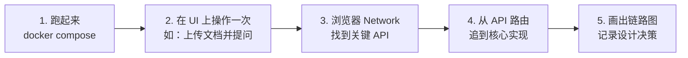
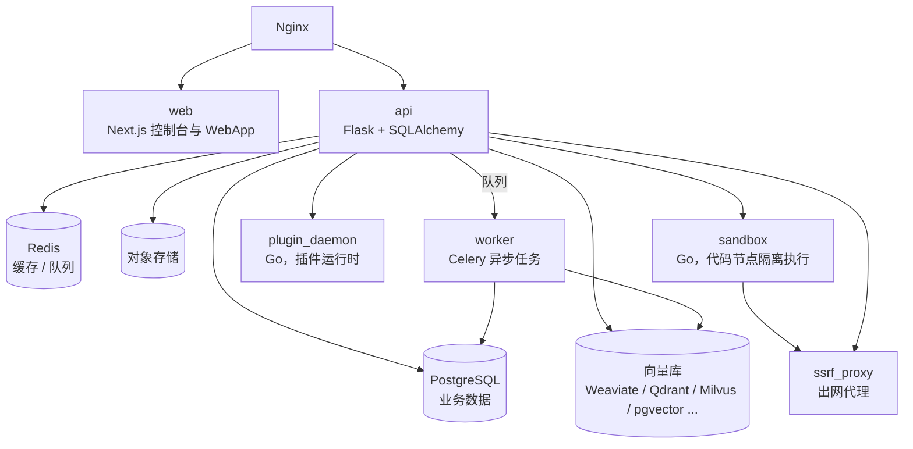
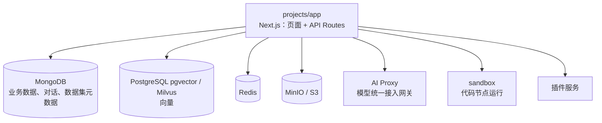

# 06 LLM 平台源码导读

> 本章目标：拆解 4 个主流开源 LLM 平台的架构与关键设计，知道**每个平台最值得读的那部分源码在哪**，以及自研时可以直接借鉴的设计。
>
> ⚠️ 平台迭代很快，目录结构以你 clone 时的版本为准。本章给出的是**模块定位与阅读路线**，读之前先 `git log` 看一下近期的重构。

---

## 一、读平台源码的方法

不要从 `main` 函数开始逐行读。按**一条核心请求链路**纵向切入：



每个平台建议追踪的三条链路：

1. **一次对话**：从 API 入口到模型调用，再到流式返回
2. **一次文档入库**：从上传到解析、切片、向量化、写入索引
3. **一次工作流执行**：从画布 DSL 到执行引擎，再到节点调度

---

## 二、Dify：最完整的企业 LLM 平台

### 2.1 定位

国内私有化部署最多的 LLM 应用平台。应用类型覆盖聊天助手、Agent、Chatflow（对话型工作流）、Workflow（任务型工作流），内置知识库、插件市场、多租户（工作空间）和权限。

### 2.2 架构



**值得注意的组件设计**：

| 组件 | 设计意图 |
|---|---|
| **plugin_daemon** | 1.0 起把模型供应商、工具、Agent 策略全部**插件化**，独立进程运行，主服务不再内置各厂商适配代码 |
| **sandbox** | 工作流的代码节点在隔离沙箱执行（系统调用白名单），防止用户代码攻击宿主 |
| **ssrf_proxy** | 所有出网请求经代理，防止用户通过 HTTP 节点访问内网地址（SSRF 攻击） |
| **worker** | 文档索引等耗时任务进入 Celery 队列，API 不阻塞 |

> 📖 **SSRF（服务端请求伪造）**：攻击者让服务器代为请求内网地址（如 `http://169.254.169.254` 云元数据接口、内网管理后台）。凡是"用户可配置 URL、由服务器发起请求"的功能都有此风险。

### 2.3 后端目录地图（`api/`）

```text
api/
├── controllers/        # HTTP 路由
│   ├── console/        #   控制台 API（管理端）
│   ├── service_api/    #   对外开放 API（API Key 鉴权）
│   └── web/            #   WebApp 终端用户 API
├── services/           # 业务服务层
├── models/             # SQLAlchemy 数据模型（tenant、app、dataset、conversation ...）
├── core/               # ★ 核心引擎
│   ├── app/            #   各应用类型的运行器与队列（流式事件的生产者）
│   ├── workflow/       #   ★ 工作流引擎：图引擎 + 各类节点
│   ├── rag/            #   ★ RAG：提取、切分、检索、重排
│   ├── agent/          #   Agent 策略（Function Calling / ReAct）
│   ├── plugin/         #   与 plugin_daemon 通信
│   └── ops/            #   对接 Langfuse / LangSmith 等可观测平台
└── tasks/              # Celery 异步任务
```

### 2.4 推荐阅读路线

| 顺序 | 读什么 | 学什么 |
|---|---|---|
| 1 | `models/` 中的 tenant、account、app | **多租户数据模型**：工作空间、成员、角色怎么设计 |
| 2 | `core/app/` 中某个应用类型的生成流程 | 一次对话的生命周期；**事件队列 → SSE 流式输出**的实现 |
| 3 | `core/workflow/` | **DAG 工作流引擎**：图解析、节点调度、并行分支、变量池、错误处理 |
| 4 | `core/rag/` | 检索方法（向量 / 全文 / 混合）、重排、多知识库召回策略 |
| 5 | `core/plugin/` + plugin_daemon 仓库 | **插件体系**：插件协议、进程隔离、反向调用主服务 |

### 2.5 可借鉴的设计

- **应用 DSL**：应用整体可导出为 YAML，支持版本管理与跨环境迁移，这是"Prompt 与流程即代码"的落地
- **变量池（Variable Pool）**：工作流节点之间用 `{{#节点ID.变量名#}}` 引用数据，统一管理作用域
- **三套 API 分层**：控制台 / 开放 API / 终端用户 API 各自鉴权，边界清晰
- **可观测对接**：内置把 trace 发送给 Langfuse 等平台的适配层，而不是自己造监控

---

## 三、FastGPT：前端最易读懂的全栈 TS 平台

### 3.1 定位

国内团队开发的知识库问答 + 工作流平台，**全栈 TypeScript**，Next.js 同时承担前端与 API。对前端工程师来说是理解"完整 LLM 平台"门槛最低的选择。

### 3.2 架构



### 3.3 Monorepo 目录地图

```text
FastGPT/
├── projects/app/          # ★ 主应用（Next.js）
│   └── src/
│       ├── pages/api/     #   API 路由入口
│       ├── pageComponents/#   页面级组件（工作流画布、知识库管理）
│       └── web/           #   前端 store、API 封装
├── packages/
│   ├── global/            # 前后端共享的类型与常量（节点类型、权限定义）
│   ├── service/           # ★ 服务端核心逻辑
│   │   ├── core/workflow/dispatch/  # ★ 工作流调度引擎与各节点实现
│   │   ├── core/dataset/            # ★ 知识库：训练队列、检索
│   │   ├── core/ai/                 # 模型调用封装
│   │   └── support/permission/      # 权限
│   └── web/               # 通用前端组件
└── plugins/               # 系统插件
```

### 3.4 推荐阅读路线

| 顺序 | 读什么 | 学什么 |
|---|---|---|
| 1 | `packages/global` 中的工作流节点类型定义 | **前后端共享类型**的 monorepo 组织方式 |
| 2 | `packages/service/core/workflow/dispatch/` | 工作流调度：节点依次执行、条件分支、循环、**流式响应如何从节点透传到前端** |
| 3 | `packages/service/core/dataset/` | **训练队列**：文档切片后进入队列，由后台消费者异步向量化，支持重试 |
| 4 | 数据集检索相关代码 | 向量 + 全文混合检索、重排、引用返回 |
| 5 | `support/permission/` | **基于位运算的权限模型**：读 / 写 / 管理用二进制位组合，团队、成员、资源三层 |
| 6 | 前端工作流画布 | 基于 React Flow 的可视化编排器：节点注册、连线校验、变量引用选择器 |

### 3.5 可借鉴的设计

- **QA 拆分模式**：除了直接切片，还可以让 LLM 把文档转成"问题-答案对"再索引。对 FAQ 类文档召回效果明显更好
- **训练队列与计费**：每个入库任务都计量 token，与团队额度挂钩，这是 SaaS 计费的基础
- **工作流画布工程**：如果你要做低代码 AI 编排，它的画布实现可以直接参考

---

## 四、Coze Studio：大厂 DDD 架构的 Agent 平台

### 4.1 定位

字节跳动开源的 Agent 开发平台（扣子开源版），包含 Agent、工作流、插件、知识库。配套的 **Coze Loop** 负责 Prompt 开发、评测与可观测。后端 Go，前端 React。

### 4.2 架构特点

```text
backend/
├── api/            # 接口层：HTTP 路由与参数（Hertz 框架）
├── application/    # 应用层：编排领域服务，处理用例
├── domain/         # ★ 领域层：agent、workflow、knowledge、plugin、conversation ...
├── crossdomain/    # 跨领域调用的契约（领域之间不直接依赖）
└── infra/          # 基础设施：数据库、缓存、对象存储、向量库、模型调用的具体实现
```

> 📖 **DDD（领域驱动设计）**：按业务领域划分模块，领域层只包含业务规则、不依赖具体技术实现；数据库、外部服务等放在基础设施层，通过接口注入。好处是业务逻辑可测试、技术组件可替换。

LLM 编排使用字节开源的 Go 框架 **Eino**（组件化编排：ChatModel、Tool、Retriever、Graph）。

### 4.3 学什么

| 方向 | 要点 |
|---|---|
| **大型平台的模块边界** | 领域之间通过 `crossdomain` 契约通信，避免平台越做越大后变成泥球 |
| **插件体系** | 插件以 OpenAPI 描述注册，统一鉴权（OAuth / API Key）与调用 |
| **工作流引擎** | 对比 Dify：Go 实现、编译为 Eino Graph 执行 |
| **前端 Monorepo** | 大型 React 应用的分包与工程化（Rush） |

> 🎯 **落地要点**：Coze Studio 更适合**学架构**而不是直接部署。如果团队后端是 Go，它的分层是 AI 平台自研的优秀模板。

---

## 五、RAGFlow：深度文档理解

### 5.1 定位

以"深度文档理解"为核心卖点的 RAG 引擎，**解决的正是企业 RAG 中最难的文档解析环节**（[05 章第三节](./05-企业级RAG落地.md#三文档解析重点)）。

### 5.2 值得读的模块

```text
ragflow/
├── deepdoc/                # ★ 文档理解
│   ├── vision/             #   版面识别、表格结构识别、OCR
│   └── parser/             #   PDF / DOCX / Excel / PPT 等解析器
├── rag/
│   ├── app/                # ★ 按文档类型的切片模板：通用、问答、表格、论文、书籍、法律、手册、演示文稿 ...
│   ├── nlp/                #   分词、检索、混合打分
│   └── llm/                #   模型适配
├── agent/                  # Agent 画布
└── api/                    # 服务接口
```

### 5.3 核心设计：按文档类型选择切片模板

RAGFlow 不追求"一个切片算法通吃"，而是**让用户为不同类型的文档选择不同模板**：

| 模板 | 处理方式 |
|---|---|
| 法律法规 | 按"章-节-条"层级切分，保留条款编号 |
| 论文 | 识别摘要、章节、参考文献，分别处理 |
| 表格 | 每行转为一条记录，附表头 |
| 问答 | 识别 Q/A 对，问题用于检索、答案用于回答 |
| 演示文稿 | 每页一块，结合版面信息 |

> 🎯 **落地要点**：这个思路可以直接用在自研 RAG 中：**按 `docType` 路由到不同的解析 + 切片策略**，比调优单一通用策略有效得多。

---

## 六、补充：LobeHub（大型 AI 前端工程）

如果你的重点是 AI 产品的前端工程，LobeHub（原 LobeChat）是最好的参考：

| 方向 | 看点 |
|---|---|
| **多模型运行时** | 独立的 model-runtime 包，把几十家厂商统一为一套接口，处理各家流式格式差异 |
| **状态管理** | Zustand 按 slice 拆分大型 store（会话、消息、工具、设置） |
| **双数据库模式** | 客户端模式（浏览器内 PGlite）与服务端模式（Postgres + Drizzle）共用一套数据访问抽象 |
| **插件与 MCP** | 插件市场、MCP 接入的前端交互 |
| **工程化** | i18n、主题、PWA、桌面端打包 |

---

## 七、横向对比

| | Dify | FastGPT | Coze Studio | RAGFlow |
|---|---|---|---|---|
| 后端 | Python | TS | Go | Python |
| 前端 | Next.js | Next.js | React | React |
| 强项 | 全面、生态、插件 | 知识库、全栈 TS | 架构、Agent | 文档解析 |
| 多租户 / 权限 | 工作空间 + 角色 | 团队 + 位运算权限 | 空间 | 团队 |
| 工作流 | ✅ 成熟 | ✅ 成熟 | ✅ | ✅ Agent 画布 |
| **最值得读** | 工作流引擎、插件体系 | 训练队列、权限、画布 | DDD 分层 | deepdoc、切片模板 |
| 直接部署推荐度 | ⭐⭐⭐ | ⭐⭐⭐ | ⭐⭐ | ⭐⭐（作为 RAG 引擎） |

---

## 八、自研 AI 平台时可直接借鉴的设计清单

| 设计 | 来源 | 价值 |
|---|---|---|
| 应用配置导出为 DSL（YAML） | Dify | 版本管理、环境迁移、Code Review |
| 模型供应商插件化 | Dify | 主服务不随厂商变动发版 |
| 代码执行沙箱 + SSRF 出网代理 | Dify | 用户可配置能力的安全底线 |
| 三套 API 鉴权分层 | Dify | 管理端、开放 API、终端用户隔离 |
| 文档入库走异步训练队列 + 计量 | FastGPT | 削峰、重试、计费 |
| 位运算权限 | FastGPT | 权限组合高效、存储紧凑 |
| 前后端共享类型包 | FastGPT | TS 全栈的类型安全 |
| 领域分层 + 跨领域契约 | Coze Studio | 大型平台可维护性 |
| 按文档类型路由切片策略 | RAGFlow | RAG 效果 |
| 可观测性对接而非自建 | Dify / FastGPT | 复用 Langfuse 等成熟方案 |

---

## 本章小结

- 读平台源码按**链路**切入：对话、入库、工作流执行
- **Dify** 读工作流引擎和插件体系；**FastGPT** 读训练队列、权限和画布；**Coze Studio** 读 DDD 分层；**RAGFlow** 读 deepdoc 和切片模板
- 平台的安全设计（沙箱、SSRF 代理、API 分层）是自研时**最容易遗漏、最该照抄**的部分

## 练习

1. 用 docker compose 部署 Dify，创建一个 Chatflow；在浏览器 Network 中找到对话 API，追踪到 `core/app/` 下对应的生成流程，画出事件流转图
2. 阅读 FastGPT 的工作流调度代码，回答：两个并行分支如何汇合？节点执行失败时如何处理？
3. 对比 Dify 和 FastGPT 的知识库入库流程，列出两者在切片方式、异步处理、失败重试上的差异
