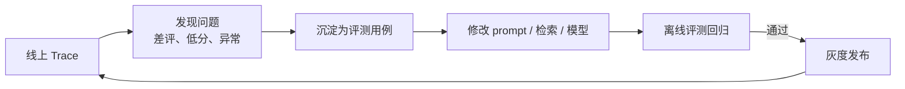
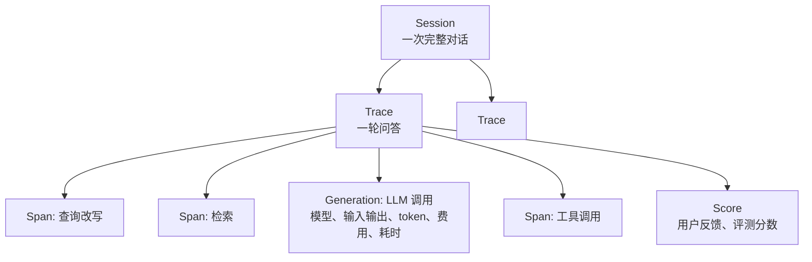
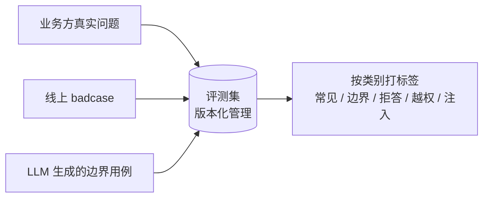
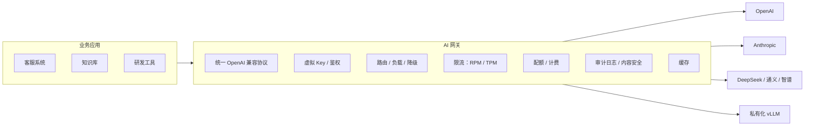

# 07 LLMOps：可观测、评测与 AI 网关

> 本章目标：建立 AI 应用上线后的"运营闭环"——**看得见**（Tracing）、**量得准**（评测）、**控得住**（网关与成本），以 Langfuse 和 LiteLLM / New API 为主线。
>
> LangSmith 的用法和 FastAPI 部署见已有系列 [12 章](../LangChain-LangGraph入门到进阶/12-调试评估与生产部署.md)；本章侧重开源可私有化方案和体系化方法。

---

## 一、为什么 AI 应用需要专门的 Ops

| 传统应用 | AI 应用 |
|---|---|
| 出错会报异常 | **答错了不会报错**，HTTP 200 照样返回 |
| 同样输入同样输出 | 输出不确定，换模型、改 prompt 都可能"静默退化" |
| 成本随机器线性增长 | 成本随 **token** 增长，一个死循环 Agent 一晚上就能烧掉一个月的预算 |
| 日志看请求即可 | 要看**每一步**：检索到了什么、模型看到了什么、调用了哪些工具 |

所以需要一个闭环：



---

## 二、Tracing：看得见

### 2.1 数据模型

以 Langfuse 为例（其他平台概念基本一致）：



| 概念 | 含义 | 关键字段 |
|---|---|---|
| **Trace** | 一次请求的完整执行 | userId、sessionId、tags、release / version |
| **Span** | 其中的一个步骤 | 输入、输出、耗时 |
| **Generation** | 一次模型调用（特殊的 Span） | 模型名、参数、token 用量、费用、**关联的 prompt 版本** |
| **Score** | 对 Trace 的评分 | 来源（用户、LLM 评估、人工）、数值或分类 |

### 2.2 Langfuse 架构（私有化部署需了解）

```text
langfuse-web     # UI + API（Next.js）
langfuse-worker  # 异步处理写入事件
PostgreSQL       # 配置、用户、prompt
ClickHouse       # trace / observation 明细（列式存储，适合海量分析查询）
Redis            # 队列与缓存
S3 / MinIO       # 原始事件、大字段
```

> 📖 **ClickHouse**：列式 OLAP 数据库，擅长对海量日志做聚合统计（按天统计 token、按模型统计耗时分位数）。

### 2.3 接入 AI SDK

AI SDK 7 的遥测基于 OpenTelemetry，而 Langfuse 支持以 OTel 方式接收数据，所以接入方式是"注册 OTel + 配置 Langfuse 导出"：

```ts
// instrumentation.ts（Next.js 在服务端启动时加载）
import { NodeSDK } from '@opentelemetry/sdk-node';
import { LangfuseSpanProcessor } from '@langfuse/otel';
import { registerTelemetry } from 'ai';
import { OpenTelemetry } from '@ai-sdk/otel';

const sdk = new NodeSDK({ spanProcessors: [new LangfuseSpanProcessor()] }); // 读取 LANGFUSE_* 环境变量
sdk.start();
registerTelemetry(new OpenTelemetry());
```

```ts
// 调用处：附加业务维度，便于按用户、会话、版本筛选
streamText({
  model,
  messages,
  telemetry: {
    functionId: 'kb-chat',
    metadata: { userId: session.userId, sessionId: chatId, release: process.env.APP_VERSION },
  },
});
```

> ⚠️ **注意**：各包的初始化方式以 Langfuse 和 AI SDK 官方的集成文档为准。AI SDK 7 默认**不把 runtimeContext 写入遥测**，需要用 `includeRuntimeContext` 显式选择字段，这是有意为之的隐私保护。

### 2.4 Tracing 的企业要点

- **脱敏**：trace 会记录完整的 prompt 和回答，包含用户隐私和业务数据。上报前做脱敏（Langfuse 支持 mask 函数），或只在私有化部署的实例中存储
- **采样**：高流量下全量记录成本很高，可以按比例采样，但**报错和差评的请求要 100% 保留**
- **版本标记**：每个 trace 带 `release` 和 prompt 版本，才能对比"改版前后"的效果
- **全链路**：配合 MCP 的 `traceparent` 传递（[03 章第三节](./03-MCP协议与企业工具集成.md#三2026-07-28-规范从有状态到无状态重点)），把工具服务的 span 串进同一条 trace

---

## 三、评测：量得准（重点）

### 3.1 评测的四种形态

| 形态 | 时机 | 数据 | 用途 |
|---|---|---|---|
| **离线评测** | 发布前 | 固定评测集 | 改动回归、模型选型对比 |
| **在线评测** | 运行时 | 线上采样 | 监控质量趋势 |
| **人工标注** | 定期 | 抽样 trace | 校准自动评估器，发现新问题 |
| **用户反馈** | 实时 | 点赞 / 点踩 / 纠错 | 最真实的信号，进入 badcase 池 |

### 3.2 评估器类型

| 类型 | 例子 | 可靠性 | 成本 |
|---|---|---|---|
| **代码规则** | JSON 是否合法、是否包含引用、SQL 能否执行、关键词命中 | ⭐⭐⭐ | 极低 |
| **参考答案对比** | 与标准答案的语义相似度、关键事实覆盖 | ⭐⭐ | 低 |
| **LLM-as-Judge** | 按评分标准判断忠实度、有用性、语气 | ⭐⭐ 需校准 | 中 |
| **人工** | 专家打分 | ⭐⭐⭐ | 高 |

> 🎯 **落地要点**：**能用代码判断的，绝不用 LLM 判断**。很多看似主观的指标可以拆成客观检查，例如"回答是否专业"可以拆成"是否引用了来源""是否包含禁用词""长度是否在范围内"。

### 3.3 LLM-as-Judge 的正确用法

```ts
const JudgeSchema = z.object({
  reasoning: z.string().describe('先逐条核对，再给结论'),
  faithful: z.boolean().describe('回答中的每个事实都能在参考资料中找到依据'),
  unsupportedClaims: z.array(z.string()),
});

const { output } = await generateText({
  model: judgeModel, // 与被测模型不同家族，减少"自我偏好"
  output: Output.object({ schema: JudgeSchema }),
  prompt: `参考资料：\n${context}\n\n回答：\n${answer}\n\n逐条检查回答中的事实是否有参考资料支持。`,
});
```

已知偏差与对策：

| 偏差 | 表现 | 对策 |
|---|---|---|
| 位置偏差 | 两两比较时偏好先出现的 | 交换顺序各评一次 |
| 长度偏差 | 偏好更长的回答 | 评分标准明确"简洁优先" |
| 自我偏好 | 偏好同家族模型的输出 | 使用不同厂商的模型做评估 |
| 尺度漂移 | 1~10 分打分不稳定 | **用二元判断或少档位分类**，而不是细粒度打分 |

**校准**：抽 50 条让人工和 LLM 评估器同时打分，一致率低于 80% 就要修改评分标准。

### 3.4 评测集的构建与维护



- **规模**：起步 50~100 条，覆盖主要意图；每个线上 badcase 修复后都加入评测集
- **必须包含的类别**：正常问题、应该拒答的问题、多轮追问、**越权尝试**、**提示注入尝试**
- **按类别统计**：总分不变时，某类别可能暴跌，必须分类看

### 3.5 放进 CI

```yaml
# 改动 prompts/、agents/、rag/ 目录时触发评测
on:
  pull_request:
    paths: ['prompts/**', 'agents/**', 'rag/**']
jobs:
  eval:
    steps:
      - run: pnpm eval --dataset kb-golden-v3 --threshold faithfulness=0.9,recall@5=0.85
      # 结果以评论形式贴到 PR，并给出与 main 分支的对比
```

> 🎯 **落地要点**：评测**结果对比**比绝对分数更有用。每个 PR 都给出"本次 vs main"的分类对比和退化用例清单，评审者直接看退化的那几条即可。

---

## 四、Prompt 管理

当 prompt 需要由产品或运营调整、或者需要快速回滚时，把它从代码中外置出来：

| 能力 | 说明 |
|---|---|
| **版本化** | 每次修改生成新版本，可对比、可回滚 |
| **标签** | `production` / `staging` 指向某个版本，切换标签即发布 |
| **运行时拉取 + 本地缓存** | 应用启动或定期拉取，平台不可用时使用缓存或内置默认值 |
| **关联 Trace** | 每次 Generation 记录 prompt 版本，便于按版本对比效果 |
| **变量模板** | `{{userName}}` 之类的变量由代码填充 |

```ts
import { LangfuseClient } from '@langfuse/client';

const langfuse = new LangfuseClient();
const prompt = await langfuse.prompt.get('kb-answer', { label: 'production' }); // SDK 自带缓存
const instructions = prompt.compile({ companyName: '某某科技' });
```

> ⚠️ **注意**：外置 prompt 意味着**不经过代码评审就能改变线上行为**。必须配套：修改权限控制、发布前强制跑评测、变更审计。核心业务的 prompt 也可以继续放在代码仓库中，走 PR 流程。

---

## 五、AI 网关：控得住（重点）

### 5.1 为什么企业需要 AI 网关

没有网关时，每个业务团队各自申请 API Key、各自对接厂商，结果是：密钥散落各处、无法统计费用、无法统一限流、换厂商要改所有业务代码。



| 能力 | 说明 |
|---|---|
| **统一协议** | 业务方只对接 OpenAI 兼容接口，网关负责转换为各厂商协议 |
| **虚拟 Key** | 给每个团队或应用发放网关 Key，真实厂商 Key 只保存在网关中 |
| **路由与降级** | 按模型名路由；主渠道 429 / 5xx 时自动切换备用渠道或备用模型 |
| **限流** | 按 Key 限 RPM（每分钟请求数）和 TPM（每分钟 token 数） |
| **配额与计费** | 按团队预算扣费，超额告警或拒绝 |
| **审计** | 谁、何时、用了哪个模型、消耗多少；必要时记录内容 |

### 5.2 开源方案对比

| | LiteLLM | New API（One API 系） |
|---|---|---|
| 语言 | Python | Go |
| 定位 | 面向研发团队的模型代理 + SDK | 面向运营的模型分发与计费平台 |
| 强项 | 支持的厂商最多；路由、重试、fallback 策略丰富；Prometheus 指标 | 渠道管理、用户 / 分组、充值计费、管理后台完善 |
| 适合 | 企业内部 AI 平台 | 多用户分发、需要计费运营的场景 |

### 5.3 自研网关的关键实现点

**① 流式响应中的 token 计量**

流式响应时，usage 只出现在最后一个 chunk（OpenAI 协议需要请求带 `stream_options: { include_usage: true }`）。网关要在转发流的同时解析最后的 usage：

```ts
async function* proxyStream(upstream: AsyncIterable<Chunk>, onUsage: (u: Usage) => void) {
  let usage: Usage | undefined;
  for await (const chunk of upstream) {
    if (chunk.usage) usage = chunk.usage;
    yield chunk; // 边收边转发，不缓冲
  }
  // 客户端中途断开时 upstream 也会中止，此时 usage 可能缺失，需按已输出内容估算计费
  onUsage(usage ?? estimateUsage());
}
```

**② TPM 限流的预扣与结算**

请求开始时还不知道会产生多少 token，常用做法是"**预扣 + 结算**"：

```text
请求到达 → 按 输入 token + max_tokens 预扣额度 → 不足则 429
请求结束 → 按实际 usage 结算，多退少补
```

**③ 降级策略**

```yaml
# LiteLLM 风格的配置示意
model_list:
  - model_name: chat-default
    litellm_params: { model: anthropic/claude-sonnet-5 }
  - model_name: chat-default        # 同名多渠道：负载均衡
    litellm_params: { model: bedrock/anthropic.claude-sonnet-5 }
  - model_name: chat-fallback
    litellm_params: { model: deepseek/deepseek-chat }
router_settings:
  fallbacks: [{ chat-default: [chat-fallback] }]
  num_retries: 2
```

> ⚠️ **注意**：跨模型降级（Claude → DeepSeek）可能导致效果明显变化，尤其是工具调用和长指令遵循。**降级目标模型也要跑评测集**，确认可接受后再配置。

---

## 六、成本治理

按投入产出比排序：

| 手段 | 典型节省 | 说明 |
|---|---|---|
| **模型分级路由** | 50%~80% | 分类、改写、摘要用小模型；复杂推理才用大模型（[04 章路由模式](./04-Agent工程化-从Loop到生产.md#32-路由routing)） |
| **Prompt Caching** | 缓存部分输入费用降至一到二成 | 稳定前缀（系统指令、工具定义、长文档）放在前面（[04 章 4.3](./04-Agent工程化-从Loop到生产.md#43-实战技巧)） |
| **控制上下文长度** | 30%~60% | 历史压缩、工具结果裁剪、检索 Top K 不贪多 |
| **Batch API** | 通常约 5 折 | 离线任务（批量打标、批量摘要）用厂商的批处理接口 |
| **控制输出长度** | 视场景 | 输出比输入贵数倍；限制 `maxOutputTokens`，要求简洁 |
| **语义缓存** | 视命中率 | 相似问题直接返回缓存答案；**注意权限隔离和时效性**（[05 章 6.5](./05-企业级RAG落地.md#65-权限穿透的其他环节)） |
| **推理强度控制** | 视场景 | AI SDK 7 的 `reasoning` 参数统一控制，简单任务关闭或调低推理 |

---

## 七、监控看板

| 类别 | 指标 | 告警建议 |
|---|---|---|
| **质量** | 点踩率、在线评测分、拒答率、引用缺失率 | 点踩率日环比上升 50% |
| **性能** | 首 token 延迟（TTFT）P50 / P95、总耗时、输出速度（tokens/s） | TTFT P95 > 5s |
| **可靠性** | 错误率（按厂商 / 错误码）、降级触发次数、工具调用失败率 | 错误率 > 2% |
| **成本** | 日费用（按团队 / 应用 / 模型）、单次对话平均费用、缓存命中率 | 日费用超预算 80% |
| **Agent** | 平均步数、达到步数上限的比例、审批通过率 | 达到上限比例突增（可能出现循环） |
| **使用** | DAU、对话数、人均轮次、功能使用分布 | — |

> 📖 **TTFT（Time To First Token）**：从发出请求到收到第一个 token 的时间，是流式交互中用户感知最明显的延迟指标。

---

## 本章小结

- AI 应用"答错不报错"，必须建立 **Trace → 发现问题 → 沉淀用例 → 修改 → 评测回归 → 发布** 的闭环
- Tracing 记录到 **Generation 粒度**，带上 userId、sessionId、版本；注意脱敏
- 评测：**代码规则优先**，LLM-as-Judge 要用二元判断并与人工校准；评测集按类别管理，放进 CI
- **AI 网关**统一协议、密钥、路由降级、限流计费，是 AI 平台团队的基础设施
- 成本优化优先级：**模型分级 > Prompt Caching > 上下文控制 > Batch**

## 练习

1. 用 docker compose 私有化部署 Langfuse，接入 02 章的订单助手，在 UI 中查看一次多步工具调用的完整 trace
2. 为知识库问答构建 50 条评测集（含 10 条应拒答、5 条越权尝试），实现"代码规则 + LLM-as-Judge"两类评估器，并与人工打分对比一致率
3. 部署 LiteLLM，配置两个渠道的负载均衡和一个降级模型，人为让主渠道失败，验证降级生效与 token 计量正确
