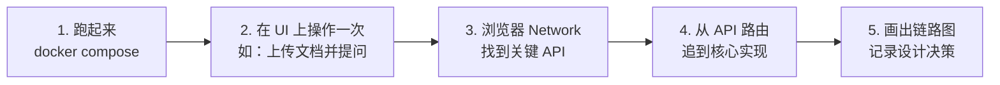
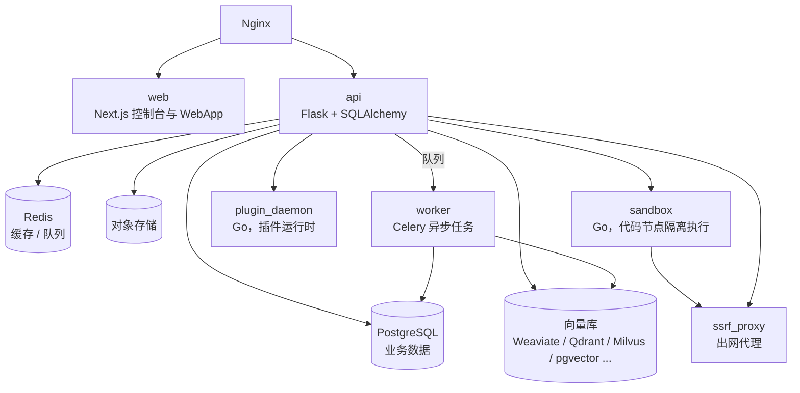
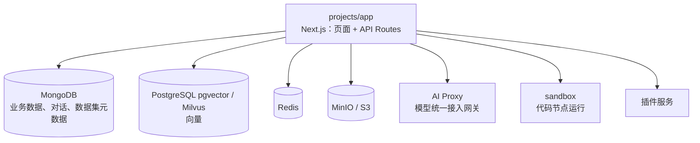
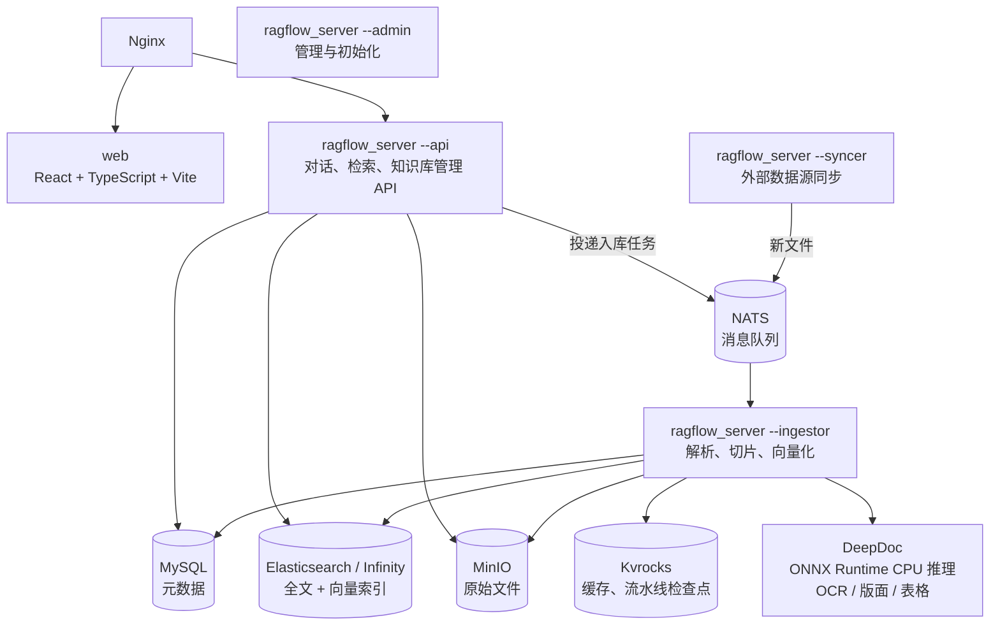
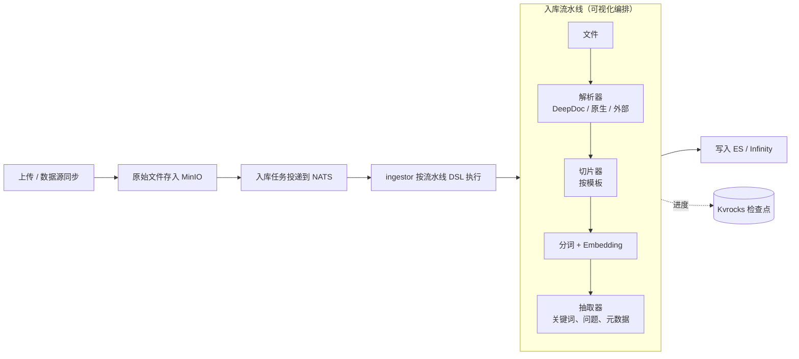
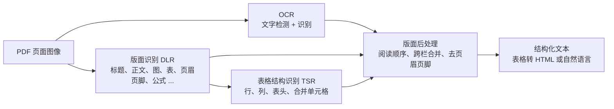

# 08 LLM 平台源码导读

> 本章目标：拆解 4 个主流开源 LLM 平台的架构与关键设计，知道**每个平台最值得读的那部分源码在哪**，以及自研时可以直接借鉴的设计。
>
> ⚠️ 平台迭代很快，目录结构以你 clone 时的版本为准。本章给出的是**模块定位与阅读路线**，读之前先 `git log` 看一下近期的重构。

---

## 一、读平台源码的方法

不要从 `main` 函数开始逐行读。按**一条核心请求链路**纵向切入：



每个平台建议追踪的三条链路：

1. **一次对话**：从 API 入口到模型调用，再到流式返回
2. **一次文档入库**：从上传到解析、切片、向量化、写入索引
3. **一次工作流执行**：从画布 DSL 到执行引擎，再到节点调度

---

## 二、Dify：最完整的企业 LLM 平台

### 2.1 定位

国内私有化部署最多的 LLM 应用平台。应用类型覆盖聊天助手、Agent、Chatflow（对话型工作流）、Workflow（任务型工作流），内置知识库、插件市场、多租户（工作空间）和权限。

### 2.2 架构



**值得注意的组件设计**：

| 组件 | 设计意图 |
|---|---|
| **plugin_daemon** | 1.0 起把模型供应商、工具、Agent 策略全部**插件化**，独立进程运行，主服务不再内置各厂商适配代码 |
| **sandbox** | 工作流的代码节点在隔离沙箱执行（系统调用白名单），防止用户代码攻击宿主 |
| **ssrf_proxy** | 所有出网请求经代理，防止用户通过 HTTP 节点访问内网地址（SSRF 攻击） |
| **worker** | 文档索引等耗时任务进入 Celery 队列，API 不阻塞 |

> 📖 **SSRF（服务端请求伪造）**：攻击者让服务器代为请求内网地址（如 `http://169.254.169.254` 云元数据接口、内网管理后台）。凡是"用户可配置 URL、由服务器发起请求"的功能都有此风险。

### 2.3 后端目录地图（`api/`）

```text
api/
├── controllers/        # HTTP 路由
│   ├── console/        #   控制台 API（管理端）
│   ├── service_api/    #   对外开放 API（API Key 鉴权）
│   └── web/            #   WebApp 终端用户 API
├── services/           # 业务服务层
├── models/             # SQLAlchemy 数据模型（tenant、app、dataset、conversation ...）
├── core/               # ★ 核心引擎
│   ├── app/            #   各应用类型的运行器与队列（流式事件的生产者）
│   ├── workflow/       #   ★ 工作流引擎：图引擎 + 各类节点
│   ├── rag/            #   ★ RAG：提取、切分、检索、重排
│   ├── agent/          #   Agent 策略（Function Calling / ReAct）
│   ├── plugin/         #   与 plugin_daemon 通信
│   └── ops/            #   对接 Langfuse / LangSmith 等可观测平台
└── tasks/              # Celery 异步任务
```

### 2.4 推荐阅读路线

| 顺序 | 读什么 | 学什么 |
|---|---|---|
| 1 | `models/` 中的 tenant、account、app | **多租户数据模型**：工作空间、成员、角色怎么设计 |
| 2 | `core/app/` 中某个应用类型的生成流程 | 一次对话的生命周期；**事件队列 → SSE 流式输出**的实现 |
| 3 | `core/workflow/` | **DAG 工作流引擎**：图解析、节点调度、并行分支、变量池、错误处理 |
| 4 | `core/rag/` | 检索方法（向量 / 全文 / 混合）、重排、多知识库召回策略 |
| 5 | `core/plugin/` + plugin_daemon 仓库 | **插件体系**：插件协议、进程隔离、反向调用主服务 |

### 2.5 可借鉴的设计

- **应用 DSL**：应用整体可导出为 YAML，支持版本管理与跨环境迁移，这是"Prompt 与流程即代码"的落地
- **变量池（Variable Pool）**：工作流节点之间用 `{{#节点ID.变量名#}}` 引用数据，统一管理作用域
- **三套 API 分层**：控制台 / 开放 API / 终端用户 API 各自鉴权，边界清晰
- **可观测对接**：内置把 trace 发送给 Langfuse 等平台的适配层，而不是自己造监控

---

## 三、FastGPT：全栈 TypeScript 的知识库平台

### 3.1 定位

国内团队开发的知识库问答 + 工作流平台，**全栈 TypeScript**，Next.js 同时承担前端与 API。前后端共享类型、代码集中在一个 monorepo 中，是端到端理解"完整 LLM 平台"门槛最低的选择。

### 3.2 架构



### 3.3 Monorepo 目录地图

```text
FastGPT/
├── projects/app/          # ★ 主应用（Next.js）
│   └── src/
│       ├── pages/api/     #   API 路由入口
│       ├── pageComponents/#   页面级组件（工作流画布、知识库管理）
│       └── web/           #   前端 store、API 封装
├── packages/
│   ├── global/            # 前后端共享的类型与常量（节点类型、权限定义）
│   ├── service/           # ★ 服务端核心逻辑
│   │   ├── core/workflow/dispatch/  # ★ 工作流调度引擎与各节点实现
│   │   ├── core/dataset/            # ★ 知识库：训练队列、检索
│   │   ├── core/ai/                 # 模型调用封装
│   │   └── support/permission/      # 权限
│   └── web/               # 通用前端组件
└── plugins/               # 系统插件
```

### 3.4 推荐阅读路线

| 顺序 | 读什么 | 学什么 |
|---|---|---|
| 1 | `packages/global` 中的工作流节点类型定义 | **前后端共享类型**的 monorepo 组织方式 |
| 2 | `packages/service/core/workflow/dispatch/` | 工作流调度：节点依次执行、条件分支、循环、**流式响应如何从节点透传到前端** |
| 3 | `packages/service/core/dataset/` | **训练队列**：文档切片后进入队列，由后台消费者异步向量化，支持重试 |
| 4 | 数据集检索相关代码 | 向量 + 全文混合检索、重排、引用返回 |
| 5 | `support/permission/` | **基于位运算的权限模型**：读 / 写 / 管理用二进制位组合，团队、成员、资源三层 |
| 6 | 前端工作流画布 | 基于 React Flow 的可视化编排器：节点注册、连线校验、变量引用选择器 |

### 3.5 可借鉴的设计

- **QA 拆分模式**：除了直接切片，还可以让 LLM 把文档转成"问题-答案对"再索引。对 FAQ 类文档召回效果明显更好
- **训练队列与计费**：每个入库任务都计量 token，与团队额度挂钩，这是 SaaS 计费的基础
- **工作流画布工程**：如果你要做低代码 AI 编排，它的画布实现可以直接参考

---

## 四、Coze Studio：大厂 DDD 架构的 Agent 平台

### 4.1 定位

字节跳动开源的 Agent 开发平台（扣子开源版），包含 Agent、工作流、插件、知识库。配套的 **Coze Loop** 负责 Prompt 开发、评测与可观测。后端 Go，前端 React。

### 4.2 架构特点

```text
backend/
├── api/            # 接口层：HTTP 路由与参数（Hertz 框架）
├── application/    # 应用层：编排领域服务，处理用例
├── domain/         # ★ 领域层：agent、workflow、knowledge、plugin、conversation ...
├── crossdomain/    # 跨领域调用的契约（领域之间不直接依赖）
└── infra/          # 基础设施：数据库、缓存、对象存储、向量库、模型调用的具体实现
```

> 📖 **DDD（领域驱动设计）**：按业务领域划分模块，领域层只包含业务规则、不依赖具体技术实现；数据库、外部服务等放在基础设施层，通过接口注入。好处是业务逻辑可测试、技术组件可替换。

LLM 编排使用字节开源的 Go 框架 **Eino**（组件化编排：ChatModel、Tool、Retriever、Graph）。

### 4.3 学什么

| 方向 | 要点 |
|---|---|
| **大型平台的模块边界** | 领域之间通过 `crossdomain` 契约通信，避免平台越做越大后变成泥球 |
| **插件体系** | 插件以 OpenAPI 描述注册，统一鉴权（OAuth / API Key）与调用 |
| **工作流引擎** | 对比 Dify：Go 实现、编译为 Eino Graph 执行 |
| **前端 Monorepo** | 大型 React 应用的分包与工程化（Rush） |

> 🎯 **落地要点**：Coze Studio 更适合**学架构**而不是直接部署。如果团队后端是 Go，它的分层是 AI 平台自研的优秀模板。

---

## 五、RAGFlow：深度文档理解

### 5.1 定位

以"深度文档理解"为核心卖点的 RAG 引擎，**解决的正是企业 RAG 中最难的文档解析环节**（[07 章第三节](./07-企业级RAG落地.md#三文档解析重点)）。在此基础上逐步扩展出入库流水线编排、知识编译、Agentic 检索和 Agent 画布，定位从"RAG 引擎"走向"以检索为核心的上下文引擎"。

> ⚠️ **版本分水岭**：2026 年 11 月发布的 **v1.0 用 Go 全面重写**（官方称镜像约小 10 倍、并发能力约高 100 倍），消息队列从 Redis 换成 **NATS**，缓存与检查点改用 **Kvrocks**。**v0.27.x 是最后的 Python 版本**，网上大部分源码解读针对的都是 0.x。0.27.2 升级到 1.0 的数据迁移**不可逆**，升级前必须备份。

### 5.2 架构（v1.0）



| 设计 | 意图 |
|---|---|
| **单一二进制、按模式启动** | 同一个 `ragflow_server` 以 `--api` / `--admin` / `--ingestor` / `--syncer` 等模式运行，镜像统一，各角色可**独立扩缩容**（入库高峰时只扩 ingestor） |
| **入库与在线服务分离** | 解析是 CPU 密集的长任务，放进队列由 ingestor 异步消费，不影响在线问答的延迟 |
| **流水线检查点** | 入库流水线的进度存入 Kvrocks，失败后可以从中断处恢复，而不是整份文档重新解析 |
| **文档引擎可替换** | Elasticsearch 与 Infinity（InfiniFlow 自研的 AI 原生数据库，同时支持全文、向量、稀疏向量和张量检索）二选一 |
| **原生解析库** | Go 服务通过 CGO 调用 pdfium 等原生库解析 PDF / Office，DeepDoc 模型以 ONNX 格式运行 |

> 📖 **NATS**：轻量级的云原生消息系统，带 JetStream 持久化。**Kvrocks**：Apache 基金会的磁盘型 KV 存储，兼容 Redis 协议，数据落盘、容量不受内存限制。

### 5.3 源码地图

**v1.0（Go，`main` 分支）**：

```text
ragflow/
├── cmd/
│   ├── ragflow_server.go     # 入口：按 --api / --admin / --ingestor / --syncer 启动不同角色
│   └── ragflow-cli/          # 命令行工具
├── internal/
│   ├── router/ handler/      # HTTP 路由与请求处理
│   ├── service/              # 业务服务层
│   ├── dao/ entity/          # 数据访问与实体定义
│   ├── ingestion/            # ★ 入库流水线
│   │   ├── component/        #   流水线组件：文件、解析器、切片器、分词器、抽取器
│   │   └── pipeline/         #   流水线 DSL 转换、画布驱动执行、检查点与断点续跑
│   ├── parser/               # ★ 解析与切片
│   │   ├── parser/           #   Markdown / HTML / PDF / DOCX / XLSX / 文本解析器
│   │   └── chunk/            #   切片算子
│   ├── deepdoc/              # ★ DeepDoc 集成（基于原生库的 PDF / DOCX 解析）
│   ├── rag/  agentic_rag/    # ★ 检索与 Agentic 检索
│   ├── engine/               # 索引后端：Elasticsearch、Infinity
│   ├── agent/                # Agent 运行时：画布执行、组件、工具绑定
│   ├── mcp/                  # MCP 客户端与服务端
│   ├── syncer/               # 数据源连接器与同步
│   ├── permission/           # 权限
│   └── storage/              # 对象存储抽象
├── web/                      # 前端
└── docker/                   # 部署编排
```

**v0.27.x（Python，最后一个 Python 版本）**：

```text
ragflow/                      # 切到 v0.27.3 tag 阅读
├── api/                      # Web 服务（Flask 系）与业务逻辑
├── deepdoc/
│   ├── vision/               # ★ OCR、版面识别、表格结构识别
│   └── parser/               # ★ PDF / DOCX / Excel / PPT 等解析器，及 MinerU、Docling 等外部解析器适配
├── rag/
│   ├── app/                  # ★ 按文档类型的切片模板：naive、qa、table、paper、book、laws、manual、presentation ...
│   ├── nlp/                  #   分词、查询处理、混合检索打分
│   ├── llm/                  #   各类模型适配
│   └── svr/task_executor.py  #   入库任务消费进程
├── graphrag/                 # 知识图谱构建（0.27 起由"知识编译"取代）
└── agent/                    # Agent 画布与组件
```

> 🎯 **落地要点**：**学算法读 Python，学工程读 Go**。切片模板、版面后处理、检索打分这些"RAG 算法"在 0.27 的 Python 代码中更直观，注释和社区解读也最多；高并发、流水线检查点、多角色部署这些"工程能力"看 1.0 的 Go 代码。

### 5.4 一次文档入库的链路



v1.0 把内置的 12 种文档解析器与**入库流水线**（Ingestion Pipeline）统一：解析、切片、抽取都是流水线中的组件，用户既可以直接选内置模板，也可以在画布上自定义"用哪个解析器、怎么切、抽取什么"。

### 5.5 DeepDoc：深度文档理解



| 环节 | 解决的问题 |
|---|---|
| **OCR** | 扫描件、图片中的文字；对数字原生 PDF 也会结合文本层使用 |
| **版面识别** | 区分标题、正文、图、图注、表、表注、页眉、页脚、参考文献、公式等区域。**页眉页脚不去掉，每个切片都会混入噪声** |
| **表格结构识别** | 识别行、列、表头、跨行跨列单元格，把表格还原为结构化数据，而不是一串被打散的文字 |
| **版面后处理** | 多栏排版的阅读顺序、跨页段落合并、标题层级恢复 |

除了内置的 DeepDoc，RAGFlow 还可以接入 **MinerU**、**Docling** 等外部解析器。

> ⚠️ **注意**：v1.0 开源版的 DeepDoc **只支持 CPU 推理**。大批量扫描件入库时，解析吞吐会成为瓶颈，需要单独扩容 ingestor，或把 OCR 交给 GPU 部署的外部解析服务。

### 5.6 核心设计：按文档类型选择切片模板

RAGFlow 不追求"一个切片算法通吃"，而是**让用户为不同类型的文档选择不同模板**：

| 模板 | 处理方式 | 适合 |
|---|---|---|
| **General**（通用） | 按版面和长度切分，合并过短片段 | 默认选择 |
| **Q&A** | 识别问答对，问题用于检索、答案用于回答 | FAQ、客服知识 |
| **Table** | 每行转为一条记录，附表头 | Excel、CSV、结构化清单 |
| **Laws** | 按"章-节-条"层级切分，保留条款编号 | 法律法规、规章制度 |
| **Paper** | 识别摘要、章节、参考文献，分别处理 | 学术论文 |
| **Book** | 按章节目录层级切分 | 长篇书籍、手册 |
| **Manual** | 按标题层级切分，保留章节路径 | 产品手册、操作指南 |
| **Presentation** | 每页一块，结合版面信息 | PPT |
| **Resume** | 抽取结构化字段 | 简历 |
| **Picture** | OCR + 视觉模型描述 | 图片 |
| **One** | 整个文档作为一块 | 短文档、需要完整上下文的文档 |
| **Email** | 解析邮件头、正文与附件 | 邮件归档 |
| **Tag** | 作为标签库，为其他知识库的切片打标签 | 标签体系 |

切片的**可视化与人工干预**是另一个关键设计：用户能看到每个切片对应原文的哪个区域，可以直接修改、补充关键词，这对质量要求高的企业知识库非常重要。

### 5.7 检索与知识编译

| 能力 | 说明 |
|---|---|
| **混合检索** | 关键词检索与向量检索加权融合，再经 Rerank 模型重排；元数据过滤下推到索引层执行 |
| **Agentic 检索** | 对复杂问题先拆解，多轮检索，再由"决策模型"判断证据是否充分，不足则继续检索 |
| **知识编译** | 0.27 起取代原来的 GraphRAG 与 RAPTOR 入口：把文档或整个知识库"编译"为图谱（Graph）、层级摘要树（Tree）、Wiki、PageIndex、思维导图、时间线、**Skills** 等结构化产物，用于回答"全局性"问题 |
| **引用溯源** | 回答中的每处引用都能定位到原文切片和页面区域 |

> 📖 **RAPTOR**：把切片自底向上聚类并逐层摘要，形成一棵摘要树，检索时可以命中不同抽象层级，适合"这份报告的主要结论是什么"这类需要整体理解的问题。**PageIndex**：不切片，而是为长文档构建目录式的层级索引，由模型像人一样"翻目录"定位内容。

### 5.8 Agent 与对外接口

- **Agent 画布**：可视化编排的 Agent 与工作流，内置检索、分类、代码执行等组件和多个模板
- **MCP**：既能作为 MCP Server 把知识库检索暴露给其他 Agent，也能作为 MCP Client 调用外部工具
- **数据源同步**：内置 S3、Google Drive、Notion、Confluence、Slack、JIRA 等 30 多个连接器，支持增量同步
- **HTTP API 与 Python SDK**：可以只把 RAGFlow 当作"文档解析 + 检索"后端，上层用自己的应用

### 5.9 推荐阅读路线

| 顺序 | 读什么 | 学什么 |
|---|---|---|
| 1 | 0.27：`deepdoc/vision/` 与 `deepdoc/parser/pdf_parser.py` | **PDF 解析全流程**：OCR、版面、表格如何组合，阅读顺序如何恢复 |
| 2 | 0.27：`rag/app/` 下的 `naive.py`、`laws.py`、`table.py`、`qa.py` | **按文档类型切片**的具体实现，对比不同模板的差异 |
| 3 | 0.27：`rag/nlp/` 中的检索与打分 | 混合检索的权重融合、查询预处理 |
| 4 | 1.0：`internal/ingestion/pipeline/` | **流水线 DSL、检查点与断点续跑**的工程实现 |
| 5 | 1.0：`cmd/ragflow_server.go` + `internal/server/` | 单一二进制多角色启动、配置装配 |
| 6 | 1.0：`internal/agentic_rag/` | Agentic 检索的拆解、检索、证据判断循环 |

### 5.10 部署要点

- 起步配置：4 核 CPU、16 GB 内存、50 GB 磁盘；大批量入库按 ingestor 数量线性增加 CPU
- 使用 Elasticsearch 时宿主机需设置 `vm.max_map_count >= 262144`；换用 Infinity 通常不需要
- Embedding 和 Rerank 模型建议独立部署（如用 vLLM 或 TEI），通过模型配置接入，避免与解析任务争抢资源
- 权限：RAGFlow 的权限粒度是团队与知识库级别，**文档级 ACL 需要在上层应用或检索时的元数据过滤中实现**（[07 章第六节](./07-企业级RAG落地.md#六权限过滤重点)）

> 🎯 **落地要点**：RAGFlow 最可复用的思路是：**按 `docType` 路由到不同的解析 + 切片策略**，并把入库流程做成**可编排、可断点续跑的流水线**。这比调优单一的通用切片策略有效得多。

---

## 六、补充：LobeHub（大型 AI 前端工程）

如果关注 AI 产品的前端工程（大型对话应用的状态管理、多模型适配、插件体系），LobeHub（原 LobeChat）是很好的参考：

| 方向 | 看点 |
|---|---|
| **多模型运行时** | 独立的 model-runtime 包，把几十家厂商统一为一套接口，处理各家流式格式差异 |
| **状态管理** | Zustand 按 slice 拆分大型 store（会话、消息、工具、设置） |
| **双数据库模式** | 客户端模式（浏览器内 PGlite）与服务端模式（Postgres + Drizzle）共用一套数据访问抽象 |
| **插件与 MCP** | 插件市场、MCP 接入的前端交互 |
| **工程化** | i18n、主题、PWA、桌面端打包 |

---

## 七、横向对比

| | Dify | FastGPT | Coze Studio | RAGFlow |
|---|---|---|---|---|
| 后端 | Python | TS | Go | Go（1.0 起；0.x 为 Python） |
| 前端 | Next.js | Next.js | React | React |
| 强项 | 全面、生态、插件 | 知识库、全栈 TS | 架构、Agent | 文档解析 |
| 多租户 / 权限 | 工作空间 + 角色 | 团队 + 位运算权限 | 空间 | 团队 |
| 工作流 | ✅ 成熟 | ✅ 成熟 | ✅ | ✅ Agent 画布 |
| **最值得读** | 工作流引擎、插件体系 | 训练队列、权限、画布 | DDD 分层 | DeepDoc、切片模板、入库流水线 |
| 直接部署推荐度 | ⭐⭐⭐ | ⭐⭐⭐ | ⭐⭐ | ⭐⭐（作为 RAG 引擎） |

---

## 八、自研 AI 平台时可直接借鉴的设计清单

| 设计 | 来源 | 价值 |
|---|---|---|
| 应用配置导出为 DSL（YAML） | Dify | 版本管理、环境迁移、Code Review |
| 模型供应商插件化 | Dify | 主服务不随厂商变动发版 |
| 代码执行沙箱 + SSRF 出网代理 | Dify | 用户可配置能力的安全底线 |
| 三套 API 鉴权分层 | Dify | 管理端、开放 API、终端用户隔离 |
| 文档入库走异步训练队列 + 计量 | FastGPT | 削峰、重试、计费 |
| 位运算权限 | FastGPT | 权限组合高效、存储紧凑 |
| 前后端共享类型包 | FastGPT | TS 全栈的类型安全 |
| 领域分层 + 跨领域契约 | Coze Studio | 大型平台可维护性 |
| 按文档类型路由切片策略 | RAGFlow | RAG 效果 |
| 入库流水线 + 检查点断点续跑 | RAGFlow | 大批量入库的可靠性 |
| 单一二进制按角色启动、各角色独立扩缩容 | RAGFlow | 部署简单，资源按瓶颈分配 |
| 可观测性对接而非自建 | Dify / FastGPT | 复用 Langfuse 等成熟方案 |

---

## 本章小结

- 读平台源码按**链路**切入：对话、入库、工作流执行
- **Dify** 读工作流引擎和插件体系；**FastGPT** 读训练队列、权限和画布；**Coze Studio** 读 DDD 分层；**RAGFlow** 读 DeepDoc、切片模板（0.27 Python）和入库流水线（1.0 Go）
- 平台的安全设计（沙箱、SSRF 代理、API 分层）是自研时**最容易遗漏、最该照抄**的部分

## 练习

1. 用 docker compose 部署 Dify，创建一个 Chatflow；在浏览器 Network 中找到对话 API，追踪到 `core/app/` 下对应的生成流程，画出事件流转图
2. 阅读 FastGPT 的工作流调度代码，回答：两个并行分支如何汇合？节点执行失败时如何处理？
3. 对比 Dify 和 FastGPT 的知识库入库流程，列出两者在切片方式、异步处理、失败重试上的差异
4. 部署 RAGFlow，用同一份带表格的 PDF 分别选择 General 和 Manual 模板入库，对比切片结果和问答效果；再阅读 0.27 的 `rag/app/naive.py`，解释两种模板的切分差异从何而来
