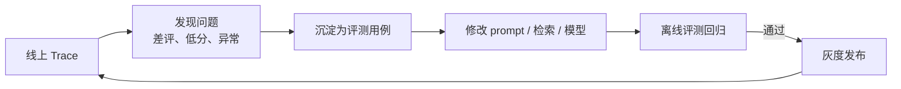
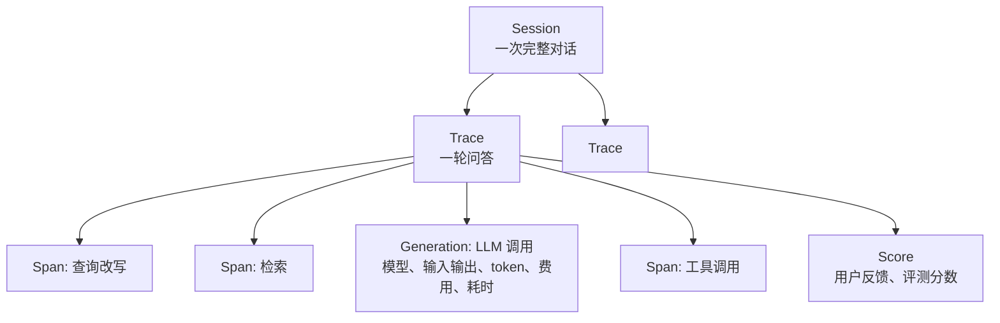
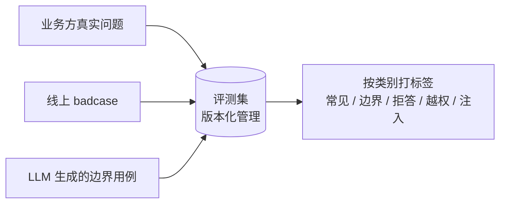
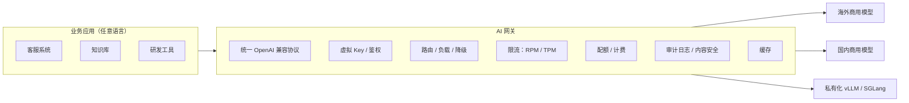

# 09 LLMOps：可观测、评测与 AI 网关

> 本章目标：建立 AI 应用上线后的"运营闭环"——**看得见**（Tracing）、**量得准**（评测）、**控得住**（网关与成本）。以**开放标准**（OpenTelemetry GenAI 语义约定、OpenAI 兼容协议）为基础，以 Langfuse、LiteLLM / Higress 等开源方案为参考实现。
>
> LangSmith 的用法和 FastAPI 部署见已有系列 [12 章](../LangChain-LangGraph入门到进阶/12-调试评估与生产部署.md)；本章侧重开源可私有化方案和体系化方法。

---

## 一、为什么 AI 应用需要专门的 Ops

| 传统应用 | AI 应用 |
|---|---|
| 出错会报异常 | **答错了不会报错**，HTTP 200 照样返回 |
| 同样输入同样输出 | 输出不确定，换模型、改 prompt 都可能"静默退化" |
| 成本随机器线性增长 | 成本随 **token** 增长，一个死循环 Agent 一晚上就能烧掉一个月的预算 |
| 日志看请求即可 | 要看**每一步**：检索到了什么、模型看到了什么、调用了哪些工具 |

所以需要一个闭环：



---

## 二、Tracing：看得见

### 2.1 数据模型

各平台概念基本一致（以 Langfuse 的命名为例）：



| 概念 | 含义 | 关键字段 |
|---|---|---|
| **Trace** | 一次请求的完整执行 | user_id、session_id、tags、release / version |
| **Span** | 其中的一个步骤 | 输入、输出、耗时 |
| **Generation** | 一次模型调用（特殊的 Span） | 模型名、参数、token 用量、费用、**关联的 prompt 版本** |
| **Score** | 对 Trace 的评分 | 来源（用户、LLM 评估、人工）、数值或分类 |

### 2.2 开放标准：OpenTelemetry GenAI 语义约定

> 📖 **OpenTelemetry（OTel）**：CNCF 的开源可观测标准，统一了 Trace、Metrics、Logs 的数据格式与采集方式。**GenAI 语义约定**在此基础上规定了 LLM 调用、Agent、工具调用的标准字段（如模型名、输入输出 token 数、操作类型）。

这意味着：

- **埋点与平台解耦**：应用按 OTel 标准埋点一次，数据可以发到 Langfuse、Phoenix、Datadog、自建 Jaeger / Tempo 等任意后端
- **框架普遍支持**：Vercel AI SDK 7（`@ai-sdk/otel`）、Spring AI（Micrometer）、Microsoft Agent Framework、Google ADK 等都输出 OTel 数据；OpenLLMetry 等库可为 Python / TS 的主流 SDK 自动埋点
- **全链路贯通**：MCP 新规范在请求 `_meta` 中传递 `traceparent`（[05 章第三节](./05-MCP与Agent互操作协议.md#三2026-07-28-规范从有状态到无状态重点)），工具服务的 span 能串进同一条 trace

> 🎯 **落地要点**：**优先按 OTel 标准埋点**，再选择可观测后端。这样以后换平台、或同时把数据送进公司已有的 APM 系统，都不需要改业务代码。

### 2.3 平台选型

| 平台 | 开源 | 特点 |
|---|---|---|
| **Langfuse** | ✅ | Tracing + 评测 + Prompt 管理一体，私有化部署成熟 |
| **Arize Phoenix** | ✅ | 原生基于 OTel，评测能力强，Python 生态友好 |
| **Opik** | ✅ | Comet 出品，可观测与评测 |
| LangSmith | 闭源 | 与 LangChain / LangGraph 集成最深 |
| 已有 APM（Datadog、阿里云 ARMS 等） | — | 多数已支持 GenAI 语义约定，适合统一运维视图 |

Langfuse 私有化部署的组件（了解即可）：

```text
langfuse-web     # UI + API
langfuse-worker  # 异步处理写入事件
PostgreSQL       # 配置、用户、prompt
ClickHouse       # trace / observation 明细（列式存储，适合海量分析查询）
Redis            # 队列与缓存
S3 / MinIO       # 原始事件、大字段
```

> 📖 **ClickHouse**：列式 OLAP 数据库，擅长对海量日志做聚合统计（按天统计 token、按模型统计耗时分位数）。

### 2.4 接入示例

**Python（Langfuse SDK，装饰器方式）**：

```python
from langfuse import observe, get_client

@observe()   # 自动创建 span，记录输入输出与耗时；嵌套调用自动形成父子关系
async def answer(question: str, user_id: str, chat_id: str) -> str:
    get_client().update_current_trace(user_id=user_id, session_id=chat_id,
                                      tags=["kb-chat"], release=APP_VERSION)
    docs = await retrieve(question)          # retrieve 同样加 @observe()
    return await generate(question, docs)    # 模型调用经集成自动记录为 Generation
```

**TypeScript（AI SDK 7 + OTel）**：

```ts
// instrumentation.ts：服务端启动时注册 OTel，并把数据导出到 Langfuse
import { NodeSDK } from '@opentelemetry/sdk-node';
import { LangfuseSpanProcessor } from '@langfuse/otel';
import { registerTelemetry } from 'ai';
import { OpenTelemetry } from '@ai-sdk/otel';

new NodeSDK({ spanProcessors: [new LangfuseSpanProcessor()] }).start();
registerTelemetry(new OpenTelemetry());

// 调用处附加业务维度
streamText({ model, messages, telemetry: { functionId: 'kb-chat', metadata: { userId, sessionId: chatId } } });
```

> ⚠️ **注意**：各 SDK 的初始化方式以官方集成文档为准。AI SDK 7 默认**不把 runtimeContext 写入遥测**，需要显式选择字段，这是有意为之的隐私保护。

### 2.5 Tracing 的企业要点

- **脱敏**：trace 会记录完整的 prompt 和回答，包含用户隐私和业务数据。上报前做脱敏（Langfuse 等支持 mask 函数），或只在私有化部署的实例中存储
- **采样**：高流量下全量记录成本很高，可以按比例采样，但**报错和差评的请求要 100% 保留**
- **版本标记**：每个 trace 带 `release` 和 prompt 版本，才能对比"改版前后"的效果
- **访问控制**：trace 中有大量敏感内容，查看 trace 本身需要权限与审计

---

## 三、评测：量得准（重点）

### 3.1 评测的四种形态

| 形态 | 时机 | 数据 | 用途 |
|---|---|---|---|
| **离线评测** | 发布前 | 固定评测集 | 改动回归、模型选型对比 |
| **在线评测** | 运行时 | 线上采样 | 监控质量趋势 |
| **人工标注** | 定期 | 抽样 trace | 校准自动评估器，发现新问题 |
| **用户反馈** | 实时 | 点赞 / 点踩 / 纠错 | 最真实的信号，进入 badcase 池 |

### 3.2 评估器类型

| 类型 | 例子 | 可靠性 | 成本 |
|---|---|---|---|
| **代码规则** | JSON 是否合法、是否包含引用、SQL 能否执行、关键词命中 | ⭐⭐⭐ | 极低 |
| **参考答案对比** | 与标准答案的语义相似度、关键事实覆盖 | ⭐⭐ | 低 |
| **LLM-as-Judge** | 按评分标准判断忠实度、有用性、语气 | ⭐⭐ 需校准 | 中 |
| **人工** | 专家打分 | ⭐⭐⭐ | 高 |

> 🎯 **落地要点**：**能用代码判断的，绝不用 LLM 判断**。很多看似主观的指标可以拆成客观检查，例如"回答是否专业"可以拆成"是否引用了来源""是否包含禁用词""长度是否在范围内"。

### 3.3 LLM-as-Judge 的正确用法

```python
class Judgement(BaseModel):
    reasoning: str = Field(description="先逐条核对，再给结论")
    faithful: bool = Field(description="回答中的每个事实都能在参考资料中找到依据")
    unsupported_claims: list[str]

judgement = await judge_llm.structured(   # 评估模型与被测模型不同家族，减少"自我偏好"
    Judgement,
    prompt=f"参考资料：\n{context}\n\n回答：\n{answer}\n\n逐条检查回答中的事实是否有参考资料支持。",
)
```

已知偏差与对策：

| 偏差 | 表现 | 对策 |
|---|---|---|
| 位置偏差 | 两两比较时偏好先出现的 | 交换顺序各评一次 |
| 长度偏差 | 偏好更长的回答 | 评分标准明确"简洁优先" |
| 自我偏好 | 偏好同家族模型的输出 | 使用不同厂商的模型做评估 |
| 尺度漂移 | 1~10 分打分不稳定 | **用二元判断或少档位分类**，而不是细粒度打分 |

**校准**：抽 50 条让人工和 LLM 评估器同时打分，一致率低于 80% 就要修改评分标准。

### 3.4 Agent 的评测

Agent 除了看最终答案，还要看**过程**：

| 维度 | 指标 |
|---|---|
| 结果 | 任务完成率、答案正确率 |
| 过程 | 工具选择正确率、参数正确率、平均步数、是否出现无效循环 |
| 效率 | 单任务 token、费用、耗时 |
| 安全 | 越权尝试是否被拦截、注入用例下是否执行了危险操作 |

可以借助 trace 数据做"轨迹评测"：把期望的工具调用序列与实际轨迹对比。

### 3.5 评测集的构建与维护



- **规模**：起步 50~100 条，覆盖主要意图；每个线上 badcase 修复后都加入评测集
- **必须包含的类别**：正常问题、应该拒答的问题、多轮追问、**越权尝试**、**提示注入尝试**
- **按类别统计**：总分不变时，某类别可能暴跌，必须分类看

### 3.6 评测工具

| 工具 | 定位 |
|---|---|
| **Ragas** | RAG 指标库（忠实度、上下文召回等） |
| **DeepEval** | 类似 pytest 的 LLM 单元测试框架 |
| **promptfoo** | 声明式配置评测与**红队测试**，命令行友好，适合放进 CI |
| Langfuse / Phoenix / Opik | 平台内置数据集、实验对比、在线评测 |
| 框架内置 | Google ADK、Mastra 等提供内置评测能力 |

### 3.7 放进 CI

```yaml
# 改动 prompts/、agents/、rag/ 目录时触发评测
on:
  pull_request:
    paths: ['prompts/**', 'agents/**', 'rag/**']
jobs:
  eval:
    steps:
      - run: make eval DATASET=kb-golden-v3 THRESHOLD="faithfulness=0.9,recall@5=0.85"
      # 结果以评论形式贴到 PR，并给出与 main 分支的对比
```

> 🎯 **落地要点**：评测**结果对比**比绝对分数更有用。每个 PR 都给出"本次 vs main"的分类对比和退化用例清单，评审者直接看退化的那几条即可。

---

## 四、Prompt 管理

当 prompt 需要由产品或运营调整、或者需要快速回滚时，把它从代码中外置出来：

| 能力 | 说明 |
|---|---|
| **版本化** | 每次修改生成新版本，可对比、可回滚 |
| **标签** | `production` / `staging` 指向某个版本，切换标签即发布 |
| **运行时拉取 + 本地缓存** | 应用启动或定期拉取，平台不可用时使用缓存或内置默认值 |
| **关联 Trace** | 每次 Generation 记录 prompt 版本，便于按版本对比效果 |
| **变量模板** | `{{company_name}}` 之类的变量由代码填充 |

```python
from langfuse import get_client

prompt = get_client().get_prompt("kb-answer", label="production")  # SDK 自带缓存
instructions = prompt.compile(company_name="某某科技")
```

> ⚠️ **注意**：外置 prompt 意味着**不经过代码评审就能改变线上行为**。必须配套：修改权限控制、发布前强制跑评测、变更审计。核心业务的 prompt 也可以继续放在代码仓库中，走 PR 流程。

---

## 五、AI 网关：控得住（重点）

### 5.1 为什么企业需要 AI 网关

没有网关时，每个业务团队各自申请 API Key、各自对接厂商，结果是：密钥散落各处、无法统计费用、无法统一限流、换厂商要改所有业务代码。



| 能力 | 说明 |
|---|---|
| **统一协议** | 业务方只对接 OpenAI 兼容接口，网关负责转换为各厂商协议 |
| **虚拟 Key** | 给每个团队或应用发放网关 Key，真实厂商 Key 只保存在网关中 |
| **路由与降级** | 按模型名路由；主渠道 429 / 5xx 时自动切换备用渠道或备用模型 |
| **限流** | 按 Key 限 RPM（每分钟请求数）和 TPM（每分钟 token 数） |
| **配额与计费** | 按团队预算扣费，超额告警或拒绝 |
| **审计与合规** | 谁、何时、用了哪个模型、消耗多少；按数据密级路由（[10 章 7.2](./10-安全权限与上线清单.md#72-按数据密级路由模型)） |

### 5.2 开源方案对比

| | LiteLLM | New API（One API 系） | Higress | Portkey Gateway |
|---|---|---|---|---|
| 语言 | Python | Go | Go（基于 Envoy） | TS |
| 定位 | 研发团队的模型代理 + SDK | 模型分发与计费运营平台 | 云原生 API 网关 + AI 网关 + **MCP 网关** | 轻量高性能 AI 网关 |
| 强项 | 支持厂商最多，路由、重试、降级策略丰富 | 渠道、用户分组、充值计费、管理后台 | 与 K8s / 服务网格融合，网关能力完整 | 部署轻、延迟低 |
| 适合 | 企业内部 AI 平台 | 多用户分发、计费运营 | 已有云原生网关体系、需统一治理 API 与 MCP | 边缘或轻量场景 |

> 🎯 **落地要点**：如果公司已有 Kong、APISIX、Envoy 等 API 网关，优先评估它们的 AI 插件 / 扩展，**把 AI 流量纳入已有的网关治理体系**，而不是再造一套。

### 5.3 自研网关的关键实现点

**① 流式响应中的 token 计量**

流式响应时，usage 只出现在最后一个 chunk（OpenAI 协议需要请求带 `stream_options: {"include_usage": true}`）。网关要在转发流的同时解析 usage：

```python
async def proxy_stream(upstream: AsyncIterator[Chunk], on_usage: Callable[[Usage], Awaitable[None]]):
    usage = None
    try:
        async for chunk in upstream:
            if chunk.usage:
                usage = chunk.usage
            yield chunk                  # 边收边转发，不缓冲
    finally:
        # 客户端中途断开时 usage 可能缺失，需按已输出内容估算计费
        await on_usage(usage or estimate_usage())
```

**② TPM 限流的预扣与结算**

请求开始时还不知道会产生多少 token，常用做法是"**预扣 + 结算**"：

```text
请求到达 → 按 输入 token + max_tokens 预扣额度 → 不足则 429
请求结束 → 按实际 usage 结算，多退少补
```

**③ 降级策略**

```yaml
# LiteLLM 风格的配置示意
model_list:
  - model_name: chat-default
    litellm_params: { model: <主力模型> }
  - model_name: chat-default        # 同名多渠道：负载均衡
    litellm_params: { model: <同一模型的另一渠道> }
  - model_name: chat-fallback
    litellm_params: { model: <备用模型> }
router_settings:
  fallbacks: [{ chat-default: [chat-fallback] }]
  num_retries: 2
```

> ⚠️ **注意**：跨模型降级可能导致效果明显变化，尤其是工具调用和长指令遵循。**降级目标模型也要跑评测集**，确认可接受后再配置。只对 429、5xx、超时降级，4xx 参数错误不降级。

---

## 六、成本治理

按投入产出比排序：

| 手段 | 典型节省 | 说明 |
|---|---|---|
| **模型分级路由** | 50%~80% | 分类、改写、摘要用小模型；复杂推理才用大模型（[06 章路由模式](./06-Agent工程化-从Loop到生产.md#32-路由routing)、[03 章第六节](./03-模型层-选型私有化推理与微调.md#六模型路由与级联)） |
| **Prompt Caching** | 缓存部分输入费用降至一到二成 | 稳定前缀（系统指令、工具定义、长文档）放在前面（[06 章 4.3](./06-Agent工程化-从Loop到生产.md#43-实战技巧)） |
| **控制上下文长度** | 30%~60% | 历史压缩、工具结果裁剪、检索 Top K 不贪多 |
| **Batch API** | 通常约 5 折 | 离线任务（批量打标、批量摘要）用厂商的批处理接口 |
| **蒸馏到小模型** | 视场景，可达一个数量级 | 高频窄任务（[03 章第四节](./03-模型层-选型私有化推理与微调.md#四rag微调还是提示工程重点)） |
| **控制输出长度** | 视场景 | 输出比输入贵数倍；限制最大输出 token，要求简洁 |
| **推理强度控制** | 视场景 | 简单任务关闭或调低推理 |
| **语义缓存** | 视命中率 | 相似问题直接返回缓存答案；**注意权限隔离和时效性**（[07 章 6.5](./07-企业级RAG落地.md#65-权限穿透的其他环节)） |

---

## 七、监控看板

| 类别 | 指标 | 告警建议 |
|---|---|---|
| **质量** | 点踩率、在线评测分、拒答率、引用缺失率 | 点踩率日环比上升 50% |
| **性能** | 首 token 延迟（TTFT）P50 / P95、总耗时、输出速度（tokens/s） | TTFT P95 > 5s |
| **可靠性** | 错误率（按厂商 / 错误码）、降级触发次数、工具调用失败率 | 错误率 > 2% |
| **成本** | 日费用（按团队 / 应用 / 模型）、单次对话平均费用、缓存命中率 | 日费用超预算 80% |
| **Agent** | 平均步数、达到步数上限的比例、审批通过率 | 达到上限比例突增（可能出现循环） |
| **使用** | DAU、对话数、人均轮次、功能使用分布 | — |

> 📖 **TTFT（Time To First Token）**：从发出请求到收到第一个 token 的时间，是流式交互中用户感知最明显的延迟指标。

---

## 本章小结

- AI 应用"答错不报错"，必须建立 **Trace → 发现问题 → 沉淀用例 → 修改 → 评测回归 → 发布** 的闭环
- **按 OTel GenAI 语义约定埋点**，与可观测平台解耦；Tracing 记录到 Generation 粒度，注意脱敏
- 评测：**代码规则优先**，LLM-as-Judge 用二元判断并与人工校准；Agent 还要评过程；评测集按类别管理，放进 CI
- **AI 网关**统一协议、密钥、路由降级、限流计费；优先纳入已有网关体系
- 成本优化优先级：**模型分级 > Prompt Caching > 上下文控制 > Batch / 蒸馏**

## 练习

1. 用 docker compose 私有化部署 Langfuse 或 Phoenix，接入一个多步工具调用的 Agent，在 UI 中查看完整 trace；再把同一份 OTel 数据同时导出到另一个后端，验证埋点与平台解耦
2. 为知识库问答构建 50 条评测集（含 10 条应拒答、5 条越权尝试），实现"代码规则 + LLM-as-Judge"两类评估器，并与人工打分对比一致率
3. 部署 LiteLLM 或 Higress，配置两个渠道的负载均衡和一个降级模型，人为让主渠道失败，验证降级生效与 token 计量正确
