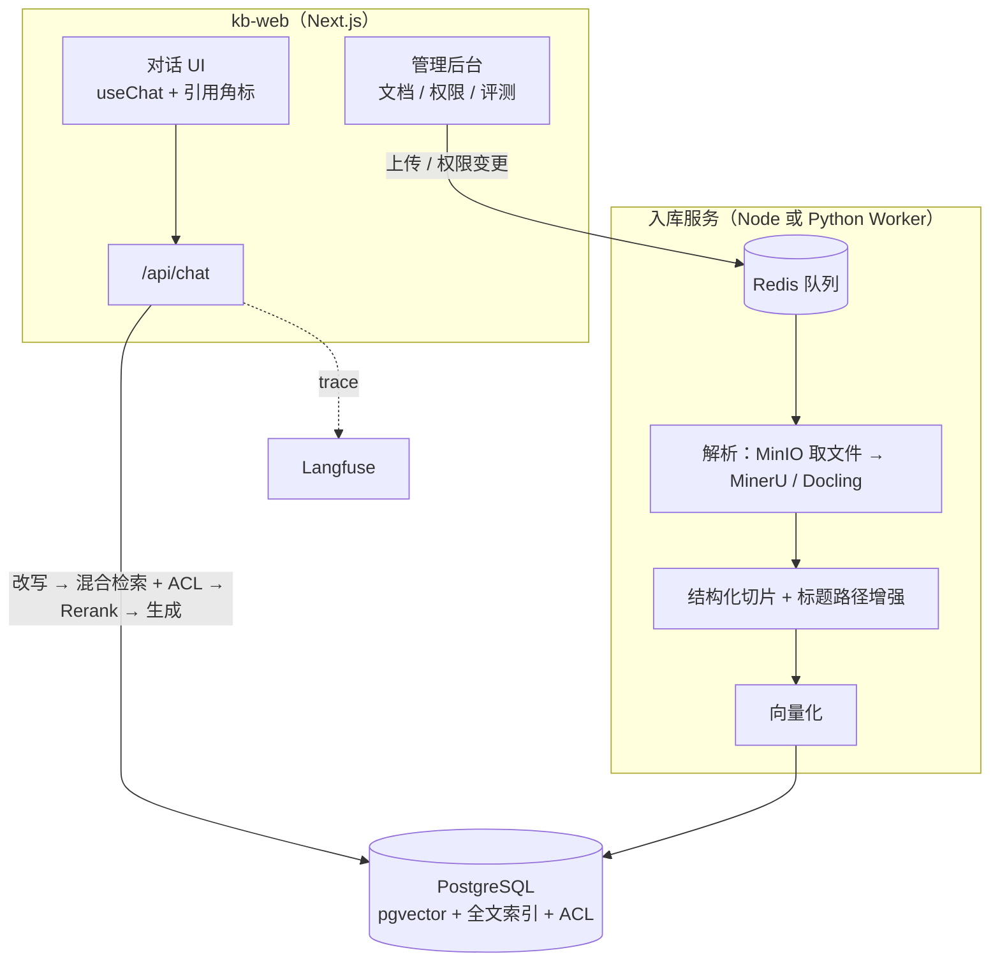
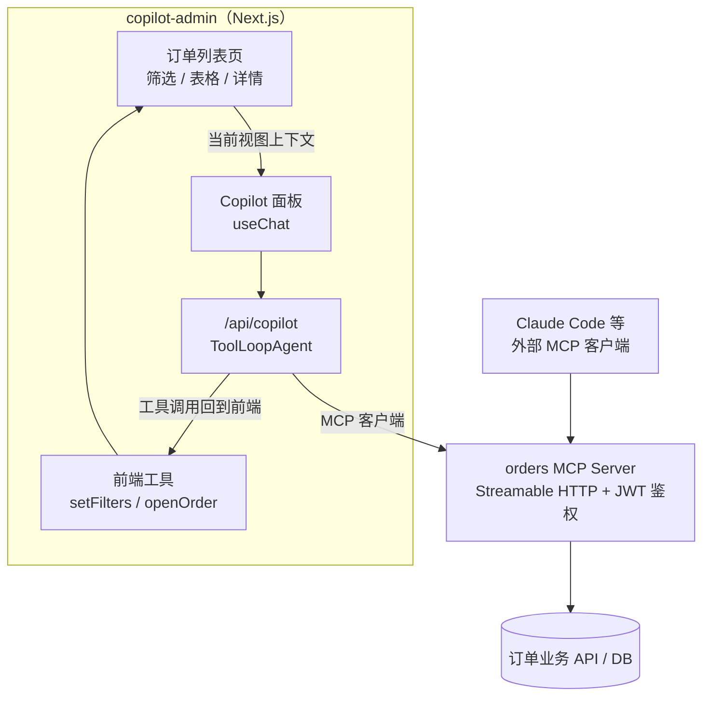
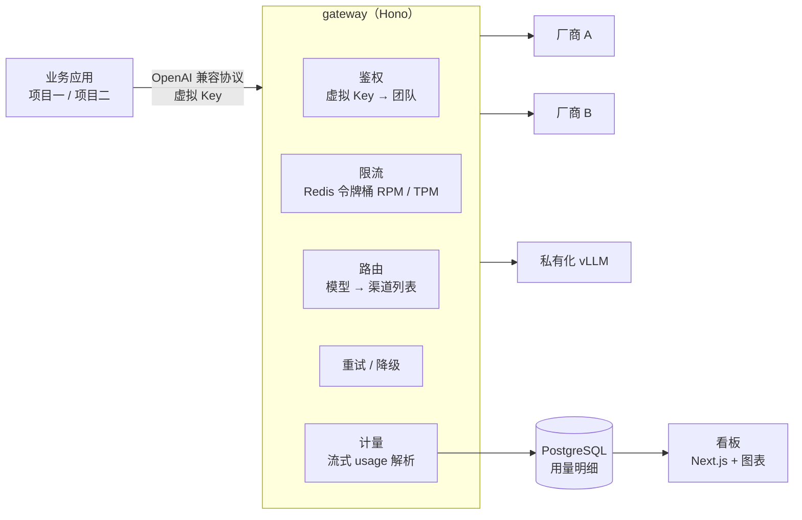

# 09 实战项目方案

> 本章目标：给出 3 个**企业级**练手项目的完整方案：架构、技术选型、数据模型、里程碑与**可量化的验收标准**。每个项目都对应企业中真实高频的需求，做完可以直接作为作品集或内部落地的原型。

---

## 一、项目选择

| 项目 | 对应企业需求 | 核心能力 | 覆盖章节 | 难度 | 周期 |
|---|---|---|---|---|---|
| **项目一：带权限的企业知识库** | 制度问答、产品手册、技术文档助手 | 企业 RAG、权限、引用、评测 | 02 / 05 / 07 / 08 | ⭐⭐⭐ | 2 周 |
| **项目二：业务系统内嵌 Copilot** | 给已有后台加 AI 助手 | 工具调用、审批、MCP、Generative UI | 02 / 03 / 04 / 08 | ⭐⭐⭐ | 1.5 周 |
| **项目三：企业 AI 网关 + 用量看板** | AI 平台团队基础设施 | 网关、限流计费、可观测 | 07 / 08 | ⭐⭐ | 1 周 |

> 🎯 **建议顺序**：前端 / 全栈同学先做**项目二**（最贴近现有技能，成就感来得快），再做**项目一**（企业价值最高），最后做**项目三**，把前两个项目的模型调用都接到自己的网关上，形成完整体系。

推荐的统一技术底座：

```text
ai-lab/                         # pnpm monorepo
├── apps/
│   ├── kb-web/                 # 项目一：Next.js
│   ├── copilot-admin/          # 项目二：Next.js 业务后台 + Copilot
│   └── gateway/                # 项目三：Hono / Fastify
├── packages/
│   ├── model/                  # 统一模型接入（指向项目三的网关）
│   ├── auth/                   # 鉴权与用户身份
│   ├── evals/                  # 评测集与评估器
│   └── ui/                     # 对话组件、工具卡片、引用角标
├── mcp-servers/
│   └── orders/                 # 项目二的 MCP Server
└── infra/docker-compose.yml    # PG（pgvector）、Redis、MinIO、Langfuse
```

---

## 二、项目一：带权限的企业知识库问答

### 2.1 需求

**背景**：公司制度、产品手册、技术文档分散在网盘和 Wiki 中，员工找不到、看不懂；不同部门的文档权限不同。

**目标**：
- 员工用自然语言提问，得到**带引用**的准确回答
- 员工**只能检索到有权限的文档**
- 文档更新、删除、权限变更后自动同步

**非目标**（第一版不做）：多模态（图片内容理解）、跨语言、GraphRAG

### 2.2 架构



### 2.3 技术选型

| 环节 | 选型 | 理由 |
|---|---|---|
| 前端 + API | Next.js + AI SDK 7 | 流式、引用 part、进度推送 |
| 文档解析 | MinerU 或 Docling（Python 服务） | 表格与版面效果好；用 HTTP 服务形式供 Node 调用 |
| 存储 | PostgreSQL + pgvector + 中文全文检索 | 一个数据库同时解决向量、全文、ACL、业务数据 |
| Embedding / Rerank | BGE-M3 + BGE-Reranker（本地或云 API） | 中文效果好，可私有化 |
| 队列 | Redis + BullMQ | Node 生态成熟，支持重试与并发控制 |
| 可观测 | Langfuse（私有化） | Trace + 评测 + Prompt 管理 |

### 2.4 核心数据模型

```sql
-- 用户与组（模拟 IdP，实际项目对接公司 SSO）
CREATE TABLE users  (id text PRIMARY KEY, name text, tenant_id text);
CREATE TABLE groups (id text PRIMARY KEY, name text, parent_id text);
CREATE TABLE user_groups (user_id text, group_id text, PRIMARY KEY (user_id, group_id));

-- 文档
CREATE TABLE documents (
  id text PRIMARY KEY, tenant_id text, title text, source_url text,
  doc_type text, content_hash text, status text,   -- pending / indexing / ready / failed
  acl_principals text[] NOT NULL, updated_at timestamptz
);

-- 块：冗余存储 ACL，避免检索时联表
CREATE TABLE chunks (
  id text PRIMARY KEY, tenant_id text, doc_id text REFERENCES documents ON DELETE CASCADE,
  content text, heading_path text[], page int,
  embedding vector(1024), tsv tsvector, principals text[] NOT NULL
);

-- 对话与反馈
CREATE TABLE chats    (id text PRIMARY KEY, user_id text, messages jsonb, updated_at timestamptz);
CREATE TABLE feedback (id serial, chat_id text, message_id text, rating int, comment text, trace_id text);
```

### 2.5 里程碑

| 里程碑 | 内容 | 产出 |
|---|---|---|
| **M1 跑通（2~3 天）** | 上传 PDF → 解析 → 切片 → pgvector；纯向量检索 + 流式回答 | 能问答的最小版本 |
| **M2 准确（3~4 天）** | 标题路径增强、混合检索 + RRF + Rerank、多轮查询改写、引用与校验、拒答阈值 | 构建 50 条评测集，记录基线 |
| **M3 安全（2~3 天）** | 用户 / 组 / ACL、检索前置过滤、权限变更同步、删除同步、越权测试 | 越权召回率 = 0 |
| **M4 可运营（2 天）** | Langfuse trace、点赞点踩、badcase 入评测集、评测脚本进 CI | 评测报告 + 看板 |

### 2.6 验收标准

| 指标 | 目标 |
|---|---|
| 检索 Recall@5（评测集） | ≥ 85% |
| 回答忠实度（LLM-as-Judge + 人工抽检） | ≥ 90% |
| 应拒答问题的拒答率 | ≥ 90% |
| **越权召回率**（低权限账号测试） | **= 0** |
| 首 token 延迟 P95 | ≤ 3 秒 |
| 文档权限变更生效时间 | ≤ 5 分钟 |

### 2.7 进阶挑战

- 实现**蓝绿索引**：更换 Embedding 模型时不停服重建
- 加入 **Agentic RAG**：复杂问题由 Agent 多轮检索，对比评测集上的收益与成本
- 对接飞书 / 钉钉 / Confluence 作为数据源，实现增量同步

---

## 三、项目二：业务系统内嵌 Copilot

### 3.1 需求

**背景**：已有一个订单管理后台（可以自己用 Next.js 搭一个简化版），运营人员每天要做大量筛选、查询、批量操作。

**目标**：
- 在后台右侧嵌入 AI 助手，运营用自然语言完成"查一下上周华东区退款超过 500 元的订单"之类的操作
- AI 能**操作页面**（修改筛选条件、打开详情）和**调用业务接口**（查询、退款、备注）
- 高风险操作必须审批
- 订单工具同时以 **MCP Server** 形式暴露，可以在 Claude Code 等客户端中使用

### 3.2 架构



### 3.3 工具设计

| 工具 | 位置 | 风险级别 | 审批策略 |
|---|---|---|---|
| `setFilters` | 前端 | L0 | 自动 |
| `openOrderDetail` | 前端 | L0 | 自动 |
| `search_orders` | MCP | L1 | 自动 + 审计 |
| `get_order_overview` | MCP | L1 | 自动 + 审计 |
| `add_order_note` | MCP | L2 | 自动 + 审计 |
| `refund_order` | MCP | L4 | **金额 ≤ 100 自动；否则审批；单日累计额度上限** |
| `batch_update_status` | MCP | L3 | **强制审批，展示受影响订单列表** |

### 3.4 关键实现点

**① 页面上下文按需提供**

```ts
// 只传当前视图的关键状态，详细数据让模型通过工具查询
const pageContext = {
  page: 'orders/list',
  filters: currentFilters,
  selectedOrderIds: selection.slice(0, 20),
  totalInView: pagination.total,
};
sendMessage({ text: input }, { body: { pageContext } });
```

**② 前端工具（不定义 `execute`）**

服务端只声明 `setFilters` 的 schema，不提供 `execute`。工具调用到达前端后由页面执行，执行结果通过 `addToolOutput` 回传给模型。

**③ 工具结果渲染为业务组件**

`search_orders` 的结果直接渲染为可点击的订单表格组件，而不是让模型复述。

**④ MCP Server 鉴权**

MCP Server 校验 JWT 的签名、`aud`、`scope`，以 token 中的用户身份调用业务 API，**不透传 token**（[03 章第七节](./03-MCP协议与企业工具集成.md#七鉴权企业落地的核心重点)）。

### 3.5 里程碑

| 里程碑 | 内容 |
|---|---|
| **M1（2 天）** | 搭建订单后台（mock 数据）+ Copilot 面板；本地工具 `search_orders`，结果渲染为表格 |
| **M2（2 天）** | 前端工具 `setFilters` / `openOrderDetail`；页面上下文注入；路由到便宜模型做意图分类 |
| **M3（2 天）** | 抽出 orders MCP Server（TS SDK v2，Streamable HTTP + JWT），Copilot 改为通过 MCP 客户端调用；在 Claude Code 中接入验证 |
| **M4（2 天）** | 退款与批量操作的审批流、额度上限、幂等键；审计日志；红队测试（订单备注中的间接注入） |

### 3.6 验收标准

| 指标 | 目标 |
|---|---|
| 30 条典型指令的任务完成率 | ≥ 85% |
| L3 / L4 操作未经审批即执行的次数 | **= 0** |
| 订单备注间接注入测试 | 不触发任何写操作 |
| 重放同一审批请求 | 不产生重复退款（幂等） |
| 同一 MCP Server 在 Claude Code 中可用 | ✅ |

### 3.7 进阶挑战

- 把退款审批改为 `WorkflowAgent`，支持主管异步审批（数小时后恢复执行）
- 用 MCP Apps 让 `get_order_overview` 返回可交互的订单卡片
- 加入长期记忆：记住运营人员的常用筛选习惯

---

## 四、项目三：企业 AI 网关 + 用量看板

### 4.1 需求

**背景**：多个团队各自对接模型厂商，密钥散落、费用不透明、无法统一限流和降级。

**目标**：
- 提供 OpenAI 兼容接口，业务方只改 `baseURL` 即可接入
- 虚拟 Key、按团队配额、RPM / TPM 限流
- 多渠道负载均衡与自动降级
- 用量与费用看板

### 4.2 架构



### 4.3 路线选择

| 路线 | 做法 | 适合 |
|---|---|---|
| **A. 基于 LiteLLM / New API 二次开发** | 部署开源网关，补充企业 SSO、看板定制 | 想快速落地 |
| **B. 自研（推荐用于学习）** | 用 Hono 实现核心链路，参考开源方案的设计 | 想吃透网关原理 |

### 4.4 关键实现点

- **流式透传**：边收边转发，不缓冲；在流结束时解析 usage 并计费（[07 章 5.3](./07-LLMOps-可观测评测与AI网关.md#53-自研网关的关键实现点)）
- **TPM 预扣 + 结算**：请求前按 `输入 token + max_tokens` 预扣，结束后按实际用量多退少补
- **降级判定**：只对 429、5xx、超时降级，4xx 参数错误不降级
- **客户端断开**：上游请求同步中止，按已输出内容计费
- **密钥安全**：厂商 Key 加密存储，日志中不出现任何 Key

### 4.5 里程碑

| 里程碑 | 内容 |
|---|---|
| **M1（2 天）** | `/v1/chat/completions` 透传（含流式）；虚拟 Key 鉴权；用量记录 |
| **M2（2 天）** | Redis 限流（RPM / TPM）；团队配额；多渠道负载均衡与降级 |
| **M3（2 天）** | 看板：按团队 / 模型 / 天的 token 与费用；TTFT、错误率；预算告警 |
| **M4（1 天）** | 项目一、项目二的模型调用全部切换到网关；按数据密级路由（[08 章 6.2](./08-安全权限与上线清单.md#62-按数据密级路由模型)） |

### 4.6 验收标准

| 指标 | 目标 |
|---|---|
| 网关引入的额外 TTFT | ≤ 50 ms |
| 流式透传 | 无缓冲，逐 chunk 到达 |
| 计量误差（与厂商账单对比） | ≤ 1% |
| 主渠道故障时 | 自动切换，业务请求成功率 ≥ 99% |
| 超出 TPM | 返回 429 和 `Retry-After` |

---

## 五、作品集与面试表达

做完项目后，按下面的结构整理成作品说明，这也是面试中讲项目的框架：

```text
1. 业务问题：解决什么问题，为什么现有方案不行
2. 架构决策：为什么选平台 / 框架 / 自研；为什么是 Workflow 还是 Agent
3. 关键难点：选 1~2 个讲透（如权限过滤召回不足、流式计量、审批防篡改）
4. 量化结果：评测指标基线 → 优化后（Recall@5 从 62% 提升到 88%）
5. 治理设计：权限、安全、成本、可观测分别怎么做
6. 反思：哪些设计做错了，下一版会怎么改
```

> 🎯 **落地要点**：能体现"企业级"的不是功能有多少，而是**第 4 点和第 5 点**：有评测数据支撑效果，有治理设计支撑上线。

---

## 本章小结

- 三个项目分别对应企业 AI 落地最高频的三类需求：**知识库、业务 Copilot、AI 网关**
- 每个项目都按"**跑通 → 准确 → 安全 → 可运营**"四个里程碑推进
- 验收标准必须**可量化**，安全类指标（越权召回、未审批执行）必须为 0
- 三个项目共用 monorepo 底座，最终串成一个完整的企业 AI 体系
