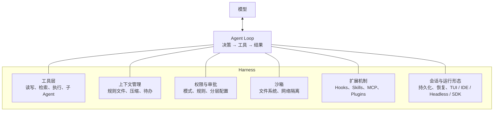
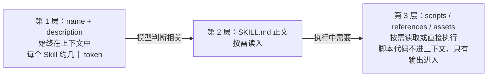
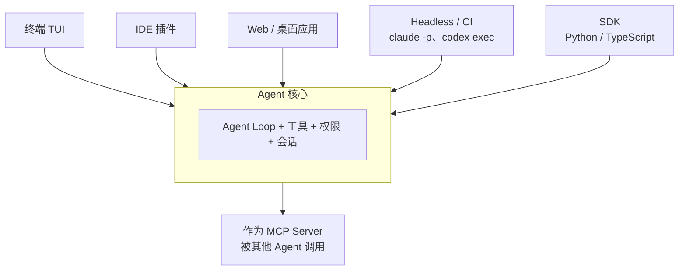

# 12 编码 Agent Harness 深度拆解

> 本章目标：拆开当前工程化最成熟的三个编码 Agent（**Claude Code、Codex CLI、OpenHands**），逐个子系统看清它们怎么做**工具、上下文、权限、沙箱、扩展机制和运行形态**，并能把这些设计迁移到企业 Agent，或直接基于它们的 SDK 构建业务 Agent。
>
> [06 章第八节](./06-Agent工程化-从Loop到生产.md#八harness-工程向编码-agent-学习)给出的是"学什么"的结论清单，本章讲"**它们具体是怎么做的**"。
>
> 版本基线（2026 年 11 月）：Claude Code **2.1.x**、Codex CLI **0.16x**（Rust 实现 `codex-rs`）、OpenHands **V1**（Software Agent SDK）。这三个项目按周发版，配置项和事件名以官方文档为准：[Claude Code 文档](https://code.claude.com/docs)、[Codex 文档](https://developers.openai.com/codex)、[OpenHands 文档](https://docs.openhands.dev)。

---

## 一、为什么编码 Agent 是 Harness 的标杆

编码是 Agent **最难、也最适合**的场景，这逼出了最成熟的工程：

| 编码场景的特点 | 逼出的 Harness 能力 |
|---|---|
| 任务长：一次修改可能涉及几十步、几十个文件 | 上下文压缩、待办清单、子 Agent 隔离 |
| 上下文大：代码库远超上下文窗口 | 即时检索（grep / glob）、项目规则文件、渐进式披露 |
| 副作用强：能删文件、执行任意命令、推送代码 | 权限模式、审批、OS 级沙箱、Hooks 拦截 |
| 结果可验证：能跑测试、能编译 | 评估-优化循环、Hooks 自动格式化与检查 |
| 用户是工程师：要求可定制、可脚本化 | 配置分层、Skills、Plugins、Headless 模式、SDK |

> 🎯 **落地要点**：企业 Agent 面对的问题（长流程、海量资料、高风险操作、可审计）与编码 Agent **同构**。把"代码库"换成"业务系统"，把"bash"换成"业务工具"，下面的每一个设计都能直接复用。

### 1.1 Harness 的组成



### 1.2 三个项目的定位

| | Claude Code | Codex CLI | OpenHands |
|---|---|---|---|
| 出品 | Anthropic | OpenAI | All Hands AI（社区） |
| 开源 | 闭源（Agent SDK 开放） | 开源（Apache 2.0） | 开源（MIT） |
| 实现语言 | TypeScript | **Rust** | Python |
| 形态 | 终端 / IDE / 桌面 / Web / SDK | 终端 / IDE / 桌面 / Cloud / SDK | Web GUI / CLI / Cloud / SDK |
| 模型 | Claude 系列 | OpenAI 系列（可接其他兼容端点） | **任意模型**（经 LiteLLM） |
| 最值得学 | **扩展体系**（Hooks、Skills、子 Agent、Plugins）与权限分层 | **OS 级沙箱**与"沙箱 × 审批"双维度权限 | **事件溯源**架构、容器化运行时、SDK 分包 |

---

## 二、Agent Loop 与工具设计

### 2.1 主循环

三个项目的主循环和 [06 章第一节](./06-Agent工程化-从Loop到生产.md#一agent-的本质一个循环)的基本循环一致，差别在于**每个环节都插入了工程设施**：

```python
async def harness_loop(user_input: str, session: Session):
    run_hooks("UserPromptSubmit", user_input)              # ① 可改写或拦截用户输入
    session.append(user_message(user_input))

    while True:
        if session.tokens() > session.compact_threshold:  # ② 接近上限时自动压缩
            run_hooks("PreCompact")
            session.compact()

        response = await model.call(
            system=session.system_prompt,                  # 稳定前缀，命中 prompt cache
            tools=session.visible_tools(),                 # 内置工具 + MCP + Skill 元数据
            messages=session.messages,
        )
        session.append(response.message)
        if not response.tool_calls:
            if run_hooks("Stop") == BLOCK:                 # ③ Stop Hook 可以要求"还没完，继续"
                continue
            return response.text

        results = await gather(*[run_tool(call) for call in response.tool_calls])  # ④ 并行执行只读工具
        session.append(tool_results(results))

async def run_tool(call):
    decision = run_hooks("PreToolUse", call)               # ⑤ Hook 可以允许、拒绝、改写参数
    if decision is None:
        decision = permission_engine.check(call)           # ⑥ 规则匹配：deny → ask → allow
    if decision == ASK:
        decision = await ask_user(call)                    # ⑦ 人工审批
    if decision == DENY:
        return error_result("用户拒绝了该操作，原因：...")    #    拒绝也要以可读结果回到上下文
    result = await sandbox.execute(call)                   # ⑧ 在沙箱中执行
    run_hooks("PostToolUse", call, result)                 # ⑨ 格式化、审计、校验
    return truncate(result)                                # ⑩ 结果截断，防止撑爆上下文
```

> 🎯 **落地要点**：注意第 ⑦ 步之后的处理。**被拒绝的工具调用不能让循环崩溃**，而是作为一条可读的工具结果回给模型，让它换一种做法。这是"人机协同"能顺畅运行的前提。

### 2.2 工具集：少而通用

**Claude Code 的内置工具**（核心部分）：

| 类别 | 工具 | 设计要点 |
|---|---|---|
| 读 | `Read` | 带行号输出，支持分页（offset / limit）；可读图片、PDF、Notebook |
| 检索 | `Glob`、`Grep` | 文件名模式匹配；基于 ripgrep 的内容搜索，支持只返回文件名、计数或匹配行 |
| 写 | `Edit`、`Write`、`NotebookEdit` | `Edit` 是**精确字符串替换**，要求 `old_string` 在文件中唯一，且**必须先 Read 过该文件** |
| 执行 | `Bash`（Windows 为 `PowerShell`） | 工作目录在调用之间保持；支持后台运行与超时 |
| 网络 | `WebFetch`、`WebSearch` | 抓取网页由小模型按提示摘要后返回，而不是返回整页 HTML |
| 编排 | `Agent`（子 Agent）、`Skill`、任务管理工具 | 子 Agent 在独立上下文运行；按需加载 Skill；维护待办 |
| 交互 | `AskUserQuestion` | 遇到需要用户决定的问题时，结构化地提问（选项 + 推荐项） |

**Codex CLI** 的核心工具更少：`shell`（执行命令）、`apply_patch`（应用补丁修改文件）、计划更新工具，以及 MCP 工具。读文件、搜索都通过 shell 中的 `cat`、`rg` 完成。

**OpenHands** 的工具在 `openhands-tools` 包中：终端（bash）、文件编辑器（`view` / `create` / `str_replace` / `insert` / `undo_edit` 等子命令）、任务跟踪器、浏览器等。它的前身提出了 **CodeAct** 思想：让 Agent 以"写代码并执行"作为统一的行动方式。

### 2.3 文件编辑：四种策略的取舍

"怎么让模型改文件"是编码 Agent 最核心的工具设计问题，各家选择不同：

| 策略 | 代表 | 优点 | 缺点 |
|---|---|---|---|
| **整文件重写** | 早期方案、`Write` | 实现简单 | 大文件浪费 token，容易遗漏或改坏无关代码 |
| **精确字符串替换** | Claude Code `Edit`、OpenHands `str_replace` | token 少、意图明确；匹配失败时能明确报错 | 要求模型准确复现原文（含缩进），原文不唯一时需要带更多上下文 |
| **补丁格式** | Codex `apply_patch` | 一次修改多处、多文件；能表达新增、删除、重命名 | 格式复杂，模型需要专门训练才能稳定输出 |
| **行号编辑** | 少数实现 | 简洁 | 行号在多次编辑后会漂移，最容易出错 |

Codex 的补丁格式示意（以官方实现为准）：

```text
*** Begin Patch
*** Update File: src/order/service.ts
@@ export async function refund(orderId: string) {
-  const order = await db.order.find(orderId);
+  const order = await db.order.findOrThrow(orderId);
*** End Patch
```

> 📖 **为什么"先读后写"**：Claude Code 的 `Edit` 要求本会话已读过该文件，并在写入前检查文件自读取后是否被外部修改。这避免了模型基于**过时的记忆**覆盖用户刚做的改动。企业 Agent 修改业务数据时同理：**写操作要基于最新读取的版本**（乐观锁、版本号校验）。

### 2.4 工具设计的共同原则

| 原则 | 编码 Agent 的做法 | 企业 Agent 的对应 |
|---|---|---|
| 通用可组合 | 十几个工具覆盖几乎所有编码任务 | 优先提供"查询 / 读取 / 执行"类通用工具，而不是为每个报表写一个工具 |
| 读写分离 | 只读工具可以并行、通常免审批；写工具串行、需要权限 | 按读写和风险等级分级（[10 章 4.2](./10-安全权限与上线清单.md#42-工具风险分级)） |
| 结果有界 | 输出截断，长输出提示"用 grep 过滤" | 分页、摘要、落盘返回引用（[06 章 4.3](./06-Agent工程化-从Loop到生产.md#43-实战技巧)） |
| 错误可读 | "old_string 不唯一，请提供更多上下文" | 错误信息告诉模型**下一步该怎么做** |
| 描述即文档 | 工具描述中写清楚使用时机和反例 | 工具描述是 prompt 的一部分，要像写接口文档一样认真 |

---

## 三、上下文工程

### 3.1 上下文布局

```text
┌─ 系统提示：身份、行为规范、工具使用规则 ─────────┐  几乎不变
├─ 工具定义：内置工具 + MCP 工具（或延迟加载） ──────┤  很少变
├─ Skills 元数据：每个 Skill 的名称 + 一句话描述 ────┤  很少变
├─ 项目记忆：CLAUDE.md / AGENTS.md ────────────────┤  按项目变
├─ 对话历史与工具结果 ───────────────────────────┤  逐轮追加
└─ 最新消息（含动态信息：git status、当前时间等） ───┘  每次变
```

按"越稳定越靠前"排列，是为了最大化 **prompt cache** 命中。修改 CLAUDE.md、增减 MCP 服务器都会改变前缀、使缓存失效，所以这类配置应在会话开始前定好，而不是在长会话中频繁调整。

### 3.2 项目记忆文件

| | Claude Code：`CLAUDE.md` | Codex：`AGENTS.md` |
|---|---|---|
| 全局级 | `~/.claude/CLAUDE.md` | `~/.codex/AGENTS.md`（可用 `AGENTS.override.md` 覆盖） |
| 项目级 | 项目根的 `CLAUDE.md` 或 `.claude/CLAUDE.md` | 从 Git 根到当前目录逐层查找，**按从根到叶的顺序拼接** |
| 子目录 | 读取该目录下的文件时**按需加载** | 同上，逐层拼接 |
| 企业级 | 托管策略位置下发的 `CLAUDE.md`，用户无法覆盖 | 通过托管配置限制 |
| 引用 | `@path/to/file` 导入其他文件 | — |
| 上限 | 启动时读取的内容有长度上限 | 默认合计 32 KiB（可配置） |
| 安全 | — | 不受信任的项目**不读取**项目级 AGENTS.md 和项目级配置 |

> 🔭 **先锋视角**：**AGENTS.md** 已成为跨厂商的事实标准（Codex、Cursor、OpenCode、Gemini CLI 等都支持），与 MCP 一同由 Linux 基金会旗下的 Agentic AI Foundation（AAIF）托管。Claude Code 使用 CLAUDE.md，团队可以在 CLAUDE.md 中用 `@AGENTS.md` 导入，维护一份即可。

**写好项目记忆文件的原则**：

- 只写**模型无法从代码中推断**的内容：构建命令、约定、坑、禁止事项
- 简短。它每轮都在上下文里，每一行都在消耗注意力和 token
- 写成可执行的规则（"提交前运行 `pnpm lint`"），而不是愿景（"代码要优雅"）
- 硬性约束不要只靠记忆文件。**模型可能不遵守，需要强制的用 Hooks 或权限规则实现**（见第六节）

### 3.3 即时检索 vs 预建索引

| 方式 | 代表 | 优点 | 缺点 |
|---|---|---|---|
| **即时检索（Agentic Search）** | Claude Code、Codex（grep / glob / 读文件） | 永远是最新代码；无需建索引；结果精确 | 多花几轮工具调用 |
| **代码库地图** | Aider 的 repo map（用 tree-sitter 提取符号和引用关系，按重要度压缩） | 一次性给出全局结构 | 大仓库需要裁剪 |
| **向量索引** | 部分 IDE 助手 | 适合语义模糊的查询 | 索引滞后、切片破坏代码结构、需要基础设施 |

主流终端 Agent 选择即时检索：**模型足够强时，"像工程师一样用 grep 查找"比向量检索更准确**。这对企业 RAG 也有启发：对结构化、可精确定位的资料（代码、配置、表格），给 Agent 搜索工具往往比向量检索更好（[07 章](./07-企业级RAG落地.md)）。

### 3.4 压缩

| | Claude Code | OpenHands | Codex |
|---|---|---|---|
| 触发 | 接近上下文上限时自动压缩；也可手动 `/compact [保留重点]` | Condenser 在 token / 事件数超过阈值时触发；Agent 也可以主动请求压缩 | 自动压缩 + 手动 `/compact` |
| 方法 | 单独发起一次请求生成摘要，替换历史 | 默认用 LLM 摘要旧事件；也有不调用 LLM 的窗口丢弃等策略 | 生成摘要替换历史 |
| 压缩后 | **从磁盘重新注入** CLAUDE.md、待办、计划等关键状态 | **原始事件日志完整保留**，只在发给模型前应用压缩视图 | — |
| 扩展点 | `PreCompact` / `PostCompact` Hook | Condenser 可插拔、可自定义 | — |

> 🎯 **落地要点**：OpenHands 的做法值得重点借鉴：**存储层永远保留完整历史，压缩只作用于"发给模型的视图"**。这样既能控制 token，又不影响审计、回放和事后排查。

### 3.5 待办与计划

- Claude Code 提供任务管理工具（创建、更新、列出任务），模型在长任务中**逐项勾选**，用户在界面上实时看到进度；**Plan 模式**下只读不写，先产出方案，用户批准后再执行
- Codex 有计划更新工具，同样以清单形式展示步骤
- Cline 的 **Plan / Act 模式**：Plan 模式只能读和搜索，Act 模式才能修改；两种模式可以绑定不同模型（如规划用强模型、执行用便宜模型）

> 📖 这些机制本质上都是[上下文工程](./06-Agent工程化-从Loop到生产.md#四上下文工程重点)中的"**写出**"：把任务状态从模型的"记忆"中拿出来，变成显式的、可见的、压缩后不会丢失的数据。

---

## 四、权限与审批（重点）

### 4.1 Claude Code：模式 + 规则 + 分层配置

**权限模式**：

| 模式 | 行为 | 适合 |
|---|---|---|
| `default` | 首次使用每类工具时询问 | 日常开发 |
| `acceptEdits` | 自动接受文件编辑，命令仍需确认 | 信任当前任务的改动范围 |
| `plan` | 只读，只能分析和产出方案 | 先评审方案再动手 |
| `auto` | 由分类模型判断每个操作的风险，安全的自动放行、可疑的才询问 | 减少打扰，同时保留防护 |
| `dontAsk` | 不询问，**未预先允许的操作一律拒绝** | 无人值守、权限明确的自动化任务 |
| `bypassPermissions` | 跳过所有权限检查 | **只应在隔离环境（容器、VM）中使用** |

**权限规则**写在 settings.json 的 `permissions` 中：

```json
{
  "permissions": {
    "allow": ["Bash(npm run test:*)", "Bash(git diff:*)", "Read(./src/**)", "WebFetch(domain:docs.company.com)"],
    "ask":   ["Bash(git push:*)"],
    "deny":  ["Read(./.env)", "Read(./secrets/**)", "Bash(curl:*)", "mcp__prod-db__execute_sql"]
  }
}
```

- 规则格式是 `工具名` 或 `工具名(匹配说明)`；MCP 工具名为 `mcp__服务器名__工具名`
- 评估顺序固定为 **deny → ask → allow**，先匹配的生效。**宽泛的 deny 无法被更具体的 allow 打开例外**，这保证了"禁止"总是最强的

**配置分层**（优先级从高到低）：

```text
① 托管配置（managed-settings.json / MDM / 服务端下发）   ← 企业 IT 统一下发，用户无法覆盖
② 命令行参数
③ 项目本地配置 .claude/settings.local.json             ← 个人在本项目的偏好，不入库
④ 项目共享配置 .claude/settings.json                   ← 团队共享，入库
⑤ 用户配置 ~/.claude/settings.json
```

> ⚠️ **注意**：出于安全考虑，有些配置不能在项目级生效。例如把默认模式设为 `bypassPermissions` 或 `auto` 只能写在用户级或托管配置中。否则 clone 一个恶意仓库，它的 `.claude/settings.json` 就能关掉你的权限检查。**"项目配置不能提升自身权限"** 是分层配置必须遵守的原则。

### 4.2 Codex：沙箱 × 审批，两个正交维度

Codex 把权限拆成两个**独立**的维度：**沙箱决定"能做什么"，审批策略决定"什么时候问人"**。

| `sandbox_mode` | 能力边界 |
|---|---|
| `read-only` | 只能读文件，不能写、不能联网 |
| `workspace-write` | 可以写工作区（及配置的额外可写目录），默认不能联网 |
| `danger-full-access` | 不做沙箱限制 |

| `approval_policy` | 行为 |
|---|---|
| `on-request` | **默认**。模型认为需要突破沙箱时（如联网、写工作区外的文件）主动请求批准 |
| `never` | 从不询问；被沙箱拦截的操作直接以失败结果返回给模型。适合 CI（`codex exec` 固定使用此策略） |
| `{ granular = {...} }` | 按类别分别控制：沙箱提权、规则命中、MCP 交互请求、Skill 审批等 |

> ⚠️ **注意**：旧文档中的 `untrusted` 已不再支持（设置后 Codex 无法启动），`on-failure` 已废弃并按 `on-request` 处理。"不受信任"现在是**项目级**属性：在用户配置中把项目标记为 `trust_level = "untrusted"` 后，Codex 会跳过该项目的 `.codex/` 配置、Hooks 和规则，并使用更严格的审批行为。

```toml
# ~/.codex/config.toml
sandbox_mode = "workspace-write"
approval_policy = "on-request"

[sandbox_workspace_write]
network_access = false              # 默认不联网

[projects."/Users/me/work/untrusted-repo"]
trust_level = "untrusted"
```

**命令规则（rules）**：用 Starlark 语法按命令前缀声明决策，比 Claude Code 的字符串匹配更结构化：

```python
# ~/.codex/rules/default.rules
prefix_rule(pattern=["git", "status"], decision="allow")
prefix_rule(pattern=["git", "push"], decision="prompt", justification="推送到远程需要确认")
prefix_rule(pattern=["rm", "-rf"], decision="forbidden")
```

`never` 不等于解除沙箱。"**全自动但仍在沙箱内**"（`workspace-write` + `never`）是 CI 场景最常见的安全组合。

### 4.3 OpenHands：确认模式 + 风险分析器

OpenHands 运行在容器里，宿主机天然隔离，所以权限设计侧重于**动作级的风险判断**：

- **确认模式**：Agent 的每个动作执行前等待用户确认，或者只在高风险动作上确认
- **安全分析器**：用 LLM 对每个动作评估风险等级（低 / 中 / 高），配合确认策略决定是否需要人工介入

### 4.4 权限设计的共同模式

| 模式 | 说明 | 迁移到企业 Agent |
|---|---|---|
| **能力边界与审批时机分离** | Codex 的沙箱 × 审批 | "这个 Agent 能访问哪些系统"由平台配置，"哪些操作要审批"由业务规则配置 |
| **规则匹配，deny 优先** | Claude Code 的 deny → ask → allow | 黑名单永远最高优先级，防止配置组合出意外放行 |
| **分层配置，上层不可被下层突破** | 托管 > 项目 > 用户 | 平台级 > 租户级 > 用户级，下级只能收紧不能放宽 |
| **项目内容不可信** | 项目配置不能提升自身权限；不受信任的项目不加载项目配置 | **用户上传的文档、检索到的网页都不能改变 Agent 的权限** |
| **拒绝是正常结果** | 拒绝后模型换一种做法 | 审批拒绝要带原因回到上下文 |
| **模式随任务切换** | Plan → 执行 | 先出方案、人工确认、再执行，适合高风险业务操作 |

---

## 五、沙箱

### 5.1 三种实现路线

| | Claude Code | Codex CLI | OpenHands |
|---|---|---|---|
| 隔离层级 | **OS 级进程沙箱**（只作用于 Bash 及其子进程） | **OS 级进程沙箱**（作用于所有命令） | **容器**（整个 Agent 运行时在容器内） |
| macOS | Seatbelt（系统内置） | Seatbelt（`sandbox-exec` + 策略文件） | Docker |
| Linux | bubblewrap（Linux 命名空间）+ socat（网络代理） | bubblewrap + seccomp（早期为 Landlock） | Docker / 远程运行时 |
| Windows | WSL2 下复用 Linux 方案 | 实验性的原生沙箱 | Docker |
| 文件系统 | 默认只能写当前工作目录 | 按 `sandbox_mode` 和可写根目录 | 容器内挂载的工作区 |
| 网络 | 经代理出网，**按域名白名单放行** | 默认禁止，可整体开启 | 容器网络策略 |

> 📖 **Seatbelt**：macOS 内置的强制访问控制框架，用策略文件声明进程能访问哪些文件、能否联网。**bubblewrap**：Linux 上的轻量沙箱工具，用命名空间（namespace）为进程构造一个受限的文件系统和网络视图，Flatpak 也在用它。两者都是**无需安装 Docker 的进程级隔离**，启动几乎零开销。

### 5.2 为什么沙箱能减少审批

没有沙箱时，每条命令都可能造成任意破坏，只能逐条询问，用户很快会疲劳并无脑点"同意"。有了 OS 级沙箱：

```text
沙箱内的操作（写工作区、运行测试）  → 最坏后果可控 → 自动执行
需要突破沙箱的操作（联网、写系统目录）→ 才询问用户
```

> 🎯 **落地要点**：**审批疲劳本身就是安全漏洞**。用隔离把"可自动执行"的范围划清楚，才能让审批只出现在真正有风险的地方。

### 5.3 网络出口是关键

沙箱最重要的一道控制是**网络**。回顾"致命三要素"（[10 章](./10-安全权限与上线清单.md)）：**接触私有数据 + 接触不可信内容 + 能对外通信**。编码 Agent 天然满足前两条（读代码、读网页和依赖包），只要切断或白名单化网络出口，提示注入就无法把数据外传。

> ⚠️ **注意**：OS 级沙箱如果在当前平台不可用（如缺少依赖），某些实现会**静默降级为不隔离运行**。生产环境应配置为"沙箱不可用即失败"（Claude Code 的 `sandbox.failIfUnavailable`），不要依赖默认值。

### 5.4 企业场景的选择

| 场景 | 推荐 |
|---|---|
| 开发者本机使用 | OS 级进程沙箱（Claude Code / Codex 内置） |
| 团队共享的 Agent 服务、CI | 容器（每个任务一个容器，用完销毁） |
| 执行不可信代码、多租户平台 | microVM（Firecracker、E2B 等，[10 章第六节](./10-安全权限与上线清单.md#六代码执行沙箱)） |

---

## 六、扩展机制

四种扩展机制解决不同问题，先看全局：

| 机制 | 本质 | 何时加载 | 由谁触发 | 典型用途 |
|---|---|---|---|---|
| **项目记忆**（CLAUDE.md） | 始终在上下文中的指令 | 会话开始 | — | 项目约定、构建命令 |
| **Hooks** | 生命周期事件上的**确定性脚本** | 事件发生时 | **Harness**（不经过模型） | 强制规则、拦截、格式化、审计 |
| **Skills** | 按需加载的能力包 | 模型判断需要时 | 模型（或用户 `/命令`） | 流程 SOP、领域知识、配套脚本 |
| **子 Agent** | 独立上下文的专用 Agent | 被委派时 | 模型（或用户指定） | 探索、评审、隔离大量中间信息 |
| **MCP** | 外部工具与数据 | 会话开始（或延迟加载） | 模型调用 | 接入内部系统 |
| **Plugins** | 以上各项的打包分发 | 安装后 | — | 团队共享一整套能力 |

> 🎯 **落地要点**：**"模型应该做"用记忆文件和 Skills，"必须做"用 Hooks 和权限规则。** 记忆文件里写"不要删除 migrations 目录"，模型大概率会遵守，但不保证；Hook 拦截则 100% 生效。

### 6.1 Hooks

**事件类型**（Claude Code 目前有三十多个事件，以下是最常用的）：

| 层级 | 事件 | 能做什么 |
|---|---|---|
| 会话 | `SessionStart`、`SessionEnd` | 注入动态上下文（当前分支、待办工单）；会话结束时清理、上报 |
| 轮次 | `UserPromptSubmit` | 校验或补充用户输入，可以拦截 |
| 轮次 | `Stop` | 模型准备结束时触发，**可以阻止结束并要求继续**（如"测试还没通过"） |
| 工具 | `PreToolUse` | **执行前拦截**：允许、拒绝、转为询问，或改写参数 |
| 工具 | `PermissionRequest` | 即将弹出权限询问时，可以代替用户自动决策 |
| 工具 | `PostToolUse`、`PostToolUseFailure` | 执行后格式化代码、跑 lint、记录审计日志 |
| 子 Agent | `SubagentStart`、`SubagentStop` | 跟踪、限制子 Agent |
| 上下文 | `PreCompact`、`PostCompact`、`InstructionsLoaded` | 压缩前保存关键状态；审计加载了哪些规则 |
| 其他 | `Notification`、`FileChanged`、`CwdChanged` 等 | 桌面通知、外部变更感知 |

**协议**：

- **输入**：事件信息以 JSON 写入脚本的 stdin，包含 `session_id`、`cwd`、`hook_event_name`、`tool_name`、`tool_input` 等字段
- **退出码**：`0` 成功（若 stdout 是 JSON 则解析其中的决策字段）；**`2` 阻断**（stderr 内容作为原因反馈给模型）；其他非零值为非阻断错误，只记录不阻断
- **决策输出**：`PreToolUse` 可以输出 `hookSpecificOutput.permissionDecision`（`allow` / `deny` / `ask` 等）及原因

**配置示例**：拦截危险命令 + 编辑后自动格式化

```json
{
  "hooks": {
    "PreToolUse": [
      { "matcher": "Bash", "hooks": [{ "type": "command", "command": "node ~/.claude/hooks/guard-dangerous.js" }] }
    ],
    "PostToolUse": [
      { "matcher": "Edit|Write", "hooks": [{ "type": "command", "command": "npx prettier --write \"$(jq -r '.tool_input.file_path')\"" }] }
    ]
  }
}
```

```js
// guard-dangerous.js：从 stdin 读取工具调用，命中危险模式则阻断
const input = JSON.parse(require('fs').readFileSync(0, 'utf8'));
const cmd = input.tool_input?.command ?? '';
const rules = [
  { re: /\brm\s+-[a-z]*r[a-z]*f?\b/, reason: '递归删除需要人工确认目标与范围' },
  { re: /\bgit\s+push\b.*--force\b/, reason: '禁止强制推送' },
];
const hit = rules.find(r => r.re.test(cmd));
if (hit) {
  console.log(JSON.stringify({
    hookSpecificOutput: { hookEventName: 'PreToolUse', permissionDecision: 'ask', permissionDecisionReason: hit.reason },
  }));
}
process.exit(0);
```

> ⚠️ **注意**：
> - Hook 脚本以**当前用户的完整权限**运行，项目里的 Hook 配置等同于"clone 仓库就执行任意代码"。这也是 Codex 对不受信任的项目跳过项目级 Hooks 的原因
> - Hook 会拖慢每一次工具调用，脚本要快；耗时操作放到 `PostToolUse` 并异步执行
> - 正则拦截命令**可以被绕过**（变量拼接、`eval`、写脚本再执行）。Hook 是一道防线，**真正的边界是沙箱**

Codex 同样提供 Hooks 和上一节的命令规则；OpenHands SDK 在 Agent 和 Conversation 层提供回调与安全分析器作为扩展点。

### 6.2 Skills

**目录结构**：

```text
.claude/skills/release-notes/
├── SKILL.md              # 必需：frontmatter + 指令正文
├── scripts/
│   └── collect_prs.py    # 可执行脚本：确定性的工作交给代码
├── references/
│   └── style-guide.md    # 参考资料：需要时才读
└── assets/
    └── template.md       # 模板等资源
```

```markdown
---
name: release-notes
description: 根据两个 tag 之间的提交和 PR 生成版本发布说明。用户提到"发版说明""release notes""changelog"时使用。
---

# 生成发布说明

1. 运行 `python scripts/collect_prs.py <from_tag> <to_tag>` 收集 PR 列表（输出 JSON）
2. 按 references/style-guide.md 的分类规则归类：新功能 / 修复 / 破坏性变更
3. 套用 assets/template.md 输出；破坏性变更必须附迁移说明
```

**渐进式披露的三层加载**：



**写好 Skill 的要点**：

- `description` 决定 Skill 会不会被触发：写清楚**做什么**和**什么时候用**，包含用户可能说的关键词
- 正文写**流程和判断标准**，不写模型本来就会的通用知识
- 确定性的步骤（数据收集、格式转换、校验）写成**脚本**，让模型执行而不是让模型"手算"
- 一个 Skill 只做一件事；大而全的 Skill 会在不该触发时被触发

> 🔭 **先锋视角**：Skills 的格式已作为开放标准（Agent Skills）被多家采用：Codex、OpenHands（`.agents/skills/`）、多个 IDE 助手都能加载同一格式的 Skill。对企业而言，**Skill 就是"可被 Agent 执行的 SOP"**：把运维手册、审核流程、报表规范写成 Skill，就能在不同 Agent 产品之间复用。

### 6.3 子 Agent

```markdown
<!-- .claude/agents/security-reviewer.md -->
---
name: security-reviewer
description: 审查代码改动中的安全问题。在完成涉及鉴权、用户输入、SQL 的修改后主动使用。
tools: Read, Grep, Glob
model: sonnet
---

你是安全审查专家。只读审查，不修改代码。
检查：注入、越权、敏感信息泄露、不安全的反序列化。
输出：问题列表（文件:行号、风险等级、修复建议）。没有问题就明确说没有。
```

- **独立上下文**：子 Agent 从干净的上下文开始，只拿到自己的系统提示和委派任务；读几十个文件产生的中间信息**不会污染主对话**，只有结论返回
- **工具白名单**：`tools` 限定可用工具（省略则继承全部），这是**权限隔离**，也能防止审查类子 Agent 越界修改
- **模型选择**：探索、检索类子 Agent 可以用更快更便宜的模型
- **内置子 Agent**：`Explore`（只读，快速搜索代码库）、`Plan`（只读，设计方案）、`general-purpose`（通用）

> ⚠️ **注意**：子 Agent 的返回内容要**精炼**。如果子 Agent 把完整过程都返回，就失去了上下文隔离的意义。在子 Agent 的系统提示中明确规定输出格式和长度。

### 6.4 MCP 与 Plugins

**MCP**（协议细节见 [05 章](./05-MCP与Agent互操作协议.md)）在 Claude Code 中有三个作用域：本地（仅自己、仅当前项目）、项目（仓库根的 `.mcp.json`，团队共享）、用户（自己的所有项目）。

MCP 工具多了会挤占上下文，降低工具选择准确率。主流 Harness 的应对是**工具搜索 / 延迟加载**：上下文中只放工具名，模型需要时先搜索，再加载完整的 schema。这和 Skills 的渐进式披露是同一个思路。

**Plugins** 把 Skills、子 Agent、Hooks、MCP 服务器、斜杠命令打包成一个单元，通过 **Marketplace**（一个包含 `.claude-plugin/marketplace.json` 的 Git 仓库）分发。企业可以搭建内部 Marketplace，统一分发经过安全审核的能力包。

---

## 七、会话、持久化与运行形态

### 7.1 会话持久化

| | Claude Code | Codex CLI | OpenHands |
|---|---|---|---|
| 存储 | 每个会话一个 JSONL 文件（按项目路径组织） | 本地会话记录 | **只追加的事件流**（Action / Observation） |
| 恢复 | `--continue`、`--resume` | `codex resume` | 从事件流重建状态 |
| 回滚 | 检查点：可以把代码和对话**回退**到之前的某一步 | — | 事件溯源天然支持**确定性回放** |

> 📖 **事件溯源（Event Sourcing）**：不直接存"当前状态"，而是存所有"发生过的事件"，当前状态由事件依次重放得出。好处是完整可审计、可回放到任意时刻、可以从同一份事件派生出不同的视图（如压缩视图）。代价是状态重建需要计算，事件格式需要做版本兼容。

### 7.2 一个核心，多种前端

三个项目都走向了"**Agent 核心与交互前端分离**"的架构：



| 项目 | 核心与前端的通信 |
|---|---|
| Claude Code | Agent SDK 与 CLI 共享同一套 Harness；Headless 模式用 `--output-format stream-json` 输出事件流 |
| Codex CLI | Rust workspace 拆成上百个 crate，核心是 `core`（引擎）、`protocol`（事件与类型）、`tui`（终端界面）、`exec`（非交互）、`app-server`（JSON-RPC，供 IDE 插件和桌面应用使用）；`codex mcp-server` 命令把 Codex 对外暴露为 MCP Server |
| OpenHands | `agent-server` 用 FastAPI 提供 REST + WebSocket；SDK 中的 `Conversation` 根据工作区配置返回本地或远程实现，**同一份代码可以本地运行，也可以在远程容器中运行** |
| OpenCode | 启动时同时运行服务端（HTTP + SSE，提供 OpenAPI 文档）和 TUI 客户端；多个客户端可以连接同一服务端 |

> 🎯 **落地要点**：自研企业 Agent 时，**一开始就把 Agent 核心做成独立服务，通过事件流协议对外**（参考 [04 章 AG-UI](./04-AI交互层-流式协议与生成式UI.md)）。Web 界面、IM 机器人、定时任务、其他 Agent 都只是不同的客户端。

---

## 八、横向对比

| 维度 | Claude Code | Codex CLI | OpenHands |
|---|---|---|---|
| 编辑方式 | 精确字符串替换 | 补丁格式（`apply_patch`） | 字符串替换（文件编辑器工具） |
| 代码检索 | 专用 Grep / Glob 工具 | 通过 shell 调用 rg | 通过终端 |
| 项目指令 | CLAUDE.md（分层 + 按需 + `@` 导入） | AGENTS.md（逐层拼接） | Skills（`.agents/skills/`，可设置始终加载或关键词触发） |
| 权限模型 | 6 种模式 + deny/ask/allow 规则 + 5 层配置 | 沙箱模式 × 审批策略 + Starlark 命令规则 | 确认模式 + LLM 风险分析 |
| 沙箱 | Seatbelt / bubblewrap，网络域名白名单 | Seatbelt / bubblewrap + seccomp | Docker 容器 |
| 扩展 | Hooks（30+ 事件）、Skills、子 Agent、MCP、Plugins | Hooks、规则、Skills、MCP | 工具、Skills、Condenser、安全分析器均可插拔 |
| 上下文压缩 | 摘要 + 关键状态重新注入 | 摘要 | 可插拔 Condenser，事件日志保留原文 |
| 持久化 | JSONL 会话 + 代码检查点 | 会话记录 | 事件溯源 |
| 运行形态 | CLI / IDE / 桌面 / Web / Agent SDK | CLI / IDE / 桌面 / Cloud / SDK / MCP Server | GUI / CLI / Cloud / SDK + Agent Server |
| 可读源码 | 否（读文档和 SDK） | **是**（Rust） | **是**（Python） |

---

## 九、基于 Harness 构建企业 Agent

如果需求是"在文件、代码、数据上完成复杂任务"，**直接基于成熟 Harness 构建**通常比自研循环更快、更可靠（[06 章 9.2](./06-Agent工程化-从Loop到生产.md#92-按场景选)）。

### 9.1 Claude Agent SDK

把 Claude Code 的 Harness 作为库使用，内置工具、权限、Hooks、子 Agent、Skills、MCP 全部可用：

```python
from claude_agent_sdk import (
    query, ClaudeAgentOptions, AgentDefinition, HookMatcher, tool, create_sdk_mcp_server,
)

@tool("get_order", "按订单号查询订单状态与金额", {"order_id": str})
async def get_order(args):
    order = await order_service.get(args["order_id"])        # 业务系统调用
    return {"content": [{"type": "text", "text": order.to_json()}]}

biz = create_sdk_mcp_server(name="biz", version="1.0.0", tools=[get_order])

async def audit_and_guard(input_data, tool_use_id, context):
    await audit_log.write(input_data)                        # 每次工具调用落审计
    if input_data["tool_name"] == "Bash" and "prod" in input_data["tool_input"].get("command", ""):
        return {"hookSpecificOutput": {
            "hookEventName": "PreToolUse",
            "permissionDecision": "deny",
            "permissionDecisionReason": "禁止访问生产环境",
        }}
    return {}

options = ClaudeAgentOptions(
    system_prompt="你是订单问题排查助手。只读排查，结论附证据。",
    cwd="/workspace/ticket-1234",                          # 每个任务独立的工作目录
    mcp_servers={"biz": biz},
    allowed_tools=["Read", "Grep", "Glob", "mcp__biz__get_order"],
    permission_mode="dontAsk",                             # 未在白名单中的一律拒绝
    max_turns=30,
    hooks={"PreToolUse": [HookMatcher(hooks=[audit_and_guard])]},
    agents={"log-analyst": AgentDefinition(
        description="分析大段日志并返回异常摘要",
        prompt="只返回异常时间线和根因假设，不超过 20 行。",
        tools=["Read", "Grep"], model="haiku",
    )},
)

async for message in query(prompt="订单 A1024 退款失败，排查原因", options=options):
    stream_to_client(message)                              # 转换为前端事件流
```

> ⚠️ **注意**：参数名以所用 SDK 版本的文档为准。`query()` 每次创建新会话；需要多轮交互、中断（`interrupt()`）时用 `ClaudeSDKClient`。TypeScript 版本的 API 与 Python 基本对应。

### 9.2 Codex 与 OpenHands

- **Codex**：`codex exec`（非交互，可输出 JSON 事件流）适合嵌入 CI 和脚本；官方提供 TypeScript SDK；也可以用 `codex mcp-server` 把 Codex 作为工具挂给其他 Agent
- **OpenHands Software Agent SDK**：模型无关，最适合需要**私有化模型 + 容器隔离**的企业场景

```python
from openhands.sdk import LLM, Agent, Conversation, Tool
from openhands.tools.terminal import TerminalTool
from openhands.tools.file_editor import FileEditorTool

llm = LLM(model="openai/qwen3-coder", base_url="http://llm-gateway.internal/v1", api_key=GATEWAY_KEY)
agent = Agent(llm=llm, tools=[Tool(name=TerminalTool.name), Tool(name=FileEditorTool.name)])

conversation = Conversation(agent=agent, workspace="/workspace/repo")   # 换成远程工作区即可在容器中运行
conversation.send_message("为 utils/date.py 补充单元测试并运行通过")
conversation.run()
```

> ⚠️ **注意**：OpenHands V1 的包结构和导入路径仍在演进，以 [software-agent-sdk](https://github.com/OpenHands/software-agent-sdk) 仓库 README 和示例为准。

### 9.3 企业落地清单

- [ ] **运行隔离**：服务端运行的 Agent 每个任务一个容器或 microVM，任务结束即销毁；宿主机上的 OS 级沙箱只适合开发者本机
- [ ] **凭证不进沙箱**：Agent 需要调用的内部 API 通过 MCP Server 或出口代理注入凭证，沙箱内不保存长期密钥
- [ ] **网络白名单**：默认禁止出网，只放行包仓库、内部 API 等必要域名
- [ ] **托管配置**：用托管配置统一下发权限规则、禁用 `bypassPermissions`、指定允许的 MCP 服务器和 Marketplace
- [ ] **审计**：用 Hooks 记录所有工具调用；开启 OpenTelemetry 导出，接入 Langfuse 或公司 APM（[09 章](./09-LLMOps-可观测评测与AI网关.md)）
- [ ] **预算**：限制最大轮数、单任务 token 和费用；模型调用经 AI 网关计量
- [ ] **提示注入**：代码仓库、Issue、网页、依赖包都是不可信输入。高权限任务与接触不可信内容的任务分开，或者切断网络出口
- [ ] **结果验收**：Agent 的产出走与人工相同的流程（代码评审、测试、审批），不因为是 Agent 写的就放宽

---

## 十、源码与文档阅读路线

### 10.1 Codex CLI（Rust，推荐精读）

| 顺序 | 读什么 | 学什么 |
|---|---|---|
| 1 | `codex-rs/core` | Agent 主循环、工具调度、会话与压缩 |
| 2 | `codex-rs/protocol` | 核心与前端之间的事件和类型定义；`SandboxPolicy` 等权限模型 |
| 3 | `codex-rs/linux-sandbox` 及 macOS Seatbelt 策略 | **OS 级沙箱的具体实现** |
| 4 | `codex-rs/execpolicy` | 命令规则的解析与匹配 |
| 5 | `codex-rs/apply-patch` | 补丁格式的解析与容错 |
| 6 | `codex-rs/tui`、`codex-rs/app-server` | 一个核心如何服务多个前端 |

### 10.2 OpenHands（Python）

| 顺序 | 读什么 | 学什么 |
|---|---|---|
| 1 | SDK 的事件定义（Action / Observation / 事件流） | **事件溯源**的数据模型 |
| 2 | `Agent` 与 `Conversation` | 主循环、本地与远程会话的抽象 |
| 3 | Condenser | 可插拔的上下文压缩 |
| 4 | 安全分析器与确认策略 | 动作级风险评估 |
| 5 | `openhands-workspace`、`openhands-agent-server` | 工作区抽象、远程执行 |

### 10.3 Claude Code（闭源，读文档 + 观察行为）

- 精读官方文档中的 **Settings、Permissions、Hooks、Skills、Subagents、Sandboxing、Agent SDK** 章节，它们本身就是一份 Harness 设计说明书
- 在会话中用 `/context` 查看上下文占用构成，用 `/hooks`、`/permissions`、`/agents` 查看当前配置
- 读本地会话记录（JSONL），观察工具调用序列、压缩前后的消息变化
- 读官方插件仓库（`anthropics/claude-plugins-official`）中的 Skills 和 Hooks 实现

> 🎯 **落地要点**：不要从入口函数逐行读。按 [08 章](./08-LLM平台源码导读.md#一读平台源码的方法)的方法，**沿一条链路纵向切入**，例如"一次 Bash 调用从模型输出到沙箱执行再到结果回传"，在三个项目中各追一遍，对比它们在权限、沙箱、截断上的取舍。

---

## 本章小结

- 编码 Agent 是 Harness 的标杆，因为编码场景同时具备**长任务、大上下文、强副作用、结果可验证**的特点；企业 Agent 面对的问题与之同构
- 工具设计：**少而通用、读写分离、结果有界、错误可读**；文件编辑在字符串替换和补丁格式之间各有取舍
- 上下文：稳定前缀利用缓存；项目记忆文件只写模型推断不出的内容；**即时检索**优于预建索引；压缩时**保留完整原始日志**
- 权限：**能力边界与审批时机分离**，规则 deny 优先，配置分层且下层不可放宽，**项目内容不能提升自身权限**
- 沙箱：OS 级进程沙箱（Seatbelt / bubblewrap）或容器；**网络出口是最关键的控制**；隔离越好，审批越少
- 扩展：**"应该做"用记忆和 Skills，"必须做"用 Hooks 和权限**；子 Agent 隔离上下文和权限；Plugins 负责分发
- 架构：**Agent 核心与前端分离**，通过事件流服务 TUI、IDE、Web、CI 和 SDK

## 练习

1. 在 Claude Code 中为一个项目配置：项目级 deny 规则禁止读取 `.env`；`PreToolUse` Hook 拦截 `git push --force`；`PostToolUse` Hook 在编辑 `.ts` 文件后自动运行 prettier。验证三者都生效
2. 把团队的一个手工流程（如发版检查）写成 Skill，包含一个收集数据的脚本，观察它在什么样的提问下会被触发、在什么情况下不会
3. 在 Codex 中分别用 `read-only`、`workspace-write`、`danger-full-access` 三种沙箱模式执行同一个"安装依赖并跑测试"的任务，记录每种模式下哪些操作被拦截、哪些需要审批
4. 阅读 Codex 的 `linux-sandbox` 或 OpenHands 的 Condenser 源码，画出其核心流程图，写一页设计笔记
5. 用 Claude Agent SDK 或 OpenHands SDK 实现一个"只读排障 Agent"：接入一个返回模拟订单数据的 MCP 工具，所有工具调用写审计日志，未在白名单中的工具一律拒绝
