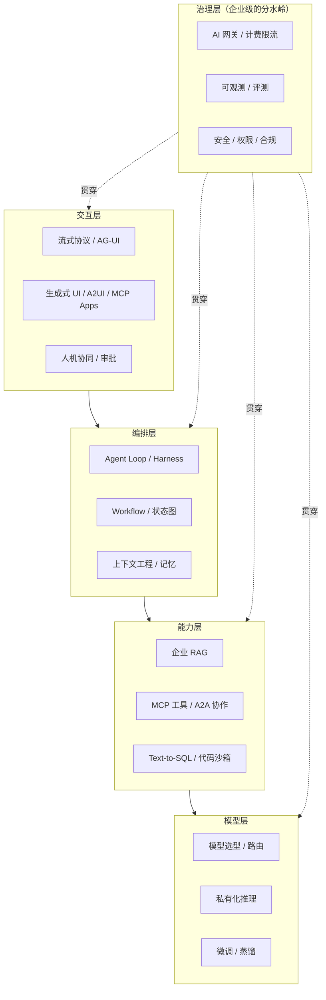
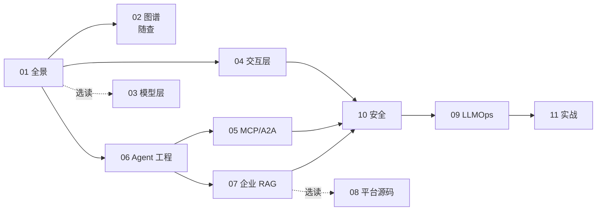

# 企业级 AI 应用开发实战

> 一套**不限语言、不限技术栈**的企业级 AI 应用开发知识库：站在 2026 年的技术前沿，系统梳理**把 AI 应用真正落地到企业**所需的范式、协议、架构、平台与工程方法。
>
> 和同库的 [LangChain & LangGraph 从入门到进阶](../LangChain-LangGraph入门到进阶/README.md) 互补：那套讲**单一框架的用法**，这套讲**跨生态的全景、标准与企业工程**。重叠部分直接链接过去，不重复。

- **编写时间**：2026 年 11 月
- **视角**：概念与标准优先，框架其次；每个主题给出 Python / TypeScript / Java / Go 等主流生态的对应方案
- **版本基线**：MCP 规范 `2026-07-28`（官方 Python / TS SDK v2）、A2A v1.0、LangGraph 1.x、Microsoft Agent Framework 1.0、Google ADK 2.x、Spring AI 2.0、Vercel AI SDK 7

> ⚠️ AI 工程领域半年一个大版本。文中凡是涉及具体 API 的地方都标了版本；动手前先对照官方 changelog，**以官方文档为准**。

---

## 一、选材原则

AI 领域的开源项目成百上千，这里只深入**同时满足以下三条**的内容：

1. **企业真实在用**：已在生产环境被大量验证，而不是 demo 级玩具
2. **技术代际正确**：代表 2026 年的主流范式（Agent、Context Engineering、开放协议、持久化执行），而不是正在被淘汰的写法
3. **可迁移**：优先讲**跨框架、跨语言都成立**的概念与标准；具体框架作为"参考实现"出现，换语言、换框架时知识不作废

按这三条筛完，企业级 AI 应用的知识体系收敛为一张图：

> 🎯 **一句话判断标准**：demo 和企业级应用的差距，**大部分在治理层**（权限、评测、可观测、成本、安全），而不在模型调用本身。

---

## 二、目录

重要度：⭐⭐⭐ 必须精通 ｜ ⭐⭐ 需要掌握 ｜ ⭐ 了解即可

| 章节 | 内容 | 重要度 | 建议用时 |
|---|---|---|---|
| [01 全景地图与技术选型](./01-全景地图与技术选型.md) | 分层架构、项目分级、**多语言生态对照**、平台 vs 框架 vs 自研、2026 趋势 | ⭐⭐⭐ | 2 小时 |
| [02 开源项目与生态图谱](./02-开源项目与生态图谱.md) | 17 个领域、近百个项目与标准的定位、技术栈与学习要点（查阅型） | ⭐⭐⭐ | 随查 |
| [03 模型层：选型、私有化推理与微调](./03-模型层-选型私有化推理与微调.md) | 模型选型方法、vLLM/SGLang、显存估算、RAG vs 微调、LoRA/DPO/RFT | ⭐⭐ | 3 小时 |
| [04 AI 交互层：流式协议、生成式 UI 与人机协同](./04-AI交互层-流式协议与生成式UI.md) | SSE 与事件模型、AG-UI、AI SDK、A2UI / MCP Apps、审批交互、生产问题 | ⭐⭐⭐ | 4 小时 |
| [05 MCP 与 Agent 互操作协议](./05-MCP与Agent互操作协议.md) | MCP 无状态新规范、多语言 SDK、OAuth、MCP 网关、A2A、协议全景 | ⭐⭐⭐ | 4 小时 |
| [06 Agent 工程化：从 Loop 到生产](./06-Agent工程化-从Loop到生产.md) | Workflow vs Agent、五种模式、上下文工程、记忆、持久化执行、多 Agent、框架选型 | ⭐⭐⭐ | 4 小时 |
| [07 企业级 RAG 落地](./07-企业级RAG落地.md) | 文档解析、切片、混合检索、**权限过滤**、引用溯源、多模态 RAG、评测 | ⭐⭐⭐ | 4 小时 |
| [08 LLM 平台源码导读](./08-LLM平台源码导读.md) | Dify / FastGPT / Coze Studio / RAGFlow 架构拆解与借鉴点 | ⭐⭐ | 3 小时 + 读源码 |
| [09 LLMOps：可观测、评测与 AI 网关](./09-LLMOps-可观测评测与AI网关.md) | OTel GenAI、Langfuse、评测体系、Prompt 管理、AI 网关、成本治理 | ⭐⭐⭐ | 3 小时 |
| [10 安全、权限与上线清单](./10-安全权限与上线清单.md) | OWASP LLM / Agentic Top 10、提示注入纵深防御、Agent 权限、沙箱、上线 Checklist | ⭐⭐⭐ | 3 小时 |
| [11 实战项目方案](./11-实战项目方案.md) | 3 个企业级项目：多技术栈方案、里程碑、量化验收标准 | ⭐⭐⭐ | 每个 1~2 周 |

---

## 三、学习路径

- **🚀 两周速成**：01 → 06 → 05 → 07 → 10 → 11（任选一个项目）
- **📘 标准路径（一到两个月）**：按 01 → 11 顺序通读，02 作为工具书随时查阅，完成 11 中至少两个项目
- **🎯 目标导向**：
  - 给已有业务系统**加 AI 能力** → 04 → 05 → 06 → 10 → 11 项目二
  - 做**企业知识库 / 智能客服** → 06 → 07 → 09 → 10 → 11 项目一
  - 做 **AI 中台 / 平台团队** → 01 → 03 → 08 → 09 → 10 → 11 项目三
  - 想**拓宽技术视野** → 01 → 02 → 03 → 05，再挑感兴趣的生态深入

---

## 四、阅读约定

> 🎯 **落地要点**：企业项目中真正会踩、会被问、会决定成败的点。

> ⚠️ **注意**：坑、版本差异、反模式。

> 🔭 **先锋视角**：正在形成的新范式，值得提前布局，但要评估成熟度。

> 📖 **术语**：跨领域（后端、数据、算法、运维、安全）的术语，首次出现时简要说明。

代码约定：

- **代码语言按领域的主流生态选择**：模型、RAG、评测、数据处理以 Python 为主；交互层以 TypeScript 为主；协议与服务端给出多语言对照
- 概念性代码（如 Agent 循环）用 Python 风格伪代码，重在表达思路
- 代码以"讲清要点"为目的，生产代码请补齐错误处理和鉴权（见 10 章）

---

## 五、与已有系列的对应关系

| 主题 | 本系列 | LangChain 系列 |
|---|---|---|
| 术语、模型调用基础 | 不重复 | [00](../LangChain-LangGraph入门到进阶/00-基础概念与术语表.md) / [02](../LangChain-LangGraph入门到进阶/02-模型与消息.md) |
| RAG 基础流程 | 07 章只讲企业级增量 | [06 RAG](../LangChain-LangGraph入门到进阶/06-RAG检索增强生成.md) |
| LangGraph 状态图、持久化、HITL | 06 章讲跨框架的模式与选型 | [08](../LangChain-LangGraph入门到进阶/08-LangGraph核心概念.md) / [09](../LangChain-LangGraph入门到进阶/09-LangGraph持久化-记忆与人机协同.md) / [10](../LangChain-LangGraph入门到进阶/10-LangGraph高级模式-流式子图多Agent.md) |
| LangSmith 评测、FastAPI 部署 | 09 章讲开源可观测与评测体系 | [12](../LangChain-LangGraph入门到进阶/12-调试评估与生产部署.md) |
| LangChain.js / Next.js | 04 章讲交互层协议与多种实现 | [13](../LangChain-LangGraph入门到进阶/13-JS-TS版本速查.md) |
