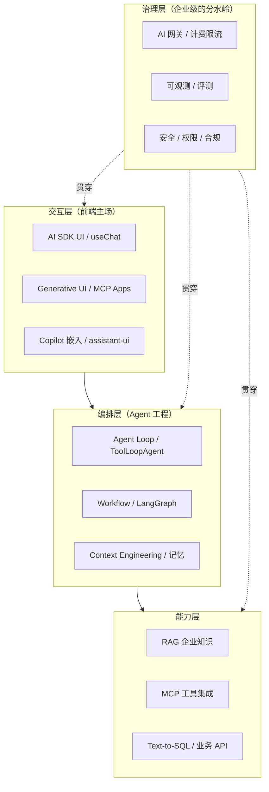
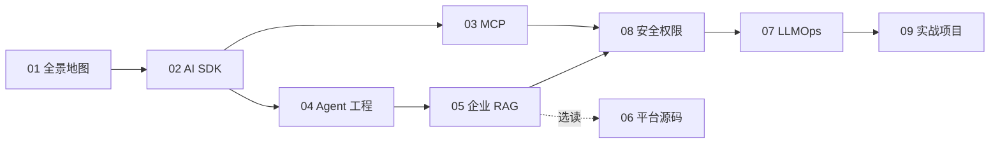

# 企业级 AI 应用开发实战

> 一套写给**前端 / 全栈工程师**的企业级 AI 应用开发知识库：不讲"大模型是什么"，只讲**在 2026 年把 AI 应用真正落地到企业**需要掌握的技术、平台和工程要点。
>
> 和同库的 [LangChain & LangGraph 从入门到进阶](../LangChain-LangGraph入门到进阶/README.md) 互补：那套讲**框架用法**（Python 主线），这套讲**企业工程与平台**（TS 主线）。重叠部分直接链接过去，不重复。

- **编写时间**：2026 年 11 月
- **版本基线**：Vercel AI SDK 7.x、MCP 规范 `2026-07-28`、MCP TS SDK v2、LangGraph 1.x
- **语言**：TypeScript 为主（AI 应用层），Python 为辅（平台源码 / 数据处理）

> ⚠️ AI 工程领域半年一个大版本。文中凡是涉及具体 API 的地方都标了版本；动手前先对照官方 changelog，**以官方文档为准**。

---

## 一、选材原则：为什么是这些内容

AI 应用的开源项目成百上千，这里只挑**同时满足以下三条**的内容展开：

1. **企业真实在用**：已经在生产环境被大量验证，而不是 demo 级玩具
2. **技术代际正确**：代表 2026 年的主流范式（Agent、MCP、Context Engineering），而不是正在被淘汰的写法
3. **对前端/全栈有杠杆**：你的现有技能（TS、React、Next.js、Node）可以直接迁移

按这三条筛完，核心技术栈收敛为一张图：

> 🎯 **一句话判断标准**：demo 和企业级应用的差距，**80% 在治理层**（权限、评测、可观测、成本、安全），而不在模型调用本身。

---

## 二、目录

重要度：⭐⭐⭐ 必须精通 ｜ ⭐⭐ 需要掌握 ｜ ⭐ 了解即可

| 章节 | 内容 | 重要度 | 建议用时 |
|---|---|---|---|
| [01 全景地图与技术选型](./01-全景地图与技术选型.md) | 分层架构、开源项目分级清单、平台 vs 框架 vs 自研决策、2026 趋势判断 | ⭐⭐⭐ | 1.5 小时 |
| [02 AI SDK 与 AI 前端工程](./02-AI-SDK与AI前端工程.md) | AI SDK 7 核心 API、流式协议、工具渲染、审批、Generative UI | ⭐⭐⭐ | 4 小时 |
| [03 MCP 协议与企业工具集成](./03-MCP协议与企业工具集成.md) | 协议原语、无状态新规范、TS SDK v2 写 Server、OAuth、企业 MCP 网关 | ⭐⭐⭐ | 3 小时 |
| [04 Agent 工程化：从 Loop 到生产](./04-Agent工程化-从Loop到生产.md) | Workflow vs Agent、五种编排模式、上下文工程、记忆、HITL、多 Agent、持久化执行 | ⭐⭐⭐ | 4 小时 |
| [05 企业级 RAG 落地](./05-企业级RAG落地.md) | 文档解析、切片、混合检索、**权限过滤**、引用溯源、增量更新、评测 | ⭐⭐⭐ | 4 小时 |
| [06 LLM 平台源码导读](./06-LLM平台源码导读.md) | Dify / FastGPT / Coze Studio / RAGFlow 架构拆解与借鉴点 | ⭐⭐ | 3 小时 + 读源码 |
| [07 LLMOps：可观测、评测与 AI 网关](./07-LLMOps-可观测评测与AI网关.md) | Langfuse、评测体系、Prompt 管理、LiteLLM/New API、成本治理 | ⭐⭐ | 3 小时 |
| [08 安全、权限与上线清单](./08-安全权限与上线清单.md) | OWASP LLM Top 10、提示注入防御、Agent 权限模型、上线 Checklist | ⭐⭐⭐ | 2 小时 |
| [09 实战项目方案](./09-实战项目方案.md) | 3 个企业级练手项目：架构、里程碑、验收标准 | ⭐⭐⭐ | 每个 1~2 周 |

---

## 三、学习路径

- **🚀 一周速成（能做出企业可演示的东西）**：01 → 02 → 04 前半 → 05 → 09 项目一
- **📘 标准路径（一个月，能主导 AI 项目落地）**：按 01 → 09 顺序通读，每章做完"练习"，完成 09 中至少两个项目
- **🎯 目标导向**：
  - 给已有业务系统**加 AI 能力** → 02 → 03 → 04 → 08 → 09 项目二
  - 做**企业知识库 / 智能客服** → 02 → 05 → 07 → 08 → 09 项目一
  - 做 **AI 中台 / 平台团队** → 01 → 06 → 07 → 08 → 09 项目三

---

## 四、阅读约定

> 🎯 **落地要点**：企业项目中真正会踩、会被问、会决定成败的点。

> ⚠️ **注意**：坑、版本差异、反模式。

> 🔭 **先锋视角**：正在形成的新范式，值得提前布局，但要评估成熟度。

> 📖 **术语**：非前端领域（后端、数据、算法）的术语，首次出现时简要说明。

代码约定：

- TS 代码默认 Node.js ≥ 22、ESM、`zod/v4`（AI SDK 7 和 MCP TS SDK v2 的共同要求）
- 模型统一写成变量 `model`，接入方式见 [02 章 · 模型接入](./02-AI-SDK与AI前端工程.md#二模型接入与-provider-抽象)，国内可换 DeepSeek / 通义 / 智谱等 OpenAI 兼容服务
- 代码以"讲清要点"为目的，生产代码请补齐错误处理和鉴权（见 08 章）

---

## 五、与已有系列的对应关系

| 主题 | 本系列 | LangChain 系列 |
|---|---|---|
| 术语、模型调用基础 | 不重复 | [00](../LangChain-LangGraph入门到进阶/00-基础概念与术语表.md) / [02](../LangChain-LangGraph入门到进阶/02-模型与消息.md) |
| RAG 基础流程 | 05 章只讲企业级增量 | [06 RAG](../LangChain-LangGraph入门到进阶/06-RAG检索增强生成.md) |
| LangGraph 状态图、持久化、HITL | 04 章讲选型与模式 | [08](../LangChain-LangGraph入门到进阶/08-LangGraph核心概念.md) / [09](../LangChain-LangGraph入门到进阶/09-LangGraph持久化-记忆与人机协同.md) / [10](../LangChain-LangGraph入门到进阶/10-LangGraph高级模式-流式子图多Agent.md) |
| LangSmith 评测、FastAPI 部署 | 07 章讲 Langfuse 与评测体系 | [12](../LangChain-LangGraph入门到进阶/12-调试评估与生产部署.md) |
| Next.js 接 LangChain | 02 章讲 AI SDK | [13](../LangChain-LangGraph入门到进阶/13-JS-TS版本速查.md) |
