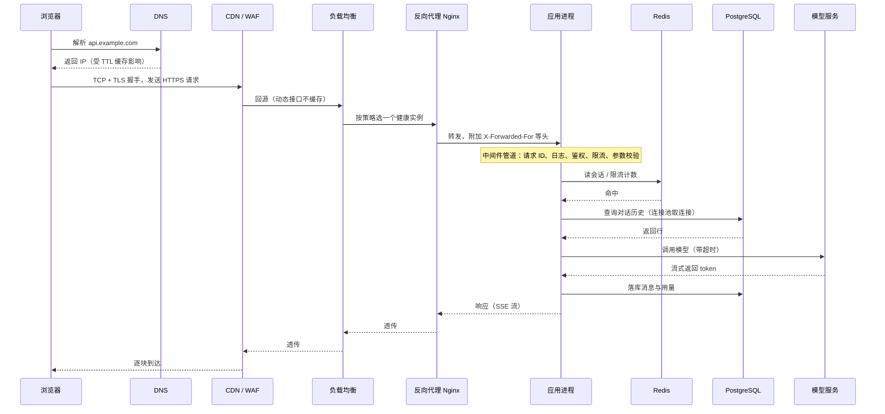
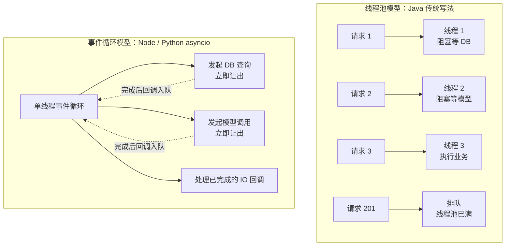
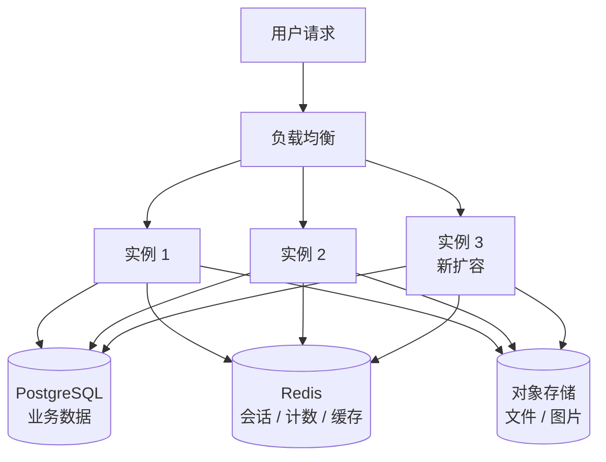

# 00 前端到后端的思维切换

> 本章目标：建立**服务端心智模型**——理解一个请求在服务端经过了哪些环节，分清**事件循环与线程池**两类并发模型，明白服务为什么要**无状态**，并把**"不可信输入"与"一切会失败"**两条底层原则变成写代码、审代码时的条件反射。
>
> 版本基线：Java 25 LTS、Node.js 26 LTS、Python 3.14 / 3.15（free-threaded 现状见 3.5 节）。网络与协议细节在 [01 章](./01-网络与HTTP-服务端视角.md)，三栈框架与语法在 [02 章](./02-后端语言与框架选型.md)。本章末尾的术语表覆盖全系列高频术语，可作为速查索引。

---

## 一、前端与后端：心智差异

### 1.1 差异对照

| 维度 | 前端（浏览器） | 后端（服务端） |
|---|---|---|
| **运行环境** | 每个用户一个独立的浏览器进程，代码跑在用户机器上 | 成千上万用户**共享**同一批进程，代码跑在你掌控的机器上 |
| **信任边界** | 代码和数据都在用户手里，可被任意查看、修改 | 服务端是**唯一可信的一方**，客户端发来的一切都不可信 |
| **状态** | 内存状态（store、组件 state）随页面生命周期存在，刷新即重置 | 进程随时会重启、扩容、被调度到别的机器，内存状态**不可靠** |
| **并发** | 单用户操作，竞态主要来自异步请求乱序 | 同一时刻多个请求读写同一份数据，竞态是常态 |
| **故障影响面** | 一个用户的页面崩了，刷新即可 | 一个 bug 影响**所有用户**；一个慢接口可能拖垮整个服务 |
| **资源泄漏** | 关掉标签页就回收 | 连接、内存、文件句柄泄漏会**持续累积**，直到 OOM 或连接耗尽 |
| **数据持久性** | localStorage 丢了就丢了 | 数据库里的数据是公司资产，写错、丢失、泄露都是事故 |
| **发布与回滚** | 静态资源替换，用户刷新拿到新版本 | 新旧版本**同时在线**，数据库结构变更不可随意回滚 |
| **调试手段** | DevTools 断点、实时看 DOM | 线上不能断点，只能靠**日志、指标、链路追踪** |
| **时间** | 用户本地时区 | 统一用 UTC 存储，展示时再转换；多台机器的时钟不完全一致 |

> 📖 **OOM（Out Of Memory）**：进程内存超过上限被操作系统或容器运行时强制终止。前端页面内存泄漏顶多卡顿，服务端泄漏最终表现为进程周期性被杀、重启。

### 1.2 三个最容易带到后端的前端习惯

| 前端习惯 | 在后端的后果 | 正确做法 |
|---|---|---|
| 把数据放内存，像用 store 一样 | 多实例之间数据不一致，重启即丢失 | 状态外置到数据库 / 缓存（第四节） |
| 相信请求里的字段（`userId`、`price`、`role`） | 越权、篡改价格、提权 | 身份从会话取，价格从数据库取（第五节） |
| 只写 happy path | 下游超时一次，请求线程全部卡死 | 每个外部调用都有超时、失败处理与降级（第五节） |

> 🎯 **落地要点**：AI 生成的后端代码通常"功能正确"，错误集中在上表三类。审查时与其逐行读逻辑，不如带着三个问题扫一遍：**状态放在哪？输入信了谁？失败了怎么办？**

---

## 二、一个请求在服务端的完整生命周期

### 2.1 全链路时序

以用户在 AI 对话页发送一条消息为例：



前端视角只看到"一个 fetch 发出去、一个响应回来"，中间至少有六七跳，**每一跳都可能是故障点，也都有自己的超时**（超时链路见 [01 章第七节](./01-网络与HTTP-服务端视角.md)）。

### 2.2 每一跳做什么、坏了是什么样

| 环节 | 职责 | 典型故障现象 | 详见 |
|---|---|---|---|
| DNS | 域名 → IP | 迁移后部分用户仍访问旧 IP（TTL 未过期） | [01 章](./01-网络与HTTP-服务端视角.md) |
| CDN / WAF | 缓存静态资源、抗攻击、TLS 终止 | 流式响应被缓冲；长请求被 CDN 读超时切断 | [01 章](./01-网络与HTTP-服务端视角.md)、[15 章](../L4-工程与部署/15-部署架构与云.md) |
| 负载均衡 | 把流量分发到多个实例，摘除不健康实例 | 偶发 502（keep-alive 超时配置不匹配） | [01 章](./01-网络与HTTP-服务端视角.md)、[10 章](../L3-架构与分布式/10-分布式系统基础.md) |
| 反向代理 | 路由、限流、改写头、终止 TLS | 504（`proxy_read_timeout` 先于应用超时） | [15 章](../L4-工程与部署/15-部署架构与云.md) |
| 应用进程 | 中间件 + 业务逻辑 | 线程 / 事件循环被阻塞，所有请求一起变慢 | 本章第三节 |
| 缓存 | 热点数据、会话、计数器 | 缓存击穿导致数据库瞬时被打满 | [05 章](../L2-核心能力/05-缓存与Redis.md) |
| 数据库 | 持久化与事务 | 连接池耗尽、慢查询、锁等待 | [04 章](../L2-核心能力/04-数据库与数据建模.md) |
| 下游服务 | 模型、支付、第三方 API | 下游变慢 → 本服务资源被占满 → 雪崩 | [08 章](../L2-核心能力/08-并发与可靠性.md) |

### 2.3 应用内部：中间件管道

中间件和前端的 axios 拦截器、Koa 洋葱模型是同一个思路：请求依次穿过一组处理器，响应反向穿出。


三栈的对应机制：

| 职责 | Spring Boot | NestJS | FastAPI |
|---|---|---|---|
| 通用前后置处理 | `Filter`、`HandlerInterceptor` | Middleware、Interceptor | Middleware |
| 认证 / 授权 | Spring Security 过滤器链、`@PreAuthorize` | Guard | `Depends(get_current_user)` |
| 参数校验 | `@Valid` + Jakarta Validation | `ValidationPipe` | Pydantic 模型（自动） |
| 统一异常处理 | `@RestControllerAdvice` | Exception Filter | `@app.exception_handler` |

> ⚠️ **注意**：中间件**顺序有语义**。请求 ID 必须最先生成，否则鉴权失败的日志无法关联；匿名接口的限流要放在认证之前（按 IP 限），登录后接口的限流放在认证之后（按用户限）。AI 生成代码时常把顺序随意排列，审查时要逐个确认。

---

## 三、进程、线程、协程与并发模型

### 3.1 四个概念

| 概念 | 是什么 | 谁来调度 | 切换成本 | 前端类比 |
|---|---|---|---|---|
| **进程** | 操作系统分配资源的单位，内存相互隔离 | 操作系统 | 高 | 每个浏览器标签页 |
| **线程** | 进程内的执行流，共享进程内存 | 操作系统 | 中（栈默认约 1 MB 量级） | Web Worker（但 Worker 不共享内存） |
| **协程 / 虚拟线程** | 用户态的轻量执行单元，遇到 IO 主动让出 | 语言运行时 | 低（KB 级） | `async` 函数在 `await` 处让出 |
| **事件循环** | 单线程不断从队列取任务执行，IO 完成后回调入队 | 运行时 | — | 浏览器主线程的 Event Loop |

> 📖 **IO 密集 vs CPU 密集**：IO 密集指大部分时间在**等**（等数据库、等模型、等网络）；CPU 密集指大部分时间在**算**（解析 PDF、图片处理、加解密、大 JSON 序列化、本地向量计算）。

AI 应用的主体是 IO 密集：一次对话请求里，等模型返回可能占 95% 以上的时间。但知识库入库、文档解析、token 计数这类环节是 CPU 密集，**两类负载混在同一个进程里**是 AI 后端最常见的性能问题来源。

### 3.2 两种并发模型



- **线程池**：一个请求占一个线程，代码按同步方式写，直观；代价是线程数有限（Spring Boot 内嵌 Tomcat 默认最大 200 个工作线程），大量请求在等 IO 时线程被白白占着
- **事件循环**：一个线程服务所有请求，IO 期间不占线程，并发能力强；代价是**任何一段同步耗时代码都会卡住所有请求**

### 3.3 Node：单线程事件循环 + libuv 线程池

- JS 代码只在**一个主线程**上执行；网络 IO 由操作系统异步通知
- 文件 IO、`dns.lookup`、部分 `crypto` 与 `zlib` 操作交给 libuv 线程池（默认 4 个线程，可通过 `UV_THREADPOOL_SIZE` 调整）
- 多核利用靠**多进程**：容器化部署时通常一个容器一个 Node 进程，靠扩容实例数利用多核；裸机部署用 `cluster` 模块或 PM2
- CPU 密集任务用 `worker_threads`（或 Piscina 等线程池库），更重的任务放到独立 worker 服务 + 队列（[07 章](../L2-核心能力/07-异步任务与消息队列.md)）

### 3.4 Java：线程池 → 虚拟线程

传统 Spring MVC 是"一个请求一个平台线程"。Java 21 正式引入**虚拟线程**：由 JVM 调度的轻量线程，遇到阻塞 IO 时自动从承载线程上卸下，代码仍按同步方式写，却获得接近事件循环的并发能力。

| 版本 | 关键变化 |
|---|---|
| Java 21 | 虚拟线程正式发布；但在 `synchronized` 块内阻塞会**钉住**（pin）承载线程 |
| Java 24 | JEP 491：`synchronized` 不再导致钉住，消除了绝大部分钉住场景 |
| Java 25 LTS | 第一个包含上述修复的 LTS 版本，新项目的推荐基线 |

在 Spring Boot 中开启：

```yaml
spring:
  threads:
    virtual:
      enabled: true   # 默认关闭，需要显式开启
```

> ⚠️ **注意**：开启虚拟线程后，**隐式的并发上限消失了**。过去 200 个线程天然限制了最多 200 个请求同时打数据库；现在可能有上万个虚拟线程同时等 HikariCP 连接池（默认 10 个连接），表现为大量请求卡在"获取连接超时"。对数据库、模型 API 等稀缺资源要显式限流（信号量 / 舱壁隔离，见 [08 章](../L2-核心能力/08-并发与可靠性.md)）。另外，原生方法调用、类加载等场景仍可能钉住，可用 JFR 的 `jdk.VirtualThreadPinned` 事件排查。

Spring 生态里还有另一条路线 **WebFlux**（基于 Netty 事件循环的响应式编程），写法是 `Mono` / `Flux` 链式调用。虚拟线程普及后，新项目多数回到 MVC + 虚拟线程，但 Spring AI 的流式接口返回 `Flux`，读代码时仍会遇到。

### 3.5 Python：asyncio + 多进程 worker

**GIL（全局解释器锁）**：标准 CPython 中同一时刻只有一个线程执行 Python 字节码。因此 Python 多线程对 IO 密集有效（等待时释放 GIL），对 CPU 密集无效。

FastAPI 的并发由三层组成：

| 层 | 机制 | 解决什么 |
|---|---|---|
| `async def` 路由 | 在事件循环上执行 | 大量并发 IO |
| `def` 路由 / 依赖 | 自动丢进线程池执行（AnyIO 默认上限 40 个线程） | 兼容同步库（同步数据库驱动、`requests`） |
| 多 worker 进程 | `uvicorn --workers N` 或由进程管理器拉起多个 Uvicorn 进程 | 利用多核、绕开 GIL |

**free-threaded（无 GIL）现状**：

- Python 3.13：提供实验性的 free-threaded 构建
- Python 3.14：PEP 779 落地，free-threaded 构建进入**官方支持但可选**阶段；单线程性能有约 5%~10% 的开销
- Python 3.15（2026 年 10 月发布）：新增面向 free-threaded 的稳定 ABI（abi3t），便于 C 扩展发布兼容的 wheel
- 默认的 `python3.x` 仍然带 GIL，无 GIL 版本是单独的 `python3.14t` / `python3.15t`；成为默认构建没有官方时间表

> 🎯 **落地要点**：截至本文编写时，生产环境的 Python 服务仍应按"**asyncio 处理 IO + 多进程处理 CPU 与多核**"来设计。free-threaded 的主要障碍是依赖生态：任何一个 C 扩展没有 free-threaded wheel，导入时解释器就会重新启用 GIL。是否尝试，取决于你的依赖清单是否全部支持。

### 3.6 三栈并发模型对照

| | Node | Java（Spring Boot） | Python（FastAPI） |
|---|---|---|---|
| 请求如何执行 | 单线程事件循环 | 每请求一个线程（平台线程或虚拟线程） | 事件循环（`async def`）或线程池（`def`） |
| IO 等待时 | 让出，处理其他请求 | 平台线程：阻塞占用；虚拟线程：卸载 | `await` 让出；同步调用则**阻塞整个循环** |
| 利用多核 | 多进程 / 多实例 | 天然多线程 | 多进程 worker |
| CPU 密集怎么办 | `worker_threads` 或独立服务 | 有界线程池（大小≈核数） | `ProcessPoolExecutor` 或独立 worker + 队列 |
| 最典型的错误 | 同步 API 卡住事件循环 | 线程池 / 连接池容量不匹配 | `async def` 里调用同步阻塞库 |

### 3.7 阻塞事件循环：AI 最常写错的代码

**Python 反例**：在 `async def` 里调用同步库

```python
@app.post("/api/chat")
async def chat(body: ChatIn):
    resp = requests.post(LLM_URL, json=body.model_dump())   # ❌ 同步 HTTP，阻塞整个事件循环
    time.sleep(1)                                           # ❌ 同步 sleep，所有请求一起停 1 秒
    doc = PdfReader(body.file_path).pages[0].extract_text()  # ❌ CPU 密集，同样阻塞
    return resp.json()
```

一个请求等模型 30 秒，这个 worker 上的**所有其他请求**（包括健康检查）都要等 30 秒，健康检查失败后实例还会被摘除、重启，故障扩大。

**Python 正例**：

```python
@app.post("/api/chat")
async def chat(body: ChatIn, http: Annotated[httpx.AsyncClient, Depends(get_http)]):
    resp = await http.post(LLM_URL, json=body.model_dump())     # ✅ 异步客户端，复用连接池
    await asyncio.sleep(1)                                       # ✅ 让出事件循环
    meta = await asyncio.to_thread(sync_sdk.get_metadata, body.file_id) # ✅ 只有同步 API 的 IO 库丢到线程
    loop = asyncio.get_running_loop()
    text = await loop.run_in_executor(process_pool, extract_first_page, body.file_path)  # ✅ CPU 密集用进程池
    return resp.json()

# 线程受 GIL 限制，CPU 密集放线程里仍会拖慢事件循环；批量解析、切片、向量化投递到队列由独立 worker 处理（07 章）
```

> ⚠️ **注意**：把 `def` 改成 `async def` 却不改内部调用，会让性能**更差**——原来 `def` 至少在线程池里跑，改完直接卡在事件循环上。审查 FastAPI 代码时，`async def` 里出现 `requests`、`time.sleep`、同步数据库驱动、同步 SDK 客户端都是阻断问题。

**Node 反例**：同步 API 与 CPU 密集代码混入请求处理

```ts
app.post('/api/register', async (c) => {
  const { password } = await c.req.json();
  const hash = bcrypt.hashSync(password, 12);           // ❌ 同步哈希，几十到上百毫秒内事件循环停摆
  const prompt = fs.readFileSync('./prompt.md', 'utf8'); // ❌ 每次请求同步读文件
  const tokens = countTokens(hugeDocument);              // ❌ 大文本 token 计数是纯 CPU 计算
  // ...
});
```

**Node 正例**：

```ts
const prompt = await fs.promises.readFile('./prompt.md', 'utf8');   // ✅ 启动时读一次
const pool = new Piscina({ filename: new URL('./token-worker.js', import.meta.url).href });

app.post('/api/register', async (c) => {
  const { password } = await c.req.json();
  const hash = await bcrypt.hash(password, 12);          // ✅ 异步版本在 libuv 线程池执行
  const tokens = await pool.run(hugeDocument);           // ✅ CPU 密集交给 worker 线程
  // ...
});
```

**Java 的对应陷阱**：在 WebFlux 的 `Mono` / `Flux` 链里调用阻塞 API（JDBC、`RestTemplate`、`Thread.sleep`），会卡住 Netty 的事件循环线程，后果与 Node 相同。MVC + 虚拟线程下阻塞调用是安全的。

**排查手段**：

| 栈 | 怎么发现事件循环被阻塞 |
|---|---|
| Node | `perf_hooks.monitorEventLoopDelay()` 监控事件循环延迟，持续超过几十毫秒即有问题 |
| Python | `asyncio.run(main(), debug=True)` 或 `PYTHONASYNCIODEBUG=1`，会记录执行超过 100 ms 的回调 |
| Java | `jcmd <pid> Thread.print` 抓线程栈，看大量线程卡在哪里 |

---

## 四、有状态与无状态

### 4.1 什么是无状态服务

**无状态**指：任何一个请求可以被任何一个实例处理，处理结果不依赖"这个实例之前处理过什么"。实例内存里只放可以随时丢弃的东西（本地缓存、连接池）。

### 4.2 为什么要无状态



- **水平扩展**：流量上来直接加实例，新实例无需"预热"用户数据
- **滚动发布**：逐个替换实例，旧实例被杀不丢数据
- **故障转移**：实例崩溃，负载均衡把流量切到其他实例，用户无感
- **弹性伸缩**：K8s HPA、Serverless 按负载自动增删实例（[14 章](../L4-工程与部署/14-Kubernetes核心与实践.md)），前提就是实例可随时创建和销毁

> 📖 **水平扩展 vs 垂直扩展**：水平扩展是加机器（scale out），垂直扩展是换更大的机器（scale up）。垂直扩展有物理上限且需要停机，水平扩展要求服务无状态。

### 4.3 状态放哪

| 状态类型 | 放哪 | 说明 |
|---|---|---|
| 业务数据（用户、对话、订单） | 关系型数据库 | 唯一事实来源（[04 章](../L2-核心能力/04-数据库与数据建模.md)） |
| 登录态 | Redis 存 Session，或无状态 JWT | 取舍见 [06 章](../L2-核心能力/06-认证授权与Web安全.md) |
| 缓存、限流计数、分布式锁 | Redis | 多实例共享（[05 章](../L2-核心能力/05-缓存与Redis.md)） |
| 上传文件、生成的图片、导出报表 | 对象存储（S3 兼容） | 数据库只存 URL / key（[10 章](../L3-架构与分布式/10-分布式系统基础.md)） |
| 长任务进度、Agent 执行状态 | 数据库 / 工作流引擎 | 进程重启可恢复（[07 章](../L2-核心能力/07-异步任务与消息队列.md)） |
| 定时任务"只跑一次" | 分布式锁或独立调度器 | 否则 N 个实例各跑一遍 |

### 4.4 反例 → 正例

```ts
// ❌ 反例：状态放在进程内存
const conversations = new Map<string, Message[]>();   // 多实例下用户刷新可能落到另一个实例，历史"消失"
const requestCount = new Map<string, number>();       // 限流计数各实例独立，实际阈值 = 阈值 × 实例数

app.post('/api/upload', async (c) => {
  const file = await c.req.parseBody();
  await fs.promises.writeFile(`./uploads/${id}`, file); // 写本地磁盘，容器重建即丢失，其他实例读不到
});
```

```ts
// ✅ 正例：状态外置
await db.insert(messages).values({ conversationId, role: 'user', content });  // 对话历史入库
const allowed = await rateLimiter.consume(`rl:user:${userId}`);               // Redis 计数（05 章）
await s3.send(new PutObjectCommand({ Bucket, Key: `uploads/${id}`, Body }));  // 文件进对象存储
```

> ⚠️ **注意**：本地开发只跑一个实例，上面的反例**完全能跑通**，测试也能过。问题只在多实例部署后出现，且表现为"偶发"——这正是 AI 生成代码最难被发现的一类错误。

### 4.5 无法避免的有状态

| 场景 | 为什么有状态 | 应对 |
|---|---|---|
| WebSocket / SSE 长连接 | 连接本身绑定在某个实例上 | 消息通过 Redis Pub/Sub 等广播到所有实例，由持有连接的实例推送（[01 章](./01-网络与HTTP-服务端视角.md)） |
| 进程内本地缓存 | 为了性能 | 只缓存可容忍短暂不一致的数据，设置短 TTL |
| 本地模型推理 | 模型加载到 GPU 显存耗时长 | 推理服务独立部署，业务服务保持无状态 |

---

## 五、两条底层原则

### 5.1 原则一：一切输入都不可信

前端校验是**用户体验**，服务端校验才是**安全边界**。攻击者不会用你的页面，而是直接用 curl 调接口。

**不可信的来源远不止请求体**：

| 来源 | 例子 | 风险 |
|---|---|---|
| 请求体 / 查询参数 | `{"userId": 2, "price": 0.01}` | 越权、篡改金额 |
| 请求头 | `X-Forwarded-For`、`X-User-Id`、`X-Tenant-Id` | 伪造 IP 绕过限流、伪造身份（[01 章第四节](./01-网络与HTTP-服务端视角.md)） |
| 路径参数 | `/api/conversations/123` | 遍历他人资源（IDOR） |
| 上传文件 | 文件名、MIME、大小、内容 | 路径穿越、超大文件打满磁盘 |
| 第三方回调 | 支付回调、Webhook | 伪造回调（需验签） |
| **模型输出** | 工具调用参数、生成的 SQL / HTML | 注入、越权（[企业级 10 章](../../企业级AI应用开发实战/10-安全权限与上线清单.md)） |
| 下游 API 响应 | 字段缺失、类型不对 | 运行时崩溃 |

> 📖 **IDOR（不安全的直接对象引用）**：接口只校验了"已登录"，没校验"这个资源属于你"，攻击者改 URL 里的 ID 就能读到别人的数据。这是 AI 生成 CRUD 接口时出现频率最高的安全漏洞。

**反例 → 正例**：

```python
# ❌ 反例：身份、价格、归属全部来自客户端
@router.post("/api/orders")
async def create_order(body: dict):
    await db.execute(insert(Order).values(user_id=body["user_id"], price=body["price"]))

@router.get("/api/conversations/{cid}")
async def get_conversation(cid: int, user=Depends(get_current_user)):
    return await repo.get(cid)          # 只校验了登录，没校验归属
```

```python
# ✅ 正例：身份从会话取，价格从服务端取，查询带归属条件，入参有 schema
class CreateOrderIn(BaseModel):
    model_config = ConfigDict(extra="forbid")      # 拒绝未声明字段
    plan_id: Literal["pro_monthly", "pro_yearly"]

@router.post("/api/orders")
async def create_order(body: CreateOrderIn, user=Depends(get_current_user)):
    plan = await plans.get(body.plan_id)            # 价格以服务端为准
    await orders.create(user_id=user.id, plan_id=plan.id, price=plan.price)

@router.get("/api/conversations/{cid}")
async def get_conversation(cid: int, user=Depends(get_current_user)):
    conv = await repo.get_owned(cid, owner_id=user.id)   # WHERE id = ? AND owner_id = ?
    if conv is None:
        raise HTTPException(404)                     # 不存在与无权限都返回 404，不泄露资源是否存在
    return conv
```

### 5.2 原则二：一切都会失败

分布式系统里有一组经典的"错误假设"：网络可靠、延迟为零、带宽无限、网络安全、拓扑不变……每一条在生产环境都会被打破。服务端代码默认要假设：

| 会失败的东西 | 表现 | 对应手段 | 详见 |
|---|---|---|---|
| 下游调用 | 超时、5xx、连接被重置 | **超时** + 有限重试（指数退避 + 抖动） | [08 章](../L2-核心能力/08-并发与可靠性.md) |
| 重试本身 | 请求成功但响应丢失，重试导致重复执行 | **幂等**（幂等键、唯一约束） | [03 章](../L2-核心能力/03-API设计.md)、[07 章](../L2-核心能力/07-异步任务与消息队列.md) |
| 下游持续故障 | 每个请求都等到超时，资源被占满 | **熔断**、**降级** | [08 章](../L2-核心能力/08-并发与可靠性.md) |
| 进程 | 发布、OOM、节点驱逐时被杀 | **优雅停机**、任务可恢复 | [08 章](../L2-核心能力/08-并发与可靠性.md) |
| 多步写操作 | 第二步失败，第一步已提交 | **事务**、Outbox、Saga | [04 章](../L2-核心能力/04-数据库与数据建模.md)、[07 章](../L2-核心能力/07-异步任务与消息队列.md) |
| 你的判断 | 不知道哪里坏了 | 日志、指标、链路、告警 | [17 章](../L4-工程与部署/17-可观测性与线上排障.md) |

**反例 → 正例**：

```ts
// ❌ 反例：无超时 + 无限重试 + 吞掉错误
async function callModel(prompt: string) {
  while (true) {
    try {
      return await fetch(LLM_URL, { method: 'POST', body: JSON.stringify({ prompt }) });
    } catch {
      // 下游挂掉时：每个请求无限重试，流量放大 N 倍，把下游彻底打死
    }
  }
}
```

```ts
// ✅ 正例：总超时 + 有限次数 + 退避抖动 + 只重试可重试错误 + 失败上抛
async function callModel(prompt: string, signal: AbortSignal) {
  for (let attempt = 0; attempt < 3; attempt++) {
    try {
      const res = await fetch(LLM_URL, {
        method: 'POST',
        body: JSON.stringify({ prompt }),
        signal: AbortSignal.any([signal, AbortSignal.timeout(30_000)]),  // 单次超时 + 上游取消
      });
      if (res.status === 429 || res.status >= 500) throw new RetryableError(res.status);
      if (!res.ok) throw new NonRetryableError(res.status);   // 4xx 重试也没用
      return await res.json();
    } catch (err) {
      if (!(err instanceof RetryableError) || attempt === 2) throw err;
      await sleep(2 ** attempt * 500 + Math.random() * 300);  // 指数退避 + 抖动，避免同时重试
    }
  }
}
```

> 🎯 **落地要点**：AI 应用对这条原则格外敏感——模型 API 慢、贵、限流严格。没有超时会耗尽资源，没有幂等的重试会**重复计费**，没有降级会让一个模型供应商的故障变成你的全站故障。

---

## 六、跨领域术语表

后续章节的高频术语，按领域分组。每项一句话，详细内容见对应章节。

| 术语 | 一句话解释 | 章节 |
|---|---|---|
| **QPS / TPS** | 每秒查询数 / 每秒事务数，衡量吞吐量 | [11](../L3-架构与分布式/11-系统设计案例.md)、[17](../L4-工程与部署/17-可观测性与线上排障.md) |
| **RT / 延迟** | 响应时间（Response Time），从收到请求到返回响应的耗时 | [17](../L4-工程与部署/17-可观测性与线上排障.md) |
| **P50 / P99** | 分位数延迟：99% 的请求快于 P99 值；平均值会掩盖长尾，看 P99 更能反映用户体验 | [17](../L4-工程与部署/17-可观测性与线上排障.md) |
| **TTFT** | 首 token 时间，流式 AI 接口最关键的体感指标 | [17](../L4-工程与部署/17-可观测性与线上排障.md) |
| **容量估算** | 根据用户量、QPS、数据量推算需要多少机器和存储 | [11](../L3-架构与分布式/11-系统设计案例.md) |
| **幂等** | 同一请求执行一次和执行多次效果相同，重试安全的前提 | [03](../L2-核心能力/03-API设计.md)、[07](../L2-核心能力/07-异步任务与消息队列.md) |
| **REST / gRPC** | 基于 HTTP 资源语义的 API 风格 / 基于 HTTP/2 与 Protobuf 的高性能 RPC | [03](../L2-核心能力/03-API设计.md) |
| **OpenAPI** | 描述 HTTP API 的标准格式，可生成文档和客户端代码 | [03](../L2-核心能力/03-API设计.md) |
| **事务 / ACID** | 一组操作要么全部成功要么全部回滚；原子性、一致性、隔离性、持久性 | [04](../L2-核心能力/04-数据库与数据建模.md) |
| **隔离级别** | 并发事务之间互相"看见"多少，级别越高越安全越慢 | [04](../L2-核心能力/04-数据库与数据建模.md) |
| **MVCC** | 多版本并发控制，读写互不阻塞的实现方式 | [04](../L2-核心能力/04-数据库与数据建模.md) |
| **索引** | 加速查询的数据结构，代价是写入变慢、占用空间 | [04](../L2-核心能力/04-数据库与数据建模.md) |
| **DDL / DML** | 定义结构的语句（`CREATE`、`ALTER`）/ 操作数据的语句（`INSERT`、`UPDATE`） | [04](../L2-核心能力/04-数据库与数据建模.md) |
| **迁移（Migration）** | 版本化管理数据库结构变更的脚本 | [04](../L2-核心能力/04-数据库与数据建模.md)、[16](../L4-工程与部署/16-CICD与发布策略.md) |
| **ORM** | 把表映射为对象的库（JPA / Hibernate、Prisma、Drizzle、SQLAlchemy） | [04](../L2-核心能力/04-数据库与数据建模.md) |
| **N+1 查询** | 查 1 次列表再对每行查 1 次关联，ORM 最常见的性能陷阱 | [04](../L2-核心能力/04-数据库与数据建模.md) |
| **连接池** | 预先建立并复用一组连接（数据库、HTTP），避免每次新建的开销 | [01](./01-网络与HTTP-服务端视角.md)、[04](../L2-核心能力/04-数据库与数据建模.md) |
| **缓存穿透 / 击穿 / 雪崩** | 查不存在的数据 / 热点 key 过期瞬间 / 大量 key 同时失效，导致请求直达数据库 | [05](../L2-核心能力/05-缓存与Redis.md) |
| **分布式锁** | 跨进程的互斥锁，常基于 Redis 或数据库实现 | [05](../L2-核心能力/05-缓存与Redis.md) |
| **限流** | 限制单位时间内的请求数（令牌桶、滑动窗口） | [05](../L2-核心能力/05-缓存与Redis.md)、[08](../L2-核心能力/08-并发与可靠性.md) |
| **认证 / 授权** | 确认"你是谁"（AuthN）/ 确认"你能做什么"（AuthZ） | [06](../L2-核心能力/06-认证授权与Web安全.md) |
| **JWT / OAuth / OIDC** | 自包含签名令牌 / 授权委托协议 / 基于 OAuth 的身份认证层 | [06](../L2-核心能力/06-认证授权与Web安全.md) |
| **RBAC / ABAC** | 基于角色 / 基于属性的访问控制 | [06](../L2-核心能力/06-认证授权与Web安全.md) |
| **多租户** | 一套系统服务多个客户组织，数据必须隔离 | [06](../L2-核心能力/06-认证授权与Web安全.md) |
| **SSRF** | 服务端请求伪造：诱导服务端去访问内网地址 | [06](../L2-核心能力/06-认证授权与Web安全.md) |
| **MQ（消息队列）** | 生产者与消费者解耦的中间件（Kafka、RabbitMQ、Redis Streams） | [07](../L2-核心能力/07-异步任务与消息队列.md) |
| **投递语义** | 至多一次 / 至少一次 / 恰好一次，实践中多为"至少一次 + 幂等消费" | [07](../L2-核心能力/07-异步任务与消息队列.md) |
| **死信队列（DLQ）** | 多次消费失败的消息转入的隔离队列，等待人工处理 | [07](../L2-核心能力/07-异步任务与消息队列.md) |
| **Outbox** | 业务数据与待发消息在同一事务写入，再由后台投递，保证不丢消息 | [07](../L2-核心能力/07-异步任务与消息队列.md) |
| **竞态条件** | 结果依赖并发执行的先后顺序，典型如超卖、重复扣费 | [08](../L2-核心能力/08-并发与可靠性.md) |
| **乐观锁 / 悲观锁** | 提交时校验版本号 / 读取时先加锁 | [04](../L2-核心能力/04-数据库与数据建模.md)、[08](../L2-核心能力/08-并发与可靠性.md) |
| **熔断** | 下游错误率过高时暂时停止调用，快速失败，给下游恢复时间 | [08](../L2-核心能力/08-并发与可靠性.md) |
| **降级** | 依赖不可用时提供有损但可用的服务（换备用模型、返回缓存结果） | [08](../L2-核心能力/08-并发与可靠性.md) |
| **背压** | 消费方处理不过来时向上游反馈，让生产方减速 | [08](../L2-核心能力/08-并发与可靠性.md) |
| **优雅停机** | 收到终止信号后停止接新请求，处理完存量再退出 | [08](../L2-核心能力/08-并发与可靠性.md) |
| **单体 / 微服务** | 一个部署单元 / 按业务拆成多个独立部署的服务 | [09](../L3-架构与分布式/09-架构模式.md) |
| **BFF** | 为特定前端定制的后端聚合层 | [09](../L3-架构与分布式/09-架构模式.md) |
| **CQRS** | 读写模型分离 | [09](../L3-架构与分布式/09-架构模式.md) |
| **CAP** | 网络分区时一致性与可用性只能二选一 | [10](../L3-架构与分布式/10-分布式系统基础.md) |
| **最终一致性** | 数据短时间内可能不一致，但最终会收敛 | [10](../L3-架构与分布式/10-分布式系统基础.md) |
| **Saga** | 用一系列本地事务 + 补偿操作实现跨服务的"事务" | [10](../L3-架构与分布式/10-分布式系统基础.md) |
| **读写分离 / 分库分表** | 读请求走从库 / 数据按规则拆到多个库表 | [10](../L3-架构与分布式/10-分布式系统基础.md) |
| **对象存储** | 按 key 存取文件的存储服务（S3、OSS、MinIO） | [10](../L3-架构与分布式/10-分布式系统基础.md) |
| **正向代理 / 反向代理** | 代表客户端出网 / 代表服务端接收请求（Nginx、Caddy） | [01](./01-网络与HTTP-服务端视角.md)、[15](../L4-工程与部署/15-部署架构与云.md) |
| **LB（负载均衡）** | 把流量分发到多个后端实例 | [01](./01-网络与HTTP-服务端视角.md)、[10](../L3-架构与分布式/10-分布式系统基础.md) |
| **CDN** | 边缘节点缓存与加速网络 | [01](./01-网络与HTTP-服务端视角.md)、[15](../L4-工程与部署/15-部署架构与云.md) |
| **API 网关** | 统一入口，集中处理鉴权、限流、路由、协议转换 | [01](./01-网络与HTTP-服务端视角.md) |
| **TLS 终止** | 在代理层解密 HTTPS，内部转发明文或重新加密 | [01](./01-网络与HTTP-服务端视角.md)、[15](../L4-工程与部署/15-部署架构与云.md) |
| **进程 / 端口 / 文件描述符** | Linux 排障的三个基本对象；连接也占用文件描述符 | [12](../L4-工程与部署/12-Linux与排障命令.md) |
| **systemd** | Linux 的服务管理器，负责启停、自动重启、日志收集 | [12](../L4-工程与部署/12-Linux与排障命令.md) |
| **容器 / 镜像** | 打包了应用与依赖的隔离进程 / 容器的只读模板 | [13](../L4-工程与部署/13-Docker与Compose.md) |
| **Pod** | K8s 最小调度单位，包含一个或多个共享网络的容器 | [14](../L4-工程与部署/14-Kubernetes核心与实践.md) |
| **Deployment / Service / Ingress** | K8s 中管理副本 / 提供稳定访问地址 / 对外暴露 HTTP 路由的对象 | [14](../L4-工程与部署/14-Kubernetes核心与实践.md) |
| **探针（Probe）** | K8s 检查容器是否存活、是否就绪接流量 | [14](../L4-工程与部署/14-Kubernetes核心与实践.md) |
| **HPA** | 按 CPU、内存或自定义指标自动增减副本数 | [14](../L4-工程与部署/14-Kubernetes核心与实践.md) |
| **Serverless / PaaS** | 按调用计费、免运维的函数计算 / 托管运行平台 | [15](../L4-工程与部署/15-部署架构与云.md) |
| **CI / CD** | 持续集成（每次提交自动构建测试）/ 持续交付部署 | [16](../L4-工程与部署/16-CICD与发布策略.md) |
| **灰度 / 金丝雀 / 蓝绿** | 新版本先给小部分流量 / 同上的具体做法 / 两套环境整体切换 | [16](../L4-工程与部署/16-CICD与发布策略.md) |
| **Feature Flag** | 运行时开关功能，发布与上线解耦 | [16](../L4-工程与部署/16-CICD与发布策略.md) |
| **SLA / SLO / SLI** | 对外承诺的服务水平 / 内部目标 / 实际测量指标 | [17](../L4-工程与部署/17-可观测性与线上排障.md) |
| **日志 / 指标 / 链路** | 可观测性三支柱：发生了什么 / 量有多大 / 请求经过了哪里 | [17](../L4-工程与部署/17-可观测性与线上排障.md) |
| **Trace / Span** | 一次请求的完整调用链 / 链路中的一个步骤 | [17](../L4-工程与部署/17-可观测性与线上排障.md) |
| **测试金字塔** | 大量单元测试、适量集成测试、少量端到端测试 | [18](../L4-工程与部署/18-测试策略.md) |
| **契约测试 / 压测** | 校验服务间接口约定 / 用模拟流量测容量与瓶颈 | [18](../L4-工程与部署/18-测试策略.md) |

---

## 七、AI 代码审查清单

### 7.1 状态

- [ ] 🔴 没有用进程内 `Map` / 全局变量 / 单例字段保存会话、对话历史、限流计数等需要跨请求共享的数据
- [ ] 🔴 上传文件、生成文件没有写入本地磁盘作为最终存储，而是进入对象存储
- [ ] 定时任务在多实例下不会重复执行（有分布式锁或独立调度）
- [ ] 本地缓存有 TTL 和容量上限，缓存的数据能容忍短暂不一致

### 7.2 并发模型

- [ ] 🔴 Python `async def` 内没有 `requests`、`time.sleep`、同步数据库驱动、同步 SDK 调用
- [ ] 🔴 Node 请求处理路径上没有 `*Sync` 文件 / 加密 API，没有大文本循环计算
- [ ] CPU 密集任务（文档解析、批量 token 计数、图片处理）在 worker 线程 / 进程或独立服务中执行
- [ ] Java 开启虚拟线程后，对数据库、模型 API 等稀缺资源有显式并发限制
- [ ] WebFlux 响应式链路中没有阻塞调用
- [ ] 连接池大小与并发模型匹配（Python 多 worker 时，总连接数 = 每进程池大小 × 进程数 × 实例数，未超过数据库上限）

### 7.3 不可信输入

- [ ] 🔴 用户 ID、租户 ID、角色来自服务端会话 / 令牌，不来自请求体、查询参数或自定义请求头
- [ ] 🔴 按 ID 读写资源时校验归属（查询条件带 `owner_id` / `tenant_id`）
- [ ] 🔴 价格、额度、权限等关键值以服务端数据为准
- [ ] 所有入参有 schema 校验：类型、长度、范围、枚举；拒绝未声明字段
- [ ] 请求体、上传文件、列表分页大小有上限
- [ ] 模型输出、第三方响应在使用前做结构化校验

### 7.4 失败处理

- [ ] 🔴 每个外部调用（HTTP、数据库、Redis、模型）都设置了超时
- [ ] 🔴 重试次数有上限，有退避与抖动，只重试可重试错误（超时、429、5xx）
- [ ] 带副作用的操作（扣费、发消息、创建订单）在重试场景下幂等
- [ ] 没有空的 `catch` / `except: pass`；降级时记录日志与指标
- [ ] 中间件顺序合理：请求 ID 最先，统一异常处理兜底，鉴权与限流位置符合接口类型

---

## 本章小结

- 后端与前端的根本差异：**共享进程、不可信客户端、多实例、一切会失败**；审查 AI 代码时先问"状态在哪、信了谁、失败怎么办"
- 一个请求要经过 DNS、CDN、LB、反代、应用、缓存、数据库、下游，**每一跳都是故障点、都有超时**
- 并发模型分两类：**线程池**（Java 传统，直观但线程有限）和**事件循环**（Node、Python asyncio，并发强但怕阻塞）；Java 虚拟线程让同步写法获得高并发，Java 25 LTS 是推荐基线
- **阻塞事件循环**是 Node / Python 后端头号性能问题；CPU 密集任务交给 worker 线程、进程或独立服务
- Python 生产服务仍按"asyncio + 多进程 worker"设计；free-threaded 自 3.14 起官方支持但可选，瓶颈在 C 扩展生态
- 服务要**无状态**才能水平扩展、滚动发布、故障转移；状态外置到数据库、Redis、对象存储
- 两条底层原则：**一切输入都不可信**（包括请求头、模型输出）、**一切都会失败**（超时、有限重试、幂等、熔断降级）

## 练习

1. 用 FastAPI 写两个版本的 `/api/chat`：一个在 `async def` 里用 `time.sleep(5)` 模拟同步调用，一个用 `await asyncio.sleep(5)`。用 `hey`、`oha` 或 `ab` 并发 20 个请求，同时访问一个 `/health` 接口，对比两版的总耗时与健康检查延迟
2. 在 Node 服务里接入 `monitorEventLoopDelay()`，把 P99 事件循环延迟暴露为指标；然后在某个接口里加入一段 `bcrypt.hashSync`，观察指标变化，再改为异步版本或 worker 线程验证效果
3. 找一段 AI 生成的对话服务代码（或让 AI 现写一个"带对话历史与限流的聊天接口"），按第七节清单逐项审查，列出所有状态放在进程内存、身份来自请求体、外部调用无超时的位置，并给出修改方案
4. 画出你当前项目（或计划中的 AI 全栈项目）一个核心接口的完整请求链路，标注每一跳的组件名、超时配置和失败时用户看到的现象
