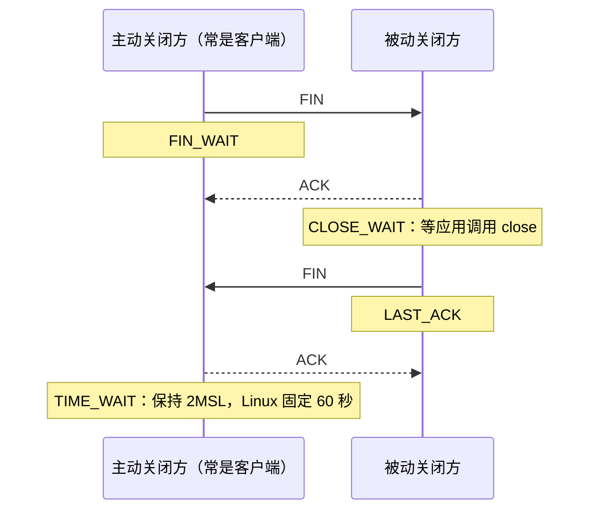
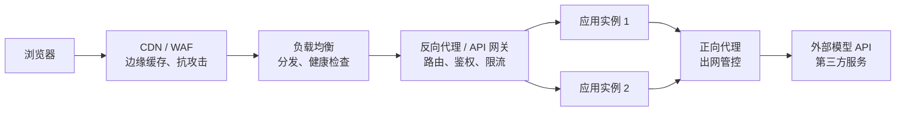
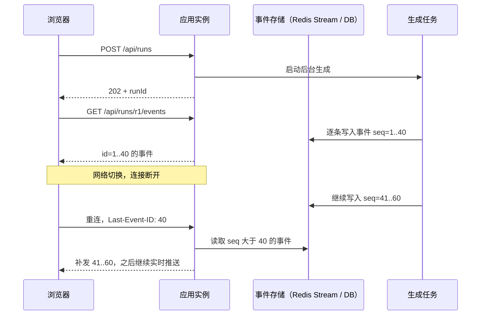
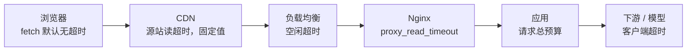

# 01 网络与 HTTP：服务端视角

> 本章目标：从**服务端和排障**的角度重新认识网络：TCP 连接的成本与耗尽、TLS 证书链、DNS TTL，**连接复用与 HTTP 客户端连接池**，代理 / 负载均衡 / CDN / 网关的分工与**真实 IP**，服务端 **CORS** 的正确配置，**SSE / WebSocket** 的服务端实现要点，以及从浏览器到模型服务的**超时链路**。
>
> 本章讲协议与服务端实现；Nginx / Caddy 的完整部署配置见 [15 章](../L4-工程与部署/15-部署架构与云.md)，AI 应用层事件模型与 AG-UI 见 [企业级 04 章](../../企业级AI应用开发实战/04-AI交互层-流式协议与生成式UI.md)。文中各组件默认值均注明出处版本，部署前以所用版本的官方文档为准。

---

## 一、TCP：只讲排障用得上的部分

### 1.1 建连成本：为什么要复用连接

一次 HTTPS 请求在发出第一个字节前，要先完成 TCP 三次握手（1 个 RTT）和 TLS 握手（TLS 1.3 为 1 个 RTT）。跨地域调用模型 API 时 RTT 可能有几十到上百毫秒，**每个请求新建连接就要多付出数百毫秒**，还会消耗双方的 CPU（TLS 密钥交换）和端口。

> 📖 **RTT（Round-Trip Time）**：数据包往返一次的时间。同机房通常在 1 ms 以内，跨省数十毫秒，跨洋上百毫秒。

### 1.2 四次挥手与 TIME_WAIT



排障时只需要记住两个状态：

| 状态 | 出现在哪一方 | 大量堆积意味着什么 |
|---|---|---|
| **TIME_WAIT** | **主动关闭**连接的一方 | 短连接太多。服务调用下游时每次新建连接，本机就会堆积 TIME_WAIT，最终耗尽本地端口 |
| **CLOSE_WAIT** | 被动关闭的一方 | 对端已关闭，**本方应用没有 close**——几乎一定是代码 bug（响应体没读完 / 没释放、连接泄漏） |

> 📖 **临时端口（ephemeral port）**：客户端发起连接时由系统分配的本地端口。Linux 默认范围 32768~60999，约 2.8 万个。对**同一个目标 IP:端口**，每个处于 TIME_WAIT 的连接都占着一个本地端口 60 秒，短连接 QPS 超过约 470（28000 / 60）就可能触发端口耗尽，报错 `EADDRNOTAVAIL` / `Cannot assign requested address`。

### 1.3 连接耗尽的几种形态

| 现象 / 报错 | 根因 | 处理 |
|---|---|---|
| `Cannot assign requested address` | 本地临时端口耗尽（短连接 + TIME_WAIT） | **复用连接**（连接池 + keep-alive）；不要依赖调内核参数 |
| `Too many open files` / `EMFILE` | 文件描述符耗尽（每个连接占一个 fd） | 查连接泄漏；调大 `ulimit -n`（[12 章](../L4-工程与部署/12-Linux与排障命令.md)） |
| 获取连接超时（`pool timeout`、`Connection is not available`） | 连接池耗尽：并发超过池大小，或连接被长期占用不归还 | 查慢查询 / 慢下游；查连接是否在异常路径被释放 |
| CLOSE_WAIT 持续增长 | 应用没关闭连接 | 查响应体未消费、流未关闭 |
| 新连接偶发超时 | 对端监听队列（backlog）满 | 对端扩容或调大 backlog |

```bash
ss -s                                           # 各状态连接总数
ss -tan state time-wait | wc -l                 # TIME_WAIT 数量
ss -tanp state close-wait                       # CLOSE_WAIT 及所属进程
```

> ⚠️ **注意**：网上常见的"调大 `tcp_tw_reuse`、开 `tcp_tw_recycle`"属于治标；后者在 Linux 4.12 已被移除，且在 NAT 环境下会导致连接失败。根治手段是让应用**复用连接**（第三节）。

---

## 二、TLS 与 DNS

### 2.1 TLS 握手与证书链

服务端视角下 TLS 有三件事要做对：

| 要点 | 说明 | 出错表现 |
|---|---|---|
| **完整证书链** | 服务端必须发送"叶子证书 + 中间证书"，根证书由客户端信任库提供 | 浏览器正常（会自动补全中间证书），但 curl、Java、Python 客户端报证书校验失败 |
| **SNI** | 一个 IP 托管多个域名时，客户端在握手时告知目标域名，服务端据此选证书 | 拿到了默认站点的证书，域名不匹配 |
| **到期续签** | 证书有效期越来越短，必须自动化续签（ACME / Let's Encrypt、云厂商托管证书） | 某天凌晨全站 HTTPS 失败 |

内部服务使用企业私有 CA 时，各语言客户端要单独配置信任：

| 栈 | 信任私有 CA 的方式 | 典型报错 |
|---|---|---|
| Java | 导入 JVM truststore 或指定 `javax.net.ssl.trustStore` | `PKIX path building failed` |
| Node | 环境变量 `NODE_EXTRA_CA_CERTS=/path/ca.pem` | `unable to get local issuer certificate` |
| Python | httpx / requests 的 `verify="/path/ca.pem"` 参数 | `CERTIFICATE_VERIFY_FAILED` |

> ⚠️ **注意**：AI 遇到证书错误时最爱给的方案是 `verify=False`、`rejectUnauthorized: false`、`NODE_TLS_REJECT_UNAUTHORIZED=0` 或信任所有证书的 `TrustManager`。这等于关闭了 HTTPS 的身份校验，任何中间人都能窃听和篡改，**出现在非本地调试代码中即阻断**。

### 2.2 DNS 解析与 TTL

- **TTL** 决定解析结果被各级缓存多久。迁移服务器或切换 CDN 前，**提前一到两个 TTL 周期把 TTL 调小**，切换完成后再调回
- 缓存不只在 DNS 服务器：操作系统、浏览器、语言运行时都可能缓存。JVM 有自己的解析缓存（`networkaddress.cache.ttl`）；长生命周期的连接池里，已建立的连接不会因 DNS 变更而断开，需要配置连接最大存活时间
- 容器与 K8s 环境的 DNS（服务发现、`ndots` 导致的多次查询）见 [14 章](../L4-工程与部署/14-Kubernetes核心与实践.md)

---

## 三、HTTP 版本与连接复用

### 3.1 三个版本的服务端差异

| | HTTP/1.1 | HTTP/2 | HTTP/3 |
|---|---|---|---|
| 传输层 | TCP | TCP | **QUIC（基于 UDP）** |
| 连接复用 | keep-alive：一个连接**串行**处理多个请求 | **多路复用**：一个连接并发多个流 | 多路复用，且无 TCP 层队头阻塞 |
| 浏览器并发 | 同一源约 6 个连接 | 一个连接即可 | 一个连接即可 |
| 是否需要 TLS | 否 | 浏览器要求 TLS；服务间可用明文 h2c | 强制 |
| 典型位置 | 反代 → 应用的内网转发 | 浏览器 → CDN / LB；gRPC 全链路 | 浏览器 → CDN / LB 边缘 |

服务端要意识到两点：

- **协议在每一跳可以不同**。浏览器到 CDN 用 HTTP/3，CDN 到 LB 用 HTTP/2，Nginx 到应用往往是 HTTP/1.1。应用日志里看到的协议版本，不代表用户实际使用的版本
- **HTTP/1.1 下浏览器的 6 连接上限会影响 SSE**：用户开多个标签页、每页一条 SSE 长连接，第 7 个请求会一直排队。对外入口启用 HTTP/2 即可缓解
- HTTP/3 通常由 CDN、云 LB 在边缘提供（通过响应头 `Alt-Svc` 告知浏览器可升级），应用服务一般无需改动

### 3.2 keep-alive 超时的配对规则

连接池两端各有一个"空闲多久就关闭"的超时。**如果服务端先关、客户端不知道，客户端恰好在这一瞬间复用该连接发请求，就会收到连接重置**，表现为低频、随机的 502。

规则：**接收方（服务端）的 keep-alive 空闲超时 > 发送方（客户端 / LB / 反代）的连接池空闲超时。**

| 链路 | 发送方空闲超时 | 接收方需设置 |
|---|---|---|
| 云 LB → Node 应用 | 如 AWS ALB 默认 60 秒 | Node `server.keepAliveTimeout` 大于 60 秒（Node 26 文档中默认仍为 5 秒；社区已合入将默认值提高到 65 秒的改动，以所用版本为准），`headersTimeout` 再略大一点 |
| Nginx upstream → 应用 | `keepalive_timeout`（upstream 块内，默认 60 秒） | 应用的 keep-alive 超时大于该值，或调小 Nginx 侧 |
| Nginx → Uvicorn | 同上 | `--timeout-keep-alive`（默认 5 秒）需调大 |

Nginx 默认对上游使用短连接，要启用上游连接复用需显式配置：

```nginx
upstream app {
    server 10.0.0.11:8080;
    server 10.0.0.12:8080;
    keepalive 32;                       # 每个 worker 保留的空闲长连接数
}
server {
    location /api/ {
        proxy_pass http://app;
        proxy_http_version 1.1;         # 上游 keep-alive 需要 1.1
        proxy_set_header Connection ""; # 清掉客户端传来的 Connection: close
    }
}
```

### 3.3 HTTP 客户端连接池：AI 最常写错的地方

服务端调用下游（模型 API、内部服务、第三方）时，HTTP 客户端**必须是长生命周期的单例**，内部维护连接池。AI 生成代码时最常见的错误是**在请求处理函数里新建客户端**。

三栈的典型反例：

| 栈 | 反例写法（出现在请求处理函数或业务方法内） | 问题 |
|---|---|---|
| Python | `async with httpx.AsyncClient() as client:` | 每个请求新建并关闭，TCP + TLS 握手每次重来 |
| TypeScript | `new https.Agent({ keepAlive: false })`、`new OpenAI(...)` | 每次新建且禁用复用；SDK 客户端同样不应在请求内创建 |
| Java | `HttpClient.newHttpClient()` | 每次新建独立的连接池与后台线程，连接无法复用，还可能泄漏线程 |

这些反例通常还伴随**没有设置超时**。

**Python 正例**：在应用生命周期内创建一次，关闭时释放

```python
@asynccontextmanager
async def lifespan(app: FastAPI):
    app.state.llm_http = httpx.AsyncClient(
        base_url=settings.llm_base_url,
        timeout=httpx.Timeout(60.0, connect=3.0),                       # 显式超时
        limits=httpx.Limits(max_connections=100, max_keepalive_connections=20),
    )
    yield
    await app.state.llm_http.aclose()

app = FastAPI(lifespan=lifespan)

def get_llm_http(request: Request) -> httpx.AsyncClient:
    return request.app.state.llm_http
```

**TypeScript 正例**：模块级创建一次，所有请求共享

```ts
import { Agent, fetch } from 'undici';

const llmDispatcher = new Agent({
  connections: 100,          // 每个源的最大连接数
  keepAliveTimeout: 30_000,
  headersTimeout: 15_000,    // 等待响应头
  bodyTimeout: 60_000,       // 两个数据块之间的最大间隔，流式响应要大于模型最长停顿
});
export const openai = new OpenAI({ apiKey: env.OPENAI_API_KEY, timeout: 120_000, maxRetries: 2 });

export async function callTool(url: string, body: unknown, signal: AbortSignal) {
  return fetch(url, { method: 'POST', body: JSON.stringify(body), dispatcher: llmDispatcher, signal });
}
```

**Java 正例**：注册为 Bean，由 Spring 管理生命周期

```java
@Configuration
class LlmClientConfig {
    @Bean
    RestClient llmRestClient(RestClient.Builder builder, @Value("${llm.base-url}") String baseUrl) {
        var http = HttpClient.newBuilder()
                .connectTimeout(Duration.ofSeconds(3))
                .build();                                   // 线程安全，内部维护连接池
        var factory = new JdkClientHttpRequestFactory(http);
        factory.setReadTimeout(Duration.ofSeconds(60));
        return builder.baseUrl(baseUrl).requestFactory(factory).build();
    }
}
```

> 🎯 **落地要点**：同样的规则适用于**数据库连接池、Redis 客户端、模型 SDK 客户端、对象存储客户端**——全部在启动时创建、全局复用、停机时关闭。审查时搜索请求处理函数内的 `new XxxClient(`、`HttpClient.newHttpClient()`、`httpx.AsyncClient(`、`new Pool(`，基本能一次找全。

---

## 四、代理、负载均衡、CDN 与网关

### 4.1 概念区分

| 组件 | 代表谁 | 核心职责 | 典型产品 |
|---|---|---|---|
| **正向代理** | 客户端 | 代表内部客户端访问外网：出网管控、审计、SSRF 防护 | Squid、企业出网代理、Dify 的 ssrf_proxy |
| **反向代理** | 服务端 | 接收外部请求转给后端：路由、TLS 终止、静态资源、缓冲 | Nginx、Caddy、Envoy |
| **负载均衡** | 服务端 | 在多个实例间分发流量，健康检查，摘除故障实例 | 云 LB（四层 / 七层）、Nginx upstream、K8s Service |
| **CDN** | 服务端 | 边缘缓存与加速，抗 DDoS，常兼 WAF | Cloudflare、阿里云 CDN、CloudFront |
| **API 网关** | 服务端 | 统一的鉴权、限流、路由、协议转换、API 管理 | Kong、APISIX、云 API 网关；AI 网关见 [企业级 09 章](../../企业级AI应用开发实战/09-LLMOps-可观测评测与AI网关.md) |



这些角色在实际部署中经常合并：小项目里一个 Nginx 同时是反代、LB 和 TLS 终止点；云上常见的组合是"CDN + 云 LB + 应用"。部署形态的选型见 [15 章](../L4-工程与部署/15-部署架构与云.md)。

### 4.2 真实 IP 与 X-Forwarded-For

经过代理后，应用看到的 TCP 对端地址是**最后一跳代理的 IP**，用户真实 IP 只能从代理添加的请求头里取：

```text
X-Forwarded-For: <客户端>, <代理1>, <代理2>
X-Forwarded-Proto: https          # 原始协议，用于生成重定向地址、判断 Secure Cookie
X-Forwarded-Host: app.example.com
```

问题在于：**`X-Forwarded-For` 是客户端可以随意伪造的请求头**。攻击者发送 `X-Forwarded-For: 1.2.3.4`，Nginx 用 `$proxy_add_x_forwarded_for` 追加后变成 `1.2.3.4, <真实IP>`。

```ts
// ❌ 反例：取最左边的值，攻击者每次换一个伪造 IP 就能绕过按 IP 限流、伪造审计日志
const ip = req.headers['x-forwarded-for']?.split(',')[0].trim();
```

**正确做法**：只信任你自己的代理添加的部分，**从右往左**跳过已知代理，第一个不可信的地址才是客户端 IP。各框架都内置了这个逻辑，只需正确声明"信任哪些代理"：

| 栈 | 配置 |
|---|---|
| Nginx（边缘入口） | `proxy_set_header X-Forwarded-For $remote_addr;` 直接覆盖客户端传入的值；内层代理用 `set_real_ip_from <上游代理网段>` + `real_ip_header X-Forwarded-For` + `real_ip_recursive on` |
| Spring Boot | `server.forward-headers-strategy=native`，并用 `server.tomcat.remoteip.internal-proxies` 限定可信代理网段 |
| Express | `app.set('trust proxy', 1)`（信任 1 跳）或可信网段列表，然后用 `req.ip` |
| Fastify | `Fastify({ trustProxy: '10.0.0.0/8' })`，然后用 `request.ip` |
| Uvicorn / FastAPI | `--proxy-headers`（默认开启）配合 `--forwarded-allow-ips=<代理 IP>`（默认只信任 127.0.0.1） |

> ⚠️ **注意**：`trust proxy: true` / `forwarded-allow-ips='*'` 表示信任所有来源的转发头，**只有在应用不可能被绕过代理直接访问时才安全**。如果应用端口直接暴露在公网，任何人都能伪造 IP。标准 `Forwarded` 头（RFC 7239）语义更清晰，但支持度不如 `X-Forwarded-*` 普遍，两者不要混用。

---

## 五、CORS：服务端视角

### 5.1 服务端负责什么

CORS 是**浏览器**执行的策略，服务端只负责"声明允许谁"。浏览器发起跨源请求时：

- **简单请求**（GET / HEAD / POST，且 Content-Type 为表单或 `text/plain`）：直接发送，根据响应头决定是否把结果交给 JS
- **预检请求**：`Content-Type: application/json`、自定义头（`Authorization`、`Idempotency-Key`）、PUT / DELETE 等，浏览器先发 `OPTIONS`，服务端用以下响应头回答：

| 响应头 | 含义 |
|---|---|
| `Access-Control-Allow-Origin` | 允许的源，**一个具体值**或 `*` |
| `Access-Control-Allow-Credentials: true` | 允许携带 Cookie / HTTP 认证 |
| `Access-Control-Allow-Methods` / `-Headers` | 预检时声明允许的方法与请求头 |
| `Access-Control-Expose-Headers` | 允许 JS 读取的响应头（如 `X-Request-Id`） |
| `Access-Control-Max-Age` | 预检结果缓存秒数（浏览器会封顶，Chromium 为 2 小时） |
| `Vary: Origin` | 按 Origin 动态返回时必须加，否则 CDN / 浏览器缓存会串 |

### 5.2 常见错误配置

| 错误 | 后果 |
|---|---|
| `Allow-Origin: *` + `Allow-Credentials: true` | 浏览器直接拒绝。开发者随后常"修复"为反射 Origin，引出下一条 |
| 🔴 **原样反射请求的 Origin** + 允许凭据 | 任何网站都能以用户身份读取接口数据，等于没有同源保护 |
| 用 `endsWith('example.com')` / `includes` 匹配 | `evilexample.com`、`example.com.evil.io` 均可通过 |
| 允许 `null` 源 | 沙箱 iframe、本地文件都会发送 `Origin: null`，攻击者容易构造 |
| 预检 `OPTIONS` 被鉴权中间件拦截返回 401 | 前端只看到"CORS 错误"，真实原因被掩盖 |
| 错误响应（401 / 500 / 网关 502）不带 CORS 头 | 同上：浏览器报 CORS 错误，开发者误以为是 CORS 配置问题 |
| Nginx 和应用都加了 CORS 头 | 响应里出现两个 `Access-Control-Allow-Origin`，浏览器拒绝 |

**反例 → 正例**（Hono；其他框架同理）：

```ts
// ❌ 反例：反射任意 Origin 并允许凭据
app.use('/api/*', cors({ origin: (origin) => origin, credentials: true }));
```

```ts
// ✅ 正例：精确白名单，来自配置，按环境区分
const allowed = new Set(env.CORS_ORIGINS.split(','));   // https://app.example.com,https://admin.example.com
app.use('/api/*', cors({
  origin: (origin) => (allowed.has(origin) ? origin : null),
  credentials: true,
  allowMethods: ['GET', 'POST', 'PUT', 'DELETE'],
  allowHeaders: ['Content-Type', 'Authorization', 'Idempotency-Key'],
  exposeHeaders: ['X-Request-Id'],
  maxAge: 3600,
}));
```

其他两栈的同类陷阱：

| 栈 | 危险组合 | 实际效果 |
|---|---|---|
| Spring | `allowedOrigins("*")` + `allowCredentials(true)` | 处理请求时直接抛异常 |
| Spring | `allowedOriginPatterns("*")` + `allowCredentials(true)` | 能运行，但等同反射任意 Origin |
| FastAPI / Starlette | `allow_origins=["*"]` + `allow_credentials=True` | 中间件回显请求的 Origin，同样对所有站点开放 |

正确写法都是从配置读取**精确的源列表**，按环境区分。

> 🎯 **落地要点**：**CORS 不是访问控制**。它只限制"浏览器里的 JS 能否读到响应"，挡不住 curl、脚本和服务端调用，也不能替代 CSRF 防护（SameSite Cookie、CSRF Token，见 [06 章](../L2-核心能力/06-认证授权与Web安全.md)）。接口的安全仍然靠鉴权与授权。前后端同域部署（反代把 `/api` 转到后端）可以彻底绕开 CORS，是最简单的方案。

---

## 六、SSE 与 WebSocket 的服务端实现

### 6.1 服务端视角的选型

| | SSE | WebSocket |
|---|---|---|
| 协议 | 普通 HTTP 响应，`Content-Type: text/event-stream` | HTTP Upgrade 后切换为独立协议 |
| 方向 | 服务端 → 客户端 | 双向 |
| 经过代理 / 网关 | 与普通 HTTP 一样，只需关闭缓冲 | 需要代理显式支持 Upgrade |
| 鉴权 | 与普通接口相同（Cookie / Authorization 头） | 浏览器 API 不能自定义请求头，需另行设计 |
| 断线续传 | 协议内置 `id` + `Last-Event-ID` | 自行实现 |
| AI 场景 | **对话流式输出的默认选择** | 实时语音、协同编辑、高频双向交互 |

AI 应用的事件类型设计（文本增量、工具调用、运行状态等）见 [企业级 04 章 2.3 节](../../企业级AI应用开发实战/04-AI交互层-流式协议与生成式UI.md#23-应用层事件模型)，本节只讲传输层的服务端实现。

### 6.2 SSE 协议要点

```text
retry: 3000                     # 告诉浏览器断线后多久重连（毫秒）

id: 42                          # 事件 ID，断线重连时浏览器会在 Last-Event-ID 头里带回
event: text-delta               # 事件类型，省略则为 message
data: {"delta":"你好"}

: ping                          # 冒号开头是注释行，客户端忽略，用作心跳

```

- 浏览器原生 `EventSource` **只支持 GET、不能自定义请求头**，但会自动重连并携带 `Last-Event-ID`
- 用 `fetch` 读取流（以支持 POST 和自定义头）时，**重连与 `Last-Event-ID` 都要自己实现**
- 推荐拆成两个接口：`POST /api/runs` 创建任务并返回 `runId`，`GET /api/runs/{runId}/events` 订阅事件流。**生成过程与连接解耦**，断线、刷新页面都能续上

### 6.3 断线重连与续传



要点：事件带**单调递增的序号**并持久化；订阅接口先补发 `Last-Event-ID` 之后的历史，再接实时流；重连可能落到另一个实例，所以事件不能只存在原实例内存里。任务的持久化执行见 [07 章](../L2-核心能力/07-异步任务与消息队列.md) 和 [企业级 06 章](../../企业级AI应用开发实战/06-Agent工程化-从Loop到生产.md#六人机协同与持久化执行)。

### 6.4 三栈最小 SSE 示例

三个示例实现同样的行为：建流前完成鉴权与归属校验、支持 `Last-Event-ID` 续传、每 15 秒心跳、客户端断开后停止订阅。`runEvents` / `subscribe` 代表从事件存储读取"历史 + 实时"事件的函数。

**TypeScript（Hono）**：

```ts
import { streamSSE } from 'hono/streaming';

app.get('/api/runs/:runId/events', requireAuth, async (c) => {
  const run = await runs.getOwned(c.req.param('runId'), c.get('user').id);
  if (!run) return c.json({ error: 'not_found' }, 404);          // 建流之前返回错误
  const after = Number(c.req.header('Last-Event-ID') ?? 0);
  c.header('X-Accel-Buffering', 'no');                            // 关闭 Nginx 缓冲

  return streamSSE(c, async (stream) => {
    const ac = new AbortController();
    stream.onAbort(() => ac.abort());                             // 客户端断开 → 停止订阅
    const heartbeat = setInterval(() => void stream.write(': ping\n\n'), 15_000);
    try {
      for await (const ev of runEvents(run.id, { after, signal: ac.signal })) {
        await stream.writeSSE({ id: String(ev.seq), event: ev.type, data: JSON.stringify(ev.data) });
      }
    } finally {
      clearInterval(heartbeat);
    }
  });
});
```

**Java（Spring MVC）**：

```java
@GetMapping(path = "/api/runs/{runId}/events", produces = MediaType.TEXT_EVENT_STREAM_VALUE)
ResponseEntity<SseEmitter> events(@PathVariable String runId,
                                  @RequestHeader(name = "Last-Event-ID", defaultValue = "0") long after,
                                  @AuthenticationPrincipal Jwt jwt) {
    var run = runService.getOwned(runId, jwt.getSubject());      // 不属于当前用户则抛异常 → 404
    var emitter = new SseEmitter(Duration.ofMinutes(30).toMillis());  // 不传则沿用容器的异步超时（Tomcat 默认 30 秒）
    var sub = runEvents.subscribe(run.id(), after, ev -> {
        try {
            emitter.send(SseEmitter.event().id(String.valueOf(ev.seq())).name(ev.type()).data(ev.data()));
        } catch (IOException e) {
            emitter.completeWithError(e);                          // 写失败 = 客户端已断开
        }
    });
    var heartbeat = scheduler.scheduleAtFixedRate(() -> {
        try { emitter.send(SseEmitter.event().comment("ping")); }
        catch (IOException e) { emitter.completeWithError(e); }
    }, 15, 15, TimeUnit.SECONDS);
    Runnable cleanup = () -> { heartbeat.cancel(false); sub.close(); };
    emitter.onCompletion(cleanup);
    emitter.onTimeout(emitter::complete);
    emitter.onError(e -> cleanup.run());
    return ResponseEntity.ok().header("X-Accel-Buffering", "no").body(emitter);
}
```

**Python（FastAPI 0.135+ 内置 SSE）**：

```python
from fastapi.sse import EventSourceResponse, ServerSentEvent

async def get_owned_run(run_id: str, user: Annotated[User, Depends(get_current_user)]) -> Run:
    run = await runs.get_owned(run_id, owner_id=user.id)
    if run is None:
        raise HTTPException(404)         # 依赖在建流之前执行，此时还能返回正常的错误响应
    return run

@router.get("/api/runs/{run_id}/events", response_class=EventSourceResponse)
async def run_events(request: Request,
                     run: Annotated[Run, Depends(get_owned_run)],
                     last_event_id: Annotated[int, Header()] = 0):   # 对应请求头 Last-Event-ID
    async for ev in with_heartbeat(subscribe(run.id, after=last_event_id), interval=15):
        if await request.is_disconnected():
            break
        if ev is None:
            yield ServerSentEvent(comment="ping")
        else:
            yield ServerSentEvent(data=ev.data, event=ev.type, id=str(ev.seq))

async def with_heartbeat(source: AsyncIterator[T], interval: float) -> AsyncIterator[T | None]:
    """source 超过 interval 秒没有产出时插入 None，调用方据此发送心跳。"""
    it = aiter(source)
    nxt = asyncio.ensure_future(anext(it))
    try:
        while True:
            done, _ = await asyncio.wait({nxt}, timeout=interval)   # 超时不取消 nxt，下一轮继续等
            if not done:
                yield None
                continue
            try:
                item = nxt.result()
            except StopAsyncIteration:
                return
            yield item
            nxt = asyncio.ensure_future(anext(it))
    finally:
        nxt.cancel()
```

> ⚠️ **注意**：FastAPI 0.135 之前的版本没有 `fastapi.sse`，常见写法是 `StreamingResponse` 手写 `data:` 行（[企业级 04 章 2.4 节](../../企业级AI应用开发实战/04-AI交互层-流式协议与生成式UI.md#24-最小实现python-服务端输出-sse)）或第三方库 sse-starlette，两者的 `EventSourceResponse` 用法不同，复制示例前先看导入路径。

### 6.5 反代缓冲与压缩

本地流式正常、部署后变成"一次性吐出"，几乎都是中间层在缓冲：

| 环节 | 处理 |
|---|---|
| Nginx | `proxy_buffering off;`，或由应用返回 `X-Accel-Buffering: no`（只对该响应生效，更精确） |
| 压缩 | 网关 / 应用的压缩中间件会攒够数据再压缩发出，对 `text/event-stream` 关闭压缩 |
| CDN | 流式接口不缓存、不压缩；确认 CDN 支持流式回源 |
| 空闲超时 | 心跳间隔 < 链路上最小的读超时（Nginx `proxy_read_timeout` 默认 60 秒） |

```nginx
location /api/runs/ {
    proxy_pass http://app;
    proxy_http_version 1.1;
    proxy_set_header Connection "";
    proxy_buffering off;
    proxy_cache off;
    gzip off;
    proxy_read_timeout 300s;     # 两次读之间的最大间隔，不是总时长
}
```

### 6.6 WebSocket 的服务端要点

```nginx
location /ws/ {
    proxy_pass http://app;
    proxy_http_version 1.1;
    proxy_set_header Upgrade $http_upgrade;
    proxy_set_header Connection "upgrade";
    proxy_read_timeout 3600s;    # 无数据时多久断开，需大于心跳间隔
}
```

| 问题 | 要点 |
|---|---|
| **鉴权** | 浏览器 WebSocket API 不能带 `Authorization` 头。可用 Cookie（**必须校验 `Origin`**，防跨站 WebSocket 劫持），或先通过 HTTP 接口换取秒级过期的一次性票据放在 URL 中；不要把长期 Token 放进 URL（会进入访问日志） |
| **心跳** | 用 ping / pong 帧检测死连接并保活；服务端发现超时未响应的连接要主动关闭释放资源 |
| **粘性会话** | 连接建立后天然固定在一个实例上，WebSocket 本身不需要粘性；需要粘性的是 Socket.IO 等库的长轮询回退（同一会话的多个 HTTP 请求必须落到同一实例） |
| **跨实例推送** | 用户 A 连在实例 1，触发事件的请求落在实例 2：通过 Redis Pub/Sub、NATS 等广播，由持有连接的实例推送 |
| **负载不均** | 长连接不会自动重新分布，新扩容的实例长时间没有连接；按连接数而非 CPU 扩缩容 |
| **发布与重连风暴** | 实例下线时所有连接同时断开、同时重连。服务端优雅关闭时先通知客户端，客户端重连加**指数退避 + 随机抖动** |
| **资源上限** | 每个连接占用一个文件描述符和若干内存，监控连接数，调整 `ulimit -n` |

---

## 七、超时链路

### 7.1 每一层都有超时



**请求超时的配置规则：外层 > 内层，逐层留余量。** 让最内层先超时，应用才能在掌握上下文的地方返回结构化错误、记录日志、取消下游调用；反过来，如果 Nginx 先超时，用户看到一个通用 504，应用却还在继续等模型、继续计费。

| 层 | 关键配置 | 默认值（注明来源，以所用版本为准） |
|---|---|---|
| 浏览器 | `AbortSignal.timeout()` | `fetch` 无默认超时 |
| CDN | 源站读超时 | Cloudflare 非企业版不可调，超时返回 524，具体值以官方文档为准 |
| 云 LB | 空闲超时 | AWS ALB 默认 60 秒 |
| Nginx | `proxy_connect_timeout` / `proxy_read_timeout` / `proxy_send_timeout` | 均为 60 秒；读超时指两次读之间的间隔 |
| Node 服务端 | `requestTimeout` / `headersTimeout` / `keepAliveTimeout` | 300 秒 / 60 秒 / 5 秒（Node 26 文档） |
| Uvicorn | `--timeout-keep-alive` | 5 秒；不限制单个请求时长 |
| 应用 → 下游 | 连接超时、读超时、总超时 | httpx 默认 5 秒；`requests` 和 JDK `HttpClient` 无默认超时；undici 的 `headersTimeout` / `bodyTimeout` 默认 300 秒 |
| 模型 SDK | `timeout` / `maxRetries` | OpenAI 官方 SDK 默认 10 分钟、自动重试 2 次 |
| 数据库 | 语句超时 | PostgreSQL `statement_timeout` 默认不限制（[04 章](../L2-核心能力/04-数据库与数据建模.md)） |

> ⚠️ **注意**：注意两类超时方向相反。**请求超时**是外层大于内层；**keep-alive 空闲超时**是接收方大于发送方（3.2 节）。两条规则针对不同问题，不要混淆。

### 7.2 用"剩余预算"代替固定超时

一个请求依次调用多个下游时，每个下游都用固定 30 秒超时，总耗时可能远超外层限制。更好的做法是请求进入时确定**截止时间**（deadline），每次调用下游时取 `min(本调用上限, 剩余时间)`：

```ts
const deadline = Date.now() + 25_000;                    // 小于 Nginx 读超时
const remaining = () => Math.max(deadline - Date.now(), 0);

const docs = await retrieve(query, { signal: AbortSignal.timeout(Math.min(3_000, remaining())) });
const answer = await llm.generate(prompt(docs), { signal: AbortSignal.timeout(remaining()) });
```

gRPC 原生支持 deadline 在服务间传递；HTTP 调用需要自行通过请求头传递剩余时间或截止时间。

### 7.3 LLM 长请求的超时陷阱

| 陷阱 | 现象 | 处理 |
|---|---|---|
| 非流式调用 + 长输出 | 生成要 90 秒，Nginx 60 秒切断返回 504，模型仍在后台生成并计费 | 改为流式；或调大该路由的读超时并让应用总预算小于它 |
| 流式但首 token 很慢 | 推理模型"思考"阶段长时间无输出，被链路某一层的读超时切断 | 先发送响应头与心跳；读超时按"最长静默时间"而非总时长设置 |
| 网关读超时 < SDK 超时 | 网关已返回 504，SDK 还在等 | 应用总预算 < 网关读超时 < CDN 读超时 |
| **504 之后客户端重试** | 第一次生成其实成功了，重试又生成一次，**重复计费、重复写入** | 写操作带幂等键（[03 章](../L2-核心能力/03-API设计.md)） |
| SDK 自动重试叠加业务重试 | SDK 重试 2 次 × 业务重试 3 次 × 网关重试，流量放大十几倍 | 只在一层重试，其余层关闭 |
| 用户点"停止"后服务端继续 | 连接断了，模型调用仍在跑 | 监听断开事件，取消下游调用（6.4 节示例） |
| 分钟级任务（深度研究、批量入库） | 任何 HTTP 超时都撑不住 | 改为异步任务：提交返回任务 ID，前端订阅进度或轮询（[03 章](../L2-核心能力/03-API设计.md)、[07 章](../L2-核心能力/07-异步任务与消息队列.md)） |

---

## 八、常用调试

### 8.1 curl 与命令行

```bash
curl -v https://api.example.com/health          # 解析到的 IP、TLS 握手、请求头与响应头
curl -sS -o /dev/null -w 'dns=%{time_namelookup} tcp=%{time_connect} tls=%{time_appconnect} ttfb=%{time_starttransfer} total=%{time_total}\n' \
  https://api.example.com/health                # 各阶段耗时：慢在 DNS、建连、TLS 还是服务端
curl -N -H 'Accept: text/event-stream' -H 'Last-Event-ID: 40' -H "Authorization: Bearer $TOKEN" \
  https://api.example.com/api/runs/r1/events    # -N 关闭 curl 输出缓冲，逐块查看 SSE
curl --resolve api.example.com:443:10.0.0.12 https://api.example.com/health   # 绕过 DNS 直连某节点
curl -i -X OPTIONS https://api.example.com/api/chat -H 'Origin: https://app.example.com' \
  -H 'Access-Control-Request-Method: POST' -H 'Access-Control-Request-Headers: content-type,authorization'  # 模拟预检
openssl s_client -connect api.example.com:443 -servername api.example.com -showcerts </dev/null   # 证书链与有效期
dig api.example.com +noall +answer              # 解析结果与剩余 TTL
```

`--http2`、`--http3` 可以强制协议版本（后者需要 curl 编译时支持 HTTP/3）。端口、连接、抓包等更多工具见 [12 章](../L4-工程与部署/12-Linux与排障命令.md)。

### 8.2 浏览器 DevTools 与服务端日志对照

**第一步：确认错误是谁返回的。** 同样是 502 / 504，来自 CDN、LB、Nginx 还是应用，排查方向完全不同：

| 状态码 | 通常含义 | 怎么判断来源 |
|---|---|---|
| 499 | Nginx 记录：客户端在响应前主动断开（用户关页面、前端超时） | 只出现在 Nginx 日志中 |
| 502 | 代理收到上游的无效响应或连接被重置：上游崩溃、keep-alive 超时不匹配 | 响应体是代理的 HTML 错误页，而非应用的 JSON |
| 503 | 无可用实例、限流、维护 | 看 `Server` 头与响应体格式 |
| 504 | 代理等待上游超时 | 比对耗时是否恰好等于某一层的超时值（60 秒、300 秒等整数） |
| 524 | Cloudflare 等待源站响应超时 | CDN 品牌错误页 |

> 🎯 **落地要点**：如果某个错误**总是在整数秒（30、60、100、120、300）时出现**，几乎可以断定是某一层的超时配置，而不是业务逻辑问题。

**第二步：用请求 ID 串起两端。** 应用在入口生成请求 ID（或使用 W3C `traceparent`），写入所有日志，并通过响应头 `X-Request-Id` 返回（跨域时加入 `Access-Control-Expose-Headers`）。前端报错时带上这个 ID，后端直接按 ID 检索日志与链路（[17 章](../L4-工程与部署/17-可观测性与线上排障.md)）。

**第三步：对照 Timing 面板与服务端耗时。**

| DevTools Timing | 对应环节 | 如果偏大 |
|---|---|---|
| Queueing / Stalled | 浏览器内排队 | HTTP/1.1 下同源连接数已满（如多条 SSE 长连接） |
| DNS Lookup | DNS 解析 | DNS 服务慢或 TTL 过短 |
| Initial connection / SSL | TCP + TLS 握手 | 没有复用连接；地理距离远 |
| Waiting for server response（TTFB） | 服务端处理 + 中间各层 | 与应用日志中的请求耗时对比：两者接近说明慢在应用；差距大说明慢在代理、网关或排队 |
| Content Download | 响应体传输 | 响应过大；流式接口这里就是整个生成时长 |

---

## 九、AI 代码审查清单

### 9.1 连接与客户端

- [ ] 🔴 请求处理函数内没有新建 HTTP 客户端、数据库连接池、Redis 客户端、模型 SDK 客户端；全部在启动时创建并复用
- [ ] 🔴 每个 HTTP 客户端都配置了连接超时与读超时（`requests`、JDK `HttpClient`、`fetch` 默认没有总超时）
- [ ] 应用停机时关闭客户端与连接池（`aclose()`、Bean 销毁、`server.close()`）
- [ ] 响应体在所有分支都被消费或关闭（避免连接不归还、CLOSE_WAIT 堆积）
- [ ] 连接池大小有显式配置，并与下游的连接 / 并发限制匹配

### 9.2 TLS 与代理

- [ ] 🔴 非本地调试代码中没有 `verify=False`、`rejectUnauthorized: false`、`NODE_TLS_REJECT_UNAUTHORIZED=0`、信任所有证书的 TrustManager
- [ ] 🔴 客户端 IP 通过框架的可信代理配置获取，没有直接取 `X-Forwarded-For` 的第一个值
- [ ] 可信代理范围是具体网段，而不是"信任全部"；应用端口不直接暴露公网
- [ ] 应用 keep-alive 空闲超时大于前置 LB / 反代的连接池空闲超时

### 9.3 CORS

- [ ] 🔴 允许凭据时，`Allow-Origin` 来自精确白名单，没有反射任意 Origin，没有 `allowedOriginPatterns("*")` / `allow_origins=["*"]` 与凭据的组合
- [ ] 🔴 Origin 校验没有使用 `endsWith`、`includes`、未锚定的正则；不允许 `null`
- [ ] 动态返回 Origin 时带 `Vary: Origin`
- [ ] 预检 `OPTIONS` 不经过鉴权；错误响应同样带 CORS 头

### 9.4 SSE / WebSocket

- [ ] 🔴 流式接口在建流之前完成鉴权与资源归属校验
- [ ] 🔴 客户端断开后取消下游模型调用（监听 abort / disconnect）
- [ ] 流式响应关闭了反代缓冲和压缩（`X-Accel-Buffering: no` 或 `proxy_buffering off`）
- [ ] 有心跳，间隔小于链路上最小的读 / 空闲超时
- [ ] 事件带递增 ID 并持久化，支持 `Last-Event-ID` 续传；生成任务不依赖连接存活
- [ ] WebSocket 握手校验 `Origin`；长期 Token 不放在 URL 中
- [ ] 跨实例推送通过 Pub/Sub 等机制实现，而非假设所有连接在同一实例

### 9.5 超时链路

- [ ] 🔴 应用对下游的总超时 < Nginx / 网关读超时 < LB / CDN 超时
- [ ] 🔴 重试只在一层发生；带副作用的接口有幂等键
- [ ] 多个下游串行调用时使用剩余预算，而不是各自固定超时
- [ ] 分钟级任务使用异步任务 + 进度订阅，而不是一个长 HTTP 请求

---

## 本章小结

- 建连很贵：TCP + TLS 至少 2 个 RTT。**短连接会堆积 TIME_WAIT、耗尽端口**；CLOSE_WAIT 堆积几乎一定是代码没关连接
- HTTP 客户端、连接池、SDK 客户端必须**全局单例复用**，这是 AI 生成代码最高频的错误之一
- keep-alive 空闲超时要求**接收方大于发送方**，否则出现低频随机 502；请求超时要求**外层大于内层**
- 代理、LB、CDN、网关职责不同但常合并部署；**真实 IP 只能通过可信代理配置获取**，`X-Forwarded-For` 可被伪造
- CORS 是浏览器策略不是访问控制；**反射 Origin + 凭据**是最危险的配置，同域部署可彻底绕开 CORS
- SSE 是 AI 流式输出的默认选择：**建流前鉴权、心跳、事件 ID 与续传、关闭反代缓冲、断开即取消下游**；WebSocket 额外要解决鉴权、跨实例推送与重连风暴
- LLM 长请求要从链路整体设计超时，504 之后的重试会导致**重复计费**；分钟级任务改为异步任务
- 排障先判断"错误是谁返回的"，再用请求 ID 串起浏览器与服务端日志

## 练习

1. 写一个调用下游接口的小服务，分别实现"每次请求新建客户端"和"全局复用客户端"两个版本，用压测工具以 200 QPS 压 1 分钟，用 `ss -s` 和 `ss -tan state time-wait | wc -l` 对比两者的连接状态和 P99 延迟
2. 用 Nginx 反代一个 SSE 接口，依次验证：默认配置下流式是否被缓冲；加 `X-Accel-Buffering: no` 后的效果；把 `proxy_read_timeout` 设为 10 秒、心跳设为 15 秒时会发生什么；再把心跳改为 5 秒
3. 实现第六节的"创建任务 + 订阅事件流"模式：生成过程写入 Redis Stream，订阅接口支持 `Last-Event-ID` 续传。用浏览器 `EventSource` 连接后断网 10 秒再恢复，确认没有丢事件、没有重复事件
4. 为你的 AI 对话接口画出完整的超时链路图，列出每一层的实际配置值，检查是否满足"外层大于内层"与"keep-alive 接收方大于发送方"，并用 `curl -w` 测量各阶段耗时
