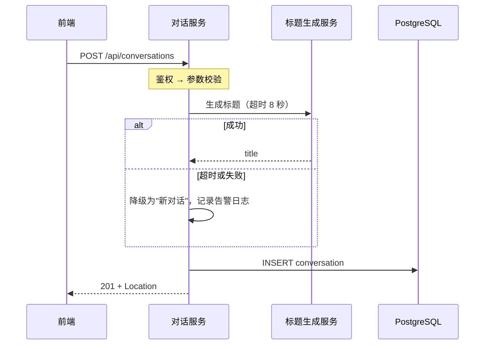
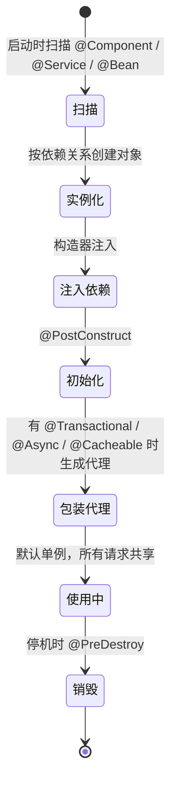
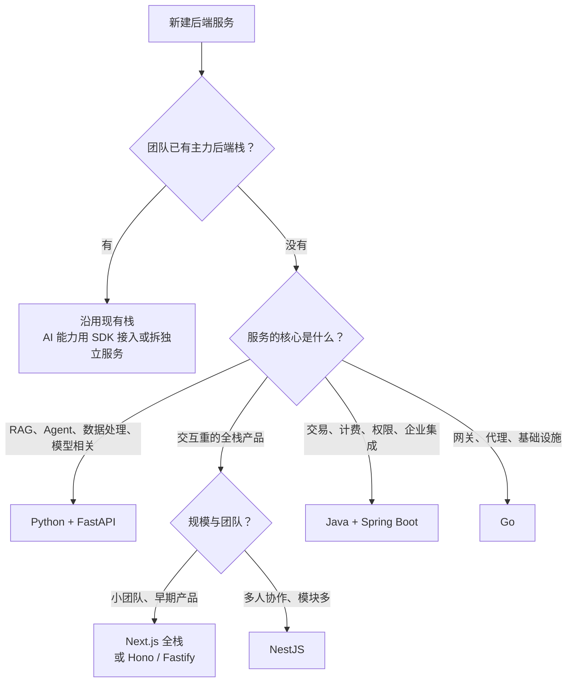
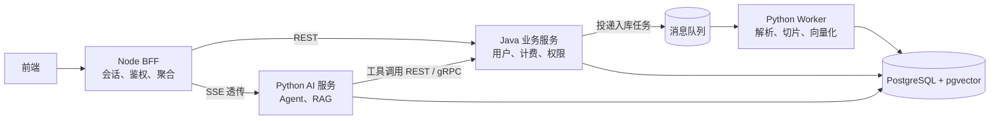

# 02 后端语言与框架选型

> 本章目标：建立 **Java（Spring Boot）/ TypeScript（Node）/ Python（FastAPI）** 三栈的全景认知，通过**同一个接口的三栈对照**读懂各自的路由、校验、依赖注入、错误处理与异步调用，掌握**看懂 AI 生成代码所需的最小语法**，并能为 AI 应用做出有依据的**语言与组合选型**。
>
> 版本基线（2026 年 11 月核实）：
> - **Java 25 LTS**（2025 年 9 月发布）；最新特性版本为 JDK 27（2026 年 9 月）
> - **Spring Boot 4.1.x**（4.1 于 2026 年 6 月发布）；4.0 开源支持至 2026 年 12 月底，4.2 处于 RC 阶段。Spring Boot 4 基于 Spring Framework 7 与 Jackson 3，最低 Java 17
> - **Node.js 26**（2026 年 10 月 28 日起为 Active LTS），Node 24 进入维护期；Node 27 起改为每年一个大版本且均会成为 LTS
> - **NestJS 12**（2026 年 8 月，核心包改为 ESM 发布）；Fastify 5、Hono 4（5 处于 RC）、Express 5
> - **Python 3.15**（2026 年 10 月）/ 3.14；**FastAPI** 仍为 0.x 且发版频繁（0.135 起内置 SSE），务必锁定版本；Pydantic 2.x；uv 尚未发布 1.0
>
> 并发模型的原理见 [00 章第三节](./00-前端到后端的思维切换.md#三进程线程协程与并发模型)；AI 框架（Spring AI、LangGraph、AI SDK 等）的选型见 [企业级 06 章第九节](../../企业级AI应用开发实战/06-Agent工程化-从Loop到生产.md#九框架选型多语言)。

---

## 一、三栈全景

### 1.1 对比总览

| 维度 | Java / Spring Boot | TypeScript / Node | Python / FastAPI |
|---|---|---|---|
| **并发模型** | 每请求一个线程；Java 21+ 虚拟线程；可选 WebFlux 响应式 | 单线程事件循环 + 多进程 / 多实例 | asyncio 事件循环；`def` 路由走线程池；多进程 worker |
| **性能特点** | JIT 预热后吞吐高，CPU 密集能力强；启动慢、内存占用大 | IO 并发好、启动快；CPU 密集弱 | IO 并发好；纯 Python 计算慢，重计算依赖 C / Rust 扩展 |
| **类型系统** | 静态强类型，编译期检查，运行时保留类型信息 | 静态类型只在编译期，运行时擦除 | 类型注解可选、运行时不检查；Pydantic 在边界做运行时校验 |
| **生态强项** | 事务、安全、批处理、消息、企业集成；国内大厂主流 | 前后端同构、Serverless / 边缘、交互层 | 数据处理、机器学习、LLM 框架与模型工具链 |
| **AI 生态** | Spring AI、Spring AI Alibaba、LangChain4j；能力跟进快，但新能力通常晚于 Python | Vercel AI SDK、Mastra、LangGraph.js；**交互层最强** | LangGraph、LlamaIndex、各厂商 SDK 首发；**AI 能力最全最早** |
| **典型团队 / 场景** | 中大型企业；交易、计费、权限、审批等复杂业务 | 前端主导的全栈团队；BFF、AI 产品交互层、中小规模服务 | AI 服务、RAG、Agent、数据管道；算法与数据团队 |
| **前端工程师上手** | 难：语言 + Spring 体系都要学 | 易：语言零成本，只需补后端概念 | 中：语法简单，异步与依赖注入需适应 |
| **部署特点** | JAR / 镜像；需关注 JVM 内存参数 | 镜像、Serverless、边缘运行时 | 镜像；带 C 扩展的依赖使镜像偏大 |

> 🎯 **落地要点**：三栈都能写出可靠的后端，**选型首先看团队现有栈与 AI 能力的权重**，性能差异在绝大多数 AI 应用中不是决定因素——瓶颈几乎总在模型调用和数据库。

### 1.2 Node 框架怎么选

| 框架 | 定位 | 适合 | 注意 |
|---|---|---|---|
| **NestJS** | 强约束、依赖注入、模块化，设计上接近 Spring | 中大型团队，需要统一工程规范 | 装饰器 + 反射元数据有学习成本；必须经编译运行 |
| **Fastify** | 高性能，插件体系，内置 JSON Schema 校验 | 性能敏感的 API 服务 | 插件的封装作用域需要理解 |
| **Hono** | 基于 Web 标准 `Request` / `Response`，跨运行时（Node、Bun、Deno、Workers） | 边缘、Serverless、轻量 API、BFF | 中间件生态比 Express 小 |
| **Express** | 历史最久、生态最大 | 维护存量项目 | Express 5 才原生处理 async 函数抛出的错误；新项目一般不首选 |
| **Next.js Route Handlers** | 全栈框架内的后端接口 | 前端为主的产品早期 | 不适合长任务、WebSocket、后台任务与定时任务 |

### 1.3 Go 的位置

Go 用 goroutine（运行时调度的轻量协程）让同步写法获得高并发，编译为单个静态二进制，启动快、内存小。它是**云原生基础设施的事实标准语言**（Docker、Kubernetes、Prometheus、大量网关与代理都用 Go 编写），适合网关、代理、高并发中间层和运维工具；AI 方向有 Eino、Google ADK Go 等框架。业务 CRUD、ORM 与企业集成生态不如 Java 丰富。读懂 K8s 生态的源码和配置时会经常遇到它，但本系列不以 Go 为主线。

---

## 二、同一个接口的三栈对照

### 2.1 需求

`POST /api/conversations`：已登录用户发起新对话。

- 入参：`firstMessage`（1~4000 字符）、`model`（`fast` / `smart`）
- 调用下游"标题生成服务"为对话起标题；**下游失败或超时则降级为默认标题**，不影响创建
- 写入数据库，返回 `201 Created` 与 `Location` 头



> ⚠️ **注意**：下游调用放在数据库事务**之外**。如果先开事务再调用一个 8 秒的远程接口，这 8 秒内事务一直持有数据库连接（和可能的行锁），并发一高连接池就被耗尽。这是 AI 生成 Spring 代码时 `@Transactional` 标在整个 Service 方法上的常见后果。

### 2.2 Java（Spring Boot）

```java
// 入参与出参：record 是不可变数据类，Jakarta Validation 注解声明校验规则
public record CreateConversationRequest(
        @NotBlank @Size(max = 4000) String firstMessage,
        @NotNull ModelTier model) {}

public record ConversationResponse(UUID id, String title, Instant createdAt) {}

@RestController
@RequestMapping("/api/conversations")
class ConversationController {
    private final ConversationService service;

    ConversationController(ConversationService service) {   // 构造器注入，由容器提供实例
        this.service = service;
    }

    @PostMapping
    ResponseEntity<ConversationResponse> create(@Valid @RequestBody CreateConversationRequest req,
                                                @AuthenticationPrincipal Jwt jwt) {   // 身份来自令牌
        var conv = service.create(jwt.getSubject(), req);
        return ResponseEntity.created(URI.create("/api/conversations/" + conv.id())).body(conv);
    }
}

@Service
class ConversationService {
    private final ConversationRepository repo;
    private final TitleClient titleClient;

    ConversationService(ConversationRepository repo, TitleClient titleClient) {
        this.repo = repo;
        this.titleClient = titleClient;
    }

    ConversationResponse create(String userId, CreateConversationRequest req) {
        String title = titleClient.suggest(req.firstMessage()).orElse("新对话");   // 事务外调用下游
        var saved = repo.save(new Conversation(userId, title, req.model()));    // save 自带事务
        return new ConversationResponse(saved.getId(), saved.getTitle(), saved.getCreatedAt());
    }
}

@Component
class TitleClient {
    private static final Logger log = LoggerFactory.getLogger(TitleClient.class);
    private final RestClient client;

    TitleClient(RestClient.Builder builder, @Value("${title-service.base-url}") String baseUrl) {
        var factory = new JdkClientHttpRequestFactory(
                HttpClient.newBuilder().connectTimeout(Duration.ofSeconds(2)).build());
        factory.setReadTimeout(Duration.ofSeconds(8));
        this.client = builder.baseUrl(baseUrl).requestFactory(factory).build();   // 单例，复用连接
    }

    Optional<String> suggest(String text) {
        try {
            var res = client.post().uri("/v1/titles").body(Map.of("text", text))
                    .retrieve().body(TitleResult.class);
            return Optional.ofNullable(res).map(TitleResult::title).filter(t -> !t.isBlank());
        } catch (RestClientException e) {          // 超时、连接失败、4xx / 5xx 都在这里
            log.warn("title service failed, fallback to default", e);
            return Optional.empty();
        }
    }

    record TitleResult(String title) {}
}

@RestControllerAdvice
class ApiExceptionHandler {
    @ExceptionHandler(MethodArgumentNotValidException.class)
    ProblemDetail onInvalid(MethodArgumentNotValidException e) {
        var pd = ProblemDetail.forStatus(HttpStatus.BAD_REQUEST);    // RFC 9457 错误格式
        pd.setTitle("参数校验失败");
        pd.setProperty("errors", e.getBindingResult().getFieldErrors().stream()
                .map(f -> Map.of("field", f.getField(), "message", String.valueOf(f.getDefaultMessage())))
                .toList());
        return pd;
    }
}
```

要点：代码是同步写法；开启虚拟线程（`spring.threads.virtual.enabled=true`）后，等待下游的 8 秒不会占用平台线程。

### 2.3 TypeScript（NestJS）

```ts
// DTO：class-validator 装饰器声明校验规则（NestJS 12 也支持 Zod 等 Standard Schema 库）
export class CreateConversationDto {
  @IsString() @IsNotEmpty() @MaxLength(4000)
  firstMessage!: string;

  @IsIn(['fast', 'smart'])
  model!: 'fast' | 'smart';
}

@Controller('api/conversations')
@UseGuards(JwtAuthGuard)                                  // 鉴权在 Guard 中完成
export class ConversationController {
  constructor(private readonly service: ConversationService) {}   // 构造器注入

  @Post()
  async create(
    @Body() dto: CreateConversationDto,
    @CurrentUser() user: AuthUser,                        // 自定义参数装饰器，从 request.user 取身份
    @Res({ passthrough: true }) res: Response,
  ) {
    const conv = await this.service.create(user.id, dto);
    res.location(`/api/conversations/${conv.id}`);        // POST 默认返回 201
    return conv;
  }
}

@Injectable()
export class ConversationService {
  constructor(
    private readonly repo: ConversationRepository,
    private readonly titleClient: TitleClient,
  ) {}

  async create(userId: string, dto: CreateConversationDto) {
    const title = (await this.titleClient.suggest(dto.firstMessage)) ?? '新对话';
    return this.repo.insert({ userId, title, model: dto.model });
  }
}

@Injectable()
export class TitleClient {
  private readonly logger = new Logger(TitleClient.name);
  private readonly baseUrl: string;

  constructor(config: ConfigService) {
    this.baseUrl = config.getOrThrow<string>('TITLE_SERVICE_BASE_URL');   // 缺配置启动即失败
  }

  async suggest(text: string): Promise<string | null> {
    try {
      const res = await fetch(`${this.baseUrl}/v1/titles`, {
        method: 'POST',
        headers: { 'content-type': 'application/json' },
        body: JSON.stringify({ text }),
        signal: AbortSignal.timeout(8_000),               // fetch 默认没有总超时
      });
      if (!res.ok) throw new Error(`title service responded ${res.status}`);
      const data = (await res.json()) as { title?: unknown };
      return typeof data.title === 'string' && data.title.trim() ? data.title : null;  // 下游响应也要校验
    } catch (err) {
      this.logger.warn(`title service failed, fallback to default: ${String(err)}`);
      return null;
    }
  }
}

@Module({
  controllers: [ConversationController],
  providers: [ConversationService, ConversationRepository, TitleClient],
})
export class ConversationModule {}

// main.ts：全局校验管道。whitelist 去掉未声明字段，forbidNonWhitelisted 直接拒绝
app.useGlobalPipes(new ValidationPipe({ whitelist: true, forbidNonWhitelisted: true, transform: true }));
```

### 2.4 Python（FastAPI）

```python
class ModelTier(StrEnum):
    FAST = "fast"
    SMART = "smart"

class CreateConversationIn(BaseModel):
    model_config = ConfigDict(extra="forbid")                  # 拒绝未声明字段
    first_message: str = Field(min_length=1, max_length=4000)
    model: ModelTier

class ConversationOut(BaseModel):
    model_config = ConfigDict(from_attributes=True)            # 允许从 ORM 对象构造
    id: UUID
    title: str
    created_at: datetime

@asynccontextmanager
async def lifespan(app: FastAPI):
    app.state.title_http = httpx.AsyncClient(                  # 全局一个客户端，复用连接池
        base_url=settings.title_service_base_url,
        timeout=httpx.Timeout(8.0, connect=2.0),
    )
    yield
    await app.state.title_http.aclose()

app = FastAPI(lifespan=lifespan)

def get_title_http(request: Request) -> httpx.AsyncClient:
    return request.app.state.title_http

async def suggest_title(http: httpx.AsyncClient, text: str) -> str | None:
    try:
        r = await http.post("/v1/titles", json={"text": text})
        r.raise_for_status()
        title = r.json().get("title")
        return title if isinstance(title, str) and title.strip() else None
    except (httpx.HTTPError, ValueError) as e:                  # 超时、连接失败、非 2xx、非法 JSON
        logger.warning("title service failed, fallback to default: %s", e)
        return None

@router.post("/api/conversations", status_code=201, response_model=ConversationOut)
async def create_conversation(
    body: CreateConversationIn,
    response: Response,
    user: Annotated[User, Depends(get_current_user)],          # 鉴权依赖
    db: Annotated[AsyncSession, Depends(get_db)],              # 每个请求一个会话，结束自动关闭
    http: Annotated[httpx.AsyncClient, Depends(get_title_http)],
):
    title = await suggest_title(http, body.first_message) or "新对话"
    conv = Conversation(user_id=user.id, title=title, model=body.model)
    db.add(conv)
    await db.commit()
    await db.refresh(conv)
    response.headers["Location"] = f"/api/conversations/{conv.id}"
    return conv
```

### 2.5 对照小结

| 关注点 | Spring Boot | NestJS | FastAPI |
|---|---|---|---|
| 路由声明 | `@RestController` + `@PostMapping` | `@Controller` + `@Post` | `@router.post` |
| 参数校验 | Jakarta Validation 注解 + `@Valid` | class-validator / Standard Schema + `ValidationPipe` | Pydantic 模型（自动） |
| 校验失败默认状态码 | 400 | 400 | **422** |
| 依赖注入 | 构造器注入，容器管理单例 | 构造器注入，Module 中注册 provider | `Depends()` 函数式注入，按请求解析 |
| 身份获取 | `@AuthenticationPrincipal` | Guard + 自定义参数装饰器 | `Depends(get_current_user)` |
| 统一错误处理 | `@RestControllerAdvice` + `ProblemDetail` | Exception Filter / `HttpException` | `@app.exception_handler` / `HTTPException` |
| 异步调用 | 同步写法 + 虚拟线程 | `async` / `await` | `async` / `await` |
| 下游超时 | `JdkClientHttpRequestFactory` 读超时 | `AbortSignal.timeout()` | `httpx.Timeout` |

> 🎯 **落地要点**：三栈的默认错误格式与状态码各不相同（FastAPI 校验失败默认 422，另两者 400）。多语言系统要约定**统一的错误模型**并在各栈的全局异常处理中实现，见 [03 章](../L2-核心能力/03-API设计.md)。

---

## 三、读懂三种语言的最小语法

### 3.1 Java

```java
// 注解：给框架和编译器看的元数据，本身不执行逻辑；Spring 在启动时扫描注解完成装配
@Service
public class QuotaService { ... }

// 泛型：与 TS 泛型含义相同，但只在编译期检查（运行时擦除）
Map<String, List<Message>> byConversation = new HashMap<>();
ResponseEntity<Page<ConversationResponse>> page;

// var：局部变量类型推断，类似 TS 的 const x = ...
var list = new ArrayList<String>();

// Optional：显式表达"可能没有值"，替代返回 null
User user = userRepo.findById(id).orElseThrow(() -> new NotFoundException("user"));

// Stream：集合的链式操作，类似数组的 filter / map
List<String> titles = conversations.stream()
        .filter(c -> !c.archived())
        .map(Conversation::title)          // 方法引用，等价于 c -> c.title()
        .toList();

// record：不可变数据类，自动生成构造器、访问器、equals / hashCode / toString
public record Usage(long inputTokens, long outputTokens) {
    public long total() { return inputTokens + outputTokens; }
}
```

读代码时还会频繁遇到：**Lombok**（`@Data`、`@RequiredArgsConstructor`、`@Slf4j` 在编译期生成 getter、构造器、日志字段）；**受检异常**（方法签名里的 `throws IOException` 要求调用方必须处理或继续声明）；`jakarta.*` 包名（Spring Boot 3 起由 `javax.*` 迁移而来）。

**Spring 依赖注入与 Bean 生命周期**



两条必须知道的推论：

- **Bean 默认是单例**，被所有请求线程并发使用。Bean 的成员字段里不能存放请求相关的数据（当前用户、请求参数），否则就是并发 bug
- **`@Transactional`、`@Async`、`@Cacheable` 靠代理生效**，同一个类内部的方法互相调用会绕过代理，注解静默失效：

```java
@Service
class BillingService {
    public void chargeAll(List<Order> orders) {
        orders.forEach(this::charge);      // ❌ this 调用不经过代理，charge 上的事务不生效
    }

    @Transactional
    public void charge(Order order) { ... }
}
// ✅ 把 charge 移到另一个 Bean 中再注入调用；或把事务边界放在 chargeAll 上（视业务语义而定）
```

### 3.2 Python

```python
# 类型注解：语法与 TS 相似，但运行时不检查，靠 mypy / pyright 静态检查
def build_prompt(history: list[Message], limit: int = 20) -> str: ...
user_id: str | None = None

# Annotated：给类型附加元数据，FastAPI 用它声明依赖和参数约束
UserDep = Annotated[User, Depends(get_current_user)]

# async / await：语义与 JS 相同；不同点是协程不 await 就根本不会执行
async def fetch_all(ids: list[str]) -> list[Doc]:
    return await asyncio.gather(*(fetch_doc(i) for i in ids))

# 装饰器：接收函数、返回新函数的高阶函数，@ 是语法糖
def timed(fn):
    @functools.wraps(fn)
    async def wrapper(*args, **kwargs):
        start = time.perf_counter()
        try:
            return await fn(*args, **kwargs)
        finally:
            logger.info("%s took %.1fms", fn.__name__, (time.perf_counter() - start) * 1000)
    return wrapper

# Pydantic：运行时校验 + 序列化，相当于 Zod schema 与类型合一
class ToolCall(BaseModel):
    name: Literal["search_docs", "get_order"]
    arguments: dict[str, Any]

call = ToolCall.model_validate(raw_json)     # 校验失败抛 ValidationError
payload = call.model_dump()                  # 转 dict

# 带 yield 的依赖：yield 之前是获取资源，之后是释放资源，请求结束时执行
async def get_db() -> AsyncIterator[AsyncSession]:
    async with SessionLocal() as session:     # async with：异步上下文管理器，离开时自动关闭
        yield session
```

> ⚠️ **注意**：AI 训练数据里有大量 Pydantic v1 写法。看到 `class Config:`、`.dict()`、`.parse_obj()`、`@validator`，说明是旧 API，v2 中对应 `model_config = ConfigDict(...)`、`.model_dump()`、`.model_validate()`、`@field_validator`。同理，FastAPI 的 `@app.on_event("startup")` 已被 `lifespan` 取代。

### 3.3 Node 后端特有点

前端工程师写 Node 后端时，语言不用学，要切换的是**运行环境的假设**：

| 主题 | 前端 TS | Node 后端 |
|---|---|---|
| 运行时 API | DOM、`window`、`localStorage` | `process`、`fs`、`Buffer`、`net`；没有 DOM |
| 模块系统 | 打包器处理，ESM / CJS 基本无感 | 运行时直接解析：`package.json` 的 `"type": "module"`、相对导入需写扩展名、ESM 中没有 `__dirname`（用 `import.meta.dirname`） |
| 类型 | 编译后擦除 | 同样擦除，**请求入参必须运行时校验**（Zod、class-validator） |
| 环境变量 | 构建时注入（如 `VITE_*`），会打进前端包 | 运行时从 `process.env` 读取，**密钥只能放在这里** |
| 未处理异常 | 控制台报错，页面继续 | 未捕获异常和未处理的 Promise rejection 默认**终止进程**，需进程管理器拉起并做好优雅停机 |
| 模块级变量 | 每个用户一份 | **所有请求共享**；请求上下文（当前用户、trace ID）用 `AsyncLocalStorage` 传递 |
| 进程生命周期 | 关闭标签页即结束 | 长驻进程：监听 `SIGTERM` 优雅停机；内存泄漏会持续累积 |

**ESM / CJS**：新项目统一用 ESM；NestJS 12 起核心包以 ESM 发布，新版 Node 也支持在 CJS 中 `require` 同步的 ES 模块，混用问题已大幅减少，但含顶层 `await` 的模块仍不能被 `require`。

**TS 如何运行**：新版 Node 可以直接运行只含"可擦除语法"的 `.ts` 文件（类型剥离），但 `enum`、参数属性、旧式装饰器等需要转换的语法不在此列。**NestJS 依赖 `experimentalDecorators` 与 `emitDecoratorMetadata`，必须经 tsc 或 SWC 编译后运行**；同理，注入的类不能用 `import type` 导入，否则编译后元数据丢失，依赖注入失败。

---

## 四、项目结构与构建工具

### 4.1 目录结构惯例

三栈都推荐**按业务模块分包**（`conversation/`、`billing/`），而不是按技术层分包（`controllers/`、`services/` 各放一堆）。

```text
# Java（Spring Boot + Maven）
chat-service/
├── pom.xml                              # 依赖与构建；Gradle 项目为 build.gradle.kts
├── mvnw                                 # Maven Wrapper，统一构建工具版本
└── src/
    ├── main/java/com/example/chat/
    │   ├── ChatApplication.java         # @SpringBootApplication 入口
    │   ├── conversation/                # Controller / Service / Repository / dto
    │   ├── llm/TitleClient.java
    │   └── common/ApiExceptionHandler.java
    ├── main/resources/
    │   ├── application.yml              # 配置；application-prod.yml 按 profile 覆盖
    │   └── db/migration/                # Flyway 迁移脚本
    └── test/java/...

# TypeScript（NestJS + pnpm）
chat-service/
├── package.json / pnpm-lock.yaml
├── tsconfig.json
├── src/
│   ├── main.ts                          # 启动、全局管道、过滤器、优雅停机
│   ├── app.module.ts
│   ├── conversation/                    # module / controller / service / dto
│   └── common/
└── test/

# Python（FastAPI + uv）
chat-service/
├── pyproject.toml / uv.lock
├── app/
│   ├── main.py                          # FastAPI 实例、lifespan、中间件
│   ├── config.py                        # pydantic-settings 读取环境变量
│   ├── deps.py                          # 公共依赖：get_db、get_current_user
│   ├── conversations/                   # router / schemas（Pydantic）/ models（ORM）/ service
│   └── llm/client.py
├── migrations/                          # Alembic 迁移脚本
└── tests/
```

### 4.2 包管理与构建

| 操作 | Maven | Gradle | pnpm | uv |
|---|---|---|---|---|
| 依赖声明 | `pom.xml` | `build.gradle.kts` | `package.json` | `pyproject.toml` |
| 锁定版本 | 版本写死在 pom，Spring Boot BOM 统一管理 | 可选 `gradle.lockfile` | `pnpm-lock.yaml` | `uv.lock` |
| 安装依赖 | 构建时自动下载 | 构建时自动下载 | `pnpm install` | `uv sync` |
| 添加依赖 | 编辑 pom | 编辑构建脚本 | `pnpm add <pkg>` | `uv add <pkg>` |
| 本地运行 | `./mvnw spring-boot:run` | `./gradlew bootRun` | `pnpm dev` | `uv run uvicorn app.main:app --reload` |
| 测试 | `./mvnw test` | `./gradlew test` | `pnpm test` | `uv run pytest` |
| 产物 | `target/*.jar` | `build/libs/*.jar` | `dist/` | 无编译产物（源码 + 虚拟环境） |

- **Java**：Spring Boot 的依赖管理（BOM）统一了几百个库的兼容版本，`pom.xml` 中受管理的依赖**不要再手写版本号**；AI 常给出写死旧版本号的依赖，与 Boot 管理的版本冲突
- **Node**：锁文件必须提交；CI 中用 `pnpm install --frozen-lockfile`，避免构建时悄悄升级
- **Python**：uv 集 Python 版本管理、虚拟环境、依赖锁定于一体，是新项目的主流选择；存量项目常见 Poetry（`poetry.lock`）或 `pip` + `requirements.txt`。FastAPI 仍是 0.x 且发版频繁，**必须锁定版本**

---

## 五、选型与组合

### 5.1 选型决策树



> 🎯 **落地要点**："团队已有主力栈"优先级最高。为了 AI 能力把整个业务系统换成 Python 很少划算；更常见的做法是**业务留在原栈，AI 能力以独立服务或 SDK 形式接入**。

### 5.2 AI 应用的常见组合

| 组合 | 形态 | 适合 | 注意 |
|---|---|---|---|
| **Next.js 全栈** | 页面 + Route Handlers + AI SDK，一个部署单元 | 小团队、MVP | 长任务、文档入库需要另起 worker |
| **前端 / Next.js + Python AI 服务** | Node 负责页面与 BFF，Python 负责 Agent / RAG | 前端团队 + 算法同学 | 鉴权统一在 BFF；流式需经 BFF 透传 |
| **Java 业务主站 + Python AI 服务** | Java 管用户、订单、权限、计费；Python 提供 AI 能力 | 已有 Java 体系的企业 | 服务间契约、身份透传、超时与流式透传 |
| **Java 全栈 + Spring AI** | 一个技术栈完成业务与 AI | 纯 Java 团队，AI 以模型调用与 RAG 为主 | 前沿 AI 能力跟进慢于 Python |
| **Node / Java 主服务 + Python worker** | 主服务投递任务到队列，Python worker 解析、切片、向量化 | 知识库入库流水线 | 消息契约与幂等消费（[07 章](../L2-核心能力/07-异步任务与消息队列.md)） |



### 5.3 跨语言服务间通信

| 方式 | 适合 | 注意 |
|---|---|---|
| **REST / JSON + OpenAPI** | 默认选择，各语言支持最好 | 契约优先，由 OpenAPI 生成各语言客户端（[03 章](../L2-核心能力/03-API设计.md)） |
| **gRPC + Protobuf** | 内部高频调用、强类型、双向流 | 浏览器不能直接调用；需要全链路 HTTP/2 |
| **SSE 透传** | Python AI 服务的流式输出经主站转给前端 | 每一跳都关闭缓冲、传递取消信号（[01 章第六节](./01-网络与HTTP-服务端视角.md#六sse-与-websocket-的服务端实现)） |
| **消息队列** | 异步任务、事件通知 | 投递语义、幂等、死信（[07 章](../L2-核心能力/07-异步任务与消息队列.md)） |
| **MCP** | 把业务能力暴露为 Agent 工具 | 见 [企业级 05 章](../../企业级AI应用开发实战/05-MCP与Agent互操作协议.md) |
| 共享数据库 | 不推荐 | 表结构变成隐式契约，任何一方改表都可能破坏另一方 |

跨语言调用还有三件事要统一：**服务间鉴权与用户身份透传**（mTLS、服务令牌、下游校验用户令牌，见 [06 章](../L2-核心能力/06-认证授权与Web安全.md)），**链路追踪上下文传递**（W3C `traceparent` 头，见 [17 章](../L4-工程与部署/17-可观测性与线上排障.md)），以及**统一的错误模型与超时预算**。

---

## 六、AI 代码审查清单

### 6.1 依赖注入与生命周期

- [ ] 🔴 单例组件（Spring Bean、NestJS provider、模块级变量）的字段中没有存放请求相关数据（当前用户、请求参数）
- [ ] 服务类通过构造器注入获取依赖，没有在业务方法里手动 `new` Service、Repository 或客户端
- [ ] Spring 中没有同类内部调用带 `@Transactional` / `@Async` / `@Cacheable` 的方法
- [ ] NestJS 中被注入的类没有用 `import type` 导入；新增 provider 已在 Module 中注册
- [ ] FastAPI 的资源型依赖（数据库会话等）使用 `yield` 依赖，确保请求结束后释放

### 6.2 校验与错误处理

- [ ] 🔴 所有入参通过 DTO / Pydantic 模型校验，并拒绝或剔除未声明字段（`forbidNonWhitelisted`、`extra="forbid"`）
- [ ] 🔴 统一异常处理不向客户端返回堆栈、SQL、内部地址
- [ ] 下游响应在使用前做类型与空值校验
- [ ] 降级路径记录了告警日志，而不是静默吞掉异常
- [ ] 多语言系统中各栈的错误格式与状态码遵循同一约定

### 6.3 异步与事务边界

- [ ] 🔴 远程调用（模型、第三方 API）不在数据库事务内执行
- [ ] 🔴 FastAPI `async def` / NestJS 处理函数中没有同步阻塞调用（[00 章 3.7 节](./00-前端到后端的思维切换.md#37-阻塞事件循环ai-最常写错的代码)）
- [ ] 每个下游调用都有超时；HTTP 客户端是复用的单例
- [ ] Python 中所有协程都被 `await`（或显式作为任务管理），没有"创建了协程却没执行"

### 6.4 版本与依赖

- [ ] 🔴 没有使用已移除或过时的 API：`javax.*`（应为 `jakarta.*`）、`WebSecurityConfigurerAdapter`、Pydantic v1 写法、FastAPI `on_event`
- [ ] 框架主版本与团队基线一致；Spring Boot 受管依赖没有手写版本号
- [ ] 锁文件已提交，CI 使用冻结锁文件安装
- [ ] 配置与密钥来自环境变量 / 配置中心，缺失时启动即失败，而不是带着空值运行

---

## 本章小结

- 三栈都能写出可靠的后端：**Java** 强在复杂业务与企业生态，**Node** 强在全栈同构与交互层，**Python** 强在 AI 与数据生态；选型首先看团队现有栈
- 并发模型决定写法：Java 同步写法 + 虚拟线程，Node 与 Python 用 `async` / `await`，Python 的 `async def` 里最忌同步阻塞
- 同一个接口在三栈中的结构高度一致：**路由 → 鉴权 → 校验 → 业务 → 下游调用（超时 + 降级）→ 持久化 → 统一错误处理**；差异主要在注解、装饰器与 `Depends` 的写法
- Spring 的 Bean 是**单例 + 代理**：字段不能存请求数据，内部调用会让 `@Transactional` 失效
- Node 后端要切换的是运行环境假设：**模块级变量全局共享、未处理异常会终止进程、密钥只在运行时读取**；NestJS 必须编译运行
- AI 生成代码常带**过时 API**（`javax.*`、Pydantic v1、FastAPI `on_event`），审查时要对照当前版本基线
- AI 应用常见组合是"**业务留在原栈 + Python AI 服务**"，跨语言通信默认 REST + OpenAPI，同时统一鉴权透传、链路追踪与错误模型

## 练习

1. 用你最熟悉之外的两个栈，各实现一遍第二节的"创建对话"接口（数据库可先用内存实现替代），并分别补充：参数校验失败、标题服务超时、标题服务返回非法 JSON 三种情况的测试
2. 在 Spring Boot 项目中复现 `@Transactional` 自调用失效：写一个方法内部调用同类的事务方法并在其中抛异常，确认数据没有回滚；再按 3.1 节的方式修复并验证
3. 让 AI 生成一个"FastAPI + Pydantic + SQLAlchemy"的知识库文档上传接口，按第六节清单审查：是否有 v1 旧写法、`async def` 中是否有同步调用、上传与解析是否在请求内同步完成；列出问题并给出修改方案
4. 为"Java 业务主站 + Python AI 服务"组合设计一份接口契约（OpenAPI）：包含创建对话、流式回答、工具回调三个接口，明确用户身份如何透传、超时预算如何分配、错误格式如何统一
