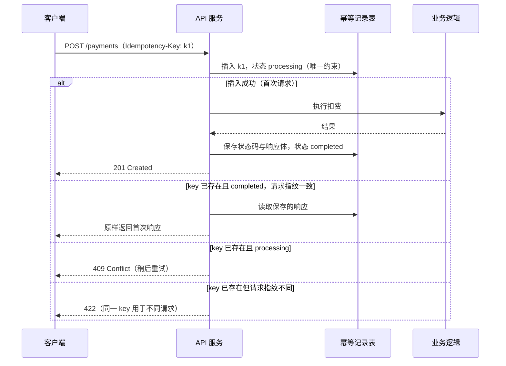
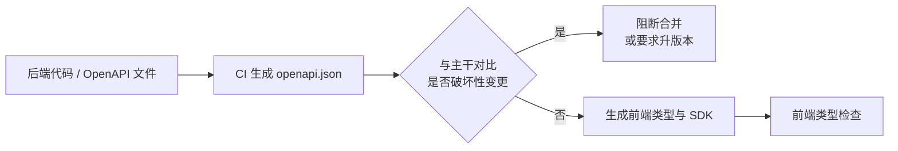
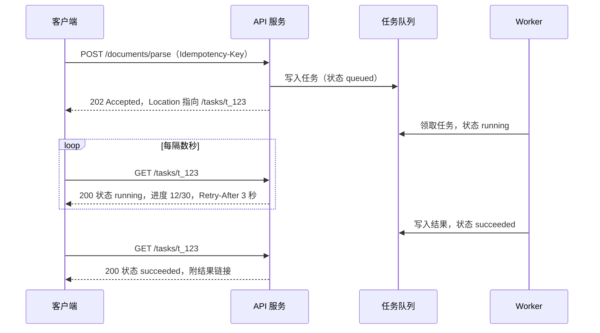

# 03 API 设计

> 本章目标：能为一个 AI 应用**选对 API 风格**，设计出语义正确的 REST 资源、**统一的错误模型**、可扩展的**分页**与**版本策略**；掌握**幂等键**与**长任务 API** 的实现流程，并能在 review 中识别 AI 生成接口的常见缺陷。
>
> 版本基线：HTTP 语义以 RFC 9110 为准；错误模型采用 **RFC 9457**（Problem Details，取代 RFC 7807）；**OpenAPI 3.2**（2025-09 发布）；QUERY 方法已发布为 **RFC 10008**（2026-06）；`Deprecation` 头为 RFC 9745，`Sunset` 头为 RFC 8594。**`Idempotency-Key` 头（draft -08）与 `RateLimit` 头（draft -11）仍是 IETF 草案**，业界已广泛采用，细节以最终标准为准。
>
> 边界：SSE 协议与服务端实现见 [01 章](../L1-认知切换/01-网络与HTTP-服务端视角.md)，AI 流式事件模型见 [企业级 04](../../企业级AI应用开发实战/04-AI交互层-流式协议与生成式UI.md)；限流算法见 [05 章](./05-缓存与Redis.md)；鉴权见 [06 章](./06-认证授权与Web安全.md)；队列与投递语义见 [07 章](./07-异步任务与消息队列.md)；契约测试见 [18 章](../L4-工程与部署/18-测试策略.md)。

---

## 一、API 风格选型

### 1.1 五种风格对比

| 维度 | REST | gRPC | GraphQL | tRPC | JSON-RPC 2.0 |
|---|---|---|---|---|---|
| 抽象 | 资源 + HTTP 方法 | 服务 + 方法（Protobuf 定义） | 单端点 + 查询语言 | TS 函数直接调用 | 方法名 + 参数 |
| 契约 | OpenAPI（可选） | `.proto`（强制） | Schema（强制） | TS 类型本身 | 无标准 schema |
| 传输 | HTTP/1.1、2、3 | HTTP/2，二进制 | 通常 HTTP POST | HTTP | 任意（HTTP、stdio、WebSocket） |
| 浏览器直连 | ✅ | ⚠️ 需 gRPC-Web 或 Connect | ✅ | ✅ | ✅ |
| HTTP 缓存 | ✅ GET 天然可缓存 | ❌ | ❌ 需专门方案 | ⚠️ 有限 | ❌ |
| 流式 | SSE / 分块 | ✅ 原生双向流 | Subscription | ✅ 订阅 | 取决于传输 |
| 跨语言 | ✅ 最好 | ✅ 代码生成 | ✅ | ❌ **仅 TS** | ✅ |
| 学习与调试成本 | 低（curl 即可） | 中（需工具） | 中高（N+1、复杂度限制、权限） | 低 | 低 |

> 📖 **术语**：**Protobuf**（Protocol Buffers）是 Google 的二进制序列化格式，用 `.proto` 文件声明消息结构，再生成各语言代码。**Connect** 是兼容 gRPC 协议、同时支持浏览器直接调用的 RPC 框架。

### 1.2 按场景选

| 场景 | 推荐 | 理由 |
|---|---|---|
| **对外开放 API** | REST + OpenAPI | 生态最广，任何语言都能调用；可以生成 SDK 和文档；HTTP 缓存、网关、限流都现成 |
| **内部服务间** | gRPC（或 Connect） | 强契约、二进制高效、原生流式、自动生成客户端；常见于业务服务调推理服务、向量服务 |
| **前后端同仓**（Next.js、Nuxt 全栈） | tRPC，或 REST + 共享 schema | 改后端签名，前端立即类型报错；但**只服务自家 TS 前端**，一旦要开放给第三方或移动端就要补 REST |
| 多端聚合、字段需求差异大 | GraphQL 或 BFF | GraphQL 要额外处理查询复杂度、N+1、字段级权限；团队没有经验时，BFF + REST 更稳 |
| 协议层 / 工具调用 | JSON-RPC 2.0 | MCP、LSP 都基于它；业务 API 很少直接用 |

> 🎯 **落地要点**：AI 应用的典型组合是：**对外 REST + OpenAPI，流式输出用 SSE，内部重计算服务（推理、embedding、重排）用 gRPC，Agent 工具层用 MCP**（JSON-RPC，见 [企业级 05](../../企业级AI应用开发实战/05-MCP与Agent互操作协议.md)）。不要为了"技术先进"在一个小团队里同时引入 GraphQL 和 gRPC。

---

## 二、REST 资源建模

### 2.1 资源与 URL

REST 的核心是**把业务对象建模为资源**，用 HTTP 方法表达对资源的操作。

| 规则 | 正例 | 反例 |
|---|---|---|
| 名词复数表示集合 | `GET /conversations` | `GET /getConversationList` |
| 用 ID 定位单个资源 | `GET /conversations/{id}` | `GET /conversation?id=1` |
| 子资源表达从属关系，嵌套不超过两层 | `POST /conversations/{id}/messages` | `/tenants/{t}/users/{u}/conversations/{c}/messages/{m}` |
| 过滤、排序、分页用查询参数 | `GET /messages?role=user&limit=20` | `GET /messages/role/user/page/2` |
| 动词放进方法，而不是路径 | `DELETE /files/{id}` | `POST /files/{id}/delete` |
| 非 CRUD 动作建模为子资源或自定义方法 | `POST /tasks/{id}/cancel`、`POST /tasks/{id}:cancel` | `POST /cancelTask` |

非 CRUD 动作（取消任务、重新生成回答、发布文档）没有完美的 REST 表达，团队统一一种写法即可。`:cancel` 是 Google API 设计指南（AIP）中的"自定义方法"风格。

> ⚠️ **注意**：URL 里的 ID 只是**定位**，不是**授权**。AI 生成的 `GET /conversations/{id}` 经常直接 `findById(id)` 返回，任何登录用户换个 ID 就能读别人的对话（IDOR，越权访问）。查询必须带上当前用户或租户条件，详见 [06 章](./06-认证授权与Web安全.md)。

### 2.2 方法语义：安全性与幂等性

> 📖 **术语**：**安全（safe）**指请求不改变服务器状态；**幂等（idempotent）**指同一请求执行一次和执行多次，服务器最终状态相同（响应可以不同）。

| 方法 | 语义 | 安全 | 幂等 | 典型用法 |
|---|---|---|---|---|
| `GET` / `HEAD` | 读取 | ✅ | ✅ | 查询资源 |
| `QUERY`（RFC 10008） | 带请求体的查询 | ✅ | ✅ | 复杂检索条件放 body；框架、代理、浏览器支持仍在跟进 |
| `PUT` | 整体替换 | ❌ | ✅ | 已知 ID 的创建或全量更新 |
| `DELETE` | 删除 | ❌ | ✅ | 第二次删除返回 404 或 204 都可以，状态不变 |
| `PATCH` | 部分更新 | ❌ | ❌（取决于实现） | `{"title": "新标题"}` 是幂等的，`{"op": "increment"}` 不是 |
| `POST` | 创建 / 执行动作 | ❌ | ❌ | 发消息、创建任务、扣费，**需要幂等键**（第七节） |

幂等性决定了**谁可以安全重试**：网关、HTTP 客户端库、浏览器在超时后会自动重试幂等请求，对 `POST` 则不会（或不应该）。

> ⚠️ **注意**：**`GET` 绝不能有副作用**。浏览器预取、爬虫、链接预览、CDN 都会主动发 `GET`。AI 偶尔会写出 `GET /api/tasks/{id}/retry` 或 `GET /unsubscribe?token=...` 直接执行动作，一次链接预览就触发了重试或退订。

### 2.3 状态码选用

| 状态码 | 何时用 | 常见错用 |
|---|---|---|
| `200 OK` | 成功并返回内容 | 业务失败也返回 200 |
| `201 Created` | 创建成功，配合 `Location` 头 | 创建返回 200（不算错，但丢失语义） |
| `202 Accepted` | 已受理，异步处理中（第九节） | 同步阻塞几十秒再返回 200 |
| `204 No Content` | 成功且无响应体（删除） | 204 还带了 body |
| `400 Bad Request` | 请求格式错误：JSON 解析失败、缺必填字段 | — |
| `401 Unauthorized` | **未认证**：没登录、token 过期 | 和 403 混用 |
| `403 Forbidden` | **已认证但无权限** | — |
| `404 Not Found` | 资源不存在，**或不想暴露其存在**（无权访问的资源也可返回 404） | — |
| `409 Conflict` | 状态冲突：重复创建、版本冲突、任务已在运行 | 用 400 笼统表示 |
| `422 Unprocessable Content` | 格式正确但语义校验失败（FastAPI 的默认校验错误码） | — |
| `429 Too Many Requests` | 限流或配额耗尽（第十节） | 用 500 或 403 |
| `500` | 服务端未预期错误 | 把业务错误抛成 500 |
| `502` / `503` / `504` | 上游错误 / 服务不可用 / 上游超时 | 调 LLM 超时返回 500，客户端无法判断能否重试 |

400 与 422 的划分各团队不同，**关键是全项目一致**，并在错误体中给出字段级详情。

### 2.4 "全部 200 + code 字段"的利弊

国内很多项目所有响应都返回 HTTP 200，用 body 里的 `code` 表达成败：

```json
{ "code": 40001, "msg": "余额不足", "data": null }
```

| | 优点 | 代价 |
|---|---|---|
| 前端 | 统一拦截器处理，`fetch` 不会进 catch | 必须解析 body 才知道成败 |
| 网关 / 监控 | — | **5xx 错误率、SLO 告警全部失效**，错误被"藏"进 200 |
| 重试与缓存 | — | 代理、CDN、客户端库无法据状态码判断是否重试，甚至**把错误响应缓存下来** |
| 生态 | — | OpenAPI 生成的 SDK、APM 工具、AI 网关都按状态码工作 |

> 🎯 **落地要点**：推荐**HTTP 状态码表达错误大类，body 中的业务错误码表达细分原因**（如 `429` + `QUOTA_EXCEEDED`）。存量项目已经全 200 时不必硬改，但至少保证**真正的服务端异常返回 5xx**，否则监控和告警是瞎的。

---

## 三、统一错误模型

### 3.1 RFC 9457 Problem Details

RFC 9457 定义了标准错误响应格式，媒体类型为 `application/problem+json`：

```json
{
  "type": "https://api.example.com/problems/quota-exceeded",
  "title": "Quota exceeded",
  "status": 429,
  "detail": "本月 token 额度已用完，将于 12 月 1 日重置。",
  "instance": "/v1/conversations/c_01J.../messages",
  "code": "QUOTA_EXCEEDED",
  "traceId": "4bf92f3577b34da6a3ce929d0e0e4736",
  "errors": [{ "field": "model", "message": "当前套餐不支持该模型" }]
}
```

| 字段 | 含义 |
|---|---|
| `type` | 问题类型的 URI，**机器识别的主键**，可指向说明文档 |
| `title` | 该类型的简短概括，同一 `type` 下固定不变 |
| `status` | HTTP 状态码（冗余一份，便于日志和转发后识别） |
| `detail` | 本次出错的具体说明，面向人 |
| `instance` | 本次出错的具体位置 |
| 扩展字段 | 规范允许自定义，如 `code`、`traceId`、`errors` |

Spring Framework 6+ 内置 `ProblemDetail`，FastAPI 和 Node 生态也有现成实现，没有理由再自创格式。

### 3.2 业务错误码设计

- **用稳定的字符串码**（`QUOTA_EXCEEDED`、`CONVERSATION_NOT_FOUND`），比 `40001` 这类数字码可读、可搜索，不会冲突
- **错误码是 API 契约的一部分**：写进 OpenAPI 文档，发布后不改含义，只能新增
- **按"客户端能做什么"区分**：可重试（`UPSTREAM_TIMEOUT`）、需用户操作（`QUOTA_EXCEEDED`）、需修改请求（`VALIDATION_FAILED`）、不可恢复（`CONTENT_BLOCKED`）
- AI 场景常见错误码：`MODEL_UNAVAILABLE`、`CONTEXT_TOO_LONG`、`CONTENT_FILTERED`、`QUOTA_EXCEEDED`、`RATE_LIMITED`、`TOOL_EXECUTION_FAILED`

### 3.3 错误信息不泄漏内部细节

```java
// ❌ 反例：AI 高频写法，把异常原文直接返回
@ExceptionHandler(Exception.class)
ResponseEntity<?> handle(Exception e) {
    return ResponseEntity.status(500).body(Map.of("error", e.getMessage(), "trace", e.getStackTrace()));
}
// 客户端可能看到：ERROR: duplicate key value violates unique constraint "users_email_key"
//                或 Connection refused: 10.0.3.17:5432、上游 LLM 的原始报错（含内部 API Key 前缀）
```

泄漏内容包括：SQL 与表结构、内网地址、依赖版本、堆栈、上游模型厂商的原始错误。正确做法是**完整信息写日志，响应只返回错误码和 `traceId`**，用户反馈问题时凭 `traceId` 查日志（[17 章](../L4-工程与部署/17-可观测性与线上排障.md)）。

### 3.4 三栈全局异常处理

**Java**（Spring Boot，`@RestControllerAdvice` + `ProblemDetail`）：

```java
@RestControllerAdvice
public class GlobalExceptionHandler extends ResponseEntityExceptionHandler { // 继承它以统一处理框架内置异常

    @ExceptionHandler(BizException.class)
    ProblemDetail handleBiz(BizException e) {
        ProblemDetail pd = ProblemDetail.forStatusAndDetail(e.status(), e.getMessage());
        pd.setType(URI.create("https://api.example.com/problems/" + e.code().toLowerCase()));
        pd.setProperty("code", e.code());
        pd.setProperty("traceId", currentTraceId());
        return pd;
    }

    @ExceptionHandler(Exception.class)
    ProblemDetail handleUnknown(Exception e) {
        log.error("unhandled exception", e);                    // 完整信息只进日志
        ProblemDetail pd = ProblemDetail.forStatusAndDetail(HttpStatus.INTERNAL_SERVER_ERROR, "服务内部错误");
        pd.setProperty("code", "INTERNAL_ERROR");
        pd.setProperty("traceId", currentTraceId());
        return pd;
    }
}
```

> ⚠️ **注意**：Spring Boot 的 `spring.mvc.problemdetails.enabled` 默认为 `false`；Spring Security 抛出的认证、授权异常不经过 `@RestControllerAdvice`，需要单独配置 `AuthenticationEntryPoint` 和 `AccessDeniedHandler`，否则 401/403 的响应格式与其他错误不一致。

**TypeScript**（NestJS `ExceptionFilter`；`BizException` 继承 `HttpException`，用 `HttpAdapterHost` 兼容 Express / Fastify 适配器）：

```ts
@Catch()
export class ProblemFilter implements ExceptionFilter {
  constructor(private readonly adapterHost: HttpAdapterHost) {}
  catch(ex: unknown, host: ArgumentsHost) {
    const known = ex instanceof HttpException;
    const status = known ? ex.getStatus() : 500;
    if (!known) logger.error(ex);                          // 未知异常只进日志
    this.adapterHost.httpAdapter.reply(host.switchToHttp().getResponse(), {
      title: known ? ex.message : '服务内部错误', status,
      code: ex instanceof BizException ? ex.code : known ? 'HTTP_ERROR' : 'INTERNAL_ERROR',
      traceId: currentTraceId(),
    }, status);
  }
}
```

Fastify 原生写法是 `app.setErrorHandler((err, req, reply) => ...)`，结构相同：`err instanceof BizError` 走业务分支，`err.validation` 存在时是 schema 校验错误，其余记日志后返回通用 500。

**Python**（FastAPI `exception_handler`）：

```python
@app.exception_handler(BizError)
async def biz_error_handler(request: Request, exc: BizError):
    return JSONResponse(
        status_code=exc.status, media_type="application/problem+json",
        content={"type": exc.type_uri, "title": exc.title, "status": exc.status,
                 "code": exc.code, "traceId": get_trace_id()},
    )

# 另需覆盖 RequestValidationError（默认 422 格式与全局不一致）和 Exception（记日志 + 通用 500）
```

> 🎯 **落地要点**：三栈的共同结构是 **"已知业务异常 → 映射为对应状态码和错误码；框架校验异常 → 统一格式；未知异常 → 记日志 + 通用 500"**。review 时重点看最后一个分支有没有把 `e.message` 透传出去。

---

## 四、输入校验与输出 DTO

### 4.1 校验三栈

所有外部输入（body、query、path、header）都在**入口处**按 schema 校验，校验失败直接拒绝。

**Java**（Bean Validation）：

```java
public record SendMessageRequest(
    @NotBlank @Size(max = 32_000) String content,
    @NotNull @Pattern(regexp = "gpt-.*|claude-.*|qwen-.*") String model,
    @Size(max = 10) List<@NotBlank String> attachmentIds
) {}

@PostMapping("/conversations/{id}/messages")
MessageDto send(@PathVariable UUID id, @Valid @RequestBody SendMessageRequest req) { ... }
```

**TypeScript**（zod，Fastify / Hono 常用；NestJS 默认用 class-validator）：

```ts
const SendMessage = z.object({
  content: z.string().min(1).max(32_000),
  model: z.enum(['gpt-5', 'claude-sonnet', 'qwen-max']),
  attachmentIds: z.array(z.string()).max(10).default([]),
}).strict();                                   // 拒绝未声明字段

// NestJS：全局 ValidationPipe 务必开启白名单
app.useGlobalPipes(new ValidationPipe({ whitelist: true, forbidNonWhitelisted: true, transform: true }));
```

**Python**（Pydantic v2）：

```python
class SendMessageRequest(BaseModel):
    model_config = ConfigDict(extra="forbid")        # 拒绝未声明字段
    content: str = Field(min_length=1, max_length=32_000)
    model: Literal["gpt-5", "claude-sonnet", "qwen-max"]
    attachment_ids: list[str] = Field(default_factory=list, max_length=10)
```

| 校验层次 | 放在哪 | 例子 |
|---|---|---|
| 格式与边界 | 入口 schema | 类型、长度、枚举、数组上限、请求体大小 |
| 业务规则 | Service 层 | 余额是否足够、对话是否属于当前用户、模型是否在套餐内 |
| 数据完整性 | 数据库约束 | 唯一索引、外键、`CHECK`（[04 章](./04-数据库与数据建模.md)） |

> ⚠️ **注意**：AI 应用的输入特别需要**长度上限**：prompt 长度、附件数量、上传文件大小、批量 embedding 的条数。没有上限的接口就是"无界消耗"攻击入口（OWASP LLM10），一个请求就能烧掉大量 token。

### 4.2 输出 DTO 与实体分离

**AI 最常见的反例之一：直接把 ORM 实体返回给前端，或直接把请求体合并进实体。**

```ts
// ❌ 反例 1：过度暴露。实体里的 passwordHash、tenantId、内部成本、deletedAt 全部返回
app.get('/users/:id', async (req) => prisma.user.findUnique({ where: { id: req.params.id } }));

// ❌ 反例 2：批量赋值（mass assignment）。客户端传 {"role":"admin","credits":999999} 就提权了
app.patch('/users/me', async (req) => prisma.user.update({ where: { id: req.user.id }, data: req.body }));
```

```ts
// ✅ 正例：入参只接受白名单字段，出参显式映射
const UpdateProfile = z.object({ nickname: z.string().max(50).optional(), avatarUrl: z.string().url().optional() }).strict();

app.patch('/users/me', async (req) => {
  const data = UpdateProfile.parse(req.body);
  const user = await prisma.user.update({ where: { id: req.user.id }, data });
  return toUserDto(user);                       // { id, nickname, avatarUrl, createdAt }
});
```

FastAPI 用 `response_model=UserOut` 自动裁剪输出字段；Spring 用独立的 `record UserDto` 加 MapStruct 或手写映射。实体加字段时，DTO 不加就不会泄漏，这是**默认安全**。

### 4.3 JSON 序列化的跨端细节

| 问题 | 规则 | 原因 |
|---|---|---|
| 64 位整数 ID | **序列化为字符串** | JS `Number` 安全整数上限是 2^53−1，雪花 ID 超出后精度丢失，前端拿到的 ID 末几位被改写 |
| 时间 | ISO 8601 带时区，统一 UTC：`2026-11-10T08:00:00Z` | 避免服务端本地时区泄漏进数据 |
| 金额 | 整数分或十进制字符串 `"12.30"` | 浮点误差 |
| 命名风格 | 全项目统一 camelCase 或 snake_case | Python 默认 snake_case，前端常要 camelCase，用序列化别名转换而不是混用 |
| `null` 与缺省 | PATCH 中"字段缺省"表示不改，"显式 `null`"表示清空 | AI 常混淆，导致 PATCH 一个字段把其他字段清空 |

---

## 五、分页、过滤、排序与字段选择

### 5.1 offset 与 cursor

| | offset 分页 | cursor（keyset）分页 |
|---|---|---|
| 请求 | `?page=5&size=20` | `?limit=20&cursor=eyJ0Ijo...` |
| SQL | `LIMIT 20 OFFSET 80` | `WHERE (created_at, id) < ($1, $2) ORDER BY ... LIMIT 21` |
| 跳页 | ✅ | ❌ 只能上一页 / 下一页 |
| 深分页性能 | ❌ `OFFSET 100000` 要先扫过并丢弃 10 万行 | ✅ 走索引定位，与页数无关 |
| 数据变动时 | 新数据插入会导致重复或漏条 | 稳定 |
| 适合 | 后台管理表格、数据量小 | **消息列表、Feed、日志、无限滚动、对外 API** |

### 5.2 keyset 分页的正确写法

```sql
-- 对话的消息列表，按时间倒序。排序键必须唯一：created_at 可能重复，用 id 兜底
SELECT id, role, content, created_at
FROM messages
WHERE conversation_id = $1
  AND (created_at, id) < ($2, $3)          -- 上一页最后一条的 (created_at, id)
ORDER BY created_at DESC, id DESC
LIMIT 21;                                  -- 多取 1 条用于判断 hasMore
```

配套索引 `(conversation_id, created_at DESC, id DESC)`，原理见 [04 章第四节](./04-数据库与数据建模.md)。cursor 对客户端应是**不透明的**（base64 编码的 JSON），这样服务端可以随时改变内部排序键而不破坏契约。

```json
{ "data": [ ... ], "nextCursor": "eyJjIjoiMjAyNi0xMS0xMFQwODowMDowMFoiLCJpIjoiMDFKLi4uIn0", "hasMore": true }
```

> ⚠️ **注意**：AI 生成分页时常犯三个错：只按 `created_at` 排序（同一毫秒的数据翻页时丢失或重复）；不限制 `limit` 上限（`?limit=1000000` 拖垮数据库）；每页都执行 `COUNT(*)`（大表上比查数据本身还慢）。总数确有需要时，单独接口提供或给近似值。

### 5.3 过滤、排序与字段选择

- **排序字段白名单**：`ORDER BY` 不能用参数化占位符，AI 常把 `?sort=xxx` 直接拼进 SQL，形成 SQL 注入。必须映射到白名单：`{ createdAt: 'created_at', title: 'title' }[sort] ?? 'created_at'`
- **过滤条件**：简单场景用 `?status=active&model=gpt-5`；复杂查询考虑 `QUERY` 方法或 `POST /conversations/search`
- **字段选择**：`?fields=id,title,updatedAt` 减少大字段传输（如列表页不需要 `content`）；需要更灵活的字段选择时，才值得考虑 GraphQL

---

## 六、版本管理与向后兼容

### 6.1 版本策略

| 策略 | 形式 | 优点 | 缺点 | 代表 |
|---|---|---|---|---|
| **URL 路径** | `/v1/messages` | 直观、易路由、易缓存 | 大版本切换成本高 | 多数开放 API |
| 请求头 | `Api-Version: 2026-11-01` | URL 稳定，粒度细 | 调试不直观 | GitHub（`X-GitHub-Api-Version`） |
| 日期版本 + 账户锁定 | 首次调用时锁定版本，头可覆盖 | 可频繁演进而不破坏老用户 | 服务端要维护多版本转换层 | Stripe |
| 不做版本 | 只做兼容变更 | 最简单 | 需要严格的兼容纪律 | 内部 API、同仓前后端 |

> 🎯 **落地要点**：对外 API 用 **URL 主版本（`/v1`）+ 版本内只做兼容变更**，足以覆盖绝大多数团队。内部 API 和同仓前后端不需要版本号，靠契约检查（第八节）保证兼容。

### 6.2 兼容变更与破坏性变更

| ✅ 兼容（可在同一版本内发布） | ❌ 破坏性（需要新版本或废弃流程） |
|---|---|
| 新增可选请求字段、新增响应字段 | 删除或重命名字段 |
| 新增接口、新增可选查询参数 | 修改字段类型（数字 → 字符串）或格式 |
| 放宽校验（长度上限从 1000 到 2000） | 收紧校验、可选字段改为必填 |
| 新增错误码（客户端有兜底分支时） | **改变字段语义**（`amount` 从"元"改为"分"） |
| — | 改变默认行为（默认排序、默认分页大小） |

> ⚠️ **注意**：**新增枚举值**对前端可能是破坏性的。TS 里用穷尽 `switch` 处理 `status` 的代码，遇到新增的 `"paused"` 会落入意外分支。约定客户端必须容忍未知枚举值，并在文档中写明"该枚举可能扩展"。

### 6.3 废弃流程

1. **公告**：文档与变更日志标注废弃，给出迁移指南和下线日期
2. **响应头提示**：返回 `Deprecation`（RFC 9745）与 `Sunset`（RFC 8594），附 `Link: <迁移文档>; rel="deprecation"`
3. **监控存量调用**：按 API Key / 客户端统计仍在调用旧接口的用户，定向通知
4. **到期下线**：返回 `410 Gone`，而不是直接 404

```http
# Deprecation 为结构化字段日期（Unix 秒，此处为 2026-11-01），Sunset 为 HTTP-date，且不得早于 Deprecation
Deprecation: @1793491200
Sunset: Thu, 31 Dec 2026 23:59:59 GMT
Link: <https://docs.example.com/migrate-v2>; rel="deprecation"
```

---

## 七、幂等键（Idempotency-Key）

### 7.1 为什么需要

客户端发出 `POST /payments`，网络超时了。它不知道服务端是**没收到**、**处理到一半**还是**已经成功只是响应丢了**。重试可能重复扣款，不重试可能漏单。同类场景还有：用户双击发送、弱网自动重试、网关或 SDK 自动重试、消息队列至少一次投递（[07 章](./07-异步任务与消息队列.md)），以及 **Agent 持久化执行恢复时重放工具调用**（[企业级 06 第六节](../../企业级AI应用开发实战/06-Agent工程化-从Loop到生产.md#六人机协同与持久化执行)）。

幂等键的思路：**客户端为每个"逻辑操作"生成唯一 key，重试时带同一个 key；服务端保证同一 key 只执行一次，重复请求返回首次的结果。**

### 7.2 处理流程



IETF 草案建议的错误语义：必需却缺失 key 返回 `400`，key 被复用于不同请求体返回 `422`，原请求仍在处理返回 `409`。

### 7.3 存储设计

```sql
CREATE TABLE idempotency_keys (
    scope            text        NOT NULL,     -- 租户 / 用户 / API Key 维度，防止不同用户的 key 互相碰撞
    key              text        NOT NULL,
    request_hash     text        NOT NULL,     -- 方法 + 路径 + 规范化请求体的哈希
    status           text        NOT NULL CHECK (status IN ('processing', 'completed')),
    response_status  int,
    response_body    jsonb,
    locked_until     timestamptz NOT NULL,     -- processing 状态的租约，进程崩溃后可被接管
    created_at       timestamptz NOT NULL DEFAULT now(),
    expires_at       timestamptz NOT NULL,
    PRIMARY KEY (scope, key)
);
CREATE INDEX ON idempotency_keys (expires_at);   -- 定时清理过期记录
```

| 设计点 | 建议 |
|---|---|
| 存储介质 | 与业务同库的 Postgres 表最可靠（能和业务写入放进同一事务）；Redis `SET NX EX` 更快，但与业务数据不在同一事务里 |
| 过期时间 | 覆盖客户端最长重试窗口；Stripe 的做法是 key 至少保留 24 小时，自建常取 24~72 小时 |
| 哪些结果要保存 | 业务**已开始执行**后的结果（包括业务失败）；校验失败、未开始执行的请求不保存，允许修正后重试 |
| key 的生成 | 客户端生成 UUID，**每个逻辑操作一个**，重试复用，新操作换新 key |

### 7.4 实现要点（TypeScript）

```ts
async function withIdempotency(scope: string, key: string, reqHash: string, run: (tx: Tx) => Promise<Res>) {
  const claimed = await sql`
    INSERT INTO idempotency_keys (scope, key, request_hash, status, locked_until, expires_at)
    VALUES (${scope}, ${key}, ${reqHash}, 'processing', now() + interval '30 seconds', now() + interval '24 hours')
    ON CONFLICT (scope, key) DO UPDATE                       -- 只允许接管租约已过期的 processing 记录
      SET locked_until = EXCLUDED.locked_until
      WHERE idempotency_keys.status = 'processing' AND idempotency_keys.locked_until < now()
    RETURNING request_hash`;

  if (claimed.length === 0) {
    const [row] = await sql`SELECT * FROM idempotency_keys WHERE scope = ${scope} AND key = ${key}`;
    if (row.request_hash !== reqHash) throw new Problem(422, 'IDEMPOTENCY_KEY_REUSED');
    if (row.status === 'processing') throw new Problem(409, 'REQUEST_IN_PROGRESS', { retryAfter: 2 });
    return { status: row.response_status, body: row.response_body, replayed: true };
  }
  if (claimed[0].request_hash !== reqHash) throw new Problem(422, 'IDEMPOTENCY_KEY_REUSED');

  // run 抛错时整个事务回滚，记录停留在 processing，租约过期后允许客户端用同一 key 重试
  return sql.begin(async (tx) => {                            // 业务写入与"完成标记"在同一事务
    const res = await run(tx);
    await tx`UPDATE idempotency_keys SET status = 'completed', response_status = ${res.status},
             response_body = ${tx.json(res.body)} WHERE scope = ${scope} AND key = ${key}`;
    return res;
  });
}
```

### 7.5 结合场景

| 场景 | 做法 |
|---|---|
| **支付 / 扣费** | 幂等键 + **业务唯一约束双保险**：`usage_records` 上对 `request_id` 建唯一索引，即使幂等层失效也不会重复记账；调用支付渠道时把同一个 key 透传给下游（Stripe 等支付 API 都支持） |
| **创建任务**（文档解析、批量 embedding） | 重复请求返回同一个 `taskId`，而不是再创建一个任务 |
| **发送消息** | 前端为每条待发送消息生成 `clientMessageId`，作为幂等键；重试不会产生两条用户消息、触发两次 LLM 调用 |
| **Agent 工具调用** | 以 `run_id + tool_call_id` 作为幂等键，持久化恢复时重放不会重复执行退款、发邮件 |

> ⚠️ **注意**：幂等键只解决"同一请求重复执行"，不解决"两个不同请求并发修改同一数据"（如并发扣减余额），后者是并发控制问题，见 [04 章第七节](./04-数据库与数据建模.md) 与 [08 章](./08-并发与可靠性.md)。

---

## 八、契约优先

### 8.1 Code-first 与 Contract-first

| | Code-first | Contract-first |
|---|---|---|
| 流程 | 先写代码，从注解 / 类型生成 OpenAPI | 先写 OpenAPI，生成服务端骨架和客户端 |
| 工具 | springdoc-openapi、`@nestjs/swagger`、FastAPI 内置、`@fastify/swagger` | OpenAPI Generator、各语言代码生成器 |
| 优点 | 文档与代码天然同步，上手快 | 前后端可并行开发，评审先于实现 |
| 风险 | 契约随手被改，破坏性变更不易察觉 | 生成代码的维护成本 |
| 适合 | 多数团队、内部 API | 对外开放平台、多团队协作 |

不论哪种，**关键是 OpenAPI 文件要进仓库、在 CI 中做差异检查**：



### 8.2 前后端类型共享

| 方式 | 做法 | 适合 |
|---|---|---|
| **OpenAPI → TS 类型** | `openapi-typescript` 生成类型，配合 `openapi-fetch`；或 orval、`@hey-api/openapi-ts` 生成带请求函数的 SDK | 后端为 Java / Python，或对外 API |
| **共享 zod schema** | monorepo 中 `packages/contracts` 定义 schema，后端用于校验，前端用于类型推导与表单校验 | 前后端都是 TS |
| **tRPC** | 前端直接导入后端 router 类型 | 同仓全 TS、只服务自家前端 |

> 🎯 **落地要点**：用 AI 写前后端时，**契约是给 AI 的最佳上下文**。把 OpenAPI 或共享 schema 放进上下文让 AI 生成前端调用代码，比让它"看后端代码猜接口"准确得多；破坏性变更检测（如 oasdiff）放进 CI，防止 AI 顺手改了字段名。契约测试见 [18 章](../L4-工程与部署/18-测试策略.md)。

---

## 九、长任务 API

### 9.1 三种模式

文档解析、批量 embedding、Agent 长任务可能运行几十秒到几十分钟，不能在一个同步 HTTP 请求里等结果：反向代理、负载均衡、浏览器都有超时（[01 章](../L1-认知切换/01-网络与HTTP-服务端视角.md)），服务重新部署也会切断连接。

| 模式 | 机制 | 优点 | 缺点 | 适合 |
|---|---|---|---|---|
| **202 + 轮询** | 提交返回任务 ID，客户端定时查询状态 | 最简单、最健壮，穿透任何代理 | 有延迟，空轮询浪费请求 | 默认选择，所有长任务的兜底 |
| **SSE 推进度** | 客户端订阅任务事件流 | 实时，可推中间结果 | 长连接占资源，需断线续传 | 用户正盯着页面等结果 |
| **Webhook 回调** | 完成后服务端主动 POST 到调用方 URL | 调用方无需轮询 | 调用方需公网可达，要处理签名、重试、重复 | 服务端对服务端、开放平台 |

三者通常组合使用：**任务资源 + 状态查询接口是底座**，SSE 和 Webhook 是在其之上的通知手段。

### 9.2 202 Accepted + 轮询



任务资源的响应：

```json
{ "id": "t_123", "type": "document.parse", "status": "running", "progress": { "done": 12, "total": 30 },
  "result": null, "error": null, "createdAt": "2026-11-10T08:00:00Z",
  "links": { "self": "/tasks/t_123", "cancel": "/tasks/t_123/cancel", "events": "/tasks/t_123/events" } }
```

设计要点：

- **状态机显式化**：`queued → running → succeeded / failed`，`queued / running` 可转 `cancelled`；终态不可再变，状态转换在数据库里用条件更新保证（`UPDATE ... WHERE status = 'running'`）
- **提交接口幂等**：重复提交返回同一个任务
- **可取消**：`POST /tasks/{id}/cancel`，Worker 在步骤间检查取消标记
- **结果存放**：大结果（解析后的全文、向量）放对象存储，任务里只放引用
- **用 `Retry-After` 引导轮询间隔**，或客户端指数退避，避免每 100ms 一次

### 9.3 SSE 推进度

SSE 的协议、代理缓冲与服务端实现见 [01 章](../L1-认知切换/01-网络与HTTP-服务端视角.md)，AI 事件模型见 [企业级 04](../../企业级AI应用开发实战/04-AI交互层-流式协议与生成式UI.md)。用于任务进度时的要点：

- 每个事件带递增 `id`，客户端断线重连时通过 `Last-Event-ID` 续传，服务端从任务事件表补发
- 事件流是**通知通道**，不是**数据源**：连接断开不影响任务执行，重连后可以先 `GET /tasks/{id}` 拿当前状态
- 任务在 Worker 里执行，SSE 连接所在的 API 实例通过 Redis Pub/Sub 或数据库通知获取进度，不要假设任务和连接在同一个进程

### 9.4 Webhook 回调

**发送方**的职责：签名、重试、记录投递日志。业界正在收敛到 **Standard Webhooks** 规范（OpenAI 等厂商已采用）：请求头 `webhook-id`、`webhook-timestamp`、`webhook-signature`，对 `"{id}.{timestamp}.{原始请求体}"` 做 HMAC-SHA256。

**接收方**的校验（TypeScript）：

```ts
function verifyWebhook(rawBody: string, h: Record<string, string>, secret: Buffer): void {
  const id = h['webhook-id'], ts = h['webhook-timestamp'], sigHeader = h['webhook-signature'];
  if (!id || !ts || !sigHeader) throw new Problem(400, 'MISSING_SIGNATURE');
  if (Math.abs(Date.now() / 1000 - Number(ts)) > 300) throw new Problem(400, 'TIMESTAMP_OUT_OF_RANGE'); // 防重放

  const expected = createHmac('sha256', secret).update(`${id}.${ts}.${rawBody}`).digest();
  const ok = sigHeader.split(' ').some((entry) => {           // 多个签名以空格分隔，便于密钥轮换
    const [version, sig] = entry.split(',');
    const actual = Buffer.from(sig ?? '', 'base64');
    return version === 'v1' && actual.length === expected.length && timingSafeEqual(actual, expected);
  });
  if (!ok) throw new Problem(401, 'INVALID_SIGNATURE');
}
```

| 角色 | 必做 |
|---|---|
| 接收方 | **对原始请求体字节验签**（框架已解析成 JSON 再序列化会导致签名不匹配）；常量时间比较；校验时间戳；按 `webhook-id` 去重；**快速返回 2xx，重活丢进队列** |
| 发送方 | 失败按指数退避重试（持续数小时到数天）；超过上限进入死信并告警；提供投递日志与手动重发；**校验回调 URL 防 SSRF**（不能是内网地址，见 [06 章](./06-认证授权与Web安全.md)） |

### 9.5 AI 场景映射

| 场景 | 推荐组合 | 备注 |
|---|---|---|
| 用户上传文档解析入库 | 202 + 轮询 + SSE 进度 | 入库流水线设计见 [11 章](../L3-架构与分布式/11-系统设计案例.md)，解析策略见 [企业级 07](../../企业级AI应用开发实战/07-企业级RAG落地.md) |
| 批量 embedding / 批量推理 | 202 + 轮询 + Webhook | 按批次报告进度，部分失败要能单独重试 |
| Agent 长任务 | 任务资源 + SSE 事件流 | 暂停、审批、恢复由持久化执行引擎负责（[企业级 06](../../企业级AI应用开发实战/06-Agent工程化-从Loop到生产.md)） |
| 单轮对话生成 | 直接 SSE 流式响应 | 不需要任务资源；但要支持服务端感知客户端断开并中止模型调用 |

---

## 十、限流与配额的 API 表现

限流算法（令牌桶、滑动窗口）与 Redis 实现见 [05 章](./05-缓存与Redis.md)，本节只讲**对调用方怎么表达**。

```http
HTTP/1.1 429 Too Many Requests
Content-Type: application/problem+json
Retry-After: 30
RateLimit-Policy: "per-minute";q=60;w=60
RateLimit: "per-minute";r=0;t=30

{ "type": "https://api.example.com/problems/rate-limited", "status": 429, "code": "RATE_LIMITED",
  "detail": "每分钟最多 60 次请求，请 30 秒后重试。" }
```

| 头 | 含义 | 状态 |
|---|---|---|
| `Retry-After` | 多少秒后（或某个时间点后）再试 | RFC 9110 标准，429 / 503 都可以带 |
| `RateLimit-Policy` | 配额策略：`q` 配额、`w` 窗口秒数 | IETF 草案，格式在各版本间变化过 |
| `RateLimit` | 当前剩余：`r` 剩余量、`t` 距重置秒数 | 同上 |
| `X-RateLimit-*` | 各厂商的私有头（如 `x-ratelimit-remaining-requests`） | 事实标准，格式不统一 |

| 情况 | 状态码 | 错误码 | 客户端行为 |
|---|---|---|---|
| 短时请求频率超限 | `429` | `RATE_LIMITED` | 按 `Retry-After` 退避重试 |
| Token 速率超限（TPM） | `429` | `TOKEN_RATE_LIMITED` | 退避重试，或减小请求 |
| 月度额度 / 余额耗尽 | `429`、`402` 或 `403`（团队统一） | `QUOTA_EXCEEDED` | **重试无用**，提示用户充值或升级 |
| 服务过载主动降级 | `503` | `OVERLOADED` | 退避重试 |

> 🎯 **落地要点**：关键是让客户端**区分"稍后重试会好"和"重试无用"**。AI 生成的前端代码常对所有 429 无脑重试，额度耗尽时就会变成对自家服务的持续轰炸。服务端在错误体中给出明确的 `code`，前端按 `code` 分支处理。AI 应用的配额通常按 **token 而非请求次数**计算，计费与额度的系统设计见 [11 章](../L3-架构与分布式/11-系统设计案例.md)，AI 网关层的配额见 [企业级 09](../../企业级AI应用开发实战/09-LLMOps-可观测评测与AI网关.md#五ai-网关控得住重点)。

---

## 十一、AI 代码审查清单

### 11.1 资源、方法与错误

- [ ] 🔴 按 ID 查询、修改、删除资源时，查询条件包含当前用户 / 租户，不是裸 `findById`
- [ ] 🔴 没有带副作用的 `GET` 接口（重试、退订、确认、删除等动作都不能用 `GET`）
- [ ] 🔴 未知异常的响应不包含 `e.message`、堆栈、SQL、内网地址、上游厂商原始报错；真正的服务端异常返回 5xx，没有包装成 200
- [ ] 全局异常处理器覆盖业务异常、校验异常、未知异常三类，格式统一为 Problem Details，带稳定字符串错误码和 `traceId`
- [ ] 状态码语义正确：创建 `201` / 异步 `202` / 删除 `204`；未认证 `401` 与无权限 `403` 区分；上游 LLM 超时返回 `504` 或可重试错误码

### 11.2 输入与输出

- [ ] 🔴 所有入参经过 schema 校验，且**拒绝未声明字段**（`.strict()`、`extra="forbid"`、`whitelist + forbidNonWhitelisted`）
- [ ] 🔴 没有把 `req.body` 直接传给 ORM 的 `create` / `update`（批量赋值）
- [ ] 🔴 响应不直接返回 ORM 实体；`passwordHash`、`tenantId`、内部成本、`deletedAt` 等字段不出现在响应中
- [ ] 字符串、数组、文件、prompt 长度都有上限
- [ ] 64 位整数 ID 序列化为字符串；时间为带时区的 ISO 8601；金额不是浮点数；PATCH 区分"字段缺省"和"显式 null"

### 11.3 分页、版本与契约

- [ ] 🔴 排序字段经过白名单映射，没有拼接进 SQL
- [ ] `limit` 有上限；大表列表用 keyset 分页且排序键含唯一列；没有每页都执行全表 `COUNT(*)`
- [ ] 本次变更没有删除 / 重命名字段、改变字段类型或语义；如有，已走新版本或废弃流程
- [ ] OpenAPI 随代码更新，CI 中有破坏性变更检测；前端类型由契约生成或共享 schema 推导

### 11.4 幂等、长任务与限流

- [ ] 🔴 扣费、支付、创建订单等接口支持幂等键，或有业务唯一约束兜底
- [ ] 幂等键按用户 / 租户隔离、校验请求指纹、处理中返回 409、有过期清理；"完成标记"与业务写入在同一事务
- [ ] 超过数秒的操作改为 `202` + 任务资源；任务状态用条件更新转换，终态不可再变，支持取消
- [ ] 🔴 Webhook 接收方对原始请求体验签、常量时间比较、校验时间戳并按事件 ID 去重；发送方校验回调 URL 防 SSRF
- [ ] 429 响应带 `Retry-After`；额度耗尽与频率超限用不同错误码区分

---

## 本章小结

- **对外 REST + OpenAPI、内部重计算服务 gRPC、同仓全 TS 可用 tRPC**；不要为了技术先进同时引入多种风格
- 方法语义决定重试安全性：**`GET` 不能有副作用，`POST` 需要幂等键**
- HTTP 状态码表达错误大类，**RFC 9457 Problem Details + 稳定字符串错误码**表达细节；未知异常只返回 `traceId`，细节进日志
- 入参**白名单校验并拒绝未知字段**，出参**用 DTO 显式映射**，杜绝过度暴露与批量赋值
- 列表接口默认 **keyset 分页**，排序键带唯一列兜底，排序字段走白名单
- 版本内只做兼容变更；**改字段语义是最隐蔽的破坏性变更**；废弃用 `Deprecation` / `Sunset` 头
- 幂等键 = **唯一约束占位 + 请求指纹 + 保存首次响应 + 过期清理**，资金类操作再加业务唯一约束双保险
- 长任务以**任务资源 + 状态查询**为底座，SSE 推进度、Webhook 回调是叠加的通知手段

## 练习

1. 为一个 AI 对话服务设计完整的 REST 接口清单（对话 CRUD、发送消息、重新生成、停止生成、导出），写出 OpenAPI 文件，并用 `openapi-typescript` 生成前端类型
2. 选一种栈实现全局异常处理，覆盖业务异常、校验异常、未知异常与上游 LLM 超时四种情况；写测试断言 500 响应中不包含异常原文
3. 按第七节实现"扣减 token 额度"接口的幂等键：用两个并发请求（同 key）、同 key 不同请求体、处理中进程被杀三种情况验证行为
4. 实现"文档解析"长任务 API：`202` 提交、状态查询、SSE 进度、取消，并为完成事件实现 Webhook 回调（按 Standard Webhooks 签名）及接收方验签
