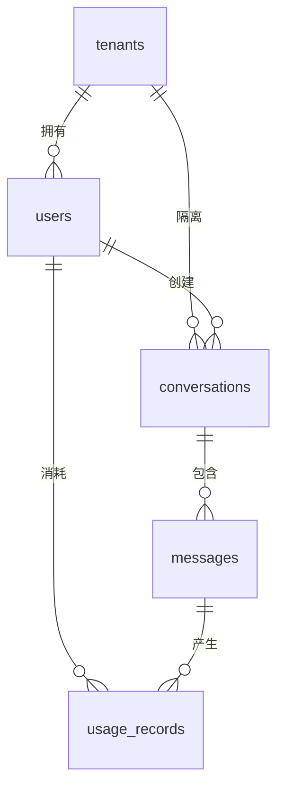
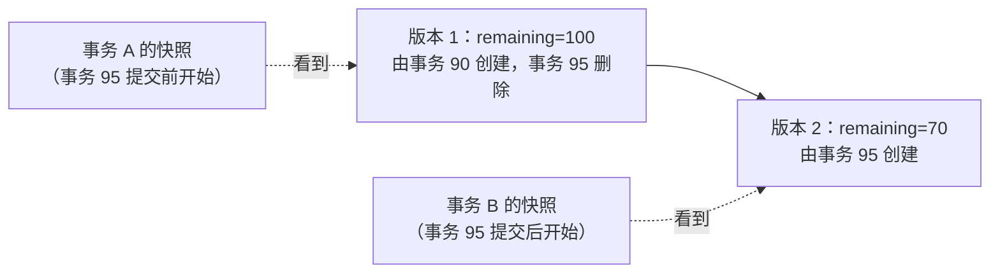
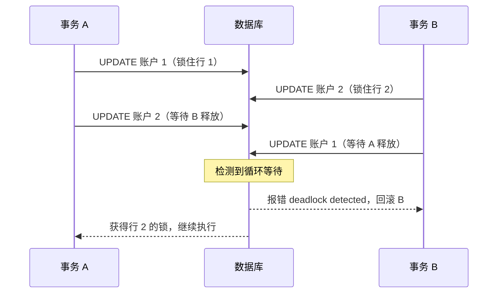

# 04 数据库与数据建模

> 本章目标：能为 AI 应用**选对数据库**并完成**可演进的数据建模**；读懂**索引与 EXPLAIN**，理解**事务、隔离级别、MVCC 与锁**，在应用层写对**事务边界**；识别 **ORM 陷阱**，掌握**零停机迁移**，并从运维视角用好 Postgres 生态（JSONB、全文检索、pgvector、分区）。
>
> 版本基线：**PostgreSQL 18**（当前稳定大版本，2026-08 小版本为 18.6；PostgreSQL 19 处于 RC 阶段尚未正式发布；PG 14 于 2026-11-12 停止维护）；**pgvector 0.8.x**（2026-10 为 0.8.7，支持 PG 13+）；**MySQL 8.4 LTS / 9.7 LTS**（8.0 已于 2026-04 停止支持）；Prisma 7（必须使用 driver adapter）；Spring Framework 6.2+。SQL 默认 PostgreSQL 方言。
>
> 边界：应用层并发控制（乐观锁 / 悲观锁的选择）见 [08 章](./08-并发与可靠性.md)；Outbox 见 [07 章](./07-异步任务与消息队列.md)；读写分离与分库分表见 [10 章](../L3-架构与分布式/10-分布式系统基础.md)；迁移发布流程见 [16 章](../L4-工程与部署/16-CICD与发布策略.md)；托管数据库选型见 [15 章](../L4-工程与部署/15-部署架构与云.md)；RAG 检索策略见 [企业级 07](../../企业级AI应用开发实战/07-企业级RAG落地.md)。

---

## 一、数据库选型

### 1.1 各类数据库的定位

| 类型 | 代表 | 擅长 | 不擅长 | AI 应用中的角色 |
|---|---|---|---|---|
| **关系型** | PostgreSQL、MySQL | 事务、约束、关联查询、通用业务数据 | 超大规模写入、全文检索（相对专用引擎） | 用户、对话、消息、计费，**系统的事实来源** |
| 文档型 | MongoDB | 结构多变的文档、灵活 schema | 跨文档事务与关联（能做但不是强项） | 部分团队存对话记录；PG 的 JSONB 通常可替代 |
| KV / 缓存 | Redis、Valkey | 毫秒级读写、计数器、锁、队列 | 持久化与复杂查询 | 缓存、限流、会话、短期记忆（[05 章](./05-缓存与Redis.md)） |
| 向量库 | Milvus、Qdrant、pgvector | 向量近邻检索 | 事务与复杂业务查询 | RAG 检索、语义记忆 |
| 时序 / 分析 | TimescaleDB、ClickHouse | 海量追加写入、聚合分析 | 高频单行更新 | 指标、LLM trace、用量分析（Langfuse 用 ClickHouse 存 trace） |
| 搜索引擎 | Elasticsearch、OpenSearch | 全文检索、分词、聚合、混合检索 | 作为事实来源（非强一致） | 大规模关键词检索、日志检索 |

### 1.2 为什么 AI 应用默认 Postgres 起步

- **一库多用**：关系数据 + JSONB（半结构化）+ pgvector（向量）+ 全文检索 + 分区，起步阶段一个数据库覆盖绝大多数需求，少运维一个系统就少一类故障
- **业务数据与向量在同一事务和同一查询里**：文档权限过滤（`WHERE tenant_id = ? AND acl ...`）和向量检索一条 SQL 完成，不存在两个系统之间的数据同步与权限不一致问题（[企业级 07 第六节](../../企业级AI应用开发实战/07-企业级RAG落地.md#63-实现示例postgresql--pgvector)）
- **生态默认选项**：LangGraph checkpointer、各类 Agent 框架的持久化、Supabase、Neon 等平台都以 Postgres 为一等公民；所有云厂商都提供托管 PG
- **迁移有退路**：规模上去后，向量检索可以单独拆到专用向量库，关键词检索拆到 ES，主库仍是 Postgres

> 🎯 **落地要点**：除非团队已经深度绑定 MySQL（国内很多存量系统如此），新的 AI 应用**默认选 PostgreSQL**。"上来就 Postgres + Redis + Milvus + ES + MongoDB" 是典型的过度设计。

### 1.3 PostgreSQL 与 MySQL 的关键差异

| 维度 | PostgreSQL | MySQL（InnoDB） |
|---|---|---|
| 默认隔离级别 | **读已提交（RC）** | **可重复读（RR）** |
| 表存储方式 | 堆表，索引指向行的物理位置 | **聚簇索引**：数据按主键组织，二级索引存主键值 |
| DDL 是否可在事务中回滚 | ✅ | ❌ DDL 会隐式提交 |
| 扩展生态 | 极丰富（pgvector、PostGIS、pg_trgm、TimescaleDB） | 较少 |
| Upsert | `INSERT ... ON CONFLICT` | `INSERT ... ON DUPLICATE KEY UPDATE` |
| 写入后返回行 | `RETURNING` | 不支持，需再查一次 |
| 外键列索引 | **不自动创建** | 自动创建 |

---

## 二、数据建模基础

### 2.1 实体关系与范式

一对多由"多"的一方存外键（`messages.conversation_id`），多对多用中间表加联合唯一约束（`kb_documents(kb_id, document_id)`）。

> 📖 **术语**：**范式（Normal Form）**是消除数据冗余的设计规则，核心是"一个事实只存一处"。**反范式**是为了读性能有意冗余，代价是写入时要维护一致性。

默认按第三范式建模，**有意识地**反范式。三类常见且合理的反范式：

| 反范式 | 例子 | 理由 | 维护方式 |
|---|---|---|---|
| 冗余计数 | `conversations.message_count` | 列表页不必 `COUNT(*)` | 与插入消息在同一事务中原子 `+1` |
| 冗余隔离键 | `messages.tenant_id` | 按租户过滤、分区、行级安全不必 JOIN | 写入时从父记录带入，之后不变 |
| **历史快照** | 账单里的单价、订单里的商品名 | 价格调整不能改变历史账单 | 写入时复制，**本就不该同步** |

### 2.2 主键选择

| 方案 | 优点 | 缺点 |
|---|---|---|
| 自增整数（`bigint GENERATED ALWAYS AS IDENTITY`） | 8 字节、有序、索引最紧凑 | 可被枚举（暴露业务量，IDOR 更易猜中）；多库合并冲突；需数据库分配 |
| UUIDv4 | 全局唯一、客户端可生成、不可猜 | 16 字节；**完全随机**，插入落在 B+ 树随机位置，页分裂多、缓存命中差（MySQL 聚簇索引下尤其明显） |
| **UUIDv7**（RFC 9562） | 全局唯一 + **按时间有序**，兼顾索引局部性；PG 18 内置 `uuidv7()` | 16 字节；ID 中可读出创建时间 |
| 雪花 ID（64 位） | 8 字节、有序、分布式生成 | 需分配机器号、处理时钟回拨；**超出 JS 安全整数**，API 中必须序列化为字符串 |

> 🎯 **落地要点**：新项目推荐 **UUIDv7 作主键**（PG 17 及以下可在应用侧生成）。内部只追加、从不对外暴露的大表（用量流水、日志）用 `bigint identity` 更省空间。AI 常写 `SERIAL`，新代码应使用 SQL 标准的 `GENERATED ... AS IDENTITY`。

### 2.3 通用字段

| 字段 | 规则 | 常见错误 |
|---|---|---|
| `created_at` / `updated_at` | `timestamptz NOT NULL DEFAULT now()`；`updated_at` 由 ORM 或触发器维护 | 用 `timestamp`（无时区） |
| `deleted_at`（软删除） | 可空时间戳，非空即已删除 | 唯一约束冲突；查询漏加过滤 |
| `tenant_id` | 多租户应用的**每张业务表**都有，联合索引以它开头 | 只在顶层表有，子表靠 JOIN 判断归属 |

**软删除的三个坑**：

1. **每条查询都要过滤**：靠人记一定会漏。用 ORM 的全局过滤（Hibernate `@SQLRestriction`、Prisma Client 扩展、SQLAlchemy 的 `with_loader_criteria`），或者对外只暴露过滤后的视图
2. **唯一约束冲突**：用户删除账号后用同一邮箱重新注册，撞上旧记录。改用**部分唯一索引**：`CREATE UNIQUE INDEX ... ON users (tenant_id, lower(email)) WHERE deleted_at IS NULL`
3. **合规删除**：个人信息保护要求真正删除或匿名化时，软删除不算删除，需要定期物理清理或脱敏

### 2.4 时间、时区与金额

| 数据 | 类型 | 理由 |
|---|---|---|
| 时间点 | PG `timestamptz`；MySQL `DATETIME` 配合应用统一用 UTC | PG 的 `timestamptz` 内部统一存 UTC，读取时按会话时区转换；`timestamp` 不带时区，跨时区部署必出错。MySQL `TIMESTAMP` 有 2038 年上限 |
| 金额 | `numeric(p, s)` 或**整数最小单位**（分、微元） | `float` / `double` 有二进制精度误差，`0.1 + 0.2 ≠ 0.3` |
| Token 单价 | 整数微元（百万分之一元）或 `numeric` | 每 token 单价极小，"分"不够精度 |
| 枚举状态 | `text` + `CHECK` 约束 | 比 PG 原生 `ENUM` 类型更容易增删值 |

---

## 三、实战建模：AI 对话应用

### 3.1 实体关系



### 3.2 DDL

```sql
-- tenants(id, name, plan, created_at, updated_at) 结构简单，从略
CREATE TABLE users (
    id            uuid PRIMARY KEY DEFAULT uuidv7(),               -- PG 18+
    tenant_id     uuid NOT NULL REFERENCES tenants (id),
    email         text NOT NULL,
    role          text NOT NULL DEFAULT 'member' CHECK (role IN ('owner', 'admin', 'member')),
    created_at    timestamptz NOT NULL DEFAULT now(),
    updated_at    timestamptz NOT NULL DEFAULT now(),
    deleted_at    timestamptz
);
CREATE UNIQUE INDEX uq_users_tenant_email ON users (tenant_id, lower(email)) WHERE deleted_at IS NULL;

CREATE TABLE conversations (
    id               uuid PRIMARY KEY DEFAULT uuidv7(),
    tenant_id        uuid NOT NULL REFERENCES tenants (id),
    user_id          uuid NOT NULL REFERENCES users (id),
    title            text,
    model            text NOT NULL,
    message_count    int  NOT NULL DEFAULT 0,                      -- 反范式：列表页免 COUNT
    last_message_at  timestamptz,
    created_at       timestamptz NOT NULL DEFAULT now(),
    updated_at       timestamptz NOT NULL DEFAULT now(),
    deleted_at       timestamptz
);
CREATE INDEX idx_conv_user_recent ON conversations (tenant_id, user_id, last_message_at DESC)
    INCLUDE (title) WHERE deleted_at IS NULL;                     -- 覆盖"我的对话"列表查询

CREATE TABLE messages (
    id                 uuid PRIMARY KEY DEFAULT uuidv7(),
    tenant_id          uuid NOT NULL,                              -- 冗余隔离键
    conversation_id    uuid NOT NULL REFERENCES conversations (id) ON DELETE CASCADE,
    role               text NOT NULL CHECK (role IN ('system', 'user', 'assistant', 'tool')),
    status             text NOT NULL DEFAULT 'completed' CHECK (status IN ('pending', 'completed', 'failed')),
    content            text NOT NULL DEFAULT '',
    parts              jsonb,                                      -- 工具调用、引用、附件等结构多变的部分
    client_message_id  text,                                       -- 前端生成的幂等键（03 章第七节）
    created_at         timestamptz NOT NULL DEFAULT now(),
    UNIQUE (conversation_id, client_message_id)
);
CREATE INDEX idx_msg_conv_created ON messages (conversation_id, created_at DESC, id DESC);

CREATE TABLE usage_records (
    id              bigint GENERATED ALWAYS AS IDENTITY PRIMARY KEY,   -- 只追加、不对外暴露
    tenant_id       uuid   NOT NULL,
    user_id         uuid   NOT NULL,
    message_id      uuid,
    request_id      text   NOT NULL UNIQUE,                        -- 同一次模型调用只记一次账
    model           text   NOT NULL,
    input_tokens    int    NOT NULL CHECK (input_tokens >= 0),
    output_tokens   int    NOT NULL CHECK (output_tokens >= 0),
    cost_micros     bigint NOT NULL,                               -- 金额：微元整数
    price_snapshot  jsonb  NOT NULL,                               -- 记账时的单价快照
    created_at      timestamptz NOT NULL DEFAULT now()
);
CREATE INDEX idx_usage_tenant_time ON usage_records (tenant_id, created_at);
```

### 3.3 设计决策解读

| 决策 | 理由 |
|---|---|
| 业务表用 UUIDv7，流水表用 `bigint` | 对外 ID 不可枚举且有序；流水表行数最多、只追加，省空间 |
| `messages.parts` 用 JSONB | 工具调用、引用、多模态附件的结构随模型和协议演进，不值得每次改表；**会被过滤或关联的字段**（`role`、`status`）仍是普通列 |
| `UNIQUE (conversation_id, client_message_id)` | 弱网重试不会产生重复消息；PG 中 NULL 互不相等，assistant 消息不填该列不受影响 |
| `usage_records.request_id UNIQUE` | 幂等键之外的第二道防线，重复记账直接被数据库拒绝 |
| `price_snapshot` | 模型调价后历史账单不变，可审计 |
| 消息索引 `(conversation_id, created_at DESC, id DESC)` | 精确匹配 keyset 分页（[03 章第五节](./03-API设计.md)） |
| `users`、`tenants` 未给外键列单独建索引 | 采用软删除，几乎不物理删除父记录；**PG 不自动为外键列建索引**，会被级联删除或频繁 JOIN 的外键列要自己建 |

> 🔭 **先锋视角**：消息量增长后，`messages` 和 `usage_records` 是最先需要**按时间分区**的表（第十二节），冷数据可以归档到对象存储。建模时就保证它们的查询都带时间或可推导出时间范围，后续分区几乎无痛。

---

## 四、索引

### 4.1 B+ 树直觉

- **矮胖的树**：每个节点是一个页（PG 8KB，InnoDB 16KB），能放几百个键，三四层就能索引上亿行，一次查找只需读几个页
- **叶子有序且相连**：所以 B+ 树擅长**等值、范围、排序**，`ORDER BY created_at DESC LIMIT 20` 可以直接沿叶子读 20 条，不用排序
- **PG 与 InnoDB 的差异**：PG 索引叶子存行的物理位置，命中后去堆表取行；InnoDB 二级索引叶子存**主键值**，还要再查一次主键索引（**回表**）

> 📖 **术语**：**选择性（selectivity）**指条件过滤后剩下的行占比。剩下的越少，索引越有用；如果要返回表中大部分行，顺序全表扫描反而更快。

### 4.2 联合索引与最左前缀

索引 `(tenant_id, user_id, last_message_at)` 好比按"租户 → 用户 → 时间"排好序的电话簿：

| 查询条件 | 能否高效使用 |
|---|---|
| `tenant_id = ?` | ✅ |
| `tenant_id = ? AND user_id = ?` | ✅ |
| `tenant_id = ? AND user_id = ? ORDER BY last_message_at DESC` | ✅ 连排序都省了 |
| `tenant_id = ? AND last_message_at > ?` | ⚠️ 只用 `tenant_id` 定位，时间条件在索引内逐条过滤 |
| `user_id = ?` | ❌ 缺少最左列（PG 18 的 skip scan 在前导列取值很少时可部分利用） |

规则：**等值条件的列在前，范围或排序的列在后**；把最常用、最能区分数据的等值列放最左。多租户应用中 `tenant_id` 几乎总是第一列。

### 4.3 覆盖索引

查询需要的列全部在索引中时不必回表，PG 中表现为 `Index Only Scan`。上面的 `idx_conv_user_recent` 用 `INCLUDE (title)` 让"我的对话"列表（只要 `id`、`title`、`last_message_at`）直接命中索引。`INCLUDE` 的列只存在叶子里、不参与排序，适合放只用于返回的小字段。PG 的 Index Only Scan 依赖可见性映射，表刚大量更新、尚未 VACUUM 时，EXPLAIN 中的 `Heap Fetches` 会偏高。

### 4.4 索引失效场景

| 场景 | 例子 | 改法 |
|---|---|---|
| 对列做函数或运算 | `WHERE date(created_at) = '2026-11-10'` | 改为范围 `created_at >= '2026-11-10' AND created_at < '2026-11-11'`，或建表达式索引 |
| 隐式类型转换 | MySQL 中 `varchar` 列 `phone = 13800000000` | 参数类型与列一致 |
| 前导通配符 | `LIKE '%合同%'` | `pg_trgm` GIN 索引或全文检索（第十二节） |
| 违背最左前缀 | 见上节 | 调整列顺序或补索引 |
| `OR` 跨不同列 | `WHERE user_id = ? OR assignee_id = ?` | 两列各有索引（PG 可 BitmapOr），或改写为 `UNION` |
| 返回大比例的行 | `status = 'completed'` 占 95% | 此时全表扫描是正确选择；只查少数状态时用部分索引 `WHERE status = 'pending'` |
| 排序方向混合 | `ORDER BY a ASC, b DESC` 配索引 `(a, b)` | 建 `(a, b DESC)`；同向反序 `ORDER BY a DESC, b DESC` 可以反向扫描 |
| 统计信息过期 | 大批量导入后优化器仍按旧数据估算 | `ANALYZE 表名` |

### 4.5 什么时候不该加索引

- **每个索引都有写入代价**：每次 INSERT 要同时更新所有索引，写多读少的表（日志、流水）索引越少越好
- **重复索引**：有了 `(a, b)`，单独的 `(a)` 通常多余
- **小表**：几千行的配置表，全表扫描就是最快的
- **单独的低区分度列**：`is_deleted`、`gender` 单独建索引几乎无用，改用部分索引或放进联合索引

AI 生成迁移时常"给每个查询条件都加个索引"。定期找出从未使用的索引：

```sql
SELECT relname AS table, indexrelname AS index, idx_scan, pg_size_pretty(pg_relation_size(indexrelid)) AS size
FROM pg_stat_user_indexes
ORDER BY idx_scan, pg_relation_size(indexrelid) DESC
LIMIT 20;                       -- idx_scan 长期为 0 且体积大的，是删除候选（注意主键、唯一约束不能删）
```

---

## 五、EXPLAIN 读法

### 5.1 EXPLAIN 与 EXPLAIN ANALYZE

- `EXPLAIN`：只看**优化器预估**的执行计划，不执行
- `EXPLAIN ANALYZE`：**真正执行**并报告实际耗时与行数。PG 18 起默认附带 `BUFFERS`（页访问统计）
- 对 UPDATE / DELETE 用 `EXPLAIN ANALYZE` 会真的改数据，要包在 `BEGIN; ... ROLLBACK;` 里

### 5.2 案例：消息列表查询（无合适索引）

`messages` 表约 400 万行，查某个对话最新 20 条消息（输出为节选，数值随数据和硬件变化）：

```text
EXPLAIN ANALYZE
SELECT id, role, created_at FROM messages
WHERE conversation_id = '0193a5c2-...' ORDER BY created_at DESC LIMIT 20;

 Limit  (cost=48211.95..48214.29 rows=20 width=40) (actual time=312.418..318.902 rows=20.00 loops=1)
   Buffers: shared hit=2112 read=29870
   ->  Gather Merge  (cost=48211.95..48299.82 rows=753 width=40) (actual time=312.416..318.896 rows=20.00 loops=1)
         Workers Planned: 2
         Workers Launched: 2
         ->  Sort  (cost=47211.93..47212.87 rows=377 width=40) (actual time=301.120..301.123 rows=14.67 loops=3)
               Sort Key: created_at DESC
               Sort Method: top-N heapsort  Memory: 27kB
               ->  Parallel Seq Scan on messages  (cost=0.00..47201.90 rows=377 width=40) (actual time=0.412..300.874 rows=402.33 loops=3)
                     Filter: (conversation_id = '0193a5c2-...'::uuid)
                     Rows Removed by Filter: 1333264
 Planning Time: 0.162 ms
 Execution Time: 318.961 ms
```

**从最内层往外读**（缩进越深越先执行）：

| 行 | 含义 |
|---|---|
| `Parallel Seq Scan on messages` | **并行全表扫描**，3 个进程（主进程 + 2 个 worker）各扫约三分之一 |
| `rows=402.33 loops=3` | 每个进程平均返回约 402 行（PG 18 起实际行数显示两位小数），共约 1207 行 |
| `Rows Removed by Filter: 1333264` | 每个进程丢弃约 133 万行：**读了 400 万行只为找 1207 行**，这是问题根源 |
| `Sort ... top-N heapsort` | 对筛出的行排序取前 N，内存 27kB，排序本身不贵 |
| `cost=启动成本..总成本` | 优化器的**相对估算单位**，不是毫秒，只用于比较计划 |
| `rows=753`（估算） vs 实际约 1207 | 估算与实际差距不大，说明统计信息基本准确；**相差数量级时要先 `ANALYZE`** |
| `actual time=0.412..300.874` | 首行返回时间..全部完成时间（毫秒，单次循环） |
| `Buffers: shared hit=2112 read=29870` | 2112 页来自缓存，**29870 页（约 233MB）从磁盘读取** |

### 5.3 加索引后

```sql
CREATE INDEX CONCURRENTLY idx_msg_conv_created ON messages (conversation_id, created_at DESC, id DESC);
```

```text
 Limit  (cost=0.56..21.38 rows=20 width=40) (actual time=0.028..0.061 rows=20.00 loops=1)
   Buffers: shared hit=24
   ->  Index Scan using idx_msg_conv_created on messages  (cost=0.56..784.31 rows=753 width=40) (actual time=0.027..0.057 rows=20.00 loops=1)
         Index Cond: (conversation_id = '0193a5c2-...'::uuid)
         Index Searches: 1
         Buffers: shared hit=24
 Planning Time: 0.210 ms
 Execution Time: 0.079 ms
```

- `Index Scan` + `Index Cond`：条件在索引中定位，**没有 Sort 节点**，因为索引顺序就是 `created_at DESC`
- `Index Searches: 1`（PG 18 新增）：在索引中下降查找的次数；skip scan 时会大于 1
- `Buffers: shared hit=24`：只访问 24 页，全在缓存中；耗时从 319ms 降到 0.08ms

### 5.4 常见节点速查

| 节点 | 含义 | 何时是问题 |
|---|---|---|
| `Seq Scan` | 全表扫描 | 大表 + 高选择性条件 + `Rows Removed by Filter` 很大 |
| `Index Scan` | 走索引再取行 | 返回大量行时随机读多 |
| `Index Only Scan` | 覆盖索引，不回表 | `Heap Fetches` 很高说明需要 VACUUM |
| `Bitmap Index Scan` + `Bitmap Heap Scan` | 先收集匹配位置再批量取行 | 中等选择性时的正常选择 |
| `Nested Loop` | 外层每行去内层查一次 | 外层行数大而内层无索引 |
| `Hash Join` | 小表建哈希表，大表探测 | `Batches` 大于 1 说明内存不足溢出到磁盘 |
| `Sort` | 排序 | `Sort Method: external merge  Disk: ...` 表示溢出到磁盘 |

**排查顺序**：用 `pg_stat_statements` 找出总耗时最高的 SQL → `EXPLAIN ANALYZE` → 看估算与实际行数是否偏差 → 看哪个节点耗时最多、读了最多页 → 加索引或改写 → 再次验证。

```sql
SELECT calls, round(mean_exec_time::numeric, 2) AS mean_ms, round(total_exec_time::numeric) AS total_ms, left(query, 80)
FROM pg_stat_statements ORDER BY total_exec_time DESC LIMIT 10;
```

MySQL 对应工具：`EXPLAIN FORMAT=TREE`、`EXPLAIN ANALYZE`（8.0.18+）、慢查询日志。

---

## 六、事务与隔离级别

### 6.1 ACID

**原子性**（全部成功或全部回滚，否则"扣了额度但消息没保存"）、**一致性**（事务前后满足所有约束）、**隔离性**（并发事务互不干扰的程度，可调）、**持久性**（提交后宕机也不丢）。其中只有隔离性是"可调的"，也是最容易出错的部分。

### 6.2 读现象与隔离级别

| 读现象 | 描述 |
|---|---|
| **脏读** | 读到其他事务**未提交**的数据，对方回滚后你读到的数据从未存在过 |
| **不可重复读** | 同一事务内两次读同一行，结果不同（中间被别人改了并提交） |
| **幻读** | 同一事务内两次范围查询，第二次多出或少了行 |
| **丢失更新** | 两个事务读同一值、各自计算后写回，后写覆盖先写 |
| **写偏斜** | 两个事务读同一批数据，基于读到的结果**各自写不同的行**，合起来违反了业务约束 |

| 隔离级别 | 脏读 | 不可重复读 | 幻读 | 丢失更新 | 写偏斜 |
|---|---|---|---|---|---|
| 读未提交（SQL 标准） | 可能 | 可能 | 可能 | 可能 | 可能 |
| **读已提交（PG 默认）** | 防止 | 可能 | 可能 | 可能 | 可能 |
| **可重复读 · PG** | 防止 | 防止 | **防止**（快照） | **防止**（并发更新报错） | 可能 |
| **可重复读 · MySQL（默认）** | 防止 | 防止 | 普通读防止；加锁读靠间隙锁防止 | **可能**（读后写回） | 可能 |
| 可串行化 | 防止 | 防止 | 防止 | 防止 | 防止 |

> ⚠️ **注意**：
> - PG 中"读未提交"实际按"读已提交"执行
> - PG 的可重复读和可串行化遇到冲突会抛出**序列化失败**（SQLSTATE `40001`），**应用必须捕获并重试整个事务**（Prisma 中为错误码 `P2034`）。AI 写的代码几乎从不处理这个错误
> - MySQL RR 下，普通 `SELECT` 读快照，而 `UPDATE` 和 `SELECT ... FOR UPDATE` 读**最新已提交版本**（当前读），同一事务内两者可能看到不同的数据

### 6.3 两个 AI 应用中的典型并发错误

**丢失更新：扣减额度**

```ts
// ❌ 反例：读 → 计算 → 写回。两个请求同时读到 100，都写回 70，实际消耗 60 却只扣了 30
const q = await db.quota.findUnique({ where: { tenantId } });
await db.quota.update({ where: { tenantId }, data: { remaining: q.remaining - cost } });
```

```sql
-- ✅ 正例：一条原子更新，条件中校验余额，靠返回行数判断成败
UPDATE quotas SET remaining = remaining - $1
WHERE tenant_id = $2 AND remaining >= $1
RETURNING remaining;                    -- 返回 0 行即余额不足
```

**写偏斜：席位上限**

租户最多 5 个成员。两个邀请请求并发执行，各自 `SELECT count(*)` 都得到 4，各自 `INSERT` 一行，结果是 6 个。两个事务写的是**不同的行**，行锁无法阻止。解决方式：

- 先锁住共同的父行：`SELECT ... FROM tenants WHERE id = $1 FOR UPDATE`，再计数和插入
- 或使用 `SERIALIZABLE` 隔离级别 + 失败重试
- 能用约束表达的，交给数据库约束（唯一索引、`CHECK`、排他约束）

乐观锁与悲观锁在应用层的取舍见 [08 章](./08-并发与可靠性.md)。

### 6.4 MVCC 直觉

> 📖 **术语**：**MVCC（多版本并发控制）**：更新时不覆盖旧数据，而是生成新版本；每个事务按自己的**快照**决定看到哪个版本。效果是**读不阻塞写，写不阻塞读**。



PG 把旧版本作为"死元组"留在表中，由 **VACUUM**（autovacuum）清理；InnoDB 把旧版本放在 undo log，由 purge 线程清理。两者都怕长事务：旧版本无法回收，PG 表现为**表和索引膨胀**、查询变慢。

> ⚠️ **注意**：**长事务和 `idle in transaction`（开启事务后迟迟不提交）的连接是 PG 的头号隐形杀手**：阻止 VACUUM、持有锁、占用连接。设置 `idle_in_transaction_session_timeout`，并在监控中关注最老事务的年龄。

---

## 七、锁

### 7.1 锁的类型

| 锁 | 粒度 | 何时出现 | 注意 |
|---|---|---|---|
| **行锁** | 单行 | `UPDATE`、`DELETE`、`SELECT ... FOR UPDATE` | 持有到事务结束；同一行的写写互斥，读不受影响（MVCC） |
| **表锁** | 整表 | DDL、`LOCK TABLE` | 普通 DML 只加相互兼容的弱表锁；**`ALTER TABLE` 等 DDL 需要最强的排他锁**，与所有读写冲突 |
| **间隙锁 / 临键锁**（MySQL RR） | 索引区间 | 范围条件的加锁读、`UPDATE`、`DELETE` | 防止幻读，但会锁住"不存在的行"所在的区间，是 MySQL 死锁的常见来源；**WHERE 列无索引时会锁住扫描到的所有行** |
| 咨询锁（PG advisory lock） | 应用自定义的键 | `pg_advisory_xact_lock(key)` | 用数据库实现跨实例互斥，与 Redis 分布式锁的对比见 [05 章](./05-缓存与Redis.md) |

> ⚠️ **注意**：**DDL 的锁排队效应**。`ALTER TABLE` 在等待一个长查询释放锁时，**后续所有对该表的普通查询都会排在它后面**，几秒内连接池耗尽、服务雪崩。执行 DDL 前先 `SET lock_timeout = '5s'`，拿不到锁就失败重试，而不是无限等待（第十一节）。

### 7.2 SELECT ... FOR UPDATE

需要"先读、判断、再写"且无法写成一条原子 SQL 时，用 `FOR UPDATE` 锁住要修改的行：

```sql
BEGIN;
SELECT remaining, frozen FROM quotas WHERE tenant_id = $1 FOR UPDATE;   -- 其他事务的 FOR UPDATE / UPDATE 在此等待
-- 应用层判断套餐规则、计算预占额度……
UPDATE quotas SET frozen = frozen + $2 WHERE tenant_id = $1;
COMMIT;
```

变体：`FOR UPDATE NOWAIT` 拿不到锁立即报错（用户交互操作宁可失败也不卡住）；`FOR UPDATE SKIP LOCKED` 跳过已被锁的行，适合**用数据库表做任务队列**：

```sql
-- 多个 Worker 并发领取任务，每个任务只会被一个 Worker 拿到
UPDATE tasks SET status = 'running', locked_by = $1, started_at = now()
WHERE id = (SELECT id FROM tasks WHERE status = 'queued' ORDER BY created_at
            FOR UPDATE SKIP LOCKED LIMIT 1)
RETURNING *;
```

### 7.3 死锁



成因与预防：多个事务以**不同顺序**锁相同的行 → 统一加锁顺序（如按主键排序后再批量更新，或先 `SELECT ... ORDER BY id FOR UPDATE`）；事务太长 → 缩短事务，事务内不做外部调用；MySQL 间隙锁 + 并发插入 → 确保条件列有索引，必要时改用 RC。

**排查**：PG 日志中的 `deadlock detected` 会列出双方的 SQL；MySQL 用 `SHOW ENGINE INNODB STATUS` 查看 `LATEST DETECTED DEADLOCK`。查看当前锁等待：

```sql
SELECT pid, state, now() - xact_start AS tx_age, pg_blocking_pids(pid) AS blocked_by, left(query, 80)
FROM pg_stat_activity WHERE state <> 'idle' ORDER BY tx_age DESC NULLS LAST;
```

数据库检测到死锁后会回滚其中一个事务，**应用层应对死锁错误做有限次重试**。

---

## 八、应用层的事务边界

### 8.1 原则

- **事务边界放在 Service 层**的一个业务用例上，而不是每个 Repository 方法各自提交
- **事务要短**：只包含数据库操作，**不包含 HTTP 调用、LLM 调用、发消息、发邮件**
- 事务内产生的外部副作用（发 MQ、调 Webhook），用 **Outbox** 模式在事务提交后可靠投递（[07 章](./07-异步任务与消息队列.md)）

### 8.2 Java：Spring `@Transactional` 的陷阱

```java
@Service
public class ChatService {
    public void send(SendCmd cmd) {
        saveMessageAndCount(cmd);              // ❌ 自调用：this.xxx() 不经过代理，事务不生效
    }

    @Transactional
    public void saveMessageAndCount(SendCmd cmd) throws IOException {
        messageRepo.save(...);
        conversationRepo.incrementCount(...);
        storage.upload(...);                   // ❌ 抛出受检异常 IOException，默认【不回滚】，前两步已提交
    }
}
```

| 陷阱 | 说明 | 正确做法 |
|---|---|---|
| **自调用失效** | Spring 事务基于代理，同一个类内部方法互调不经过代理 | 把事务方法放到另一个 Bean，或在入口方法上加注解 |
| **受检异常不回滚** | 默认只对 `RuntimeException` 和 `Error` 回滚 | `@Transactional(rollbackFor = Exception.class)`；Spring 6.2+ 可全局 `@EnableTransactionManagement(rollbackOn = RollbackOn.ALL_EXCEPTIONS)` |
| 吞掉异常 | `try { ... } catch (Exception e) { log... }` 后事务照常提交 | 记录后重新抛出 |
| `private` 方法加注解 | 代理拦截不到，注解无效 | 事务方法用 `public` |
| 内层标记回滚、外层捕获 | 抛出 `UnexpectedRollbackException` | 理解传播行为；独立提交用 `REQUIRES_NEW` |
| 查询方法 | — | `@Transactional(readOnly = true)`，可被路由到只读副本 |

### 8.3 TypeScript：Prisma、Drizzle、TypeORM

```ts
// ❌ 反例：AI 极高频的错误。回调里用了外层的 prisma 而不是 tx，这条写入不在事务中，回滚不掉
await prisma.$transaction(async (tx) => {
  await tx.message.create({ data: msg });
  await prisma.conversation.update({ where: { id }, data: { messageCount: { increment: 1 } } });
});

// ✅ 正例：回调内所有操作都用 tx
await prisma.$transaction(async (tx) => {
  await tx.message.create({ data: msg });
  await tx.conversation.update({ where: { id }, data: { messageCount: { increment: 1 } } });
}, { timeout: 5000 });   // 交互式事务默认超时 5 秒、等待获取 2 秒；需要调大说明事务太重了
```

Drizzle 的 `db.transaction(async (tx) => ...)`、TypeORM 的 `dataSource.transaction(async (manager) => ...)` 是同一个坑：回调内必须使用 `tx` / `manager`，**通过依赖注入拿到的 Repository 不在这个事务里**。

### 8.4 Python：SQLAlchemy 2.x

```python
@router.post("/conversations/{cid}/messages")
async def send(cid: UUID, body: SendMessageRequest, session: AsyncSession = Depends(get_session)):  # 每请求一个 session
    async with session.begin():                               # 退出时提交，异常时回滚
        session.add(Message(conversation_id=cid, role="user", content=body.content))
        await session.execute(update(Conversation).where(Conversation.id == cid)
                              .values(message_count=Conversation.message_count + 1))   # 原子自增
```

> ⚠️ **注意**：SQLAlchemy 常见错误：**全局共享一个 session**（session 不是并发安全的）；异步模式下访问未加载的关联属性触发懒加载，报 `MissingGreenlet`（用 `selectinload` 预加载）；提交后访问对象属性触发重新查询（异步场景通常设 `expire_on_commit=False`）。

### 8.5 反例：在事务里调用 LLM

```python
# ❌ 反例：行锁和数据库连接被占用 10~60 秒。并发几十个请求，连接池耗尽，其他所有接口跟着超时
async with session.begin():
    quota = await lock_quota(session, tenant_id)               # SELECT ... FOR UPDATE
    answer = await llm.chat(messages)                          # 慢、可能超时、可能失败
    await save_answer(session, answer)
    await deduct(session, quota, answer.usage)
```

```python
# ✅ 正例：拆成"短事务 → 事务外调用 → 短事务"
async with session.begin():                                    # ① 预占额度，写入 pending 状态的消息
    reservation = await reserve_quota(session, tenant_id, estimated_tokens)
    msg = await create_pending_message(session, cid)

try:
    answer = await asyncio.wait_for(llm.chat(messages), timeout=60)   # ② 事务外调用，带超时
except Exception:
    async with session.begin():                                # 失败：释放预占，消息标记 failed
        await release(session, reservation); await mark_failed(session, msg.id)
    raise

async with session.begin():                                    # ③ 按实际用量结算，request_id 唯一防重复记账
    await settle(session, reservation, answer.usage, request_id=answer.id)
    await complete_message(session, msg.id, answer.text)
```

预占 + 结算的计费设计见 [11 章](../L3-架构与分布式/11-系统设计案例.md)。

---

## 九、连接池

### 9.1 为什么要连接池，以及池多大

建立数据库连接要经过 TCP、TLS、认证，PG 还会为每个连接 fork 一个后端进程（每个连接消耗数 MB 内存）。PG 默认 `max_connections = 100`，连接数不是越大越好：超过 CPU 能并行处理的数量后，只会增加上下文切换和锁竞争。

估算方法：

- **起点公式**（HikariCP 文档）：`连接数 ≈ 数据库 CPU 核数 × 2 + 有效磁盘数`。4 核的数据库，全体应用加起来十几个活跃连接就能跑满
- **按流量估算**（利特尔法则）：`所需连接数 ≈ QPS × 平均每次占用连接的时长`。1000 QPS、每次 5ms → 约 5 个连接；如果事务里调了 LLM 占用 10 秒 → 需要 10000 个，这就是 8.5 节反例必然崩溃的原因
- **总量约束**：`应用实例数 × 每实例池大小 + 迁移、运维、监控预留 ≤ max_connections`。扩容到 20 个 Pod、每个池 20，就是 400 个连接，PG 会直接拒绝

### 9.2 Serverless 与 PgBouncer

Serverless 函数（Vercel、Lambda）每个并发实例都会建立自己的连接，流量高峰时瞬间打满 `max_connections`。解决方式是在应用与数据库之间加**连接池代理**：

常见方案：**PgBouncer**（最常用，数千个客户端连接复用几十个数据库连接）、托管代理（AWS RDS Proxy、Supabase Supavisor、Neon 内置连接池等），以及部分 Serverless Postgres 提供的 HTTP 驱动（适合边缘函数）。

| PgBouncer 模式 | 连接归还时机 | 限制 |
|---|---|---|
| session | 客户端断开时 | 复用率低 |
| **transaction**（最常用） | 每个事务结束时 | **不能依赖会话级状态**：`SET`（用 `SET LOCAL`）、会话级咨询锁、`LISTEN`、SQL 级 `PREPARE`；协议级 prepared statement 需 PgBouncer 1.21+ 并配置 `max_prepared_statements` |
| statement | 每条语句结束时 | 不支持多语句事务，很少用 |

> ⚠️ **注意**：迁移工具和需要会话级特性（`LISTEN/NOTIFY`、会话级咨询锁）的组件应**直连数据库**，不经过 transaction 模式的 PgBouncer。Prisma 等 ORM 的文档都会区分"连接池 URL"和"直连 URL"。

### 9.3 连接与超时的防线

- **应用池的获取超时**：几秒即可，宁可快速失败，也不要让请求无限排队
- **`statement_timeout`**：单条 SQL 最长执行时间，OLTP 接口按业务设为数秒到数十秒
- **`lock_timeout`**：等锁最长时间，迁移和 DDL 必设
- **`idle_in_transaction_session_timeout`**：终止开启事务后长期空闲的连接，防止泄漏的事务持锁

连接泄漏的典型症状：QPS 不高，但应用日志大量"获取连接超时"，`pg_stat_activity` 中有很多 `idle in transaction`。

---

## 十、ORM 陷阱

### 10.1 三栈主流 ORM

| 栈 | ORM / 数据访问 | 风格 | 要点 |
|---|---|---|---|
| Java | **JPA / Hibernate** | 实体映射、脏检查、懒加载 | 生产力高，但 SQL 不透明，N+1 与懒加载是主要坑 |
| Java | **MyBatis**（国内常配 MyBatis-Plus） | SQL 映射，手写 SQL | SQL 完全可控；动态 SQL 条件为空时易生成全表操作 |
| TS | **Prisma** | schema DSL 生成类型安全客户端 | v7 起查询引擎改为 TS 实现，必须配置 driver adapter |
| TS | **Drizzle** | 类 SQL 的 TS 查询构建器 | 轻量、SQL 透明，适合 Serverless |
| TS | **TypeORM** | 装饰器实体，NestJS 的传统搭配 | Repository 与事务 manager 混用是高频错误 |
| Python | **SQLAlchemy 2.x** | Core（SQL 构建）+ ORM | 2.0 风格用 `select()`；异步需注意懒加载 |
| Python | **SQLModel** | SQLAlchemy + Pydantic 合一 | FastAPI 生态，模型同时作 schema 与表；复杂场景仍要落回 SQLAlchemy |

### 10.2 N+1 查询

```ts
// ❌ 反例：1 次查对话 + N 次查最后一条消息。列表 50 条就是 51 次查询
const convs = await prisma.conversation.findMany({ where: { userId }, take: 50 });
for (const c of convs) {
  c.lastMessage = await prisma.message.findFirst({ where: { conversationId: c.id }, orderBy: { createdAt: 'desc' } });
}

// ✅ 正例：一次查询带出关联数据
const convs = await prisma.conversation.findMany({
  where: { userId }, take: 50,
  include: { messages: { orderBy: { createdAt: 'desc' }, take: 1 } },
});
```

各栈手段：JPA 用 `JOIN FETCH`、`@EntityGraph` 或 `hibernate.default_batch_fetch_size`；Prisma / Drizzle 用 `include` / `with`；SQLAlchemy 用 `selectinload()`；通用做法是先查 ID 列表再 `WHERE id = ANY($1)` 批量查。

**发现 N+1**：开发环境打开 SQL 日志，看一次请求执行了多少条 SQL；或在 trace 中看数据库 span 数量（[17 章](../L4-工程与部署/17-可观测性与线上排障.md)）。

### 10.3 懒加载与 Open Session in View

JPA 默认对集合关联懒加载。Spring Boot 的 `spring.jpa.open-in-view` **默认为 `true`**（启动时会打印警告）：数据库会话一直开到响应写完，序列化 JSON 时访问懒加载属性会悄悄触发查询，N+1 发生在 Controller 之外，而且连接被占用到请求结束。新项目显式设为 `false`，在 Service 层用 DTO 投影或 `JOIN FETCH` 把需要的数据一次查好。

### 10.4 批量写入

| 反例 | 问题 | 正例 |
|---|---|---|
| 循环 `save()` 插入 1 万条 embedding 分块 | 1 万次网络往返 | `createMany`、`insert().values([...])`、`saveAll` + JDBC 批处理 |
| Hibernate 用 `IDENTITY` 主键做批量插入 | Hibernate 为了拿回自增 ID **自动禁用 JDBC 批量插入** | 使用序列或应用侧生成的 UUID |
| 一个事务插入 100 万行 | 长事务、锁和内存压力 | 分批（每批数百到数千行）提交；超大量导入用 `COPY` |

### 10.5 隐式全表更新 / 删除

```ts
// ❌ 反例：Prisma 中 undefined 表示"忽略这个条件"。tenantId 没传时，条件消失，删掉【所有租户】的数据
await prisma.document.deleteMany({ where: { tenantId: input.tenantId, kbId: input.kbId } });
```

```xml
<!-- ❌ 反例：MyBatis 动态 SQL，所有 if 都不成立时 WHERE 整体消失 -->
<update id="disable">
  UPDATE api_keys SET status = 'disabled'
  <where><if test="userId != null">user_id = #{userId}</if></where>
</update>
```

防线：入参 schema 强制必填；批量更新 / 删除前断言条件非空；MyBatis-Plus 开启防全表更新删除插件（`BlockAttackInnerInterceptor`）；MySQL 可开启 `sql_safe_updates`；数据库账号按最小权限授予。

> ⚠️ **注意**：原生 SQL 中**拼接字符串**是 SQL 注入的直接来源。Prisma 的 `$queryRaw` 标签模板会参数化，而 `$queryRawUnsafe` 不会；SQLAlchemy 用 `text()` 加绑定参数，而不是 f-string。`ORDER BY` 列名和表名无法参数化，必须走白名单（[03 章第五节](./03-API设计.md)）。

---

## 十一、Schema 迁移

### 11.1 工具与原则

| 栈 | 工具 | 形式 | 注意 |
|---|---|---|---|
| Java | **Flyway** | 版本化 SQL（`V3__add_messages.sql`） | 简单直接，默认每个脚本在一个事务中执行 |
| Java | **Liquibase** | XML / YAML / SQL changeset | 支持声明回滚、多数据库 |
| TS | **Prisma Migrate** | 由 `schema.prisma` 的差异生成 SQL | `migrate dev` 只用于开发；生产用 `migrate deploy`；`db push` 不产生迁移文件，不能用于生产 |
| TS | **Drizzle Kit** | 由 TS schema 生成 SQL | `generate` + `migrate`；`push` 适合原型 |
| Python | **Alembic** | Python 迁移脚本，`--autogenerate` | 自动生成的脚本必须人工审查 |

原则：

- 迁移文件进仓库，**已在任何环境执行过的迁移不再修改**，有问题就写新迁移
- 生产迁移作为发布流水线中的**独立步骤**执行（[16 章](../L4-工程与部署/16-CICD与发布策略.md)），迁移账号与应用账号分离
- **滚动发布期间新旧代码并存**：每次迁移后的 schema 必须同时兼容旧版本和新版本代码，这是下一节 expand-contract 的根本原因
- **审查自动生成的迁移**：Alembic、Prisma 等工具会把"重命名列"识别为"删除旧列 + 新增新列"，直接执行就丢数据

### 11.2 零停机迁移：expand-contract


| 变更 | 安全步骤 |
|---|---|
| **加列** | 加可空列（或带常量默认值）→ 发布写新列的代码 → 回填 → 需要时再加 `NOT NULL` |
| **改列名** | 加新列 → 双写 → 回填 → 读切到新列 → 停写旧列 → 删旧列。**绝不直接 `RENAME COLUMN`**：旧版本代码会立即报错 |
| **改类型** | 同改列名，新类型的新列走一遍 expand-contract |
| **删列** | 先发布不再读写该列的代码（**包括 ORM 实体映射**，JPA 等会在 SELECT 中列出所有映射列）→ 下个版本再删列 |
| **加 `NOT NULL`** | 回填完成后：PG 18 可 `ADD CONSTRAINT ... NOT NULL col NOT VALID` 再 `VALIDATE CONSTRAINT`；更早版本先加 `CHECK (col IS NOT NULL) NOT VALID` → `VALIDATE` → `SET NOT NULL`（可借已验证的 CHECK 免全表扫描） |
| **加外键** | `ADD CONSTRAINT ... FOREIGN KEY ... NOT VALID` → `VALIDATE CONSTRAINT`（验证时不阻塞读写） |

回填要**分批**，每批几千行、批间短暂停顿，避免长事务和主从延迟飙升：

```sql
UPDATE messages SET tenant_id = c.tenant_id
FROM conversations c
WHERE messages.conversation_id = c.id
  AND messages.id IN (SELECT id FROM messages WHERE tenant_id IS NULL LIMIT 5000);
-- 循环执行直到影响行数为 0
```

### 11.3 PG 中的危险 DDL

| 操作 | 风险 | 安全做法 |
|---|---|---|
| `CREATE INDEX` | 建索引期间**阻塞写入** | `CREATE INDEX CONCURRENTLY` |
| `ADD COLUMN ... DEFAULT 常量` | PG 11+ 只改元数据，很快 | — |
| `ADD COLUMN ... DEFAULT gen_random_uuid()` 等易变默认值 | **重写整张表** | 先加无默认值的列，再分批回填 |
| `ALTER COLUMN TYPE` | 多数情况重写整表并持有排他锁 | expand-contract |
| `SET NOT NULL` | 持排他锁全表扫描 | 见上表 |
| 任何 DDL | 排他锁排队阻塞后续所有查询（7.1） | `SET lock_timeout = '5s'`，失败后重试 |

`CREATE INDEX CONCURRENTLY` 的注意事项：

- **不能在事务块中执行**，而 Flyway 等工具默认把每个脚本包在事务里。Flyway 用脚本头注释 `-- flyway:executeInTransaction=false`（并将其单独放在一个脚本中）；Alembic 用 `with op.get_context().autocommit_block():`；其他工具查阅其非事务迁移的写法
- 构建失败会留下 **`INVALID` 状态的索引**，它不参与查询却拖慢写入。检查 `pg_index.indisvalid`，用 `DROP INDEX CONCURRENTLY` 清理后重建
- MySQL 对应方案：InnoDB Online DDL（`ALGORITHM=INSTANT / INPLACE`），大表常用 gh-ost、pt-online-schema-change

---

## 十二、Postgres 生态

### 12.1 JSONB：何时用

| ✅ 适合 | ❌ 不适合 |
|---|---|
| 结构多变、随协议演进的数据：消息 `parts`、工具调用参数、模型原始响应 | 需要外键、唯一约束、频繁按字段过滤和排序的数据 |
| 第三方 Webhook 原始负载、配置项 | 把整个业务实体塞进一个 `data jsonb` 列（失去约束、类型和统计信息） |
| RAG 分块的元数据（来源、页码、标签） | 高频更新其中某个字段（每次更新都重写整个 JSONB 值） |

```sql
CREATE INDEX idx_chunks_meta ON chunks USING gin (metadata jsonb_path_ops);
SELECT id FROM chunks WHERE metadata @> '{"source": "contract", "year": 2026}';   -- 包含查询走 GIN
```

### 12.2 全文检索

PG 内置 `tsvector` / `tsquery` + GIN 索引，可满足中小规模的关键词检索，与向量检索组合实现混合检索。注意：

- **中文需要分词扩展**（如 zhparser、pg_jieba），内置配置不会切分中文
- 只需要模糊匹配（`LIKE '%关键词%'`）时，`pg_trgm` 扩展的 GIN 索引更简单
- 需要复杂分词、同义词、相关性调优、大规模聚合时，迁到 Elasticsearch / OpenSearch

### 12.3 pgvector：运维视角

检索策略（混合检索、重排、权限过滤）见 [企业级 07](../../企业级AI应用开发实战/07-企业级RAG落地.md#五检索策略)，本节只讲存储与索引。

**类型、维度与存储**：

| 类型 | 每个值占用 | 可建索引的最大维度 | 用途 |
|---|---|---|---|
| `vector` | `4 × 维度 + 8` 字节 | 2000 | 默认单精度 |
| `halfvec` | `2 × 维度 + 8` 字节 | 4000 | 半精度，**存储减半**，召回损失通常很小 |
| `bit` | `维度 / 8 + 8` 字节 | 64000 | 二值量化，粗排 |
| `sparsevec` | `8 × 非零元素数 + 16` 字节 | 1000 个非零元素（仅 HNSW） | 稀疏向量 |

估算：1536 维 `vector` 每条约 6KB，**100 万个分块约 6GB 原始向量**，索引还要额外空间，且索引需尽量常驻内存才快。超过 2000 维的模型（如 3072 维）不能直接对 `vector` 建索引，可按表达式建 `halfvec` 索引：

```sql
CREATE INDEX ON chunks USING hnsw ((embedding::halfvec(3072)) halfvec_cosine_ops);
-- 查询时同样转换：ORDER BY embedding::halfvec(3072) <=> $1::halfvec(3072) LIMIT 10
```

**两种索引**：

| | HNSW | IVFFlat |
|---|---|---|
| 原理 | 多层近邻图 | 先聚类，查询时只搜最近的若干个簇 |
| 查询性能（速度与召回） | 更好 | 较差 |
| 构建 | 慢、耗内存；可在空表上建 | 快；**必须在已有数据后建**，否则召回差 |
| 数据持续写入 | 适应良好 | 数据分布变化后需重建 |
| 关键参数 | `m`（默认 16）、`ef_construction`（默认 64）、查询时 `hnsw.ef_search`（默认 40） | `lists`（百万行以内约 `行数/1000`）、查询时 `ivfflat.probes`（默认 1，建议从 `sqrt(lists)` 起调） |

运维要点：

- **默认选 HNSW**；构建前调大 `maintenance_work_mem`（图放不进内存时构建会显著变慢），但不能超过服务器内存承受范围；可调 `max_parallel_maintenance_workers` 并行构建
- 大批量导入时**先导数据再建索引**，比边写边维护索引快得多
- 带 `WHERE` 过滤的向量查询可能返回不足 `LIMIT` 条（先近邻后过滤），0.8.0 起用 `hnsw.iterative_scan` 缓解，详见 [企业级 07](../../企业级AI应用开发实战/07-企业级RAG落地.md#63-实现示例postgresql--pgvector)
- 距离运算符要与索引的 ops 一致：`<=>` 余弦对应 `vector_cosine_ops`，`<->` L2 对应 `vector_l2_ops`，`<#>` 负内积对应 `vector_ip_ops`；不一致时不走索引
- **更换 embedding 模型 = 全量重算向量 + 重建索引**，表设计中记录 `embedding_model` 字段，新旧向量可以并存过渡

**何时迁到专用向量库**（Milvus、Qdrant 等）：向量规模达到数千万以上、向量检索 QPS 高到影响主库的 OLTP 负载、需要更丰富的过滤检索与多租户隔离、需要独立扩缩容。迁移前先考虑把向量表放到**独立的 PG 实例或只读副本**上，往往就够了。存储选型对比见 [企业级 07 第十三节](../../企业级AI应用开发实战/07-企业级RAG落地.md#十三存储与框架选型)。

### 12.4 分区表

```sql
CREATE TABLE usage_records (
    id          bigint GENERATED ALWAYS AS IDENTITY,
    tenant_id   uuid NOT NULL,
    created_at  timestamptz NOT NULL,
    -- ……
    PRIMARY KEY (id, created_at)                -- 主键和唯一约束必须包含分区键
) PARTITION BY RANGE (created_at);

CREATE TABLE usage_records_2026_11 PARTITION OF usage_records
    FOR VALUES FROM ('2026-11-01') TO ('2026-12-01');
```

- **收益**：带时间条件的查询只扫相关分区（分区裁剪）；数据保留变成 `DETACH` / `DROP` 分区，秒级完成，无需大批量 `DELETE`；VACUUM 与索引维护按分区进行
- **代价**：不带分区键的查询要扫所有分区；主键与唯一约束必须包含分区键；要提前创建未来分区（可用 pg_partman 扩展自动化）
- **适用**：按时间增长、按时间查询和清理的大表（消息、用量流水、审计日志）。几百万行的表索引就够了，不需要分区

---

## 十三、备份、恢复与读副本

### 13.1 备份与 PITR

| 方式 | 工具 | 特点 |
|---|---|---|
| 逻辑备份 | `pg_dump` / `pg_restore` | 导出 SQL 或归档格式，可跨版本、可只恢复单表；大库慢，**只能恢复到备份时刻** |
| 物理备份 + WAL 归档 | `pg_basebackup`、pgBackRest、WAL-G、Barman | 复制数据文件 + 持续归档 WAL，支持 **PITR** |
| 托管数据库 | 云厂商自动备份 | 通常内置 PITR，需确认保留天数与跨地域副本 |

> 📖 **术语**：**WAL（预写日志）**是数据库在修改数据文件前先写下的变更日志。**PITR（时间点恢复）**是"基础备份 + 重放 WAL 到指定时刻"，可以恢复到误操作前的那一秒。**RPO** 是可容忍丢失多少数据（时间），**RTO** 是可容忍多久恢复服务。

> 🎯 **落地要点**：**没有演练过恢复的备份等于没有备份**。至少每季度做一次恢复演练：从备份恢复到新实例，校验数据，记录实际耗时（真实的 RTO）。AI 执行的"清理脚本"误删数据时，PITR 是最后的退路。

### 13.2 读副本

主库通过流复制把 WAL 发送给只读副本，读请求可以分流到副本。核心问题是**复制延迟**：用户发完消息立即刷新列表，读副本可能还没有这条消息。常见对策是写后一段时间内该用户的读走主库、关键读强制走主库。读写分离的路由与一致性策略见 [10 章](../L3-架构与分布式/10-分布式系统基础.md)。

---

## 十四、AI 代码审查清单

### 14.1 建模与迁移

- [ ] 🔴 时间列使用 `timestamptz`（MySQL 统一 UTC），金额与 token 单价不使用 `float` / `double`
- [ ] 🔴 多租户应用的每张业务表都有 `tenant_id`，查询条件都带上它
- [ ] 🔴 迁移中没有直接 `RENAME COLUMN`、删除仍被代码（含 ORM 实体映射）引用的列、对大表直接 `ALTER COLUMN TYPE`
- [ ] 🔴 大表建索引使用 `CREATE INDEX CONCURRENTLY`，且该迁移不在事务中执行
- [ ] 自动生成的迁移已人工审查（重命名未被识别为"删列 + 加列"）；DDL 设置了 `lock_timeout`；回填分批执行
- [ ] 软删除表的唯一约束改为部分唯一索引，查询有全局过滤
- [ ] 对外 ID 不可枚举（UUIDv7 等）；MySQL 大表不用 UUIDv4 作聚簇主键；计费流水有业务唯一键兜底并保存价格快照

### 14.2 索引与查询

- [ ] 新增查询有匹配的索引，联合索引"等值在前、范围 / 排序在后"；没有"每个条件一个索引"式的冗余索引
- [ ] 会被 JOIN 或级联删除的外键列已建索引（PG 不自动创建）
- [ ] 没有对索引列做函数运算、前导 `%` 模糊匹配而未配合对应索引
- [ ] 慢查询已用 `EXPLAIN ANALYZE` 验证，没有大表 `Seq Scan` + 大量 `Rows Removed by Filter`

### 14.3 事务与并发

- [ ] 🔴 事务内没有 LLM 调用、HTTP 调用、文件上传、发消息等外部 I/O
- [ ] 🔴 余额、额度、库存的扣减是原子 `UPDATE ... WHERE remaining >= ?` 或 `FOR UPDATE`，不是"读出来算完再写回"
- [ ] 🔴 Prisma `$transaction` / TypeORM `transaction` 回调内全部使用 `tx` / `manager`，没有混用外层客户端
- [ ] Spring `@Transactional` 没有自调用、不在 `private` 方法上；受检异常需要回滚时配置了 `rollbackFor` 或全局 `rollbackOn`；没有 catch 后吞掉异常
- [ ] 使用 RR / SERIALIZABLE 时处理了序列化失败（`40001`）重试；死锁有有限次重试；多行更新按固定顺序加锁
- [ ] "检查后插入"的业务约束（席位上限等）考虑了写偏斜，有父行锁、串行化或约束兜底

### 14.4 连接、ORM 与运维

- [ ] 🔴 批量更新 / 删除的条件不可能因参数缺失（`undefined`、动态 SQL 全空）而变成全表操作
- [ ] 🔴 原生 SQL 全部参数化，没有字符串拼接用户输入（包括 `$queryRawUnsafe`、f-string）
- [ ] `实例数 × 池大小` 小于 `max_connections` 并留有余量；Serverless 环境经过连接池代理；设置了获取连接超时、`statement_timeout`、`idle_in_transaction_session_timeout`
- [ ] 列表接口没有 N+1；Spring 项目显式关闭 `spring.jpa.open-in-view`；批量写入不用循环单条 `save()`；SQLAlchemy 没有全局共享 session
- [ ] JSONB 只存结构多变的数据；pgvector 索引 ops 与查询运算符一致，超过 2000 维用 `halfvec` 索引，记录了 `embedding_model`
- [ ] 按时间增长的大表有保留策略（分区或归档）；备份开启 PITR 并有恢复演练记录

---

## 本章小结

- AI 应用**默认 PostgreSQL 起步**：关系数据、JSONB、pgvector、全文检索一库覆盖，规模上来再按需拆分
- 建模要点：**UUIDv7 主键、`timestamptz`、金额用整数或 `numeric`、每表 `tenant_id`、软删除配部分唯一索引**；反范式要有意识并说明维护方式
- 索引是有序的 B+ 树：**等值在前、范围排序在后**，覆盖索引免回表；每个索引都有写入代价；用 `EXPLAIN ANALYZE` 从内层往外读，关注行数估算偏差、`Rows Removed by Filter` 与 `Buffers`
- **PG 默认 RC、MySQL 默认 RR**；丢失更新用原子 `UPDATE` 或 `FOR UPDATE` 解决，写偏斜需要锁父行、串行化或约束；高隔离级别必须处理重试
- MVCC 让读写互不阻塞，但**长事务与 `idle in transaction` 会导致膨胀和锁堆积**；DDL 的锁排队会拖垮整张表
- **事务短而纯粹**：不在事务里调 LLM 和外部服务，采用"预占 → 事务外调用 → 结算"；注意 Spring 自调用、受检异常、Prisma 混用 `tx` 等陷阱
- 连接数受数据库 CPU 约束而不是越多越好；Serverless 必须经过连接池代理
- 迁移遵循 **expand-contract**，大表索引用 `CONCURRENTLY`，所有 DDL 设 `lock_timeout`；备份必须演练恢复

## 练习

1. 按第三节 DDL 在本地 PG 18 中建表，用脚本生成 400 万条消息，复现第五节两个 `EXPLAIN ANALYZE` 结果；再把索引改为 `(created_at, conversation_id)`，观察计划如何变化并解释原因
2. 写一个并发测试：50 个请求同时对同一租户扣减 token 额度，分别用"读后写回"、原子 `UPDATE`、`SELECT ... FOR UPDATE` 三种实现，对比最终余额是否正确；再用 PG 的 `REPEATABLE READ` 跑"读后写回"，观察并处理 `40001` 错误
3. 把"在事务里调用 LLM"的接口改造为第 8.5 节的三段式，用压测工具模拟 LLM 延迟 20 秒，对比改造前后连接池占用和其他接口的延迟
4. 为 `messages.content` 改名为 `text` 设计完整的 expand-contract 迁移计划（迁移脚本 + 每一步对应的代码版本），并给 `messages` 增加 1536 维 `embedding` 列、建 HNSW 索引，记录构建耗时与索引大小
