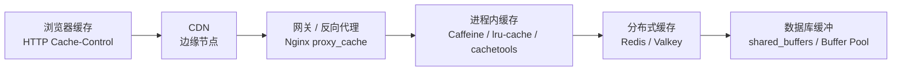
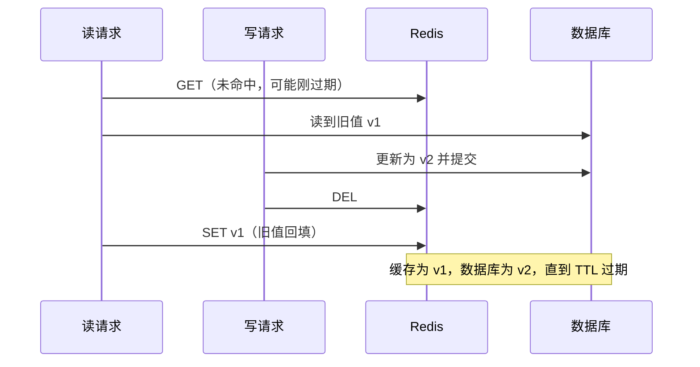
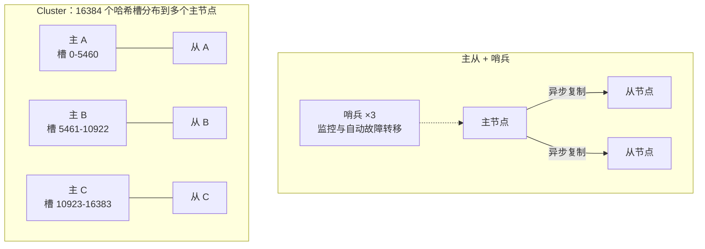
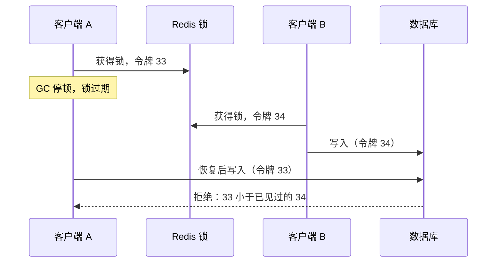
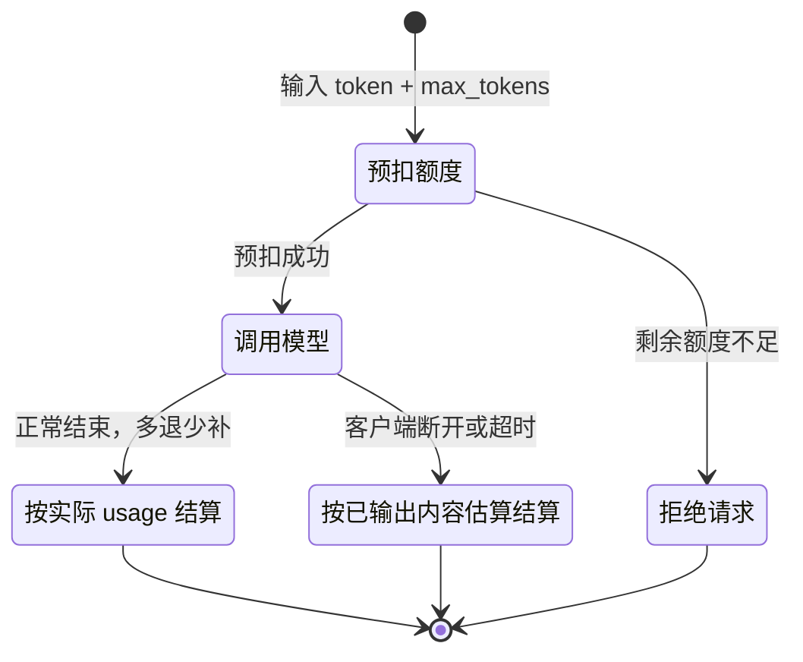

# 05 缓存与 Redis

> 本章目标：掌握**缓存放在哪一层**、**Cache-Aside 与一致性窗口**、穿透 / 击穿 / 雪崩的成因与对策，能为业务选对 **Redis 数据结构**，写出正确的**分布式锁**与**限流**，并能判断 AI 应用中哪些东西值得缓存、哪些缓存会出事故。
>
> 版本基线：Redis Open Source 8.x（截至 2026 年 10 月最新稳定版为 8.10）；Valkey 9.x（最新稳定版 9.1）。
>
> 边界：数据库锁与事务原理见 [04 章](./04-数据库与数据建模.md)；限流在韧性体系（超时、重试、熔断、降级）中的位置见 [08 章](./08-并发与可靠性.md)；Redis Stream 作为消息队列见 [07 章](./07-异步任务与消息队列.md)；模型厂商的 prompt cache 见 [企业级 09 章第六节](../../企业级AI应用开发实战/09-LLMOps-可观测评测与AI网关.md#六成本治理)。

---

## 一、缓存放在哪一层

### 1.1 缓存层次

一次请求从浏览器到数据库，沿途每一层都可以缓存。越靠近用户，命中时越快、越省后端资源，但**失效越难控制**。



| 层 | 缓存什么 | 失效方式 | 典型坑 |
|---|---|---|---|
| 浏览器 | 静态资源、可公开的 GET 响应 | `Cache-Control`、文件名哈希 | 带用户数据的接口误设 `public` |
| CDN | 静态资源、公开页面 | TTL、主动刷新（purge） | 把带 `Set-Cookie` 或鉴权的响应缓存给所有人 |
| 网关 / 反代 | 公共接口响应 | TTL | 缓存 key 没包含鉴权维度 |
| **进程内** | 配置、字典、热点只读数据 | TTL、容量淘汰 | 多实例之间不一致；占用应用堆内存 |
| **分布式缓存** | 查询结果、会话、计数、锁、限流 | TTL、主动删除 | 一致性、穿透 / 击穿 / 雪崩 |
| 数据库缓冲 | 数据页 | 数据库自动管理 | 无需应用干预，但说明"数据库并不总是慢" |

> 📖 **术语**：**命中率**（Hit Ratio）= 命中次数 / 总请求次数，是衡量缓存价值的核心指标。命中率低于一定水平的缓存只会增加复杂度和一次网络往返。

前三层的 HTTP 缓存语义与 CDN 配置见 [01 章](../L1-认知切换/01-网络与HTTP-服务端视角.md) 与 [15 章](../L4-工程与部署/15-部署架构与云.md)。本章聚焦后端可控的**进程内缓存**与**分布式缓存**。

### 1.2 进程内缓存 vs Redis

| 维度 | 进程内缓存 | Redis |
|---|---|---|
| 延迟 | 纳秒到微秒级（内存读取） | 亚毫秒到毫秒级（一次网络往返） |
| 多实例共享 | 否，每个实例各一份 | 是 |
| 一致性 | 实例间天然不一致 | 所有实例看到同一份 |
| 容量 | 受应用内存限制，挤占业务内存 | 独立扩容 |
| 进程重启 | 丢失 | 保留（视持久化配置） |
| 适合 | 体积小、变化少、可容忍短暂不一致：配置、权限字典、模型价格表 | 需要共享的状态：会话、计数、限流、锁、查询结果 |

```java
// Java：Caffeine（可作为 Spring Cache 的底层实现）
LoadingCache<String, ModelPrice> prices = Caffeine.newBuilder()
    .maximumSize(1_000)
    .expireAfterWrite(Duration.ofMinutes(5))
    .build(model -> priceRepository.findByModel(model));   // 同一 key 并发加载只执行一次
```

TypeScript 对应 `lru-cache`（`new LRUCache({ max, ttl })`），Python 对应 `cachetools.TTLCache(maxsize, ttl)`。

> ⚠️ **注意**：AI 常写一个模块级的 `const cache = new Map()` 或 `cache = {}` 当缓存。它**没有容量上限、没有过期**，线上运行几天后就是内存泄漏。进程内缓存必须同时设置**容量上限**和 **TTL**。

### 1.3 什么数据值得缓存

- **读多写少**：读写比越高越值得缓存；频繁写的数据缓存后大部分时间都在失效
- **计算或查询昂贵**：聚合统计、多表 JOIN、外部 API 调用、embedding 计算
- **可容忍短暂旧数据**：商品详情可以旧几秒，**余额、库存扣减、权限判定**不能依赖缓存做最终决定

> 🎯 **落地要点**：加缓存前先确认慢在哪里。缺索引的查询应该先加索引（[04 章](./04-数据库与数据建模.md)），而不是用缓存掩盖。缓存解决的是"**正确但昂贵**"的读，不是"错误的慢"。

---

## 二、缓存模式与一致性（重点）

### 2.1 四种读写模式

| 模式 | 读 | 写 | 谁维护缓存 | 适用 |
|---|---|---|---|---|
| **Cache-Aside**（旁路缓存） | 先读缓存，未命中读 DB 再回填 | 写 DB，然后**删除**缓存 | 应用代码 | **绝大多数业务的默认选择** |
| Read-Through | 应用只读缓存，缓存层未命中时自己去 DB 加载 | — | 缓存组件 | Caffeine `LoadingCache`、Spring `@Cacheable` 的读路径 |
| Write-Through | — | 应用写缓存，缓存层同步写 DB | 缓存组件 | 需要专门的缓存中间件支持，业务中少见 |
| Write-Behind（Write-Back） | — | 只写缓存，异步批量刷回 DB | 缓存组件 | 点赞数、浏览量等**可容忍丢失**的高频计数 |

> ⚠️ **注意**：Write-Behind 在缓存宕机时会**丢数据**。浏览量可以这样做，订单、扣费、额度流水绝不可以。

### 2.2 Cache-Aside 的正确写法

```python
# 读路径
async def get_doc(doc_id: str) -> Doc:
    key = f"kb:v1:doc:{doc_id}"
    if (raw := await redis.get(key)) is not None:
        return Doc.model_validate_json(raw)
    doc = await repo.get(doc_id)
    await redis.set(key, doc.model_dump_json(), ex=600 + random.randint(0, 120))  # TTL 加随机抖动，见 3.4
    return doc
```

写路径是 AI 最常写错的地方，下面三种写法都很常见：

```python
# ❌ 反例 1：先删缓存，再更新 DB
await redis.delete(key)
await repo.update(doc)       # 删除与更新之间，并发读会把旧值重新回填进缓存

# ❌ 反例 2：更新 DB 后"更新"缓存而不是删除
await repo.update(doc)
await redis.set(key, doc.json())   # 两个并发写可能以相反顺序写缓存：DB 是 B，缓存是 A

# ❌ 反例 3：在数据库事务内删除缓存
async with db.transaction():
    await repo.update(doc)
    await redis.delete(key)   # 事务尚未提交，并发读读到旧值并回填；事务回滚时缓存却已删除
```

```python
# ✅ 正例：事务提交成功后删除缓存，删除失败要重试
await repo.update(doc)                    # 事务在此完成提交
try:
    await redis.delete(key)
except RedisError:
    await retry_queue.enqueue_delete(key)  # 删除失败交给异步重试，不能静默吞掉
```

### 2.3 "先更新 DB 再删缓存"仍有不一致窗口

这个方案并非绝对正确，仍存在一个极端时序：



触发条件是"**读请求查 DB 的耗时 > 写请求更新 DB 加删除缓存的耗时**"，而写通常比读慢，所以概率很低，但并发足够大时一定会出现。另外两个常见放大因素：

- **从只读副本回填缓存**：主从复制有延迟，写请求删完缓存后，读请求从副本读到的仍是旧值
- **删除失败**：网络抖动导致 `DEL` 没执行，旧值一直存活到 TTL 过期

### 2.4 一致性方案与不一致窗口

| 方案 | 做法 | 不一致窗口 | 代价 |
|---|---|---|---|
| **更新 DB + 删除缓存 + TTL 兜底** | 2.2 正例 | 极端时序下最长为 TTL | 最低，**默认选它** |
| **延迟双删** | 更新 DB → 删缓存 → 延迟 N 毫秒后再删一次 | 约为 N，N 需大于一次读路径的耗时（含副本延迟） | N 是经验值，难以精确；延迟删除要异步执行 |
| **订阅 binlog / CDC 删缓存** | 用 Debezium、Canal 等订阅 MySQL binlog 或 PostgreSQL 逻辑复制，由独立消费者删缓存 | 约为复制与消费延迟（通常毫秒到秒级） | 运维一套 CDC 链路；业务代码不再关心缓存，删除可靠重试 |
| **不缓存 / 直读主库** | 强一致场景跳过缓存 | 无 | 数据库压力 |

> 📖 **术语**：**CDC**（Change Data Capture，变更数据捕获）：通过读取数据库的变更日志（MySQL binlog、PostgreSQL WAL）获取每一行的增删改事件，再投递给下游。与 Outbox 的关系见 [07 章](./07-异步任务与消息队列.md)。

> 🎯 **落地要点**：缓存与数据库之间**没有廉价的强一致**。设计时要回答的是"这份数据能容忍旧多久"，并据此设置 TTL。不能容忍旧数据的判断（余额是否足够、库存是否充足、用户是否有权限）应以数据库为准，缓存只用于展示。

---

## 三、穿透、击穿、雪崩

### 3.1 三者对比

| 问题 | 现象 | 成因 | 主要对策 |
|---|---|---|---|
| **穿透** | 请求查询**不存在**的数据，每次都打到 DB | 恶意遍历 ID、前端传错参数 | 参数校验、空值缓存、布隆过滤器 |
| **击穿** | **某个热点 key** 过期瞬间，大量请求同时回源 | 热点数据 TTL 到期 | 互斥重建（singleflight）、逻辑过期 |
| **雪崩** | **大量 key** 同时失效或 Redis 整体不可用，DB 被压垮 | TTL 相同、批量预热、Redis 宕机 | TTL 随机化、多级缓存、熔断与限流 |

### 3.2 穿透：空值缓存与布隆过滤器

```ts
// 空值缓存：不存在的数据也缓存一个短 TTL 的占位符
const NULL_MARK = '__null__';

async function getUser(id: string): Promise<User | null> {
  const cached = await redis.get(`user:${id}`);
  if (cached === NULL_MARK) return null;
  if (cached) return JSON.parse(cached);

  const user = await db.user.findUnique({ where: { id } });
  await redis.set(`user:${id}`, user ? JSON.stringify(user) : NULL_MARK, {
    EX: user ? 600 : 60,             // 空值 TTL 要短，避免数据创建后长时间"查不到"
  });
  return user;
}
```

ID 空间巨大、攻击者可随机构造时，空值缓存会被大量垃圾 key 撑满，此时用**布隆过滤器**前置拦截。Redis 8 已内置布隆过滤器命令（Valkey 通过 valkey-bloom 模块提供）：

```text
BF.RESERVE kb:doc_ids 0.001 10000000   # 误判率 0.1%，预计 1000 万元素
BF.ADD     kb:doc_ids doc_123          # 新建文档时写入
BF.EXISTS  kb:doc_ids doc_999          # 返回 0 则一定不存在，直接拒绝
```

> 📖 **术语**：**布隆过滤器**：用很少的内存判断"元素是否在集合中"。回答"不在"一定准确，回答"在"有一定误判率。标准布隆过滤器**不支持删除**，数据会被删除的场景可用布谷鸟过滤器（Cuckoo Filter，Redis 中为 `CF.*` 命令）或定期重建。

### 3.3 击穿：互斥重建（singleflight）

核心思想：**同一个 key 同一时刻只允许一个请求回源**，其他请求等待结果或先返回旧值。

**进程内合并**（单实例内的并发请求合并为一次）：

```java
// Java：Spring Cache 的 sync = true 让同一 key 的并发加载在本实例内只执行一次
@Cacheable(cacheNames = "kbStats", key = "#kbId", sync = true)
public KbStats getStats(UUID kbId) { return statsRepository.compute(kbId); }
```

```ts
// TypeScript：用 Map<key, Promise> 合并并发请求
const inflight = new Map<string, Promise<unknown>>();

function singleflight<T>(key: string, fn: () => Promise<T>): Promise<T> {
  const existing = inflight.get(key);
  if (existing) return existing as Promise<T>;
  const p = fn().finally(() => inflight.delete(key));   // 无论成败都要清理，否则失败结果会被永久复用
  inflight.set(key, p);
  return p;
}
```

Python 的 asyncio 版本思路相同：用 `dict[str, asyncio.Future]` 保存进行中的加载，结束时在 `finally` 中移除。

**跨实例互斥**：实例很多时，每个实例各回源一次仍可能压垮 DB，此时用 Redis 锁（第六节）让全局只有一个请求重建，其他请求短暂等待后重读缓存。

**逻辑过期**：缓存值里带一个 `expireAt` 字段，Redis key 本身不过期。读到逻辑过期的数据时**先返回旧值**，再异步触发一次重建。适合"宁可旧一点也不能慢"的热点数据，如首页推荐、模型列表。

### 3.4 雪崩：分散失效与多级防护

- **TTL 随机化**：`ttl = base + random(0, base * 0.2)`，避免批量写入的 key 在同一秒过期
- **多级缓存**：热点数据在进程内再缓存几秒到几十秒，Redis 抖动时仍能扛住大部分读
- **Redis 不可用时的降级**：回源 DB 时加并发上限与熔断，宁可部分请求失败，也不能让 DB 被打垮（[08 章](./08-并发与可靠性.md)）
- **发布与冷启动预热**：新版本修改了缓存结构时，key 带版本号（`kb:v2:doc:123`）避免反序列化失败，并对关键数据预热

> ⚠️ **注意**：缓存 value 的结构变化是常被忽视的发布风险。新代码读到旧版本写入的 JSON，字段缺失导致反序列化异常，等效于缓存全部失效。**修改缓存数据结构时同步升级 key 版本号。**

---

## 四、Redis 数据结构与用例

### 4.1 用例映射表

| 结构 | 典型命令 | 用例 | 注意 |
|---|---|---|---|
| **String** | `GET` `SET` `INCR` `SET NX PX` | 对象 JSON 缓存、计数器、分布式锁、幂等键 | 单个 value 不宜过大 |
| **Hash** | `HSET` `HGETALL` `HINCRBY` `HEXPIRE` | 对象按字段读写、用户额度多字段 | Redis 7.4 起支持字段级过期 |
| **List** | `LPUSH` `LTRIM` `BRPOP` | 最近 N 条消息、简单队列 | 消费者取出后崩溃即丢消息，可靠队列用 Stream 或 MQ |
| **Set** | `SADD` `SISMEMBER` `SINTER` | 标签、去重、共同关注 | 大集合的 `SMEMBERS` 会阻塞 |
| **ZSet**（有序集合） | `ZADD` `ZRANGE` `ZREMRANGEBYSCORE` | 排行榜、延迟队列（score 为执行时间）、滑动窗口限流 | — |
| **Stream** | `XADD` `XREADGROUP` `XACK` | 带消费者组和确认机制的轻量消息流 | 与 Kafka 的取舍见 [07 章](./07-异步任务与消息队列.md) |
| **Bitmap** | `SETBIT` `BITCOUNT` | 签到、按天统计活跃用户 | 用户 ID 需为连续整数 |
| **HyperLogLog** | `PFADD` `PFCOUNT` | 近似 UV 统计 | 标准误差约 0.81%，每个 key 最多约 12KB |
| **Geo** | `GEOADD` `GEOSEARCH` | 附近的门店 | — |
| **JSON** | `JSON.SET` `JSON.GET` | 按路径读写嵌套文档 | Redis 8 内置；Valkey 通过 valkey-json 模块 |
| **查询引擎 / 向量** | `FT.CREATE` `FT.SEARCH`；`VADD` `VSIM` | 二级索引、全文检索、向量相似度搜索、语义缓存 | Redis 8 内置查询引擎；Vector Set 在 Redis 8.0 发布时标注为 **beta**，生产使用前查阅所用版本的发布说明 |
| Pub/Sub | `PUBLISH` `SUBSCRIBE` | 实时广播（多实例间推送 SSE 事件） | **不持久化**，订阅者离线期间的消息直接丢失 |

> 🎯 **落地要点**：Redis 的向量能力适合**数据量中等、已经在用 Redis、要求低延迟**的场景，例如语义缓存、会话级检索。知识库主检索更常放在 pgvector 或专用向量库，选型见 [04 章](./04-数据库与数据建模.md) 与 [企业级 07 章](../../企业级AI应用开发实战/07-企业级RAG落地.md)。

### 4.2 key 设计

```text
<应用>:<版本>:<实体>:<租户>:<ID>[:<子资源>]
kb:v1:doc:t_42:doc_123
chat:v1:session:t_42:u_7:conv_88
rl:{t_42}:u_7:chat          # 花括号是 Cluster 的 hash tag，见 5.2
```

- **带租户维度**：多租户系统中缓存 key 漏掉租户，就是跨租户数据泄露（[06 章第六节](./06-认证授权与Web安全.md)）
- **带版本号**：数据结构变化时整体切换
- **可读、有前缀**：便于按前缀扫描、统计和清理
- **永远设置 TTL**：除了明确需要常驻的数据，所有 key 都应有过期时间

### 4.3 过期与淘汰

Redis 过期删除采用"**惰性删除 + 定期抽样删除**"：访问时发现已过期才删除，后台周期性抽样清理。所以过期 key 不会立刻释放内存。

内存达到 `maxmemory` 后，按 `maxmemory-policy` 淘汰：

| 策略 | 行为 | 适用 |
|---|---|---|
| `noeviction`（默认） | 不淘汰，写入报错 | 存锁、限流、队列等**不能丢**的数据的实例 |
| `allkeys-lru` / `allkeys-lfu` | 所有 key 中淘汰最近最少使用 / 最不常用的 | **纯缓存实例** |
| `volatile-lru` / `volatile-lfu` / `volatile-ttl` | 只在设置了 TTL 的 key 中淘汰 | 缓存与少量常驻数据混用 |
| `allkeys-random` / `volatile-random` | 随机淘汰 | 很少使用 |

完整策略列表以所用版本的官方文档为准。

> ⚠️ **注意**：同一个 Redis 实例既当缓存又存限流计数和分布式锁时，`allkeys-lru` 可能把锁或额度计数淘汰掉，导致锁失效、限流失效。**缓存与"状态数据"最好分实例部署**；至少让状态数据使用 `noeviction` 的实例。

### 4.4 大 key 与热 key

| 问题 | 危害 | 发现 | 处理 |
|---|---|---|---|
| **大 key**（单个 value 很大或集合元素很多） | Redis 单线程执行命令，读写、删除大 key 会阻塞其他请求；Cluster 下数据倾斜 | `redis-cli --bigkeys`、`--memkeys`、`MEMORY USAGE` | 拆分（按字段或分片）、用 `UNLINK` 异步删除、避免 `HGETALL` 大 Hash |
| **热 key**（少数 key 承担大部分流量） | 单个分片 CPU 打满、带宽打满 | `redis-cli --hotkeys`（需 LFU 淘汰策略）、客户端埋点统计 | 进程内缓存兜底、复制多份（`key:0`~`key:N` 随机读）、读副本 |

大 key 的阈值没有统一标准，团队通常自定经验值（例如 String 超过数十 KB、集合元素超过数千），以团队规范为准。

> ⚠️ **注意**：生产环境禁止使用 `KEYS *`，它会遍历全部 key 并阻塞实例；按前缀查找用 `SCAN` 游标迭代。AI 写清理脚本时几乎总是用 `KEYS`，review 时要拦下。

---

## 五、持久化、高可用与托管

### 5.1 持久化

| 方式 | 原理 | 数据丢失 | 说明 |
|---|---|---|---|
| **RDB** | 定时 fork 子进程生成内存快照 | 丢失上次快照之后的写入 | 文件紧凑、恢复快；fork 时内存占用可能短暂上升 |
| **AOF** | 追加记录每条写命令 | `appendfsync everysec` 时最多约丢 1 秒 | 文件更大，需要后台重写压缩 |
| **混合** | AOF 重写时以 RDB 格式作为前缀 | 同 AOF | 兼顾恢复速度与数据安全 |
| 关闭 | 纯内存 | 重启全丢 | 纯缓存且可接受冷启动时可以 |

> 🎯 **落地要点**：先问"这个实例里的数据丢了会怎样"。纯缓存丢了只是回源；存了会话、限流计数、额度预扣的实例丢了会让用户掉线、额度错乱，需要 AOF 或托管服务的持久化能力。**Redis 不应作为业务数据的唯一存储**，额度、订单等的事实来源永远在数据库。

### 5.2 主从、哨兵与 Cluster



| 形态 | 解决什么 | 限制 |
|---|---|---|
| 主从复制 | 读扩展、数据冗余 | 主节点故障需要人工切换 |
| **哨兵**（Sentinel） | 自动故障转移 | 容量受单个主节点内存限制 |
| **Cluster** | 数据分片、水平扩展容量与吞吐 | 多 key 命令、事务、Lua 脚本涉及的 key 必须在同一个槽 |

> 📖 **术语**：**hash tag**：Cluster 只用 key 中第一对 `{}` 内的内容计算槽位。`rl:{t_42}:minute` 与 `rl:{t_42}:day` 会落在同一个槽，可以在同一个 Lua 脚本中操作；否则报 `CROSSSLOT` 错误。

> ⚠️ **注意**：Redis 主从复制是**异步**的。主节点写入成功后、复制到从节点前宕机，故障转移后这次写入就丢了。这直接影响第六节分布式锁的可靠性。

### 5.3 托管 Redis 与许可证

生产环境优先使用云厂商的托管服务（AWS ElastiCache / MemoryDB、Google Memorystore、阿里云 Tair 等），备份、故障转移、补丁升级由厂商负责。Serverless 平台上还可以选择 Upstash 这类按请求计费、支持 HTTP 访问的服务。

Redis 的许可证在两年内变化了两次，选型和合规审查时会被问到：

| 时间 | 事件 |
|---|---|
| 7.2.x 及以前 | BSD-3-Clause |
| 2024 年 3 月 | Redis 7.4 起改为 RSALv2 / SSPLv1 双许可（均非 OSI 认可的开源许可证）；同月 Linux 基金会基于 Redis 7.2.4 分叉出 **Valkey**，沿用 BSD-3-Clause |
| 2025 年 5 月 | Redis 8 新增 **AGPLv3** 选项，变为 RSALv2 / SSPLv1 / AGPLv3 三许可；免费版更名为 **Redis Open Source**，原 Redis Stack 的 JSON、查询引擎、概率数据结构等并入核心 |
| 2026 年 | Valkey 进入 9.x（9.1 为当前稳定线）；AWS、Google Cloud 等均提供托管 Valkey |

| 维度 | Redis 8 | Valkey 9 |
|---|---|---|
| 许可证 | 三许可，可选 AGPLv3（copyleft） | BSD-3-Clause（宽松） |
| 扩展能力 | JSON、查询引擎、向量、布隆过滤器等内置 | 以独立模块提供（valkey-json、valkey-bloom、valkey-search 等），可用 valkey-bundle 镜像 |
| 客户端兼容 | 协议兼容，主流客户端两者都能连 | 同左；两边新增的命令逐步分化 |

> 🎯 **落地要点**：把未修改的 Redis 当作后端服务使用，通常不触发 AGPLv3 的源码公开义务；但不少公司的合规政策一律禁止 AGPL 依赖，以法务意见为准。只用基础数据结构的业务在两者间迁移成本很低；依赖 JSON、查询引擎、向量命令时，需要在目标引擎上逐条验证。

---

## 六、分布式锁

### 6.1 正确的最小实现

```ts
// ❌ 反例：AI 高频写法，三处错误
const ok = await redis.setNX(`lock:refund:${orderId}`, '1');   // ① 值不唯一，无法区分持有者
if (ok) {
  await redis.expire(`lock:refund:${orderId}`, 10);           // ② 与上一行非原子，中间崩溃则锁永不过期
  await doRefund(orderId);
  await redis.del(`lock:refund:${orderId}`);                   // ③ 可能删掉别人的锁（自己的锁已过期被他人获取）
}
```

```ts
// ✅ 正例：SET NX PX 原子加锁 + 唯一值 + Lua 校验后释放
const RELEASE = `
if redis.call("GET", KEYS[1]) == ARGV[1] then
  return redis.call("DEL", KEYS[1])
end
return 0`;

async function withLock<T>(key: string, ttlMs: number, fn: () => Promise<T>): Promise<T> {
  const token = randomUUID();
  const ok = await redis.set(key, token, { NX: true, PX: ttlMs });
  if (ok !== 'OK') throw new LockBusyError(key);
  try {
    return await fn();
  } finally {
    await redis.eval(RELEASE, { keys: [key], arguments: [token] });
  }
}
```

### 6.2 锁续期：Redisson watchdog

TTL 设短了，业务没执行完锁就过期；设长了，持有者崩溃后要等很久才能释放。Redisson 的 **watchdog**（看门狗）机制是：不指定租期时，锁默认 30 秒过期，后台每隔约三分之一租期自动续期，持有者进程崩溃则停止续期，锁自然过期。

```java
RLock lock = redisson.getLock("lock:refund:" + orderId);
if (lock.tryLock(3, TimeUnit.SECONDS)) {      // 最多等 3 秒；不传 leaseTime 才会启用 watchdog
    try {
        refundService.refund(orderId);
    } finally {
        lock.unlock();
    }
}
```

> ⚠️ **注意**：调用 `tryLock(waitTime, leaseTime, unit)` 显式传入 `leaseTime` 时，watchdog **不会生效**，锁到期即释放。这是 Redisson 最常见的误用之一。

### 6.3 为什么锁不能保证正确性

即使实现完全正确，基于 TTL 的锁仍然会在以下情况下让**两个持有者同时工作**：

- 持有者遭遇长时间 GC 停顿、进程被挂起、网络分区，锁在此期间过期，另一个客户端获得锁
- 主节点写入锁后宕机，异步复制尚未完成，从节点被提升后锁"消失"



解决办法是 **fencing token**（防护令牌）：每次加锁返回一个单调递增的号码（可用 `INCR` 生成），**被保护的存储**拒绝号码比已见过的更小的写入。关键在于：最终防线在存储侧，而不是锁本身。Martin Kleppmann 在《How to do distributed locking》一文中对此有详细论证，也是对 Redlock 算法的主要批评。

据此区分两类锁：

| 锁的目的 | 偶尔失效的后果 | 方案 |
|---|---|---|
| **效率**：避免重复计算，如缓存重建、定时任务防重复 | 多算一次，可接受 | Redis 锁即可 |
| **正确性**：防止重复扣款、超卖、重复退款 | 资金或数据错误 | 存储侧的约束兜底：唯一约束、条件更新、乐观锁版本号、数据库锁 |

### 6.4 何时改用数据库锁

被保护的资源本身就在数据库里时，**直接在数据库层面保证正确性**往往更简单也更可靠：

```sql
-- 条件更新：额度不足时影响行数为 0，天然防超扣
UPDATE quotas SET remaining = remaining - $1
WHERE tenant_id = $2 AND remaining >= $1;

-- 唯一约束：同一订单只能有一条退款记录，重复插入直接失败
CREATE UNIQUE INDEX uq_refund_order ON refunds(order_id);

-- 事务级咨询锁：在同一个 PostgreSQL 事务内对某个业务 ID 互斥，事务结束自动释放
SELECT pg_advisory_xact_lock(hashtext('refund:' || $1));
```

> 🎯 **落地要点**：看到 AI 用 Redis 锁保护"扣款 / 扣额度 / 改库存"时，先问一句：**数据库里能不能用一条条件 UPDATE 或唯一约束解决？**能的话 Redis 锁只是锦上添花，甚至可以去掉。行锁、`SELECT ... FOR UPDATE` 的原理见 [04 章](./04-数据库与数据建模.md)，乐观锁与悲观锁的应用选择见 [08 章](./08-并发与可靠性.md)。

---

## 七、限流

### 7.1 算法对比

| 算法 | 原理 | 突发流量 | 精度与开销 | 适用 |
|---|---|---|---|---|
| **固定窗口** | 每个时间窗口一个计数器（`INCR` + `EXPIRE`） | 窗口边界可能放过 2 倍流量 | 最省 | 粗粒度的日 / 小时配额 |
| **滑动日志** | ZSet 记录每次请求的时间戳，删除窗口外的记录后计数 | 精确 | 每个请求占一条记录，内存大 | 低频、要求精确的场景（如短信验证码） |
| **滑动窗口计数** | 当前窗口计数 + 上一窗口计数 × 重叠比例 | 平滑的近似 | 两个计数器 | API 每分钟请求数 |
| **令牌桶** | 按固定速率往桶里加令牌，请求消耗令牌，桶有容量上限 | **允许一定突发**，长期平均受限 | 两个字段 | **API 限流的主流选择**，也适合按 token 数扣减 |
| **漏桶** | 请求进入队列，以固定速率流出 | 不允许突发，输出完全平滑 | 需要排队 | 保护处理能力固定的下游（如调用有严格 QPS 的第三方接口） |

### 7.2 Redis + Lua 实现令牌桶

限流的"读取 → 计算 → 写回"必须原子执行，否则并发请求会读到同一个旧值，一起通过。Redis 执行 Lua 脚本期间不会穿插其他命令，正好满足这一点。

```lua
-- KEYS[1] 桶的 key；ARGV[1] 容量；ARGV[2] 每秒补充的令牌数；ARGV[3] 本次消耗
local capacity = tonumber(ARGV[1])
local rate     = tonumber(ARGV[2])
local cost     = tonumber(ARGV[3])

-- 用 Redis 服务器时间，避免多个应用实例时钟不一致
local t   = redis.call('TIME')
local now = tonumber(t[1]) * 1000 + math.floor(tonumber(t[2]) / 1000)

local data   = redis.call('HMGET', KEYS[1], 'tokens', 'ts')
local tokens = tonumber(data[1]) or capacity
local ts     = tonumber(data[2]) or now

tokens = math.min(capacity, tokens + (now - ts) / 1000 * rate)

local allowed = 0
if tokens >= cost then
  tokens = tokens - cost
  allowed = 1
end

redis.call('HSET', KEYS[1], 'tokens', tokens, 'ts', now)
redis.call('PEXPIRE', KEYS[1], math.ceil(capacity / rate * 1000) + 1000)

-- Lua 数字返回给客户端时会被截断为整数，这里显式取整
local retry_ms = 0
if allowed == 0 then retry_ms = math.ceil((cost - tokens) / rate * 1000) end
return { allowed, math.floor(tokens), retry_ms }
```

调用方式（Java 用 Spring Data Redis 的 `RedisScript` + `redisTemplate.execute`，写法类似）：

```ts
// TypeScript：node-redis
const [allowed, remaining, retryMs] = (await redis.eval(TOKEN_BUCKET, {
  keys: [`rl:{${tenantId}}:${userId}:chat`],
  arguments: ['20', '5', '1'],
})) as number[];
if (!allowed) {
  reply.header('Retry-After', Math.ceil(retryMs / 1000)).code(429).send({ code: 'RATE_LIMITED' });
}
```

```python
# Python：redis-py asyncio，register_script 会优先用 EVALSHA 减少传输
token_bucket = redis.register_script(TOKEN_BUCKET)
allowed, remaining, retry_ms = await token_bucket(keys=[f"rl:{{{tenant_id}}}:{user_id}:chat"], args=[20, 5, 1])
```

被限流时返回 **429** 和 `Retry-After` 头，错误体遵循 [03 章](./03-API设计.md) 的统一错误模型。Java 项目也可直接用 Redisson 的 `RRateLimiter` 或 Bucket4j，Node 有 `rate-limiter-flexible`，不必每个项目都手写脚本；但要能看懂它们背后是哪种算法。

### 7.3 限流维度

| 维度 | key 示例 | 防什么 |
|---|---|---|
| IP | `rl:ip:1.2.3.4:login` | 未登录接口的暴力破解、爬虫 |
| 用户 | `rl:u_7:chat` | 单个用户滥用 |
| 租户 | `rl:{t_42}:chat` | 一个租户挤占所有租户的容量（"吵闹的邻居"） |
| API Key | `rl:key_ab12:chat` | 开放 API 的调用方超额 |
| 接口 / 模型 | `rl:{t_42}:model:large` | 昂贵接口、昂贵模型单独限额 |

通常分层组合：**网关层**做 IP 与 API Key 的粗粒度限流，**应用层**做用户、租户、模型维度的细粒度限流与配额。

> ⚠️ **注意**：AI 常把限流 key 写成 `rl:${req.ip}`，但服务在反向代理之后时，`req.ip` 是代理的地址，所有用户共享一个桶。要正确配置框架的"信任代理"选项并从 `X-Forwarded-For` 取客户端地址，且只信任自己的代理链（[01 章](../L1-认知切换/01-网络与HTTP-服务端视角.md)）。

### 7.4 AI 应用：按 token 限流与额度扣减

LLM 接口的成本与 **token 数**成正比，单纯按请求数限流不够：一个请求可能消耗几十个 token，也可能是几十万。常见组合：

| 限制 | 含义 | 实现 |
|---|---|---|
| RPM | 每分钟请求数 | 令牌桶，`cost = 1` |
| **TPM** | 每分钟 token 数 | 令牌桶，`cost = 预估 token 数` |
| **并发流数** | 同一用户同时进行的流式生成数 | 计数信号量：开始时 `INCR`，结束时 `DECR`，key 带 TTL 兜底防泄漏 |
| **额度**（Quota） | 按天 / 月 / 套餐的总 token 或金额 | Redis 预扣 + 数据库流水结算 |

请求开始时不知道最终消耗，采用"**预扣 + 结算**"：



```ts
// ❌ 反例：先查后扣，两步之间并发请求都会通过，额度被扣成负数
const remaining = Number(await redis.get(quotaKey));
if (remaining < estimate) throw new QuotaExceeded();
await redis.decrBy(quotaKey, estimate);
```

```lua
-- ✅ 正例：检查与扣减在一个 Lua 脚本中原子完成
local remain = tonumber(redis.call('GET', KEYS[1]) or '0')
local need = tonumber(ARGV[1])
if remain < need then return -1 end
return redis.call('DECRBY', KEYS[1], need)
```

> 🎯 **落地要点**：Redis 里的额度是**快速判断用的副本**，事实来源是数据库里的额度流水表。结算要**幂等**（以请求 ID 为幂等键），避免重试导致重复退还或重复扣减；定期对账，用数据库流水校正 Redis 余额。完整的计费与额度设计见 [11 章](../L3-架构与分布式/11-系统设计案例.md)，网关层的 TPM 预扣与流式 usage 计量见 [企业级 09 章 5.3](../../企业级AI应用开发实战/09-LLMOps-可观测评测与AI网关.md#53-自研网关的关键实现点)。

---

## 八、AI 场景的缓存

### 8.1 LLM 响应缓存：精确缓存与语义缓存

| | 精确缓存 | 语义缓存 |
|---|---|---|
| 命中条件 | 输入完全一致（哈希相等） | 输入 embedding 相似度超过阈值 |
| 命中率 | 低，适合重复调用（批处理重跑、固定模板） | 较高，适合 FAQ 类问答 |
| 风险 | 低 | **答非所问**、**越权**、**过期** |

**精确缓存的 key 必须包含所有影响输出的因素**：

```python
def llm_cache_key(req: ChatRequest, tenant_id: str) -> str:
    material = json.dumps({
        "tenant": tenant_id,                 # 不同租户的知识与权限不同
        "model": req.model,
        "prompt_version": req.prompt_version,
        "params": {"temperature": req.temperature, "max_tokens": req.max_tokens},
        "tools": req.tool_schema_hash,
        "messages": req.messages,
    }, sort_keys=True, ensure_ascii=False)
    return "llm:v1:" + hashlib.sha256(material.encode()).hexdigest()
```

**语义缓存的三类事故**：

- **语义相近但意图相反**："怎么开通自动续费"与"怎么关闭自动续费"的 embedding 可能非常接近，返回的答案完全错误
- **跨权限复用**：用户 A 问"我的合同到期时间"，答案被缓存；用户 B 问同一句话，命中了 A 的答案
- **答案过期**：知识库文档更新后，缓存仍返回基于旧文档生成的答案

对策：只对**非个性化、与用户上下文无关**的问题启用；按租户和权限范围隔离缓存空间；阈值宁高勿低，并用评测集测量误命中率；知识库更新时按文档关联批量失效；提供"重新生成"绕过缓存。可用 RedisVL 的 `SemanticCache` 或 Redis 的托管服务 LangCache 实现，权限隔离仍需自己设计。

> ⚠️ **注意**：多轮对话中，同一句"那第二个呢"在不同上下文中含义完全不同。语义缓存如果只对最后一条消息做 embedding，几乎一定会出错。多轮场景下要么不用语义缓存，要么把对话上下文的哈希纳入 key。

### 8.2 Embedding 缓存

Embedding 是确定性的（同一模型、同一输入，结果相同），**最适合缓存**。知识库重新入库、切片策略微调时，大部分文本块没变，缓存可以节省大量调用费用和时间。

- **key**：`emb:<模型名>:<模型版本>:<维度>:<sha256(规范化文本)>`。换模型或换维度必须换 key，不同模型的向量混用会让检索结果毫无意义
- **value**：以二进制（float32 字节）存储，比 JSON 数组节省数倍空间
- **TTL**：可以较长；更持久的方案是存入数据库或对象存储，Redis 只做热数据层

### 8.3 会话上下文缓存

对话服务每轮都要加载最近的消息历史。常见做法是 Redis 保存最近 N 轮（List + `LTRIM`，带 TTL）作为热缓存，**数据库保存完整历史作为事实来源**。Redis 未命中时从数据库加载并回填。

> ⚠️ **注意**：不要把 Redis 当作对话历史或 Agent 状态的唯一存储。实例重启、淘汰策略、过期都会让用户的对话"消失"。Agent 的持久化执行与 checkpoint 见 [企业级 06 章第六节](../../企业级AI应用开发实战/06-Agent工程化-从Loop到生产.md#六人机协同与持久化执行)。

### 8.4 Prompt Cache 不是你的缓存

模型厂商提供的 prompt cache 缓存的是**模型侧对稳定前缀的计算结果**，由厂商管理，应用侧要做的是让 prompt 的前缀保持稳定，而不是在 Redis 中存储什么。前缀设计见 [企业级 06 章 4.3](../../企业级AI应用开发实战/06-Agent工程化-从Loop到生产.md#43-实战技巧)，成本收益见 [企业级 09 章第六节](../../企业级AI应用开发实战/09-LLMOps-可观测评测与AI网关.md#六成本治理)。

---

## 九、三栈客户端与连接管理

| 栈 | 客户端 | 说明 |
|---|---|---|
| Java | **Spring Data Redis**（默认 Lettuce 驱动） | `StringRedisTemplate` / `RedisTemplate`、`@Cacheable`；`RedisTemplate` 默认用 JDK 序列化，key 会变成 `\xac\xed...` 二进制，应改用字符串或 JSON 序列化器 |
| Java | **Redisson** | 分布式锁、限流器、分布式集合等高级对象 |
| TypeScript | **node-redis**（npm 包名 `redis`） | Redis 官方推荐的新项目首选，对 Redis 8 新能力支持完整 |
| TypeScript | ioredis | 存量项目大量使用；其 README 说明目前为"尽力维护"，新项目推荐 node-redis |
| Python | **redis-py**（`redis.asyncio`） | 同一个包同时提供同步与异步客户端 |

**连接管理的通用规则**：客户端在**进程启动时创建一次、全局复用**，进程退出时关闭；设置连接超时与命令超时；处理断线重连。

```ts
// ❌ 反例：每个请求新建连接，高并发时连接数爆炸，且没有监听 error 事件
app.get('/doc/:id', async (req) => {
  const client = await createClient({ url: process.env.REDIS_URL }).connect();
  return client.get(`doc:${req.params.id}`);
});

// ✅ 正例：启动时创建一次；必须监听 error，否则断线时未处理的 error 事件会让进程崩溃
export const redis = createClient({
  url: process.env.REDIS_URL,
  socket: { connectTimeout: 2000, reconnectStrategy: (n) => Math.min(n * 100, 3000) },
});
redis.on('error', (err) => logger.error({ err }, 'redis error'));
await redis.connect();
```

```python
# ✅ FastAPI：在 lifespan 中创建与关闭，异步路由里只用异步客户端
@asynccontextmanager
async def lifespan(app: FastAPI):
    app.state.redis = redis.asyncio.from_url(
        settings.redis_url, decode_responses=True,
        socket_connect_timeout=2, socket_timeout=1, max_connections=50,
    )
    yield
    await app.state.redis.aclose()
```

> ⚠️ **注意**：在 FastAPI 的 `async def` 路由里使用同步的 `redis.Redis`，每次调用都会阻塞事件循环，表现为并发一高整个服务卡顿（事件循环原理见 [00 章](../L1-认知切换/00-前端到后端的思维切换.md)）。Serverless 函数中每次冷启动都新建 TCP 连接，容易打满 Redis 的连接上限，可选用支持 HTTP 访问的托管服务或连接代理。

---

## 十、AI 代码审查清单

### 10.1 缓存使用

- [ ] 🔴 缓存 key 包含租户 / 用户 / 权限范围等所有影响结果的维度，不会把 A 的数据返回给 B
- [ ] 🔴 余额、库存、权限等关键判断以数据库为准，不以缓存值做最终决定
- [ ] 进程内缓存同时设置了容量上限与 TTL，没有裸 `Map` / `dict` 充当缓存
- [ ] 所有 Redis key 都设置了 TTL，TTL 带随机抖动
- [ ] 写路径是"事务提交后删除缓存"，不是先删缓存、不是更新缓存、不在事务内删除
- [ ] 缓存删除失败有重试或告警，没有被 `catch` 后静默忽略
- [ ] 缓存数据结构变化时 key 版本号同步升级
- [ ] 不存在的数据有空值缓存（短 TTL）或布隆过滤器
- [ ] 热点 key 的回源有 singleflight 或互斥重建
- [ ] Redis 不可用时有降级路径，回源 DB 有并发上限

### 10.2 Redis 使用

- [ ] 🔴 生产代码与脚本中没有 `KEYS *`，用 `SCAN` 迭代
- [ ] 存锁、限流、额度的实例不使用 `allkeys-*` 淘汰策略，或与缓存实例分离
- [ ] 没有大 key（大 Hash 的 `HGETALL`、大集合的 `SMEMBERS`），大 key 删除用 `UNLINK`
- [ ] Cluster 下多 key 操作与 Lua 脚本使用 hash tag 保证同槽
- [ ] Redis 客户端全局单例，配置了连接超时、命令超时与重连；Node 客户端监听了 `error` 事件
- [ ] Java 未使用默认 JDK 序列化；Python 异步路由中使用 `redis.asyncio`
- [ ] Redis 不是任何业务数据的唯一存储

### 10.3 分布式锁

- [ ] 🔴 加锁使用 `SET key token NX PX ttl` 一条命令，不是 `SETNX` + `EXPIRE`
- [ ] 🔴 释放锁用 Lua 校验 token，不直接 `DEL`
- [ ] 涉及资金、库存、额度的正确性不只依赖 Redis 锁，存储侧有唯一约束、条件更新或版本号兜底
- [ ] Redisson 需要自动续期时没有传 `leaseTime`；`unlock` 在 `finally` 中
- [ ] 获取锁失败有明确处理（返回"处理中"、重试或排队），不是静默跳过

### 10.4 限流与额度

- [ ] 🔴 限流与额度扣减的"检查 + 修改"是原子操作（Lua 或数据库条件更新），不是先 `GET` 后 `DECRBY`
- [ ] 🔴 LLM 接口有按用户 / 租户的 TPM 与额度限制，不只限请求数
- [ ] 限流按正确的维度（用户、租户、API Key）计数；按 IP 限流时正确处理了反向代理
- [ ] 限流使用 Redis 服务器时间或单一时间源，不依赖各实例本地时钟
- [ ] 被限流时返回 429 与 `Retry-After`
- [ ] 额度结算幂等，客户端断开时有估算结算，有与数据库流水的对账机制
- [ ] 流式生成有并发数限制，计数 key 带 TTL 防止泄漏

### 10.5 AI 缓存

- [ ] 🔴 语义缓存按租户与权限隔离，个性化问题和多轮上下文问题不走语义缓存
- [ ] LLM 精确缓存 key 包含模型、prompt 版本、参数、工具定义与完整消息
- [ ] Embedding 缓存 key 包含模型名、版本与维度
- [ ] 对话历史与 Agent 状态的事实来源在数据库，Redis 只是热缓存

---

## 本章小结

- 缓存层次越靠近用户越快，也越难失效；后端可控的是**进程内缓存**与 **Redis**，前者快但实例间不一致，后者共享但多一次网络往返
- **Cache-Aside + 提交后删缓存 + TTL 兜底**是默认方案；它仍有极端不一致窗口，更严格时用延迟双删或 CDC，强一致需求不走缓存
- 穿透用**空值缓存 / 布隆过滤器**，击穿用 **singleflight / 逻辑过期**，雪崩用 **TTL 随机化 / 多级缓存 / 降级**
- Redis 数据结构按用例选择；缓存与状态数据（锁、限流、额度）**分实例**或使用不同淘汰策略；警惕大 key、热 key 与 `KEYS *`
- Redis 8 为三许可（可选 AGPLv3），Valkey 为 BSD 分支；基础用法两者兼容，依赖扩展能力时需逐项验证
- 分布式锁：**SET NX PX + 唯一值 + Lua 释放**；锁只能保证效率，**正确性要靠存储侧的 fencing token、唯一约束或条件更新**
- 令牌桶是 API 限流的主流算法，必须原子执行；AI 应用要按 **token 数**限流，额度采用**预扣 + 幂等结算 + 对账**
- AI 缓存中 embedding 最适合缓存，语义缓存风险最高；prompt cache 是厂商侧能力，应用侧只需保持前缀稳定

## 练习

1. 为一个知识库文档详情接口实现 Cache-Aside：包含空值缓存、TTL 抖动、singleflight 与提交后删除。用压测工具并发读写同一文档，统计缓存与数据库不一致的次数，再加上延迟双删对比结果
2. 用 Redis + Lua 实现令牌桶，同时支持 RPM 与 TPM 两个维度（同一脚本内用 hash tag 保证同槽），在 Fastify 或 FastAPI 中做成中间件，被限流时返回 429 与 `Retry-After`
3. 实现对话服务的额度"预扣 + 结算"：开始时按 `输入 token + max_tokens` 原子预扣，结束时按实际 usage 结算；模拟客户端中途断开和结算请求重试两种情况，验证额度不会多扣或少扣
4. 为 FAQ 机器人实现语义缓存，构造 20 组"相似但意图不同"的问题对（开通 / 关闭、增加 / 删除等），测量不同相似度阈值下的误命中率，确定一个可接受的阈值
