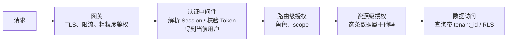
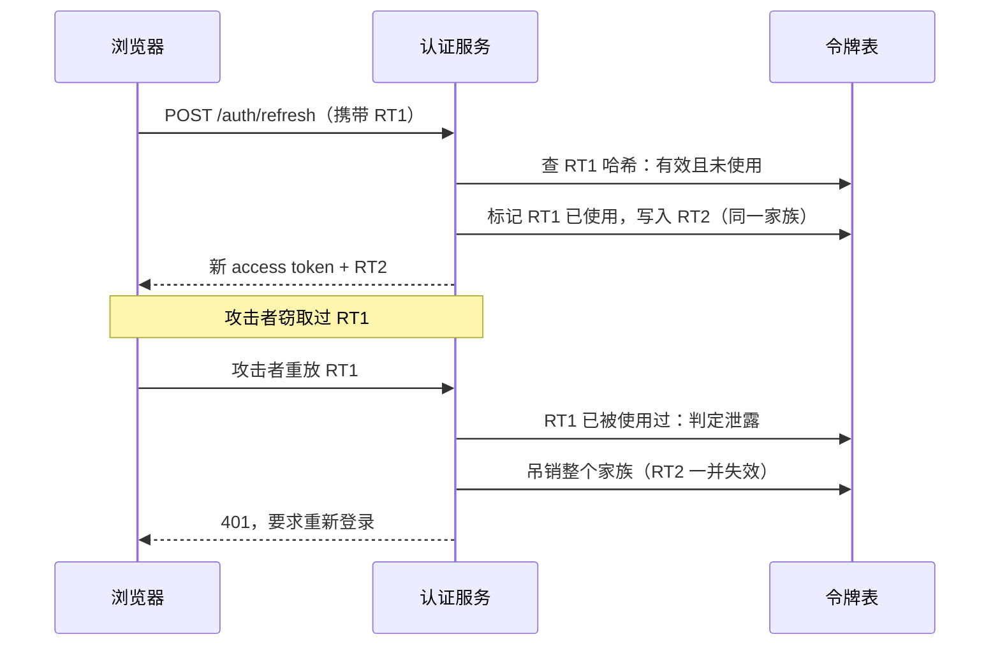
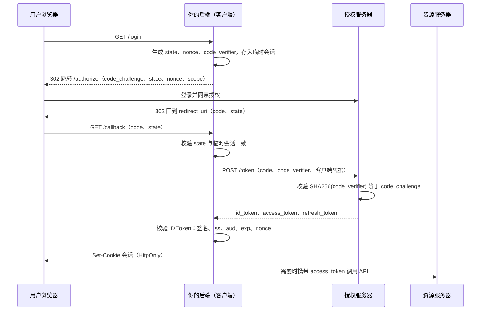
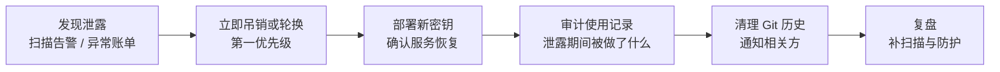

# 06 认证、授权与 Web 安全

> 本章目标：分清**认证与授权**，能在 **Session 与 JWT** 之间做出有依据的选择，看懂 **OAuth 2.x / OIDC 授权码 + PKCE** 流程，在每个接口上做好**资源级权限检查**与**多租户隔离**，并能按 **OWASP Top 10:2025** 逐条审查 AI 写的后端代码。
>
> 版本基线：OWASP Top 10:2025；OAuth 2.1 截至 2026 年 10 月仍为 IETF 草案（draft-17），其要求已大多体现在 RFC 9700（OAuth 2.0 安全最佳实践，2025 年 1 月发布）中；Spring Security 7（Spring Authorization Server 已并入）。
>
> 边界：CORS 的服务端配置见 [01 章](../L1-认知切换/01-网络与HTTP-服务端视角.md)；HTTPS 与证书见 [15 章](../L4-工程与部署/15-部署架构与云.md)；K8s Secret 见 [14 章](../L4-工程与部署/14-Kubernetes核心与实践.md)；依赖扫描与 CI 密钥见 [16 章](../L4-工程与部署/16-CICD与发布策略.md)；提示注入、Agent 权限与沙箱见 [企业级 10 章](../../企业级AI应用开发实战/10-安全权限与上线清单.md)。

---

## 一、认证与授权：先分清两件事

### 1.1 概念

| | 认证（Authentication，AuthN） | 授权（Authorization，AuthZ） |
|---|---|---|
| 回答 | **你是谁** | **你能对这个资源做什么** |
| 依据 | 密码、Passkey、第三方登录、API Key | 角色、属性、资源归属、关系 |
| 失败时的状态码 | **401** Unauthorized（未认证或凭据无效） | **403** Forbidden（已认证但无权限）；为防止资源枚举，也常返回 **404** |
| AI 常见缺陷 | JWT 不验签、会话不过期 | **只校验登录，不校验资源归属** |

### 1.2 在一次请求中的位置



> 🎯 **落地要点**：认证通常由框架或中间件统一完成，不容易漏；**资源级授权分散在每个接口的业务逻辑里，最容易漏**。OWASP Top 10:2025 中排名第一的仍是访问控制失效（A01），AI 生成的 CRUD 接口是这类漏洞的高发区。

---

## 二、会话：Session 与 JWT

### 2.1 对比

| 维度 | 服务端 Session + Cookie | JWT（自包含令牌） |
|---|---|---|
| 状态存在哪 | 服务端（Redis / 数据库），浏览器只持有随机 session ID | 令牌本身携带用户信息与签名 |
| 吊销 | **删除服务端记录即刻生效** | **签发后在过期前一直有效**，吊销需要额外的黑名单 |
| 体积 | 几十字节 | 几百字节到几 KB，每个请求都要携带 |
| 校验成本 | 每次查一次存储 | 本地验签，无需查询 |
| 适合 | **自家 Web 应用**（前后端同站或 BFF） | 服务间调用、第三方 API、移动端、OAuth 资源服务器 |

> 📖 **术语**：**JWT**（JSON Web Token）：`header.payload.signature` 三段 Base64URL 编码的字符串。**payload 只是编码不是加密**，任何人都能解码看到内容，不要放敏感信息。

> 🎯 **落地要点**：给自己的前端做登录，**Session + HttpOnly Cookie 往往是更简单、更安全的默认选择**。AI 倾向于默认生成 JWT + localStorage 方案，这不是错误，但要清楚它放弃了"即时吊销"，并且需要额外处理 XSS 风险。JWT 的典型使用方式是：短有效期 access token（如 5~15 分钟）+ 可吊销的 refresh token，高风险操作再查一次服务端状态。

### 2.2 JWT 常见误用

```ts
// ❌ 反例 1：decode 不校验签名，任何人伪造 payload 都能通过
const user = jwt.decode(token);

// ❌ 反例 2：不显式限定算法，依赖库的默认行为；不校验 iss / aud，签发给其他应用的令牌也能通过
const user = jwt.verify(token, publicKey);
```

```ts
// ✅ 正例（jose）：固定算法，校验签名、过期、签发者、受众
const JWKS = createRemoteJWKSet(new URL('https://auth.example.com/.well-known/jwks.json'));
const { payload } = await jwtVerify(token, JWKS, {
  issuer: 'https://auth.example.com/',
  audience: 'api://kb',
  algorithms: ['RS256'],
});
```

```python
# ❌ 反例：PyJWT 关闭验签
claims = jwt.decode(token, options={"verify_signature": False})
# ✅ 正例
claims = jwt.decode(token, key, algorithms=["RS256"], audience="api://kb", issuer=ISSUER)
```

```java
// ✅ Spring Security 资源服务器：配置 issuer-uri 后自动拉取 JWKS 校验签名、iss、exp
// aud 需通过 spring.security.oauth2.resourceserver.jwt.audiences 等方式显式配置
http.oauth2ResourceServer(o -> o.jwt(Customizer.withDefaults()));
```

其他高频问题：HS256 的密钥写成 `"secret"` 这类弱口令（可被离线爆破）；access token 有效期设成 30 天；把邮箱、手机号、权限列表塞进 payload 后再也无法及时变更。

### 2.3 令牌存在哪里

| 存储位置 | XSS 能否读取 | CSRF 风险 | 说明 |
|---|---|---|---|
| `localStorage` / `sessionStorage` | **能** | 无（需 JS 主动附加到请求头） | 一次 XSS 即可窃取令牌并在攻击者机器上长期使用 |
| 内存（JS 变量） | 能在页面存活期间利用 | 无 | 刷新页面丢失，需配合 refresh 流程 |
| **HttpOnly Cookie** | **不能** | 有，需 SameSite + CSRF 防护 | XSS 仍可在页面内发起请求，但无法把令牌带走 |
| **BFF 模式**（令牌只在服务端） | 不能 | 有，同上 | 浏览器只持有会话 Cookie，OAuth 令牌保存在后端；IETF 浏览器应用安全草案推荐的最安全形态 |

> 📖 **术语**：**BFF**（Backend for Frontend）：为前端专门设置的一层后端，负责登录、持有令牌、代理调用下游 API。Next.js / Nuxt 的服务端部分天然可以承担这个角色。

### 2.4 Refresh Token 轮换

Refresh token 有效期长（数天到数周），一旦泄露危害大。**轮换**（Rotation）是指每次使用 refresh token 都签发一个新的、作废旧的；同时做**重用检测**：



- 服务端只保存 refresh token 的**哈希**，与密码同理
- 多标签页并发刷新会误触发重用检测，可设置几秒的宽限期，或在前端串行化刷新请求
- refresh token 放在 `HttpOnly; Secure; SameSite=Strict; Path=/auth/refresh` 的 Cookie 中，缩小发送范围

### 2.5 Cookie 安全属性与 CSRF

```http
Set-Cookie: __Host-sid=8f3a...; Path=/; Secure; HttpOnly; SameSite=Lax; Max-Age=1209600
```

| 属性 | 作用 | 常见错误 |
|---|---|---|
| `HttpOnly` | JS 无法读取 | 会话 Cookie 漏设 |
| `Secure` | 只通过 HTTPS 发送 | 本地开发关掉后上线忘记打开 |
| `SameSite=Lax` | 跨站请求中只有顶层导航的 GET 携带 Cookie | 用 GET 接口执行写操作，Lax 挡不住 |
| `SameSite=Strict` | 任何跨站请求都不携带 | 从外部链接点进来显示未登录，体验差 |
| `SameSite=None` | 跨站也携带，必须同时设置 `Secure` | 为解决跨域问题随手设成 None，等于放弃 CSRF 防护 |
| `Domain` | 指定后对所有子域生效 | 随手设成 `.example.com`，任何子域被攻破都能读写会话 |
| `__Host-` 前缀 | 浏览器强制要求 `Secure`、`Path=/`、无 `Domain` | — |

> 📖 **术语**：**CSRF**（跨站请求伪造）：用户已登录 A 站，访问恶意 B 站时，B 站让浏览器向 A 站发请求，浏览器自动带上 A 站的 Cookie。用 `Authorization` 头携带令牌的接口不受 CSRF 影响，因为浏览器不会自动附加这个头。

使用 Cookie 会话时的 CSRF 防护：

1. **SameSite=Lax 或 Strict** 作为基线；**GET 请求不改变状态**
2. 对所有改变状态的请求校验 `Origin` 头（或 `Sec-Fetch-Site`）是否在允许列表中
3. 高风险场景再加 **CSRF token**（服务端生成，前端放在请求头回传）

```ts
// Fastify：改变状态的请求必须来自允许的来源
app.addHook('onRequest', async (req, reply) => {
  if (['GET', 'HEAD', 'OPTIONS'].includes(req.method)) return;
  if (!ALLOWED_ORIGINS.has(req.headers.origin ?? '')) {
    return reply.code(403).send({ code: 'CSRF_REJECTED' });
  }
});
```

> ⚠️ **注意**：SameSite 的"站"是指注册域（`a.example.com` 与 `b.example.com` 是同站），所以**同一主域下的其他子域发起的请求不受 SameSite 限制**。Spring Security 默认开启 CSRF 防护，AI 生成的配置里经常有 `.csrf(c -> c.disable())`：纯 Bearer token 的 API 可以关闭，**使用 Cookie 会话的应用不能关**。

---

## 三、OAuth 2.x 与 OIDC

### 3.1 角色

| 角色 | 是谁 | 例子 |
|---|---|---|
| **资源所有者**（Resource Owner） | 用户 | 你 |
| **客户端**（Client） | 想访问资源的应用 | 你的 AI 知识库应用 |
| **授权服务器**（Authorization Server） | 验证用户、签发令牌 | Google、GitHub、企业 Keycloak |
| **资源服务器**（Resource Server） | 持有受保护资源的 API | Google Drive API、你自己的后端 API |

**OAuth 2.0 解决授权**（让应用代表用户访问资源），**OIDC**（OpenID Connect）在其上增加**认证**层（告诉应用"登录的是谁"）。"用 Google 登录"本质是 OIDC。

> 📖 **术语**：**机密客户端**（Confidential Client）能安全保存 `client_secret`，如后端服务；**公共客户端**（Public Client）不能，如 SPA、移动 App、桌面应用。公共客户端里出现 `client_secret`，就等于公开了它。

### 3.2 授权码 + PKCE 流程

以下为推荐的 BFF 形态：后端是机密客户端，浏览器只拿到会话 Cookie。



| 参数 | 防什么 |
|---|---|
| `state` | 回调被伪造（登录 CSRF） |
| `code_verifier` / `code_challenge`（**PKCE**） | 授权码在回调中被截获后被他人兑换 |
| `nonce` | ID Token 被重放 |
| `redirect_uri` 精确匹配 | 授权码被重定向到攻击者的地址 |

### 3.3 ID Token 与 Access Token

| | ID Token | Access Token |
|---|---|---|
| 给谁看 | **客户端**：确认登录的是谁 | **资源服务器**：确认调用者有哪些权限 |
| 格式 | 一定是 JWT | 可能是 JWT，也可能是不透明字符串 |
| `aud` | 客户端的 `client_id` | 资源服务器的标识 |
| 客户端应该 | 校验并读取 `sub`、`email` 等声明 | **当作不透明字符串**，原样转发，不解析 |

### 3.4 常见误用

- ❌ 把 ID Token 当作 access token 发给自己的 API 做鉴权
- ❌ 用 `email` 作为用户唯一标识：用户的邮箱会变，不同提供方的同一邮箱未必是同一个人。**用 `iss` + `sub` 作为外部身份的唯一键**
- ❌ 不检查 `email_verified` 就按邮箱自动合并账号：攻击者在某个不校验邮箱的提供方注册受害者的邮箱，即可登录受害者账号
- ❌ `redirect_uri` 配置通配符或前缀匹配
- ❌ 资源服务器不校验 `aud`，接受了签发给其他应用的令牌
- ❌ 申请远超需要的 scope；把第三方返回的 access / refresh token 明文存库

### 3.5 OAuth 2.1 现状

OAuth 2.1 将 OAuth 2.0 及其后十余年的安全实践整合为一份规范，截至 2026 年 10 月仍是 IETF 草案（draft-17），尚未成为 RFC。核心变化：

- 授权码流程**所有客户端都必须使用 PKCE**
- **移除隐式授权**（Implicit）与**密码授权**（Resource Owner Password Credentials）
- `redirect_uri` **精确字符串匹配**
- 公共客户端的 refresh token 必须**发送方绑定或一次性使用**（即轮换）
- 禁止在 URL 查询参数中传递 Bearer token

这些要求在已正式发布的 RFC 9700 中已有对应条款，主流身份服务和 Spring Security 的授权服务器也已按此实现。MCP 远程 Server 的鉴权同样基于 OAuth 2.1，见 [企业级 05 章第七节](../../企业级AI应用开发实战/05-MCP与Agent互操作协议.md#七鉴权企业落地的核心重点)。**结论：新项目直接按 OAuth 2.1 的要求实现，不必等它成为 RFC。**

### 3.6 第三方登录接入要点

1. 本地建 `user_identities(provider, subject, user_id)` 表，`(provider, subject)` 唯一，一个用户可以绑定多个外部身份
2. 首次登录时创建本地用户；账号合并只在**邮箱已验证**且用户确认后进行
3. 登录成功后**签发自己的会话**，不要每个请求都拿第三方令牌去验证
4. 只在需要调用第三方 API 时保存其令牌，并加密存储

### 3.7 Passkeys / WebAuthn

Passkey 是基于公钥密码学的无密码登录：设备生成密钥对，私钥保存在设备或密码管理器中，服务端只保存公钥。登录时服务端发出随机挑战，设备用私钥签名。

- **抗钓鱼**：凭据绑定到域名（RP ID），钓鱼网站无法让用户为真实域名签名
- **服务端没有可泄露的秘密**：数据库泄露只泄露公钥
- 实现时使用成熟库：SimpleWebAuthn（TS）、py_webauthn（Python）、Spring Security 内置的 Passkeys 支持；托管身份服务基本都已支持

> 🎯 **落地要点**：Passkey 适合作为密码的替代或第二因素。账号恢复流程（设备丢失）是设计重点，恢复通道的安全强度决定了整个账号体系的安全下限。

---

## 四、自建还是托管身份服务

| 方案 | 形态 | 适合 | 注意 |
|---|---|---|---|
| **Auth0（Okta）/ Clerk** | 托管 SaaS，提供预制登录 UI 与 SDK | 想最快上线、不想维护身份系统的团队 | 按月活计费，规模大后成本显著；数据出境与合规 |
| **Supabase Auth** | Supabase 平台的一部分 | 已使用 Supabase，与 Postgres RLS 天然配合 | 与平台绑定 |
| **Keycloak** | 开源自托管（CNCF 孵化项目） | 企业 SSO、对接 LDAP / AD、私有化部署 | 运维与升级成本；需要专人熟悉 |
| 其他开源 IdP | ZITADEL、Authentik、Ory、Casdoor 等 | 需要私有化但希望比 Keycloak 更轻 | 评估社区活跃度 |
| **Better Auth** | TypeScript 库，用户数据存在你自己的数据库 | TS 全栈项目，希望掌控数据又不想手写 | 2025 年 9 月起接手维护 Auth.js；2026 年 7 月宣布加入 Vercel |
| Auth.js（NextAuth.js） | TypeScript 库 | 存量项目 | 现由 Better Auth 团队维护，官方建议新项目使用 Better Auth |
| **Spring Security**（含 Authorization Server） | Java 库，自 Spring Security 7.0 起包含授权服务器 | 需要自建 OAuth 2.x / OIDC 授权服务器的 Java 团队 | 工作量最大，适合有明确需求时 |
| 云厂商 | AWS Cognito、Microsoft Entra ID 等 | 已深度使用该云 | 定制化受限 |

Python / FastAPI 生态没有统一的全功能认证框架，常见做法是对接外部 IdP（用 Authlib 实现 OIDC 客户端），自己只做令牌校验与授权。

> 🎯 **落地要点**：**登录、密码重置、MFA、账号恢复、会话管理**是安全性要求极高、细节极多的功能，除非有明确理由，不要让 AI 从零手写。优先选托管服务或成熟库，自己把精力放在**授权**上，那才是和业务强相关、无法外包的部分。

---

## 五、授权模型与资源级权限检查（重点）

### 5.1 三种授权模型

| 模型 | 判断依据 | 例子 | 优点 | 局限 |
|---|---|---|---|---|
| **RBAC**（基于角色） | 用户 → 角色 → 权限 | 管理员可删除知识库 | 简单、易审计 | 表达不了"只能改自己的"；角色数量膨胀 |
| **ABAC**（基于属性） | 主体、资源、环境的属性组合 | 同部门、工作时间、内网 IP 才能导出 | 灵活 | 策略分散时难以审计；常借助 OPA、Cedar 等策略引擎 |
| **ReBAC**（基于关系） | 主体与资源之间的关系图 | 用户是文件夹的编辑者，文件夹下的文档自动继承 | 天然表达共享、继承、组织层级 | 需要专门的关系存储与查询服务 |

> 📖 **术语**：**Zanzibar** 是 Google 发表的全局授权系统论文，用"对象#关系@主体"的元组描述权限，支撑 Drive、YouTube 等产品的共享模型。开源实现中，**OpenFGA**（2025 年 10 月成为 CNCF 孵化项目）与 SpiceDB 最常见。

实际系统通常组合使用：RBAC 管功能入口（谁能进管理后台），资源归属或 ReBAC 管数据（谁能看哪个知识库），ABAC 补充条件（导出需要内网）。知识库与 RAG 的文档级权限过滤见 [企业级 07 章第六节](../../企业级AI应用开发实战/07-企业级RAG落地.md#六权限过滤重点)。

### 5.2 越权：IDOR / BOLA

> 📖 **术语**：**IDOR**（不安全的直接对象引用）/ **BOLA**（对象级授权失效，OWASP API 安全 Top 10 第一名）：接口根据请求中的 ID 直接返回数据，没有校验这条数据是否属于当前用户。

```python
# ❌ 反例：只校验了"已登录"，改 URL 里的 ID 就能读别人的对话
@router.get("/conversations/{conv_id}")
async def get_conv(conv_id: UUID, user: User = Depends(current_user), db=Depends(get_db)):
    return await db.get(Conversation, conv_id)
```

```python
# ✅ 正例：归属条件写进查询，查不到统一返回 404
@router.get("/conversations/{conv_id}")
async def get_conv(conv_id: UUID, user: User = Depends(current_user), db=Depends(get_db)):
    conv = await db.scalar(
        select(Conversation).where(
            Conversation.id == conv_id,
            Conversation.tenant_id == user.tenant_id,
            Conversation.owner_id == user.id,
        )
    )
    if conv is None:
        raise HTTPException(404)
    return conv
```

越权不只发生在详情接口，以下位置同样要检查：

- **列表、搜索、导出**接口的过滤条件
- **批量接口**：`ids` 数组中每一个都要校验，不是只校验第一个
- **写接口的关联 ID**：创建对话时传入的 `kb_id` 是否属于当前用户
- **批量赋值**（Mass Assignment）：`User(**body)` 或 `Object.assign(user, req.body)` 让用户把自己的 `role` 改成 `admin`。请求体用 DTO 白名单字段接收
- **WebSocket / SSE 订阅**：订阅 `conversation:123` 频道前是否校验了归属
- **异步任务与 Agent 工具**：后台任务以谁的身份执行，工具调用是否以当前用户身份鉴权（[企业级 10 章第四节](../../企业级AI应用开发实战/10-安全权限与上线清单.md#四agent-权限模型重点)）

> ⚠️ **注意**：把自增 ID 换成 UUID 只能增加枚举难度，**不是授权**。UUID 会出现在分享链接、日志、前端代码里，一旦泄露照样被越权访问。

### 5.3 三栈实现

**Java：Spring Security 方法级鉴权**

```java
@EnableMethodSecurity   // 配置类上开启
// ...
@PreAuthorize("hasAuthority('kb:write') and @kbAccess.canEdit(#kbId, authentication)")
public KnowledgeBase update(UUID kbId, UpdateKbRequest req) { ... }

@Component("kbAccess")
class KbAccess {
    boolean canEdit(UUID kbId, Authentication auth) {
        var user = (AppUser) auth.getPrincipal();
        return kbRepository.existsByIdAndTenantIdAndEditor(kbId, user.tenantId(), user.id());
    }
}
```

> ⚠️ **注意**：`@PreAuthorize` 依赖 Spring 的代理机制，**同一个类内部方法互相调用时注解不生效**。AI 经常把鉴权注解加在被内部调用的私有或同类方法上，看起来有保护，实际没有。

**TypeScript：NestJS Guard**

```ts
@Injectable()
export class KbEditorGuard implements CanActivate {
  constructor(private readonly kbService: KbService) {}

  async canActivate(ctx: ExecutionContext): Promise<boolean> {
    const req = ctx.switchToHttp().getRequest();
    const ok = await this.kbService.canEdit(req.params.kbId, req.user);
    if (!ok) throw new NotFoundException();
    return true;
  }
}

@UseGuards(JwtAuthGuard, KbEditorGuard)   // 先认证，后资源级授权
@Patch(':kbId')
update(@Param('kbId') kbId: string, @Body() dto: UpdateKbDto) { ... }
```

**Python：FastAPI Depends**

```python
async def editable_kb(kb_id: UUID, user: User = Depends(current_user), db=Depends(get_db)) -> KnowledgeBase:
    kb = await db.scalar(select(KnowledgeBase).where(
        KnowledgeBase.id == kb_id, KnowledgeBase.tenant_id == user.tenant_id))
    if kb is None or not can_edit(user, kb):
        raise HTTPException(404)
    return kb

@router.patch("/kbs/{kb_id}")
async def update_kb(body: UpdateKb, kb: KnowledgeBase = Depends(editable_kb)):
    ...   # 拿到的 kb 已经过授权，业务代码无法绕过
```

> 🎯 **落地要点**：三栈的共同模式是**把"加载资源 + 校验权限"合成一步**，业务代码只能拿到已授权的对象。另外两条原则：**默认拒绝**（新接口不加任何注解时应该是不可访问的，而不是公开的）；**用低权限测试账号写越权测试**，作为每个资源接口的必备用例（[18 章](../L4-工程与部署/18-测试策略.md)）。

---

## 六、多租户隔离

### 6.1 三种隔离模式

| 模式 | 隔离强度 | 成本 | 运维 | 适合 |
|---|---|---|---|---|
| **共享表 + `tenant_id`** | 逻辑隔离，依赖每条查询都带条件 | 最低 | 一套 schema，迁移一次 | 大量中小租户的 SaaS（默认起点） |
| **独立 schema** | 中，靠 `search_path` 切换 | 中 | 迁移要对每个 schema 执行 | 租户数在几十到几百、有定制需求 |
| **独立数据库** | 强，物理隔离 | 高 | 连接池、迁移、备份按租户管理 | 大客户、强合规、私有化部署 |

常见的混合做法：中小租户放共享表，付费的企业客户单独部署。

### 6.2 共享表的兜底：PostgreSQL RLS

共享表模式最大的风险是**某条查询忘了加 `tenant_id` 条件**。PostgreSQL 的行级安全（Row-Level Security）把条件下沉到数据库，作为最后一道防线：

```sql
ALTER TABLE documents ENABLE ROW LEVEL SECURITY;
ALTER TABLE documents FORCE ROW LEVEL SECURITY;    -- 表的所有者也受策略约束

CREATE POLICY tenant_isolation ON documents
  USING (tenant_id = current_setting('app.tenant_id')::uuid)
  WITH CHECK (tenant_id = current_setting('app.tenant_id')::uuid);
```

```sql
-- 每个请求在事务开始时设置当前租户；第三个参数 true 表示只在本事务内有效
BEGIN;
SELECT set_config('app.tenant_id', $1, true);
SELECT * FROM documents WHERE id = $2;   -- 即使漏写 tenant_id 条件，也只能看到本租户数据
COMMIT;
```

> ⚠️ **注意**：RLS 的三个高频坑。① 用会话级 `SET`（而不是事务级）设置租户，连接归还连接池后，**下一个请求会继承上一个租户的身份**；② 超级用户和带 `BYPASSRLS` 属性的角色绕过所有策略，应用连接数据库要用普通角色；③ 未设置 `app.tenant_id` 时 `current_setting` 会报错，这是期望的"失败即拒绝"，不要为了消除报错改成返回全部数据。

> 🎯 **落地要点**：租户维度不止存在于数据库表。**缓存 key、向量库的过滤字段、对象存储的路径前缀、消息队列的消息体、日志与 trace** 都要带租户标识（缓存见 [05 章 4.2](./05-缓存与Redis.md#42-key-设计)）。在 ORM 层还可以配置全局租户过滤（如 Hibernate 的 `@TenantId`、Prisma Client 扩展），和 RLS 形成双重保护。

---

## 七、密码与 API Key

### 7.1 密码存储

| 算法 | 结论 |
|---|---|
| 明文、可逆加密、MD5、SHA-1、SHA-256（含加盐） | **禁止**。通用哈希速度太快，GPU 每秒可尝试数十亿次 |
| **Argon2id** | 首选。OWASP 推荐的最低参数为内存 19 MiB、迭代 2 次、并行度 1 |
| **bcrypt** | 可用。工作因子不低于 10；**输入超过 72 字节的部分会被忽略** |
| scrypt、PBKDF2 | 有合规要求（如 FIPS）时使用 PBKDF2 |

```python
# Python：argon2-cffi，默认即 Argon2id
ph = PasswordHasher()
stored = ph.hash(password)
ph.verify(stored, password)              # 失败抛异常
if ph.check_needs_rehash(stored):        # 参数升级后，在用户下次登录时平滑重新哈希
    stored = ph.hash(password)
```

TypeScript 用 `argon2` 包（`argon2.hash` / `argon2.verify`）；Java 用 Spring Security 的 `DelegatingPasswordEncoder`，存储格式带 `{bcrypt}`、`{argon2}` 等前缀，便于将来迁移算法。

配套措施：登录接口按账号和 IP 限流（[05 章第七节](./05-缓存与Redis.md#七限流)）；错误提示统一为"账号或密码错误"，不区分"账号不存在"；登录成功后**重新生成 session ID**（防会话固定攻击）；支持 MFA；密码重置令牌一次性、短时有效、存哈希。

### 7.2 API Key

面向开发者开放 API、给 Agent 或自动化脚本授权时需要 API Key。完整的生命周期：

```ts
// 生成：密码学安全随机数 + 可识别前缀
function createApiKey() {
  const secret = randomBytes(32).toString('base64url');
  const key = `sk_live_${secret}`;
  return {
    key,                                                            // 只在创建时展示一次
    hash: createHash('sha256').update(key).digest('hex'),          // 数据库只存哈希
    displayPrefix: key.slice(0, 12),                                // 用于列表展示："sk_live_Ab3x..."
  };
}

// 校验：对请求中的 key 求哈希后按唯一索引查找
const row = await db.apiKey.findUnique({ where: { hash: sha256(presentedKey) } });
if (!row || row.revokedAt || (row.expiresAt && row.expiresAt < new Date())) throw new Unauthorized();
```

| 环节 | 要点 |
|---|---|
| 生成 | `crypto.randomBytes` / `secrets.token_urlsafe` / `SecureRandom`，**不用 `Math.random()` 或 UUID v4 拼接** |
| 前缀 | `sk_live_`、`sk_test_` 区分环境，便于 GitHub 等平台的密钥扫描识别泄露 |
| 存储 | 只存 SHA-256 哈希。API Key 是高熵随机串，不存在字典攻击问题，**用快速哈希即可**，这一点与密码不同 |
| 展示 | 创建时展示一次完整 key，此后只展示前缀和最后使用时间 |
| 权限 | 每个 key 绑定 scope、所属用户 / 租户、过期时间，**限流和额度按 key 计算** |
| 轮换 | 支持同一用户同时持有多个 key：创建新 key → 调用方切换 → 吊销旧 key |

---

## 八、OWASP Top 10:2025 逐条

### 8.1 总表

| 编号 | 名称 | 在后端代码里长什么样 | AI 常见写法 | 修复方向 |
|---|---|---|---|---|
| **A01** | 访问控制失效（**含 SSRF**） | 按 ID 直接查数据；新接口没加鉴权；任意 URL 抓取 | 只校验登录不校验归属 | 资源级授权、默认拒绝、SSRF 防护（8.3） |
| **A02** | 安全配置错误 | 生产开着调试模式；Actuator 端点全暴露；默认账号密码；错误页带堆栈 | `management.endpoints.web.exposure.include=*`；`DEBUG=True` | 按环境分离配置，生产配置基线检查 |
| **A03** | 软件供应链失效 | 依赖不锁版本；安装来历不明的包；镜像不验证 | 引入不存在或拼写相近的包名（AI 幻觉包名可被抢注） | lockfile、依赖扫描、SBOM（[16 章](../L4-工程与部署/16-CICD与发布策略.md)） |
| **A04** | 加密机制失效 | MD5 存密码；密钥写死在代码里；关闭 TLS 证书校验 | `verify=False`、`rejectUnauthorized: false`；`Math.random()` 生成令牌 | 第七节、第九节 |
| **A05** | 注入 | SQL / 命令 / NoSQL / 模板拼接；XSS | 字符串模板拼 SQL；`shell=True` | 参数化、白名单、不经过 shell（8.2） |
| **A06** | 不安全设计 | 验证码接口无限流；优惠券可重复领取；额度可被并发绕过 | 只实现"正常路径" | 威胁建模、限流、业务约束写进数据库 |
| **A07** | 认证失效 | 无暴力破解防护；登录后不换 session ID；JWT 不验签 | `jwt.decode` 当校验用 | 第二节、第七节 |
| **A08** | 软件或数据完整性失效 | 反序列化不可信数据；Webhook 不验签名 | `pickle.loads(request.body)` | 只用 JSON + schema 校验；Webhook 校验 HMAC 与时间戳（8.4） |
| **A09** | 安全日志与告警失效 | 登录、权限变更没有审计日志；日志里有密码和令牌；没有告警 | `logger.info(request.body)` | 审计日志、日志脱敏、告警（8.6） |
| **A10** | 异常条件处理不当 | 出错时放行（fail open）；吞掉异常；部分失败后状态不一致 | `catch { return true }` | 失败即拒绝（fail closed）（8.6） |

> 🎯 **落地要点**：2025 版相对 2021 版的主要变化是：SSRF 并入 A01；新增 A03 软件供应链失效与 A10 异常条件处理不当；A09 更名，强调"告警"而不只是"记录"。对 AI 写的代码来说，A03（幻觉包名）和 A10（为了"让代码跑通"而吞掉异常）尤其高发。

### 8.2 注入

```ts
// ❌ SQL 拼接
await db.query(`SELECT * FROM docs WHERE title LIKE '%${q}%' ORDER BY ${sort}`);
// ❌ ORM 的"不安全"原始查询入口
await prisma.$queryRawUnsafe(`SELECT * FROM docs WHERE owner = '${userId}'`);

// ✅ 参数化；ORDER BY 等无法参数化的位置用白名单
const SORTABLE = { created: 'created_at', title: 'title' } as const;
const column = SORTABLE[sort as keyof typeof SORTABLE] ?? 'created_at';
await db.query(`SELECT * FROM docs WHERE title ILIKE $1 ORDER BY ${column}`, [`%${q}%`]);
```

Java 中对应的危险写法是 JPA `createQuery("... where name = '" + name + "'")` 和 MyBatis 的 `${}`（直接替换），应改为命名参数和 `#{}`（预编译占位符）。Python 中是 SQLAlchemy 的 `text(f"...")`，应改为 `text("... :name")` 绑定参数。

```python
# ❌ 命令注入：文件名里的 "; rm -rf /" 会被 shell 执行
subprocess.run(f"ffmpeg -i {path} out.mp3", shell=True)
# ✅ 参数数组、不经过 shell；path 用服务端生成的绝对路径，不直接使用用户提供的文件名
subprocess.run(["ffmpeg", "-i", path, "out.mp3"], check=True, timeout=60)
```

Node 中对应的是用 `execFile` / `spawn` 传参数数组，而不是 `exec` 拼字符串。

```ts
// ❌ NoSQL 注入：请求体 {"password": {"$ne": null}} 会匹配任意密码
await users.findOne({ email: req.body.email, password: req.body.password });
// ✅ 先用 schema 校验类型，确保字段是字符串而不是对象
const { email, password } = z.object({ email: z.string().email(), password: z.string() }).parse(req.body);
```

> ⚠️ **注意**：模型生成的 SQL、命令、代码同样是不可信输入，处理方式见 [企业级 10 章第五节](../../企业级AI应用开发实战/10-安全权限与上线清单.md#五输出处理)。

### 8.3 SSRF：AI 应用的高发区

> 📖 **术语**：**SSRF**（服务端请求伪造）：攻击者让服务器代替自己向任意地址发请求，从而访问只对内网开放的服务，如云厂商元数据服务 `169.254.169.254`（可获取云账号临时凭据）、内部管理后台、数据库管理端口。

AI 应用中的典型入口：

- **知识库"从 URL 导入网页"**、RSS 订阅、网页摘要
- **Agent 的网页抓取 / HTTP 请求工具**，URL 由模型生成，而模型可能被提示注入操控
- **多模态接口接收图片 URL**、文档转换服务渲染 HTML 时加载外部资源
- 用户配置的 **Webhook 回调地址**

```python
# ❌ 反例：任意 URL 直接抓取，自动跟随重定向
async def import_url(url: str) -> str:
    resp = await httpx.AsyncClient(follow_redirects=True).get(url)
    return resp.text
```

```python
# ✅ 正例：协议白名单 + 解析后校验所有 IP + 禁止自动重定向 + 超时与大小限制
async def resolve_public(url: str) -> None:
    u = urlsplit(url)
    if u.scheme not in ("http", "https") or not u.hostname:
        raise BadUrl("仅支持 http / https")
    port = u.port or (443 if u.scheme == "https" else 80)
    infos = await asyncio.get_running_loop().getaddrinfo(u.hostname, port)
    for info in infos:
        addr = ipaddress.ip_address(info[4][0])
        if isinstance(addr, ipaddress.IPv6Address) and addr.ipv4_mapped:
            addr = addr.ipv4_mapped                     # ::ffff:127.0.0.1 这类写法
        if not addr.is_global:                          # 私网、回环、链路本地（含元数据地址）、保留地址
            raise BadUrl("禁止访问内网地址")

async def safe_fetch(url: str, max_bytes: int = 5_000_000) -> bytes:
    async with httpx.AsyncClient(follow_redirects=False, timeout=10) as client:
        for _ in range(3):                              # 手动跟随重定向，每一跳都重新校验
            await resolve_public(url)
            async with client.stream("GET", url) as resp:
                if resp.is_redirect:
                    url = urljoin(url, resp.headers["location"])
                    continue
                body = bytearray()
                async for chunk in resp.aiter_bytes():
                    body += chunk
                    if len(body) > max_bytes:
                        raise BadUrl("内容过大")
                return bytes(body)
    raise BadUrl("重定向次数过多")
```

> ⚠️ **注意**：上面的应用层校验仍有 **DNS 重绑定**漏洞：校验时域名解析到公网 IP，真正发请求时再次解析却指向了内网。彻底的方案是**出网代理**：所有对外抓取都经过一个只允许访问公网的代理（如 Stripe 开源的 Smokescreen，或 Dify 使用的 ssrf_proxy），再配合网络策略禁止应用直接出网、云主机启用元数据服务的令牌保护（如 AWS IMDSv2）。应用层校验作为第一道防线，网络层隔离才是可靠的边界。

### 8.4 反序列化与 Webhook

| 语言 | 危险用法 | 替代 |
|---|---|---|
| Python | `pickle.loads`、`yaml.load`、加载来源不明的 pickle 格式模型文件 | JSON + Pydantic；`yaml.safe_load`；模型权重优先 safetensors |
| Java | `ObjectInputStream.readObject`；Jackson 开启默认多态类型（`activateDefaultTyping`） | JSON + DTO；多态用显式的类型白名单 |
| JS | 深度合并不可信对象（`__proto__` 原型污染）；`node-serialize` 等可执行代码的序列化库 | schema 校验后再合并；`Object.create(null)` 作为字典 |

接收第三方 Webhook（支付回调、Git 平台事件）时：校验签名（HMAC，用常量时间比较），校验时间戳拒绝过旧请求（防重放），按事件 ID 幂等处理（[07 章](./07-异步任务与消息队列.md)）。

### 8.5 文件上传

知识库应用的核心入口就是文件上传，风险也集中在这里：

- **大小限制**在反向代理与框架两层都设置；解压后的大小也要限制（**压缩炸弹**）
- **类型**按文件头魔数检测，不信任扩展名和 `Content-Type`
- **文件名**不用于存储路径：用 UUID 重命名，防止 `../../` 路径穿越；解压 zip 时校验每个条目的路径（**Zip Slip**）
- **存储**在对象存储中，不放在应用服务器的 Web 目录；下载时加 `Content-Disposition: attachment`，用户上传的 HTML / SVG 不要在主域下直接渲染（存储型 XSS）
- **解析**（PDF、Office、图片）放在独立的、资源受限的 worker 中执行，解析库本身是攻击面
- **直传**：前端用预签名 URL 直传对象存储时，在签名中限制大小、类型与路径前缀
- 上传文件的内容会进入 LLM 上下文，是**间接提示注入**的载体（[企业级 10 章第三节](../../企业级AI应用开发实战/10-安全权限与上线清单.md#三提示注入无法根治只能纵深防御重点)）

### 8.6 日志敏感信息与异常处理

```java
// ❌ 整个请求对象进日志：密码、令牌、身份证号全部落盘，并同步到日志平台
log.info("login request: {}", request);
log.debug("headers: {}", headers);         // Authorization、Cookie 一并记录
```

```java
// ✅ 只记录白名单字段；令牌、密码永不入日志；用户标识用 ID 而不是手机号
log.info("login attempt userId={} ip={} result={}", userId, clientIp, result);
```

- 在日志框架层配置**脱敏过滤器**，作为兜底（字段名匹配 `password`、`token`、`authorization`、`secret` 等）
- LLM 的 prompt 与回复同样包含用户隐私，trace 平台要脱敏并控制访问权限（[企业级 09 章](../../企业级AI应用开发实战/09-LLMOps-可观测评测与AI网关.md)）
- **审计日志**单独记录：登录成功 / 失败、权限变更、API Key 创建与吊销、数据导出，并对异常模式**配置告警**（[17 章](../L4-工程与部署/17-可观测性与线上排障.md)）

```ts
// ❌ A10：授权服务超时 = 放行；异常被吞，攻击者只要让授权服务变慢就能绕过
async function canView(user: User, docId: string) {
  try { return await authz.check(user.id, 'viewer', docId); } catch { return true; }
}
// ✅ 失败即拒绝，并记录可告警的错误
async function canView(user: User, docId: string) {
  try { return await authz.check(user.id, 'viewer', docId); }
  catch (err) { logger.error({ err, docId }, 'authz check failed'); return false; }
}
```

返回给客户端的错误只包含错误码和通用信息，**堆栈、SQL、内部路径只进日志**（错误模型见 [03 章](./03-API设计.md)）。

---

## 九、密钥与敏感配置管理

### 9.1 存放方式

| 方式 | 适合 | 风险 |
|---|---|---|
| 代码 / 配置文件中硬编码 | **任何情况都不行** | 进入 Git 历史，永久泄露 |
| `.env` 文件 | 本地开发 | 必须在 `.gitignore` 中；仓库只提交 `.env.example` |
| 平台注入的环境变量 | 中小项目的生产环境 | 会出现在进程环境、崩溃转储、子进程中；不便审计与轮换 |
| **Secret Manager**（AWS Secrets Manager、GCP Secret Manager、Azure Key Vault、国内云的 KMS 凭据管家） | 生产环境推荐 | 访问有审计日志，支持自动轮换，按服务授权 |
| **HashiCorp Vault / OpenBao** | 多云、私有化、需要动态密钥 | 可按需签发短期数据库账号，用完自动失效；运维成本高 |
| K8s Secret | K8s 部署 | 默认只是 Base64 编码，需开启静态加密或对接外部密钥管理（[14 章](../L4-工程与部署/14-Kubernetes核心与实践.md)） |

基本规则：每个环境独立的密钥；每个服务只拿到自己需要的密钥；提交前用 gitleaks 等工具扫描，开启代码平台的推送保护；CI 中的密钥管理见 [16 章](../L4-工程与部署/16-CICD与发布策略.md)。

### 9.2 前端不能出现服务端密钥

这是前端工程师转全栈时**最高发**的安全事故：

```ts
// ❌ 反例：VITE_ / NEXT_PUBLIC_ 前缀的变量会在构建时被内联进前端产物，任何人打开 DevTools 都能看到
const client = new OpenAI({ apiKey: import.meta.env.VITE_OPENAI_API_KEY, dangerouslyAllowBrowser: true });
```

```ts
// ✅ 正例：密钥只在服务端，前端调用自己的后端接口；后端负责鉴权、限流、额度
// app/api/chat/route.ts（Next.js 服务端路由）
export async function POST(req: Request) {
  const user = await requireUser(req);
  await checkQuota(user);
  const client = new OpenAI({ apiKey: process.env.OPENAI_API_KEY });   // 无公开前缀，只在服务端可读
  ...
}
```

- 带 `VITE_`、`NEXT_PUBLIC_`、`NUXT_PUBLIC_` 等公开前缀的变量**一律视为公开信息**
- Next.js 中服务端模块被客户端组件间接导入时，可能把服务端代码打进前端包，可用 `server-only` 包让这类导入在构建时报错
- 浏览器确需直连模型厂商（如实时语音）时，由后端为当前用户签发**短期、限定范围的临时令牌**，而不是下发长期 API Key
- 生产环境的 source map 不要公开部署，它会暴露完整源码

### 9.3 泄露后的处置



> ⚠️ **注意**：**先轮换，再清理**。密钥推送到公开仓库后，自动化扫描程序往往在很短时间内就会发现并利用，删除提交或改写历史都无法撤回已经泄露的事实。系统设计上要支持**新旧密钥并存一段时间**，否则每次轮换都意味着停机。

---

## 十、安全响应头与依赖扫描

| 响应头 | 作用 | 建议值 |
|---|---|---|
| `Strict-Transport-Security` | 强制浏览器只用 HTTPS 访问 | `max-age=31536000; includeSubDomains` |
| `Content-Security-Policy` | 限制脚本、样式、图片等资源的来源，是 XSS 的重要缓解手段 | 按应用定制，从 `default-src 'self'` 起步 |
| `X-Content-Type-Options` | 禁止浏览器猜测 MIME 类型 | `nosniff` |
| CSP `frame-ancestors` / `X-Frame-Options` | 防点击劫持 | `frame-ancestors 'none'` 或指定来源 |
| `Referrer-Policy` | 控制跳转时泄露的来源 URL | `strict-origin-when-cross-origin` |
| `Cache-Control` | 含用户数据的 API 响应不被中间层缓存 | `no-store` |

Express / NestJS 可用 `helmet` 统一设置，Spring Security 默认会添加其中一部分（如 HSTS、`nosniff`、`X-Frame-Options`），FastAPI 通常在反向代理层（[15 章](../L4-工程与部署/15-部署架构与云.md)）或中间件中设置。同时移除暴露技术栈与版本号的 `X-Powered-By`、`Server` 头。

依赖漏洞扫描（`npm audit`、`pip-audit`、OSV-Scanner、Dependabot / Renovate）与镜像扫描接入 CI 的方式见 [16 章](../L4-工程与部署/16-CICD与发布策略.md) 与 [13 章](../L4-工程与部署/13-Docker与Compose.md)。AI 引入新依赖时，先确认包名真实存在、维护活跃、下载量正常。

---

## 十一、AI 代码审查清单

### 11.1 认证与会话

- [ ] 🔴 JWT 使用 `verify` 而非 `decode`，固定了算法，校验了 `exp`、`iss`、`aud`
- [ ] 🔴 会话 Cookie 设置了 `HttpOnly`、`Secure`、`SameSite`，没有随手设置 `Domain` 或 `SameSite=None`
- [ ] 🔴 使用 Cookie 会话的应用没有关闭 CSRF 防护；GET 接口不改变状态
- [ ] access token 有效期为分钟级；refresh token 启用轮换与重用检测，服务端只存哈希
- [ ] 登录成功后重新生成 session ID；登录接口有按账号和 IP 的限流
- [ ] 令牌不存放在 `localStorage`，或已评估并接受 XSS 风险
- [ ] 401 与 403 / 404 使用正确

### 11.2 OAuth / OIDC

- [ ] 🔴 授权码流程使用 PKCE（S256）并校验 `state`；OIDC 校验 `nonce`
- [ ] 🔴 SPA、移动端代码中没有 `client_secret`
- [ ] 外部身份以 `iss` + `sub` 为唯一键；按邮箱合并账号前检查 `email_verified`
- [ ] 没有使用隐式授权和密码授权；`redirect_uri` 精确匹配
- [ ] ID Token 没有被当作 API 的 access token 使用

### 11.3 授权与多租户

- [ ] 🔴 每个按 ID 访问资源的接口（详情、修改、删除、导出、订阅）都校验了归属或权限，越权时返回 404 / 403
- [ ] 🔴 列表与搜索接口的查询条件带 `tenant_id` 与可见范围
- [ ] 🔴 请求体用 DTO 白名单接收，不存在 `**body` / `Object.assign(entity, req.body)` 式的批量赋值
- [ ] 批量接口逐个校验 ID；写接口校验传入的关联 ID
- [ ] Spring `@PreAuthorize` 没有加在同类内部调用的方法上
- [ ] 新接口默认需要认证，公开接口显式声明
- [ ] 使用 RLS 时用事务级 `set_config(..., true)`，应用连接角色没有 `BYPASSRLS`
- [ ] 缓存 key、向量库过滤、对象存储路径都带租户维度
- [ ] 有低权限账号的越权测试用例

### 11.4 密码与 API Key

- [ ] 🔴 密码使用 Argon2id 或 bcrypt，没有 MD5 / SHA 系列
- [ ] 🔴 API Key、重置令牌、session ID 使用密码学安全随机数生成
- [ ] API Key 只存哈希，只展示前缀；绑定 scope、过期时间与所属主体，支持吊销与多 key 并存

### 11.5 OWASP 与输入处理

- [ ] 🔴 SQL 全部参数化，没有字符串拼接、`$queryRawUnsafe`、MyBatis `${}`；动态列名走白名单
- [ ] 🔴 外部命令使用参数数组，没有 `shell=True` / `exec` 拼接
- [ ] 🔴 抓取用户或模型提供的 URL 时：协议白名单、内网地址拦截、每跳重定向重新校验、超时与大小限制；生产环境经出网代理
- [ ] 🔴 不对不可信数据使用 `pickle`、`ObjectInputStream`、`yaml.load`
- [ ] 🔴 鉴权、授权、额度检查出错时拒绝（fail closed），没有 `catch { return true }`
- [ ] 请求体经 schema 校验类型（防 NoSQL 注入与原型污染）
- [ ] 文件上传限制大小、检测魔数、重命名存储、解压校验路径，解析在隔离 worker 中执行
- [ ] Webhook 校验签名、时间戳并幂等处理
- [ ] 没有 `verify=False` / `rejectUnauthorized: false`
- [ ] 生产环境关闭调试模式、接口文档与管理端点按需暴露并加鉴权
- [ ] 错误响应不包含堆栈、SQL 与内部路径

### 11.6 日志与密钥

- [ ] 🔴 代码、配置文件、提交历史中没有密钥；`.env` 在 `.gitignore` 中
- [ ] 🔴 前端代码与 `VITE_` / `NEXT_PUBLIC_` 变量中没有任何服务端密钥
- [ ] 🔴 日志中没有密码、令牌、Cookie、完整请求体
- [ ] 登录、权限变更、Key 管理、数据导出有审计日志与告警
- [ ] 生产密钥来自 Secret Manager 或平台注入，按环境与服务隔离，支持新旧并存轮换
- [ ] 设置了 HSTS、`nosniff`、CSP 等安全响应头；新引入的依赖确认真实存在

---

## 本章小结

- **认证回答"你是谁"，授权回答"你能做什么"**；认证由框架统一完成，资源级授权分散在每个接口里，是 AI 代码最容易漏的地方
- 自家 Web 应用优先 **Session + HttpOnly Cookie**（或 BFF）；JWT 要短有效期、严格验签，refresh token 做**轮换与重用检测**；Cookie 会话必须配套 **SameSite + Origin 校验**等 CSRF 防护
- OAuth 2.x / OIDC 用**授权码 + PKCE**，校验 `state`、`nonce`、`aud`；外部身份以 `iss` + `sub` 为键；**按 OAuth 2.1 草案的要求实现**
- 登录、MFA、账号恢复优先用**托管服务或成熟库**，把精力放在和业务强相关的授权上
- 授权组合使用 **RBAC / ABAC / ReBAC**；三栈都把"加载资源 + 校验权限"合成一步，并坚持**默认拒绝**；多租户以 `tenant_id` 为主、**RLS 兜底**
- 密码用 **Argon2id / bcrypt**；API Key 用安全随机数生成、**只存哈希**、前缀展示、可轮换
- 按 **OWASP Top 10:2025** 审查：注入用参数化，**SSRF 是 AI 应用 URL 抓取的高发漏洞**，出错时 **fail closed**，日志不落敏感信息
- 密钥不进代码与前端产物，生产用 Secret Manager；**泄露后先轮换再清理**

## 练习

1. 为一个 Next.js（或 Nuxt）+ 后端的 AI 对话应用实现 BFF 形态的 OIDC 登录：授权码 + PKCE、`state` 与 `nonce` 校验、HttpOnly 会话 Cookie；用浏览器 DevTools 确认前端拿不到任何 OAuth 令牌
2. 在知识库服务中实现"对话、知识库、文档"三类资源的归属校验（任选一栈），再写一组越权测试：用户 A 的令牌访问用户 B 的资源详情、列表、批量删除、导出接口，全部应返回 404；最后开启 PostgreSQL RLS，故意删掉一处 `tenant_id` 条件，验证 RLS 能兜住
3. 为"从 URL 导入网页到知识库"功能实现 SSRF 防护，用以下用例测试：`http://169.254.169.254/`、`http://localhost:6379/`、`http://[::ffff:127.0.0.1]/`、指向内网的 302 重定向、超过大小限制的响应
4. 实现一套开放 API 的 API Key 管理：创建（只展示一次）、列表（只显示前缀与最后使用时间）、按 key 限流与扣额度、轮换与吊销；然后故意把一个测试 key 提交到私有仓库，验证 gitleaks 能在提交前拦截
