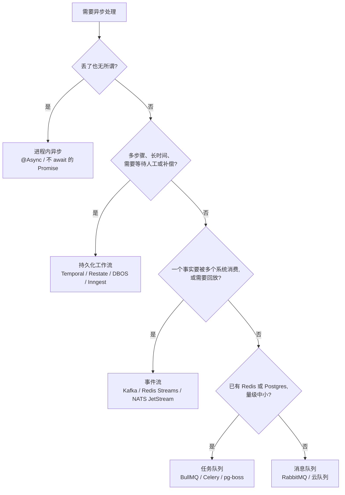
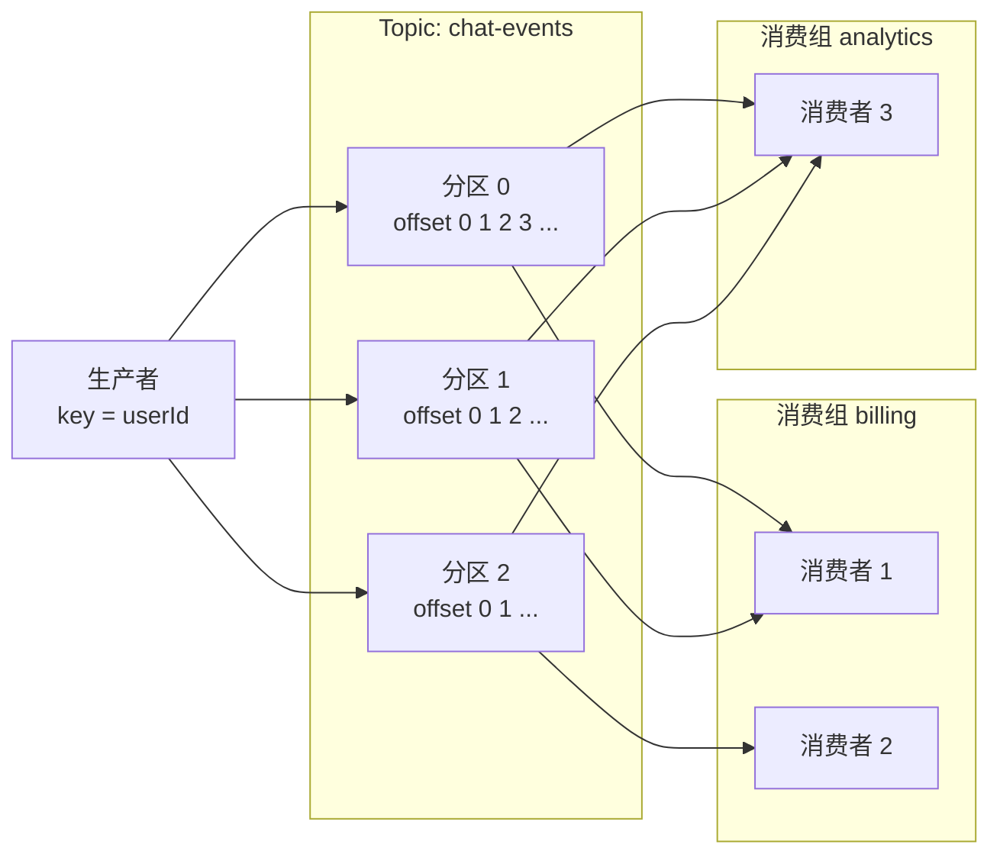
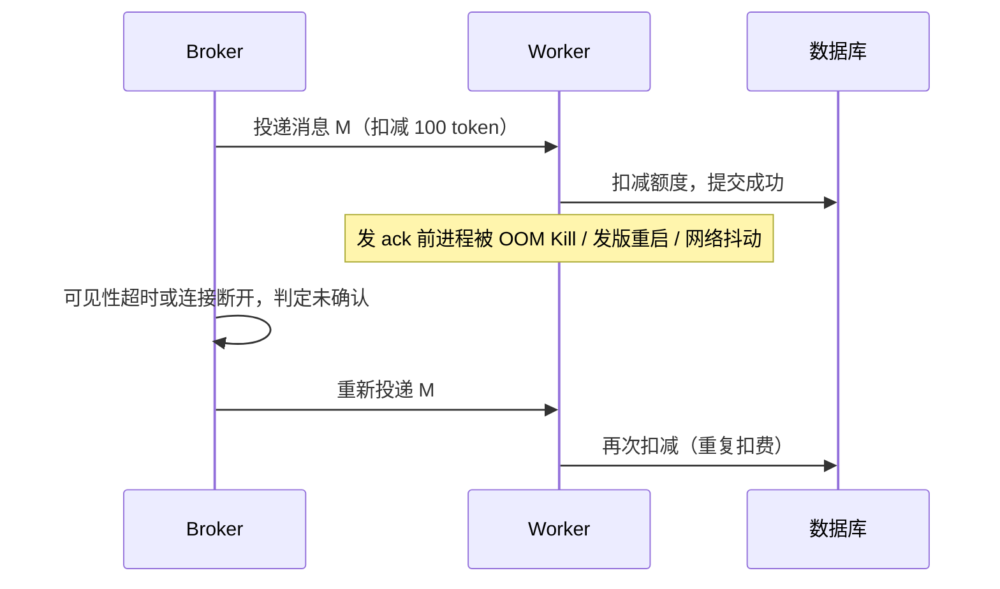
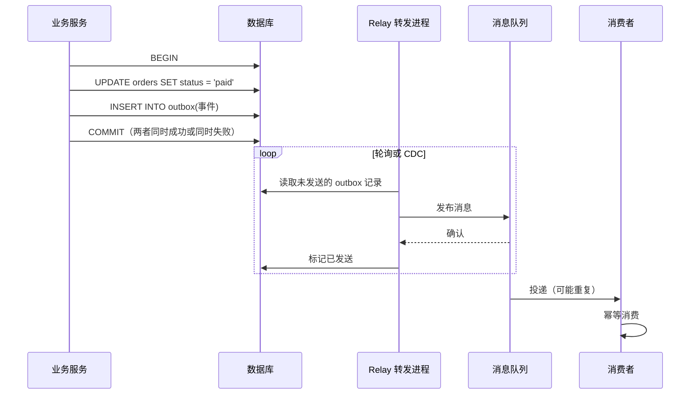
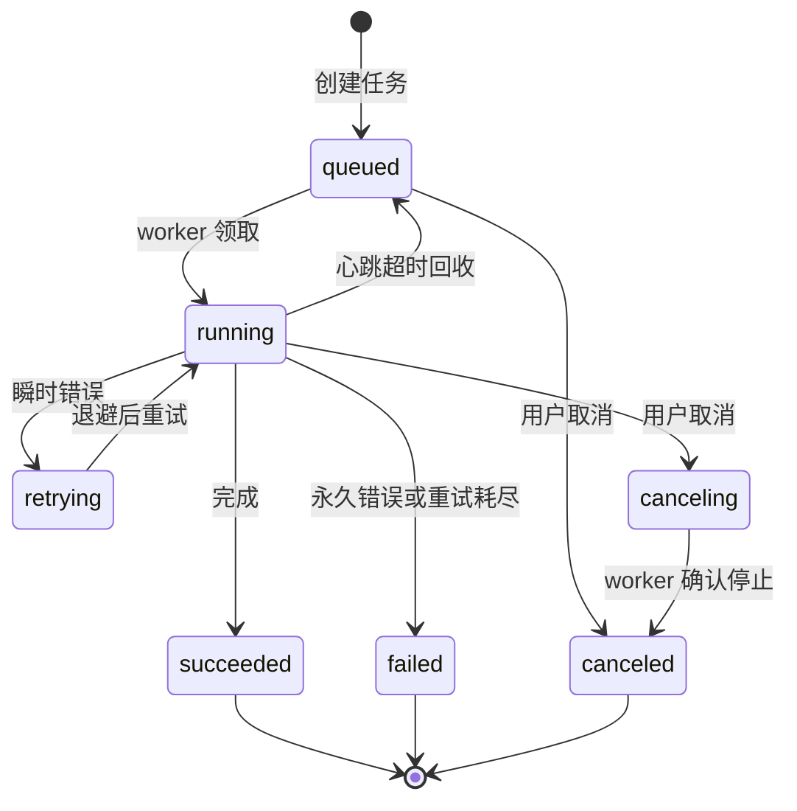

# 07 异步任务与消息队列

> 本章目标：能判断**什么时候该异步**，分清**任务队列、消息队列、事件流、工作流引擎**并做出选型；理解 **at-least-once + 幂等消费** 这一工程事实，掌握重试、死信、**Outbox**、分布式定时任务与任务状态建模，在 review 时认出"消息丢了""任务跑了两次""写库成功但消息没发"这三类高发问题。
>
> 版本基线：Kafka 4.x（4.0 起仅支持 KRaft 模式，share groups 自 4.2 起 GA）、RabbitMQ 4.x（4.0 起移除经典镜像队列）、BullMQ 6（移除旧 repeatable API，统一为 Job Scheduler）、Celery 5.6、Spring Framework 7 / Spring Boot 4、Debezium 3.x、ShedLock 7.x。具体参数以官方文档为准。
>
> 边界：长任务的 **API 形态**（202 + 轮询 / SSE）见 [03 章第九节](./03-API设计.md#九长任务-api)；跨服务的 **Saga** 见 [10 章](../L3-架构与分布式/10-分布式系统基础.md)；知识库入库流水线的完整设计见 [11 章](../L3-架构与分布式/11-系统设计案例.md)；**Agent 场景下的持久化执行**见 [企业级 06 章 6.2](../../企业级AI应用开发实战/06-Agent工程化-从Loop到生产.md#62-为什么需要持久化执行)。

---

## 一、何时该异步

### 1.1 判断表

同步处理的含义是：调用方在一次请求里等到结果。满足下表任一条，就应考虑把工作移出请求链路。

| 信号 | 判断标准 | 例子 |
|---|---|---|
| **耗时长** | 超过用户可接受的等待（通常数秒），或超过网关 / 反代超时 | 解析 200 页 PDF、批量 embedding |
| **可失败、需重试** | 依赖不稳定的外部服务，失败后应自动重试而不是让用户重新点 | 调用 LLM、第三方支付回调通知 |
| **削峰** | 请求量突发远超处理能力，允许延迟处理 | 批量导入、营销活动期间的消息推送 |
| **解耦** | 主流程不应关心下游有几个、是否可用 | 注册成功后发邮件、发积分、写审计 |
| **跨服务通知** | 一个事实需要被多个服务感知 | "订单已支付"通知库存、账单、数据仓库 |

反过来，**用户必须立即看到结果、且处理很快**的操作（查询、简单写入）保持同步。异步不是免费的：它引入最终一致、重复执行、排障链路变长等问题，本章大部分篇幅都在处理这些代价。

### 1.2 AI 应用中的典型异步场景

| 场景 | 为什么异步 | 关键设计点 |
|---|---|---|
| **文档解析与 embedding 入库** | 单文档可能耗时数分钟，且解析、切片、向量化各步都可能失败 | 按步骤拆任务、每步幂等、进度可见；增量更新见 [企业级 07 章第八节](../../企业级AI应用开发实战/07-企业级RAG落地.md#八增量更新与数据生命周期) |
| **批量评测** | 数百条用例 × 多个模型，总耗时长，受限于模型 API 的速率限制 | 控制并发、遵守 429、结果可断点续跑 |
| **长 Agent 任务** | 深度研究、代码修改可能运行几十分钟，期间可能等待人工审批 | 状态持久化、可取消、可恢复（第八节） |
| **账单与用量汇总** | 按小时 / 天聚合 token 用量，与实时请求无关 | 定时任务、多实例不重复执行（第七节） |
| **会话后处理** | 对话结束后提取长期记忆、生成标题、内容审核 | 不阻塞响应，失败可丢弃或重试 |

### 1.3 AI 最常写错的"异步"

让 AI"把这个改成异步"，最常见的产物是**进程内的发后即忘**：

```typescript
// ❌ 反例：请求返回后在进程内"后台"执行
app.post("/documents", async (req, reply) => {
  const doc = await db.document.create({ data: req.body });
  processDocument(doc.id);          // 不 await，也不进队列
  return reply.code(202).send({ id: doc.id });
});
```

问题在于：**进程重启、发版、OOM 时任务直接消失**，没有重试、没有并发控制、没有可观测性。FastAPI 的 `BackgroundTasks`、Spring 的 `@Async` 本质相同（后者还有同类内部调用不经过代理导致注解失效的陷阱）。

```typescript
// ✅ 正例：写库后投递到持久化队列，由独立 worker 处理
app.post("/documents", async (req, reply) => {
  const doc = await db.document.create({ data: { ...req.body, status: "queued" } });
  await ingestQueue.add("ingest", { docId: doc.id }, {
    jobId: `ingest:${doc.id}`,               // 同一文档不重复入队
    attempts: 5,
    backoff: { type: "exponential", delay: 2000 },
  });
  return reply.code(202).send({ id: doc.id, status: "queued" });
});
```

> ⚠️ **注意**：上面的正例仍有"写库成功、入队失败"的双写缺口，严格场景需要第六节的 Outbox。进程内后台任务只适合**丢了也无所谓**的工作（如刷新一个本地缓存、记录一条非关键埋点）。

---

## 二、四类工具：任务队列、消息队列、事件流、工作流引擎

### 2.1 概念区分

这四类工具经常被混称为"MQ"，但解决的问题不同：

| 类别 | 核心抽象 | 消息被消费后 | 典型用途 | 前端类比 |
|---|---|---|---|---|
| **任务队列** | "执行这个函数" | 删除 | 后台作业、重试、定时任务 | 带持久化和重试的 `requestIdleCallback` |
| **消息队列** | "这里有一条消息，按路由投递" | 确认后删除 | 服务间解耦、工作分发 | 按规则分拣的邮局 |
| **事件流** | "追加到一条有序日志" | **保留**，消费者自己记位置 | 事件溯源、多订阅方、数据管道、回放 | 可回放的 Redux action 日志 |
| **持久化工作流** | "这是一个多步骤流程，每步结果存档" | 流程级状态长期保存 | 长流程、跨步骤补偿、等待人工 | 带存档点的游戏关卡 |

> 📖 **术语**：**Broker**：消息中间件的服务端（Kafka、RabbitMQ 节点）。**生产者 / 消费者**：发消息和处理消息的一方。**Worker**：任务队列中执行任务的进程。

### 2.2 选型表

| 产品 | 类别 | 依赖 | 适合 | 注意 |
|---|---|---|---|---|
| **BullMQ** | 任务队列（Node） | Redis | Node 项目的后台任务、延迟任务、定时任务、限速 | v6 起定时任务统一用 Job Scheduler；Redis 需开启持久化并设置 `maxmemory-policy noeviction` |
| **Celery** | 任务队列（Python） | RabbitMQ / Redis 等 | Python 生态最成熟，功能全 | 默认在**执行前**确认消息，需显式配置 `acks_late`（见 4.1） |
| **Dramatiq** | 任务队列（Python） | RabbitMQ / Redis | 比 Celery 简洁，默认行为更安全 | 生态较小 |
| **arq** | 任务队列（Python，asyncio） | Redis | 轻量异步任务 | 官方已声明**仅维护模式**，新项目谨慎选用 |
| **Spring `@Async`** | 进程内异步 | 无 | 不怕丢的轻量后台工作 | **不是队列**：无持久化、无重试 |
| **JobRunr** | 任务队列（Java） | 数据库或 Redis 等 | Java 项目要持久化后台任务，又不想引入 MQ | 以官方文档为准选存储 |
| **pg-boss / Procrastinate** | 任务队列（Node / Python） | PostgreSQL | 已有 Postgres、量不大，希望任务与业务写入同库同事务 | 基于 `SKIP LOCKED`，吞吐上限低于专用 MQ |
| **RabbitMQ** | 消息队列 | 自身集群 | 灵活路由、工作分发、请求级消息 | 4.x 用 quorum queue 做高可用 |
| **Kafka** | 事件流 | 自身集群（KRaft） | 高吞吐、多订阅方、需要回放、数据管道与 CDC | 运维成本最高；不适合"一条消息一个任务、需要单条重试"的场景（4.2 起的 share groups 在补这块） |
| **Redis Streams** | 轻量事件流 | Redis | 已有 Redis、量中等、要消费组语义 | 持久性取决于 Redis 持久化配置 |
| **NATS（JetStream）** | 消息 + 流 | 自身集群 | 云原生、低延迟、边缘场景 | 核心 NATS 无持久化，需 JetStream |
| **云队列**（SQS、云厂商 MQ） | 消息队列 | 托管 | 不想运维中间件 | 注意可见性超时、消息大小上限、厂商锁定 |
| **Temporal** | 持久化工作流 | 自身集群或 Temporal Cloud | 长流程、强可靠、多语言 | 最成熟也最重；工作流代码有确定性约束 |
| **Restate / DBOS / Inngest** | 持久化执行 | 单二进制 / Postgres / 托管平台 | 中小规模的多步骤流程 | 生态较年轻，许可与自托管条款以官方为准 |

### 2.3 选型路径



> 🎯 **落地要点**：中小型 AI 应用的合理起点是**复用已有基础设施**：Node 项目用 BullMQ + Redis，Python 项目用 Celery / Dramatiq，Java 项目用 JobRunr 或 Spring + RabbitMQ；Postgres 足够时用 pg-boss / Procrastinate 还能让"写业务数据 + 入队"处在同一事务里。**不要因为"大厂都用 Kafka"就为一个后台任务引入 Kafka 集群。**

---

## 三、Kafka 与 RabbitMQ 核心概念

AI 生成的消息代码大多基于这两者，读懂它们的模型才能判断配置是否合理。

### 3.1 Kafka：分区日志



| 概念 | 含义 | review 时关注 |
|---|---|---|
| **Topic** | 一类消息的逻辑名称 | 命名、保留时长 |
| **Partition** | Topic 的物理分片，每个分区是一条只追加的日志 | 分区数决定**同一消费组的最大并行度** |
| **Offset** | 消息在分区内的序号；消费者提交 offset 记录"读到哪了" | 何时提交 offset 决定投递语义 |
| **Consumer Group** | 一组共同消费一个 Topic 的消费者；**一个分区同一时刻只分给组内一个消费者** | 不同组互不影响，各自独立读全量消息 |
| **Key** | 生产时指定，相同 key 进入同一分区 | 需要有序的实体必须用其 ID 做 key |
| **Rebalance** | 组内消费者增减时重新分配分区 | 处理中的消息可能被重复消费 |

**有序性边界**：Kafka 只保证**单分区内有序**。同一用户的事件要有序，就必须用 `userId` 做 key；不指定 key 时消息分散到各分区，全局无序。消费者数量超过分区数时，多出的消费者空闲。

> ⚠️ **注意**：Kafka 消费者的 `enable.auto.commit` 默认开启，按固定间隔在后台提交 offset，与"是否处理完成"无关：处理到一半崩溃，可能**丢消息**（已提交未处理）或**重复**（已处理未提交）。业务关键消费应**处理成功后手动提交**。Spring Kafka 默认由监听容器管理提交，行为不同，以其文档为准。

### 3.2 RabbitMQ：交换机路由

| 概念 | 含义 | review 时关注 |
|---|---|---|
| **Exchange** | 接收消息并按规则路由，自身不存消息 | 类型：`direct`（精确匹配）、`topic`（通配符）、`fanout`（广播）、`headers` |
| **Queue** | 存储消息直到被确认 | 4.x 中高可用用 **quorum queue**；经典队列不再支持镜像复制 |
| **Binding / Routing Key** | 队列与交换机的绑定规则 | 没有匹配绑定的消息默认被丢弃 |
| **Ack / Nack** | 消费者确认处理成功 / 失败 | 必须**手动 ack**；自动 ack 等于投递即删除 |
| **Prefetch** | 未确认消息的最大数量 | 不设或过大会让一个消费者囤积大量消息 |
| **Publisher Confirm** | Broker 确认已持久化 | 生产者不开启则无法知道消息是否真的写入 |

### 3.3 对照

| 维度 | Kafka | RabbitMQ |
|---|---|---|
| 模型 | 分区日志，消费不删除 | 队列，确认后删除 |
| 多订阅方 | 天然支持，每个消费组独立读 | 每个订阅方一个队列，交换机复制 |
| 回放历史 | 重置 offset 即可 | 经典队列与 quorum queue 不支持；Streams 队列类型支持 |
| 单条重试 | 弱：分区内一条卡住会阻塞后续，需重试 topic | 强：nack 单条、死信 |
| 顺序 | 分区内有序 | 单队列单消费者时有序 |
| 吞吐 | 极高 | 高 |
| 适合 | 事件总线、数据管道、CDC、审计流 | 任务分发、复杂路由、请求级消息 |

---

## 四、投递语义与幂等消费（重点）

### 4.1 三种语义的真相

| 语义 | 实现方式 | 后果 | 何时可接受 |
|---|---|---|---|
| **at-most-once**（至多一次） | 先确认再处理 | 处理失败时**消息丢失** | 指标采样、非关键日志 |
| **at-least-once**（至少一次） | 处理成功后再确认 | 确认前崩溃会**重复投递** | **绝大多数业务的默认选择** |
| **exactly-once**（恰好一次） | 见下文 | 只在特定边界内成立 | — |

重复投递在 at-least-once 下**一定会发生**，而不是偶尔：



**exactly-once 的真相**：

- **Kafka 事务**能保证"从 Kafka 读 → 处理 → 写回 Kafka"这个闭环内恰好一次；一旦处理过程写了数据库或调用了外部 API，这个保证就不覆盖了
- **SQS FIFO** 的"exactly-once processing"指在 5 分钟去重窗口内不产生重复消息；消费者处理完但删除消息前崩溃，仍会重复处理
- **端到端恰好一次 = at-least-once 投递 + 幂等消费**。这是工程上唯一可靠的做法

> ⚠️ **注意**：Celery 默认在任务**开始执行前**确认消息（接近 at-most-once），worker 崩溃时任务丢失。关键任务应设置 `task_acks_late = True` 与 `task_reject_on_worker_lost = True`，此时语义变为 at-least-once，任务必须幂等。使用 Redis 作为 broker 时还要注意**可见性超时**（默认 1 小时）：任务执行超过该时长未确认，会被重新投递给另一个 worker，造成同一任务并发执行两份。

### 4.2 三种幂等实现方式

> 📖 **术语**：**幂等（Idempotent）**：同一操作执行一次和执行多次，对系统状态的影响相同。HTTP 层的幂等键见 [03 章第七节](./03-API设计.md#七幂等键idempotency-key)，本节讲消费侧。

| 方式 | 做法 | 适合 | 局限 |
|---|---|---|---|
| **去重表**（Inbox） | 消费前在 `processed_messages` 表插入消息 ID（主键唯一），与业务写入**同一事务** | 通用，任何消息 | 需要清理历史；外部副作用不在事务内 |
| **业务唯一键** | 利用业务天然唯一性：`INSERT ... ON CONFLICT DO NOTHING` | 创建类操作：入库一条 chunk、生成一张账单 | 依赖业务有唯一键 |
| **状态机** | 只允许合法状态迁移：`UPDATE ... SET status='done' WHERE id=? AND status='processing'` | 有生命周期的实体：订单、任务、文档 | 需要先设计好状态 |

**外部副作用怎么办**：调用 LLM、发邮件、调用支付这些操作不在数据库事务里。做法是：① 把外部调用的**幂等键**（如消息 ID）传给支持幂等的下游（支付、邮件服务通常支持）；② 先把"已发起"写入状态机，重复消息看到该状态就跳过或查询结果；③ 实在无法幂等的（如部分短信通道），接受极低概率的重复，并在业务上可补偿。

### 4.3 三栈示例

**反例**：AI 写的消费者通常直接处理，没有任何去重：

```python
# ❌ 重复投递时重复记账
@celery_app.task(acks_late=True)
def record_usage(event: dict):
    db.execute("UPDATE quota SET used = used + %s WHERE tenant_id = %s",
               (event["tokens"], event["tenant_id"]))
```

**Java（Spring Kafka + 去重表）**：

```java
@KafkaListener(topics = "usage-events", groupId = "billing")
@Transactional
public void onUsage(UsageEvent event) {
    // 主键冲突说明已处理过；与业务更新同事务，任一失败一起回滚
    int inserted = jdbc.update("""
        INSERT INTO processed_messages(consumer, message_id) VALUES ('billing', ?)
        ON CONFLICT DO NOTHING""", event.eventId());
    if (inserted == 0) return;

    jdbc.update("UPDATE quota SET used = used + ? WHERE tenant_id = ?",
                event.tokens(), event.tenantId());
}
```

**TypeScript（BullMQ + 业务唯一键）**：

```typescript
new Worker("embed", async (job) => {
  const { docId, chunkIndex, text } = job.data;
  const vector = await embed(text);  // 外部调用：重复时只多花一次费用，不影响正确性
  // (doc_id, chunk_index) 唯一约束保证重复执行不会插入两份
  await sql`
    INSERT INTO chunks (doc_id, chunk_index, content, embedding)
    VALUES (${docId}, ${chunkIndex}, ${text}, ${vector})
    ON CONFLICT (doc_id, chunk_index) DO NOTHING`;
}, { connection, concurrency: 8 });
```

**Python（Celery + 状态机）**：

```python
@celery_app.task(bind=True, acks_late=True, autoretry_for=(TransientError,),
                 retry_backoff=True, max_retries=5)
def generate_report(self, report_id: str):
    # 抢占：只有 queued 状态能进入 processing，重复消息在这里被挡住
    claimed = db.execute("""
        UPDATE reports SET status = 'processing', started_at = now()
        WHERE id = %s AND status = 'queued'""", (report_id,)).rowcount
    if claimed == 0:
        return  # 已在处理或已完成

    content = call_llm(report_id)
    db.execute("""UPDATE reports SET status = 'done', content = %s
                  WHERE id = %s AND status = 'processing'""", (content, report_id))
```

> ⚠️ **注意**：状态机示例中，如果任务在 `processing` 状态崩溃，重投的消息会被永久挡住。需要配合**超时回收**：`processing` 超过阈值且无心跳的任务被重置为 `queued`（第八节）。

> 🎯 **落地要点**：review 消费者代码时只问一个问题：**这条消息被处理两次会怎样？** 答不上来或答案是"会出错"，就是缺陷。

---

## 五、重试、死信与积压

### 5.1 重试与退避

先区分错误类型，再决定是否重试：

| 错误类型 | 例子 | 处理 |
|---|---|---|
| **瞬时错误** | 网络超时、429、503、数据库连接中断 | 指数退避重试 |
| **永久错误** | 参数校验失败、文档格式不支持、资源已删除 | **立即失败**，进死信或标记失败 |
| **毒消息** | 消息格式损坏，反序列化必然失败 | 立即进死信，不要无限重试 |

各栈的重试配置：

| 技术栈 | 重试配置 | 永久失败的处理 |
|---|---|---|
| BullMQ | `attempts` + `backoff: { type: "exponential", delay }` | 抛 `UnrecoverableError` 跳过剩余重试；失败任务留在 failed 集合，可手动重试 |
| Celery | `autoretry_for`、`retry_backoff`、`max_retries`、`retry_jitter` | 超过次数抛出异常，需自行记录或路由到失败队列 |
| Spring Kafka | `DefaultErrorHandler` + `BackOff`；或 `@RetryableTopic` 非阻塞重试 | 配置 `DeadLetterPublishingRecoverer` 发往 DLT |
| RabbitMQ | nack 后重新入队；quorum queue 有投递次数上限（4.0 起默认 20） | 超限后转入配置的死信交换机，未配置则丢弃 |

> ⚠️ **注意**：Spring Kafka 的 `DefaultErrorHandler` 默认在有限次快速重试后**记录日志并跳过**该记录，等于静默丢弃。业务消费必须显式配置死信。

**Kafka 的特殊性**：同一分区内一条消息反复重试会阻塞后面所有消息。常见做法是**重试 topic**：失败消息转发到 `orders-retry-1m`、`orders-retry-10m` 等延迟 topic，主 topic 继续消费，最终失败进入 `orders-dlt`。代价是这条消息与同 key 后续消息的顺序被打破。

### 5.2 死信队列与重放

> 📖 **术语**：**死信队列（DLQ / DLT）**：存放多次处理失败的消息，避免它们阻塞正常消息或被静默丢弃。

完整链路是：主队列 → 消费失败 → 退避重试 → 超过次数或永久错误进入死信 → 告警与人工排查 → 修复后重放回主队列，或确认无效后归档。死信不是终点，必须配套：

- **告警**：死信数量 > 0 即告警，不能只看日志
- **保留上下文**：消息体、失败原因、堆栈、重试次数、首次失败时间
- **重放工具**：修复 bug 后能按条件（时间范围、错误类型）把死信重新投回主队列；重放依赖消费幂等，否则会二次出错

### 5.3 消息顺序

多数业务**不需要全局有序**，只需要**同一实体内有序**（同一文档的"创建 → 更新 → 删除"）。

| 手段 | 做法 | 代价 |
|---|---|---|
| 分区键 | Kafka 用实体 ID 做 key；RabbitMQ 按实体哈希分到多个单消费者队列 | 热点实体导致分区倾斜 |
| 版本号 | 消息带单调递增版本，消费时丢弃比当前版本旧的消息 | 需要存当前版本 |
| 只发通知不带数据 | 消息只说"文档 X 变了"，消费者回源读最新状态 | 多一次读 |

> ⚠️ **注意**：重试、并发消费（`concurrency > 1`）、死信重放都会打破顺序。AI 生成的代码经常在需要有序的消费者上随手设置高并发。

### 5.4 消息积压排查

积压（backlog）指消息生产速度持续大于消费速度。先看这几项指标：

| 指标 | 含义 | 异常时的方向 |
|---|---|---|
| **消费延迟 / lag** | Kafka 为各分区的 offset 差；队列为待处理消息数 | 持续增长 = 消费能力不足 |
| **最老消息的等待时长** | 比数量更能反映用户体验 | 超过 SLA 即告警 |
| **单条处理耗时**（P50 / P99） | 消费者是否变慢 | 下游变慢（LLM、数据库） |
| **失败率与重试率** | 是否在反复重试 | 重试占满了消费能力 |

排查顺序：① **生产端是否突增**（批量导入、重试风暴、bug 导致重复发送）→ ② **消费端是否变慢**（单条耗时上升通常是下游问题：慢查询、LLM 限流 429）→ ③ **是否有毒消息卡住**（Kafka 某个分区 lag 增长而其他分区正常）→ ④ **扩容是否有效**（Kafka 消费者数不能超过分区数；下游是瓶颈时扩消费者只会把压力传给下游）→ ⑤ **应急**：临时扩容、暂停非关键消费、把积压转存到临时 topic 慢慢消化。

---

## 六、事务性发件箱 Outbox（重点）

### 6.1 双写问题

业务写数据库、再发消息，是两个独立系统的两次写入，任一步失败都会不一致：

```java
// ❌ 反例一：先提交再发送——提交成功后进程崩溃，消息永远不会发出
@Transactional
public void completePayment(long orderId) {
    orderRepo.markPaid(orderId);
}
// 调用方：completePayment(id); kafkaTemplate.send("order-paid", id);

// ❌ 反例二：事务内发送——消息发出后事务回滚，下游收到一个不存在的"已支付"
@Transactional
public void completePayment(long orderId) {
    orderRepo.markPaid(orderId);
    kafkaTemplate.send("order-paid", String.valueOf(orderId));
    ledgerRepo.insert(...);   // 这里抛异常，订单回滚，但消息已经发出
}
```

两种写法 AI 都很常写，且在测试环境几乎不会暴露。

### 6.2 Outbox 模式

思路：**把"要发的消息"作为一行数据，与业务数据在同一个数据库事务里写入**，再由独立的转发进程（relay）把它投递到 MQ。



Relay 在"发布成功、标记已发送"之间崩溃会重发，所以 Outbox 提供的是 **at-least-once**，消费端仍需幂等。

### 6.3 实现要点

```sql
CREATE TABLE outbox (
    id            uuid PRIMARY KEY,           -- 同时作为消息 ID，供消费端去重
    aggregate_id  text NOT NULL,              -- 用作分区键，保证同一实体有序
    event_type    text NOT NULL,
    payload       jsonb NOT NULL,
    created_at    timestamptz NOT NULL DEFAULT now(),
    published_at  timestamptz
);
CREATE INDEX ON outbox (created_at) WHERE published_at IS NULL;
```

轮询式 relay，多实例并发运行时用 `SKIP LOCKED` 避免抢同一批：

```sql
-- 在一个事务内：取一批、发送、标记 published_at
SELECT * FROM outbox WHERE published_at IS NULL
ORDER BY created_at LIMIT 100
FOR UPDATE SKIP LOCKED;
```

> 📖 **术语**：**`FOR UPDATE SKIP LOCKED`**：锁住选中的行，并跳过已被其他事务锁住的行。多个 worker 可以并发领取不同的行而不互相等待，是"用 Postgres 当队列"的核心语法。锁的原理见 [04 章](./04-数据库与数据建模.md)。

- 已发送记录定期清理，避免表无限增长
- 发送失败的记录要有重试上限与告警，不要让一条坏消息阻塞后面所有消息
- 若任务队列本身就在同一个 Postgres（pg-boss、Procrastinate），**直接在业务事务里入队**即可，不需要 Outbox

### 6.4 CDC 方式

> 📖 **术语**：**CDC（Change Data Capture，变更数据捕获）**：读取数据库的复制日志（Postgres 的 WAL、MySQL 的 binlog），把每次行变更转成事件。

用 **Debezium** 监听 outbox 表的插入，自动发布到 Kafka（其 Outbox Event Router 专门处理这种表结构），省去轮询，延迟更低。代价是要运维 Debezium 与 Kafka Connect，并关注复制槽堆积等数据库侧问题。

| 方式 | 延迟 | 运维成本 | 适合 |
|---|---|---|---|
| 轮询 relay | 秒级（取决于轮询间隔） | 低，几十行代码 | 大多数项目 |
| CDC（Debezium） | 亚秒级 | 高 | 已有 Kafka 平台、事件量大 |

> 🎯 **落地要点**：Outbox 解决"本地事务 + 发消息"的原子性；跨多个服务的业务一致性（如下单 → 扣库存 → 扣额度，任一失败需补偿）是 **Saga** 的范畴，见 [10 章](../L3-架构与分布式/10-分布式系统基础.md)。Saga 的每一步通常都靠 Outbox 可靠地发出下一步事件。

---

## 七、定时任务

### 7.1 分布式环境下的重复执行

单机时代 `@Scheduled` / `node-cron` / `APScheduler` 没有问题。服务部署多个副本后，**每个副本都会执行一次**：账单汇总跑三遍、提醒邮件发三封。

```java
// ❌ 部署 3 个副本 = 每天生成 3 份账单
@Scheduled(cron = "0 0 2 * * *")   // Spring cron 为 6 位：秒 分 时 日 月 周
public void dailyBilling() { billingService.aggregate(LocalDate.now().minusDays(1)); }
```

| 方案 | 做法 | 适合 | 注意 |
|---|---|---|---|
| **ShedLock**（Java） | 用数据库 / Redis 记录锁，同一时刻只有一个副本执行 | Spring 项目首选 | `lockAtMostFor` 要大于最长执行时间 |
| **分布式锁** | 任务开始时抢 Redis 锁，抢不到就跳过 | 任意语言 | 锁过期而任务未结束会并发执行，见 [05 章第六节](./05-缓存与Redis.md#六分布式锁) |
| **队列自带调度** | BullMQ Job Scheduler、Celery beat 投递到队列，由任一 worker 消费一次 | 已使用任务队列 | Celery beat 本身只能运行**一个实例** |
| **外部调度器** | K8s CronJob、云厂商定时触发 | 任务独立、低频 | CronJob 设置 `concurrencyPolicy: Forbid` 防重叠 |
| **业务幂等兜底** | 以"业务日期"为唯一键：`INSERT INTO billing_runs(date) ...` 冲突即跳过 | **所有方案都应叠加** | — |

**Java（ShedLock）**：

```java
@Scheduled(cron = "0 0 2 * * *", zone = "Asia/Shanghai")
@SchedulerLock(name = "dailyBilling", lockAtMostFor = "PT30M", lockAtLeastFor = "PT1M")
public void dailyBilling() {
    billingService.aggregate(LocalDate.now(ZoneId.of("Asia/Shanghai")).minusDays(1));
}
// 另需 @EnableSchedulerLock 与 LockProvider Bean，否则注解不生效
```

**TypeScript（BullMQ Job Scheduler）**：

```typescript
// 按 id upsert：每个副本启动时都执行这行也只会有一个调度
await billingQueue.upsertJobScheduler(
  "daily-billing",
  { pattern: "0 0 2 * * *", tz: "Asia/Shanghai" },
  { name: "aggregate", data: {} },
);
```

**Python（Celery beat）**：在 `beat_schedule` 中用 `crontab(hour=2, minute=0)` 声明调度并设置 `timezone`；beat 作为独立进程**只部署 1 个副本**，worker 可以多副本。

> ⚠️ **注意**：BullMQ v6 移除了旧的 `repeat` 选项与 `getRepeatableJobs` 等 API，从 v5 升级前需要先迁移到 Job Scheduler 并清理 Redis 中的旧配置。AI 基于旧资料生成的 `queue.add(name, data, { repeat })` 在 v6 中无法使用。

### 7.2 定时任务的其他陷阱

- **时区**：服务器、容器、数据库、调度库的默认时区可能都不同；显式指定时区，业务日期计算与调度使用同一时区
- **执行重叠**：任务耗时超过调度间隔，下一次已经开始；加锁或配置禁止并发
- **错过执行**（misfire）：发版、宕机期间错过的调度是否补跑？对账类任务通常需要补跑，提醒类通常不需要；让任务以"处理哪个时间窗口"为参数，而不是"处理现在"
- **大批量处理**：一次处理全部用户容易超时、占满连接池；定时任务只负责**按批次投递子任务**到队列，由 worker 并发处理

---

## 八、任务状态建模、进度、取消与超时

### 8.1 状态机

长任务（文档入库、批量评测、Agent 任务）需要在数据库中有一行记录，作为 API 查询、前端展示和运维排障的唯一事实来源。



```sql
CREATE TABLE jobs (
    id uuid PRIMARY KEY, tenant_id uuid NOT NULL,
    type      text NOT NULL,                     -- ingest / eval / agent_run
    status    text NOT NULL DEFAULT 'queued',
    progress  int  NOT NULL DEFAULT 0,           -- 0~100，或存 done/total
    attempts  int  NOT NULL DEFAULT 0,
    input jsonb NOT NULL, result jsonb,
    error     jsonb,                             -- 错误码与可展示信息，不放堆栈
    heartbeat_at timestamptz, deadline_at timestamptz,
    created_at timestamptz NOT NULL DEFAULT now(), updated_at timestamptz NOT NULL DEFAULT now()
);
```

与 [03 章长任务 API](./03-API设计.md#九长任务-api) 的配合：`POST` 创建任务返回 `202` 与任务 ID → 前端通过 `GET /jobs/{id}` 轮询或订阅 SSE 获取状态 → 终态后获取结果。队列系统内部的 job 状态（BullMQ、Celery 的结果后端）**不应直接暴露给前端**，以业务表为准，因为队列中的记录会被清理，且不包含租户与权限信息。

### 8.2 进度上报

- **节流写入**：每处理一个 chunk 就写一次数据库会产生大量写入；按百分比变化或时间间隔（如每秒最多一次）更新
- **可选的快速通道**：进度写 Redis 或通过 pub/sub 推给 SSE 连接，终态写数据库
- 框架自带能力：BullMQ `job.updateProgress()`、Celery `self.update_state(state="PROGRESS", meta=...)`，适合内部使用，对外仍以业务表为准
- **分步任务记录每步结果**：入库流水线"解析 → 切片 → embedding → 写索引"每步落库，重试时从失败步骤继续，而不是从头再来

### 8.3 取消

取消是**协作式**的：API 只能把状态改为 `canceling`，worker 在安全点检查并停止。

```python
async def run_agent_job(job_id: str):
    async with asyncio.timeout(MAX_JOB_SECONDS):
        for step in plan:
            if await repo.status(job_id) == "canceling":   # 每步之间检查
                await repo.set_status(job_id, "canceled")
                return
            await execute_step(step)   # 内部的 LLM 调用应能被中断，见 08 章超时
            await repo.heartbeat(job_id)
```

- 正在进行的 LLM 流式调用要能中断（`AbortController` / 取消 asyncio 任务），否则取消后仍在消耗 token
- 已产生的副作用（已写入的 chunk、已发出的通知）要么保留并标记，要么提供清理步骤

### 8.4 超时与僵尸任务

| 超时 | 含义 | 配置要点 |
|---|---|---|
| **单步超时** | 一次 LLM 调用、一次 HTTP 请求 | 见 [08 章](./08-并发与可靠性.md) |
| **任务总超时** | 整个任务的上限（`deadline_at`） | 超时标记为 `failed`，错误码明确 |
| **队列的租约 / 可见性超时** | Broker 认为 worker 已死的时间：SQS 可见性超时、Celery Redis broker 可见性超时、BullMQ 锁时长与 stalled 检测 | **必须大于任务正常耗时**，否则任务被重复投递；长任务需要续租 |
| **心跳超时** | 业务表中 `heartbeat_at` 超过阈值未更新 | 定时扫描，把僵尸任务重置为 `queued` 或标记失败 |

> ⚠️ **注意**：AI 写长任务时常忽略租约超时与任务耗时的关系。一个耗时 20 分钟的 Agent 任务跑在可见性超时 5 分钟的队列上，会在 5 分钟后被投递给第二个 worker，两个 worker 同时执行同一任务、同时扣费。

### 8.5 何时升级到持久化工作流

用任务队列 + 状态表手工实现多步骤长流程，复杂度会快速上升：每步的状态存档、重试、超时、补偿、等待外部事件（人工审批）都要自己写。出现以下情况时考虑持久化工作流引擎：

- 流程步骤多于三四步，且步骤间有分支、并行、补偿
- 需要等待外部事件数小时或数天（人工审批、用户补充材料）
- 进程重启后必须从中断的步骤继续，而不是从头开始

> 🔭 **先锋视角**：Temporal、Restate、DBOS、Inngest 等持久化执行引擎正在成为 Agent 长任务的基础设施：每一步 LLM 调用、工具调用作为一个持久化步骤，崩溃后从最后一步恢复。Agent 场景下的选型与"恢复时工具必须幂等"的要求见 [企业级 06 章 6.2](../../企业级AI应用开发实战/06-Agent工程化-从Loop到生产.md#62-为什么需要持久化执行)。引入前评估运维成本、确定性约束（Temporal 工作流代码不能直接调用随机数、当前时间等非确定性操作）与团队学习成本。

---

## 九、AI 代码审查清单

### 9.1 异步方式

- [ ] 🔴 重要且耗时的工作没有用进程内后台方式（不 await 的 Promise、`BackgroundTasks`、`@Async`）实现
- [ ] 选用的队列与项目已有基础设施匹配，没有为简单后台任务引入 Kafka 等重型组件
- [ ] BullMQ 使用的 Redis 开启了持久化且淘汰策略为 `noeviction`
- [ ] 使用的 API 与依赖的主版本一致（例如 BullMQ v6 中不存在 `repeat` 选项）

### 9.2 投递与幂等

- [ ] 🔴 每个消费者都回答了"同一消息处理两次会怎样"，并有去重表、唯一键或状态机之一保证幂等
- [ ] 🔴 去重记录与业务写入在同一数据库事务中
- [ ] 🔴 消息在**处理成功后**才确认：RabbitMQ 手动 ack、Kafka 处理后提交 offset、Celery 关键任务开启 `acks_late`
- [ ] 消息带全局唯一 ID，而不是依赖消息内容判重
- [ ] 外部副作用（支付、邮件、LLM 计费）向下游传递了幂等键
- [ ] RabbitMQ 生产者开启了 publisher confirm，Kafka 生产者保持 `acks=all` 与幂等生产者设置

### 9.3 重试与死信

- [ ] 🔴 配置了死信去向，失败消息不会被静默丢弃（Spring Kafka 的默认错误处理会记录后跳过）
- [ ] 区分了瞬时错误与永久错误，参数错误、格式错误不进入重试
- [ ] 重试有上限，退避为指数退避且带抖动
- [ ] 死信数量有告警，并有按条件重放的工具
- [ ] 需要有序的消费者使用了实体 ID 做分区键，且没有随意开启并发消费

### 9.4 Outbox 与一致性

- [ ] 🔴 "写库 + 发消息"没有直接双写；使用了 Outbox、同库事务入队或 CDC
- [ ] Outbox relay 多实例运行时使用 `FOR UPDATE SKIP LOCKED` 或单实例
- [ ] Outbox 已发送记录有清理机制

### 9.5 定时任务

- [ ] 🔴 多副本部署时定时任务只执行一次（ShedLock、队列调度、单实例 beat、CronJob）
- [ ] 定时任务以业务时间窗口为幂等键，重复触发不会产生重复结果
- [ ] 显式指定了时区；考虑了执行重叠与错过执行
- [ ] 大批量定时任务拆成子任务投递到队列，而不是单进程循环处理全部数据

### 9.6 长任务与可观测

- [ ] 🔴 队列的可见性超时 / 锁时长大于任务最长正常耗时，长任务有续租或心跳
- [ ] 任务状态以业务表为准，前端不直接读取队列内部状态
- [ ] 任务有总超时、可取消，取消时中断进行中的 LLM 调用；有僵尸任务回收
- [ ] 多步骤任务每步落库，重试从失败步骤继续
- [ ] 监控了队列深度 / lag、最老消息等待时长、处理耗时、失败率；消息携带 trace 上下文（[17 章](../L4-工程与部署/17-可观测性与线上排障.md)）

---

## 本章小结

- 异步的判断依据：**耗时、可失败重试、削峰、解耦、跨服务通知**；进程内"发后即忘"只适合丢了也无所谓的工作
- 四类工具各有定位：**任务队列执行函数、消息队列按路由投递、事件流保留可回放的日志、工作流引擎管理多步骤状态**；优先复用已有的 Redis / Postgres
- Kafka 的有序性只在**分区内**成立，并行度受分区数限制；RabbitMQ 依靠交换机路由与手动 ack
- **端到端恰好一次 = at-least-once + 幂等消费**；幂等三法：去重表、业务唯一键、状态机，去重与业务写入同事务
- 重试区分瞬时与永久错误，配合**指数退避、死信、告警、重放**；重试和并发会破坏顺序
- **Outbox** 把消息作为业务事务的一部分写入，解决"写库成功但消息没发出"的双写问题；CDC 是它的低延迟变体
- 多副本下定时任务必须**只执行一次**，并以业务时间窗口做幂等兜底
- 长任务以**业务状态表**为事实来源，具备进度、取消、总超时与僵尸回收；可见性超时必须大于任务耗时

## 练习

1. **知识库入库流水线**：用你熟悉的栈（BullMQ / Celery / Spring + RabbitMQ）实现"上传 → 解析 → 切片 → embedding → 写入 pgvector"，要求每步幂等、进度可查询、可取消。手动在 embedding 步骤中 `kill -9` worker，验证重启后不会产生重复 chunk，且从失败步骤继续
2. **额度扣减的幂等消费**：模拟 LLM 调用完成后发送用量事件，消费者扣减租户额度。先写一个无幂等的版本，用脚本让同一消息投递 3 次观察额度错误，再分别用去重表和状态机修复
3. **Outbox 实验**：实现"订单支付成功 → 发送 `order-paid` 事件"的 Outbox 表与轮询 relay，部署两个 relay 实例，验证 `SKIP LOCKED` 下没有重复发送；再在"发布成功、标记前"注入崩溃，确认消费端幂等能兜住
4. **定时账单汇总**：把每日 token 用量汇总任务部署为 3 个副本，先观察重复执行，再用 ShedLock、BullMQ Job Scheduler 或单实例 beat 之一修复，并加上以日期为唯一键的兜底
