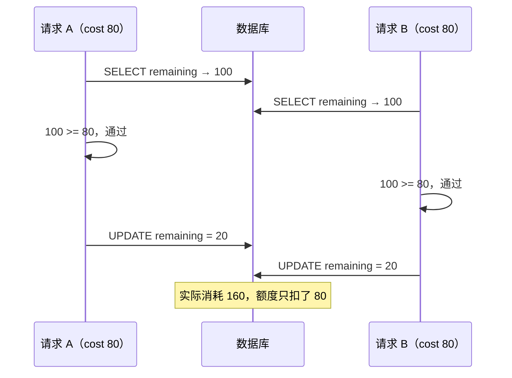
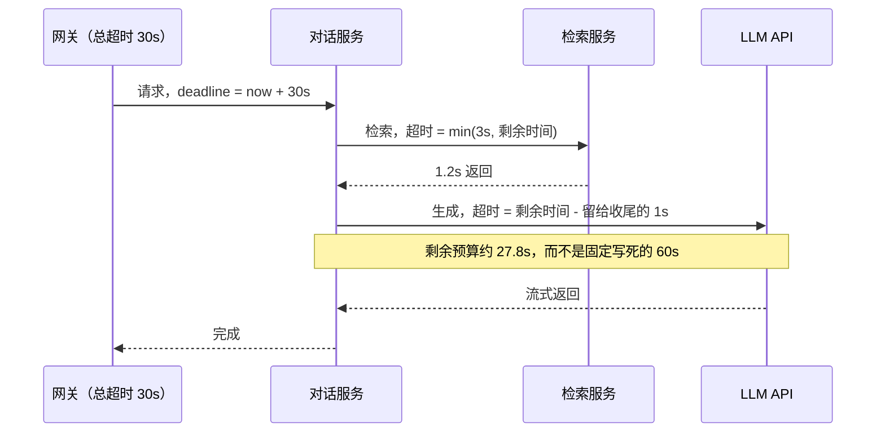
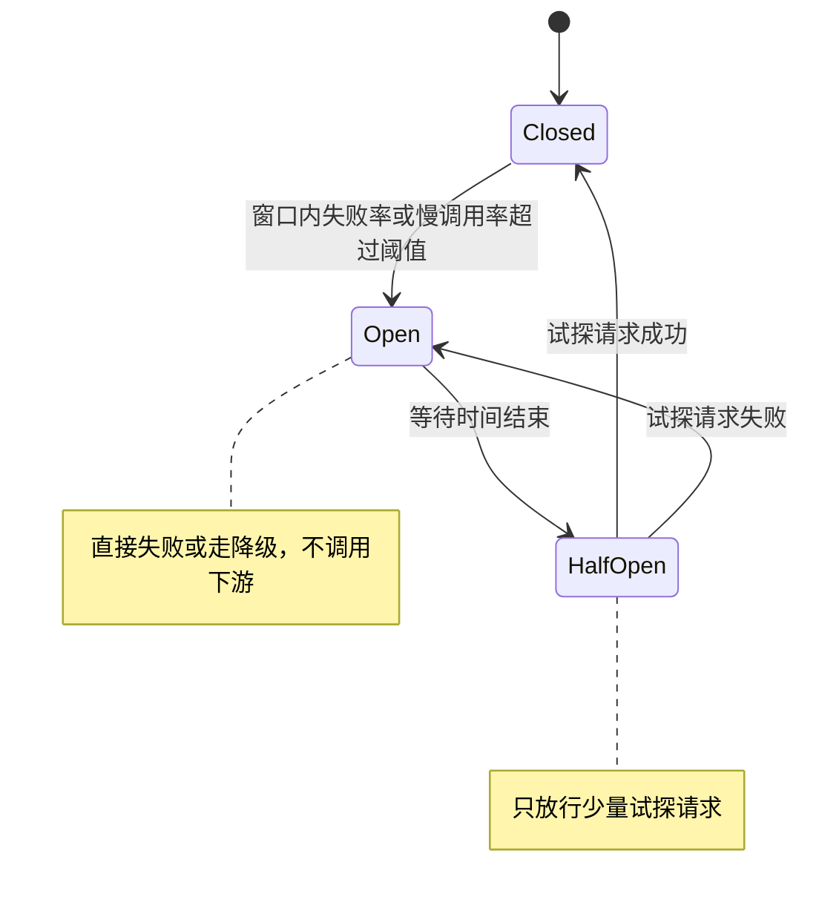
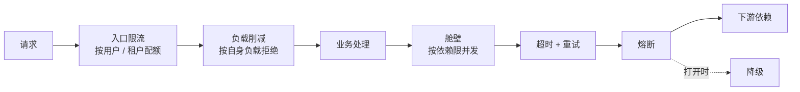
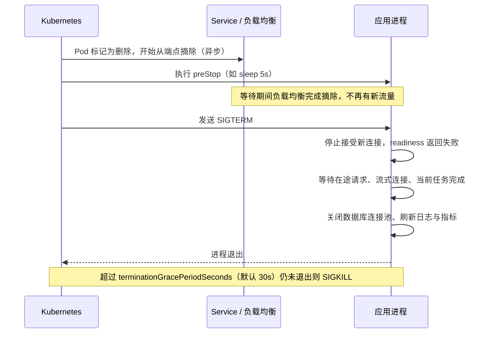

# 08 并发与可靠性

> 本章目标：认出 AI 代码中最隐蔽的一类缺陷——**竞态**，并能在**原子更新、乐观锁、悲观锁、分布式锁**之间做选择；掌握**超时、重试、熔断、舱壁、降级、负载削减、背压**组成的韧性体系，以及**优雅停机**与健康检查的正确做法。
>
> 版本基线：Spring Framework 7（核心内置 `@Retryable` 与 `@ConcurrencyLimit`）、Spring Boot 4（自 3.4 起默认开启优雅停机）、Resilience4j 2.4（提供 `resilience4j-spring-boot4`）、Node.js 26 LTS（19 起 `server.close()` 会关闭空闲 keep-alive 连接）、Kubernetes 1.34 起 preStop `sleep` 动作 GA。具体参数以官方文档为准。
>
> 边界：事务、隔离级别、锁与 MVCC 的**原理**见 [04 章](./04-数据库与数据建模.md)；限流**算法**与 Redis 分布式锁实现见 [05 章](./05-缓存与Redis.md)；队列侧的重试与死信见 [07 章](./07-异步任务与消息队列.md)；探针配置见 [14 章](../L4-工程与部署/14-Kubernetes核心与实践.md)。

---

## 一、应用层竞态

### 1.1 典型场景

> 📖 **术语**：**竞态条件（Race Condition）**：多个并发执行的操作访问共享数据，最终结果取决于它们交错执行的顺序。**先查后写（check-then-act）**：先读取判断，再根据判断结果写入，两步之间状态可能已被他人改变。

| 场景 | AI 应用中的例子 | 竞态后果 |
|---|---|---|
| **余额 / 额度扣减** | 租户 token 额度、用户点数、免费试用次数 | 超额使用、余额为负 |
| **库存** | 限量兑换码、并发许可证 | 超卖 |
| **计数** | 每日调用次数、文档引用计数 | 计数丢失 |
| **唯一性** | 同名知识库、同一用户只能有一个进行中的任务 | 重复创建 |
| **状态迁移** | 任务从 `queued` 改为 `running`、审批从待审批改为已批准 | 两个 worker 同时执行、重复审批 |

这些缺陷有共同特点：**单元测试和手工测试几乎不可能发现**，并发压力一上来就出现，而且往往直接涉及资金。

### 1.2 AI 写出的反例

```typescript
// ❌ 先查后写：两个并发请求都读到 remaining = 100，都通过检查，都扣减
async function consumeQuota(tenantId: string, cost: number) {
  const quota = await db.quota.findUnique({ where: { tenantId } });
  if (quota.remaining < cost) throw new QuotaExceededError();
  await db.quota.update({
    where: { tenantId },
    data: { remaining: quota.remaining - cost },   // 基于旧值计算，写回覆盖
  });
}
```



把这段代码放进事务**并不能**修复它：在 PostgreSQL 默认的 Read Committed 隔离级别下，两个事务依然都能读到 100。修法有以下四种。

### 1.3 修法一：原子条件更新（首选）

把"检查"和"写入"合并成一条 SQL，由数据库保证原子性：

```sql
UPDATE quota SET remaining = remaining - $1
WHERE tenant_id = $2 AND remaining >= $1;
-- 影响行数为 0 = 额度不足（或租户不存在）
```

**Java（Spring Data JPA）**：

```java
@Modifying
@Query("UPDATE Quota q SET q.remaining = q.remaining - :cost " +
       "WHERE q.tenantId = :tenantId AND q.remaining >= :cost")
int tryConsume(@Param("tenantId") UUID tenantId, @Param("cost") long cost);

// 调用处（需在事务内，@Modifying 查询要求 @Transactional）
if (quotaRepo.tryConsume(tenantId, cost) == 0) throw new QuotaExceededException();
```

**TypeScript（Prisma）**：

```typescript
const { count } = await db.quota.updateMany({
  where: { tenantId, remaining: { gte: cost } },
  data: { remaining: { decrement: cost } },
});
if (count === 0) throw new QuotaExceededError();
```

**Python（SQLAlchemy）**：

```python
result = await session.execute(
    update(Quota)
    .where(Quota.tenant_id == tenant_id, Quota.remaining >= cost)
    .values(remaining=Quota.remaining - cost)
)
if result.rowcount == 0:
    raise QuotaExceeded()
```

> 🎯 **落地要点**：数据库层再加一道 `CHECK (remaining >= 0)` 约束作为最后防线。原子更新的关键是**检查影响行数**，AI 生成的代码经常写对了 SQL 却忽略返回值。

### 1.4 修法二：乐观锁

> 📖 **术语**：**乐观锁**：不加锁，写入时检查数据自读取后是否被改过（通常用 `version` 字段），被改过则失败重试。适合冲突少的场景。

```sql
UPDATE documents SET content = $1, version = version + 1
WHERE id = $2 AND version = $3;   -- $3 是读取时的版本；影响行数为 0 = 已被他人修改
```

```java
@Entity
class KnowledgeBase {
    @Id UUID id;
    @Version long version;   // JPA 在 UPDATE 时自动带上版本条件，冲突抛 OptimisticLockException
    String config;
}
```

适合**读取后需要复杂计算再写回**、无法写成一条 SQL 的场景（如编辑一份 JSON 配置、多字段联动校验）。冲突时要么提示用户刷新（"内容已被他人修改"），要么在服务端有限次重试。

### 1.5 修法三：悲观锁

> 📖 **术语**：**悲观锁**：读取时就加锁，其他事务要修改同一行必须等待。`SELECT ... FOR UPDATE` 锁住读到的行直到事务结束。

```python
async with session.begin():
    quota = (await session.execute(
        select(Quota).where(Quota.tenant_id == tenant_id).with_for_update()
    )).scalar_one()
    if quota.remaining < cost:
        raise QuotaExceeded()
    quota.remaining -= cost
    await record_ledger(session, tenant_id, cost)   # 同一事务内写流水
```

- 必须在**事务内**，否则锁在语句结束时就释放了
- **事务内不要做慢操作**：调用 LLM、HTTP 请求会让行锁持有数秒到数分钟，后续请求全部排队，连接池随之耗尽
- 多行加锁时**按固定顺序**（如按 ID 升序），否则容易死锁；可设置 `lock_timeout` 避免无限等待

### 1.6 修法四：分布式锁

当被保护的资源**不在同一个数据库行里**时才需要：例如"同一文档同一时刻只能有一个 embedding 任务"、"同一会话同时只允许一个流式生成"、调用不支持幂等的外部系统。

- 实现与陷阱（锁过期、误删他人的锁、锁续期）见 [05 章第六节](./05-缓存与Redis.md#六分布式锁)
- 锁有过期时间，持有者可能在锁过期后仍在执行。写入共享资源时需要**fencing token**（单调递增的令牌，资源侧拒绝旧令牌的写入），或者把最终写入落回数据库的条件更新上

### 1.7 选择指南

| 场景 | 首选 | 原因 |
|---|---|---|
| 数值增减（额度、库存、计数） | **原子条件更新** | 一条 SQL，无锁等待，性能最好 |
| 唯一性（同名、一人一个） | **唯一约束 / 部分唯一索引** | 数据库强制，代码无需判断 |
| 状态迁移 | **条件更新**：`WHERE status = 'queued'` | 本质是原子 CAS |
| 读后复杂计算再写回、冲突少 | **乐观锁** | 不阻塞读 |
| 读后复杂计算再写回、冲突多，或需同时锁多行 | **悲观锁** | 避免乐观锁反复重试 |
| 资源不在单个数据库中 | **分布式锁** + 最终写入的条件保护 | 跨进程互斥 |

> 🎯 **落地要点**：AI 应用的 token 计费常用**预扣 + 结算**：请求开始前按最大可能消耗原子预扣（`remaining >= max_tokens`），完成后按实际用量退回差额。这样即使并发请求很多，也不会出现"都通过检查、最后一起超额"。按 token 限流与额度扣减的 Redis 实现见 [05 章 7.4](./05-缓存与Redis.md#74-ai-应用按-token-限流与额度扣减)，计费系统的完整设计见 [11 章](../L3-架构与分布式/11-系统设计案例.md)。

---

## 二、单进程内并发

数据库层面的竞态之外，进程内部的共享状态同样会出问题，三种语言的表现形式不同。

### 2.1 Java：共享可变状态

Spring 的 Bean 默认是**单例**，被所有请求线程同时访问。Bean 中的可变字段就是共享状态：

```java
// ❌ 单例 Bean 中的普通 HashMap 与非原子计数，多线程下数据损坏、计数丢失
@Service
class ModelRouter {
    private final Map<String, Integer> failures = new HashMap<>();
    private int total = 0;
    void recordFailure(String model) { failures.merge(model, 1, Integer::sum); total++; }
}

// ✅ 使用并发容器与原子类型；更好的做法是不在 Bean 中保存请求相关状态
@Service
class ModelRouter {
    private final ConcurrentHashMap<String, LongAdder> failures = new ConcurrentHashMap<>();
    void recordFailure(String model) { failures.computeIfAbsent(model, k -> new LongAdder()).increment(); }
}
```

- 常见陷阱：`SimpleDateFormat` 等非线程安全对象作为字段共享（改用 `DateTimeFormatter`）、把当前用户放进 Bean 字段（应放在方法参数或请求作用域）
- **虚拟线程**（`spring.threads.virtual.enabled=true`）不改变线程安全规则，但改变资源模型：线程不再稀缺，**线程池不再隐式限制并发**，下游连接池、模型 API 配额需要显式限流（见 5.3 舱壁）。JDK 24 起 `synchronized` 不再导致虚拟线程钉住载体线程，旧资料中"虚拟线程下禁用 synchronized"的建议已过时

### 2.2 Node：await 间隙的竞态

Node 单线程不等于没有竞态。每个 `await` 都是一次让出，其他请求的代码可以在此期间执行：

```typescript
// ❌ 令牌过期时，并发的 50 个请求都发现过期，同时发起 50 次刷新
let token: { value: string; expiresAt: number } | null = null;

async function getToken() {
  if (!token || token.expiresAt < Date.now()) {
    token = await fetchNewToken();     // await 期间其他请求也进入了 if
  }
  return token.value;
}

// ✅ 合并并发请求（single-flight）：只发起一次，其他请求等待同一个 Promise
let refreshing: Promise<typeof token> | null = null;

async function getToken() {
  if (token && token.expiresAt > Date.now()) return token.value;
  refreshing ??= fetchNewToken().finally(() => { refreshing = null; });
  token = await refreshing;
  return token!.value;
}
```

同类问题：缓存失效时的并发回源（击穿，见 [05 章 3.3](./05-缓存与Redis.md#33-击穿互斥重建singleflight)）、内存中的"是否正在处理"标记、模块级变量中存放请求相关数据（多租户下会串数据）。

### 2.3 Python asyncio：同样的问题，外加阻塞调用

asyncio 与 Node 一样在 `await` 处切换，上面的令牌刷新问题原样存在，修法是 `asyncio.Lock` 或缓存同一个 `Task`：

```python
_lock = asyncio.Lock()

async def get_token() -> str:
    global _token
    if _token and not _token.expired:
        return _token.value
    async with _lock:
        if _token is None or _token.expired:   # 拿到锁后再检查一次（双重检查）
            _token = await fetch_new_token()
    return _token.value
```

额外陷阱：在 `async def` 中调用同步阻塞函数（`requests.get`、同步数据库驱动、CPU 密集的解析）会**阻塞整个事件循环**，所有并发请求一起卡住。要么换异步库，要么用 `await asyncio.to_thread(...)` 放到线程池。

> ⚠️ **注意**：进程内的锁（`synchronized`、`asyncio.Lock`、single-flight）**只在单个进程内有效**。服务部署多个副本、uvicorn / gunicorn 启动多个 worker 进程时，跨进程的互斥必须回到数据库条件更新或分布式锁。

---

## 三、超时

### 3.1 每个外部调用都必须有超时

没有超时的调用，在下游变慢时会无限期占用线程、连接和内存，是**级联故障的头号原因**。很多客户端的默认值是"不超时"或很长：

| 客户端 | 默认行为 | 应当 |
|---|---|---|
| Python `requests` | 不设 `timeout` 则无限等待 | 每次调用传 `timeout=(连接, 读取)` |
| Python `httpx` | 有默认超时（较短） | 按调用类型显式设置，LLM 调用通常需要调大 |
| Node `fetch` | 无总超时 | 传 `signal: AbortSignal.timeout(ms)` |
| Java `HttpClient` | 不设置则无连接与请求超时 | `connectTimeout` + 每个请求 `.timeout()` |
| 数据库查询 | PostgreSQL `statement_timeout` 默认关闭 | 在连接或角色级别设置 |
| 连接池获取连接 | 各池不同（HikariCP 默认 30 秒） | 设为远小于接口超时的值，快速失败 |
| LLM 官方 SDK | 通常自带分钟级超时与少量自动重试 | 按场景覆盖，并注意与自己的重试叠加（4.3） |

### 3.2 超时的种类

| 超时 | 含义 | 典型值的考虑 |
|---|---|---|
| **连接超时** | 建立 TCP / TLS 连接的时间 | 短（1~3 秒），连不上通常说明对方不可用 |
| **读超时** | 两次收到数据之间的最长间隔 | 取决于下游的处理时间 |
| **总超时（deadline）** | 整个调用从开始到结束的上限 | 由调用方的剩余时间预算决定 |
| **LLM 首 token 超时** | 流式调用发出请求到收到第一个 token | 比总超时短得多，用于快速切换备用模型 |
| **LLM 空闲超时** | 流式输出中两个 chunk 的最大间隔 | 防止连接"活着但不出字" |

> ⚠️ **注意**：只设读超时不等于有总超时。一个每 25 秒吐一个字节的下游，永远不会触发 30 秒的读超时。流式 LLM 调用尤其需要**首 token 超时 + 空闲超时 + 总时长上限**三者配合。

### 3.3 Deadline 传播

调用链上每一层的超时应**逐层递减**，下游超时必须小于上游，否则上游早已放弃，下游还在白白干活：



**TypeScript**：用一个 `AbortSignal` 贯穿整条调用链，用户断开连接也能一起取消：

```typescript
app.post("/chat", async (req, reply) => {
  const signal = AbortSignal.any([
    AbortSignal.timeout(30_000),          // 本请求总预算
    abortOnClose(req.raw),                // 客户端断开时中止（自定义辅助函数）
  ]);
  const docs = await retrieve(query, { signal: AbortSignal.any([signal, AbortSignal.timeout(3_000)]) });
  return streamLLM(prompt(docs), { signal });   // 同一个 signal 传入 LLM SDK
});
```

**Python**：`asyncio.timeout()` 作用于整个代码块，内部所有 `await` 共享同一个截止时间：

```python
async with asyncio.timeout(30):
    async with asyncio.timeout(3):
        docs = await retrieve(query)
    answer = await llm.generate(build_prompt(docs))
```

**Java**：gRPC 原生支持 deadline 跨服务传播；HTTP 调用需要自行计算剩余时间设置到每个请求的 `.timeout()`，或通过请求头向下游传递截止时间。

---

## 四、重试

### 4.1 什么可以重试

| 条件 | 可重试 | 不可重试 |
|---|---|---|
| 错误类型 | 连接失败、超时、`429`、`502`、`503`、`504` | `400`、`401`、`403`、`404`、`422` 等确定性失败 |
| 操作语义 | 读操作、幂等写（`PUT`、带幂等键的 `POST`） | 不带幂等键的扣费、下单、发送 |
| 服务端提示 | 遵守 `Retry-After` 头 | — |
| 流式输出 | 尚未向用户输出任何内容时 | 已输出部分内容（重试会让用户看到重复或不一致的文本） |

> ⚠️ **注意**：超时后的重试最危险：请求可能**已经在下游执行成功**，只是响应没回来。对非幂等写操作超时重试，就是重复扣款的来源。重试写操作前必须确认下游支持幂等键（[03 章第七节](./03-API设计.md#七幂等键idempotency-key)）。

### 4.2 指数退避与抖动

固定间隔重试会让所有失败的客户端在同一时刻再次涌向刚恢复的服务。标准做法是**指数退避 + 随机抖动**：

```text
sleep = random(0, min(上限, 基数 × 2^尝试次数))     # full jitter
```

随机化把重试打散到一个时间窗口内，避免同步冲击。

### 4.3 重试风暴与重试预算

```text
网关重试 3 次 × 服务 A 重试 3 次 × LLM SDK 内置重试 3 次 = 下游最多收到 27 倍请求
```

下游一旦变慢，每层的重试叠加起来，把一次小抖动放大成彻底压垮。对策：

- **只在一层重试**，通常是最靠近失败点的那层；其他层透传错误
- **重试预算**：限制重试请求占总请求的比例（如不超过 10%），超出预算时直接失败
- 检查 SDK 是否**自带重试**（LLM SDK、云 SDK、HTTP 客户端拦截器很常见），避免与自己的重试叠加
- 与熔断配合：熔断器打开后重试立即失败，不再加压

### 4.4 三栈实现

**Java**：Spring Framework 7 核心已内置 `@Retryable`（需 `@EnableResilientMethods`），熔断等能力仍用 Resilience4j：

```java
@Retryable(includes = TransientApiException.class, maxRetries = 3,
           delay = 200, multiplier = 2, maxDelay = 2000, jitter = 100)
public Answer callModel(Prompt prompt) { ... }
```

> ⚠️ **注意**：Spring 7 的 `maxRetries` 只计重试次数，旧的 Spring Retry `maxAttempts` 包含首次调用。从 `maxAttempts = 3` 迁移时照搬数字会多执行一次。

**TypeScript**：`p-retry` 轻量，`cockatiel` 提供重试、熔断、超时、舱壁的组合策略：

```typescript
import { retry, handleWhen, ExponentialBackoff, circuitBreaker, ConsecutiveBreaker, wrap } from "cockatiel";

const retryable = handleWhen((err) => isTransient(err));   // 只对瞬时错误重试
const retryPolicy = retry(retryable, { maxAttempts: 3, backoff: new ExponentialBackoff() });
const breaker = circuitBreaker(retryable, { halfOpenAfter: 10_000, breaker: new ConsecutiveBreaker(5) });

export const callModel = (p: Prompt) => wrap(retryPolicy, breaker).execute(() => llm.generate(p));
```

**Python**：`tenacity`：

```python
@retry(
    retry=retry_if_exception_type((httpx.ConnectError, RateLimitError)),
    wait=wait_random_exponential(multiplier=0.5, max=10),   # 指数退避 + 抖动
    stop=stop_after_attempt(4),
    reraise=True,
)
async def call_model(prompt: str) -> str: ...
```

---

## 五、熔断、舱壁与降级

### 5.1 熔断器

> 📖 **术语**：**熔断器（Circuit Breaker）**：下游持续失败时，暂时停止调用并立即返回失败，给下游恢复时间，也让调用方不再浪费资源等待。



| 参数（以 Resilience4j 命名为例） | 含义 | 注意 |
|---|---|---|
| `failureRateThreshold` | 失败率阈值 | 哪些异常算失败要配置清楚，`4xx` 业务错误通常不算 |
| `slowCallDurationThreshold` / `slowCallRateThreshold` | 慢调用阈值与比例 | LLM 场景中"慢"比"错"更常见 |
| `slidingWindowSize` / `minimumNumberOfCalls` | 统计窗口与最小样本数 | 样本太少时不应触发熔断 |
| `waitDurationInOpenState` | 打开后等待多久进入半开 | — |
| `permittedNumberOfCallsInHalfOpenState` | 半开状态的试探请求数 | — |

```yaml
resilience4j.circuitbreaker.instances.llm-primary:
  slidingWindowType: TIME_BASED
  slidingWindowSize: 30            # 统计最近 30 秒
  minimumNumberOfCalls: 20
  failureRateThreshold: 50
  slowCallDurationThreshold: 20s
  slowCallRateThreshold: 60
  waitDurationInOpenState: 30s
```

> ⚠️ **注意**：熔断器的状态默认在**每个进程内**独立维护，多副本之间不共享。这通常可以接受；若要全局统一切流（如整体切换模型供应商），应放在 AI 网关层做（[企业级 09 章第五节](../../企业级AI应用开发实战/09-LLMOps-可观测评测与AI网关.md#五ai-网关控得住重点)）。

### 5.2 降级策略

熔断打开、超时或限流后，系统要有"退而求其次"的路径，而不是直接报错：

| 降级方式 | LLM 应用中的做法 | 代价 |
|---|---|---|
| **备用模型 / 渠道** | 主模型不可用时切换到另一家供应商或更小的模型 | 质量差异，需评测验证备用模型可用 |
| **缓存答案** | 高频问题返回缓存或语义缓存的结果 | 时效性；需按租户和权限隔离缓存 |
| **功能降级** | 关闭 rerank、关闭联网搜索、Agent 不调用工具只做问答、只返回检索到的原文片段 | 体验下降 |
| **排队 / 异步化** | 告知"高峰期，结果生成后通知你"，转入任务队列 | 交互模式变化 |
| **友好失败** | 明确提示稍后重试，保留用户输入 | 最后的兜底 |

> 🎯 **落地要点**：降级路径必须**平时就有流量或定期演练**。从未真正跑过的备用模型配置，在主模型故障那天大概率也是坏的（密钥过期、prompt 不兼容、配额为零）。

### 5.3 舱壁隔离

> 📖 **术语**：**舱壁（Bulkhead）**：借用船舱分隔的思路，给不同依赖分配独立的并发额度，一个依赖变慢只耗尽它自己的额度，不拖垮整个服务。

典型场景：同一个服务既处理普通对话，又处理耗时很长的文档分析。文档分析调用变慢后占满所有线程或连接，普通对话也跟着不可用。

| 技术栈 | 实现方式 |
|---|---|
| Java | Spring Framework 7 `@ConcurrencyLimit`（注意默认上限为 1）、Resilience4j Bulkhead、独立线程池 |
| TypeScript | `p-limit`、cockatiel `bulkhead()`，按依赖分别创建 |
| Python | 每个依赖一个 `asyncio.Semaphore`；HTTP 客户端按依赖分别配置连接池上限 |

使用虚拟线程或异步框架时，线程数不再是天然的并发上限，舱壁要显式配置，否则所有并发都会直接压到下游。

---

## 六、限流、负载削减与背压

### 6.1 韧性体系的分层



| 机制 | 保护谁 | 依据 | 拒绝时返回 |
|---|---|---|---|
| **限流** | 公平性与配额（防单一租户占满） | 调用方的请求速率（算法见 [05 章第七节](./05-缓存与Redis.md#七限流)） | `429` + `Retry-After` |
| **负载削减** | 自身不过载 | 自身状态：在途请求数、排队时长、CPU、内存 | `503` + `Retry-After` |
| **舱壁** | 其他功能不被某个依赖拖垮 | 每个依赖的并发数 | 快速失败或降级 |
| **熔断** | 下游与自身资源 | 下游的失败率与延迟 | 快速失败或降级 |

### 6.2 负载削减

限流按"别人发了多少"决定，负载削减按"我还扛不扛得住"决定。服务过载时，与其让所有请求都变慢最终全部超时，不如**主动拒绝一部分，保证其余请求正常完成**：

- 在途请求数超过阈值时直接返回 `503`
- 请求在队列中等待超过一定时长（客户端大概率已经超时放弃）时直接丢弃，不再处理
- **按优先级削减**：先拒绝批量评测、后台分析，再拒绝付费用户的在线对话

### 6.3 背压

> 📖 **术语**：**背压（Backpressure）**：消费方处理不过来时，向生产方传递"慢一点"的信号。缺少背压时，生产方继续高速产出，数据在内存中堆积直到 OOM。

流式场景中最常见的是"上游 LLM 产出快、下游客户端读得慢"，或"从数据库流式读取大量数据写到响应"：

```typescript
// ❌ 忽略 write 的返回值：客户端网速慢时数据全部堆在 Node 进程内存
for await (const row of db.streamRows(query)) {
  res.write(JSON.stringify(row) + "\n");
}

// ✅ 使用 pipeline，自动处理背压与错误
await pipeline(db.streamRows(query), toNdjson(), res);
// 或手动处理：write 返回 false 时等待 drain 事件
// if (!res.write(chunk)) await once(res, "drain");
```

- 队列消费的背压：限制 worker 并发与 prefetch（[07 章](./07-异步任务与消息队列.md)），用**有界队列**代替无界数组
- Python 的 `StreamingResponse` 消费异步生成器时按需拉取，生成器本身天然具有背压；但如果在生成器外部用无界 `asyncio.Queue` 缓冲上游数据，背压就失效了
- Java Reactor 中 `Flux` 支持背压，`limitRate` 等操作符控制请求量；在其中调用阻塞代码会破坏这一机制

---

## 七、优雅停机

### 7.1 为什么需要

每次发版、扩缩容、节点维护都会终止进程。直接终止会导致：在途请求返回 502、流式对话中断、已从队列领取的任务丢失或重复执行、数据库事务被中断。

### 7.2 停机流程



关键点：

- **端点摘除与 SIGTERM 是并行发生的**。如果收到 SIGTERM 立即关闭监听，负载均衡可能还在往这个 Pod 转发请求。preStop 等待几秒就是为了让摘除先完成。Kubernetes 1.34 起 preStop 原生 `sleep` 动作 GA，不再需要镜像中有 `sleep` 命令
- **时间预算**：`terminationGracePeriodSeconds` ≥ preStop 等待 + 最长在途请求耗时 + 资源清理时间。默认 30 秒对 LLM 流式对话往往不够
- **信号必须送达应用进程**：容器以 `sh -c "node server.js"` 形式启动时，shell 作为 1 号进程可能不转发 SIGTERM。Dockerfile 用 exec 形式的 `CMD ["node", "server.js"]`（[13 章](../L4-工程与部署/13-Docker与Compose.md)）
- 细节与 Pod 生命周期见 [14 章](../L4-工程与部署/14-Kubernetes核心与实践.md)

### 7.3 三栈配置

**Java（Spring Boot）**：3.4 起默认优雅停机，主要调整等待时长：

```yaml
server:
  shutdown: graceful                         # 3.4+ 为默认值，显式写出便于阅读
spring:
  lifecycle:
    timeout-per-shutdown-phase: 50s          # 默认 30s；应小于 Pod 的宽限期
```

**TypeScript（Node）**：需要自己处理信号：

```typescript
let shuttingDown = false;

process.on("SIGTERM", async () => {
  shuttingDown = true;                        // readiness 探针据此返回 503
  const force = setTimeout(() => process.exit(1), 50_000).unref();

  server.close();                             // 停止接新连接；Node 19+ 会关闭空闲 keep-alive 连接
  sseHub.broadcast({ type: "reconnect" });    // 通知流式客户端稍后重连
  await sseHub.drain();                       // 等待在途流结束或主动结束它们
  await worker.close();                       // BullMQ：不再领取新任务，等待当前任务完成
  await db.$disconnect();
  clearTimeout(force);
  process.exit(0);
});
```

Fastify、NestJS 提供 `close()` / `enableShutdownHooks()` 等封装，原理相同。

**Python（FastAPI + Uvicorn）**：Uvicorn 自行处理 SIGTERM，停止接收连接后等待在途请求，再执行 lifespan 的关闭逻辑：

```python
@asynccontextmanager
async def lifespan(app: FastAPI):
    app.state.db = await create_pool()
    yield
    await app.state.db.close()   # 在途请求处理完后执行
```

```bash
uvicorn app.main:app --timeout-graceful-shutdown 40
```

> ⚠️ **注意**：Uvicorn 不设置 `--timeout-graceful-shutdown` 时会**无限等待**在途连接。一个长时间不结束的 SSE 连接会让进程一直等到 SIGKILL，lifespan 关闭逻辑永远不会执行。务必设置一个小于 Pod 宽限期的值。

### 7.4 长连接与后台任务

- **SSE / WebSocket**：停机时主动发送一个"请重连"事件后关闭，前端自动重连到其他实例；对话类应用配合断点续传（基于消息 ID 恢复），见 [01 章](../L1-认知切换/01-网络与HTTP-服务端视角.md) 与 [企业级 04 章](../../企业级AI应用开发实战/04-AI交互层-流式协议与生成式UI.md)
- **队列 worker**：停止领取新任务，等待当前任务完成；任务可能超过宽限期时，要能在中断后由其他 worker 安全重试（幂等 + 分步落库，[07 章](./07-异步任务与消息队列.md)）
- **Celery** 的 warm shutdown 收到 SIGTERM 后等待当前任务完成；配合 `acks_late`，被强制终止的任务会重新投递

---

## 八、健康检查

| 探针 | 回答的问题 | 失败后果 | 应检查 | 不应检查 |
|---|---|---|---|---|
| **liveness** | 进程是否已卡死、需要重启 | **重启容器** | 进程能否响应、事件循环是否阻塞 | 数据库、Redis、LLM API 等外部依赖 |
| **readiness** | 现在能否接收流量 | 从负载均衡摘除，不重启 | 关键依赖可达、初始化完成、未处于停机中 | 非关键依赖 |
| **startup** | 启动是否完成 | 启动期间暂停 liveness 检查 | 预热、加载模型、迁移完成 | — |

> ⚠️ **注意**：AI 生成的健康检查最常见的错误是**在 liveness 中检查数据库**。数据库短暂抖动时，所有 Pod 的 liveness 同时失败、同时被重启，重启后又同时建立连接冲击数据库，一次小故障被放大成全面不可用。外部依赖只放进 readiness，并且 readiness 也要区分关键与非关键依赖。

探针参数与配置示例见 [14 章](../L4-工程与部署/14-Kubernetes核心与实践.md)。

---

## 九、故障模式清单

### 9.1 常见故障模式

| 故障模式 | 现象 | 根因 | 防护 |
|---|---|---|---|
| **级联故障** | 一个下游变慢，上游一层层跟着不可用 | 无超时、无熔断，等待把资源耗尽并向上传导 | 超时、熔断、舱壁、降级 |
| **慢依赖拖垮池** | 服务 CPU 很低但请求全部超时 | 线程池 / 连接池被等待慢依赖的请求占满 | 每个依赖独立的池与并发上限；连接池获取超时快速失败 |
| **重试风暴** | 下游刚恢复又被打挂 | 多层重试叠加、无退避与抖动 | 单层重试、重试预算、指数退避 + 抖动 |
| **惊群** | 缓存过期、服务重启、定时任务整点触发时瞬间峰值 | 大量请求在同一时刻被唤醒 | 过期时间加随机值、single-flight、错峰调度、启动时逐步放量 |
| **内存泄漏** | 内存缓慢上涨直到 OOM，重启后恢复 | 无上限的内存缓存、未清理的监听器 / 定时器、未关闭的流式连接、按请求创建客户端 | 缓存设上限与 TTL、复用客户端、监控堆内存趋势 |
| **连接泄漏** | 运行一段时间后获取连接超时 | 异常路径没有释放连接、事务未结束 | `try-with-resources` / `async with` / `finally`；连接池泄漏检测 |
| **探针连锁重启** | 依赖抖动时所有实例同时重启 | liveness 检查了外部依赖 | 见第八节 |

### 9.2 混沌工程

> 📖 **术语**：**混沌工程（Chaos Engineering）**：在受控范围内主动注入故障（延迟、错误、进程终止、网络分区），验证系统的韧性设计是否按预期生效。

不需要一开始就在生产环境做。可以从以下几步起步：

1. **本地或测试环境注入延迟与错误**：用 Toxiproxy 等代理在应用与数据库、LLM API 之间注入延迟、断连，验证超时与熔断是否生效
2. **预发环境演练**：随机终止 Pod，验证优雅停机与任务恢复；让主模型返回 `503`，验证降级路径
3. **形成固定的演练清单**：每个韧性机制都对应一个故障注入用例，纳入发布前检查

K8s 环境中有 Chaos Mesh、LitmusChaos 等工具，云厂商也提供托管的故障注入服务。演练的前提是有足够的可观测性来判断结果（[17 章](../L4-工程与部署/17-可观测性与线上排障.md)）。

---

## 十、AI 代码审查清单

### 10.1 竞态

- [ ] 🔴 额度、余额、库存、计数的修改没有"先查后写"，使用了原子条件更新、乐观锁或悲观锁
- [ ] 🔴 原子条件更新检查了影响行数，影响 0 行时按失败处理
- [ ] 🔴 状态迁移使用了带当前状态条件的更新（`WHERE status = ...`）
- [ ] 唯一性要求由数据库唯一约束保证，而不是代码中先查询再插入
- [ ] `FOR UPDATE` 在事务内使用，事务内没有调用 LLM 或外部 HTTP
- [ ] 进程内锁没有被用来解决多副本、多 worker 之间的互斥
- [ ] Spring 单例 Bean 中没有请求相关的可变字段；共享计数使用并发容器或原子类型
- [ ] Node / asyncio 中存在 `await` 的"检查 → 等待 → 写入"逻辑已用 single-flight 或锁保护
- [ ] `async def` 中没有同步阻塞调用

### 10.2 超时

- [ ] 🔴 每个 HTTP、数据库、Redis、LLM 调用都设置了超时（尤其是 Python `requests`、Node `fetch`、Java `HttpClient`）
- [ ] 下游超时小于上游超时，长链路传递了 deadline 或 `AbortSignal`
- [ ] 流式 LLM 调用有首 token 超时、空闲超时与总时长上限
- [ ] 客户端断开时，服务端中止了进行中的 LLM 调用
- [ ] 数据库设置了 `statement_timeout`，连接池获取连接的超时足够短

### 10.3 重试、熔断与降级

- [ ] 🔴 非幂等写操作没有在超时后盲目重试，或下游支持幂等键
- [ ] 只对瞬时错误重试，`4xx` 确定性错误不重试；遵守 `Retry-After`
- [ ] 重试使用指数退避加抖动，有次数上限
- [ ] 没有多层重试叠加（检查了 SDK 自带的重试）
- [ ] 不稳定的依赖（LLM、第三方 API）配置了熔断，并有对应的降级路径
- [ ] 降级路径（备用模型、缓存）经过实际验证，缓存按租户与权限隔离
- [ ] 不同依赖之间有舱壁隔离；使用虚拟线程或异步框架时显式限制了下游并发

### 10.4 过载与背压

- [ ] 入口有按用户 / 租户的限流，返回 `429` 与 `Retry-After`
- [ ] 过载时能主动拒绝（负载削减），而不是让所有请求一起超时
- [ ] 流式写响应处理了背压（`pipeline` 或等待 `drain`）；没有无界内存队列

### 10.5 停机与健康检查

- [ ] 🔴 liveness 探针不检查数据库、Redis、LLM 等外部依赖
- [ ] 应用处理 SIGTERM：停止接新请求、等待在途请求、关闭资源，并有强制退出的兜底超时
- [ ] 应用的停机等待时间 < `terminationGracePeriodSeconds`，并配置了 preStop 等待
- [ ] Uvicorn 设置了 `--timeout-graceful-shutdown`；Node 进程能收到 SIGTERM（exec 形式启动）
- [ ] SSE / WebSocket 连接在停机时被通知重连并关闭；队列 worker 停止领取新任务

---

## 本章小结

- 竞态是 AI 代码中**测试发现不了、上线必然出现**的缺陷；核心病灶是"先查后写"
- 修法优先级：**原子条件更新 / 唯一约束 > 乐观锁 > 悲观锁 > 分布式锁**；原子更新一定要检查影响行数
- 单线程不等于没有竞态：Node 与 asyncio 的每个 `await` 都是让出点；进程内锁管不了多副本
- **每个外部调用都要有超时**，超时沿调用链逐层递减；流式 LLM 调用需要首 token、空闲、总时长三种超时
- 重试只针对**瞬时错误和幂等操作**，指数退避加抖动，只在一层重试，警惕 SDK 内置重试的叠加
- 韧性体系分层：**限流 → 负载削减 → 舱壁 → 超时与重试 → 熔断 → 降级**；降级路径必须平时就验证
- 优雅停机：preStop 等待摘除 → SIGTERM → 停止接流量 → 等在途请求与流式连接 → 释放资源；时间预算小于宽限期
- liveness 只回答"进程是否卡死"，外部依赖只放进 readiness

## 练习

1. **额度超扣复现与修复**：实现 1.2 节的额度扣减接口，用压测工具（如 `autocannon`、`k6`、`hey`）以 50 并发请求同一租户，统计实际扣减与预期的差异；再分别用原子条件更新、乐观锁、`FOR UPDATE` 修复，对比三者在高冲突下的吞吐与失败率
2. **LLM 调用韧性封装**：为一个对话接口的模型调用加上：首 token 超时、仅对 `429` / `5xx` 的指数退避重试、熔断器、备用模型降级。用 Toxiproxy 或 mock 服务模拟主模型变慢和返回 `503`，验证每层机制按预期触发，且没有多层重试叠加
3. **令牌刷新的并发问题**：在 Node 或 asyncio 中实现一个调用第三方 API 前获取访问令牌的函数，先写出 2.2 节的反例，并发 100 个请求观察刷新次数，再用 single-flight 修复
4. **优雅停机验证**：部署一个提供 SSE 流式对话的服务（任选一栈）到本地 K8s（kind / minikube），在持续请求期间执行滚动更新，统计中断的请求数；然后加上 SIGTERM 处理、preStop 等待和合适的宽限期，重新统计直到中断为零
