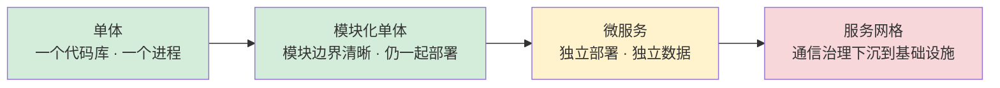
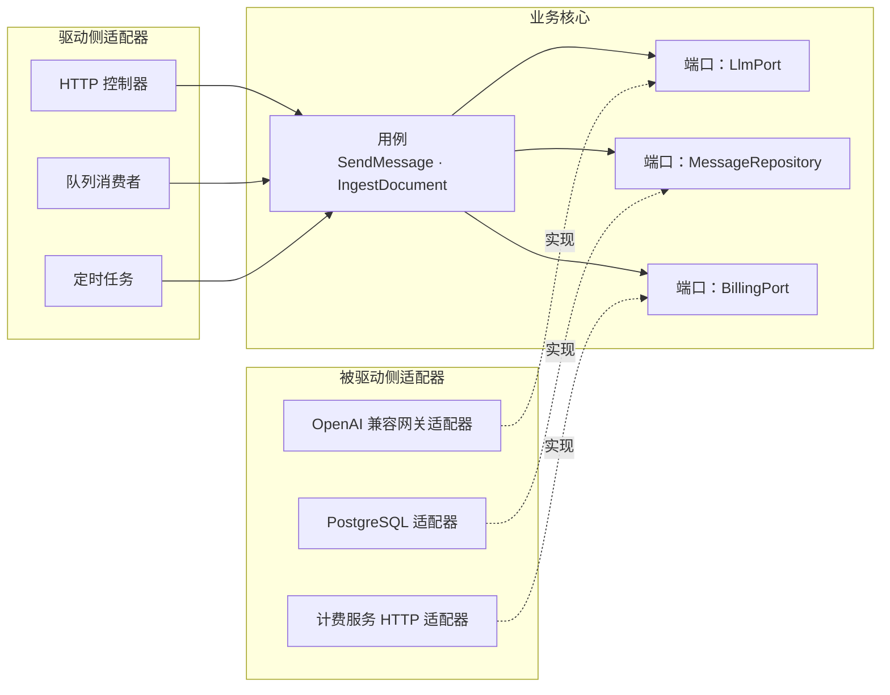
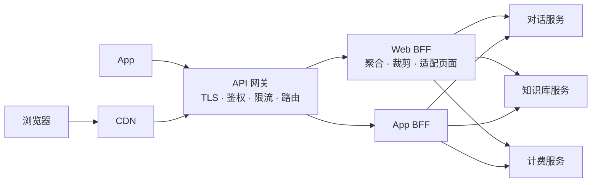
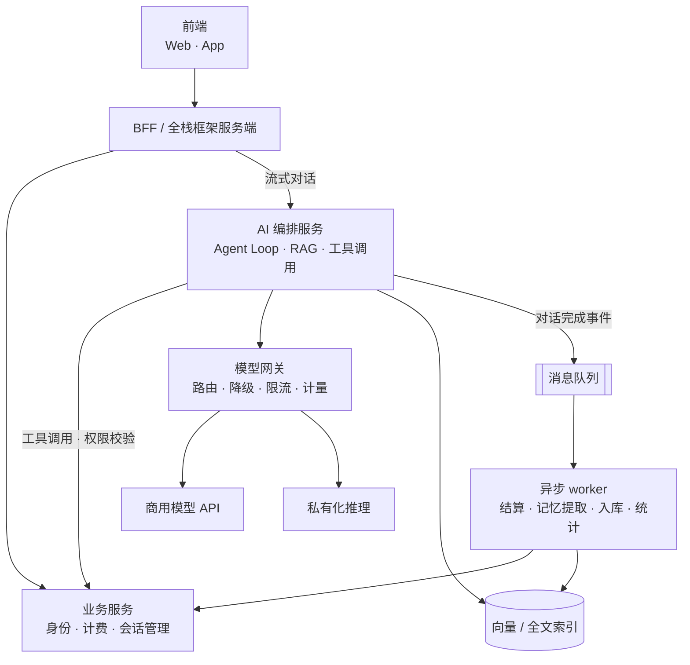

# 09 架构模式

> 本章目标：理解**单体 → 模块化单体 → 微服务**的演进逻辑与拆分判断标准，掌握**分层、六边形、轻量 DDD** 三种代码组织方式，厘清 **BFF、API 网关、全栈框架**各自的服务端职责，判断 **CQRS、事件驱动、事件溯源**何时值得，并用 **架构约束测试 + ADR** 防止 AI 把架构写乱。
>
> 版本基线：Spring Modulith 2.x（基于 Spring Boot 4 / Spring Framework 7）；Next.js 16（`middleware.ts` 更名为 `proxy.ts`）；ArchUnit、dependency-cruiser、import-linter 的具体版本以官方文档为准。
>
> 边界：AI 应用的六层全景见 [企业级 01 章](../../企业级AI应用开发实战/01-全景地图与技术选型.md)；AI 网关见 [企业级 09 章第五节](../../企业级AI应用开发实战/09-LLMOps-可观测评测与AI网关.md#五ai-网关控得住重点)；拆分之后的分布式事务、数据扩展见 [10 章](./10-分布式系统基础.md)；Outbox 与消息投递见 [07 章](../L2-核心能力/07-异步任务与消息队列.md)。

---

## 一、架构演进：从单体到微服务

### 1.1 四个阶段的收益与代价



| 阶段 | 形态 | 收益 | 代价 | 适合 |
|---|---|---|---|---|
| **单体** | 一个代码库、一个部署单元、一个数据库 | 开发、调试、部署最简单；本地事务即可保证一致性 | 代码规模变大后边界腐化，改一处牵动全身 | 早期产品、小团队 |
| **模块化单体** | 一个部署单元，内部按业务模块划分，模块间只通过公开接口通信 | 保留单体的简单；边界清晰，未来可按模块拆出 | 需要工具约束边界，否则退化为普通单体 | **绝大多数业务系统的默认起点** |
| **微服务** | 按业务能力拆成多个独立部署的服务，各自拥有数据 | 独立发布、独立伸缩、故障隔离、技术栈可异构 | 网络调用、分布式事务、数据一致性、链路追踪、运维成本全部上升 | 多团队并行、模块伸缩特征差异大 |
| **服务网格** | 在微服务之上，把重试、mTLS、流量切分、观测下沉到 sidecar 或节点代理 | 通信治理与业务代码解耦，统一策略 | 又一层基础设施，排障链路更长 | 服务数量多、已有 K8s 平台团队 |

> 📖 **服务网格（Service Mesh）**：在每个服务旁边（sidecar）或每个节点上部署网络代理，接管服务间的所有流量，统一提供加密、重试、限流、灰度和指标。代表产品是 Istio、Linkerd。详见 [10 章 6.2](./10-分布式系统基础.md)。

### 1.2 微服务不是默认选项

拆服务解决的是**组织与部署问题**，不是代码质量问题。代码边界写不清楚的团队，拆成微服务只会得到一个"**分布式单体**"：既有单体的耦合，又有分布式的复杂度。

| 判断维度 | 留在模块化单体 | 考虑拆成独立服务 |
|---|---|---|
| **团队规模** | 一到两个团队，沟通成本低 | 多个团队频繁在同一代码库冲突，发布互相阻塞 |
| **部署独立性** | 各模块发布节奏相近 | 某模块需要每天多次发布，其他模块要求稳定 |
| **伸缩差异** | 各模块负载特征相近 | 某模块需要 GPU、长连接或大内存，与其他模块差异明显 |
| **技术栈** | 一种语言足够 | AI 编排需要 Python 生态，而业务系统是 Java |
| **故障隔离** | 可以接受整体重启 | 某模块的故障（如解析大文件 OOM）不能拖垮核心交易 |
| **数据边界** | 模块间需要大量 join 和强一致事务 | 模块数据可以独立，跨模块最终一致可接受 |

> ⚠️ **注意**：常被引用的反面案例是 Amazon Prime Video 在 2023 年公开的音视频质量监控服务：从 Step Functions + Lambda 的分布式架构合并为单进程应用后，基础设施成本下降超过 90%。要准确理解它的范围：这只是**单个内部服务**的调整，不是"Amazon 放弃微服务"。结论是"按负载特征选形态"，而不是"微服务过时了"。

### 1.3 分布式单体：最常见的失败形态

出现以下任意两条，说明拆分是失败的：

- 多个服务**共享同一个数据库**，并互相读写对方的表
- 一个用户请求要**同步串行调用**四五个服务才能返回
- 改一个功能必须**同时发布**多个服务
- 服务之间传递的是数据库实体，而不是稳定的契约

> 🎯 **落地要点**：先把模块化单体做好——模块边界清晰、模块间只走公开接口、每个模块只访问自己的表。真到需要拆的时候，按模块整体拆出，几乎是机械操作。**边界先于部署**。

---

## 二、代码组织：分层、六边形与整洁架构

### 2.1 分层架构

AI 生成后端代码时最常用的结构，也是读懂大多数项目的起点：

| 层 | 职责 | 不应该做 |
|---|---|---|
| **Controller / Router** | 解析请求、参数校验、鉴权入口、调用 Service、转换响应 | 写业务规则、直接访问数据库 |
| **Service** | 业务规则、事务边界、编排多个 Repository 或外部调用 | 依赖 HTTP 对象（`Request`、`Response`）、拼 SQL |
| **Repository / DAO** | 数据访问，屏蔽 SQL 或 ORM 细节 | 包含业务判断 |

反例：AI 常把业务逻辑和数据访问直接写在路由里。

```typescript
// ❌ 反例：路由里完成鉴权以外的一切，无法复用、无法单测、事务边界不明
app.post("/conversations/:id/messages", async (req, reply) => {
  const conv = await db.query("SELECT * FROM conversations WHERE id = $1", [req.params.id]);
  if (conv.rows[0].user_id !== req.user.id) return reply.code(403).send();
  const account = await db.query("SELECT balance FROM accounts WHERE user_id = $1", [req.user.id]);
  if (account.rows[0].balance <= 0) return reply.code(402).send();
  // ……调用模型、写消息、扣费全部堆在这里
});
```

```typescript
// ✅ 正例：路由只做协议转换，业务在 Service，数据访问在 Repository
app.post("/conversations/:id/messages", async (req, reply) => {
  const body = SendMessageSchema.parse(req.body);
  const result = await chatService.sendMessage({ userId: req.user.id, conversationId: req.params.id, ...body });
  return reply.send(toMessageDto(result));
});
```

### 2.2 六边形架构（端口与适配器）

核心思想：**业务核心不依赖任何外部技术**。核心定义"端口"（接口），外部技术实现"适配器"。



对 AI 应用格外有价值：模型厂商、向量库、解析服务都会换，端口让替换只发生在适配器里。

```typescript
// 端口：用业务语言定义，不出现任何厂商 SDK 类型
export interface LlmPort {
  streamChat(input: ChatInput, signal: AbortSignal): AsyncIterable<ChatChunk>;
}

// 适配器：厂商细节只出现在这里
export class GatewayLlmAdapter implements LlmPort {
  constructor(private client: OpenAI) {}
  async *streamChat(input: ChatInput, signal: AbortSignal) {
    const stream = await this.client.chat.completions.create(
      { model: input.model, messages: input.messages, stream: true, stream_options: { include_usage: true } },
      { signal },
    );
    for await (const chunk of stream) yield mapChunk(chunk); // 映射为内部 ChatChunk
  }
}
```

测试时用一个内存版 `FakeLlm` 实现 `LlmPort`，用例测试不需要网络、不花 token。

### 2.3 整洁架构

整洁架构（Clean Architecture）与六边形本质相同，额外强调**依赖规则**：源码依赖只能从外层指向内层（框架 → 适配器 → 用例 → 实体），内层不知道外层的存在。

| | 分层架构 | 六边形 | 整洁架构 |
|---|---|---|---|
| 核心规则 | 上层调用下层 | 核心通过端口与外界交互 | 依赖只指向内层 |
| 数据库地位 | 最底层，业务依赖它 | 只是一个被驱动侧适配器 | 最外层的细节 |
| 测试便利 | Service 测试常需要数据库 | 核心可完全脱离基础设施测试 | 同六边形 |
| 样板代码 | 少 | 中 | 多（实体、用例、DTO 层层转换） |
| 适合 | CRUD 为主的系统 | 外部依赖多、需要替换实现 | 核心业务规则复杂、生命周期长 |

> 🎯 **落地要点**：不必选边站。常见的务实组合是"**分层为骨架，外部依赖处用端口**"：数据库访问照常走 Repository，模型调用、支付、短信等第三方依赖抽成端口。纯 CRUD 模块套整洁架构四层只会制造样板代码。

### 2.4 按技术分层 vs 按业务模块分包

| | 按技术分层（package by layer） | 按业务模块（package by feature） |
|---|---|---|
| 目录形态 | `controllers/` `services/` `models/` | `conversation/` `knowledge/` `billing/` |
| 改一个功能 | 跨多个顶层目录 | 集中在一个模块目录 |
| 模块边界 | 不可见，任何 Service 都能调任何 Repository | 显式，可用工具约束 |
| 拆服务 | 困难 | 按模块整体迁出 |

**Java（Spring Boot + Spring Modulith 约定）**：主包下每个直接子包是一个模块，子包 `internal` 不对外。

```text
com.example.aiapp/
├── AiAppApplication.java
├── conversation/              # 模块：对话
│   ├── ConversationApi.java   # 模块公开接口
│   ├── ConversationCompleted.java   # 领域事件
│   └── internal/              # 其他模块不可引用
│       ├── ConversationController.java
│       ├── ConversationService.java
│       └── MessageRepository.java
├── knowledge/                 # 模块：知识库
├── billing/                   # 模块：计费
└── identity/                  # 模块：用户与租户
```

**TypeScript（NestJS）**：每个业务模块一个 `Module`，只 `exports` 对外的 Service。

```text
src/
├── modules/
│   ├── conversation/
│   │   ├── conversation.module.ts     # exports: [ConversationFacade]
│   │   ├── conversation.controller.ts
│   │   ├── conversation.service.ts
│   │   ├── ports/llm.port.ts
│   │   └── adapters/gateway-llm.adapter.ts
│   ├── knowledge/
│   └── billing/
└── shared/                            # 仅放真正通用的基础设施，不放业务
```

**Python（FastAPI）**：

```text
app/
├── main.py
├── conversation/
│   ├── api.py          # APIRouter
│   ├── service.py
│   ├── repository.py
│   ├── schemas.py      # Pydantic 请求/响应模型
│   └── ports.py
├── knowledge/
├── billing/
└── core/               # 配置、数据库会话、鉴权依赖
```

> ⚠️ **注意**：AI 在没有约束时默认生成按技术分层的大目录，并且会把 `shared/`、`utils/`、`common/` 变成什么都往里扔的"杂物间"。把目标目录结构写进项目规则文件（`AGENTS.md`、`CLAUDE.md`），并配合第七节的约束测试。

---

## 三、轻量 DDD：只取对普通业务有用的部分

> 📖 **DDD（领域驱动设计）**：一套围绕业务领域组织软件的方法论。完整体系很重，普通业务系统只需要其中四个概念。

### 3.1 四个够用的概念

| 概念 | 一句话 | 解决什么问题 |
|---|---|---|
| **限界上下文** | 同一个词在一个边界内只有一种含义 | 划分模块与服务边界 |
| **聚合** | 一组必须一起保持一致的对象，对外只有一个入口（聚合根） | 确定事务边界与不变量 |
| **领域事件** | "某件业务事实已经发生"的记录 | 模块间解耦、触发后续流程 |
| **防腐层** | 在外部系统与自己的模型之间做翻译 | 防止外部模型污染内部 |

可以先不管的：值对象的完整建模规则、领域服务与应用服务的细分、战略设计的全套上下文映射模式。

### 3.2 AI 应用的上下文划分示例

同一个词在不同上下文里含义不同，这正是边界所在：

| 上下文 | 核心概念 | "用量"在这里指什么 | 拥有的数据 |
|---|---|---|---|
| **对话** | 会话、消息、模型配置、上下文窗口 | 本轮输入/输出 token 数 | conversations、messages |
| **知识库** | 知识库、文档、切片、入库任务 | 存储空间、文档数 | knowledge_bases、documents、chunks |
| **计费** | 账户、额度、预扣、账本、价目 | 折算后的金额 | accounts、ledger_entries、holds |
| **身份** | 用户、租户、角色、API Key | — | users、tenants、memberships |

上下文之间的关系：对话调用计费做预扣和结算；对话调用知识库做检索；计费不知道"消息"是什么，只接收"某账户在某请求上消耗了多少 token、用的什么模型"。

> 🎯 **落地要点**：判断边界画得对不对的简单标准：**一个上下文的表，只有这个上下文的代码能写**。计费模块里出现 `UPDATE messages ...`，说明边界错了。

### 3.3 聚合：一次事务只改一个聚合

聚合定义"必须在同一事务里保持一致的最小范围"。规则：

1. 外部只能通过聚合根修改聚合内部对象
2. **一个事务只修改一个聚合**，跨聚合用领域事件做最终一致
3. 聚合之间**按 ID 引用**，不持有对象引用
4. 聚合尽量小：会话不应该把上万条消息作为内部集合加载

反例：贫血模型，不变量散落在各处。

```java
// ❌ 反例：任何地方都能 set 余额，"余额不能为负"无人保证
account.setBalance(account.getBalance() - cost);
accountRepository.save(account);
```

```java
// ✅ 正例：不变量收在聚合根的方法里
public class CreditAccount {
    private long balanceMicros;   // 金额用最小单位整数
    private long frozenMicros;

    public Hold hold(String requestId, long amountMicros) {
        if (balanceMicros - frozenMicros < amountMicros) {
            throw new InsufficientCreditException(id, amountMicros);
        }
        frozenMicros += amountMicros;
        return new Hold(requestId, id, amountMicros);
    }
}
```

> ⚠️ **注意**：聚合方法保证的是**单进程内**的不变量。多实例并发扣减仍需要数据库层面的条件更新或乐观锁（[08 章](../L2-核心能力/08-并发与可靠性.md)），计费场景的完整设计见 [11 章案例 c](./11-系统设计案例.md)。

### 3.4 领域事件

"对话完成"之后要做的事很多：结算费用、提取长期记忆、更新会话标题、写分析数据。把它们都写进 `sendMessage` 方法，会让对话模块依赖所有其他模块。

```python
# 对话模块只发布事实，不关心谁订阅
@dataclass(frozen=True)
class ConversationTurnCompleted:
    event_id: str
    conversation_id: str
    account_id: str
    model: str
    input_tokens: int
    output_tokens: int
    occurred_at: datetime
```

| 事件范围 | 实现 | 一致性 |
|---|---|---|
| 模块内 / 同进程 | Spring `ApplicationEventPublisher`、NestJS `EventEmitter`、进程内总线 | 可在同一事务提交后触发 |
| 跨服务 | 消息队列 + **Outbox**（[07 章](../L2-核心能力/07-异步任务与消息队列.md)） | 最终一致，消费者必须幂等 |

> ⚠️ **注意**：AI 常写成"先提交事务，再 `kafka.send()`"，两步之间进程崩溃就丢事件；或反过来"先发消息再提交"，事务回滚后消息已发出。跨服务事件一律走 Outbox。

### 3.5 防腐层

模型厂商的响应格式各不相同，而且会变。在入口处翻译成内部模型，业务代码只认内部模型：

```python
class ProviderResponseTranslator:
    """把各厂商响应翻译为内部 ChatResult，业务层不出现厂商字段名。"""

    FINISH_REASON_MAP = {
        "stop": FinishReason.COMPLETED, "end_turn": FinishReason.COMPLETED,
        "length": FinishReason.TRUNCATED, "max_tokens": FinishReason.TRUNCATED,
        "tool_calls": FinishReason.TOOL_CALL, "tool_use": FinishReason.TOOL_CALL,
    }

    def translate(self, raw: dict, provider: str) -> ChatResult:
        reason = self.FINISH_REASON_MAP.get(raw.get("finish_reason") or raw.get("stop_reason"))
        if reason is None:
            raise UnknownProviderFormat(provider, raw)   # 不要静默当作成功
        ...
```

防腐层也适用于对接遗留系统、第三方 CRM、支付渠道。**AI 网关本身就是模型接入层的防腐层**。

---

## 四、BFF、API 网关与全栈框架的服务端边界

### 4.1 API 网关与 BFF



| | API 网关 | BFF（Backend for Frontend） |
|---|---|---|
| 归属 | 平台 / 基础设施团队 | 对应前端团队 |
| 职责 | 横切能力：TLS 终止、认证、限流、路由、灰度、日志 | 为某个前端聚合多个后端接口、裁剪字段、适配交互 |
| 是否含业务 | 不含 | 只含**展示相关**的编排，不含领域规则 |
| 数量 | 通常一个（或按域少量） | 每类前端一个 |
| 典型实现 | Kong、APISIX、Envoy Gateway、云厂商网关 | Next.js、NestJS、Hono、GraphQL 服务 |

> 📖 **BFF**：专门为某个前端（Web、App、小程序）服务的后端层。前端工程师最常接触、也最容易上手的后端形态。

### 4.2 前后端分离 vs 全栈框架

Next.js 这类全栈框架让"服务端代码"离前端很近：Server Components 在服务端取数，Server Actions 处理表单提交，Route Handlers 提供 HTTP 接口，`proxy.ts`（Next.js 16 之前叫 `middleware.ts`）做请求拦截。问题是：**哪些逻辑可以放在这里？**

| 逻辑类型 | 放在 Next.js 服务端 | 放在独立后端 |
|---|---|---|
| 页面取数聚合、字段裁剪 | ✅ | |
| 会话 Cookie 读取、登录跳转 | ✅ | |
| 简单 CRUD（单团队小项目） | ✅ 可以 | |
| 核心业务规则（计费、权限判定、状态机） | | ✅ |
| 长任务（文档解析、批量 embedding） | | ✅ 队列 + worker |
| 队列消费者、定时任务 | | ✅ 常驻进程 |
| 被多个前端或第三方共用的 API | | ✅ |
| 长时间流式对话 | 视部署形态 | ✅ 自托管时更可控 |

> ⚠️ **注意**：两个 Next.js 特有的坑。① **Server Action 本质是公开的 HTTP 端点**，任何人都能直接调用，每个 Action 内部都必须独立鉴权和校验参数，不能因为"只有登录后的页面才渲染这个按钮"就省略。② Next.js 官方文档明确说明 `proxy.ts` 适合做乐观检查（如未登录重定向），**不应作为完整的会话管理或授权方案**，授权要在数据访问层再做一次。

> 🎯 **落地要点**：部署在 Serverless 平台上的全栈框架，函数有执行时长和并发模型限制，不适合常驻消费者和长任务。一个稳妥的形态是：**Next.js 做 BFF 与页面，Python/Java/Node 独立服务承载领域逻辑与异步任务**。BFF 一旦开始写"满 100 元打折"这类规则，就在变成第二个业务层。

---

## 五、CQRS、事件驱动与事件溯源

### 5.1 CQRS 的三个级别

> 📖 **CQRS（命令查询职责分离）**：把"改数据"（命令）和"读数据"（查询）用不同的模型处理。

| 级别 | 做法 | 代价 | 何时值得 |
|---|---|---|---|
| **L1 代码分离** | 写操作走领域模型，读操作直接写 SQL 返回 DTO | 几乎没有 | **默认就该这么做**：列表页不必加载完整聚合 |
| **L2 读模型分离** | 写库之外维护专门的读模型（物化视图、搜索引擎、宽表），由事件同步 | 读模型延迟、同步链路要维护 | 读写模型差异巨大：用量看板、全文搜索、复杂报表 |
| **L3 事件溯源** | 写侧只存事件，状态由事件重放得出 | 很高（见 5.3） | 少数领域 |

AI 应用中 L2 的典型例子：对话明细写在 PostgreSQL，用量看板按"租户 × 模型 × 天"预聚合到汇总表或 ClickHouse；看板查询不碰明细表。

### 5.2 事件驱动架构

| 风格 | 消息内容 | 优点 | 风险 |
|---|---|---|---|
| **事件通知** | 只有 ID："文档 123 已上传" | 消息小，消费者按需回查 | 回查造成额外负载和耦合 |
| **事件携带状态** | 带上消费者需要的数据 | 消费者自治，无需回查 | 事件 schema 成为契约，演进要谨慎 |
| **命令消息** | "请解析文档 123" | 意图明确 | 发送方知道接收方，耦合更高 |

事件驱动的代价是**可追踪性**：一个业务流程散落在多个消费者里，没有人能一眼看出完整流程。缓解手段是统一的 trace 上下文传播（[17 章](../L4-工程与部署/17-可观测性与线上排障.md)）和流程较长时改用编排式 Saga 或工作流引擎（[10 章 4.3](./10-分布式系统基础.md)）。

### 5.3 事件溯源何时值得

> 📖 **事件溯源（Event Sourcing）**：不存储"当前状态"，只存储导致状态变化的全部事件，当前状态通过重放事件计算。

| 值得 | 不值得 |
|---|---|
| 审计是核心需求，必须回答"任意时刻的状态是什么、为什么" | 普通 CRUD 后台 |
| 业务本身就是事件流：交易、库存流水、协同编辑 | 团队没有实践经验，项目周期紧 |
| 需要基于历史事件构建新的读模型 | 需要大量即席查询 |

代价：事件 schema 演进（旧事件永远存在）、重放耗时需要快照、查询必须依赖投影、"删除用户数据"等合规要求实现困难。专用存储如 KurrentDB（原 EventStoreDB），也常直接用 PostgreSQL 的追加表实现。

> 🎯 **落地要点**：计费系统需要的是**追加写的账本表 + 余额快照**，这已经拿到了事件溯源最有价值的部分（可审计、可对账），又不必承担全套事件溯源的复杂度。详见 [11 章案例 c](./11-系统设计案例.md)。

---

## 六、AI 应用的典型架构形态

### 6.1 参考架构



### 6.2 四条原则

**① AI 能力作为独立服务**：理由不是"微服务更先进"，而是 1.2 节的判断维度在 AI 场景中经常同时成立——语言栈不同（AI 生态以 Python 最完整，业务系统常是 Java）、伸缩特征不同（长连接、长耗时、可能用 GPU）、发布节奏不同（prompt 与编排每天迭代）。单团队小项目一个 FastAPI 或 NestJS 单体同样合理。

**② 模型调用统一走模型网关**：业务和编排代码只对接 OpenAI 兼容接口，密钥、路由、降级、计量集中管理（[企业级 09 章第五节](../../企业级AI应用开发实战/09-LLMOps-可观测评测与AI网关.md#五ai-网关控得住重点)）。

**③ 编排层与业务层分离**：编排层负责"想"，业务层负责"做"和"守规矩"。

| 放在编排层 | 放在业务层 |
|---|---|
| prompt、上下文组装、检索策略 | 权限判定、额度校验、金额计算 |
| 工具选择、Agent 循环、重试策略 | 工具背后的真实写操作及其幂等 |
| 模型路由偏好 | 状态机与业务不变量 |

编排层**不直接写业务库**，而是通过业务服务的 API 或工具接口调用，并带上当前用户身份（[企业级 10 章第四节](../../企业级AI应用开发实战/10-安全权限与上线清单.md#四agent-权限模型重点)）。

**④ 同步对话 + 异步入库**：用户只为"看到回答"等待，其余全部异步。

| 环节 | 同步 / 异步 | 原因 |
|---|---|---|
| 用户消息落库、额度预扣 | 同步 | 失败时必须立即告知用户 |
| 模型流式输出 | 同步（流式） | 用户体验核心 |
| 助手消息最终落库 | 同步（流结束时） | 刷新页面要能看到 |
| 费用结算、用量统计 | 异步 | 允许秒级延迟 |
| 长期记忆提取、会话标题生成 | 异步 | 额外的模型调用，不应增加用户等待 |
| 文档解析、切片、向量化 | 异步 | 耗时从秒到分钟级（[11 章案例 b](./11-系统设计案例.md)） |

> 🎯 **落地要点**：与 [企业级 01 章的六层架构](../../企业级AI应用开发实战/01-全景地图与技术选型.md#一企业级-ai-应用的六层架构)对照：本节的"AI 编排服务"对应其编排层与能力层，"模型网关"对应模型接入层，"业务服务"是本系列 L2 各章的主战场。

---

## 七、守住依赖方向：防止被 AI 写乱

### 7.1 AI 常见的架构破坏

| 破坏方式 | 表现 | 后果 |
|---|---|---|
| 跨模块引用内部类 | `billing` 直接 import `conversation/internal/MessageRepository` | 模块边界名存实亡 |
| 跳层调用 | Controller 直接注入 Repository | 业务规则被绕过 |
| 核心依赖框架或 SDK | 领域对象里出现 `openai`、`HttpServletRequest` 类型 | 无法替换、无法单测 |
| 循环依赖 | A 模块调 B，B 又调 A | 无法独立拆分，初始化顺序问题 |
| 复制而非复用 | 在新模块里重新实现一遍余额校验 | 规则分叉，修一处漏一处 |

AI 每次只看到局部上下文，"能跑"是它的首要目标。**靠 review 守边界不可持续，要靠 CI 里会失败的测试。**

### 7.2 三栈的架构约束工具

| 栈 | 工具 | 能力 |
|---|---|---|
| Java | **ArchUnit** | 用单元测试表达分层、包依赖、命名规则 |
| Java | **Spring Modulith** | 按包识别模块，`verify()` 检查跨模块引用与循环依赖（底层基于 ArchUnit） |
| TypeScript | **dependency-cruiser** | 基于 import 图的禁止规则、循环检测，可输出依赖图 |
| TypeScript | eslint-plugin-boundaries、Nx 模块边界规则 | 在 lint 阶段约束目录间依赖 |
| Python | **import-linter** | `layers`、`forbidden`、`independence` 等契约 |

**Java（ArchUnit + Spring Modulith）**

```java
@AnalyzeClasses(packages = "com.example.aiapp")
class ArchitectureTest {
    @ArchTest
    static final ArchRule layers = layeredArchitecture().consideringAllDependencies()
        .layer("Web").definedBy("..web..")
        .layer("Service").definedBy("..service..")
        .layer("Persistence").definedBy("..repository..")
        .whereLayer("Web").mayNotBeAccessedByAnyLayer()
        .whereLayer("Service").mayOnlyBeAccessedByLayers("Web")
        .whereLayer("Persistence").mayOnlyBeAccessedByLayers("Service");

    @Test
    void modulesRespectBoundaries() {
        ApplicationModules.of(AiAppApplication.class).verify();  // 跨模块访问 internal 或出现循环即失败
    }
}
```

**TypeScript（`.dependency-cruiser.cjs`）**

```javascript
module.exports = {
  forbidden: [
    { name: "no-circular", severity: "error", from: {}, to: { circular: true } },
    {
      name: "no-cross-module-internals",
      severity: "error",
      comment: "模块之间只能通过 index.ts 暴露的公开接口通信",
      from: { path: "^src/modules/([^/]+)/" },
      to: { path: "^src/modules/([^/]+)/", pathNot: ["^src/modules/$1/", "^src/modules/[^/]+/index\\.ts$"] },
    },
    {
      name: "core-no-vendor-sdk",
      severity: "error",
      from: { path: "^src/modules/[^/]+/(domain|ports)/" },
      to: { path: "node_modules/(openai|@anthropic-ai|@aws-sdk)" },
    },
  ],
};
```

**Python（`pyproject.toml` + import-linter）**

```toml
[tool.importlinter]
root_package = "app"

[[tool.importlinter.contracts]]
name = "业务模块互相独立，只能经由 core 通信"
type = "independence"
modules = ["app.conversation", "app.knowledge", "app.billing"]

[[tool.importlinter.contracts]]
name = "模块内分层"
type = "layers"
layers = ["app.conversation.api", "app.conversation.service", "app.conversation.repository"]
```

> ⚠️ **注意**：`independence` 契约过严时，模块间确实需要的调用会被迫走事件或公开接口——这正是目的，但要提前约定公开接口放在哪里，否则 AI 会为了让 CI 变绿而把代码挪进 `core`，把它变成新的杂物间。

### 7.3 让规则同时约束人和 AI

1. **写进规则文件**：在 `AGENTS.md` / `CLAUDE.md` 中写明目录结构、模块公开接口位置、禁止的依赖方向
2. **放进 CI**：架构测试和普通测试一样，失败即阻断合并
3. **新增例外要显式**：确需放宽规则时，改配置并附 ADR 编号，而不是加 `// eslint-disable`

---

## 八、技术决策方法

### 8.1 可逆与不可逆决策

| 不可逆（单向门）：慢决策、写 ADR | 可逆（双向门）：快决策、先试 |
|---|---|
| 主数据库选型 | 内部工具库、日志库 |
| 对外 API 契约与鉴权方式 | 内部模块的实现方式 |
| 主键与 ID 格式、分片键 | 缓存策略、TTL |
| 多租户隔离模型（独立库 / 共享表） | 某个功能用哪个模型 |
| 事件 schema、账本结构 | 前端组件库 |

判断依据不是"重要不重要"，而是"**改回来的成本**"。数据一旦按某种结构写入生产，迁移成本远高于代码重构。

### 8.2 权衡矩阵

以"知识库向量存储选型"为例。**先定权重再打分**，否则很容易为心仪方案倒推权重。

| 维度（权重） | pgvector（复用现有 PG） | 专用向量库（自建） | 托管向量服务 |
|---|---|---|---|
| 运维成本（30%） | 5 | 2 | 4 |
| 与业务数据联合过滤、权限过滤（25%） | 5 | 3 | 3 |
| 千万级以上规模性能（20%） | 3 | 5 | 5 |
| 数据合规（15%） | 5 | 5 | 2 |
| 团队熟悉度（10%） | 5 | 2 | 3 |
| **加权得分** | **4.60** | 3.30 | 3.55 |

结论附带**前提条件**："在向量规模低于某阈值、且团队无专职运维时选 pgvector；超过阈值后重新评估。"阈值要基于压测，不要填凭空的数字。

### 8.3 ADR 模板与示例

> 📖 **ADR（Architecture Decision Record，架构决策记录）**：用一页纸记录一个架构决策的背景、选项、结论与后果，存放在代码仓库中（如 `docs/adr/`），与代码一起评审和版本化。

```markdown
# ADR-0007：AI 编排独立为 Python 服务，业务服务保持 Java 单体

- 状态：已采纳（2026-11-03）
- 决策者：后端组、AI 组

## 背景
业务系统为 Spring Boot 模块化单体。AI 功能需要 RAG、Agent 编排，团队评估的框架以 Python 生态最成熟；
prompt 与编排逻辑预计每周多次发布，而业务服务按双周发布。

## 选项
1. 在 Java 单体内用 Spring AI 实现
2. 独立 Python（FastAPI）编排服务，通过内部 API 调用业务服务
3. 全部迁移到 Python

## 决策
选择 2。

## 理由
- 发布节奏与伸缩特征（长连接、长耗时）与业务服务差异明显
- 编排服务不直接访问业务库，只通过业务 API 与工具接口，边界清晰

## 后果
- 正面：AI 迭代不阻塞业务发布；可独立扩容
- 负面：新增一次网络调用与一套部署；需要统一 trace 传播与服务间鉴权
- 后续：若 AI 功能萎缩，可将编排合并回单体（可逆）

## 复审条件
编排服务与业务服务之间的同步调用超过 3 跳，或两者总是同时发布时，重新评估。
```

> 🎯 **落地要点**：ADR 最有价值的是"**后果**"和"**复审条件**"两节。半年后有人问"为什么这么设计"，答案在仓库里，而不在某个离职同事的脑子里。

### 8.4 让 AI 出多方案并审查

AI 默认给出一个"看起来合理"的方案，并倾向于引入更多组件。要求它显式权衡：

```text
背景：<现状、团队规模、流量量级、已有基础设施>
约束：<预算、合规、上线时间、不可改变的部分>
请给出 3 个方案，其中必须包含一个"最简单可行"的方案。每个方案说明：
1. 架构草图与新增组件
2. 主要代价与失败模式（不只是优点）
3. 可逆性：选错之后回退的成本
4. 在什么条件下这个方案会变成错误选择
不要编造基准数据；需要数据支撑的地方标注"需压测验证"。
```

审查 AI 方案时的追问：

- 新增的每个组件（消息队列、缓存、新服务）**解决的是哪条具体需求**？去掉它会怎样？
- 方案里的性能数字从哪来？是否适用于你的数据规模和硬件？
- 故障时会怎样：某个依赖宕机、超时、返回重复消息？
- 有没有更"无聊"的方案：一张表、一个定时任务、一个数据库约束？

---

## 九、AI 代码审查清单（架构评审）

### 9.1 架构形态与拆分

- [ ] 🔴 新拆出的服务拥有自己的数据，没有直接读写其他服务的表
- [ ] 拆分理由能对应到 1.2 节的具体维度（团队、发布、伸缩、技术栈、故障隔离），而不是"微服务更好"
- [ ] 一个用户请求的同步调用链不超过约定跳数，没有服务间的同步循环调用
- [ ] 不存在"必须同时发布多个服务"的功能改动

### 9.2 代码组织与依赖方向

- [ ] 🔴 架构约束测试（ArchUnit / Spring Modulith / dependency-cruiser / import-linter）在 CI 中运行且通过
- [ ] Controller / Router 中没有 SQL、没有业务规则，只做协议转换与校验
- [ ] Service 不依赖 HTTP 框架对象（`Request`、`Response`、`HttpServletRequest`）
- [ ] 领域对象与端口中没有出现厂商 SDK 类型（OpenAI、AWS SDK 等）
- [ ] 跨模块调用只经过公开接口（`index.ts`、模块根包、`__init__.py` 导出），没有引用 `internal`
- [ ] 新代码没有放进 `utils` / `common` / `shared` 杂物目录；放进去的确实与业务无关

### 9.3 领域模型与事件

- [ ] 🔴 金额、额度等不变量由聚合方法或数据库约束保证，没有散落的 `setBalance`
- [ ] 🔴 跨服务事件通过 Outbox 发布，没有"提交事务后直接发 MQ"或"发 MQ 后提交事务"
- [ ] 一个事务只修改一个聚合；跨聚合更新改用领域事件
- [ ] 事件携带唯一 `event_id`，消费者按其去重
- [ ] 外部系统响应在适配器 / 防腐层翻译为内部模型，未知格式显式报错而非静默放行

### 9.4 BFF 与全栈框架

- [ ] 🔴 每个 Server Action / Route Handler 内部独立做鉴权与参数校验
- [ ] 授权判断不只存在于 `proxy.ts`（或旧版 `middleware.ts`），数据访问层还有一次
- [ ] BFF 中没有领域规则（计费、权限判定、状态机）
- [ ] 长任务、队列消费者、定时任务没有放在 Serverless 函数里

### 9.5 AI 应用架构

- [ ] 🔴 编排层不直接写业务库，通过业务 API / 工具接口并携带用户身份
- [ ] 模型调用统一经过模型网关或统一的 `LlmPort`，没有业务代码各自 `new OpenAI()`
- [ ] 记忆提取、结算、统计、入库等非关键路径是异步的，不增加用户等待时间

### 9.6 决策记录

- [ ] 涉及不可逆决策（数据库、ID 格式、分片键、租户隔离、事件 schema）的改动附带 ADR
- [ ] ADR 写明了后果与复审条件，而不只是结论
- [ ] AI 给出的方案中的性能数据有来源或标注"需压测验证"

---

## 本章小结

- **模块化单体是绝大多数系统的默认起点**；拆服务解决的是组织、发布、伸缩差异问题，边界先于部署
- 分布式单体的信号：共享数据库、同步长调用链、必须一起发布
- 务实组合：**分层为骨架 + 外部依赖处用端口**；目录按业务模块组织，而不是按技术分层
- 轻量 DDD 只取四个概念：**限界上下文、聚合、领域事件、防腐层**；"一个上下文的表只有它自己能写"
- API 网关管横切能力，BFF 管展示编排；**Server Action 是公开端点**，`proxy.ts` 不是授权方案
- CQRS 的代码级分离几乎零成本；事件溯源只在审计和事件流型业务中值得，计费用"账本 + 余额快照"即可
- AI 应用：**编排层想、业务层做；模型调用走网关；同步对话、异步入库**
- 用 **架构约束测试 + 规则文件 + ADR** 让边界可执行、决策可追溯

## 练习

1. 选一个你手上的项目（或用 AI 生成一个包含对话、知识库、计费的 Demo），按本章 2.4 节改为按业务模块分包，并为它配置对应语言的架构约束工具（ArchUnit / dependency-cruiser / import-linter），故意写一个跨模块引用 `internal` 的代码，确认 CI 失败
2. 为"对话完成后需要结算费用、提取记忆、生成标题"设计领域事件：写出事件结构、订阅者列表，以及在单体内（进程内事件）与拆分后（Outbox + MQ）两种实现下各自的一致性保证
3. 针对"是否把 AI 编排从现有 Java 单体中拆成独立 Python 服务"，用 8.4 节的提示让 AI 给出三个方案，按 8.2 节做权衡矩阵，最后写一份 ADR，包含后果与复审条件
4. 用 Next.js 写一个调用后端对话 API 的 Server Action，然后用 `curl` 绕过页面直接调用它，验证鉴权和参数校验是否生效
