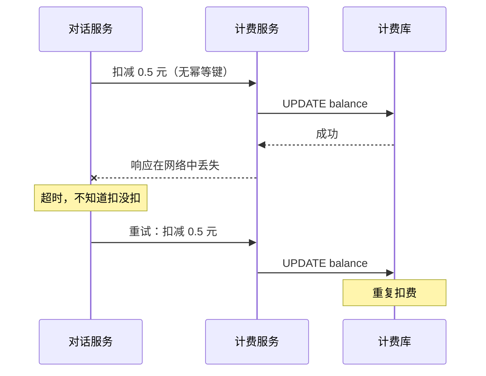
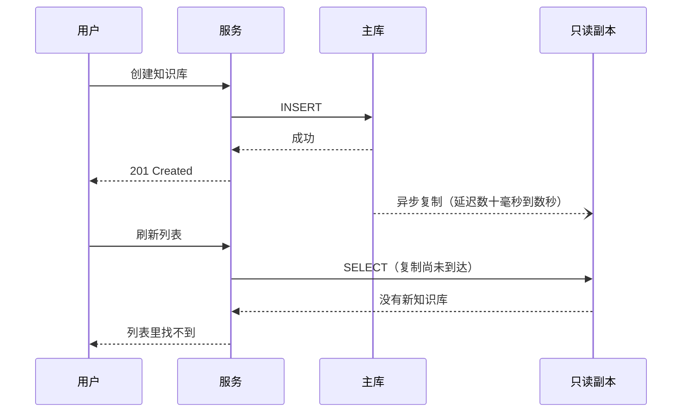
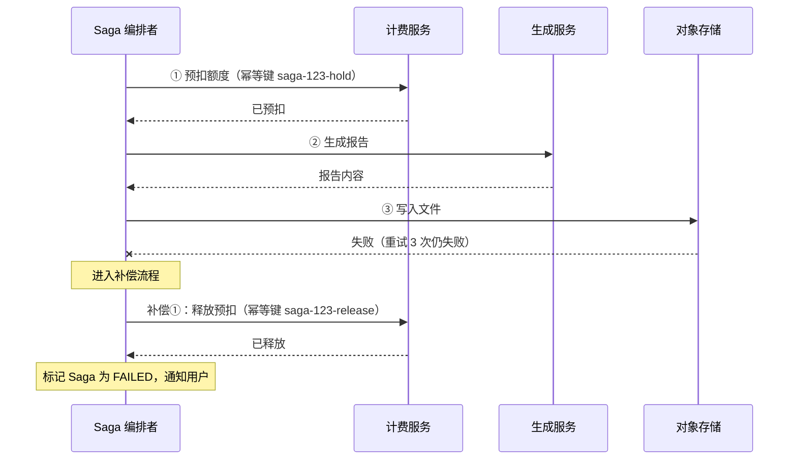
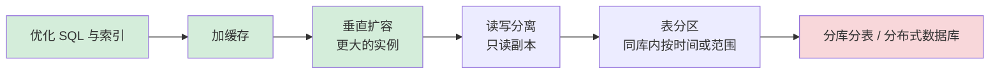
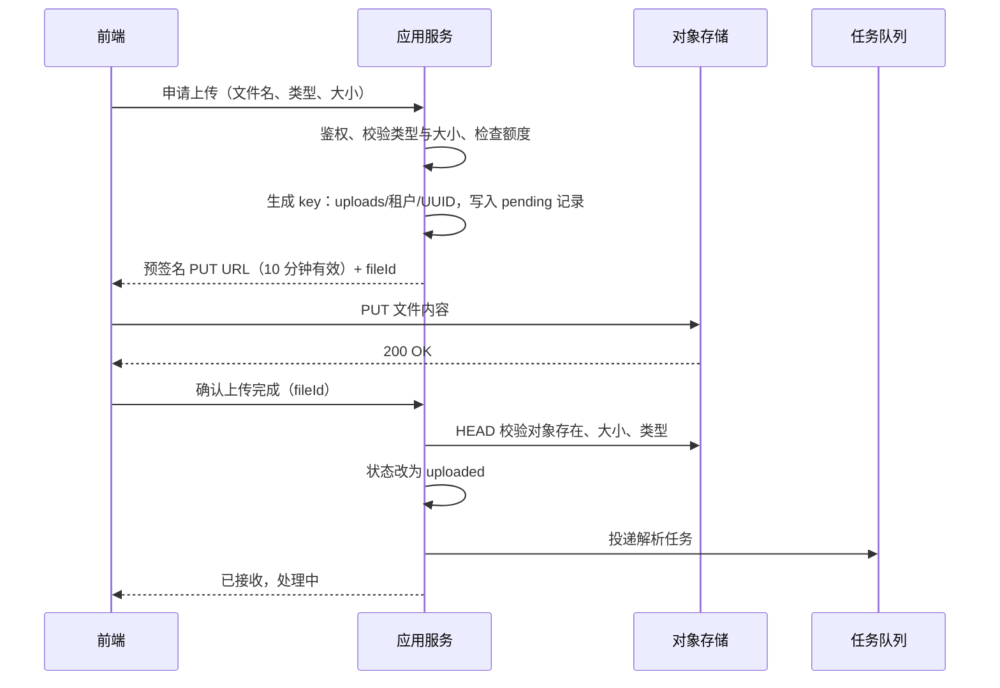

# 10 分布式系统基础

> 本章目标：建立分布式系统的基本直觉——**部分失败与"结果未知"**、**CAP / PACELC 的正确含义**、**一致性模型在应用层的表现**；掌握 **Saga、负载均衡、读写分离、分片、对象存储直传**等常用手段的取舍，知道 **时钟、幂等、共识**在分布式下为什么重要。
>
> 版本基线（2026 年 11 月核实）：Amazon S3 单次 PUT 上限 5 GB、分片 5 MB~5 GB、最多 10,000 片、单对象上限 50 TB（2025 年 12 月由 5 TB 提升）；PostgreSQL 18 内置 `uuidv7()`；Istio ambient 模式自 1.24 起 GA；分布式数据库现状见 7.4 节。
>
> 边界：Outbox、投递语义与幂等消费见 [07 章](../L2-核心能力/07-异步任务与消息队列.md)；锁、重试、熔断见 [08 章](../L2-核心能力/08-并发与可靠性.md)；分布式锁与 fencing token 见 [05 章](../L2-核心能力/05-缓存与Redis.md)；事务隔离级别见 [04 章](../L2-核心能力/04-数据库与数据建模.md)；K8s Service 与 Ingress 见 [14 章](../L4-工程与部署/14-Kubernetes核心与实践.md)；CDN 配置见 [15 章](../L4-工程与部署/15-部署架构与云.md)。

---

## 一、分布式系统为什么难

### 1.1 分布式计算的八大谬误

由 Sun 公司的工程师在 1990 年代总结，至今仍是 AI 写分布式代码时最常踩的假设：

| 谬误 | 现实 | 代码里的体现 | 对策 |
|---|---|---|---|
| 网络是可靠的 | 包会丢、连接会断 | 调用远程服务不处理异常 | 超时 + 有限重试 + 幂等 |
| 延迟为零 | 同机房亚毫秒，跨地域上百毫秒 | 循环里逐条调用远程接口（N+1） | 批量接口、并发、就近部署 |
| 带宽无限 | 大响应拖慢所有请求 | 接口一次返回全部数据 | 分页、字段裁剪、压缩 |
| 网络是安全的 | 内网同样会被横向渗透 | 服务间调用不鉴权 | mTLS、服务间令牌 |
| 拓扑不会变 | 实例随时扩缩、IP 会变 | 硬编码 IP | 服务发现、DNS |
| 只有一个管理员 | 多团队、多云、多供应商 | 假设能随时改对方配置 | 契约与版本化 |
| 传输成本为零 | 序列化耗 CPU，跨可用区 / 出网流量收费 | 服务间传大 JSON | 合适的协议与数据量 |
| 网络是同构的 | 设备、协议、中间件各不相同 | 假设所有代理都支持长连接 | 端到端验证（如 SSE 经过各级代理） |

### 1.2 部分失败：结果有三种

单机程序里，函数调用要么成功要么抛异常。分布式调用多了第三种结果：**未知**。



> 🎯 **落地要点**：**超时不等于失败**。调用方超时之后，对方可能已经执行成功。所有"可能被重试的写操作"都必须设计为幂等（第九节），这是分布式系统里最重要的一条纪律。

---

## 二、CAP 与 PACELC

### 2.1 CAP 的正确理解

> 📖 **CAP**：在发生**网络分区**（P，节点之间无法通信）时，系统只能在**一致性**（C，所有节点读到最新写入）和**可用性**（A，每个未故障节点都能响应请求）之间二选一。

| 常见误解 | 正确理解 |
|---|---|
| "三选二，可以选 CA" | 分区在分布式系统中一定会发生，P 不是可选项；真正的选择只在分区发生时出现：保 C 还是保 A |
| "C 就是 ACID 的 C" | CAP 的 C 指**线性一致性**，ACID 的 C 指满足业务约束，二者无关 |
| "选了 AP 就完全不一致" | AP 系统在分区恢复后通常会收敛，即最终一致 |
| "某数据库是 CP / AP" | 同一个数据库的不同配置、不同操作可能做出不同选择 |
| "CAP 决定日常性能" | CAP 只描述分区时的行为，日常没有分区时的取舍由 PACELC 描述 |

### 2.2 PACELC：日常取舍是延迟 vs 一致性

PACELC 由 Daniel Abadi 提出：**如果分区（P），在 A 与 C 之间选择；否则（E），在延迟（L）与一致性（C）之间选择。**

分区是少数时间，而"每次写入要不要等副本确认"是每一次请求都要面对的取舍：

| 配置 | 分区时 | 平时 | 例子 |
|---|---|---|---|
| 主从**异步复制**，读从库 | 主库不可达时从库仍可读（A） | 低延迟，但可能读到旧数据（L） | PostgreSQL / MySQL 默认的异步复制 |
| 主从**同步复制** | 同步副本不可达时写入阻塞（C） | 每次写都等副本确认，延迟更高（C） | PostgreSQL `synchronous_commit` 配合同步副本 |
| 多数派共识写入 | 少数派一侧不可写（C） | 写延迟 ≥ 多数派往返（C） | 基于 Raft 的分布式数据库、etcd |
| 可调一致性 | 按请求选择 | 按请求选择 | DynamoDB 的最终一致读与强一致读 |

> 🎯 **落地要点**：评审方案时，不要问"它是 CP 还是 AP"，而要问"**这个读请求能不能接受旧数据？能接受多旧？**"。余额、权限、库存要读最新；会话列表、统计看板可以容忍秒级延迟。

---

## 三、一致性模型

### 3.1 从强到弱

| 模型 | 含义 | 用户可感知的现象 | 典型实现 |
|---|---|---|---|
| **线性一致** | 一旦写入完成，之后所有读都能看到；系统表现得像只有一份数据 | 无异常 | 单主库读主、共识协议 |
| **因果一致** | 有因果关系的操作，所有人看到的顺序一致 | 不会先看到回复、后看到原帖 | 带版本向量的复制 |
| **读己之写** | 自己写入的内容，自己之后一定能读到 | 不会出现"刚改的昵称刷新后变回去" | 写后读主、按版本等待 |
| **单调读** | 不会先读到新值、再读到旧值 | 不会出现"消息时有时无" | 同一用户固定读同一副本 |
| **最终一致** | 停止写入后，所有副本最终相同 | 短时间内各处看到的不一样 | 异步复制、缓存、搜索索引 |

> 📖 **强一致**：日常口语中常泛指"读到最新"，严格说对应线性一致性。不要与事务隔离级别中的"可串行化"混淆：后者讨论多个事务交错执行的正确性（[04 章](../L2-核心能力/04-数据库与数据建模.md)），两者同时满足称为严格可串行化。

### 3.2 应用层最常见的问题：刚写完读不到

引入只读副本后，最典型的线上投诉是"我刚创建的知识库，列表里没有"。



| 方案 | 做法 | 代价 |
|---|---|---|
| **关键读走主库** | 余额、权限、刚写入的资源详情固定读主 | 主库读压力增加 |
| **写后粘主** | 用户写入后 N 秒内的读都路由到主库（标记存在 Redis 或 Cookie 中） | N 要大于正常复制延迟 |
| **按位点等待** | 写入时记录主库 WAL 位点，读副本前确认副本已回放到该位点 | 实现复杂，需要中间件支持 |
| **直接用写结果** | 创建接口返回完整资源，前端乐观插入列表 | 只解决当前页面 |

```typescript
// 写后粘主：用户写入后 5 秒内读主库
async function markRecentWrite(userId: string) {
  await redis.set(`recent-write:${userId}`, "1", "EX", 5);
}

async function dbForRead(userId: string) {
  return (await redis.exists(`recent-write:${userId}`)) ? primaryPool : replicaPool;
}
```

> ⚠️ **注意**：AI 常用 `@Transactional(readOnly = true)` 或路由中间件把"所有只读事务"导向副本，然后在同一个请求里先写后读，或在下一次请求里读详情，就会读到旧数据。审查读写分离代码时，逐个确认"写后紧跟的读"走的是哪个库。复制延迟应纳入监控（PostgreSQL 的 `pg_stat_replication.replay_lag`）。

---

## 四、分布式事务

### 4.1 能不分布式事务就不要

```text
① 数据放在同一个库？        → 本地事务，结束
② 能接受最终一致？          → 本地事务 + Outbox + 幂等消费（07 章）
③ 多步骤、需要失败回滚？    → Saga（4.3）
④ 需要资源预留、隔离性更强？→ TCC（4.4）
⑤ 同构数据库、低并发、强一致？→ 2PC / XA（4.2，极少用）
```

> 🎯 **落地要点**：分布式事务的需求往往是**拆分边界画错**的信号。两个总要一起改、一起成功的数据，大概率应该在同一个服务、同一个库里。模块化单体共享一个数据库实例（各模块只写自己的表）时，跨模块操作仍可用本地事务。

### 4.2 2PC 为何少用

> 📖 **2PC（两阶段提交）**：协调者先让所有参与者"准备"（锁定资源并承诺可提交），全部同意后再统一"提交"。XA 是数据库层面的 2PC 标准。

| 问题 | 说明 |
|---|---|
| 阻塞 | 参与者在准备后、收到提交前一直持有锁；协调者宕机则长时间阻塞 |
| 性能 | 多轮网络往返 + 锁持有时间长，吞吐明显下降 |
| 适用面窄 | HTTP 服务、消息队列、模型 API、支付渠道都不参与 XA |
| 运维复杂 | 悬挂的准备事务需要人工处理 |

### 4.3 Saga：用补偿代替回滚

> 📖 **Saga**：把一个长事务拆成一系列本地事务，每一步都有对应的**补偿操作**；某步失败时，按相反顺序执行已完成步骤的补偿。

| | 编排（Orchestration） | 协同（Choreography） |
|---|---|---|
| 控制方式 | 中心协调者按步骤调用各服务 | 各服务监听事件、发布下一个事件 |
| 流程可见性 | 高，流程定义集中在一处 | 低，流程散落在各消费者中 |
| 耦合 | 协调者知道所有参与者 | 参与者之间只通过事件耦合 |
| 适合 | 步骤多（≥ 3）、需要超时与人工介入 | 步骤少、流程稳定 |
| 实现 | 状态表 + worker，或 Temporal 等工作流引擎 | 消息队列 + Outbox |

AI 场景示例："生成一份付费研究报告"——预扣额度 → 调用模型生成 → 存储文件 → 结算。



补偿设计的要点：

- **补偿是语义回滚**，不是物理删除：退款是一笔新的反向流水，而不是删掉扣款记录
- **补偿必须幂等且可重试**：补偿本身也可能超时
- **不可补偿的步骤放到最后**：发邮件、调用外部支付这类做了就撤不回的操作，放在所有可能失败的步骤之后
- **缺少隔离性**：Saga 执行中间状态对外可见，用状态字段（`PENDING`）做"语义锁"，阻止其他流程使用未确认的资源
- **补偿失败要有兜底**：重试耗尽后进入人工处理队列并告警

```typescript
// 编排式 Saga 的骨架：每一步的状态持久化，进程重启后可继续
async function runReportSaga(sagaId: string) {
  const saga = await sagaRepo.load(sagaId);
  try {
    if (saga.step < 1) { await billing.hold({ key: `${sagaId}-hold`, amount: saga.estimate }); await saga.advance(1); }
    if (saga.step < 2) { saga.report = await llm.generate(saga.input); await saga.advance(2); }
    if (saga.step < 3) { saga.fileKey = await storage.put(saga.report); await saga.advance(3); }
    await billing.capture({ key: `${sagaId}-capture`, actual: saga.actualCost });
    await saga.complete();
  } catch (err) {
    if (!isRetryable(err) || saga.attempts >= 3) await compensate(saga);  // 按相反顺序补偿已完成的步骤
    else await saga.scheduleRetry();
  }
}
```

> 🔭 **先锋视角**：步骤多、有等待（人工审批、长耗时模型调用）的 Saga，越来越多地交给持久化执行引擎（Temporal、Restate 等）实现，状态持久化与重试由引擎负责。Agent 场景下的持久化执行见 [企业级 06 章第六节](../../企业级AI应用开发实战/06-Agent工程化-从Loop到生产.md#六人机协同与持久化执行)。

### 4.4 TCC 简述

> 📖 **TCC（Try-Confirm-Cancel）**：Try 预留资源，Confirm 确认使用，Cancel 释放预留。比 Saga 多了"预留"阶段，隔离性更好，但每个参与者都要实现三个接口。

TCC 的三个经典陷阱：

| 陷阱 | 场景 | 处理 |
|---|---|---|
| **空回滚** | Try 请求没到达（网络丢包），协调者超时后发来 Cancel | Cancel 发现没有对应 Try 记录时，记录"已取消"并返回成功 |
| **悬挂** | Cancel 先执行，迟到的 Try 才到达 | Try 执行前检查是否已有取消记录，有则拒绝 |
| **重复调用** | Confirm / Cancel 被重试 | 按事务 ID 幂等 |

Java 生态中 Apache Seata（2026 年 11 月仍处于 Apache 孵化阶段）提供 AT、TCC、Saga、XA 多种模式。

> 🎯 **落地要点**：AI 应用里最常见的 TCC 其实是**额度的预扣与结算**：按 `输入 token + max_tokens` 预扣（Try），按实际用量结算（Confirm），请求失败释放（Cancel）。空回滚和悬挂同样会发生，完整设计见 [11 章案例 c](./11-系统设计案例.md)。

---

## 五、负载均衡

### 5.1 L4 与 L7

| | L4（传输层） | L7（应用层） |
|---|---|---|
| 看到什么 | IP、端口、TCP / UDP 连接 | HTTP 方法、路径、Header、Cookie |
| 粒度 | **按连接**分发 | **按请求**分发 |
| 能力 | 转发快、开销小 | 按路径路由、重写、灰度、重试、TLS 终止 |
| 代表 | LVS、云厂商网络型负载均衡、K8s Service（kube-proxy） | Nginx、Envoy、HAProxy（HTTP 模式）、云厂商应用型负载均衡 |

> ⚠️ **注意**：gRPC 和 HTTP/2 在一条长连接上复用所有请求。经过 K8s Service 这类 **L4** 负载均衡时，客户端与某个 Pod 建立连接后，所有请求都打到这一个 Pod 上，扩容也不会分担负载。解决方式：使用 L7 代理（Envoy、服务网格）、客户端负载均衡（headless Service + gRPC 客户端负载均衡策略），或定期轮换连接。

### 5.2 算法

| 算法 | 原理 | 适合 | 注意 |
|---|---|---|---|
| 轮询 / 加权轮询 | 依次分发 | 请求耗时均匀的短请求 | 长短请求混合时负载不均 |
| **最少连接** | 发给当前连接数最少的实例 | **流式对话、长耗时请求** | 新实例刚上线时可能瞬间被打满，需要慢启动 |
| 随机两选一（P2C） | 随机挑两个，选负载低的 | 大规模集群，避免全局状态 | Envoy 的 least request 策略默认即按此方式选择 |
| IP 哈希 | 按客户端 IP 固定实例 | 简单的会话保持 | NAT 后大量用户同一 IP，导致不均 |
| **一致性哈希** | 按 key 映射到哈希环，增减节点只影响相邻区间 | 缓存分片、需要亲和性的请求 | 需要虚拟节点保证均匀 |

> 📖 **一致性哈希**：把节点和请求 key 都映射到一个环上，请求交给顺时针方向第一个节点。增删一个节点只影响约 1/N 的 key，而普通取模哈希会让几乎所有 key 重新分布。

> 🔭 **先锋视角**：LLM 推理服务对负载均衡提出了新要求——相同前缀（系统提示、长文档）的请求打到同一实例上，才能命中该实例的 KV Cache。Kubernetes 的 Gateway API Inference Extension（InferencePool 已在 v1 API 中 GA）支持感知前缀缓存与排队情况的调度。业务服务调用商用 API 时无需关心，自建推理集群时值得关注（[企业级 03 章](../../企业级AI应用开发实战/03-模型层-选型私有化推理与微调.md)）。

### 5.3 会话保持与健康检查

**会话保持**（sticky session）让同一用户固定访问同一实例。它让"把会话存在内存里"能工作，但代价是实例宕机丢会话、扩缩容后负载不均。**优先让服务无状态**，会话放 Redis 或数据库（[00 章](../L1-认知切换/00-前端到后端的思维切换.md)）。WebSocket 连接天然绑定实例，消息广播要经过 Redis Pub/Sub 等共享通道。

**健康检查**分两类：

| 类型 | 方式 | 作用 |
|---|---|---|
| 主动检查 | 负载均衡定期请求 `/healthz` | 发现宕机实例并摘除 |
| 被动检查（异常检测） | 统计真实请求的错误率、超时 | 摘除"活着但异常"的实例 |

> ⚠️ **注意**：健康检查接口**不要检查下游依赖**（数据库、模型 API）。模型 API 抖动时，所有实例的健康检查同时失败，负载均衡会把全部实例摘除，小故障变成全站不可用。下游依赖的状态放在就绪检查里谨慎使用，或只用于告警。K8s 存活探针与就绪探针的区别见 [14 章](../L4-工程与部署/14-Kubernetes核心与实践.md)。

---

## 六、服务发现、服务间通信与分布式 ID

### 6.1 服务发现

| 方式 | 原理 | 代表 |
|---|---|---|
| DNS / 平台内置 | 服务名解析到虚拟 IP 或实例列表 | K8s Service、云厂商内网 DNS |
| 注册中心 | 实例启动时注册，客户端订阅实例列表 | Nacos（国内 Java 生态常见）、Consul、Eureka |
| 服务网格 | 代理从控制面获取路由与实例 | Istio、Linkerd |

运行在 K8s 上的新项目，直接用 Service DNS 即可，不需要额外的注册中心。

### 6.2 服务间通信与服务网格

| | REST / JSON | gRPC | 消息队列 |
|---|---|---|---|
| 模式 | 同步请求-响应 | 同步，支持双向流 | 异步 |
| 契约 | OpenAPI | Protobuf（强类型、代码生成） | 事件 schema |
| 性能 | 中 | 高（二进制 + HTTP/2） | 取决于中间件 |
| 浏览器直连 | 原生支持 | 需要 gRPC-Web 或转换 | 不适用 |
| 适合 | 对外 API、BFF 调用 | 内部高频调用、多语言服务 | 解耦、削峰、最终一致 |

选型细节见 [03 章](../L2-核心能力/03-API设计.md) 与 [07 章](../L2-核心能力/07-异步任务与消息队列.md)。

**服务网格**把 mTLS、重试、超时、流量切分、指标从业务代码中剥离。经典形态是每个 Pod 注入一个 sidecar 代理；Istio 的 ambient 模式（1.24 起 GA）改为节点级代理加按需的 L7 代理，减少了 sidecar 的资源开销。服务少于十个、没有平台团队时，网格的运维成本通常大于收益。

> ⚠️ **注意**：**重试会层层放大**。应用重试 3 次 × 网格重试 3 次 × 网关重试 3 次，一次故障可能变成 27 倍的请求，压垮正在恢复的下游。重试只在一层做（通常离调用方最近的一层），并配合重试预算与退避（[08 章](../L2-核心能力/08-并发与可靠性.md)）。

### 6.3 分布式 ID

| 方案 | 有序性 | 长度 | 依赖 | 注意 |
|---|---|---|---|---|
| 数据库自增 | 有序 | 64 位 | 单库 | 分库后冲突；暴露业务量 |
| UUIDv4 | 无序 | 128 位 | 无 | 作为 B-Tree 主键时插入随机分布，索引写放大 |
| **UUIDv7** | 按毫秒时间有序 | 128 位 | 无 | RFC 9562 标准；PostgreSQL 18 内置 `uuidv7()`；会暴露生成时间 |
| Snowflake 类 | 趋势有序 | 64 位 | 机器 ID 分配 | 41 位时间戳 + 10 位机器 + 12 位序列；**时钟回拨**会导致重复或阻塞 |
| 号段模式 | 趋势有序 | 64 位 | 发号服务 + 数据库 | 每次从库中领取一段 ID 在内存发放，性能高 |

```sql
-- PostgreSQL 18：时间有序的 UUID 主键
CREATE TABLE messages (
  id uuid PRIMARY KEY DEFAULT uuidv7(),
  conversation_id uuid NOT NULL,
  ...
);
```

> ⚠️ **注意**：**前端工程师尤其要注意**：JavaScript 的 `Number` 只能精确表示 2^53 以内的整数，Snowflake 生成的 64 位 ID 经过 `JSON.parse` 后末几位会被改写，导致"按 ID 查不到数据"。64 位 ID 在 API 中一律以**字符串**传输（Jackson 可配置 `ToStringSerializer`，Python 返回 `str`）。

---

## 七、扩展数据层

### 7.1 扩展顺序



越往右，复杂度和不可逆程度越高。**多数业务系统在"单主库 + 只读副本 + 合理索引"阶段就能走很远**；在没有压测数据证明前面的手段已经用尽之前，不要进入最后一步。

### 7.2 读写分离

读写分离的核心问题是复制延迟，处理方式见 3.2 节。另外两点：

- **副本数量不能无限加**：每个副本都要回放主库的全部写入，写入瓶颈不会因此缓解
- **副本故障要能降级**：副本不可用时读流量回落到主库，主库要能承受

### 7.3 分区与分片

先分清两个概念：

| | 表分区（Partitioning） | 分片（Sharding） |
|---|---|---|
| 范围 | 同一数据库实例内，一张逻辑表拆成多个物理分区 | 数据分布到多个数据库实例 |
| 解决 | 大表维护（按月删除旧数据、减少扫描范围） | 单机写入能力、存储容量的上限 |
| 透明性 | 对应用基本透明 | 应用或中间件要知道数据在哪个分片 |
| 例子 | PostgreSQL 声明式分区，消息表按月分区 | 按 `tenant_id` 把租户分到不同库 |

**分片键选择**是分片方案中最不可逆的决策：

| 标准 | 说明 | AI 应用示例 |
|---|---|---|
| 高基数、分布均匀 | 避免数据集中在少数分片 | `tenant_id` 适合 SaaS；但大客户可能形成热点 |
| **绝大多数查询带分片键** | 否则每次查询都要扫所有分片 | 消息按 `conversation_id` 分片，"查某会话的消息"只打一个分片 |
| 事务不跨分片 | 一次业务操作涉及的数据在同一分片 | 同一租户的账户与账本在同一分片 |
| 不随时间变化 | 分片键变化意味着数据迁移 | 不要用"所属部门"这类会变的字段 |

**跨分片查询**的处理：

| 需求 | 方案 |
|---|---|
| 按非分片键查询（如按用户查所有会话，但按会话分片） | 维护"用户 → 会话"的映射表，或冗余一份按用户分片的数据 |
| 全局排序、分页 | 各分片取 Top N 后合并；深分页代价极高，改用游标分页 |
| 统计报表 | 通过 CDC 同步到 OLAP 库（ClickHouse 等）或搜索引擎，不在分片库上做 |

**重分片的代价**：数据迁移期间要双写、回填、校验、切换，往往持续数周。降低代价的常用做法是**预分片**：一开始就划分大量逻辑分片（如 1024 个），映射到少量物理库；扩容时只迁移逻辑分片的归属，而不重新计算每条数据的位置。

### 7.4 何时用分布式数据库

> 📖 **分布式 SQL 数据库**：对外表现为一个支持 SQL 和事务的数据库，内部自动分片、复制、故障切换（多基于 Raft 等共识协议）。代价是单次操作延迟通常高于单机库，部分 SQL 特性受限。

2026 年 11 月的代表产品现状：

| 产品 | 兼容 | 形态 | 现状要点 |
|---|---|---|---|
| **TiDB** | MySQL 协议 | 开源 + 云服务 | 8.5 为当前 LTS 线；官方说明不支持触发器、存储过程等部分 MySQL 特性 |
| **CockroachDB** | PostgreSQL 协议 | 自托管 + 云服务 | 2024 年 11 月起自托管版统一为企业许可证，年收入 1000 万美元以下的企业可免费使用，不再是开源软件 |
| **YugabyteDB** | PostgreSQL 协议 | 开源 + 云服务 | 复用 PostgreSQL 查询层 |
| **Citus** | PostgreSQL 扩展 | 开源扩展 | Azure Cosmos DB for PostgreSQL 已处于退役路径、不再推荐新项目，微软改为推荐 Azure Database for PostgreSQL 的 Elastic Clusters（同样基于 Citus） |
| **Aurora DSQL** | PostgreSQL 兼容子集 | AWS 托管、Serverless | 2025 年 5 月 GA；只支持部分 PostgreSQL 特性，不是 PostgreSQL 的直接替代品 |
| **Vitess** | MySQL | 分片中间件 | 在 MySQL 前做路由与分片管理 |
| **Apache ShardingSphere** | MySQL / PostgreSQL | 分片中间件（Java 生态） | 国内 Java 项目常见 |
| OceanBase、PolarDB 等 | MySQL / PostgreSQL 兼容 | 国产分布式 / 云原生数据库 | 按云厂商与合规要求选型 |

> 🔭 **先锋视角**：PostgreSQL 生态正在补齐"Vitess 式"的水平扩展：Supabase 主导、由 Vitess 联合创始人领衔的 Multigres 于 2026 年 6 月发布 v0.1 alpha，当前版本提供连接池与高可用，**分片尚未发布**。属于值得关注、尚不可用于生产的方向。

值得考虑分布式数据库的信号：单主库的写入已经通过压测确认到达瓶颈；数据量增长使单机存储与备份恢复时间不可接受；需要跨地域多活。如果只是"未来可能会很大"，先用 UUIDv7 / 带租户维度的主键为将来分片留好余地即可。

---

## 八、对象存储

### 8.1 为什么文件要放对象存储

服务多实例部署后，写到本地磁盘的文件只存在于某一个实例上，容器重建即丢失；存进数据库则会让备份、复制变得笨重。**文件放对象存储，数据库只存元数据和对象 key**。

> 📖 **S3 兼容 API**：Amazon S3 的接口事实上成为了对象存储的通用协议。阿里云 OSS、腾讯云 COS、Cloudflare R2 以及自建方案（Ceph RGW、SeaweedFS、Garage 等）都提供 S3 兼容接口，代码可以用同一套 SDK。

> ⚠️ **注意**：① "S3 兼容"不等于全部兼容，例如 Cloudflare R2 不支持预签名 POST（POST Policy），只支持预签名 GET / PUT / DELETE / HEAD。切换供应商前逐项验证所用的 API。② 曾经最流行的自建方案 MinIO，其社区版已于 2025 年 12 月进入维护模式，随后仓库归档、不再维护，新项目自建需评估其他方案或商业版。

核心概念：bucket（桶）、key（对象路径，`/` 只是 key 的一部分，不是真目录）、私有桶 + 签名访问。Amazon S3 自 2020 年 12 月起提供强读后写一致性，其他兼容实现以各自文档为准。

### 8.2 预签名 URL 直传

文件不经过应用服务器，由浏览器直接上传到对象存储：节省服务器带宽与内存，大文件不会阻塞应用进程。



```typescript
// TypeScript：AWS SDK v3
import { PutObjectCommand } from "@aws-sdk/client-s3";
import { getSignedUrl } from "@aws-sdk/s3-request-presigner";

async function createUploadUrl(user: User, input: { contentType: string; size: number }) {
  if (!ALLOWED_TYPES.has(input.contentType)) throw new BadRequest("unsupported type");
  if (input.size > MAX_UPLOAD_BYTES) throw new BadRequest("file too large");

  const key = `uploads/${user.tenantId}/${uuidv7()}`;          // key 由服务端生成
  await files.insert({ key, ownerId: user.id, status: "pending", declaredSize: input.size });
  const url = await getSignedUrl(
    s3,
    new PutObjectCommand({ Bucket: BUCKET, Key: key, ContentType: input.contentType, ContentLength: input.size }),
    { expiresIn: 600 },
  );
  return { url, key };
}
```

```python
# Python：boto3
url = s3.generate_presigned_url(
    "put_object",
    Params={"Bucket": BUCKET, "Key": key, "ContentType": content_type},
    ExpiresIn=600,
)
```

```typescript
// ❌ 反例：key 由前端决定，可覆盖他人文件或写入任意路径
const key = `uploads/${req.body.filename}`;
```

预签名直传的检查点：

- **key 由服务端生成**，包含租户维度，不使用用户提供的文件名（原始文件名存在元数据里）
- **有效期短**：分钟级即可；使用临时凭证签名时，URL 还会在凭证过期时提前失效
- **限制大小**：把 `Content-Length` 签入预签名 PUT，或使用 S3 POST Policy 的 `content-length-range` 条件（注意并非所有兼容实现都支持）
- **不信任前端的"上传完成"通知**：服务端用 `HEAD` 核对对象真实大小与类型，再进入后续流程；也可以订阅存储的事件通知
- **文件类型以内容为准**：解析前用文件头（magic bytes）判断真实类型，不信任扩展名与 `Content-Type`
- **桶配置 CORS**：只允许自己的前端域名、必要的方法与 Header
- **下载同样用预签名 GET**，桶保持私有

### 8.3 分片上传

大文件（以 S3 为例，单次 PUT 上限 5 GB；实践中百 MB 以上就应考虑分片）使用分片上传：

```text
CreateMultipartUpload → 得到 uploadId
UploadPart × N        → 每片 5 MB~5 GB（最后一片可更小），最多 10,000 片，可并行；每片可单独预签名
CompleteMultipartUpload（提交各片 ETag 列表）→ 合并为一个对象
```

- **断点续传**：前端记录 uploadId，中断后用 `ListParts` 查询已上传的分片，只传剩余部分
- **清理未完成的上传**：未完成的分片**持续占用存储并计费**，且在桶的普通对象列表中看不到。配置生命周期规则自动中止超过若干天的未完成分片上传（S3 的 `AbortIncompleteMultipartUpload`）

### 8.4 生命周期与 CDN 回源

| 需求 | 做法 |
|---|---|
| 临时文件自动删除 | 按前缀（如 `tmp/`）配置过期规则 |
| 冷数据降成本 | 按时间转换到低频 / 归档存储类型（注意取回费用与最短存储期） |
| 公开静态资源加速 | CDN 回源到对象存储；桶不公开，CDN 通过回源鉴权访问（如 CloudFront 的源访问控制） |
| 私有文件加速 | CDN 签名 URL，或应用签发短期 URL |
| 长期缓存 | key 中带内容哈希（`avatar/3f2a….png`），内容变了 key 就变，可以设置很长的缓存时间 |

CDN 与域名配置详见 [15 章](../L4-工程与部署/15-部署架构与云.md)。

### 8.5 AI 应用中的文件场景

| 场景 | 要点 |
|---|---|
| **知识库文档上传** | 直传 → 校验 → 投递入库任务，完整流水线见 [11 章案例 b](./11-系统设计案例.md) |
| **多模态输入**（图片、PDF 传给模型） | 传预签名 GET URL 时，有效期要覆盖模型拉取时间；模型厂商必须能访问该 URL（内网自建存储不行）；敏感文件考虑改为服务端读取后以内容传入 |
| **模型生成的产物**（图片、报告、代码包） | 写入对象存储，返回短期签名链接；不要把大段 base64 存进消息表 |
| **安全** | 上传内容可能携带提示注入（[企业级 10 章](../../企业级AI应用开发实战/10-安全权限与上线清单.md)）；解析器处理不可信文件，应在资源受限、隔离的 worker 中运行 |

---

## 九、时钟、幂等与共识

### 9.1 时钟不可靠

- **墙上时钟会跳**：NTP 校时可能让时间回退或跳跃，不同机器之间存在偏差
- **计算耗时用单调时钟**：Java `System.nanoTime()`、Node `performance.now()` / `process.hrtime.bigint()`、Python `time.monotonic()`；不要用两次 `Date.now()` 相减来判断超时
- **不要用时间戳判断跨节点事件的先后**：两台机器各自记录的 `created_at` 无法可靠排序；需要顺序时用数据库序列、单一写入点或逻辑时钟
- **依赖时间的锁会失效**：持锁进程发生长时间 GC 停顿，租约过期后另一个进程拿到锁，两者同时写入。用 fencing token 保护（[05 章](../L2-核心能力/05-缓存与Redis.md)）

> 📖 **逻辑时钟**：不依赖物理时间、只表达事件先后关系的计数器（如 Lamport 时钟）。部分分布式数据库使用混合逻辑时钟（HLC）结合物理时间与逻辑计数；Google Spanner 则依赖带误差范围的硬件授时（TrueTime）。应用开发者了解即可。

### 9.2 幂等与去重在分布式下的意义

1.2 节已经说明：超时之后只能重试，而重试要安全就必须幂等。分布式系统中常说的"恰好一次"，工程上的真实含义是：

```text
恰好一次的效果 = 至少一次投递（重试保证不丢） + 幂等处理（去重保证不重）
```

去重的可靠实现依赖**数据库唯一约束**，而不是"先查再写"：

```sql
-- 处理消息或请求前先占位，冲突说明已处理过
INSERT INTO processed_requests (idempotency_key, result) VALUES ($1, NULL)
ON CONFLICT (idempotency_key) DO NOTHING
RETURNING idempotency_key;   -- 无返回行 = 重复请求，直接返回已有结果
```

幂等键在 API 层的设计见 [03 章](../L2-核心能力/03-API设计.md)，消费端去重见 [07 章](../L2-核心能力/07-异步任务与消息队列.md)。

### 9.3 共识算法（Raft）的直觉

> 📖 **共识**：让多个节点对"一系列操作的顺序"达成一致，即使部分节点宕机也不出错。Raft 是目前最常用、也最易理解的共识算法。

Raft 的核心直觉：

1. **选一个 leader**：所有写入都由 leader 接收；leader 失联后，其余节点在超时后发起选举
2. **日志复制**：leader 把操作追加到日志，复制到多数节点后才算提交
3. **多数派**：2f+1 个节点可以容忍 f 个节点故障；少数派一侧无法写入（分区时选择 C）

对应用开发者有用的结论：

| 结论 | 原因 |
|---|---|
| 集群节点数用奇数（3、5） | 4 节点与 3 节点都只能容忍 1 个故障 |
| 跨地域部署时写延迟至少是到多数派节点的往返时间 | 每次提交都要等多数派确认 |
| 不要自己实现共识 | 用 etcd、ZooKeeper 或内置共识的数据库 |
| 选主、配置中心、分布式锁的强一致实现底层都依赖共识 | 例如 K8s 依赖 etcd |

---

## 十、AI 代码审查清单（架构评审）

### 10.1 远程调用与部分失败

- [ ] 🔴 所有远程调用（HTTP、gRPC、数据库、模型 API）都设置了超时
- [ ] 🔴 可能被重试的写操作带幂等键，服务端以唯一约束去重
- [ ] 超时被当作"结果未知"处理，而不是直接当作失败去执行反向逻辑
- [ ] 重试只在一层进行，有次数上限与退避，没有在应用、网格、网关层层叠加
- [ ] 没有在循环中逐条调用远程接口

### 10.2 一致性与读写分离

- [ ] 🔴 余额、权限、额度等关键读走主库
- [ ] 写后紧接的读（同一请求或用户下一次刷新）不会读到副本旧数据
- [ ] 复制延迟有监控与告警；副本不可用时有回落方案
- [ ] 方案文档写明了每类数据可接受的陈旧程度

### 10.3 分布式事务

- [ ] 🔴 没有"先调 A 服务、再调 B 服务、B 失败就算了"的无补偿多步写入
- [ ] 跨服务一致性优先采用"本地事务 + Outbox"，确需回滚时使用 Saga
- [ ] Saga 每一步与每个补偿都幂等，状态持久化，进程重启后可继续
- [ ] 不可补偿的步骤（对外通知、外部支付）位于所有可能失败的步骤之后
- [ ] 补偿重试耗尽后有人工处理通道与告警
- [ ] TCC / 预扣类逻辑处理了空回滚与悬挂

### 10.4 负载均衡与通信

- [ ] gRPC / HTTP/2 长连接在 L4 负载均衡下的不均衡问题已处理
- [ ] 流式、长耗时请求的负载均衡策略不是简单轮询
- [ ] 健康检查接口不检查下游依赖
- [ ] 服务无状态，或者对会话保持的依赖有明确理由与故障预案

### 10.5 ID 与数据扩展

- [ ] 🔴 64 位整数 ID 在 JSON 中以字符串传输
- [ ] 主键不使用 UUIDv4 作为高频写入大表的聚簇 / B-Tree 主键（优先 UUIDv7 或有序 ID）
- [ ] Snowflake 类方案处理了时钟回拨与机器 ID 分配
- [ ] 引入分片或分布式数据库前，有压测数据证明前面的扩展手段已经不够
- [ ] 分片键满足"绝大多数查询带分片键、事务不跨分片"，并有对应 ADR

### 10.6 对象存储

- [ ] 🔴 对象 key 由服务端生成，不包含未经处理的用户输入
- [ ] 🔴 桶为私有，访问通过短期预签名 URL 或 CDN 回源鉴权
- [ ] 预签名 URL 有效期为分钟级，并限制了内容类型与大小
- [ ] 上传完成后服务端用 `HEAD` 校验，不信任前端回调
- [ ] 配置了中止未完成分片上传的生命周期规则
- [ ] 使用的 API 在目标 S3 兼容存储上实际验证过

### 10.7 时钟

- [ ] 耗时与超时计算使用单调时钟
- [ ] 没有用不同机器的时间戳判断事件先后
- [ ] 依赖租约的锁使用了 fencing token 或数据库层的二次校验

---

## 本章小结

- 分布式调用有第三种结果：**未知**。超时不等于失败，可重试的写操作必须幂等
- CAP 只在分区时有意义，**日常取舍是 PACELC 中的延迟与一致性**；评审时问"这个读能接受多旧的数据"
- 读写分离最常见的问题是**刚写完读不到**：关键读走主库、写后粘主、监控复制延迟
- **能不用分布式事务就不用**；需要时优先 Outbox，其次 Saga（补偿要幂等、不可补偿步骤放最后），2PC 极少用
- 负载均衡：L4 按连接、L7 按请求；流式请求用最少连接；gRPC 长连接在 L4 下会失衡；健康检查不查下游
- 分布式 ID 优先 UUIDv7 或有序 64 位 ID；**64 位 ID 在 JSON 里用字符串**
- 数据层按"索引 → 缓存 → 垂直扩容 → 读写分离 → 分区 → 分片"逐级扩展；分片键是最不可逆的决策
- 文件放对象存储，**预签名直传 + 服务端生成 key + 上传后校验**；"S3 兼容"需逐项验证

## 练习

1. 用 Docker Compose 起一个 PostgreSQL 主库 + 一个流复制只读副本，在应用中实现读写分离；人为制造复制延迟（如在副本上暂停回放 `pg_wal_replay_pause()`），复现"创建后列表里看不到"，再用写后粘主修复
2. 为"付费生成研究报告"实现一个编排式 Saga：预扣额度 → 调用模型 → 写对象存储 → 结算。在每一步之间注入失败与进程重启，验证补偿只执行一次、额度最终正确
3. 实现知识库文档的预签名直传：服务端生成 key、限制类型与大小、上传后 `HEAD` 校验、配置桶 CORS 与未完成分片的生命周期规则；再尝试伪造 `Content-Type`、超出声明大小、篡改 key，确认都被拦截
4. 写一个返回 Snowflake 风格 64 位 ID 的接口，在前端用 `fetch().then(r => r.json())` 读取，观察精度丢失；然后改为字符串传输修复
