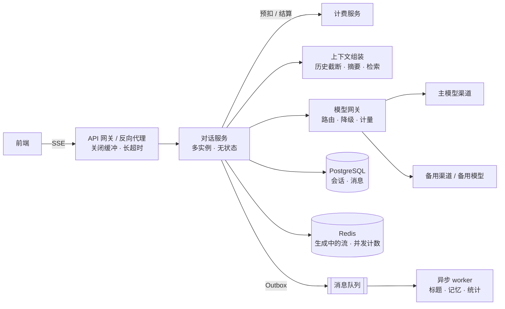
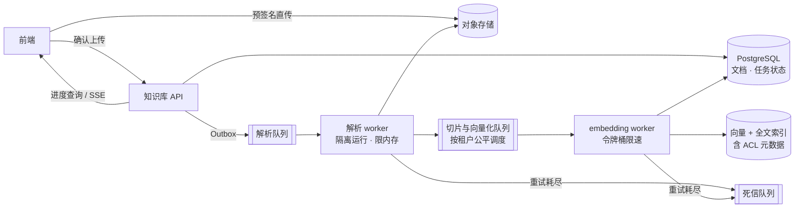
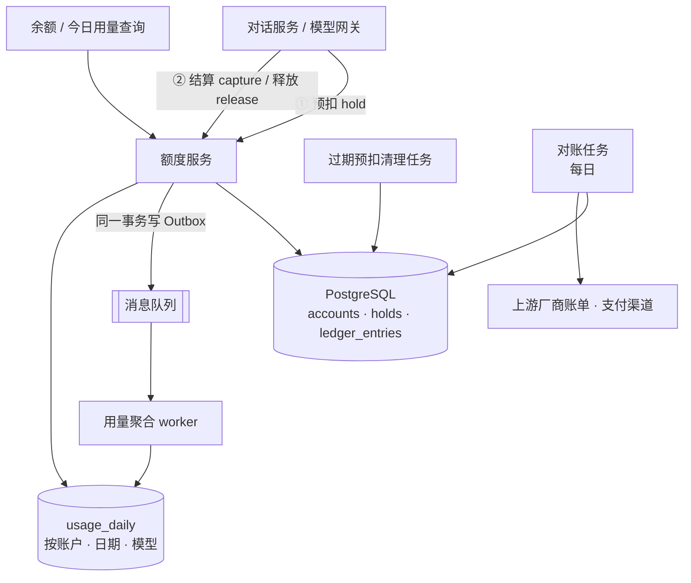
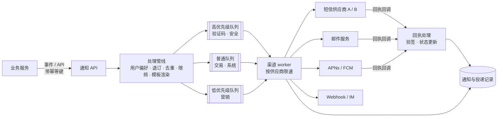
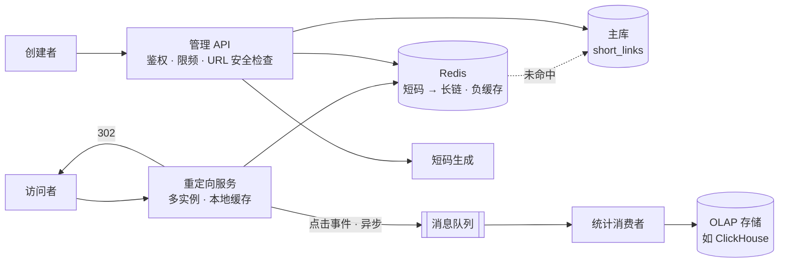

# 11 系统设计案例

> 本章目标：掌握**需求澄清 → 容量估算 → 高层设计 → 深挖瓶颈 → 取舍与演进**的系统设计五步法，会用**数量级估算**（QPS、存储、带宽、并发连接、token 成本）支撑决策，并通过 **AI 对话服务、知识库入库流水线、计费与额度、通知系统、短链服务** 五个案例，练习把 L2 与 10 章的单点知识组合成完整方案。
>
> 本章的估算数字都是**示例假设**，用来演示方法；真实项目以自己的业务数据和压测结果为准。各技术点的原理不在本章重复，按需回链 L2 各章与 [10 章](./10-分布式系统基础.md)。AI 特有的协议、检索策略、网关实现分别见 [企业级 04](../../企业级AI应用开发实战/04-AI交互层-流式协议与生成式UI.md)、[07](../../企业级AI应用开发实战/07-企业级RAG落地.md)、[09 章](../../企业级AI应用开发实战/09-LLMOps-可观测评测与AI网关.md)。

---

## 一、系统设计方法论

### 1.1 五步法

| 步骤 | 产出 | 常见错误 |
|---|---|---|
| **① 需求澄清** | 功能清单、非功能指标、明确"不做什么" | 跳过澄清直接画架构；把"可能需要"当成需求 |
| **② 容量估算** | QPS 峰值、存储增长、带宽、并发连接、成本的数量级 | 不估算就选型；或者追求精确到个位数 |
| **③ 高层设计** | 组件图、核心数据流、API 草案、数据模型 | 一开始就画十几个微服务 |
| **④ 深挖瓶颈** | 针对 1~3 个最难的点给出方案与备选 | 平均用力，每个组件都浅尝辄止 |
| **⑤ 取舍与演进** | 当前方案的代价、触发重新设计的条件、演进路线 | 只讲优点；设计一个"终局架构"一步到位 |

**需求澄清清单**：

- **功能**：核心用例是什么？哪些是第一版必须的？
- **规模**：用户数、日活、峰值时段、增长预期
- **性能**：延迟目标（P99）、吞吐；AI 场景还要问首 token 延迟（TTFT）
- **一致性**：哪些数据必须强一致（钱、权限），哪些可以延迟
- **可用性**：允许的停机时间、哪些功能可以降级
- **数据**：保留多久、是否可删除、合规要求
- **约束**：团队规模与技术栈、预算、已有基础设施、上线时间

### 1.2 估算公式

| 量 | 公式 | 说明 |
|---|---|---|
| 平均 QPS | 日请求量 ÷ 86,400 | 1 天 ≈ 10^5 秒，粗算时直接除以 10 万 |
| 峰值 QPS | 平均 QPS × 峰值系数 | 系数视业务而定，常见 2~5 倍，活动、开学、上班高峰更高 |
| 存储 | 日新增条数 × 单条大小 × 保留天数 × 副本数 | 另加索引开销与增长余量 |
| 带宽 | 峰值 QPS × 平均响应大小 | 注意出网流量费用 |
| **并发数（Little 定律）** | 并发数 = 到达率 × 平均停留时长 | **流式对话、长任务的核心公式**：60 req/s × 15 s = 900 个并发流 |
| worker 数 | 任务到达率 × 单任务耗时 ÷ 单 worker 并发 | 同样源于 Little 定律 |
| **token 成本** | 请求数 × (输入 token × 输入单价 + 输出 token × 输出单价) | 命中 prompt cache 的输入部分按折扣价计 |
| 上游配额 | 峰值 QPS × 每请求 token × 60 | 与模型厂商的 TPM（每分钟 token）限额对比 |

> 📖 **Little 定律**：稳定系统中，系统内的平均请求数 = 平均到达率 × 平均停留时间。它解释了为什么 AI 应用 QPS 不高，连接数和内存却可能很高——每个请求停留的时间太长了。

### 1.3 常用数量级

| 类别 | 量 | 数量级（参考值，务必实测） |
|---|---|---|
| 时间 | 1 天 / 1 月 / 1 年 | ≈ 8.6×10^4 秒 / 2.6×10^6 秒 / 3.2×10^7 秒 |
| 换算 | 每天 100 万次 | ≈ 12 次 / 秒 |
| 延迟 | 内存访问 | 约 100 纳秒 |
| 延迟 | SSD 随机读 | 数十到上百微秒 |
| 延迟 | 同机房网络往返 | 亚毫秒 |
| 延迟 | 跨地域网络往返 | 数十到 200 毫秒 |
| 延迟 | Redis 点查（同机房） | 亚毫秒到 1 毫秒 |
| 延迟 | 数据库索引点查 | 毫秒级 |
| 延迟 | LLM 首 token | 数百毫秒到数秒（推理模型更长） |
| 速度 | LLM 输出 | 每秒数十到上百 token，视模型与负载 |
| 大小 | 一条对话消息（含元数据） | 1~4 KB |
| 大小 | 1024 维 float32 向量 | 4 KB（1536 维为 6 KB），索引另计 |
| token | 英文 | 约 4 个字符 ≈ 1 token（OpenAI 给出的经验值） |
| token | 中文 | 因分词器差异很大，估算前用目标模型的 tokenizer 实测 |

### 1.4 示例：token 成本估算

假设：日活 10 万，人均 10 轮对话，平均每轮输入 3,000 token（系统提示 + 历史 + 检索内容），输出 500 token；**示例单价**输入 2 美元 / 百万 token、输出 8 美元 / 百万 token（非任何厂商报价）。

```text
日请求量  = 10 万 × 10 = 100 万
输入成本  = 100 万 × 3,000 = 30 亿 token = 3,000 × 2 = 6,000 美元/天
输出成本  = 100 万 × 500   =  5 亿 token =   500 × 8 = 4,000 美元/天
合计       ≈ 10,000 美元/天 ≈ 30 万美元/月

若 60% 的输入命中 prompt cache，缓存部分按一成计价：
输入成本  = 3,000 × (0.4 × 2 + 0.6 × 0.2) = 2,760 美元/天
合计       ≈ 6,760 美元/天，下降约 1/3
```

> 🎯 **落地要点**：多轮对话的成本大头往往在**输入**——每一轮都要重发历史。上下文压缩、稳定前缀以命中缓存（[企业级 06 章 4.3](../../企业级AI应用开发实战/06-Agent工程化-从Loop到生产.md#43-实战技巧)）、按任务分级路由模型，是投入产出比最高的三件事。估算表应该成为方案评审的固定附件。

---

## 二、案例 a：AI 对话服务

### 2.1 需求与约束

- 多轮对话，**流式输出**，支持停止生成、重新生成
- 会话列表与历史持久化，刷新页面或换设备可继续
- 多模型可选，按套餐限制可用模型；主模型故障时降级
- 每用户同时进行的生成数有上限；按 token 计费（对接案例 c）
- 非功能：TTFT P95 < 2 秒（不含模型本身排队）；对话服务可用性 99.9%

### 2.2 估算

```text
请求量    100 万/天 → 平均 12 req/s，峰值按 5 倍 ≈ 60 req/s
单次时长  TTFT 1~2 s + 输出 500 token ÷ 50 token/s ≈ 12~15 s
并发流    60 × 15 ≈ 900，按 2 倍余量规划 2,000 个并发 SSE 连接
存储      每轮 2 条消息 × 2 KB × 100 万 = 4 GB/天 ≈ 1.5 TB/年（不含索引）
上游配额  60 req/s × 3,500 token × 60 ≈ 1,260 万 TPM → 需核对厂商限额，通常要多渠道
成本      见 1.4 节，约 7,000~10,000 美元/天
```

结论：**QPS 很低，难点在长连接数量、上游配额与成本**，而不是数据库吞吐。

### 2.3 架构



### 2.4 数据模型要点

```sql
CREATE TABLE conversations (
  id          uuid PRIMARY KEY DEFAULT uuidv7(),
  user_id     uuid NOT NULL,
  title       text,
  summary     text,                 -- 早期历史的压缩摘要
  updated_at  timestamptz NOT NULL DEFAULT now()
);
CREATE INDEX ON conversations (user_id, updated_at DESC);

CREATE TABLE messages (
  id              uuid PRIMARY KEY DEFAULT uuidv7(),   -- 时间有序，天然按序排列
  conversation_id uuid NOT NULL REFERENCES conversations(id),
  parent_id       uuid,                                -- 重新生成形成分支
  role            text NOT NULL,                       -- user / assistant / tool
  parts           jsonb NOT NULL,                      -- 文本、工具调用、引用等结构化片段
  status          text NOT NULL,                       -- streaming / completed / aborted / failed
  model           text,
  input_tokens    int,
  output_tokens   int,
  created_at      timestamptz NOT NULL DEFAULT now()
);
CREATE INDEX ON messages (conversation_id, id);
```

- 消息内容用 `parts` 结构化存储，而不是一个大字符串，便于渲染工具调用与引用（UI 消息模型见 [企业级 04 章第四节](../../企业级AI应用开发实战/04-AI交互层-流式协议与生成式UI.md#四消息模型ui-消息-vs-模型消息)）
- `status` 区分生成中、完成、中断、失败；中断的消息保留已生成部分
- 记录每条助手消息的 `model` 与 token 数，用于计费核对与问题回溯

### 2.5 关键难点与方案

**① 生成与连接解耦**：用户断网重连、切换标签页时，生成不应中断或重来。

| 方案 | 做法 | 适合 |
|---|---|---|
| 直连 | SSE 连接即生成任务，断开即中止 | 第一版；断线就让用户重试 |
| **生成与连接解耦** | 生成任务把 chunk 写入 Redis Stream（按消息 ID），SSE 连接只是订阅者；重连时带 `Last-Event-ID` 从断点续读 | 需要断线恢复、多端同步 |

SSE 的服务端实现、反向代理缓冲与超时配置见 [01 章](../L1-认知切换/01-网络与HTTP-服务端视角.md)。

**② 落库时机**：用户消息**先落库再调模型**；助手消息在开始时插入 `status=streaming` 的记录，流结束时一次性更新内容与 token 数。不要每个 chunk 更新一次数据库——900 个并发流每秒数十个 chunk，会产生数万次无意义写入。

**③ 多轮上下文**：按 token 预算组装上下文——系统提示 + 会话摘要 + 最近 N 轮 + 检索结果，超出预算时先压缩最早的历史。策略细节见 [企业级 06 章第四节](../../企业级AI应用开发实战/06-Agent工程化-从Loop到生产.md#四上下文工程重点)。

**④ 超时分三种**：

| 超时 | 含义 | 处理 |
|---|---|---|
| 首 token 超时 | 发出请求后 N 秒没有任何输出 | 可以切换渠道重试，用户无感 |
| chunk 间隔超时 | 输出中途停顿超过 N 秒 | 中止上游，消息标记失败，提示重试 |
| 总时长上限 | 单次生成的最长时间 | 防止异常请求长期占用连接与配额 |

**⑤ 降级**：只对 429、5xx、超时降级，4xx 参数错误不降级（[企业级 09 章 5.3](../../企业级AI应用开发实战/09-LLMOps-可观测评测与AI网关.md#53-自研网关的关键实现点)）。降级顺序：同模型其他渠道 → 备用模型 → 友好提示。

> ⚠️ **注意**：**已经开始输出之后，不能无缝切换模型**。用户已经看到半段回答，换一个模型从头生成会出现内容不连贯。只在首 token 之前做透明切换；输出中途失败时，保留已生成内容并明确告知用户。

**⑥ 并发与额度控制**：每用户同时生成数用 Redis 计数（`INCR` + 过期时间，结束时 `DECR`）；开始前向计费服务预扣，结束后结算（案例 c）。用户点击停止时，**服务端必须中止上游请求**，否则模型继续生成、继续计费。

**⑦ 多模型路由**：路由规则（套餐 → 可用模型、任务类型 → 推荐模型）放在模型网关或对话服务的配置中，不散落在业务代码里。

### 2.6 演进路径

| 阶段 | 形态 | 触发下一阶段的信号 |
|---|---|---|
| 起步 | 单体服务直连模型厂商，同步落库 | 需要多模型、多渠道、统一计量 |
| 成长 | 引入模型网关；异步 worker 处理标题、记忆、统计 | 断线投诉增多、需要多端同步 |
| 规模化 | 生成与连接解耦（Redis Stream）；消息表按时间分区；冷数据归档 | 单库写入或存储到达瓶颈 |

### 2.7 常见错误设计

- 在 API 网关或反向代理上保留默认的 60 秒超时与响应缓冲，流式输出"一次性"到达或中途被切断
- 用户停止后只断开前端连接，上游模型调用继续运行
- 把完整对话历史每轮原样发给模型，没有 token 预算
- 每个 chunk 写一次数据库
- 调用模型之后才检查余额，额度用尽的用户仍能产生费用

---

## 三、案例 b：知识库入库流水线

### 3.1 需求与约束

- 用户上传 PDF、Word、Markdown、网页链接，系统解析、切片、向量化、写入索引
- 用户能看到每个文档的处理进度与失败原因，可以手动重试
- 文档更新后增量重建；删除后检索不再返回
- 检索结果遵守文档权限（谁能看这个文档，谁才能检索到它的切片）
- 单个租户可能一次性批量导入数千个文档，不能拖垮其他租户

### 3.2 估算

```text
文档量      1 万/天，平均 2 MB → 对象存储 20 GB/天 ≈ 7 TB/年
切片        平均每文档 100 片 → 100 万片/天
embedding   100 万片 × 500 token = 5 亿 token/天
向量        1024 维 float32 = 4 KB/片 → 4 GB/天（HNSW 等索引另计）
解析并发    峰值 1.2 文档/秒 × 平均解析 60 秒 ≈ 72 个并发解析任务
批量导入    某租户导入 5,000 文档 = 50 万片 = 2.5 亿 token；
            若 embedding 限额为每分钟 100 万 token（示例），至少需要约 4 小时
```

结论：**瓶颈是解析的 CPU / 内存与 embedding 接口的限额**，必须异步、分阶段、按租户公平调度。

### 3.3 架构



### 3.4 数据模型要点

```sql
CREATE TABLE documents (
  id              uuid PRIMARY KEY DEFAULT uuidv7(),
  kb_id           uuid NOT NULL,
  tenant_id       uuid NOT NULL,
  object_key      text NOT NULL,
  content_hash    text,                  -- 判断内容是否真的变化
  active_version  int,                   -- 检索时只使用该版本的切片
  status          text NOT NULL,         -- uploaded / parsing / embedding / ready / failed
  progress        jsonb,                 -- {"stage":"embedding","done":340,"total":800}
  error_code      text,                  -- 面向用户的错误分类：encrypted_pdf / unsupported / ...
  updated_at      timestamptz NOT NULL DEFAULT now()
);

CREATE TABLE chunks (
  id               uuid PRIMARY KEY DEFAULT uuidv7(),
  document_id      uuid NOT NULL,
  document_version int NOT NULL,
  kb_id            uuid NOT NULL,
  content          text NOT NULL,
  embedding        vector(1024),
  embedding_model  text NOT NULL,        -- 换模型 = 全量重建，必须记录
  principals       text[] NOT NULL       -- 可访问该文档的用户 / 组
);
```

### 3.5 关键难点与方案

**① 分阶段与队列隔离**：解析（CPU、内存重，耗时长）与 embedding（IO 为主，受外部限额约束）资源特征不同，拆成两个队列、两类 worker，分别扩缩。

**② 幂等与可重跑**：任务以 `(document_id, version)` 为幂等键。重跑某版本时先删除该版本的已有切片再写入，保证重复执行结果一致（消费幂等见 [07 章](../L2-核心能力/07-异步任务与消息队列.md)）。

**③ 重试分类**：

| 错误 | 是否重试 | 处理 |
|---|---|---|
| embedding 接口 429 / 5xx、超时 | 是，指数退避 | 超过次数进入死信 |
| 解析 worker OOM、进程被杀 | 是，有限次数 | 多次失败后标记"文件过大或复杂" |
| 加密 PDF、格式不支持、文件损坏 | **否** | 直接标记失败，给出用户可理解的原因 |

**④ 进度**：按阶段更新 `progress`（不要每处理一片就写一次库，按批或按时间间隔更新）。前端轮询或订阅 SSE；长任务 API 的设计（202 + 状态查询）见 [03 章](../L2-核心能力/03-API设计.md)。

**⑤ 增量更新与原子切换**：内容 hash 未变则跳过；变化时生成新版本切片，**全部写完后再把 `active_version` 切到新版本**，最后异步清理旧版本。检索条件带上 `document_version = active_version`，避免更新期间检索到"半新半旧"的结果。增量策略与 embedding 模型升级见 [企业级 07 章第八节](../../企业级AI应用开发实战/07-企业级RAG落地.md#八增量更新与数据生命周期)。

**⑥ 权限**：切片携带 ACL 元数据，检索时前置过滤；文档权限变更只更新 `principals`，不重新向量化（[企业级 07 章第六节](../../企业级AI应用开发实战/07-企业级RAG落地.md#六权限过滤重点)）。

**⑦ 租户公平与背压**：embedding 调用用令牌桶全局限速（[05 章](../L2-核心能力/05-缓存与Redis.md)）；队列按租户分区或轮转调度，单租户的批量导入不能独占全部 worker（背压见 [08 章](../L2-核心能力/08-并发与可靠性.md)）。

**⑧ 安全**：上传走预签名直传与服务端校验（[10 章 8.2](./10-分布式系统基础.md)）；"从 URL 导入"必须防 SSRF（[06 章](../L2-核心能力/06-认证授权与Web安全.md)）；解析器在资源受限的隔离环境中处理不可信文件。

### 3.6 演进路径

| 阶段 | 形态 | 触发下一阶段的信号 |
|---|---|---|
| 起步 | 一个任务队列（如 Celery / BullMQ）串行执行全部阶段；pgvector 存向量 | 解析拖慢 embedding、单租户导入阻塞他人 |
| 成长 | 分阶段队列、租户公平调度、死信与人工重试界面 | 切片数达到千万级，检索延迟或索引构建时间不可接受 |
| 规模化 | 评估专用向量库或分区索引；连接器支持增量同步与权限同步 | — |

### 3.7 常见错误设计

- 在 HTTP 请求里同步完成解析和向量化，大文件直接超时
- 文档更新时"先删旧切片再慢慢写新切片"，中间一段时间检索不到该文档
- 所有错误一律重试，加密 PDF 在队列里无限循环
- 切片没有记录 `embedding_model`，换模型后新旧向量混用
- 只在检索后过滤权限，Top K 被无权限内容占满

---

## 四、案例 c：计费与额度系统

### 4.1 需求与约束

参考 AI 网关的典型需求：用户或团队持有**钱包余额**，可查询**可用余额与今日用量**；每次模型调用按实际 token 和模型单价扣费。

- 调用前确认余额充足，余额不足返回 402 / 429，并不能出现大额透支
- 并发请求下扣费准确，不超扣、不漏扣、不重复扣
- 所有资金变动可追溯、可对账（与上游厂商账单、与支付渠道）
- 余额与今日用量查询低延迟

### 4.2 估算

```text
计费事件  100 万次调用/天，每次 预扣 + 结算 = 2 次账本写入 → 200 万行/天，峰值约 120 次写/秒
账本存储  每行约 200 B → 400 MB/天 ≈ 150 GB/年
热点      企业共享钱包：上千名员工的调用都更新同一个账户行
```

结论：总吞吐不高，难点在**正确性**（并发、幂等、对账）和**热点账户**。

### 4.3 架构



### 4.4 数据模型要点

```sql
CREATE TABLE accounts (
  id          uuid PRIMARY KEY,
  balance     bigint NOT NULL,          -- 最小单位整数（如 1e-6 元），禁止浮点
  frozen      bigint NOT NULL DEFAULT 0,
  CHECK (frozen >= 0)
);

CREATE TABLE holds (
  request_id  text PRIMARY KEY,         -- 调用方的幂等键
  account_id  uuid NOT NULL,
  amount      bigint NOT NULL,
  status      text NOT NULL,            -- held / captured / released / expired
  expires_at  timestamptz NOT NULL
);

CREATE TABLE ledger_entries (           -- 只追加，不更新不删除
  id            uuid PRIMARY KEY DEFAULT uuidv7(),
  account_id    uuid NOT NULL,
  request_id    text NOT NULL,
  type          text NOT NULL,          -- recharge / capture / refund / adjust
  amount        bigint NOT NULL,        -- 正为入账，负为出账
  balance_after bigint NOT NULL,
  unit_price    jsonb,                  -- 结算时的价格快照：模型、输入单价、输出单价
  created_at    timestamptz NOT NULL DEFAULT now(),
  UNIQUE (request_id, type)
);
```

**账本是事实来源，余额是账本的物化结果**。两者在同一个本地事务中写入，对账时校验 `SUM(ledger.amount) = balance`。这就是 [09 章 5.3](./09-架构模式.md) 所说的"账本 + 余额快照"。

### 4.5 关键难点与方案

**① 预扣与结算**：请求开始时还不知道实际用量。

```text
预扣   amount = (输入 token + max_tokens) × 单价     → 余额不足即拒绝
结算   actual = 实际 usage × 单价；释放冻结，扣除 actual，多退少补
释放   请求失败、用户取消 → 释放冻结
过期   进程崩溃导致既未结算也未释放 → 清理任务按 expires_at 释放
```

本质就是 TCC 的 Try / Confirm / Cancel（[10 章 4.4](./10-分布式系统基础.md)），同样要处理空回滚（结算或释放时找不到 hold）与悬挂（释放之后迟到的结算）。

**② 并发扣减**：

```typescript
// ❌ 反例：先读后写，两个并发请求都读到余额 100，各自扣 80，最终余额 20，实际消费 160
const acc = await db.one("SELECT balance FROM accounts WHERE id = $1", [accountId]);
if (acc.balance < amount) throw new InsufficientCredit();
await db.none("UPDATE accounts SET balance = $1 WHERE id = $2", [acc.balance - amount, accountId]);
```

```typescript
// ✅ 正例：幂等占位 + 条件更新，在一个事务里完成
await db.tx(async (tx) => {
  const inserted = await tx.oneOrNone(
    `INSERT INTO holds (request_id, account_id, amount, status, expires_at)
     VALUES ($1, $2, $3, 'held', now() + interval '15 minutes')
     ON CONFLICT (request_id) DO NOTHING RETURNING request_id`,
    [requestId, accountId, amount],
  );
  if (!inserted) return;                       // 重复请求：已预扣过，直接返回

  const updated = await tx.result(
    `UPDATE accounts SET frozen = frozen + $1
     WHERE id = $2 AND balance - frozen >= $1`,   // 条件写在 WHERE 里，由行锁保证原子
    [amount, accountId],
  );
  if (updated.rowCount === 0) throw new InsufficientCredit();   // 抛出即回滚，hold 记录一并撤销
});
```

> ⚠️ **注意**：不要把"插入 hold"和"更新余额"写进同一条带 `ON CONFLICT` 的 CTE 语句：PostgreSQL 中数据修改型 CTE 的每个子语句都会执行，重复请求时余额照样被冻结一次。先占位、确认不是重复请求，再改余额。乐观锁与悲观锁的选择见 [08 章](../L2-核心能力/08-并发与可靠性.md)，行锁原理见 [04 章](../L2-核心能力/04-数据库与数据建模.md)。

**③ 幂等**：`holds.request_id` 主键与 `ledger_entries (request_id, type)` 唯一约束保证重试不会重复扣费；调用方必须在整个请求生命周期内使用同一个 `request_id`（[03 章](../L2-核心能力/03-API设计.md)）。

**④ 过期与迟到的结算**：`expires_at` 必须大于单次请求的最长时长。清理任务释放过期预扣后，如果结算才到达，按实际用量直接扣费并记录（可能出现小额负余额），而不是丢弃——**宁可小额透支，不可漏记账**。

**⑤ 热点账户**：所有更新串行在同一行锁上，吞吐受限。按代价从低到高：

| 方案 | 做法 | 代价 |
|---|---|---|
| 缩短事务 | 事务内只做必要的 SQL，不在事务中调用外部服务 | 几乎没有 |
| 子账户拆分 | 一个钱包拆成 N 个子账户行，随机选择扣减，余额为总和 | 余额判断变复杂，单个子账户可能先耗尽 |
| 批量合并 | 结算事件进入队列，按账户批量合并后一次更新 | 余额有秒级延迟 |
| Redis 预扣 + 异步落账 | Redis Lua 原子扣减，账本异步写入 | Redis 故障时数据丢失风险，需对账兜底 |

**⑥ 今日用量**：不要实时 `SUM` 明细表。结算时通过 Outbox 发出事件，聚合 worker 对 `usage_daily (account_id, date, model)` 做 `INSERT ... ON CONFLICT DO UPDATE` 累加；需要实时性时，同时在 Redis 中 `INCRBY` 按日期分 key 的计数。

> ⚠️ **注意**：**"今日"是哪个时区的今日？**服务器通常用 UTC，用户在 UTC+8，北京时间早上 7 点用户看到的"今日用量"可能还包含昨天的数据。约定以账户时区（或业务所在时区）切分日期，存储与查询使用同一规则。

**⑦ 对账**：每日任务校验三件事——账本与余额一致；平台记录的 token 用量与上游厂商账单一致（计量误差目标可参考 [企业级 11 章项目三](../../企业级AI应用开发实战/11-实战项目方案.md)的验收标准）；充值记录与支付渠道一致。差异超过阈值即告警，人工处理通过 `adjust` 类型的账本记录修正，不直接改余额。

### 4.6 演进路径

| 阶段 | 形态 | 触发下一阶段的信号 |
|---|---|---|
| 起步 | 单库事务：holds + ledger + accounts；今日用量直接查询账本 | 账本行数增长使用量查询变慢 |
| 成长 | 用量预聚合；过期预扣清理；每日对账 | 出现热点账户、锁等待升高 |
| 规模化 | 子账户拆分或批量合并；账本按月分区与归档 | — |

### 4.7 常见错误设计

- 金额使用 `float` / `double`，累计误差导致对账不平
- 先读余额再更新，并发下超扣
- 先调用模型、事后扣费，且没有预扣上限
- 直接 `UPDATE balance` 而没有账本，出现争议时无法追溯
- 价格只存在配置中，调价后历史账单无法复算（应在账本中记录价格快照）
- 以 Redis 中的余额为准，Redis 故障或淘汰后余额丢失

---

## 五、案例 d：通知系统

### 5.1 需求与约束

- 渠道：站内信、邮件、短信、App 推送、Webhook / IM 机器人
- 业务方只调用一个接口：发给谁、哪个模板、哪些参数、什么优先级
- 优先级：验证码与安全告警 > 交易与系统通知（额度不足、入库完成）> 营销
- 去重（同一事件不重复通知）、限频（同一用户不被轰炸）、免打扰时段、退订
- 送达追踪：发出、送达、失败、打开
- AI 场景：Agent 长任务完成、**人工审批请求**（人机协同的触达渠道，交互设计见 [企业级 04 章第六节](../../企业级AI应用开发实战/04-AI交互层-流式协议与生成式UI.md#六人机协同的交互设计重点)）、额度预警

### 5.2 估算

```text
日常      100 万条/天 → 平均 12 条/秒
营销批量  一次活动 500 万条，期望 1 小时内发完 → 约 1,400 条/秒
供应商    短信、邮件供应商有发送速率上限，需按供应商限速
存储      每条通知 + 投递记录约 1 KB → 1 GB/天；投递明细保留 90 天后归档
```

结论：**营销洪峰不能阻塞验证码**；吞吐由外部供应商限速决定。

### 5.3 架构



### 5.4 数据模型要点

- `notifications`：`idempotency_key`（唯一）、`user_id`、`template_id`、`template_version`、`params`、`priority`、`status`
- `deliveries`：每个渠道一条，`channel`、`provider`、`provider_message_id`、`status`、`attempts`、`last_error`
- `templates`：按 `(template_id, channel, locale, version)` 版本化
- `user_preferences`：各类通知的渠道开关、免打扰时段、时区
- `suppressions`：退订、硬退信、失效的设备 token

### 5.5 关键难点与方案

**① 优先级隔离**：**按优先级拆成独立队列和独立 worker 池**，而不是在一个队列里加优先级字段——营销消息堆积时，单队列中的验证码同样要排队。

**② 去重**：两层。业务事件 ID 作为幂等键，防止同一事件重复调用（[03 章](../L2-核心能力/03-API设计.md)）；内容去重窗口（如同一用户、同一模板、同一参数 10 分钟内只发一次），防止业务方的重复触发。

**③ 限频与免打扰**：按"用户 × 渠道 × 通知类别"做滑动窗口限频（[05 章](../L2-核心能力/05-缓存与Redis.md)）；免打扰按用户时区计算，营销消息延后到时段结束，验证码与安全告警不受限制。

**④ 模板**：模板版本化，通知记录关联版本，便于追溯"用户当时收到了什么"；渲染时对变量做转义（邮件 HTML 中的 XSS），缺少必填变量时拒绝发送而不是发出 `{{name}}`。

**⑤ 送达追踪**：`sent` 只表示供应商接收了请求，不等于送达。状态以供应商回执为准：

```text
created → queued → sent → delivered → opened
                       ↘ failed / bounced
```

回执可能乱序到达（先收到 delivered，后收到 sent），状态更新时**只允许前进**：`UPDATE ... SET status = $new WHERE id = $id AND status_rank < $new_rank`。回执回调必须验证签名。

**⑥ 重试与切换**：供应商 5xx、超时可重试，并可切换备用供应商；验证码有有效期，**超过有效期不再重试**；硬退信、无效号码、失效的推送 token 写入 `suppressions`，后续不再发送。

**⑦ 合规**：邮件需配置 SPF、DKIM、DMARC，主流邮箱服务商对批量发件人还要求提供一键退订；国内短信的签名与模板需提前报备审核，营销短信需用户同意并提供退订方式。具体要求以服务商与法规为准。

### 5.6 演进路径

| 阶段 | 形态 | 触发下一阶段的信号 |
|---|---|---|
| 起步 | 业务代码直接调用邮件 / 短信 SDK | 渠道增多，重复实现去重、限频、模板 |
| 成长 | 独立通知服务，统一 API，按优先级分队列 | 需要多供应商切换、送达率分析 |
| 规模化 | 多供应商路由、送达率看板、用户偏好中心 | — |

### 5.7 常见错误设计

- 在业务事务内同步调用短信接口，供应商超时拖慢主流程，事务回滚后短信已发出（应通过 Outbox 异步触发）
- 所有通知共用一个队列，营销活动期间验证码延迟数分钟
- 把 `sent` 当作"已送达"统计
- 验证码过期后仍在重试
- 无效设备 token 永不清理，推送成功率持续下降

---

## 六、案例 e：短链服务

### 6.1 需求与约束

- 长链接生成短码，访问短链时重定向到原链接
- 支持自定义别名、过期时间；创建者可停用
- 统计：点击量、独立访客、来源、地区、设备
- 防滥用：拒绝钓鱼与恶意链接，限制匿名创建频率
- 非功能：重定向 P99 < 50 毫秒（不含客户端网络）；读多写少

### 6.2 估算

```text
写入    100 万条/天 ≈ 12 条/秒
读取    读写比 100:1 → 平均 1,200 次/秒，峰值按 5 倍 ≈ 6,000 次/秒
总量    5 年 ≈ 18 亿条；每条约 500 B → 约 1 TB
短码    62^6 ≈ 5.7×10^10，62^7 ≈ 3.5×10^12 → 7 位足够，6 位也有余量
缓存    热点集中：缓存最近活跃的 1,000 万条 × 约 300 B ≈ 3 GB
点击    1 亿次/天 × 约 100 B ≈ 10 GB/天事件数据
```

### 6.3 架构



### 6.4 数据模型要点

```sql
CREATE TABLE short_links (
  code        text PRIMARY KEY,           -- 短码即主键，点查一次命中
  long_url    text NOT NULL,
  owner_id    uuid,
  status      text NOT NULL DEFAULT 'active',   -- active / disabled / blocked
  expires_at  timestamptz,
  created_at  timestamptz NOT NULL DEFAULT now()
);
```

点击明细不进 OLTP 主库，进入 OLAP 存储按天分区；管理后台的统计查询打 OLAP，不打主库。

### 6.5 关键难点与方案

**① 短码生成**：

| 方案 | 做法 | 优点 | 缺点 |
|---|---|---|---|
| 哈希截断 | 对长链做哈希，取前 7 位 Base62 | 同一长链得到同一短码 | 冲突需检测重试 |
| 自增 ID + Base62 | 数据库序列编码 | 简单、无冲突、短 | **可预测、可枚举**，暴露业务量 |
| 自增 ID + 混淆 | 序列号经可逆变换（如 Sqids，原 Hashids）再编码 | 无冲突且不易枚举 | 混淆不是加密，不能作为访问控制 |
| 预生成号池 | 离线生成随机短码存入池中，创建时领取 | 创建快、无冲突 | 要维护号池 |
| 随机 + 唯一约束 | 随机生成，插入冲突则重试 | 实现最简单 | 空间占用率高后冲突增多 |

对 7 位、空间约 3.5 万亿的短码来说，"随机生成 + 主键唯一约束 + 冲突重试"在相当长的时间内都足够，是最省事的选择。

**② 301 还是 302**：301 是永久重定向，浏览器会缓存，之后的点击不再经过服务端——**统计丢失，停用和改目标也不再生效**。需要统计与可控性时使用 302（或 307）。

**③ 热点缓存**：读路径为"本地缓存 → Redis → 数据库"。不存在的短码写入短 TTL 的**负缓存**，或用布隆过滤器前置判断，防止恶意扫描穿透到数据库；热门短码在本地缓存中设置短 TTL，防止单个 Redis key 成为热点（穿透、击穿、热 key 见 [05 章](../L2-核心能力/05-缓存与Redis.md)）。停用或拉黑时主动删除缓存。

**④ 统计异步化**：重定向路径上只做"发事件"，不同步写数据库。事件丢失少量可接受时，可以在本地批量缓冲后发送；独立访客数可用 HyperLogLog 估算。

**⑤ 防滥用**：只允许 `http` / `https` 协议；创建时检查恶意 URL 名单；匿名创建按 IP 限频；被举报的短码可立即拉黑。如果提供链接预览（服务端抓取目标页面标题），抓取过程必须防 SSRF（[06 章](../L2-核心能力/06-认证授权与Web安全.md)）。

### 6.6 演进路径

| 阶段 | 形态 | 触发下一阶段的信号 |
|---|---|---|
| 起步 | 单服务 + PostgreSQL + Redis；统计写入明细表 | 统计写入影响重定向延迟 |
| 成长 | 点击事件走队列进入 OLAP；本地缓存 + 负缓存 | 读流量继续增长、需要全球低延迟 |
| 规模化 | 重定向逻辑下沉到边缘（CDN 边缘函数 + 边缘 KV）；主库按短码分片 | — |

### 6.7 常见错误设计

- 使用 301，上线后发现统计数据远低于预期，且无法停用已传播的链接
- 自增 ID 直接 Base62，竞争对手可以遍历全部链接
- 在重定向请求中同步 `INSERT` 点击记录
- 不存在的短码每次都查数据库
- 不校验目标 URL 协议，`javascript:` 链接被用于攻击

---

## 七、AI 代码审查清单（设计评审）

### 7.1 方法与估算

- [ ] 方案附带估算表：峰值 QPS、存储增长、并发连接、上游配额、月度成本
- [ ] 明确列出了"第一版不做什么"
- [ ] 每个新增组件都能对应到一条具体需求或一个估算结论
- [ ] 写明了当前方案的代价，以及触发重新设计的量化条件

### 7.2 AI 对话服务

- [ ] 🔴 调用模型前完成额度预扣，用户停止生成时服务端中止上游请求
- [ ] 🔴 所有模型调用设置首 token、chunk 间隔、总时长三类超时
- [ ] 反向代理与网关对流式路径关闭缓冲、调长超时，并在生产链路上验证过
- [ ] 上下文按 token 预算组装，有历史压缩策略
- [ ] 降级只针对 429、5xx、超时；输出开始后不做透明切换
- [ ] 消息不是每个 chunk 写一次数据库

### 7.3 知识库入库

- [ ] 🔴 检索时做权限前置过滤，切片带 ACL 元数据
- [ ] 解析与向量化异步、分阶段，HTTP 请求内不做重处理
- [ ] 任务以 `(document_id, version)` 幂等，重跑结果一致
- [ ] 不可重试的错误（加密、格式不支持）直接失败并给出可读原因
- [ ] 文档更新时新版本写完后再切换，检索不到"半新半旧"的结果
- [ ] embedding 调用有全局限速与租户公平调度
- [ ] 切片记录了 `embedding_model`

### 7.4 计费与额度

- [ ] 🔴 金额使用整数最小单位或定点数，没有浮点
- [ ] 🔴 扣减使用条件更新或锁，没有"先读后写"
- [ ] 🔴 预扣、结算、退款都有幂等键并由唯一约束保证
- [ ] 有只追加的账本，余额变更与账本写入在同一事务中
- [ ] 过期预扣有清理任务；迟到的结算不会被丢弃
- [ ] "今日用量"的时区规则明确，读写一致
- [ ] 有每日对账任务与差异告警；人工修正通过账本调整记录完成

### 7.5 通知系统

- [ ] 🔴 通知通过 Outbox 或事务提交后触发，不在业务事务内同步调用供应商
- [ ] 高优先级通知有独立队列与 worker
- [ ] 有幂等键去重与内容去重窗口；有按用户的限频
- [ ] 回执回调验签，状态只前进
- [ ] 有时效的通知（验证码）过期后不再重试
- [ ] 退订、硬退信、失效 token 进入抑制列表

### 7.6 短链服务

- [ ] 🔴 目标 URL 只允许 `http` / `https`，有恶意链接检查
- [ ] 需要统计时使用 302 / 307，而不是 301
- [ ] 短码不可枚举（随机或混淆），不直接暴露自增 ID
- [ ] 不存在的短码有负缓存或布隆过滤器
- [ ] 重定向路径上没有同步写数据库

---

## 本章小结

- 系统设计五步：**需求澄清 → 容量估算 → 高层设计 → 深挖瓶颈 → 取舍与演进**；估算追求数量级，不追求精确
- **Little 定律**是 AI 应用估算的核心：QPS 不高，但长耗时让并发连接、worker 数和内存成为瓶颈
- token 成本的大头常在**输入**：上下文压缩、prompt cache、分级路由是投入产出比最高的手段
- AI 对话：生成与连接可解耦；先预扣再调用；三类超时；**输出开始后不能透明切换模型**
- 知识库入库：分阶段异步、幂等可重跑、错误分类重试、**新版本写完再切换**、租户公平调度
- 计费：**账本为事实、余额为快照**；整数金额、条件更新、幂等键、过期清理、每日对账；注意"今日"的时区
- 通知与短链两个经典案例的共同点：**优先级 / 读写路径隔离**，非关键路径（统计、回执）异步化

## 练习

1. 为你正在做（或计划做）的 AI 应用写一份估算表：日活、人均轮次、平均输入 / 输出 token、峰值系数、单次生成时长，算出峰值 QPS、并发 SSE 连接数、上游 TPM 需求与月度 token 成本；再分别计算"历史压缩使平均输入减半"和"prompt cache 命中 60%"两种优化后的成本
2. 实现案例 c 的最小版本：`accounts`、`holds`、`ledger_entries` 三张表与预扣、结算、释放三个接口。用 100 个并发请求对同一账户发起预扣（总额超过余额），验证没有超扣；对同一 `request_id` 重复调用，验证只扣一次；最后写一个对账脚本校验账本与余额一致
3. 实现案例 b 的入库流水线骨架：上传 → 解析队列 → embedding 队列 → 写入 pgvector，加上进度查询接口。模拟三种失败（embedding 接口 429、解析 OOM、加密 PDF），验证前两种自动重试、第三种直接失败并给出可读原因
4. 让 AI 按本章五步法为"Agent 长任务完成后通知用户并支持在通知中直接审批"设计方案，用第七节清单逐项评审它的输出，记录它遗漏了哪些检查点
