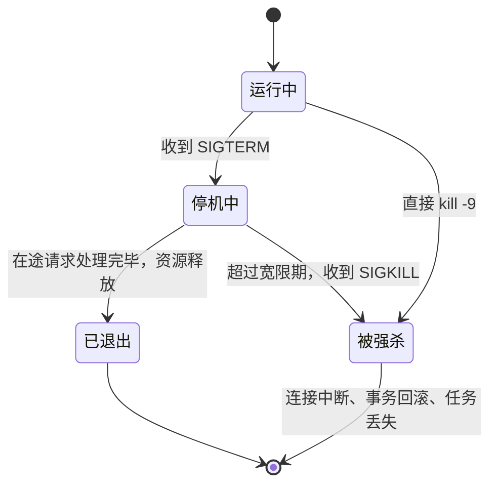
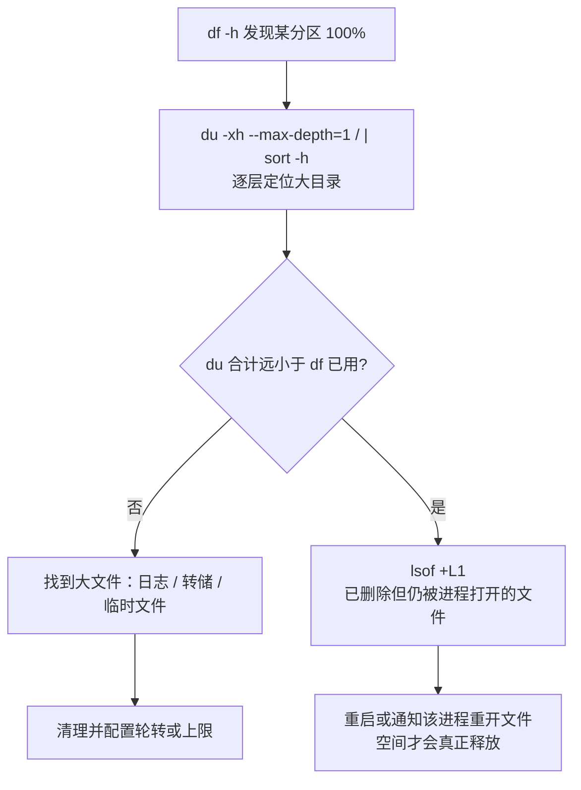
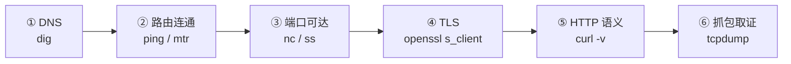

# 12 Linux 与排障命令

> 本章目标：建立服务端 Linux 的**核心心智**（文件、进程、信号、文件描述符、权限、环境变量），能用 **systemd** 把应用托管成可靠的服务，并掌握一套覆盖**资源、网络、日志、SSH 与语言运行时**的排障工具链，线上出问题时知道**先敲哪条命令**。
>
> 版本基线：命令以 systemd 发行版（Debian / Ubuntu、RHEL 系）为准；运行时以 Java 25 LTS、Node.js 26 LTS（2026 年 10 月进入 Active LTS）、Python 3.14 / 3.15（3.15 于 2026 年 10 月发布）为例。具体参数以 `man` 与官方文档为准。
>
> 边界：容器内的进程与信号见 [13 章](./13-Docker与Compose.md)，K8s 对象排障见 [14 章](./14-Kubernetes核心与实践.md)，应用层的优雅停机见 [08 章](../L2-核心能力/08-并发与可靠性.md#七优雅停机)，证书续期与反代配置见 [15 章](./15-部署架构与云.md)，系统化排障方法论与复盘见 [17 章](./17-可观测性与线上排障.md#六排障方法论)。

---

## 一、必须建立的 Linux 心智

### 1.1 一切皆文件

Linux 把普通文件、目录、设备、管道、socket，甚至**进程的运行时状态**都暴露为文件接口。排障时很多信息不需要专门工具，直接读文件即可：

| 路径 | 内容 | 典型用途 |
|---|---|---|
| `/proc/<pid>/status` | 进程状态、内存（`VmRSS`）、线程数 | 看某个进程实际占多少内存 |
| `/proc/<pid>/limits` | 该进程**生效中**的资源上限 | 确认 `Max open files` 是否真的调大了 |
| `/proc/<pid>/fd/` | 进程打开的所有文件描述符 | 统计连接数、找泄漏 |
| `/proc/<pid>/environ` | 进程启动时的环境变量（`\0` 分隔） | 确认服务读到的配置 |
| `/sys/fs/cgroup/` | cgroup 资源控制（cgroup v2） | 容器 / systemd 服务的内存与 CPU 限额 |

```bash
cat /proc/$(pgrep -f 'node dist/main.js')/limits | grep 'open files'
tr '\0' '\n' < /proc/12345/environ | grep -E '^(NODE_ENV|DATABASE_URL)='
```

### 1.2 进程与信号

> 📖 **信号（Signal）**：内核或其他进程发给进程的异步通知。进程可以注册处理函数来响应大部分信号，但 `SIGKILL` 和 `SIGSTOP` 无法捕获。可以类比为浏览器里的 `beforeunload`：有机会收尾，但不保证一定给你机会。

| 信号 | 编号 | 默认行为 | 服务端用法 |
|---|---|---|---|
| `SIGTERM` | 15 | 终止 | **请求优雅退出**。`kill`、`systemctl stop`、`docker stop`、K8s 删除 Pod 默认都发它 |
| `SIGINT` | 2 | 终止 | 终端里按 Ctrl+C |
| `SIGKILL` | 9 | 强制终止，不可捕获 | 宽限期结束后的兜底；进程**没有任何清理机会** |
| `SIGHUP` | 1 | 终止 | 约定俗成的"重新加载配置"（Nginx、sshd），或终端断开时发给子进程 |
| `SIGQUIT` | 3 | 终止并 core dump | JVM 收到后**打印线程栈而不退出** |
| `SIGUSR1` / `SIGUSR2` | 10 / 12 | 终止 | 应用自定义：日志重开、Node 生成堆快照等 |



```bash
# 反例：上来就 -9，在途请求全部 502，队列任务可能重复执行
kill -9 12345

# 正例：先 SIGTERM，等待一段时间仍未退出再升级
kill -TERM 12345; sleep 30; kill -0 12345 2>/dev/null && kill -KILL 12345
```

另外两个要认得的进程状态：**僵尸进程**（`Z`，子进程已退出但父进程没回收，占 PID 不占内存）和**不可中断睡眠**（`D`，通常卡在磁盘或 NFS I/O 上，`kill -9` 也杀不掉）。`ps -eo pid,ppid,stat,cmd | awk '$3 ~ /Z|D/'` 可以列出它们。

应用如何响应 SIGTERM（停止接新请求、排空在途请求、关闭连接池）见 [08 章第七节](../L2-核心能力/08-并发与可靠性.md#七优雅停机)。

### 1.3 文件描述符与 ulimit

> 📖 **文件描述符（fd）**：进程访问文件、socket、管道时持有的整数句柄。**每个 TCP 连接占一个 fd**，所以连接数上限首先受 fd 上限约束。

AI 应用天然是"连接密集型"：每个 SSE 流式对话、每个到模型 API 的出站连接、每个数据库连接都占 fd。默认软上限常见为 1024，并发几百个流式对话就可能触发 `EMFILE: too many open files`。

```bash
ulimit -n                              # 当前 shell 的软上限
ls /proc/12345/fd | wc -l              # 进程当前打开的 fd 数
cat /proc/12345/limits | grep files    # 进程生效中的上限
lsof -p 12345 | awk '{print $5}' | sort | uniq -c | sort -rn   # 按类型统计（IPv4 / REG / FIFO）
```

> ⚠️ **注意**：在终端里执行 `ulimit -n 65535` 只对**当前 shell 及其子进程**生效，对 systemd 启动的服务无效；改 `/etc/security/limits.conf` 也只影响经 PAM 登录的会话。systemd 服务要在 unit 文件里写 `LimitNOFILE=`，容器里要在运行时参数里设置。改完后一律用 `/proc/<pid>/limits` 验证。

fd 持续上涨而不回落，通常是**连接泄漏**（HTTP 客户端没复用、响应体没读完、数据库连接没归还），调大上限只能推迟爆炸。

### 1.4 用户与权限

`ls -l` 输出中的 `-rw-r-----` 依次表示文件类型、属主 / 属组 / 其他人的读（r）写（w）执行（x）权限，数字写法中 r=4、w=2、x=1：

| 写法 | 含义 | 典型对象 |
|---|---|---|
| `600` | 仅属主读写 | `.env`、私钥、`~/.ssh/authorized_keys` |
| `640` | 属主读写，同组只读 | 应用配置，让日志收集进程可读 |
| `644` | 所有人可读 | 公开静态文件 |
| `755` | 所有人可读可进入 / 执行 | 目录、可执行脚本 |

目录的 `x` 权限表示"可以进入和访问其中的文件"，没有它即使文件本身可读也访问不到。

**最小权限运行服务**：

```bash
# 创建无登录 shell、无家目录的系统用户
sudo useradd --system --no-create-home --shell /usr/sbin/nologin app
sudo chown -R app:app /opt/chat-api
sudo chmod 600 /opt/chat-api/.env
```

```bash
# 反例：AI 排查"权限不足"时最常给的方案
sudo chmod -R 777 /opt/chat-api
sudo node dist/main.js            # 以 root 运行服务
```

`777` 让机器上任何进程都能改写你的代码；以 root 运行意味着应用的任意一个 RCE 或路径穿越漏洞都直接拿到整台机器。正确做法是找出**哪个用户需要什么权限**，只授予那一项。需要监听 80 / 443 时，让反向代理（Nginx / Caddy）监听，或在 systemd 中授予 `AmbientCapabilities=CAP_NET_BIND_SERVICE`，而不是用 root。

### 1.5 环境变量与 shell 启动文件

"终端里能跑，systemd / cron 里起不来"是最常见的部署问题之一，根源在于**不同类型的 shell 加载的启动文件不同**：

| 启动方式 | Bash 加载 | 说明 |
|---|---|---|
| SSH 登录（登录 shell） | `/etc/profile` → `~/.bash_profile` 或 `~/.profile` | 后者通常再 source `~/.bashrc` |
| 新开终端标签（交互式非登录） | `~/.bashrc` | zsh 对应 `~/.zshrc` |
| systemd、cron、`ssh host cmd`（非交互） | **基本不加载** | `PATH` 很短，nvm / pyenv / sdkman 注入的路径都不存在 |

```ini
# 反例：依赖 nvm 注入的 PATH，systemd 下报 node: command not found
ExecStart=node dist/main.js

# 正例：写绝对路径，环境变量显式声明
ExecStart=/usr/bin/node dist/main.js
EnvironmentFile=/etc/chat-api/env
```

> 🎯 **落地要点**：服务的环境变量只从**一处**来（unit 文件的 `EnvironmentFile`、容器的 env、K8s 的 ConfigMap / Secret），不依赖任何用户的 shell 配置。不要把 API Key `export` 在 `~/.bashrc` 里：它会出现在每个子进程的环境中，也会随 dotfiles 仓库泄露。

---

## 二、systemd：把进程变成服务

### 2.1 为什么用 systemd

`nohup ... &` 和 `screen` / `tmux` 既不会在崩溃后重启、也不会开机自启，日志无轮转，只适合临时任务；pm2 / supervisord 可用，但多了一层进程管理器。**systemd** 同时提供崩溃重启、开机自启、journald 日志收集、cgroup 资源限制与沙箱选项，是裸机 / 云服务器部署的默认选择。容器化部署时进程管理交给容器运行时或 K8s，不在容器里再跑 systemd（[13 章](./13-Docker与Compose.md)）。

### 2.2 编写 unit 文件

以一个 Node 对话服务为例，`/etc/systemd/system/chat-api.service`：

```ini
[Unit]
Description=Chat API (Node.js)
After=network-online.target
Wants=network-online.target
# 启动限速：300 秒内失败 5 次就不再拉起，避免无限崩溃循环刷爆日志
StartLimitIntervalSec=300
StartLimitBurst=5

[Service]
Type=exec
User=app
Group=app
WorkingDirectory=/opt/chat-api
EnvironmentFile=/etc/chat-api/env
Environment=NODE_ENV=production
ExecStart=/usr/bin/node --enable-source-maps dist/main.js

Restart=on-failure
RestartSec=5
# 停机：先发 SIGTERM，宽限期内未退出再 SIGKILL；需大于应用自身的停机超时
KillSignal=SIGTERM
TimeoutStopSec=60

# 资源
LimitNOFILE=65536
MemoryMax=2G

# 沙箱：只读系统目录、独立 /tmp、禁止提权，只开放日志目录写权限
NoNewPrivileges=yes
ProtectSystem=strict
ProtectHome=yes
PrivateTmp=yes
ReadWritePaths=/var/log/chat-api

[Install]
WantedBy=multi-user.target
```

关键字段：

| 字段 | 作用 | 常见错误 |
|---|---|---|
| `Type=exec` | `ExecStart` 的进程即主进程，二进制成功执行才算启动成功 | 写成 `forking` 但程序并不 fork，systemd 一直等到超时 |
| `User=` | 以非 root 用户运行 | 缺省即 root |
| `EnvironmentFile=` | 从文件读 `KEY=VALUE`，文件权限设为 `600` | 把密钥直接写在 unit 文件里（unit 文件通常所有人可读） |
| `Restart=on-failure` | 非零退出、被信号杀死时重启 | 用 `always`：手动 `kill` 排障时进程被立刻拉起 |
| `TimeoutStopSec=` | SIGTERM 到 SIGKILL 的宽限期 | 小于应用的停机超时，流式对话被强制中断 |
| `MemoryMax=` | cgroup 内存上限，超出由内核在该 cgroup 内 OOM | 不设，泄漏时拖垮整台机器 |

Java 与 Python 只有 `ExecStart` 和少数环境变量不同：

```ini
# Java（Spring Boot）：堆大小显式设置，并留出非堆内存余量
ExecStart=/usr/lib/jvm/java-25/bin/java -Xms1g -Xmx1g -XX:+ExitOnOutOfMemoryError \
  -Xlog:gc*:file=/var/log/chat-api/gc.log:time,uptime:filecount=5,filesize=20m \
  -jar /opt/chat-api/app.jar

# Python（FastAPI）：用虚拟环境中的绝对路径
ExecStart=/opt/chat-api/.venv/bin/uvicorn app.main:app --host 127.0.0.1 --port 8000 \
  --workers 2 --timeout-graceful-shutdown 40
```

> 🎯 **落地要点**：后端服务监听 `127.0.0.1`，由同机的反向代理对外（[15 章](./15-部署架构与云.md)）。写完 unit 后用 `systemd-analyze security chat-api` 查看沙箱评分，按提示补充 `ProtectKernelTunables=`、`RestrictAddressFamilies=` 等选项。

### 2.3 常用命令

```bash
sudo systemctl daemon-reload                 # 修改 unit 文件后必须执行
sudo systemctl enable --now chat-api         # 开机自启 + 立即启动
sudo systemctl restart chat-api
systemctl status chat-api                    # 状态、主 PID、最近几行日志
systemctl cat chat-api                       # 最终生效的 unit（含 systemctl edit 产生的 drop-in 覆盖）

journalctl -u chat-api -f                    # 实时跟踪
journalctl -u chat-api --since "10 min ago" -p warning   # 时间 + 级别过滤
journalctl -u chat-api -b -o cat             # 本次开机以来，只输出消息正文
journalctl -k --since today                  # 内核日志（OOM、磁盘错误）
sudo journalctl --vacuum-size=1G             # journal 清理到 1G 以内（--disk-usage 查看占用）
```

### 2.4 重启策略与崩溃循环

`Restart=` 匹配时，systemd 等待 `RestartSec` 后重新拉起；`StartLimitIntervalSec` 窗口内失败次数超过 `StartLimitBurst` 后进入 `failed`，不再自动拉起。

- **启动即崩溃**（配置缺失、端口被占、数据库连不上）时，重启无法解决问题，启动限速让它停下来，留出排查现场
- 排查完后 `systemctl reset-failed chat-api` 清除计数再启动
- 依赖数据库可用才能启动的服务，与其让 systemd 反复重启，不如在应用内对数据库连接做**有上限的退避重试**

---

## 三、资源排查

### 3.1 先看全局，再看进程

```bash
uptime                          # load average：1 / 5 / 15 分钟
top -o %MEM                     # 或 htop；按内存排序
free -h                         # 看 available 列，不要看 free 列
df -h && df -i                  # 磁盘空间与 inode
vmstat 1 5                      # r（运行队列）、si/so（swap）、wa（I/O 等待）
iostat -xz 1 3                  # 每块盘的 %util、await（sysstat 包）
```

| 指标 | 怎么读 | 异常信号 |
|---|---|---|
| load average | 处于运行和不可中断等待的任务数，对比 CPU 核数 | 持续高于核数；若 CPU 不高而 load 高，多为 I/O 阻塞（`D` 状态） |
| `top` 中的 `us` / `sy` / `wa` / `st` | 用户态 / 内核态 / I/O 等待 / 被宿主机抢占 | `wa` 高看磁盘；`st` 高说明云主机超售或突发性能实例积分耗尽 |
| `free` 的 `available` | 可用内存（含可回收的页缓存） | 接近 0 且 swap 持续增长 |
| `df -i` | inode 使用率 | 空间未满但 inode 100%：大量小文件（会话文件、临时切片） |
| `iostat` 的 `%util` / `await` | 磁盘繁忙度与平均等待 | `%util` 接近 100% 且 `await` 显著升高 |

> ⚠️ **注意**：Linux 会把空闲内存用作页缓存，`free` 列很小是正常的。AI 排障时常把"free 只剩 200M"误判为内存不足，判断依据应该是 `available`。

### 3.2 OOM killer

内存耗尽时，内核的 OOM killer 会选一个进程（通常是占用最多的那个）直接 `SIGKILL`。应用日志里**什么都不会留下**，表现为"进程莫名消失"。

```bash
journalctl -k | grep -iE 'out of memory|oom-kill|killed process'
dmesg -T | grep -i 'killed process'
systemctl status chat-api        # 被 cgroup OOM 时显示 "oom-kill" 或 status=9/KILL
```

| 情形 | 判断 | 处理 |
|---|---|---|
| 整机内存不足 | 内核日志中 `Out of memory: Killed process` | 降低部署密度、加内存、找泄漏 |
| 服务自身 cgroup 超限 | `Memory cgroup out of memory`，systemd 显示 `oom-kill` | 调整 `MemoryMax=` 或修泄漏 |
| Java 堆满 | 应用日志 `java.lang.OutOfMemoryError`，进程**不一定退出** | 加 `-XX:+ExitOnOutOfMemoryError` 让其退出重启，并配置堆转储 |

> ⚠️ **注意**：JVM 的实际内存 = 堆 + 元空间 + 线程栈 + 直接内存 + 代码缓存。`-Xmx` 等于机器或 cgroup 上限时，堆还没满进程就会被 OOM killer 杀掉。堆通常设为可用内存的 60%~75%。Node 和 Python 同理：进程 RSS 才是 OOM killer 看的数字。

### 3.3 磁盘写满：最常见的低级事故

磁盘写满后，数据库拒绝写入、应用无法写日志甚至无法启动、SSH 登录变慢。元凶多半是**日志**：应用日志无轮转、journald 无上限、Docker 容器日志（[13 章](./13-Docker与Compose.md)）、调试时打开的 DEBUG 级别。



```bash
sudo du -xh --max-depth=1 /var | sort -h | tail
sudo lsof +L1 | sort -k7 -n | tail          # 链接数为 0 但仍打开的文件
: > /var/log/chat-api/app.log               # 紧急释放：截断而不是 rm 正在写入的文件
```

> ⚠️ **注意**：对正在被写入的日志执行 `rm`，目录项消失但进程仍持有 fd，空间**不会释放**，`du` 也看不到它，这就是 `df` 与 `du` 对不上的典型原因。紧急情况下截断文件，长期用 logrotate（第五节）。

---

## 四、网络排查工具链

### 4.1 分层排查

"接口调不通"时按层从下往上排，每一层用对应的工具给出确定结论，而不是在应用代码里猜：



TCP、TLS、DNS 的原理见 [01 章](../L1-认知切换/01-网络与HTTP-服务端视角.md)，这里只讲工具。

### 4.2 端口与连接：ss / lsof

`ss` 是 `netstat` 的现代替代（`netstat` 所在的 net-tools 在多数发行版已不默认安装）。

```bash
ss -lntp                                   # 监听中的 TCP 端口及进程（l 监听 n 数字 t TCP p 进程）
ss -lntp 'sport = :8000'                   # 谁占了 8000
lsof -iTCP:8000 -sTCP:LISTEN               # 同上，lsof 写法
ss -s                                      # 连接状态汇总
ss -tan state time-wait | wc -l            # TIME_WAIT 数量
ss -tanp state established '( dport = :5432 )' | wc -l   # 到 Postgres 的连接数
ss -tni dst 10.0.1.20                      # 单连接的 RTT、重传、拥塞窗口
```

| 现象 | 含义 |
|---|---|
| 监听地址是 `127.0.0.1:8000` | 只有本机能访问；外部访问不到不是防火墙问题 |
| 监听地址是 `0.0.0.0:8000` 或 `*:8000` | 所有网卡；裸露在公网时要确认这是有意为之 |
| 大量 `TIME_WAIT` | 主动关闭方的正常状态；数量极大通常是**没有复用连接**（每次请求新建连接） |
| 大量 `CLOSE_WAIT` | **本端代码 bug**：对端已关闭，本端没有 close，常见于响应体未读完 / 未释放 |
| `SYN-SENT` 堆积 | 连不上对端：防火墙丢包、对端宕机 |

### 4.3 curl：HTTP 排障主力

```bash
curl -v https://api.example.com/health                      # 请求头、响应头、TLS 握手过程
curl -sS -o /dev/null -w 'dns=%{time_namelookup} connect=%{time_connect} tls=%{time_appconnect} ttfb=%{time_starttransfer} total=%{time_total} code=%{http_code}\n' https://api.example.com/v1/models
curl --resolve api.example.com:443:10.0.1.15 https://api.example.com/health   # 绕过 DNS，直连指定后端
curl -N -H 'Accept: text/event-stream' https://api.example.com/v1/chat/stream  # 不缓冲，观察流式输出
curl --max-time 5 --connect-timeout 2 http://10.0.1.15:8000/health
```

`-w` 计时把一次请求拆成 DNS、TCP 建连、TLS 握手、首字节、总耗时五段，能立刻判断慢在哪一段：DNS 慢查解析器，`connect` 慢查网络，`ttfb` 慢才是服务端或下游（如模型 API）慢。`--resolve` 在灰度验证、绕过 CDN 直连源站、证书排查时非常有用。

### 4.4 DNS：dig

```bash
dig +short api.example.com                  # 只要结果
dig api.example.com @8.8.8.8                # 指定解析器，对比是否本地解析器的问题
dig +trace api.example.com                  # 从根域逐级追踪，查授权与生效问题
cat /etc/resolv.conf                        # 本机用的是哪个解析器（systemd-resolved 时为 127.0.0.53）
```

> ⚠️ **注意**：`dig` 直接发 DNS 查询，不读 `/etc/hosts`；应用走的是系统解析库（`getaddrinfo`），会读。两者结果不一致时用 `getent hosts api.example.com` 看应用实际得到的地址。

### 4.5 连通性：ping / mtr / nc

```bash
ping -c 4 10.0.1.20                         # 云上很多主机禁 ICMP，ping 不通不代表不可达
mtr -rwc 50 api.openai.com                  # 结合 traceroute 与 ping，定位哪一跳丢包或延迟高
nc -zv db.internal 5432                     # TCP 端口是否可达（最快的"能不能连上"）
```

`nc -zv` 返回 `Connection refused` 说明主机可达但端口没有监听；超时说明被安全组、防火墙丢弃或路由不通。这两种结论指向完全不同的排查方向。

### 4.6 tcpdump：最后的取证手段

```bash
sudo tcpdump -i any -nn port 5432 -c 100                     # 抓 100 个包
sudo tcpdump -i any -nn host 10.0.1.20 and port 443 -w /tmp/cap.pcap   # 存文件，用 Wireshark 分析
sudo tcpdump -i any -nn 'tcp[tcpflags] & (tcp-rst) != 0'     # 只看 RST
```

用于确认请求有没有发出、有没有回包、RST 由谁发起、TLS 握手停在哪一步。抓包文件可能含敏感数据，用完即删。

### 4.7 openssl s_client：查证书

```bash
# 查看证书有效期、主体、签发者、SAN（-servername 指定 SNI，多域名共用 IP 时必加）
openssl s_client -connect api.example.com:443 -servername api.example.com </dev/null 2>/dev/null \
  | openssl x509 -noout -dates -subject -issuer -ext subjectAltName
```

输出中 `Verify return code: 0 (ok)` 表示证书链校验通过。浏览器正常但服务端调用报证书错误，最常见的原因是**服务器没有发送中间证书**：浏览器会自动补全，而 Java / Node / Python 的 HTTP 客户端不会。证书自动续期与过期防范见 [15 章](./15-部署架构与云.md#44-证书过期事故防范)。

---

## 五、日志查看

### 5.1 基本工具

```bash
tail -F /var/log/chat-api/app.log            # -F：文件被轮转后自动跟随新文件
less +F app.log                              # 跟踪模式，Ctrl+C 停下来翻看，F 继续
grep -C 5 'req_8f3a' app.log                 # 匹配行上下各 5 行
zgrep 'timeout' app.log.*.gz                 # 直接搜索已压缩的轮转日志
```

### 5.2 组合技：grep / awk / sed / jq

```bash
# Nginx 访问日志：状态码分布、请求最多的 IP、最慢的请求（$NF 为 request_time，取决于 log_format）
awk '{print $9}' access.log | sort | uniq -c | sort -rn
awk '{print $1}' access.log | sort | uniq -c | sort -rn | head
awk '{print $NF, $7}' access.log | sort -rn | head

# JSON 结构化日志：按级别过滤、按 traceId 串联、统计错误类型
jq -c 'select(.level == "error")' app.log | tail
jq -c 'select(.traceId == "4bf92f3577b34da6")' app.log
jq -r 'select(.level == "error") | .err.type' app.log | sort | uniq -c | sort -rn

# journald 输出 JSON 再交给 jq
journalctl -u chat-api -o cat --since "1 hour ago" | jq -r 'select(.msg | test("llm")) | [.time, .durationMs, .model] | @tsv'
```

> 🎯 **落地要点**：应用日志从第一天起就用**结构化 JSON**（[17 章](./17-可观测性与线上排障.md#二结构化日志)），服务器上用 `jq` 就能做过滤、聚合与串联，不必为每种日志格式写正则。单机排障用这些命令，多实例后依赖集中式日志平台。

### 5.3 logrotate

应用直接写文件日志时，必须配置轮转。`/etc/logrotate.d/chat-api`：

```text
/var/log/chat-api/*.log {
    daily
    rotate 14
    maxsize 500M
    compress
    delaycompress
    missingok
    notifempty
    su app app
    create 0640 app app
    postrotate
        # 发送应用约定的"重开日志文件"信号；应用必须注册了该信号的处理器
        systemctl kill -s HUP chat-api.service >/dev/null 2>&1 || true
    endscript
}
```

> ⚠️ **注意**：信号要与应用约定一致。未注册处理器时 `SIGHUP` 的默认行为是**终止进程**；Node 的 `SIGUSR1` 被用来开启 inspector（7.2 节），不能复用为日志重开信号。

| 方式 | 原理 | 适用 |
|---|---|---|
| `create` + `postrotate` 发信号 | 重命名旧文件，通知进程重开日志文件 | 应用支持信号重开（如 Nginx 用 `USR1`） |
| `copytruncate` | 复制后截断原文件 | 应用无法重开文件；复制与截断之间写入的日志会丢失 |

更好的做法是应用**只写 stdout**，交给 journald 或容器运行时收集，配置统一的保留上限（journald 的 `SystemMaxUse=`），彻底不碰日志文件。

---

## 六、SSH

### 6.1 密钥登录

```bash
ssh-keygen -t ed25519 -C "liu@laptop"              # 生成密钥对，私钥设口令
ssh-copy-id -i ~/.ssh/id_ed25519.pub deploy@203.0.113.10
chmod 700 ~/.ssh && chmod 600 ~/.ssh/authorized_keys   # 权限过宽时 sshd 会拒绝密钥
```

### 6.2 配置文件与跳板机

生产服务器通常不直接暴露 SSH，只能经**跳板机**（Bastion，唯一对外开放 SSH 的主机）进入。`~/.ssh/config`：

```text
Host bastion
    HostName 203.0.113.10
    User deploy
    IdentityFile ~/.ssh/id_ed25519

Host app-*
    User deploy
    ProxyJump bastion
    IdentityFile ~/.ssh/id_ed25519

Host app-1
    HostName 10.0.1.15
```

之后 `ssh app-1` 自动经跳板机登录；`scp`、`rsync`、VS Code Remote 都复用这份配置。

### 6.3 端口转发：本地访问内网数据库

```bash
# 本地转发：本机 15432 → 经 bastion → db.internal:5432；-N 不执行远程命令
ssh -N -L 15432:db.internal:5432 bastion
psql "postgresql://readonly@127.0.0.1:15432/app"

# 远程转发：让远端访问本机服务（临时演示、Webhook 调试），用完即关
ssh -N -R 9000:127.0.0.1:3000 bastion
```

> ⚠️ **注意**：本地转发默认只绑定 `127.0.0.1`，不要加 `-g` 或把绑定地址写成 `0.0.0.0`，否则同一网络中的其他人也能经你的电脑访问生产数据库。查询生产数据库优先用**只读账号**。

### 6.4 安全加固

`/etc/ssh/sshd_config`（或 `/etc/ssh/sshd_config.d/` 下的独立文件）：

```text
PasswordAuthentication no
KbdInteractiveAuthentication no
PermitRootLogin no
PubkeyAuthentication yes
AllowUsers deploy
MaxAuthTries 3
```

改完先 `sudo sshd -t` 校验语法，再 `sudo systemctl reload ssh`（RHEL 系服务名为 `sshd`），保持当前会话不断开，另开终端验证能登录后再退出。

- **fail2ban**：监控认证日志，对多次失败的 IP 自动封禁一段时间，挡住暴力破解的噪音
- **云安全组**：SSH 端口只对公司出口 IP 或跳板机开放，这比任何 sshd 配置都有效
- 部分发行版（如较新的 Ubuntu）通过 `ssh.socket` 套接字激活 sshd，修改监听端口的方式与传统不同，以发行版文档为准

> ⚠️ **注意**：AI 给出的加固步骤常常是"改完配置直接 restart"。配置写错时，当前会话一断开就再也登不上，只能走云控制台的 VNC 救援。

---

## 七、语言运行时排障

系统命令只能告诉你"哪个进程 CPU 高、内存大"，要知道**是哪段代码**，需要运行时自己的工具。

| 问题 | Java | Node | Python |
|---|---|---|---|
| 线程 / 调用栈卡在哪 | `jcmd <pid> Thread.print` | `--inspect` + DevTools；`process.report` | `py-spy dump --pid` |
| CPU 热点 | JFR、async-profiler | `--cpu-prof`、DevTools Profiler | `py-spy top` / `record` |
| 内存泄漏 | 堆转储 + Eclipse MAT | 堆快照对比（DevTools Memory） | `tracemalloc` 快照对比 |
| GC / 内存行为 | GC 日志 `-Xlog:gc*` | `--trace-gc` | `gc` 模块统计 |

### 7.1 Java

```bash
jps -l                                         # 列出 Java 进程
jcmd 12345 Thread.print > /tmp/threads.txt     # 线程栈（等价于 jstack），间隔几秒打三次对比
jcmd 12345 GC.heap_info                        # 堆概况
jcmd 12345 GC.heap_dump /tmp/heap.hprof        # 堆转储（会触发 Full GC，对线上有停顿影响）
jcmd 12345 JFR.start duration=60s filename=/tmp/rec.jfr   # 飞行记录，低开销采样 CPU / 锁 / 分配
jcmd 12345 VM.native_memory summary            # 非堆内存（需启动时加 -XX:NativeMemoryTracking=summary）
```

CPU 100% 的经典定位：`top -H -p <pid>` 找到最忙的线程 ID → `printf '%x\n' <tid>` 转十六进制 → 在线程栈中搜索 `nid=0x...`。推荐的启动参数：`-XX:+HeapDumpOnOutOfMemoryError -XX:HeapDumpPath=/var/log/chat-api/` 让 OOM 现场自动留存；GC 日志如 2.2 节所示带滚动参数。

> ⚠️ **注意**：`jcmd` 需要与目标 JVM **同一用户**执行（`sudo -u app jcmd ...`）。容器常用的 JRE 镜像不带 `jcmd`，可用 `jattach` 这类独立工具，或在 K8s 中用临时调试容器（[14 章](./14-Kubernetes核心与实践.md)）。

### 7.2 Node

```bash
node --inspect=127.0.0.1:9229 dist/main.js           # 本机 Chrome 打开 chrome://inspect
ssh -N -L 9229:127.0.0.1:9229 app-1                   # 远程调试：经 SSH 转发，绝不把 9229 暴露到公网
kill -USR1 12345                                      # 对已运行的进程开启 inspector（监听 127.0.0.1:9229）
node --heapsnapshot-signal=SIGUSR2 dist/main.js       # 之后 kill -USR2 即生成 .heapsnapshot
node --heapsnapshot-near-heap-limit=2 dist/main.js    # 接近堆上限时自动生成快照，抓 OOM 现场
node --cpu-prof dist/main.js                          # 退出时写出 .cpuprofile，DevTools 打开
```

内存泄漏的标准做法：间隔一段时间（期间施加流量）取两到三份堆快照，在 DevTools 中用 **Comparison** 视图看哪类对象持续增长。AI 应用的高发泄漏点：按会话缓存的对话历史没有上限、SSE 连接关闭后监听器未移除、全局 Map 当缓存用。

> ⚠️ **注意**：`--inspect` 等于给进程开了一个**可执行任意代码**的端口，只能绑定 `127.0.0.1` 并经 SSH 访问。Clinic.js 官方已声明不再积极维护，可能无法正确支持新版 Node，优先使用 Node 内置的 `--cpu-prof`、堆快照与 DevTools。

事件循环被阻塞（CPU 密集的同步代码、巨大 JSON 的 `JSON.parse`）是 Node 服务"CPU 不高但全部请求变慢"的常见原因，用 `perf_hooks.monitorEventLoopDelay()` 暴露为指标（[17 章](./17-可观测性与线上排障.md)）。

### 7.3 Python

```bash
py-spy dump --pid 12345                       # 打印所有线程当前调用栈，不停止进程
py-spy top --pid 12345                        # 类 top 的实时函数热点
py-spy record -o /tmp/profile.svg --pid 12345 --duration 30   # 火焰图
python -m profiling.sampling attach 12345     # Python 3.15 内置采样分析器（只支持 3.15 进程）
python -m pdb -p 12345                        # Python 3.14+ 远程附加调试（PEP 768）
```

py-spy 通过读取目标进程内存工作，通常需要 root 或 `CAP_SYS_PTRACE`；新 CPython 版本发布后，py-spy 的支持可能滞后一段时间。

内存泄漏用标准库 `tracemalloc` 在进程内对比：`tracemalloc.start(25)` 后，在施加流量前后各取一次 `take_snapshot()`，用 `current.compare_to(baseline, "lineno")` 列出增长最多的分配位置（可做成仅内网可访问的调试接口）。

FastAPI 的高发问题是**在 `async def` 中调用同步阻塞函数**（同步 HTTP 客户端、同步数据库驱动、CPU 密集计算），整个事件循环停住，`py-spy dump` 能直接看到卡在哪一行（原理见 [08 章](../L2-核心能力/08-并发与可靠性.md)）。

---

## 八、排障场景手册

| 现象 | 排查命令 | 常见原因 |
|---|---|---|
| **端口被占**，启动报 `EADDRINUSE` / `Address already in use` | `ss -lntp 'sport = :8000'`、`lsof -i :8000` | 旧进程未退出、systemd 与手动启动各跑了一份、另一个服务用了同一端口 |
| **服务起不来** | `systemctl status x`、`journalctl -u x -b -n 100`、手动以服务用户执行 `ExecStart` 命令 | 环境变量缺失、`PATH` 中找不到运行时、文件权限、端口被占、依赖未就绪、启动限速已触发 |
| **CPU 100%** | `top` → `top -H -p <pid>`；`jcmd Thread.print` / `py-spy top` / `--cpu-prof` | 死循环、正则回溯、大 JSON 序列化、GC 频繁、日志过量 |
| **内存持续上涨** | `ps -o rss,cmd -p <pid>` 观察趋势；堆转储 / 堆快照 / `tracemalloc` 对比 | 无上限缓存、会话历史累积、监听器未移除、连接未释放；Java 非堆内存（线程过多、直接内存） |
| **进程突然消失** | `journalctl -k \| grep -i oom`、`systemctl status` | OOM killer、cgroup 内存超限 |
| **连接数满** / `too many open files` | `ss -s`、`ls /proc/<pid>/fd \| wc -l`、`cat /proc/<pid>/limits` | fd 上限过低、连接泄漏（`CLOSE_WAIT` 堆积）、未复用 HTTP 连接、数据库连接池过大 |
| **请求偶发超时** | `curl -w` 分段计时、`mtr`、`ss -tni` 看重传 | 下游慢（模型 API）、DNS 偶发慢、连接池耗尽排队、网络丢包 |
| **DNS 解析失败** | `dig`、`dig @8.8.8.8` 对比、`getent hosts`、`cat /etc/resolv.conf` | 解析器不可达、记录未生效 / TTL 缓存、内网域名走了公网解析器、`/etc/hosts` 覆盖 |
| **证书错误 / 过期** | `openssl s_client ... \| openssl x509 -noout -dates`、`curl -v` | 自动续期失败、续期后未 reload 服务、缺中间证书、SNI 不匹配、系统时间错误 |
| **磁盘写满** | `df -h`、`df -i`、`du -xh --max-depth=1`、`lsof +L1` | 日志无轮转、journald / 容器日志无上限、堆转储文件、已删除未释放的文件 |
| **能 SSH 但服务极慢** | `vmstat 1`（`si/so`、`wa`）、`iostat -xz 1`、`top` 的 `st` | swap 抖动、磁盘 I/O 打满、云主机 CPU 积分耗尽 |

> 🎯 **落地要点**：排障时**先保留现场再恢复服务**。重启之前花一分钟抓线程栈、堆概况、`ss -s`、关键日志片段，否则重启后问题消失，根因永远查不到。完整的排障与复盘流程见 [17 章](./17-可观测性与线上排障.md#六排障方法论)。

---

## 九、配置审查清单

针对 AI 生成的 systemd unit、部署脚本、SSH 与日志配置。

### systemd unit

- [ ] 🔴 `User=` 指定了非 root 的专用用户；没有为了"解决权限问题"而使用 root 或 `chmod 777`
- [ ] 🔴 密钥不写在 unit 文件中，通过 `EnvironmentFile=` 引用且该文件权限为 `600`
- [ ] `ExecStart=` 使用运行时的**绝对路径**，不依赖 nvm / pyenv 等 shell 注入的 `PATH`
- [ ] `Type=` 与程序实际行为一致（普通前台进程用 `exec` 或 `simple`，不写 `forking`）
- [ ] `Restart=on-failure` 配合 `RestartSec=` 与 `StartLimitBurst=`，不会无限快速重启
- [ ] `TimeoutStopSec=` 大于应用自身的优雅停机超时（流式对话场景尤其注意）
- [ ] 设置了 `LimitNOFILE=` 与 `MemoryMax=`，且上线后用 `/proc/<pid>/limits` 验证过
- [ ] 至少包含 `NoNewPrivileges=yes`、`ProtectSystem=strict`、`PrivateTmp=yes`，可写目录用 `ReadWritePaths=` 显式列出
- [ ] 服务监听 `127.0.0.1` 或内网地址，对外由反向代理承担

### 脚本、运维命令与日志

- [ ] 🔴 脚本中没有 `kill -9` 作为第一步；停止进程先 SIGTERM，等待后再升级
- [ ] 🔴 没有对未确认的路径执行 `rm -rf`（变量为空时 `rm -rf $DIR/` 会变成 `rm -rf /`）；Bash 脚本以 `set -euo pipefail` 开头
- [ ] 清理正在写入的日志用截断而非 `rm`；堆转储、抓包文件排障结束后删除
- [ ] 应用日志有轮转（logrotate 或只写 stdout 交给 journald），journald 设置了 `SystemMaxUse=`
- [ ] logrotate 的 `postrotate` 信号与应用实际支持的信号一致，或明确接受 `copytruncate` 的丢日志风险
- [ ] 生产环境日志级别不是 DEBUG，且不打印请求体中的密钥与个人信息

### SSH 与调试端口

- [ ] 🔴 sshd 禁用密码登录与 root 登录；改动前执行 `sshd -t` 并保留现有会话
- [ ] 🔴 `--inspect`、JMX、调试接口只绑定 `127.0.0.1`，通过 SSH 转发访问
- [ ] SSH 端口在安全组中只对跳板机或固定出口 IP 开放
- [ ] 端口转发绑定 `127.0.0.1`，访问生产数据库使用只读账号

---

## 本章小结

- 一切皆文件：`/proc/<pid>/` 下的 `limits`、`fd`、`environ`、`status` 是排障的第一手资料
- **SIGTERM 是请求、SIGKILL 是处决**；停止进程先给优雅退出的机会，宽限期要覆盖在途请求
- 每个连接占一个 fd；fd 上限要在**服务的启动配置**里调，并用 `/proc` 验证；fd 持续上涨先查泄漏
- 服务以**专用非 root 用户**运行，环境变量只从一处注入，不依赖用户 shell 的启动文件
- 云服务器上用 **systemd** 托管服务：重启策略、启动限速、资源上限、沙箱选项一次写全
- 资源排查看 `available` 而不是 `free`；进程无声消失先查 **OOM killer**；`df` 与 `du` 对不上查 `lsof +L1`
- 网络按 **DNS → 连通 → 端口 → TLS → HTTP → 抓包** 分层排查，`curl -w` 分段计时最能快速定位慢在哪
- 代码级问题交给运行时工具：Java 用 `jcmd` / JFR，Node 用 inspector 与堆快照，Python 用 py-spy 与 `tracemalloc`；**先保留现场再重启**

## 练习

1. 在一台云服务器（或本地虚拟机）上，为一个 FastAPI 或 Node 的流式对话服务编写 systemd unit：非 root 运行、`EnvironmentFile` 注入模型 API Key、`LimitNOFILE=65536`、`MemoryMax=1G`、沙箱选项齐全。用 `systemd-analyze security` 打分，并用 `/proc/<pid>/limits` 验证配置生效
2. 用压测工具对该服务发起 500 个并发 SSE 连接，观察 `ss -s` 与 `/proc/<pid>/fd` 的变化；把 `LimitNOFILE` 调回 1024 复现 `EMFILE`，记录应用日志中的报错形态
3. 故意写一个"会话历史无上限缓存"的泄漏版本，分别用 Node 堆快照对比或 Python `tracemalloc` 找到泄漏位置；再设置较小的 `MemoryMax`，在 `journalctl -k` 中找到 OOM 记录
4. 经跳板机建立到内网 Postgres 的本地端口转发，用只读账号查询；再用 `curl -w` 对模型 API 做十次分段计时，判断耗时主要落在哪一段
