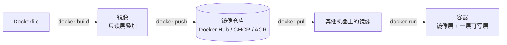
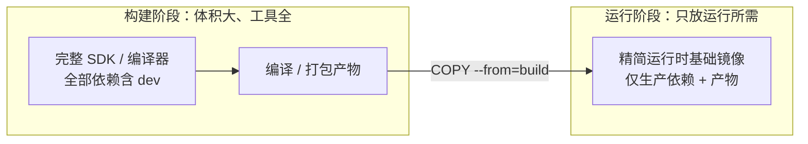
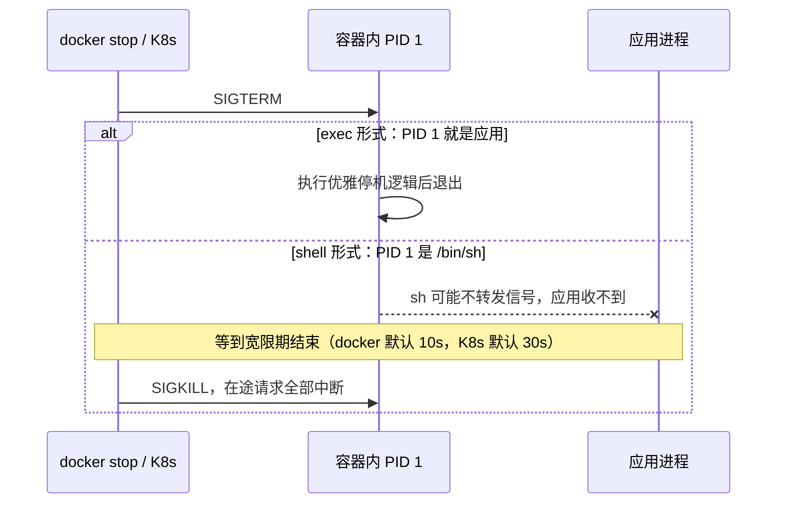
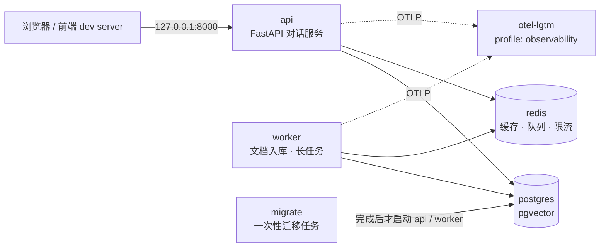

# 13 Docker 与 Compose

> 本章目标：理解容器的本质（**namespace + cgroup + 分层镜像**），能写出并审查**三栈生产级 Dockerfile**（多阶段构建、层缓存、非 root、PID 1 与信号），掌握镜像**安全与体积**的取舍，并用 **Docker Compose** 在本地编排一个完整的 AI 应用，同时避开 Apple Silicon 与服务器之间的**多架构**陷阱。
>
> 版本基线：Docker Engine 29.x（新安装默认使用 containerd 镜像存储）、Docker Compose v5（2025 年 12 月发布，官方说明与 v2 功能等价，主要新增 Go SDK；文件格式遵循 Compose Specification）、BuildKit（Engine 23.0 起为默认构建器）；示例运行时为 Spring Boot 4.1 / Java 25、Node.js 26 LTS、Python 3.14。具体参数以官方文档为准。
>
> 边界：FastAPI + LangGraph 服务的最小 Docker 化示例见 [LangChain 12 章 4.5](../../LangChain-LangGraph入门到进阶/12-调试评估与生产部署.md#45-docker-化)；应用层优雅停机见 [08 章](../L2-核心能力/08-并发与可靠性.md#七优雅停机)；K8s 见 [14 章](./14-Kubernetes核心与实践.md)；部署形态与单机拓扑见 [15 章](./15-部署架构与云.md)；CI 中的镜像构建、扫描、签名见 [16 章](./16-CICD与发布策略.md#八供应链安全)。

---

## 一、容器到底是什么

### 1.1 容器 vs 虚拟机

| | 虚拟机 | 容器 |
|---|---|---|
| 隔离边界 | 独立内核，硬件虚拟化 | **共享宿主内核**，内核级隔离 |
| 启动 | 数十秒到分钟 | 毫秒到秒（就是启动一个进程） |
| 体积 | GB 级 | MB 到数百 MB |
| 安全隔离 | 强 | 较弱，内核漏洞可能逃逸；执行不可信代码需要 gVisor / 微虚拟机（[企业级 10 章第六节](../../企业级AI应用开发实战/10-安全权限与上线清单.md#六代码执行沙箱)） |

> 🎯 **落地要点**：**容器就是宿主机上一个被隔离和限额的普通进程**。在宿主机上 `ps aux` 能看到容器里的进程；容器里的 OOM、fd 上限、信号处理，和 [12 章](./12-Linux与排障命令.md)讲的完全是同一回事。

### 1.2 namespace 与 cgroup：隔离与限额

| 机制 | 管什么 | 直觉 |
|---|---|---|
| **PID namespace** | 进程号空间 | 容器里的应用看到自己是 1 号进程 |
| **NET namespace** | 网卡、IP、端口、路由表 | 每个容器有自己的 `localhost`，端口互不冲突 |
| **USER namespace** | 用户 ID 映射 | 容器内的 root 可映射为宿主机的普通用户 |
| **cgroup** | CPU、内存、I/O、进程数配额 | `--memory=1g` 超出就被内核 OOM kill |

> ⚠️ **注意**：容器里的 `localhost` 指**容器自己**。AI 生成的配置把数据库地址写成 `localhost:5432`，在 Compose 中一定连不上，应写服务名 `postgres:5432`；容器访问宿主机上的服务，Docker Desktop 下用 `host.docker.internal`。

### 1.3 镜像、层、容器、仓库



- **层（layer）**：Dockerfile 中每条改变文件系统的指令产生一层，按内容寻址、可在镜像之间共享。拉取时只下载本地没有的层
- **容器的可写层**：容器运行时的写入落在最上面的可写层，**容器删除即消失**。需要持久化的数据放卷（第六节）
- **tag 与 digest**：`node:26-slim` 是可变的标签，今天和下个月指向的内容可能不同；`node:26-slim@sha256:...` 是内容摘要，永远指向同一份内容
- **多平台镜像**：一个 tag 背后可以是一份 manifest list，分别包含 `linux/amd64`、`linux/arm64` 的镜像（第八节）

---

## 二、Dockerfile 与层缓存

### 2.1 关键指令

| 指令 | 作用 | 常见错误 |
|---|---|---|
| `FROM` | 基础镜像；多阶段构建时可出现多次 | 用 `latest` 或不固定版本 |
| `WORKDIR` | 设置工作目录 | 用 `RUN cd /app`（每条 `RUN` 是独立 shell，`cd` 不保留） |
| `COPY` | 复制构建上下文中的文件 | 过早 `COPY . .`，破坏缓存 |
| `RUN` | 执行命令并生成一层 | 安装和清理分成两条 `RUN`，清理不会缩小镜像 |
| `ARG` / `ENV` | 构建期参数 / 运行期环境变量 | 用它们传递密钥（会留在镜像历史中） |
| `USER` | 后续指令和运行时的用户 | 不写，默认 root |
| `EXPOSE` | 文档性声明端口 | 以为它会发布端口（不会，发布靠 `-p` / `ports`） |
| `ENTRYPOINT` / `CMD` | 启动命令 | 用 shell 形式，导致信号无法送达（第五节） |
| `HEALTHCHECK` | 容器健康检查 | 调用镜像中不存在的 `curl` |

### 2.2 层缓存原理

构建时，Docker 对每条指令计算缓存键（指令本身 + 涉及文件的内容）。**某一层缓存失效，其后所有层都要重新构建**。所以要按"**变化频率从低到高**"排列：

```dockerfile
# 反例：任何源码改动都会让依赖安装重新执行，每次构建都要几分钟
COPY . .
RUN pnpm install --frozen-lockfile
RUN pnpm build

# 正例：只有锁文件变化时才重装依赖
COPY package.json pnpm-lock.yaml ./
RUN pnpm install --frozen-lockfile
COPY . .
RUN pnpm build
```

BuildKit 还提供两种挂载，让缓存和机密**不进入镜像层**：

```dockerfile
# syntax=docker/dockerfile:1
# 缓存挂载：包管理器的下载缓存跨构建复用，但不写进镜像
RUN --mount=type=cache,target=/root/.cache/uv uv sync --locked

# 机密挂载：私有仓库凭据只在这条 RUN 期间可见
RUN --mount=type=secret,id=npmrc,target=/root/.npmrc pnpm install --frozen-lockfile
```

```bash
docker build --secret id=npmrc,src=$HOME/.npmrc -t chat-api .
```

### 2.3 .dockerignore

构建上下文中的所有文件都会发送给构建器，`COPY . .` 会把它们全部复制进镜像。`.dockerignore` 和 `.gitignore` 不是一回事，**必须单独维护**：

```text
.git
node_modules
.venv
__pycache__
dist
.next
target
*.log
.env
.env.*
!.env.example
*.pem
```

> ⚠️ **注意**：没有 `.dockerignore` 时，本地的 `.env`（含模型 API Key）、`.git`（含全部历史，可能有曾经提交过的密钥）会被打进镜像。镜像推到仓库后，任何能拉取镜像的人都能拿到。

### 2.4 多阶段构建



构建阶段可以装编译器、devDependencies、测试工具；最终镜像只从中复制产物。效果是镜像体积通常缩小数倍，攻击面同步缩小（最终镜像里没有编译器和包管理器可供攻击者利用）。

---

## 三、三栈生产级 Dockerfile

### 3.1 Java：Spring Boot 分层 jar

Spring Boot 的可执行 jar 可以按变化频率解压为多层（依赖、Spring Boot loader、快照依赖、应用代码），改了业务代码只需要重新推送最上面很小的一层。以下按 Spring Boot 4.1 官方文档的写法改编：

```dockerfile
# syntax=docker/dockerfile:1
FROM eclipse-temurin:25-jdk AS build
WORKDIR /src
COPY mvnw pom.xml ./
COPY .mvn .mvn
RUN --mount=type=cache,target=/root/.m2 ./mvnw -q dependency:go-offline
COPY src src
RUN --mount=type=cache,target=/root/.m2 ./mvnw -q package -DskipTests \
 && cp target/*.jar application.jar \
 && java -Djarmode=tools -jar application.jar extract --layers --destination /extracted

FROM bellsoft/liberica-openjre-debian:25-cds
RUN useradd --system --uid 10001 app
WORKDIR /app
# 变化频率从低到高逐层复制
COPY --from=build /extracted/dependencies/ ./
COPY --from=build /extracted/spring-boot-loader/ ./
COPY --from=build /extracted/snapshot-dependencies/ ./
COPY --from=build /extracted/application/ ./
USER 10001
EXPOSE 8080
# 堆按容器内存比例设置；OOM 时直接退出交给编排系统重启，而不是带病运行
ENTRYPOINT ["java", "-XX:MaxRAMPercentage=75.0", "-XX:+ExitOnOutOfMemoryError", "-jar", "application.jar"]
```

**JVM 在容器中的内存**：现代 JDK 能识别 cgroup 内存限额，但默认最大堆只占限额的 **25%**（`MaxRAMPercentage` 默认值），1 GB 的容器只给堆 256 MB。AI 生成的 Dockerfile 常见两种错误：不设置（堆过小、频繁 GC）或写死 `-Xmx` 等于容器限额（非堆内存没有余量，被 OOM kill）。用 `MaxRAMPercentage=70~75` 让堆随限额变化，为元空间、线程栈、直接内存留出余量。

不想维护 Dockerfile 时有两种替代：**Buildpacks**（`./mvnw spring-boot:build-image`，自动选择 JRE、分层与内存参数）和 **Jib**（Maven / Gradle 插件，不依赖 Docker daemon 直接构建并推送分层镜像，适合 CI 中没有 Docker 环境的情况）。

> 🔭 **先锋视角**：Java 25 起推荐用 **AOT cache** 加速启动：构建时做一次"训练运行"生成缓存文件（`-XX:AOTCacheOutput=app.aot -Dspring.context.exit=onRefresh`），运行时以 `-XX:AOTCache=app.aot` 启动。分层解压后的目录结构对 AOT cache 友好。对需要快速扩容的服务值得一试，收益以实测为准。

### 3.2 Node：pnpm + 仅生产依赖

```dockerfile
# syntax=docker/dockerfile:1
FROM node:26-slim AS base
# Node.js 25 起官方发行包不再内置 Corepack，`corepack enable` 会失败；显式安装固定版本的 pnpm
ARG PNPM_VERSION
RUN npm install -g pnpm@${PNPM_VERSION}
WORKDIR /app

FROM base AS build
COPY package.json pnpm-lock.yaml ./
RUN --mount=type=cache,id=pnpm,target=/pnpm/store pnpm install --frozen-lockfile --store-dir /pnpm/store
COPY . .
RUN pnpm build

FROM base AS prod-deps
COPY package.json pnpm-lock.yaml ./
RUN --mount=type=cache,id=pnpm,target=/pnpm/store pnpm install --prod --frozen-lockfile --store-dir /pnpm/store

# 运行阶段不需要 pnpm
FROM node:26-slim
ENV NODE_ENV=production
WORKDIR /app
COPY --chown=node:node package.json ./
COPY --from=prod-deps --chown=node:node /app/node_modules ./node_modules
COPY --from=build --chown=node:node /app/dist ./dist
# 官方 node 镜像自带 uid 1000 的 node 用户；USER 写数字 UID，便于 K8s 的 runAsNonRoot 校验
USER 1000
EXPOSE 3000
CMD ["node", "dist/main.js"]
```

`PNPM_VERSION` 在构建时用 `--build-arg` 传入，与 `package.json` 的 `packageManager` 字段保持一致。

**Next.js 的 standalone 输出**：在 `next.config.js` 中设置 `output: 'standalone'`，构建产物 `.next/standalone` 自带精简后的 `node_modules` 与 `server.js`，运行阶段不需要再安装依赖：

```dockerfile
# base 与 build 阶段同上（build 阶段执行 next build）
FROM node:26-slim
ENV NODE_ENV=production PORT=3000 HOSTNAME=0.0.0.0
WORKDIR /app
# standalone 默认不包含 public 与 .next/static，需要手动复制（或交给 CDN）
COPY --from=build --chown=node:node /app/public ./public
COPY --from=build --chown=node:node /app/.next/standalone ./
COPY --from=build --chown=node:node /app/.next/static ./.next/static
USER 1000
EXPOSE 3000
CMD ["node", "server.js"]
```

> ⚠️ **注意**：两个前端工程师高发的坑。一是 **`HOSTNAME=0.0.0.0` 不能省**，否则服务只监听容器内的回环地址，端口映射后外部访问不到。二是 **`NEXT_PUBLIC_*` 变量在构建时被内联进前端产物**，运行时修改环境变量不起作用；同一个镜像要部署多个环境，就不能依赖 `NEXT_PUBLIC_*` 承载环境差异。

### 3.3 Python：uv + slim

```dockerfile
# syntax=docker/dockerfile:1
FROM python:3.14-slim AS build
# 固定 uv 版本（示例版本号以官方文档为准，也可固定到 digest）
COPY --from=ghcr.io/astral-sh/uv:0.13.7 /uv /uvx /bin/
ENV UV_COMPILE_BYTECODE=1 UV_LINK_MODE=copy UV_PYTHON_DOWNLOADS=0
WORKDIR /app
# 先只装依赖：pyproject.toml / uv.lock 不变时这一层命中缓存
RUN --mount=type=cache,target=/root/.cache/uv \
    --mount=type=bind,source=uv.lock,target=uv.lock \
    --mount=type=bind,source=pyproject.toml,target=pyproject.toml \
    uv sync --locked --no-install-project --no-dev
COPY . .
RUN --mount=type=cache,target=/root/.cache/uv uv sync --locked --no-dev

# 运行阶段必须与构建阶段使用同一基础镜像，虚拟环境中的解释器路径才有效
FROM python:3.14-slim
RUN useradd --system --uid 10001 app
WORKDIR /app
COPY --from=build --chown=app:app /app /app
ENV PATH="/app/.venv/bin:$PATH" PYTHONUNBUFFERED=1
USER app
EXPOSE 8000
CMD ["uvicorn", "app.main:app", "--host", "0.0.0.0", "--port", "8000", \
     "--workers", "2", "--timeout-graceful-shutdown", "40"]
```

**worker 数怎么定**：单机 / Compose 部署时，`--workers` 按分给容器的 CPU 数设置（也可用 Gunicorn 管理 Uvicorn worker，Gunicorn 会读取 `WEB_CONCURRENCY` 环境变量）；K8s 中倾向**每个容器 1~2 个 worker**，靠增加副本扩容，让 HPA 和探针以 Pod 为单位工作。

> ⚠️ **注意**：`os.cpu_count()`、`multiprocessing.cpu_count()` 返回的是**宿主机核数**，不感知容器的 CPU 配额。AI 常写的 `workers = cpu_count() * 2 + 1` 在 64 核宿主机、限额 2 核的容器里会启动 129 个进程，内存瞬间超限。worker 数应通过环境变量显式配置。

---

## 四、镜像安全与体积

### 4.1 非 root 运行

容器内的 root 默认就是宿主机内核眼中的 root（除非启用了 user namespace 映射）。一旦出现容器逃逸漏洞，非 root 是最后一道防线。三栈示例都在最终阶段创建或使用了非 root 用户，并用 `COPY --chown` 设置文件属主。

K8s 中可以进一步用 `runAsNonRoot: true` 强制校验（[14 章](./14-Kubernetes核心与实践.md)）：这要求镜像中的 `USER` 是**数字 UID**，写成用户名时 kubelet 无法确认它不是 root。

### 4.2 基础镜像选择

| 类型 | 例子 | 体积 | 优点 | 代价 |
|---|---|---|---|---|
| 完整版 | `node:26`、`python:3.14` | 大 | 工具齐全，适合构建阶段 | 漏洞面大 |
| **slim** | `node:26-slim`、`python:3.14-slim` | 中 | glibc 兼容性好，**默认推荐** | 没有 `curl`、编译工具 |
| **alpine** | `node:26-alpine` | 小 | 体积最小 | 基于 **musl libc**，兼容性坑多 |
| **distroless** | Google distroless 的 Java / Node / Python 变体 | 小 | 无 shell、无包管理器，攻击面极小 | 无法 `exec` 进去排障，需调试容器 |
| **加固镜像** | Docker Hardened Images（2025 年 12 月起免费开源）、Chainguard Images | 小 | 持续修补 CVE，默认非 root，附 SBOM | 需要适应其目录与用户约定 |

**alpine 的 musl 坑**：

- **原生扩展**：Node 的 `sharp`、`bcrypt`、Prisma 引擎，Python 的科学计算与 AI 库，需要 musl 版本的预编译包；没有就退回源码编译，构建变慢甚至失败。Python 尤其不划算：大量 AI 相关的 wheel 以 glibc（manylinux）为主，最终镜像未必更小
- **行为差异**：DNS 解析、内存分配器、线程栈默认大小与 glibc 不同，偶发问题难以复现

> 🎯 **落地要点**：默认选 **slim**；追求更小攻击面时选 distroless 或加固镜像；只有确认所有依赖在 musl 上都有预编译包时才考虑 alpine。

### 4.3 固定版本与 digest

```dockerfile
# 反例：今天能构建，下个月基础镜像大版本变化后构建结果不同
FROM node:latest

# 较好：固定主版本与变体
FROM node:26-slim

# 最好：再固定到 digest，由 Renovate / Dependabot 自动提 PR 更新
FROM node:26-slim@sha256:<digest>
```

固定 digest 的代价是基础镜像的安全补丁不会自动进来，必须配合自动更新工具，否则"固定"会变成"长期不打补丁"。

> ⚠️ **注意**：AI 生成的 Compose 文件和 Helm values 里仍大量出现 `bitnami/postgresql`、`bitnami/redis`。Bitnami 已于 2025 年 9 月下线 Docker Hub 上的免费公开镜像目录，旧镜像迁到不再更新的 `bitnamilegacy`。看到 `bitnami/*` 镜像，改用官方镜像（`postgres`、`redis`）或其他维护中的镜像，注意两者的环境变量与数据目录约定不同。

### 4.4 漏洞扫描

```bash
trivy image --severity HIGH,CRITICAL --ignore-unfixed chat-api:1.4.2   # 同类工具：docker scout cves、grype
```

- 扫描结果分两类：**基础镜像的系统包**（换新基础镜像解决）和**应用依赖**（升级依赖解决）
- `--ignore-unfixed` 只关注已有修复版本的漏洞，避免团队被无法处理的告警淹没
- 扫描器本身也是供应链的一环：2026 年 3 月 Trivy 的发行版本与 GitHub Action 标签曾被攻击者篡改，CI 中引用扫描器同样要固定版本与 SHA（[16 章第八节](./16-CICD与发布策略.md#八供应链安全)）

### 4.5 不把密钥打进镜像

```dockerfile
# 反例 1：ENV / ARG 的值会保留在镜像元数据和历史中，docker history 即可看到
ARG OPENAI_API_KEY
ENV OPENAI_API_KEY=${OPENAI_API_KEY}

# 反例 2：后续层删除文件，文件仍存在于前面的层中
COPY .npmrc /root/.npmrc
RUN pnpm install && rm /root/.npmrc

# 正例：构建期机密用 secret 挂载；运行期密钥在启动时由环境注入
RUN --mount=type=secret,id=npmrc,target=/root/.npmrc pnpm install --frozen-lockfile
```

```bash
docker history --no-trunc chat-api:1.4.2 | grep -iE 'key|token|secret|password'   # 审查已有镜像
```

运行期密钥的注入方式：本地用 Compose 的 `env_file`，单机生产用 systemd / Compose 引用权限为 `600` 的文件，K8s 用 Secret 并对接外部密钥管理（[14 章](./14-Kubernetes核心与实践.md)、[06 章](../L2-核心能力/06-认证授权与Web安全.md)）。

---

## 五、PID 1 与信号

容器的主进程是容器内的 **1 号进程**。Linux 对 PID 1 有特殊处理：**没有注册处理函数的信号会被忽略**（普通进程收到 SIGTERM 的默认行为是退出，PID 1 不是）。另外 PID 1 还负责回收僵尸子进程。



```dockerfile
# 反例 1：shell 形式，实际执行 /bin/sh -c "node dist/main.js"
CMD node dist/main.js

# 反例 2：npm / pnpm 作为父进程，信号转发与退出码处理不可靠，还多占内存
CMD ["npm", "start"]

# 正例：exec 形式，应用直接成为 PID 1
CMD ["node", "dist/main.js"]
```

必须用 shell 脚本做启动前准备时，脚本最后一行写 `exec node dist/main.js "$@"`，用应用进程替换 shell 自身。

应用会派生子进程（调用外部命令、Python 多进程）时，需要一个轻量 init 负责转发信号和回收僵尸：`docker run --init`、Compose 的 `init: true`，或在镜像中安装 **tini** 并作为 `ENTRYPOINT`。K8s 没有 `--init` 选项，需要的话把 tini 打进镜像。

停机的时间预算：`docker stop -t 45`、Compose 的 `stop_grace_period: 45s`、K8s 的 `terminationGracePeriodSeconds` 都要大于应用自身的停机超时。应用侧如何排空请求与流式连接见 [08 章第七节](../L2-核心能力/08-并发与可靠性.md#七优雅停机)。

---

## 六、数据卷、网络与资源限制

### 6.1 存储

| 类型 | 写法 | 适合 | 注意 |
|---|---|---|---|
| **命名卷** | `pgdata:/var/lib/postgresql` | 数据库数据 | 由 Docker 管理，`docker compose down -v` 会删除 |
| **绑定挂载** | `./app:/app/app` | 本地开发挂载源码 | macOS 上文件同步有性能开销；宿主机与容器的 UID 不一致会导致权限问题 |
| **tmpfs** | `tmpfs: /tmp` | 临时文件 | 占用内存 |

> ⚠️ **注意**：`docker compose down -v` 会**删除命名卷**，本地数据库数据随之清空。AI 给出的"重置环境"命令里经常带着 `-v`，执行前看清楚。

### 6.2 网络

Compose 默认为项目创建一个**用户自定义 bridge 网络**，同一网络内的容器可以用服务名互相解析，这覆盖了绝大多数场景；`host` 模式与宿主机共享网络栈、没有端口隔离，只用于特殊场景（Docker Desktop 上行为也不同）。端口发布：

```yaml
ports:
  - "5432:5432"            # 反例：绑定宿主机所有网卡，云服务器上等于把数据库暴露到公网
  - "127.0.0.1:5432:5432"  # 正例：只允许宿主机本地访问（本地调试用）
```

> ⚠️ **注意**：Docker 发布端口时**直接写入 iptables 规则**，这些规则先于 ufw / firewalld 的规则生效。在服务器上用 ufw 拒绝了 5432，Docker 发布的 `5432:5432` 依然可以从公网访问。生产环境中数据库、Redis 不发布端口，只在 Compose 内部网络中访问；确需访问时绑定 `127.0.0.1` 并经 SSH 隧道（[12 章 6.3](./12-Linux与排障命令.md#63-端口转发本地访问内网数据库)）。

### 6.3 资源限制与日志

```bash
docker run --memory=1g --cpus=1.5 --pids-limit=512 chat-api:1.4.2
docker stats                       # 实时查看各容器 CPU / 内存
docker inspect -f '{{.State.OOMKilled}} {{.State.ExitCode}}' chat-api   # 退出码 137 = 被 SIGKILL，常见于 OOM
```

Docker 默认的 `json-file` 日志驱动**不轮转**，长期运行的容器日志会写满磁盘（[12 章 3.3](./12-Linux与排障命令.md#33-磁盘写满最常见的低级事故)）。在 `/etc/docker/daemon.json` 中统一配置：

```json
{
  "log-driver": "local",
  "log-opts": { "max-size": "20m", "max-file": "5" }
}
```

修改后只对**新创建**的容器生效。

---

## 七、Docker Compose：本地编排一个 AI 应用

### 7.1 目标拓扑



### 7.2 compose.yaml

```yaml
name: ai-chat

# 扩展字段 + YAML 锚点：api / worker / migrate 共用一份镜像与环境配置
x-app: &app
  build: .
  image: ai-chat/app:dev
  env_file:
    - path: .env                 # 注入容器的环境变量（模型 API Key 等），不入库
      required: true
  environment:
    DATABASE_URL: postgresql://app:${POSTGRES_PASSWORD:?在 .env 中设置 POSTGRES_PASSWORD}@postgres:5432/app
    REDIS_URL: redis://redis:6379/0
    OTEL_EXPORTER_OTLP_ENDPOINT: http://otel-lgtm:4318
  init: true

services:
  migrate:
    <<: *app
    command: ["alembic", "upgrade", "head"]
    depends_on:
      postgres:
        condition: service_healthy
    restart: "no"

  api:
    <<: *app
    ports:
      - "127.0.0.1:8000:8000"
    depends_on:
      postgres: { condition: service_healthy }
      redis: { condition: service_healthy }
      migrate: { condition: service_completed_successfully }
    healthcheck:
      # slim 镜像没有 curl，用运行时自带的能力做检查
      test: ["CMD", "python", "-c", "import urllib.request; urllib.request.urlopen('http://127.0.0.1:8000/healthz', timeout=2)"]
      interval: 10s
      timeout: 3s
      retries: 3
      start_period: 20s
    stop_grace_period: 45s
    develop:
      watch:
        - action: sync+restart   # 改源码：同步进容器并重启进程
          path: ./app
          target: /app/app
        - action: rebuild        # 改依赖：重建镜像
          path: uv.lock

  worker:
    <<: *app
    command: ["python", "-m", "app.worker"]
    depends_on:
      postgres: { condition: service_healthy }
      redis: { condition: service_healthy }
      migrate: { condition: service_completed_successfully }
    deploy:
      resources:
        limits: { cpus: "1", memory: 1g }
    stop_grace_period: 120s      # 入库任务较长，给足完成当前任务的时间

  postgres:
    image: pgvector/pgvector:pg18
    environment:
      POSTGRES_USER: app
      POSTGRES_PASSWORD: ${POSTGRES_PASSWORD:?在 .env 中设置 POSTGRES_PASSWORD}
      POSTGRES_DB: app
    volumes:
      # PostgreSQL 18 起官方镜像的 VOLUME 改为 /var/lib/postgresql（PGDATA 为 /var/lib/postgresql/18/docker），旧的 /var/lib/postgresql/data 挂载写法不再适用
      - pgdata:/var/lib/postgresql
      # 初始化脚本只在数据目录为空时执行一次，如 CREATE EXTENSION IF NOT EXISTS vector;
      - ./db/init:/docker-entrypoint-initdb.d:ro
    ports:
      - "127.0.0.1:5432:5432"
    healthcheck:
      test: ["CMD-SHELL", "pg_isready -U app -d app"]
      interval: 5s
      timeout: 3s
      retries: 10
      start_period: 10s

  redis:
    image: redis:8
    command: ["redis-server", "--appendonly", "yes"]
    volumes:
      - redisdata:/data
    healthcheck: { test: ["CMD", "redis-cli", "ping"], interval: 5s, timeout: 3s, retries: 10 }

  otel-lgtm:
    # 开发用一体化可观测镜像（OTel Collector + Prometheus + Tempo + Loki + Grafana），团队内固定具体 tag
    image: grafana/otel-lgtm
    profiles: ["observability"]
    ports:
      - "127.0.0.1:3001:3000"    # Grafana

volumes:
  pgdata:
  redisdata:
```

### 7.3 启动顺序：healthcheck 与 depends_on

| `condition` | 含义 | 用于 |
|---|---|---|
| `service_started` | 容器已启动（短语法的默认行为） | 无启动耗时的依赖 |
| `service_healthy` | 依赖的 healthcheck 已通过 | 数据库、Redis、需要预热的服务 |
| `service_completed_successfully` | 依赖已运行完成且退出码为 0 | 迁移、种子数据等一次性任务 |

> ⚠️ **注意**：AI 生成的 Compose 最常见的写法是 `depends_on: [db]`，它**只保证 db 容器先启动**，不保证数据库已经可以接受连接，应用启动时连库失败而退出。依赖要有 healthcheck 并使用 `service_healthy`。即便如此，应用自身仍要对依赖做有上限的重试：生产环境里依赖随时可能短暂不可用。

### 7.4 环境变量、profiles 与覆盖文件

**两个"env"容易混淆**：项目目录下的 `.env` 用于 Compose 文件本身的**变量插值**（`${POSTGRES_PASSWORD}`），本身不进入容器；服务的 `env_file:` 才是**注入容器**的环境变量。示例里两者恰好是同一个文件，概念上仍是两件事。`${VAR:?提示}` 让缺失变量时直接报错，而不是静默替换成空字符串。

```bash
docker compose up -d --wait                      # 等所有服务健康后返回
docker compose --profile observability up -d     # 额外启动可观测组件
docker compose watch                             # 按 develop.watch 规则热更新
docker compose logs -f api worker
docker compose config                            # 输出合并、插值后的最终配置，排查配置问题首选
```

- **`compose.override.yaml`** 与 `compose.yaml` 位于同一目录时会被自动合并，适合放本地开发专属配置（挂载源码、开调试端口）
- 其他环境显式指定：`docker compose -f compose.yaml -f compose.prod.yaml up -d`；顶层的 `version:` 字段已经过时，新文件不要写

### 7.5 Compose 用于小规模生产的边界

单台云服务器 + Compose 是验证期和起步期的合理选择（[15 章](./15-部署架构与云.md#一部署形态选型)），但要清楚它**做不到**什么：

| 能力 | Compose | 需要时的出路 |
|---|---|---|
| 单机进程管理、崩溃重启（`restart: unless-stopped`） | ✅ | — |
| 跨多台机器调度、节点故障转移 | ❌ | 容器服务 / K8s |
| 零停机滚动发布 | ❌（`up -d` 会重建容器，存在短暂中断） | 前置反代 + 蓝绿双实例脚本，或换平台 |
| 按负载自动扩缩容 | ❌ | HPA / 托管容器服务 |
| 密钥管理 | 只有文件 / 环境变量 | 外部密钥管理服务 |

> 🎯 **落地要点**：用 Compose 跑生产时，至少做到：镜像来自 CI 构建并带不可变版本号（不在服务器上 `build`）、所有服务 `restart: unless-stopped`、数据库**用托管服务**或有自动备份、日志驱动配置轮转、数据库与 Redis 不发布端口。

---

## 八、多架构构建：Apple Silicon 与服务器

Apple Silicon 的 Mac 是 `arm64`，大多数云服务器是 `amd64`。在 Mac 上直接 `docker build` 得到的是 arm64 镜像，推到 amd64 服务器上运行会报：

```text
exec /usr/local/bin/docker-entrypoint.sh: exec format error
```

反过来，部分只发布了 amd64 版本的镜像在 Mac 上会通过 QEMU 模拟运行，速度慢且偶有崩溃。

**排查**：

```bash
docker image inspect -f '{{.Os}}/{{.Architecture}}' chat-api:1.4.2
docker buildx imagetools inspect ghcr.io/acme/chat-api:1.4.2    # 查看仓库中的镜像包含哪些平台
uname -m                                                         # 服务器架构：x86_64 / aarch64
```

**解决方案**：

| 方案 | 命令 / 做法 | 特点 |
|---|---|---|
| 只构建目标平台 | `docker build --platform linux/amd64 -t chat-api .` | 简单；在 Mac 上靠 QEMU 模拟构建，较慢 |
| 构建多平台镜像 | `docker buildx build --platform linux/amd64,linux/arm64 -t ghcr.io/acme/chat-api:1.4.2 --push .` | 一个 tag 适配两种机器，本地开发与服务器都原生运行 |
| 交叉编译 | 构建阶段 `FROM --platform=$BUILDPLATFORM`，用 `TARGETOS` / `TARGETARCH` 参数编译目标平台产物 | Go、Rust、前端打包产物适用，不需要模拟 |
| **在 CI 中构建（推荐）** | CI 使用 amd64 runner，或用原生 arm64 runner 分别构建后合并 | 发布镜像不依赖开发者本机 |

- 本地保存多平台镜像需要支持 manifest list 的镜像存储；Docker Desktop 与 Engine 29 新安装默认的 containerd 镜像存储满足要求
- Java 的 jar、Node 的纯 JS、Python 的纯 Python 代码本身与架构无关，**真正受影响的是基础镜像和原生扩展**（`sharp`、`bcrypt`、`psycopg` 二进制包、`numpy` 等）。不要把 Mac 上安装好的 `node_modules` / `.venv` 复制进镜像，依赖一律在镜像构建过程中安装

> 🎯 **落地要点**：发布到服务器的镜像只在 CI 中构建，开发者本机构建只用于本地运行。这一条同时解决了架构不一致、本地环境污染镜像、无法追溯镜像来源三个问题（[16 章](./16-CICD与发布策略.md)）。

---

## 九、配置审查清单

针对 AI 生成的 Dockerfile、`.dockerignore` 与 `compose.yaml`。

### Dockerfile

- [ ] 🔴 镜像中没有密钥：没有用 `ARG` / `ENV` 传递密钥，没有 `COPY .env`，构建期凭据使用 `--mount=type=secret`
- [ ] 🔴 存在 `.dockerignore`，至少排除 `.env*`、`.git`、`node_modules`、`.venv`、私钥文件
- [ ] 🔴 最终阶段以非 root 运行（`USER` 为数字 UID），文件属主通过 `COPY --chown` 设置
- [ ] `ENTRYPOINT` / `CMD` 使用 exec 形式；没有用 `npm start` 或 `sh -c` 包裹主进程；启动脚本以 `exec` 结尾
- [ ] 基础镜像固定了版本（不是 `latest`），最好固定 digest 并有自动更新机制；没有使用 `bitnami/*` 镜像
- [ ] 使用多阶段构建，最终镜像中没有编译器、devDependencies、包管理器缓存
- [ ] 依赖清单与锁文件先于源码复制，安装使用严格锁定模式（`--frozen-lockfile`、`--locked`、`npm ci`）；Node 25+ 镜像中没有依赖 `corepack enable`
- [ ] Java 设置了 `MaxRAMPercentage`，没有把 `-Xmx` 写成与容器限额相等；Python worker 数显式配置，没有基于 `cpu_count()` 计算
- [ ] Next.js 设置了 `HOSTNAME=0.0.0.0`，环境差异没有依赖构建时内联的 `NEXT_PUBLIC_*`
- [ ] `HEALTHCHECK` 使用的命令在最终镜像中确实存在；选用 alpine 时已确认原生依赖在 musl 上可用

### compose.yaml

- [ ] 🔴 数据库、Redis 的 `ports` 不存在，或绑定到 `127.0.0.1`；没有 `"5432:5432"` 这类绑定所有网卡的写法
- [ ] 🔴 密码与 API Key 来自 `.env` / `env_file`，不硬编码在 Compose 文件中；`.env` 已在 `.gitignore` 中
- [ ] 服务间地址使用服务名，没有使用 `localhost`
- [ ] 有启动依赖的服务使用 `condition: service_healthy`，被依赖方定义了 healthcheck；迁移作为一次性服务并使用 `service_completed_successfully`
- [ ] 数据库数据使用命名卷，挂载路径与所用镜像版本的约定一致
- [ ] `stop_grace_period` 覆盖应用的停机时间（流式对话、长任务 worker）
- [ ] 必需变量使用 `${VAR:?提示}`，缺失时报错而非静默为空；没有过时的顶层 `version:` 字段
- [ ] 用于生产时：镜像来自仓库且版本不可变、设置了 `restart` 策略、日志驱动配置了轮转

### 构建与发布

- [ ] 发布镜像的架构与目标服务器一致（`docker buildx imagetools inspect` 验证），或为多平台镜像
- [ ] 镜像经过漏洞扫描，高危且有修复版本的漏洞已处理
- [ ] 镜像 tag 为不可变版本号或提交 SHA，不在生产中使用 `latest`

---

## 本章小结

- 容器是**被 namespace 隔离、被 cgroup 限额的普通进程**；与宿主共享内核，执行不可信代码需要更强的沙箱
- 层缓存按"**变化频率从低到高**"组织指令；依赖清单先复制，源码后复制；缓存与机密用 BuildKit 挂载，不进入镜像层
- 多阶段构建让最终镜像只含运行所需；三栈分别用 **Spring Boot 分层 jar**、**pnpm 仅生产依赖 / Next.js standalone**、**uv + slim**
- 运行时与容器限额的配合：JVM 用 `MaxRAMPercentage`，Python 不要基于 `cpu_count()` 算 worker，Next.js 监听 `0.0.0.0`
- 镜像安全四件事：**非 root、固定版本、漏洞扫描、不把密钥打进镜像**；默认选 slim，谨慎选 alpine
- 主进程用 **exec 形式**成为 PID 1，才能收到 SIGTERM 并优雅停机；需要时用 `--init` / tini
- Docker 发布的端口**绕过 ufw**；默认日志驱动不轮转；`down -v` 会删数据
- Compose 适合本地开发和小规模单机生产，`depends_on` 要配合 healthcheck；发布镜像在 CI 中构建，避开 **arm64 / amd64** 不一致

## 练习

1. 选一个你用 AI 生成过的 Node 或 Python 服务的 Dockerfile，按第九节清单逐项审查并改写为多阶段构建；用 `docker images` 对比改写前后的体积，用 `docker history` 确认镜像中没有密钥
2. 写两个版本的启动方式：`CMD npm start` 与 `CMD ["node", "dist/main.js"]`。在应用中记录收到 SIGTERM 的日志，分别执行 `time docker stop`，对比退出耗时和日志
3. 按第七节搭建本地 AI 应用环境：api + worker + pgvector + redis + 迁移任务，`docker compose up --wait` 一键启动；故意让迁移失败，观察 api 是否被阻止启动；开启 `observability` profile，在 Grafana 中看到一次对话请求的 trace
4. 在 Apple Silicon 的 Mac 上为一个含原生依赖（如 `sharp` 或 `psycopg`）的服务构建 `linux/amd64,linux/arm64` 多平台镜像并推送到私有仓库，在 amd64 服务器上拉取运行，用 `imagetools inspect` 验证平台列表
