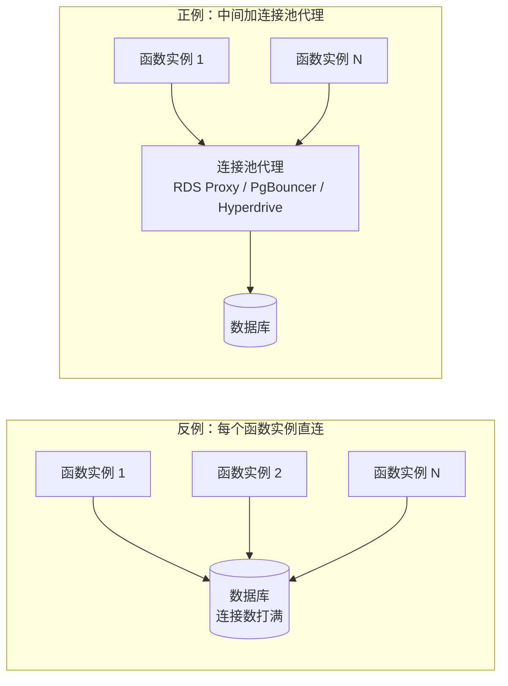
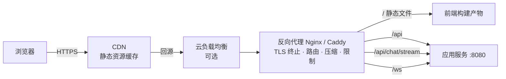
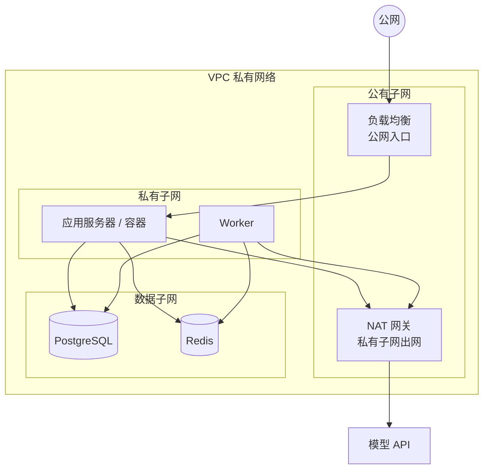
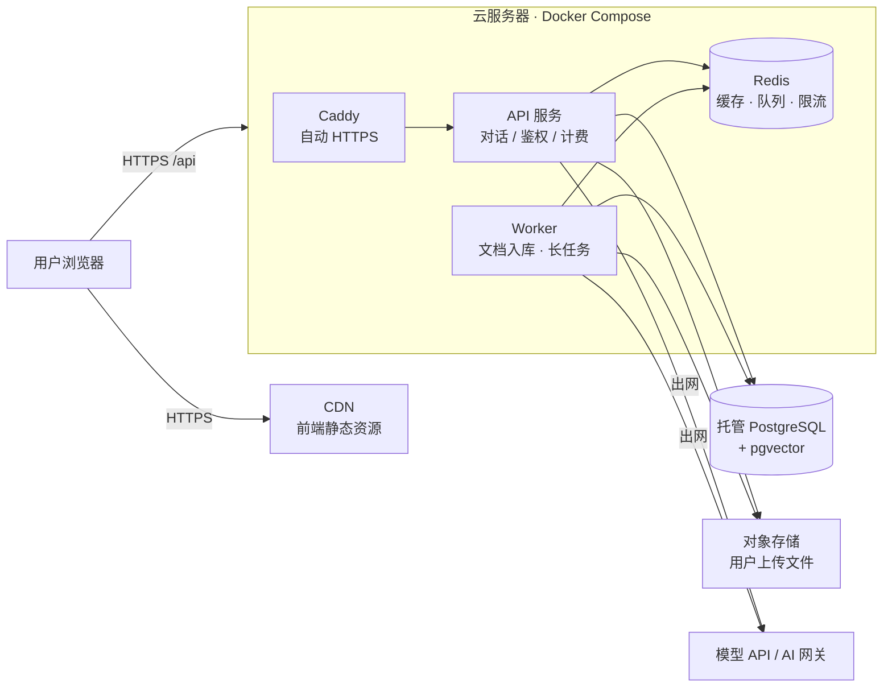
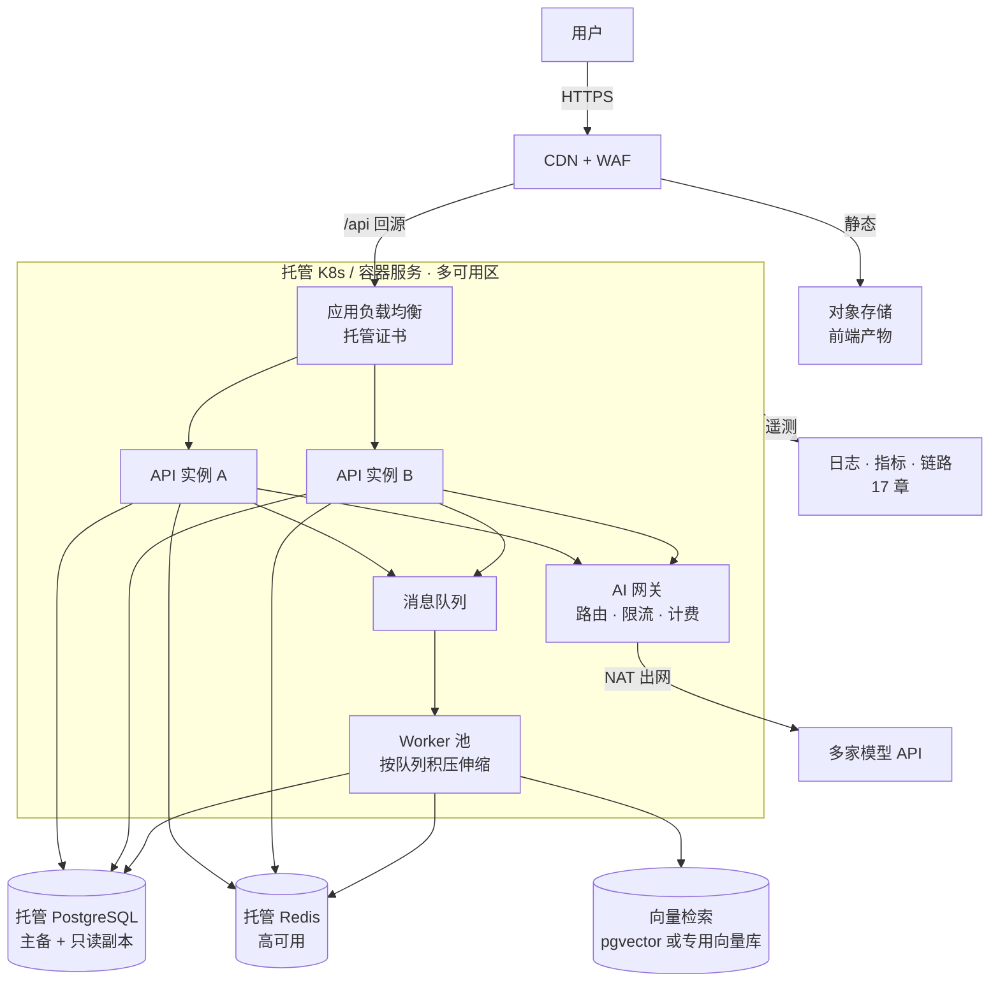

# 15 部署架构与云

> 本章目标：能为一个 AI 应用**选对部署形态**，独立写出一份可上线的 **Nginx / Caddy 配置**，把 **HTTPS、域名、CDN、托管数据库与网络隔离**串成一条完整链路，并在上线前识别出常见的**费用陷阱**。
>
> 版本基线：Nginx ≥ 1.25.1（`http2 on;` 写法）、Caddy 2.x；证书有效期规则以 2026 年 11 月的 CA/B Forum 与 Let's Encrypt 公告为准。云产品配额与价格变化频繁，文中数字均以各厂商官方文档为准。
>
> 边界：镜像构建与 Compose 编排见 [13 章](./13-Docker与Compose.md)，K8s 见 [14 章](./14-Kubernetes核心与实践.md)，流水线与发布见 [16 章](./16-CICD与发布策略.md)；SSE / WebSocket 的协议与服务端实现见 [01 章](../L1-认知切换/01-网络与HTTP-服务端视角.md)，AI 事件模型见 [企业级 04 章](../../企业级AI应用开发实战/04-AI交互层-流式协议与生成式UI.md)。

---

## 一、部署形态选型

### 1.1 五种形态

| 形态 | 代表 | 你要运维的东西 | 优点 | 主要限制 |
|---|---|---|---|---|
| **单台云服务器 + Docker Compose** | ECS / CVM / EC2 + Compose | 操作系统、Docker、反代、证书、备份 | 便宜、可控、心智负担低、无执行时长限制 | 单点故障；扩容靠换大机器；运维全靠自己 |
| **PaaS** | Vercel、Railway、Fly.io、Render | 几乎只有代码与配置 | 推送即部署、自带 HTTPS 与预览环境 | 平台限制（时长、协议、区域）；规模大后单价高；国内访问与备案受限 |
| **Serverless 函数** | AWS Lambda、阿里云函数计算、腾讯云 SCF、Cloudflare Workers | 函数代码 | 按调用计费、零闲置成本、自动伸缩 | 冷启动、执行时长上限、无本地状态、数据库连接难管理 |
| **容器服务（托管容器）** | AWS ECS / Fargate、Cloud Run、阿里云 SAE、Azure Container Apps | 镜像与服务配置 | 跑标准镜像、自动伸缩、不碰节点 | 平台特有概念；长连接与后台任务的支持度各家不同 |
| **Kubernetes** | ACK、TKE、EKS、自建 | 集群、节点、网络、存储、Ingress | 标准化、生态最全、多服务治理能力强 | 学习与运维成本最高，小团队容易"为 K8s 打工" |

> 📖 **PaaS（Platform as a Service）**：平台托管运行时，你只交付代码或镜像。和前端熟悉的 Vercel 部署体验一致，只是后端服务还要关心数据库、长连接和后台任务。

几个 PaaS 的现状（2026 年）：

- **Vercel**：前端与 Next.js 首选；函数在 Fluid compute 模式下单次执行时长上限按套餐不同（Hobby 较短，Pro / Enterprise 更长），已支持流式响应与 WebSocket，具体上限以官方 Limits 文档为准
- **Railway / Fly.io / Render**：适合跑长驻的后端容器与数据库；前两者已取消永久免费层，Render 保留了会休眠的免费实例，适合 demo，不适合生产
- **Heroku**：2026 年 2 月 Salesforce 宣布其进入"维持性工程"模式，不再开发新功能，**新项目不建议选用**

### 1.2 Serverless 与 AI 应用的冲突

AI 应用有三个特征，恰好撞上 Serverless 的三个限制：

| AI 应用特征 | Serverless 限制 | 后果 |
|---|---|---|
| LLM 流式输出动辄几十秒，Agent 任务可达数分钟 | **执行时长上限**；部分网关还有独立超时 | 回答到一半被截断 |
| 首 token 延迟本就敏感 | **冷启动**：新实例要加载运行时与依赖 | Java / Python 大依赖冷启动可达秒级 |
| 每次请求都读写数据库 | **无长驻连接池**：每个并发实例各自建连 | 流量一上来，数据库连接数被打满 |

几个常被忽略的具体限制（以官方文档为准）：

- **AWS Lambda**：同步调用最长 15 分钟；原生响应流式主要面向 Node.js 运行时，其他语言需借助 Lambda Web Adapter 等方式。前面挂 **API Gateway HTTP API 时集成超时约 30 秒且不可调高**，只有 Regional / Private 的 REST API 可以申请放宽——这是"本地能流式、上线后 30 秒就断"的常见原因
- **Cloudflare Workers**：限制的是 **CPU 时间**而不是墙钟时间，等待 LLM 响应的网络 I/O 不计入 CPU 时间，因此适合做"转发 LLM 流"的轻量网关；免费套餐的 CPU 时间极短，付费套餐可配置到分钟级
- **阿里云函数计算 / 腾讯云 SCF**：国内函数产品的时长上限普遍比 Lambda 宽松，但仍要单独核对前面 API 网关、负载均衡的超时

**数据库连接问题的解法**：



- 在函数和数据库之间放**连接池代理**：AWS RDS Proxy、自建 PgBouncer、Cloudflare Hyperdrive（Workers 专用的连接池加缓存）
- 或者用**基于 HTTP 的数据库驱动**（如部分 Serverless Postgres 服务提供的 HTTP / WebSocket 驱动），本身不占长连接
- 连接对象放在函数 handler **外部**初始化，让同一实例的多次调用复用

> 🎯 **落地要点**：AI 应用用 Serverless 的稳妥姿势是"**函数只做短请求，长任务交给队列和 Worker**"。对话流式请求要么放在长驻容器上，要么确认整条链路（网关、函数、CDN）每一跳的超时都够长。长任务改造方式见 [07 章](../L2-核心能力/07-异步任务与消息队列.md) 和 [03 章的长任务 API](../L2-核心能力/03-API设计.md)。

### 1.3 按阶段的推荐路径

| 阶段 | 推荐 | 关键动作 |
|---|---|---|
| 验证期（1~3 人，日活百级） | 前端放 Vercel / CDN，后端放 PaaS 或一台 2C4G 云服务器 + Compose | 先上线，数据库**从第一天起就有自动备份** |
| 起步期（3~10 人，日活千到万级） | 应用仍可单机或双机，**数据库与 Redis 换托管**，前面加负载均衡和 CDN | 自动化部署（16 章）、监控告警（17 章） |
| 成长期（10 人以上，多服务） | 托管 K8s 或容器服务，多可用区，Worker 与 API 分开伸缩 | 有专人或平台团队负责基础设施 |

> ⚠️ **注意**：AI 生成的部署方案很容易"一步到位"上 K8s + 微服务 + 服务网格。判断标准很简单：**团队里有没有人愿意在凌晨三点处理集群问题**。没有，就用托管程度更高的形态。

---

## 二、国内与海外环境差异

### 2.1 ICP 备案

> 📖 **ICP 备案**：在中国大陆境内服务器上提供网站服务，域名必须在工信部完成备案，否则云厂商会拦截该域名的 80 / 443 访问。备案通过后通常还需在网站底部展示备案号，并在规定时间内完成公安联网备案。

| 场景 | 是否需要 ICP 备案 |
|---|---|
| 服务器在中国大陆 | 需要 |
| 服务器在境外，但**使用中国大陆 CDN 节点** | 需要（国内 CDN 不为未备案域名提供加速） |
| 服务器与 CDN 均在境外（含港澳台） | 不需要，但国内访问速度与稳定性差 |

- 备案以**域名 + 接入商**为单位，换云厂商需要做"接入备案"
- 备案周期通常以周计，**排期时要预留**；测试环境可以先用 IP 或备案过的二级域名
- 面向公众的生成式 AI 服务另有备案要求，见 [企业级 10 章 7.3](../../企业级AI应用开发实战/10-安全权限与上线清单.md#73-国内合规要点)

### 2.2 云厂商产品对照

| 能力 | 阿里云 | 腾讯云 | AWS |
|---|---|---|---|
| 云服务器 | ECS | CVM（轻量应用服务器：Lighthouse） | EC2（轻量：Lightsail） |
| 托管关系型数据库 | RDS（PostgreSQL / MySQL）、PolarDB | TencentDB（PostgreSQL / MySQL）、TDSQL-C | RDS、Aurora |
| 托管 Redis | Tair（兼容 Redis） | TencentDB for Redis | ElastiCache、MemoryDB |
| 对象存储 | OSS | COS | S3 |
| CDN | CDN / ESA | CDN / EdgeOne | CloudFront |
| 负载均衡 | CLB（传统型）/ ALB（七层）/ NLB（四层） | CLB | ALB（七层）/ NLB（四层） |
| 托管 K8s | ACK | TKE | EKS |
| 托管容器（免节点） | SAE、ACK Serverless 集群 | TKE Serverless 集群 | ECS on Fargate |
| 函数计算 | 函数计算 FC | 云函数 SCF | Lambda |
| 密钥管理 | KMS | KMS / SSM 凭据管理 | KMS、Secrets Manager |

> ⚠️ **注意**：产品名会调整（阿里云的 SLB 已拆分为 CLB / ALB / NLB 产品家族），AI 生成的 Terraform 或部署脚本经常引用旧产品名或旧 API。动手前对照控制台与官方文档。

### 2.3 AI 应用特有的跨境问题

- **模型 API 可达性**：境外模型 API 在国内服务器上的可达性与合规性要单独评估；国内部署通常走国内模型或经合规的 AI 网关（[企业级 09 章第五节](../../企业级AI应用开发实战/09-LLMOps-可观测评测与AI网关.md#五ai-网关控得住重点)）
- **镜像与依赖源**：Docker Hub、npm、PyPI、Maven Central 在国内拉取慢或不稳定，CI 与服务器都要配置镜像源或使用云厂商的容器镜像服务
- **数据出境**：用户数据存储位置与跨境传输受法规约束，架构定稿前与法务确认

---

## 三、反向代理：Nginx 与 Caddy

### 3.1 反代在链路中的职责



| 职责 | 说明 |
|---|---|
| TLS 终止 | 在反代上解密 HTTPS，后端只跑 HTTP |
| 路由 | 按路径把请求分给静态文件或不同后端 |
| 静态资源 | 直接返回前端构建产物，并设置缓存头 |
| 压缩 | gzip / brotli / zstd 压缩文本类响应 |
| 保护 | 请求体大小、超时、简单限流，挡住一部分异常流量 |
| 透传客户端信息 | 通过 `X-Forwarded-*` 头把真实 IP、协议告诉后端 |

### 3.2 Nginx 完整配置示例

单机部署一个"前端 SPA + API + SSE + WebSocket"的典型配置：

```nginx
# /etc/nginx/conf.d/app.conf
upstream api_backend {
    server 127.0.0.1:8080;
    keepalive 32;                          # 到后端的长连接池，需配合 HTTP/1.1 与清空 Connection 头
}

map $http_upgrade $connection_upgrade {    # WebSocket：有 Upgrade 头时转为 upgrade，否则 close
    default upgrade;
    ''      close;
}

server {
    listen 80;
    server_name app.example.com;
    location /.well-known/acme-challenge/ { root /var/www/certbot; }   # HTTP-01 验证
    location / { return 301 https://$host$request_uri; }
}

server {
    listen 443 ssl;
    http2 on;                              # 1.25.1 起的写法；旧版本为 listen 443 ssl http2
    server_name app.example.com;

    ssl_certificate     /etc/letsencrypt/live/app.example.com/fullchain.pem;
    ssl_certificate_key /etc/letsencrypt/live/app.example.com/privkey.pem;
    ssl_protocols       TLSv1.2 TLSv1.3;

    add_header Strict-Transport-Security "max-age=31536000" always;

    client_max_body_size 20m;              # 默认 1m，上传文档会直接 413

    gzip on;
    gzip_min_length 1024;
    gzip_types text/css application/javascript application/json image/svg+xml;

    # ---------- 前端静态资源 ----------
    root /var/www/app/dist;

    location /assets/ {                    # 带 hash 的构建产物：长缓存
        add_header Cache-Control "public, max-age=31536000, immutable";
        add_header Strict-Transport-Security "max-age=31536000" always;
        try_files $uri =404;
    }

    location / {                           # SPA 回退到 index.html，且 index.html 不缓存
        add_header Cache-Control "no-cache";
        add_header Strict-Transport-Security "max-age=31536000" always;
        try_files $uri $uri/ /index.html;
    }

    # ---------- 普通 API ----------
    location /api/ {
        proxy_pass http://api_backend;     # 末尾无 /：保留 /api 前缀原样转发
        proxy_http_version 1.1;
        proxy_set_header Connection "";
        proxy_set_header Host              $host;
        proxy_set_header X-Real-IP         $remote_addr;
        proxy_set_header X-Forwarded-For   $proxy_add_x_forwarded_for;
        proxy_set_header X-Forwarded-Proto $scheme;
        proxy_connect_timeout 5s;
        proxy_read_timeout    60s;         # 两次读之间的间隔，不是总时长
    }

    # ---------- SSE 流式（LLM 对话）----------
    location /api/chat/stream {
        proxy_pass http://api_backend;
        proxy_http_version 1.1;
        proxy_set_header Connection "";
        proxy_set_header Host              $host;
        proxy_set_header X-Forwarded-For   $proxy_add_x_forwarded_for;
        proxy_set_header X-Forwarded-Proto $scheme;
        proxy_buffering off;               # 关键：否则 token 被攒成一大块才下发
        proxy_cache off;
        gzip off;
        proxy_read_timeout 300s;           # 大于模型最长"思考无输出"时间，或由服务端定期发心跳
    }

    # ---------- WebSocket ----------
    location /ws/ {
        proxy_pass http://api_backend;
        proxy_http_version 1.1;
        proxy_set_header Upgrade    $http_upgrade;
        proxy_set_header Connection $connection_upgrade;
        proxy_set_header Host       $host;
        proxy_read_timeout 3600s;          # 空闲超时，配合应用层 ping
    }
}
```

> ⚠️ **注意**：Nginx 的 `add_header` **只在当前层级没有任何 `add_header` 时才继承上一层**。上面在 `location` 里加了 `Cache-Control`，如果不在同一层重复写 HSTS，这些路径的响应就会丢掉 HSTS 头。AI 生成的配置几乎都会踩这个坑，上线后用 `curl -I` 逐路径核对响应头。

SSE 被缓冲、超时链路的原理见 [01 章](../L1-认知切换/01-网络与HTTP-服务端视角.md)，生产排查表见 [企业级 04 章 10.1](../../企业级AI应用开发实战/04-AI交互层-流式协议与生成式UI.md#101-流式被缓冲)。也可以由后端在 SSE 响应上加 `X-Accel-Buffering: no` 头，对单个响应关闭 Nginx 缓冲。

### 3.3 AI 常写错的 Nginx 配置

| 反例 | 后果 | 正例 |
|---|---|---|
| `location /api/ { proxy_pass http://backend/; }` 与后端路由不匹配 | `proxy_pass` 带 URI（末尾 `/`）时会**替换掉** `/api/` 前缀，后端收到 `/users` 而不是 `/api/users`，全部 404 | 明确后端是否需要前缀：需要就不带 `/`，不需要才带 |
| SSE 接口沿用普通 API 的配置 | 流式变成一次性返回；60 秒无输出被断开 | 单独 `location`，`proxy_buffering off` + 加长 `proxy_read_timeout` |
| WebSocket 缺 `Upgrade` / `Connection` 头 | 握手失败，返回 400 或直接降级为长轮询 | 用 `map` 设置 `$connection_upgrade` |
| 没设 `client_max_body_size` | 上传超过 1 MB 的文档直接 413 | 按业务上限设置，并与后端框架的上传限制保持一致 |
| `proxy_set_header X-Forwarded-For $remote_addr` 写在 CDN 之后的那层 | 后端看到的全是 CDN 节点 IP，按 IP 限流全部误伤 | 使用 `real_ip` 模块从可信代理链中取真实 IP（3.4） |
| 把 `proxy_read_timeout` 设成 `3600s` 应用到所有 API | 后端卡死的请求长时间占着连接，故障被放大 | 只给流式与长连接路径加长，普通 API 保持短超时 |

### 3.4 真实客户端 IP

`X-Forwarded-For` 是客户端也能伪造的普通请求头。正确做法是**只信任自己控制的代理链**：

```nginx
# Nginx 位于云负载均衡 / CDN 之后
set_real_ip_from 10.0.0.0/8;         # 负载均衡所在内网段
set_real_ip_from 203.0.113.0/24;     # CDN 回源 IP 段（以厂商公布的列表为准）
real_ip_header    X-Forwarded-For;
real_ip_recursive on;                # 从右往左跳过可信代理，取第一个不可信地址
```

后端框架同样要声明"信任哪一层代理"，否则拿到的是反代的 IP，或者被伪造的头欺骗：

| 栈 | 配置 |
|---|---|
| Java（Spring Boot） | `server.forward-headers-strategy=native`（Tomcat 按内网地址判断可信代理），或 `framework` 交给 Spring 处理 |
| TypeScript（Fastify / Express） | Fastify `trustProxy: '127.0.0.1'`；Express `app.set('trust proxy', 'loopback')`。**不要无脑设为 `true`** |
| Python（Uvicorn） | `uvicorn main:app --proxy-headers --forwarded-allow-ips 127.0.0.1` |

> 🎯 **落地要点**：真实 IP 影响限流（[05 章](../L2-核心能力/05-缓存与Redis.md)）、审计与风控。上线后用"直连伪造 `X-Forwarded-For: 1.2.3.4`"的请求测一次，确认后端记录的不是 `1.2.3.4`。

### 3.5 Caddy：自动 HTTPS 的反代

Caddy 的最大卖点是**零配置 HTTPS**：在站点地址写上域名，它会自动通过 ACME 申请证书、定时续期，并把 HTTP 重定向到 HTTPS。同样的需求：

```caddy
app.example.com {
    request_body {
        max_size 20MB
    }

    handle /api/* {
        reverse_proxy 127.0.0.1:8080
    }

    handle /ws/* {
        reverse_proxy 127.0.0.1:8080
    }

    handle {
        root * /var/www/app/dist
        encode zstd gzip
        @hashed path /assets/*
        header @hashed Cache-Control "public, max-age=31536000, immutable"
        try_files {path} /index.html
        file_server
    }
}
```

Caddy 的几个默认行为正好覆盖了 Nginx 的常见坑：

- `Content-Type: text/event-stream` 的响应**自动立即刷新**，SSE 不需要额外配置
- WebSocket 升级自动处理；但**配置重载时会强制关闭现有 WebSocket 连接**，可用 `stream_close_delay` 延迟关闭，避免所有客户端同时重连
- 自动设置 `X-Forwarded-For / Proto / Host`，且**默认忽略客户端传入的这些头**；前面有 CDN 时通过全局 `trusted_proxies` 声明可信网段

| 维度 | Nginx | Caddy |
|---|---|---|
| HTTPS | 需配合 certbot / acme.sh | 内置自动申请与续期 |
| 配置复杂度 | 高，坑多 | 低，默认值合理 |
| 性能与生态 | 最成熟，模块与资料最多 | 足够绝大多数中小规模场景 |
| 适合 | 已有运维规范、复杂路由与调优 | 单机 / 小团队、希望少操心证书 |

---

## 四、HTTPS 与证书

### 4.1 证书类型

| 维度 | 选项 | 说明 |
|---|---|---|
| 验证级别 | **DV** / OV / EV | DV 只验证域名控制权，自动化签发，绝大多数应用够用；OV / EV 验证组织身份，浏览器展示上已无明显差异 |
| 覆盖范围 | 单域名 / 多域名（SAN）/ 通配符 `*.example.com` | 通配符只覆盖一级子域，不覆盖根域和多级子域 |
| 来源 | Let's Encrypt 等免费 CA / 云厂商免费证书 / 商业 CA | 免费证书与付费 DV 在加密强度上没有区别 |

### 4.2 ACME 自动续期

> 📖 **ACME**：自动签发与续期证书的协议。客户端（certbot、acme.sh、Caddy、cert-manager）向 CA 证明"我控制这个域名"，然后拿到证书。

| 验证方式 | 原理 | 适合 |
|---|---|---|
| **HTTP-01** | CA 访问 `http://域名/.well-known/acme-challenge/xxx` | 单机、80 端口可达 |
| **DNS-01** | 在 DNS 中添加指定 TXT 记录 | **通配符证书必须用它**；内网服务、多台机器共享证书 |
| TLS-ALPN-01 | 在 443 端口上完成验证 | 只开放 443 的场景，Caddy 等支持 |

### 4.3 证书有效期正在快速缩短

- CA/Browser Forum 的 SC-081 决议：公开信任的 TLS 证书最长有效期从 2026 年 3 月起降到 **200 天**，2027 年 3 月降到 **100 天**，2029 年 3 月降到 **47 天**
- Let's Encrypt 计划把默认证书从 90 天逐步缩短到 **45 天**（2028 年完成），并已提供可选的 6 天短期证书
- Let's Encrypt 已于 2025 年**停止发送证书到期提醒邮件**，也已关闭 OCSP 服务（证书中不再包含 OCSP 地址，对纯 Let's Encrypt 证书配置 `ssl_stapling` 已无意义）

结论只有一个：**手动换证书的做法已经没有生存空间**，所有证书都必须自动续期，并且有独立的过期监控。

### 4.4 证书过期事故防范

证书过期是最"低级"也最常见的全站故障之一。防范清单：

1. **自动续期**：certbot / acme.sh 的定时任务、Caddy 内置、K8s 用 cert-manager；云负载均衡和 CDN 上的证书用厂商的托管证书或自动部署能力
2. **续期后重载**：certbot 续期成功不等于 Nginx 用上了新证书，需配置 `--deploy-hook "systemctl reload nginx"`
3. **独立监控**：用 Prometheus blackbox exporter 采集 `probe_ssl_earliest_cert_expiry`，或用拨测服务；剩余 14 天告警、7 天升级
4. **盘点所有出现证书的位置**：源站、负载均衡、CDN、API 网关、内部服务的 mTLS、移动端证书固定（certificate pinning）——事故常出在被遗忘的那一处
5. **演练**：在 staging 上用短期证书验证整条续期链路真的能自动跑通

```bash
# 查看线上证书到期时间
echo | openssl s_client -connect app.example.com:443 -servername app.example.com 2>/dev/null \
  | openssl x509 -noout -dates
```

### 4.5 HSTS

`Strict-Transport-Security` 告诉浏览器"在 max-age 时间内只用 HTTPS 访问此域名"。

| 参数 | 作用 | 风险 |
|---|---|---|
| `max-age` | 生效时长（秒） | 先用较小值（如 300）验证，再提高到一年 |
| `includeSubDomains` | 覆盖所有子域 | 某个子域还没上 HTTPS 时会直接打不开 |
| `preload` | 申请加入浏览器内置列表 | **几乎不可逆**，撤销要等浏览器版本更新，没有把握不要加 |

---

## 五、域名、DNS 与 CDN

### 5.1 DNS 记录类型

| 记录 | 作用 | 典型用法 |
|---|---|---|
| **A** | 域名 → IPv4 | `app.example.com → 203.0.113.10` |
| **AAAA** | 域名 → IPv6 | 支持 IPv6 访问 |
| **CNAME** | 域名 → 另一个域名 | 接入 CDN、PaaS：`www → xxx.cdn-provider.com` |
| **TXT** | 任意文本 | 域名所有权验证、ACME DNS-01、SPF / DKIM 邮件认证 |
| MX | 邮件服务器 | 企业邮箱 |
| CAA | 允许哪些 CA 为本域名签发证书 | 防止被其他 CA 误签 |
| NS | 由哪组 DNS 服务器负责解析 | 更换 DNS 服务商 |

> ⚠️ **注意**：**根域（`example.com`）按标准不能设置 CNAME**，因为它必须和 NS、SOA 等记录共存。需要把根域指向 CDN 或 PaaS 时，使用 DNS 服务商提供的 CNAME 拉平（ALIAS / ANAME），或者让根域 301 跳转到 `www`。

> 🎯 **落地要点**：DNS 迁移前**提前把 TTL 调小**（如 300 秒）并等待旧 TTL 过期，切换后观察稳定再调回。否则切换后的一段时间里，一部分用户仍按旧缓存访问旧地址。

### 5.2 CDN：静态资源加速与缓存规则

> 📖 **回源**：CDN 节点上没有缓存或缓存已过期时，向源站（你的服务器或对象存储）请求内容。

前端构建产物的标准缓存策略，与前端工程化中熟悉的 hash 文件名配合：

| 资源 | Cache-Control | 原因 |
|---|---|---|
| `index.html` | `no-cache`（可缓存但每次协商） | 入口必须能及时拿到新版本的资源引用 |
| 带 hash 的 JS / CSS / 字体 | `public, max-age=31536000, immutable` | 内容变化文件名就变，可以永久缓存 |
| 用户上传的图片、文档 | 按业务设置；私有文件用**签名 URL** | 不能让私有文件被 CDN 公开缓存 |
| **API 响应** | 默认 `no-store`，或在 CDN 上配置不缓存 `/api/*` | 防止把 A 用户的数据缓存后返回给 B 用户 |
| **SSE 流式接口** | 不缓存、不压缩，或直接不经过 CDN | CDN 缓冲会破坏流式效果，部分 CDN 对长连接有超时限制 |

缓存失效（刷新）的方式：

- **改文件名**（hash）：最可靠，零成本
- **主动刷新**：调用 CDN 的 URL / 目录刷新接口，有频率与配额限制，生效需要时间
- **预热**：大版本发布前把热点资源提前推到节点，避免发布瞬间大量回源

> ⚠️ **注意**：CDN 缓存 key 默认可能**忽略查询参数或 Cookie**。如果某个接口根据 Cookie 返回不同内容，又被 CDN 缓存了，就会出现"用户看到别人数据"的严重事故。原则：**带身份的响应永远不进公共缓存**。

### 5.3 前后端同域 vs 跨域部署

| 方案 | 形态 | 优点 | 代价 |
|---|---|---|---|
| **同域路径分流** | `app.example.com/` 静态，`app.example.com/api` 反代到后端 | 无 CORS；Cookie 天然同站；配置简单 | 静态与 API 共用一个入口，CDN 要按路径区分缓存规则 |
| **子域分离** | `app.example.com` 前端（Vercel / CDN），`api.example.com` 后端 | 前后端独立部署与扩容 | 需要 CORS；Cookie 要设 `Domain=.example.com`，同站（same-site）仍成立 |
| **完全跨域** | 前端 `xxx.vercel.app`，后端 `yyy.railway.app` | 零配置起步 | 第三方 Cookie 受浏览器限制，Session 方案基本不可用，只能用 Bearer Token |

> 🎯 **落地要点**：AI 应用推荐**同域路径分流**或**同主域的子域分离**。完全跨域部署在原型阶段方便，一旦用 Cookie Session 就会遇到 `SameSite` 与第三方 Cookie 限制。CORS 的服务端配置见 [01 章](../L1-认知切换/01-网络与HTTP-服务端视角.md)，Cookie 鉴权见 [06 章](../L2-核心能力/06-认证授权与Web安全.md)。

---

## 六、数据层：托管还是自建

### 6.1 对比

| 维度 | 托管数据库 / Redis | 自建（云服务器上跑容器） |
|---|---|---|
| 备份与时间点恢复 | 内置，控制台一键恢复 | 自己写脚本、自己验证 |
| 高可用与故障切换 | 主备自动切换 | 自己搭复制与切换，极易出错 |
| 版本升级与安全补丁 | 平台提供，按窗口执行 | 自己跟进 |
| 监控 | 内置慢查询、连接数、存储指标 | 自己接 exporter |
| 成本 | 单价更高 | 机器便宜，但人力成本高 |
| 扩展插件 | 受平台支持列表限制（如 pgvector 版本） | 完全自由 |

> 🎯 **落地要点**：**无状态的应用可以随便自建，有状态的数据库尽量托管**。应用挂了重启即可，数据库丢了数据无法挽回。验证期为了省钱自建数据库可以接受，但备份必须从第一天开始，并且恢复流程要实际演练过一次。

### 6.2 备份策略

| 层次 | 做法 | 解决的问题 |
|---|---|---|
| 自动快照 + 时间点恢复（PITR） | 托管数据库开启，保留期按业务定（如 7~30 天） | 误删数据、错误迁移后回到某一秒 |
| 逻辑备份 | 定期 `pg_dump` 到**另一个账号或区域**的对象存储 | 云账号被误操作或入侵，快照随实例一起被删 |
| 恢复演练 | 定期把备份恢复到临时实例，跑校验查询 | "备份一直在跑，但从来没恢复成功过" |

> ⚠️ **注意**：**没有演练过恢复的备份，不算备份。** 另外注意：很多托管数据库在**删除实例时会一并删除自动备份**，删除前确认保留了最终快照。

### 6.3 网络隔离



> 📖 **VPC**：云上的私有网络，内部地址与公网隔离。**安全组**：绑定在实例上的虚拟防火墙，按"来源 + 端口"放行流量，相当于实例级的白名单。

- **数据库和 Redis 不分配公网地址**，安全组只放行应用所在的安全组或网段
- 运维访问数据库走**堡垒机、VPN 或云厂商的会话管理服务**，不为了方便临时开放 `0.0.0.0/0:5432`
- SSH 只对固定办公出口 IP 开放，或完全关闭改用云厂商的免密登录通道
- 对象存储桶默认私有，前端访问通过签名 URL 或 CDN 回源鉴权

> ⚠️ **注意**：暴露在公网、无密码或弱密码的 Redis 与数据库是被批量扫描入侵的高发目标，常见后果是数据被加密勒索或机器被植入挖矿程序。AI 生成的 `docker-compose.yml` 经常写 `ports: ["5432:5432"]`，这会把数据库端口映射到宿主机的**所有网卡**；在云服务器上还会绕过部分主机防火墙规则（Docker 直接修改 iptables），见 [13 章](./13-Docker与Compose.md)。

---

## 七、AI 应用参考部署拓扑

### 7.1 小规模：单机起步

适合验证期到起步期，日活千级以内：



要点：

- 前端放 CDN 或 Vercel，后端单机；**数据库优先用托管**，至少开启自动备份
- API 与 Worker 是**同一个镜像的两个进程**，Worker 负责知识库入库、批量处理等长任务（[07 章](../L2-核心能力/07-异步任务与消息队列.md)）
- 用户上传的文件放对象存储，**不放在容器文件系统里**（容器重建即丢失）
- Redis 只在内网，没有公网端口

### 7.2 中等规模：多实例与多可用区

适合日活万级以上、有 SLA 要求的阶段：



与小规模版本相比的变化：

| 变化 | 原因 |
|---|---|
| API 多实例 + 负载均衡 | 单实例故障不影响服务；发布可滚动进行（16 章） |
| API 与 Worker 分开部署与伸缩 | 对话请求看并发，入库任务看队列积压，伸缩指标不同 |
| 引入 AI 网关 | 多模型路由、按租户限流计费、统一审计（[企业级 09 章](../../企业级AI应用开发实战/09-LLMOps-可观测评测与AI网关.md#五ai-网关控得住重点)） |
| 数据库只读副本 | 列表查询、报表走副本，减轻主库压力（[10 章](../L3-架构与分布式/10-分布式系统基础.md)） |
| CDN 前加 WAF | 挡住扫描、爬虫与基础攻击 |

> 🎯 **落地要点**：中等规模拓扑里，**流式请求要经过 CDN → 负载均衡 → Ingress → 应用 → AI 网关 → 模型 API** 六跳以上。每一跳都有自己的超时与缓冲策略，上线前必须**在生产链路上实测一次长回答**，而不是只在本地验证。具体的系统设计推演见 [11 章 AI 对话服务案例](../L3-架构与分布式/11-系统设计案例.md)。

---

## 八、成本意识

云账单里最容易失控的不是机器本身，而是下面这些"按量计费"项：

| 陷阱 | 现象 | 防范 |
|---|---|---|
| **出网流量** | 大文件直接从服务器下载、视频 / 图片不走 CDN，流量费超过机器费 | 静态与大文件走 CDN 或对象存储；评估 CDN 回源流量 |
| **NAT 网关** | 按小时计费 + 按处理流量计费；私有子网拉镜像、调模型 API 全经过它 | 镜像用同区域内网仓库；对象存储等云服务走内网终端节点（VPC Endpoint） |
| **公网 IP** | AWS 自 2024 年起对每个公网 IPv4 按小时收费，负载均衡、NAT 的地址同样计费 | 只给入口分配公网 IP，内部实例不分配 |
| **闲置资源** | 测试环境、压测机、临时数据库忘记删除；未挂载的云盘与快照持续扣费 | 资源打 `env` / `owner` 标签；定期清理；非生产环境下班自动缩容 |
| **日志与链路存储** | DEBUG 日志全量上传云日志、trace 100% 采样，日志费用超过计算费用 | 生产 INFO 级别、按量采样、设置保留期（17 章） |
| **跨可用区 / 跨区域流量** | 应用与数据库在不同可用区，内部流量也按量计费 | 了解厂商的跨区计费规则，高流量链路尽量同区 |
| **模型 API 费用** | 无配额的接口被刷、Agent 死循环 | 按用户 / 租户的配额与预算告警（[企业级 09 章第六节](../../企业级AI应用开发实战/09-LLMOps-可观测评测与AI网关.md#六成本治理)） |

> 🎯 **落地要点**：开通云账号的第一天就设置**预算告警**（按月预算的 50% / 80% / 100% 通知），并开启按标签的费用分摊。成本问题发现得越晚，越难追溯到具体资源。

---

## 九、AI 代码审查清单

### 部署形态

- [ ] 部署形态与团队规模匹配；没有为单个服务引入 K8s + 服务网格等超出运维能力的组件
- [ ] 🔴 使用 Serverless 时，已逐跳核对函数、API 网关、CDN 的超时，确认能覆盖 LLM 流式的最长时长
- [ ] Serverless 访问数据库经过连接池代理或 HTTP 驱动，连接对象在 handler 外初始化
- [ ] 长任务没有放在同步请求里执行，而是走队列 + Worker
- [ ] 用户上传文件写入对象存储，不写容器本地文件系统

### 反向代理

- [ ] 🔴 SSE 接口单独配置 `proxy_buffering off`（或响应头 `X-Accel-Buffering: no`），并在生产链路实测流式
- [ ] WebSocket 路径设置了 `Upgrade` 与 `Connection` 头，且空闲超时与应用层心跳匹配
- [ ] `proxy_pass` 末尾是否带 `/` 与后端路由前缀一致
- [ ] `client_max_body_size` 与后端框架的上传限制一致，且等于业务允许的最大文件
- [ ] 只有流式与长连接路径加长了 `proxy_read_timeout`，普通 API 保持短超时
- [ ] 在 `location` 中使用 `add_header` 时，HSTS 等安全头在该层重复声明
- [ ] 🔴 后端只信任自己的代理链（`set_real_ip_from` / `trustProxy` / `--forwarded-allow-ips`），没有直接把 `X-Forwarded-For` 首个值当作真实 IP

### HTTPS 与证书

- [ ] 🔴 所有证书（源站、负载均衡、CDN、网关）都有自动续期，续期后自动重载服务
- [ ] 有独立的证书过期监控与告警，不依赖 CA 的提醒邮件
- [ ] HTTP 自动跳转 HTTPS；HSTS 的 `includeSubDomains` / `preload` 经过评估
- [ ] 通配符证书使用 DNS-01，DNS API 凭据权限最小化

### 域名与 CDN

- [ ] 🔴 CDN 不缓存 `/api/*` 与任何带用户身份的响应
- [ ] `index.html` 不长缓存，带 hash 的静态资源长缓存
- [ ] SSE 接口不经过会缓冲的 CDN 或已关闭缓冲与压缩
- [ ] 私有文件通过签名 URL 访问，存储桶不是公共读
- [ ] 跨域部署时 CORS 白名单明确，没有 `Access-Control-Allow-Origin: *` 搭配凭据

### 数据层与网络

- [ ] 🔴 数据库与 Redis 没有公网地址，安全组只放行应用所在网段
- [ ] 🔴 `docker-compose.yml` 中数据库端口没有映射到宿主机公网网卡
- [ ] 数据库开启自动备份与 PITR，另有跨账号或跨区域的逻辑备份
- [ ] 恢复流程至少演练过一次，并有记录
- [ ] SSH 与数据库运维入口不对 `0.0.0.0/0` 开放

### 成本

- [ ] 云账号配置了预算告警
- [ ] 资源有 `env` / `owner` 标签，测试资源有清理机制
- [ ] 大文件与静态资源不从应用服务器直接出网
- [ ] 私有子网访问云服务优先走内网终端节点而非 NAT

---

## 本章小结

- 部署形态按**团队运维能力**选：验证期用 PaaS 或单机 Compose，起步期把数据库换托管，成长期再考虑托管 K8s
- Serverless 与 AI 应用的冲突集中在**执行时长、冷启动、连接池**三点；长任务交给队列，流式请求逐跳核对超时
- 国内上线先排期 **ICP 备案**；使用国内 CDN 同样需要备案；产品名以官方当前文档为准
- 反代配置的高频坑：**SSE 缓冲、WebSocket 升级头、`proxy_pass` 末尾斜杠、上传大小、`add_header` 继承、真实 IP 信任链**；Caddy 的默认值规避了其中大半
- 证书有效期正在缩短到 47 天，**自动续期 + 独立过期监控**是唯一可行的做法
- CDN 只缓存静态资源，**带身份的响应永远不进公共缓存**；前后端优先同域或同主域部署
- **有状态的数据库尽量托管**，不暴露公网，备份要跨账号存放并演练恢复
- 费用陷阱集中在**出网流量、NAT、公网 IP、闲置资源、日志存储**，第一天就配预算告警

## 练习

1. 用一台云服务器（或本地虚拟机）部署一个"前端 SPA + FastAPI / Fastify 对话接口（SSE）+ PostgreSQL"的应用：分别用 Nginx 与 Caddy 各配一次，用 `curl -N` 验证流式逐字输出、用 `curl -I` 核对每个路径的 `Cache-Control` 与 HSTS 头
2. 构造真实 IP 测试：直连后端和经过反代两种情况下，分别伪造 `X-Forwarded-For`，确认应用日志与按 IP 限流使用的是正确地址
3. 为你的项目画出中等规模部署拓扑，标出流式请求经过的每一跳及其超时值，找出其中最短的一跳，并说明它是否会截断一次 5 分钟的 Agent 任务
4. 盘点你所在团队一个线上服务的所有证书位置与续期方式，配置 blackbox exporter 或拨测服务的证书到期告警
