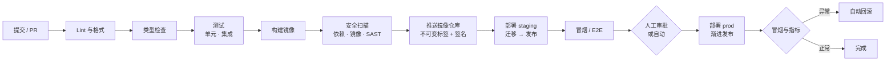
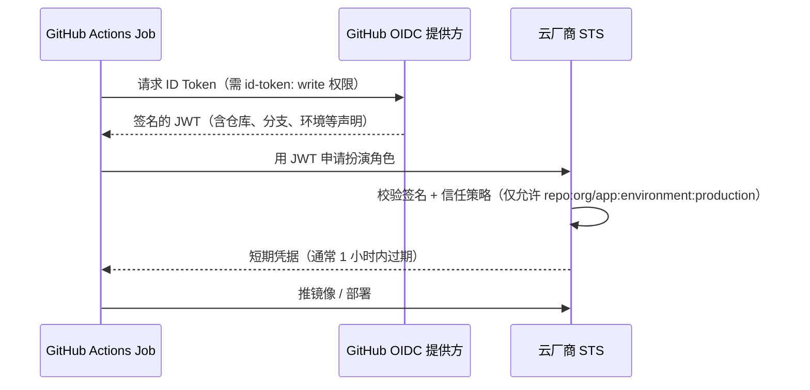
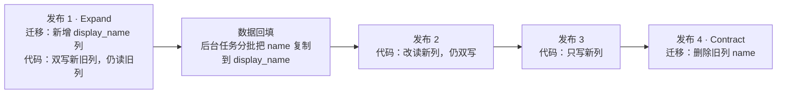
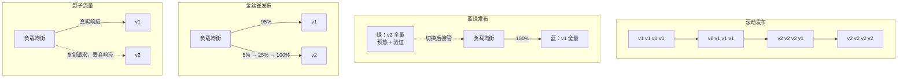
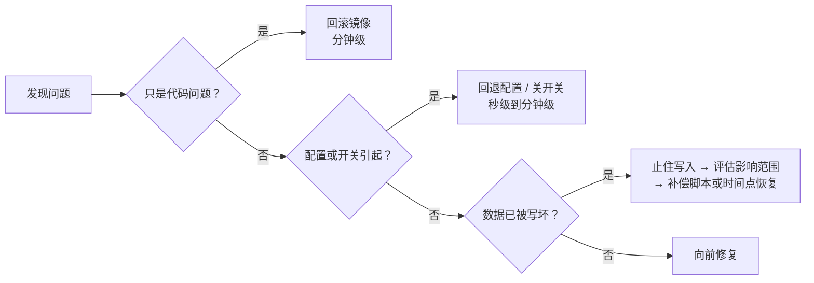

# 16 CI/CD 与发布策略

> 本章目标：能读懂并写出一条**从提交到上线**的完整流水线，用 **OIDC 短期凭据**代替长期密钥，让**数据库迁移安全地随发布执行**，按风险选择**滚动 / 蓝绿 / 金丝雀**与 **Feature Flag**，并理解三类回滚的难度差异与**供应链安全**的基本防线。
>
> 版本基线：GitHub Actions 官方 action 主版本以 2026 年 11 月 Marketplace 为准（`actions/checkout@v7`、`actions/setup-node@v7`、`actions/setup-java@v6`、`docker/build-push-action@v7` 等）；SemVer 2.0.0、Conventional Commits 1.0.0。示例中的 `@vN` 仅为可读性，生产中应固定到完整 commit SHA（见第八节）。
>
> 边界：镜像构建见 [13 章](./13-Docker与Compose.md)，K8s 的 Deployment 与探针见 [14 章](./14-Kubernetes核心与实践.md)，部署形态见 [15 章](./15-部署架构与云.md)，测试分层见 [18 章](./18-测试策略.md)；LLM 评测进 CI 见 [企业级 09 章 3.7](../../企业级AI应用开发实战/09-LLMOps-可观测评测与AI网关.md#37-放进-ci)。

---

## 一、流水线全景



| 阶段 | 拦住什么 | 失败代价 |
|---|---|---|
| Lint / 类型检查 | 低级错误、未使用变量、类型不匹配 | 最便宜，秒级反馈 |
| 测试 | 逻辑错误、SQL 错误、越权、并发缺陷 | 分钟级 |
| 构建镜像 | 依赖缺失、构建脚本错误 | 分钟级 |
| 安全扫描 | 已知漏洞依赖、高危代码模式、镜像中的密钥 | 分钟级 |
| 推送与签名 | 被篡改或来源不明的镜像进入生产 | — |
| 部署 staging + 冒烟 | 配置错误、迁移失败、与真实依赖不兼容 | 不影响用户 |
| 渐进发布 + 指标 | 只在真实流量下暴露的问题 | 影响小部分用户 |

> 📖 **CI / CD**：持续集成（Continuous Integration）指每次提交都自动构建与测试；持续交付（Continuous Delivery）指主干随时处于可发布状态、发布需一次确认；持续部署（Continuous Deployment）指通过检查后自动发布到生产。

> 🎯 **落地要点**：**构建一次，到处部署**。同一个镜像（同一个 digest）依次部署到 staging 和 prod，环境差异只来自配置。为每个环境分别构建镜像，会让"staging 测过的"和"prod 运行的"不是同一个东西。

---

## 二、GitHub Actions

### 2.1 工作流语法要点

```yaml
name: ci
on:
  pull_request:
  push:
    branches: [main]

permissions:                  # 默认最小权限，按 job 再放开
  contents: read

concurrency:                  # 同一分支的新提交取消旧的 CI 运行
  group: ci-${{ github.ref }}
  cancel-in-progress: true

jobs:
  test:
    runs-on: ubuntu-latest
    timeout-minutes: 20       # 默认上限很长，卡死的 job 会白白消耗额度
    steps:
      - uses: actions/checkout@v7
      - run: make test
  build:
    needs: test               # 依赖关系：test 通过才执行
    if: github.event_name == 'push'
    runs-on: ubuntu-latest
    steps:
      - run: echo build
```

| 概念 | 说明 |
|---|---|
| `on` | 触发条件：`push`、`pull_request`、`workflow_dispatch`（手动）、`schedule`（定时）；可加 `paths` 过滤 |
| `jobs` / `steps` | job 默认并行，在独立的 runner 上运行；step 在同一 job 内顺序执行、共享文件系统 |
| `needs` | 声明 job 依赖，组成 DAG |
| `permissions` | `GITHUB_TOKEN` 的权限；**顶层设为只读**，需要写权限的 job 单独声明 |
| `concurrency` | 控制并发；部署 job 用固定 group 且 `cancel-in-progress: false`，避免两次部署交错 |
| `environment` | 绑定部署环境，启用环境级 Secret 与保护规则（2.5） |

> ⚠️ **注意**：`pull_request_target` 触发的工作流以**目标仓库的权限和 Secret** 运行。如果它又检出并执行了 PR 中的代码，任何外部贡献者都能通过一个 PR 拿到仓库 Secret。AI 为了"让 fork 的 PR 也能访问 Secret"常常建议改用它，审查时直接拦下。

### 2.2 缓存

| 方式 | 写法 | 说明 |
|---|---|---|
| setup-* 内置缓存 | `actions/setup-java` 的 `cache: maven`、`actions/setup-node` 的 `cache: pnpm`、`astral-sh/setup-uv` 的 `enable-cache: true` | 首选；setup-node 新版本检测到 `package.json` 的 `packageManager` 字段会自动启用缓存 |
| 通用缓存 | `actions/cache`，key 用锁文件哈希：`hashFiles('**/pnpm-lock.yaml')` | 缓存任意目录，如 Playwright 浏览器 |
| Docker 层缓存 | `docker/build-push-action` 的 `cache-from: type=gha` / `cache-to: type=gha,mode=max` | GitHub 缓存服务已于 2025 年升级，需较新的 Buildx |

> ⚠️ **注意**：缓存 key 必须包含**锁文件哈希**。key 固定不变时，依赖升级后仍然命中旧缓存，出现"本地能过、CI 失败"或者反过来的诡异问题。

### 2.3 矩阵

```yaml
strategy:
  fail-fast: false            # 一个组合失败不取消其他组合
  matrix:
    node: [22, 24]
    db: ['postgres:17', 'postgres:18']
```

矩阵适合**库**（需要兼容多个运行时版本）。**应用**只需要测试与生产一致的那一个版本，矩阵只会成倍消耗 CI 时间。

### 2.4 Secret 与 OIDC 云凭据

传统做法是把云厂商的长期 AccessKey 存进仓库 Secret。问题在于：泄露后长期有效，很难知道谁用过，轮换困难。**OIDC** 让流水线在运行时换取短期凭据：



```yaml
jobs:
  deploy:
    runs-on: ubuntu-latest
    environment: production
    permissions:
      id-token: write         # 允许申请 OIDC token
      contents: read
    steps:
      - uses: aws-actions/configure-aws-credentials@v6
        with:
          role-to-assume: arn:aws:iam::123456789012:role/gha-deploy-prod
          aws-region: ap-southeast-1
```

> 🎯 **落地要点**：OIDC 的安全性取决于云侧**信任策略**的范围。只校验"来自 GitHub"等于允许任何仓库扮演你的角色；至少限定到**组织 / 仓库 / 环境**（`sub` 声明），生产角色只信任 `environment:production`。国内云厂商也在提供基于 OIDC 的角色扮演能力，配置方式以各自文档为准。

仍需存放的 Secret（第三方 API Key 等）：

- 按**环境**存放（Environment secrets），staging 与 prod 分开，prod 的 Secret 只在通过审批的部署 job 中可见
- 不在日志中打印；GitHub 会对已登记的 Secret 做掩码，但**经过变换（base64、截取）后的值不会被掩码**
- 应用运行时需要的密钥不经过 CI 传递，而由运行环境从密钥管理服务读取（[06 章第九节](../L2-核心能力/06-认证授权与Web安全.md#九密钥与敏感配置管理)）

### 2.5 环境保护规则

| 规则 | 作用 |
|---|---|
| Required reviewers | 部署到该环境前需指定人员批准 |
| Wait timer | 批准后等待一段时间再执行，留出取消窗口 |
| Deployment branches / tags | 只允许 `main` 或 `v*` 标签部署到 prod |
| 环境级 Secret | 只有绑定该环境的 job 能读取 |

> ⚠️ **注意**：私有仓库中 Required reviewers、Wait timer 等规则对 GitHub 套餐有要求（以官方文档为准）。不满足时，至少用分支保护 + 仅允许标签触发生产部署来替代。

### 2.6 Monorepo 示例：三栈 CI + 构建部署

假设仓库结构为 `services/billing`（Java）、`services/chat`（TypeScript）、`services/ingest`（Python），共用一条 CI：

```yaml
# .github/workflows/ci.yml
name: ci
on:
  pull_request:
  push:
    branches: [main]
permissions:
  contents: read
concurrency:
  group: ci-${{ github.ref }}
  cancel-in-progress: true

jobs:
  java-billing:
    runs-on: ubuntu-latest
    timeout-minutes: 20
    defaults: { run: { working-directory: services/billing } }
    steps:
      - uses: actions/checkout@v7
      - uses: actions/setup-java@v6
        with: { distribution: temurin, java-version: '25', cache: maven }
      - run: ./mvnw -B verify          # 编译 + 单元测试 + Testcontainers 集成测试（runner 自带 Docker）

  ts-chat:
    runs-on: ubuntu-latest
    timeout-minutes: 15
    defaults: { run: { working-directory: services/chat } }
    steps:
      - uses: actions/checkout@v7
      - uses: pnpm/action-setup@v6
      - uses: actions/setup-node@v7
        with: { node-version: '24', cache: pnpm, cache-dependency-path: services/chat/pnpm-lock.yaml }
      - run: pnpm install --frozen-lockfile    # 锁文件与 package.json 不一致时直接失败
      - run: pnpm lint && pnpm typecheck
      - run: pnpm test -- --coverage

  py-ingest:
    runs-on: ubuntu-latest
    timeout-minutes: 15
    defaults: { run: { working-directory: services/ingest } }
    steps:
      - uses: actions/checkout@v7
      - uses: astral-sh/setup-uv@v10
        with: { enable-cache: true }
      - run: uv sync --locked                  # 等价于"锁文件必须是最新的"
      - run: uv run ruff check . && uv run mypy src
      - run: uv run pytest
```

构建与部署单独一个工作流，由 `main` 的推送触发（分支保护要求 PR 通过 CI 才能合并；也可改用 `workflow_run` 在 CI 成功后触发）：

```yaml
# .github/workflows/deploy-chat.yml
name: deploy-chat
on:
  push:
    branches: [main]
    paths: ['services/chat/**']
permissions:
  contents: read

jobs:
  build:
    runs-on: ubuntu-latest
    permissions: { contents: read, packages: write }   # 推 GHCR 只需 GITHUB_TOKEN 的 packages 权限
    outputs:
      digest: ${{ steps.push.outputs.digest }}
    steps:
      - uses: actions/checkout@v7
      - uses: docker/setup-buildx-action@v4
      - uses: docker/login-action@v4
        with: { registry: ghcr.io, username: '${{ github.actor }}', password: '${{ secrets.GITHUB_TOKEN }}' }
      - id: meta
        uses: docker/metadata-action@v6
        with:
          images: ghcr.io/acme/chat
          tags: type=sha,format=long           # 不可变标签：完整 commit SHA，不用 latest
      - id: push
        uses: docker/build-push-action@v7
        with:
          context: services/chat
          push: true
          tags: ${{ steps.meta.outputs.tags }}
          cache-from: type=gha,scope=chat
          cache-to: type=gha,scope=chat,mode=max
      - name: 镜像漏洞扫描（高危即失败）
        run: ./scripts/scan-image.sh ghcr.io/acme/chat@${{ steps.push.outputs.digest }}

  deploy-staging:
    needs: build
    runs-on: ubuntu-latest
    environment: staging
    concurrency: { group: deploy-chat-staging, cancel-in-progress: false }
    steps:
      - uses: actions/checkout@v7
      - run: ./scripts/migrate.sh staging       # 先迁移（只允许向后兼容的变更，见第五节）
      - run: ./scripts/deploy.sh staging ghcr.io/acme/chat@${{ needs.build.outputs.digest }}
      - run: ./scripts/smoke.sh https://staging.example.com

  deploy-prod:
    needs: [build, deploy-staging]
    runs-on: ubuntu-latest
    environment: production                     # 触发人工审批
    concurrency: { group: deploy-chat-prod, cancel-in-progress: false }
    permissions: { contents: read, id-token: write }
    steps:
      - uses: actions/checkout@v7
      - uses: aws-actions/configure-aws-credentials@v6
        with: { role-to-assume: '${{ vars.PROD_DEPLOY_ROLE }}', aws-region: ap-southeast-1 }
      - run: ./scripts/migrate.sh prod
      - run: ./scripts/deploy.sh prod ghcr.io/acme/chat@${{ needs.build.outputs.digest }}
      - run: ./scripts/smoke.sh https://app.example.com || ./scripts/rollback.sh prod
```

几个值得注意的设计：

- **按 digest 部署**（`镜像@sha256:...`），而不是按标签，保证 staging 与 prod 运行的是同一个镜像
- `migrate.sh` 与 `deploy.sh` 写成仓库内的脚本，工作流只负责编排。这样本地、CI、手工应急都用同一套逻辑，也便于迁移到其他 CI 系统
- 冒烟失败自动回滚；回滚脚本部署的是**上一个成功版本的 digest**（第七节）

### 2.7 GitLab CI 与 Jenkins 对照

| 概念 | GitHub Actions | GitLab CI | Jenkins |
|---|---|---|---|
| 配置文件 | `.github/workflows/*.yml` | `.gitlab-ci.yml` | `Jenkinsfile`（Groovy DSL） |
| 执行单元 | job / step | stage / job | stage / step |
| 依赖编排 | `needs` | `stages` 顺序 + `needs` 组成 DAG | `stages` 顺序、`parallel` |
| 条件 | `if`、`on.paths` | `rules`（含 `changes`） | `when` |
| 执行器 | GitHub 托管 runner / 自托管 runner | GitLab Runner | agent / node |
| 云凭据 OIDC | `permissions: id-token: write` | `id_tokens` 关键字 | 依赖插件 |
| 部署环境与审批 | `environment` + 保护规则 | `environment` + 受保护环境 | `input` 步骤、插件 |

> 🎯 **落地要点**：国内企业内网常用 GitLab 或自建 Jenkins。三者概念基本可以一一对应；把构建、迁移、部署逻辑写成**仓库内的脚本**，CI 配置只做编排，迁移平台时成本最低。

---

## 三、分支与发布模型

### 3.1 主干开发 vs Git Flow

| 维度 | 主干开发 | Git Flow |
|---|---|---|
| 分支寿命 | 小时到一两天 | feature 分支可长达数周 |
| 合并冲突 | 小而频繁 | 大而痛苦 |
| 未完成功能 | 用 **Feature Flag** 隐藏，代码照常合并 | 留在 feature 分支 |
| 发布节奏 | 随时，每天多次 | 按版本周期 |
| 适合 | Web 服务、SaaS、持续部署 | 需要同时维护多个已发布版本的软件（客户端、私有化交付） |

> 🎯 **落地要点**：Web 后端与 AI 应用推荐**主干开发 + 短命分支 + Feature Flag**。AI 让单个分支的改动量变得很大，更要控制分支寿命与 PR 大小，否则代码审查的质量无法保证。

### 3.2 语义化版本与 Changelog

> 📖 **语义化版本（SemVer）**：`主版本.次版本.修订号`。不兼容的 API 变更升主版本，向后兼容的新功能升次版本，向后兼容的修复升修订号。

- **对外提供的 API、SDK、库**严格遵守 SemVer，主版本变更意味着调用方需要改代码（API 版本策略见 [03 章](../L2-核心能力/03-API设计.md)）
- **内部服务**可以用 SemVer，也可以直接用"日期 + commit SHA"，关键是**能从线上版本号追溯到确切的代码**
- 用 **Conventional Commits**（`feat:`、`fix:`、`feat!:` 表示破坏性变更）规范提交信息，再由 **release-please**、**changesets** 等工具自动计算版本号、生成 Changelog 与发布 PR

```text
feat(chat): 支持对话分支
feat(api)!: 移除 v1 会话接口       ← "!" 表示破坏性变更，触发主版本升级
```

---

## 四、多环境与配置管理

### 4.1 环境分层

| 环境 | 用途 | 数据 | 部署方式 |
|---|---|---|---|
| local | 开发者本机 | 种子数据，Compose 起依赖（[13 章](./13-Docker与Compose.md)） | 手动 |
| PR 预览（可选） | 每个 PR 一个临时环境 | 种子数据 | PR 打开时自动创建，关闭时销毁 |
| dev / test | 集成联调 | 测试数据 | 合并后自动 |
| staging | 发布前验证，**尽量与 prod 同构** | 脱敏数据或构造数据，量级接近生产 | 自动 |
| prod | 生产 | 真实数据 | 审批或自动 + 渐进发布 |

> ⚠️ **注意**：**不要把生产数据直接复制到 staging**。即使是内部环境，staging 的权限控制、日志策略通常比 prod 宽松，复制过去就等于扩大了用户数据的暴露面。需要真实数据分布时，先脱敏再导入。

### 4.2 12-Factor 配置原则

12-Factor App 的配置原则：**配置是部署之间会变化的东西，必须与代码严格分离，通过环境变量注入**。

| 应该放进配置 | 不应该放进配置 |
|---|---|
| 数据库地址、Redis 地址、外部服务 URL | 业务规则（应该是代码或数据库数据） |
| 密钥（经由密钥管理服务注入） | 按环境名分支的逻辑：`if (env === 'prod') {...}` |
| 功能开关的默认值、超时、并发上限 | 每次发布都要改的东西 |

```ts
// 反例：代码里按环境硬编码
const dbUrl = process.env.NODE_ENV === 'production' ? 'postgres://prod-db:5432/app' : 'postgres://localhost/app';

// 正例：配置从环境注入，启动时集中校验，缺失或格式错误即拒绝启动
const Config = z.object({
  DATABASE_URL: z.string().url(),
  LLM_TIMEOUT_MS: z.coerce.number().int().positive().default(30_000),
  OPENAI_API_KEY: z.string().min(1),
});
export const config = Config.parse(process.env);
```

三栈的对应做法：Spring Boot 的 `@ConfigurationProperties` + `@Validated`；FastAPI 常用 `pydantic-settings` 的 `BaseSettings`。共同点是**启动时校验，失败快速退出**，而不是运行到某个请求时才发现配置缺失。

> 🎯 **落地要点**：配置变更与代码发布一样需要**版本化、可审计、可回滚**。K8s 中用 ConfigMap / Secret 并随 Helm chart 版本化（[14 章](./14-Kubernetes核心与实践.md)）；也可以用配置中心（Nacos、Apollo、云厂商配置服务），但要确认它的变更有审批和历史记录。

---

## 五、数据库迁移如何随发布执行

### 5.1 核心矛盾：新旧代码同时运行

滚动、蓝绿、金丝雀发布期间，**旧版本代码和新版本代码会同时连接同一个数据库**。回滚时，旧代码还要面对已经迁移过的表结构。所以：

> 🎯 **落地要点**：每次发布的迁移都必须**同时兼容当前版本和上一个版本的代码**。破坏性变更（删列、改名、改类型、加非空约束）要拆成多次发布完成，即 **expand-contract**（原理与 SQL 细节见 [04 章 11.2](../L2-核心能力/04-数据库与数据建模.md#112-零停机迁移expand-contract)）。

### 5.2 以"重命名列"为例的发布序列



每一步都可以单独回滚到上一步，而不会出现"代码访问不存在的列"。

### 5.3 迁移与代码的先后顺序

| 变更类型 | 顺序 | 原因 |
|---|---|---|
| **扩展**（加表、加可空列、加索引） | **先迁移，再发代码** | 旧代码忽略新列，不受影响 |
| **收缩**（删列、删表） | **先发不再使用它的代码，稳定后下一次发布再迁移** | 删列时不能还有代码在读它 |
| 加非空约束 | 先加可空列并回填，代码保证写入，再单独加约束 | 直接加会让旧代码的插入失败 |
| 大表加索引 | 单独一次发布，用 `CREATE INDEX CONCURRENTLY`（PostgreSQL） | 普通建索引会锁表写入 |

### 5.4 迁移在哪里执行

| 方式 | 问题 / 适用 |
|---|---|
| ❌ 应用启动时自动执行，多副本同时启动 | 多个实例并发跑迁移；迁移耗时长导致健康检查超时、实例反复重启。部分工具有锁机制，但仍不建议用于生产 |
| ✅ 流水线中**部署前**单独执行一步 | 迁移失败则不发布代码，状态清晰（2.6 中的 `migrate.sh`） |
| ✅ K8s 中用部署前的 Job（如 Helm 的 pre-upgrade hook） | 与发布绑定，失败阻断升级 |

常用工具：

| 栈 | 工具 | 说明 |
|---|---|---|
| Java | **Flyway**、**Liquibase** | Flyway 用版本化 SQL 文件；Liquibase Community 已改为 FSL 许可（非 OSI 开源，两年后转 Apache-2.0），商用前确认许可条款 |
| TypeScript | Prisma Migrate、Drizzle Kit、Knex、TypeORM | Prisma 不同大版本的部署命令有变化，按所用版本的文档执行 |
| Python | **Alembic**（SQLAlchemy）、Django migrations | Alembic 的 `--autogenerate` 结果必须人工审查 |

> ⚠️ **注意**：ORM 自动生成的迁移经常把"重命名列"生成为"删除旧列 + 新增新列"，**直接丢失整列数据**。AI 生成迁移时同样高发。审查迁移文件时逐行看 `DROP`，并确认它不是本次发布中仍被使用的列。

### 5.5 回滚时的迁移问题

- **大多数生产迁移不写 down 脚本，或写了也不执行**。删除的列、转换过类型的数据，down 脚本也恢复不了
- 正确做法是**向前修复**（roll forward）：回滚代码到上一版本（因为迁移是向后兼容的，旧代码可以正常运行），数据库保持不动，再发一次修复
- 真正需要恢复数据时，依赖备份与时间点恢复（[15 章 6.2](./15-部署架构与云.md#62-备份策略)），代价是丢失恢复点之后的写入

---

## 六、发布策略

### 6.1 四种策略



| 策略 | 原理 | 回滚速度 | 额外资源 | 影响面 | 适合 |
|---|---|---|---|---|---|
| **滚动** | 逐批替换实例 | 慢（再滚一遍） | 少（多出一两个实例） | 逐渐扩大到全部 | 默认方案，K8s Deployment 默认行为 |
| **蓝绿** | 两套完整环境，流量一次性切换 | **快**（切回去） | 双倍 | 切换瞬间全部 | 需要秒级回滚，或需要在切换前完整验证新环境 |
| **金丝雀** | 按比例逐步放量，观察指标决定继续或回退 | 快（比例调回 0） | 少 | **可控，从小比例开始** | 高风险变更、大流量服务 |
| **影子流量** | 复制真实请求给新版本，不返回其响应 | — | 一套影子环境 | **无用户影响** | 重构、换存储引擎、换模型前评估 |

> ⚠️ **注意**：**影子流量不能用于有副作用的请求**。复制一次"扣费"或"发送通知"请求给影子环境，就会真的扣两次费。影子环境的写操作必须指向隔离的存储，外部调用要被替换为模拟。

### 6.2 金丝雀的自动化分析

金丝雀的价值在于**依据指标自动决策**，而不是人盯着看板：

```yaml
# Argo Rollouts 金丝雀步骤示意（K8s）
strategy:
  canary:
    steps:
      - setWeight: 5
      - pause: { duration: 10m }
      - analysis:                       # 查询 Prometheus：错误率、P99 未超阈值才继续
          templates: [{ templateName: error-rate-and-latency }]
      - setWeight: 25
      - pause: { duration: 10m }
      - setWeight: 100
```

K8s 上常用 **Argo Rollouts** 或 **Flagger**（Flux 生态）实现；非 K8s 环境可用云负载均衡的加权目标组，配合脚本查询指标。分析指标应与 SLO 一致（[17 章第五节](./17-可观测性与线上排障.md#五slo告警与-on-call)）。

> 🎯 **落地要点**：金丝雀比例要按**用户**或**会话**粘性分配，而不是每个请求随机。否则同一个用户的连续请求在新旧版本之间跳来跳去，前端可能拿到不兼容的响应格式；SSE / WebSocket 长连接也会在重连时换版本。

### 6.3 Feature Flag：把"部署"和"发布"分开

> 📖 **Feature Flag（功能开关）**：在运行时决定某段代码是否生效的开关，可按用户、租户、比例、地区等规则开启。**部署**是把代码送上线，**发布**是让用户用到功能；开关让两者解耦。

| 用途 | 例子 |
|---|---|
| 发布开关 | 新的对话分支功能先对内部员工开启，再按 5% → 50% → 100% 放量 |
| 运维开关（Kill Switch） | 模型供应商故障时一键关闭"深度思考"模式，降级到普通模式 |
| 实验开关 | A/B 测试两种推荐策略 |
| 权限开关 | 只对付费套餐开启某功能 |

```ts
// 使用 OpenFeature 标准 API，背后的提供方可以是 flagd、Unleash、Flagsmith、GrowthBook 或商业服务
const client = OpenFeature.getClient();
const enabled = await client.getBooleanValue('chat.branching', false, {
  targetingKey: user.id,                    // 按用户稳定分桶
  tenantPlan: user.plan,
});
```

| 方案 | 说明 |
|---|---|
| **OpenFeature** | CNCF 孵化项目，厂商无关的 **SDK 标准**，业务代码只依赖它，换提供方不改代码 |
| flagd | OpenFeature 的参考实现，配置文件驱动，Apache-2.0 |
| Unleash | 功能完整的开源平台，服务端 AGPL-3.0，企业功能收费 |
| Flagsmith / GrowthBook | 开源可自托管；GrowthBook 侧重实验分析 |

> ⚠️ **注意**：开关是**技术债**。每个发布开关在全量后都要删除代码分支，否则代码中会堆积大量"永远为 true"的分支，组合状态无法测试。建立开关的同时登记负责人和预计删除日期。

### 6.4 LLM 应用：prompt 与模型切换也要灰度

换模型、改 system prompt、调整检索参数，对 AI 应用的影响不亚于一次代码发布，而且**无法通过单元测试发现退化**。同样适用渐进发布：

- 改动先过离线评测集（[企业级 09 章第三节](../../企业级AI应用开发实战/09-LLMOps-可观测评测与AI网关.md#三评测量得准重点)）
- prompt 版本用标签指向，按比例或按租户切换（[企业级 09 章第四节](../../企业级AI应用开发实战/09-LLMOps-可观测评测与AI网关.md#四prompt-管理)）
- 模型切换在 AI 网关按权重路由（[企业级 09 章第五节](../../企业级AI应用开发实战/09-LLMOps-可观测评测与AI网关.md#五ai-网关控得住重点)），观察点踩率、成本、延迟、错误率后再放量；trace 中记录 prompt 版本与模型，才能按版本对比效果

---

## 七、回滚

### 7.1 三类回滚的难度差异

| 类型 | 难度 | 做法 | 前提 |
|---|---|---|---|
| **镜像（代码）回滚** | 低 | 重新部署上一个成功版本的 digest；K8s 可用 `kubectl rollout undo` | 镜像标签不可变，保留了历史版本；迁移向后兼容 |
| **配置回滚** | 中 | 回退 ConfigMap / 配置中心版本 / Feature Flag | 配置有版本历史；**很多事故的起因是配置变更却没有回滚记录** |
| **数据回滚** | 高 | 时间点恢复、从备份恢复、写补偿脚本修正数据 | 有备份并演练过；丢失恢复点之后的写入，通常要停服或做数据比对 |



### 7.2 让回滚真正可用

- **镜像标签不可变**：禁止覆盖已有标签，部署用 digest；`latest` 标签无法回滚，因为你不知道"上一个 latest"是什么
- **记录每次部署**：哪个版本、何时、谁触发、对应哪个 commit，作为事件写入可观测平台（[17 章](./17-可观测性与线上排障.md)）
- **回滚是一条命令**：写成脚本并定期演练，事故时不应该临时研究怎么回滚
- **优雅停机**：滚动替换与回滚都会终止旧实例，正在进行的 SSE 对话需要排空，见 [08 章第七节](../L2-核心能力/08-并发与可靠性.md#七优雅停机)
- **数据写坏的预防胜于回滚**：危险的数据修复脚本先在副本上运行，加上行数上限与 dry-run 模式

---

## 八、供应链安全

### 8.1 威胁在哪里

| 环节 | 典型事件或风险 |
|---|---|
| 依赖包 | 2025 年 9 月起的 Shai-Hulud npm 蠕虫：窃取维护者凭据后发布带后门的新版本，并在安装时继续窃取凭据自我传播 |
| CI 中的第三方 action | 2025 年 3 月 tj-actions/changed-files 的标签被改指向恶意提交，泄露大量仓库的 Secret；2026 年 3 月 aquasecurity/trivy-action 与 setup-trivy 标签被强推并发布了带后门的 trivy 版本 |
| 基础镜像 | 未固定的基础镜像随时变化；镜像中含已知漏洞 |
| 构建产物 | 镜像在构建后被替换，部署了来源不明的产物 |

### 8.2 防线

**① 锁文件与安装方式**

- 锁文件（`package-lock.json` / `pnpm-lock.yaml`、`uv.lock` / `poetry.lock`、Maven / Gradle 依赖锁定）必须提交
- CI 中用**严格模式**安装：`npm ci`、`pnpm install --frozen-lockfile`、`uv sync --locked`，锁文件与声明不一致即失败
- 设置**新版本冷静期**：pnpm 的 `minimumReleaseAge`、Yarn 的 `npmMinimalAgeGate` 等配置，让刚发布的新版本过一段时间才可被安装，躲开"发布后数小时内被发现"的恶意版本

**② 依赖自动更新**

| 工具 | 特点 |
|---|---|
| **Dependabot** | GitHub 内置，安全更新与版本更新 PR；支持 npm、Maven、pip、uv 等 |
| **Renovate** | 配置更灵活：分组合并、自动合并补丁版本、更新冷静期、monorepo 支持更好 |

> 🎯 **落地要点**：依赖更新 PR 也要过完整 CI，补丁版本可自动合并，次版本与主版本由人审查。长期不更新依赖，最后一次大升级的风险远大于持续的小升级。

**③ 代码与镜像扫描**

| 类型 | 作用 | 工具示例 |
|---|---|---|
| **SCA**（依赖漏洞） | 发现依赖中的已知 CVE | Dependabot alerts、`npm audit`、`pip-audit`、OWASP Dependency-Check |
| **SAST**（静态分析） | 发现 SQL 注入、硬编码密钥、不安全反序列化等代码模式 | CodeQL、Semgrep、SonarQube |
| **Secret 扫描** | 阻止密钥进入仓库 | GitHub secret scanning 与 push protection、gitleaks |
| **镜像扫描** | 基础镜像与系统包漏洞 | Trivy、Grype |

扫描策略：**高危且有修复版本的漏洞阻断合并**，其余进入看板限期处理。全部阻断会导致团队习惯性忽略扫描结果。

**④ 固定第三方 action 到完整 SHA**

```yaml
# 反例：标签可以被维护者（或攻击者）改指向任意提交
- uses: some-org/some-action@v3

# 正例：固定到完整 commit SHA，注释标明对应版本，由 Dependabot / Renovate 负责更新
- uses: some-org/some-action@<40 位 commit SHA>  # v3.2.1
```

GitHub 已支持在组织 / 仓库策略中**强制要求 action 固定到完整 SHA**。官方 `actions/*` 风险相对较低，第三方 action 一律固定；`GITHUB_TOKEN` 权限保持最小，让被攻破的 action 能做的事情尽量少。

**⑤ SBOM、签名与来源证明**

> 📖 **SBOM（软件物料清单）**：列出制品中包含的全部组件及版本，常用格式为 SPDX 与 CycloneDX。新漏洞披露时，可以直接查询"哪些线上镜像包含这个组件"，而不是逐个排查。

- 用 **Syft** 等工具在构建时生成 SBOM，与镜像一起存档
- 用 **cosign**（Sigstore）对镜像签名；无密钥（keyless）模式借助 CI 的 OIDC 身份签名，不需要管理签名私钥
- GitHub 的 artifact attestations 可生成构建来源证明（SLSA provenance），说明"这个镜像由哪个仓库的哪个工作流构建"
- 部署端（如 K8s 准入策略）**只允许运行签名校验通过的镜像**，才算闭环

---

## 九、AI 代码审查清单

### 流水线与 GitHub Actions

- [ ] 🔴 工作流顶层 `permissions` 为只读，写权限与 `id-token: write` 只在需要的 job 中声明
- [ ] 🔴 没有使用 `pull_request_target` 检出并执行 PR 代码
- [ ] 🔴 第三方 action 固定到完整 commit SHA，并由依赖更新工具维护
- [ ] 每个 job 设置了 `timeout-minutes`；部署 job 使用固定 `concurrency` group 且不取消进行中的部署
- [ ] 缓存 key 包含锁文件哈希
- [ ] 应用项目没有无意义的大矩阵；矩阵只用于需要多版本兼容的库

### 凭据与环境

- [ ] 🔴 云凭据通过 OIDC 获取，仓库中没有长期 AccessKey
- [ ] OIDC 信任策略限定到组织、仓库与环境，生产角色只信任生产环境
- [ ] Secret 按环境隔离；prod Secret 只在受保护环境的 job 中可见
- [ ] 日志中没有打印 Secret 或其变换后的值
- [ ] 生产部署需要审批，或仅允许从 `main` / 版本标签触发

### 构建与制品

- [ ] 🔴 镜像使用不可变标签（commit SHA），按 digest 部署；不使用 `latest`
- [ ] staging 与 prod 部署的是同一个镜像 digest
- [ ] CI 中用严格模式安装依赖（`npm ci` / `--frozen-lockfile` / `--locked`）
- [ ] 镜像扫描对高危且可修复的漏洞阻断发布

### 配置

- [ ] 配置从环境注入，启动时集中校验，缺失即退出
- [ ] 代码中没有 `if (env === 'prod')` 式的环境分支逻辑
- [ ] 配置变更有版本历史并可回滚

### 数据库迁移

- [ ] 🔴 迁移同时兼容当前版本与上一版本代码；破坏性变更按 expand-contract 拆成多次发布
- [ ] 🔴 迁移文件中的 `DROP` / 重命名经过逐行确认，没有被 ORM 生成为"删列再加列"
- [ ] 迁移在部署前单独执行，不在多副本应用启动时并发执行
- [ ] 大表索引使用 `CREATE INDEX CONCURRENTLY` 并单独发布
- [ ] 回滚预案是"回滚代码 + 向前修复"，而不是依赖 down 脚本

### 发布与回滚

- [ ] 部署后有冒烟测试，失败自动回滚到上一个成功的 digest
- [ ] 高风险变更使用金丝雀或蓝绿，并按用户 / 会话粘性分流
- [ ] 🔴 影子流量不会触发真实的扣费、通知等副作用
- [ ] 新功能有 Feature Flag，并登记负责人与删除日期
- [ ] prompt 与模型切换经过评测并按比例灰度
- [ ] 每次部署作为事件写入可观测平台

---

## 本章小结

- 流水线顺序：**lint → 类型检查 → 测试 → 构建 → 扫描 → 推送签名 → staging → 冒烟 → prod 渐进发布**；**构建一次、按 digest 部署到所有环境**
- GitHub Actions 的安全基线：**最小 `permissions`、OIDC 短期凭据、环境保护规则、第三方 action 固定 SHA**；构建与部署逻辑写成仓库脚本，CI 只做编排
- Web 后端推荐**主干开发 + 短命分支 + Feature Flag**；Conventional Commits 配合工具自动生成版本与 Changelog
- 配置与代码分离，**启动时校验**；配置变更同样需要版本化与可回滚
- 迁移必须**兼容新旧两个版本的代码**，破坏性变更走 expand-contract；迁移在部署前单独执行；回滚靠"回滚代码 + 向前修复"
- 发布策略按风险选择：滚动是默认，蓝绿回滚最快，金丝雀影响面最可控，影子流量注意副作用；**prompt 与模型切换同样要灰度**
- 回滚难度：**镜像 < 配置 < 数据**；数据问题以预防为主
- 供应链防线：**锁文件 + 严格安装 + 新版本冷静期、依赖自动更新、SCA / SAST / 镜像扫描、固定 SHA、SBOM 与签名**

## 练习

1. 为你的 AI 对话服务写一条 GitHub Actions 流水线：lint、类型检查、Testcontainers 集成测试、构建并推送以 commit SHA 为标签的镜像、部署 staging 并运行冒烟测试、生产环境需审批；用 OIDC 访问云厂商（或模拟），确认仓库中没有长期密钥
2. 设计"把 `conversations.title` 拆分为 `title` 与 `auto_title` 两列"的 expand-contract 发布序列，写出每次发布的迁移 SQL 与代码改动，并说明每一步回滚到上一步时是否安全
3. 用 OpenFeature + flagd 为"对话分支"功能加开关，实现按用户 ID 稳定分桶的 10% 放量与一键关闭，并写测试验证同一用户的结果稳定
4. 盘点你项目中的所有第三方 GitHub Action，固定到完整 SHA，并配置 Dependabot 或 Renovate 自动更新；为 npm / pnpm 依赖配置新版本冷静期
