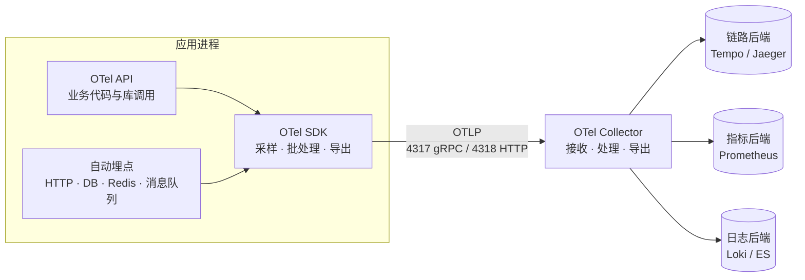
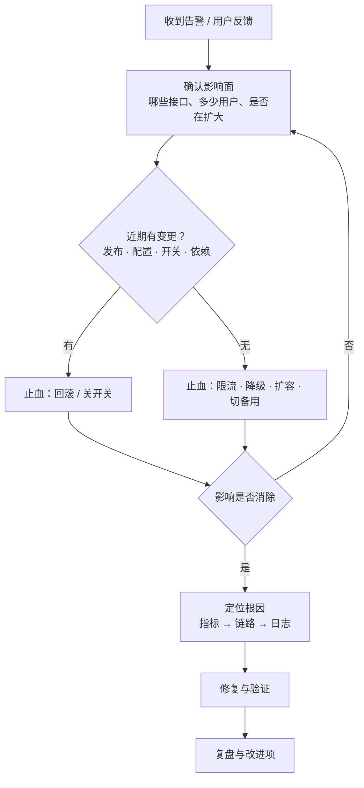
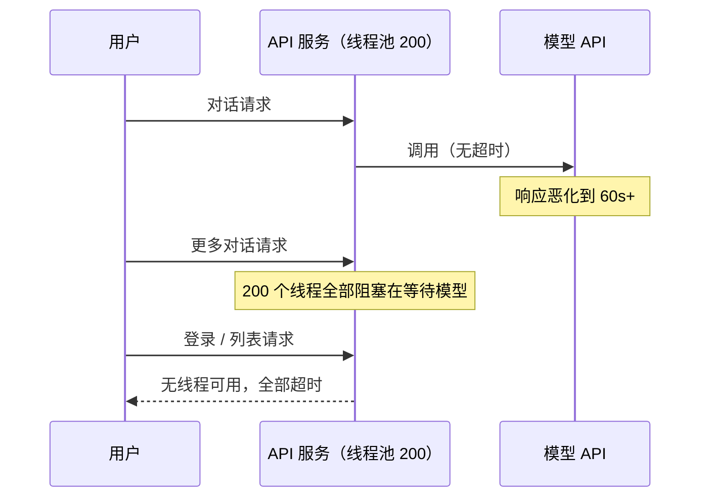
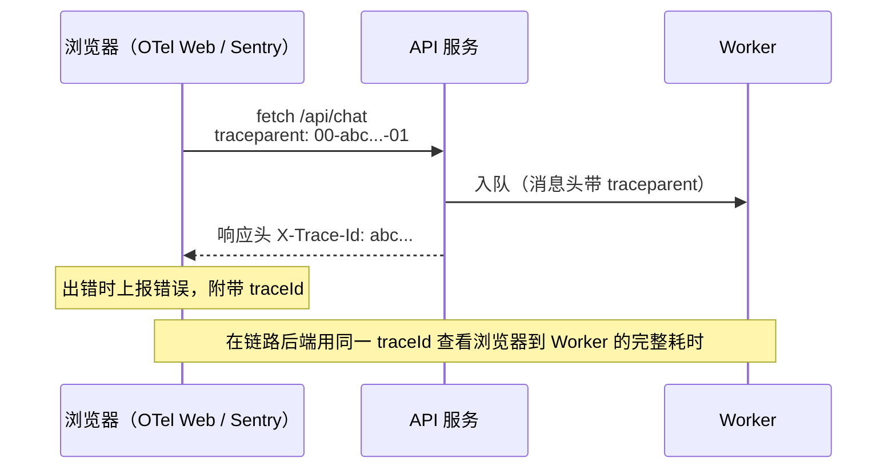

# 17 可观测性与线上排障

> 本章目标：掌握**日志、指标、链路追踪**三类信号各自回答什么问题，能用 **OpenTelemetry** 为三栈服务接入可观测，设计 **SLO 与燃烧率告警**，并用一套**先止血、再定位**的方法论处理线上故障、写出事故复盘。
>
> 版本基线：OpenTelemetry（Traces / Metrics / Logs 规范已稳定，各语言 SDK 成熟度不一；Profiles 信号为 Alpha）、Prometheus 3.x、Spring Boot 4.0（新增 `spring-boot-starter-opentelemetry`）、Jaeger v2（v1 已于 2025 年底停止维护）。
>
> 边界：本章讲通用可观测。LLM 调用的 tracing、评测、token 成本看板见 [企业级 09 章](../../企业级AI应用开发实战/09-LLMOps-可观测评测与AI网关.md)；服务器上的排障命令见 [12 章](./12-Linux与排障命令.md)，K8s 对象排障见 [14 章](./14-Kubernetes核心与实践.md)。

---

## 一、三大支柱与事件

| 信号 | 回答的问题 | 形态 | 成本特征 |
|---|---|---|---|
| **指标（Metrics）** | **有没有问题、多严重**：错误率是否升高、P99 是多少 | 按时间聚合的数值序列 | 便宜，可长期保留；但丢失单个请求的细节 |
| **链路（Traces）** | **问题在哪一跳**：一个请求经过哪些服务、每一步花了多久 | 一棵 span 树 | 中等，通常需要采样 |
| **日志（Logs）** | **具体发生了什么**：参数、异常栈、业务上下文 | 离散的事件记录 | 最贵，量大，需控制级别与保留期 |
| **事件（Events）** | **最近改了什么**：发布、配置变更、扩缩容、开关切换 | 带时间点的变更记录 | 很便宜，但最常被遗漏 |


三类信号靠 **traceId** 串联：指标上的异常点可以跳到当时的示例 trace（exemplar），trace 上的每个 span 可以跳到同一 traceId 的日志。

> 📖 **监控 vs 可观测性**：监控回答"已知会出问题的地方现在是否正常"（预先定义的看板和告警）；可观测性强调**事后能回答事先没想到的问题**，前提是信号足够丰富且能互相关联。

> 🎯 **落地要点**：把**发布与配置变更**作为事件标注到看板上（Grafana Annotations 或在 CI 部署步骤里调用接口写入）。线上故障的第一个问题永远是"刚才改了什么"。

---

## 二、结构化日志

### 2.1 为什么必须是结构化日志

```text
# 反例：字符串拼接，只能全文搜索，无法聚合
2026-11-10 14:05:31 INFO 用户 u_123 在会话 c_456 调用模型 gpt-x 失败，耗时 31200ms

# 正例：一行一个 JSON，每个字段可检索、可聚合
{"ts":"2026-11-10T14:05:31.204Z","level":"ERROR","service":"chat-api","msg":"llm call failed",
 "trace_id":"4bf92f3577b34da6a3ce929d0e0e4736","user_id":"u_123","conversation_id":"c_456",
 "model":"gpt-x","duration_ms":31200,"error.type":"ReadTimeout"}
```

结构化之后，"过去一小时各模型超时次数"就是一条查询，而不是一段正则。

### 2.2 日志级别规范

| 级别 | 用途 | 例子 | 生产是否开启 |
|---|---|---|---|
| ERROR | 需要人关注的失败，请求无法完成 | 下游调用最终失败、未捕获异常 | 是，且应触发统计 |
| WARN | 异常但已自动处理 | 重试后成功、降级到备用模型、配额即将用尽 | 是 |
| INFO | 关键业务事件，每个请求不超过几条 | 请求完成摘要、任务开始 / 结束、状态变更 | 是 |
| DEBUG | 排障细节 | 中间变量、完整的外部响应 | **否**，需要时按服务或按请求临时开启 |

> ⚠️ **注意**：AI 生成的代码常见两种极端：一是在 `catch` 里 `log.error` 之后再 `throw`，上层再记一次，一个错误打出三份栈；二是把整个 LLM 请求体和响应体打到 INFO。原则是**在处理异常的那一层记录一次**，大体积内容只在 DEBUG 或交给 LLM tracing 平台。

### 2.3 traceId 贯穿：三栈写法

请求进入时继承上游的 `traceparent`（没有则生成），之后该请求产生的**所有日志自动带上 trace_id**，而不是每条日志手动传参。

**Java**（Spring Boot 3.4+ 内置结构化日志；接入 Micrometer Tracing 或 OTel Java Agent 后，`traceId` 会自动进入 MDC）：

```yaml
# application.yaml
logging:
  structured:
    format:
      console: ecs        # 内置 ecs / logstash / gelf 三种格式
```

```java
// 业务字段：用过滤器放入 MDC，请求结束必须清理
public class LogContextFilter extends OncePerRequestFilter {
    protected void doFilterInternal(HttpServletRequest req, HttpServletResponse res, FilterChain chain)
            throws ServletException, IOException {
        try {
            MDC.put("tenant_id", TenantContext.current());
            chain.doFilter(req, res);
        } finally {
            MDC.clear();   // 线程会被复用，不清理会把上个请求的租户带到下个请求
        }
    }
}

// SLF4J 2 的键值对 API，结构化输出时成为独立字段
log.atInfo().addKeyValue("conversation_id", id).addKeyValue("duration_ms", ms).log("chat completed");
```

**TypeScript**（Fastify 内置 pino；`@opentelemetry/instrumentation-pino` 会把 `trace_id` / `span_id` 注入日志）：

```ts
const app = Fastify({
  logger: {
    level: process.env.LOG_LEVEL ?? 'info',
    redact: {
      paths: ['req.headers.authorization', 'req.headers.cookie', '*.password', '*.apiKey'],
      censor: '[REDACTED]',
    },
  },
  requestIdHeader: 'x-request-id',
});

app.post('/api/chat', async (req) => {
  req.log.info({ conversationId: req.body.conversationId }, 'chat started');   // 请求级 child logger
});
```

**Python**（structlog + contextvars，异步场景下按协程隔离上下文）：

```python
structlog.configure(processors=[
    structlog.contextvars.merge_contextvars,
    structlog.processors.add_log_level,
    structlog.processors.TimeStamper(fmt="iso"),
    redact_sensitive,                         # 自定义脱敏处理器
    structlog.processors.JSONRenderer(),
])

@app.middleware("http")
async def bind_log_context(request: Request, call_next):
    structlog.contextvars.clear_contextvars()
    ctx = trace.get_current_span().get_span_context()
    structlog.contextvars.bind_contextvars(
        trace_id=format(ctx.trace_id, "032x"),
        request_id=request.headers.get("x-request-id"),
    )
    return await call_next(request)
```

使用 loguru 的项目对应写法是 `logger.add(sys.stdout, serialize=True)` 输出 JSON、`logger.contextualize(...)` 绑定上下文。

### 2.4 敏感信息脱敏

| 必须脱敏或禁止记录 | 做法 |
|---|---|
| 密码、Token、API Key、Cookie、`Authorization` 头 | 日志库层面按字段名统一 redact（pino `redact`、Logback 自定义 converter、structlog processor） |
| 手机号、身份证号、邮箱、地址 | 掩码（`138****5678`）或只记录哈希 |
| 用户对话内容、上传文档内容 | 默认不进通用日志；需要时进入有权限控制的 LLM tracing 平台（[企业级 09 章 2.5](../../企业级AI应用开发实战/09-LLMOps-可观测评测与AI网关.md#25-tracing-的企业要点)） |
| 完整请求 / 响应体 | 只在 DEBUG，且经过脱敏 |

> ⚠️ **注意**：脱敏要在**日志库层**统一做，不能依赖每个开发者记得。AI 生成的调试代码常出现 `logger.info(f"request: {request.json()}")`，审查时直接拦下。

### 2.5 日志平台选型

应用只负责**把 JSON 写到 stdout**，由采集器（OTel Collector、Grafana Alloy、Fluent Bit、云厂商 agent）负责收集和发送。不要在应用里直接写文件或直连日志平台。

| 平台 | 特点 | 适合 |
|---|---|---|
| **Grafana Loki** | 只索引标签、正文按块压缩存储，成本低；与 Grafana 一体 | 已用 Grafana 生态、成本敏感 |
| **Elasticsearch / OpenSearch**（ELK） | 全文索引，检索与分析能力最强，资源消耗大 | 日志检索需求复杂、已有 ES 运维能力 |
| **基于 ClickHouse 的方案**（如 SigNoz） | 日志、指标、链路统一存储，列存压缩率高 | 希望一套系统覆盖三类信号 |
| **云日志服务**（阿里云 SLS、腾讯云 CLS、AWS CloudWatch Logs） | 免运维，按量计费 | 不想自建；注意按写入量与保留期计费 |

> ⚠️ **注意**：Grafana 的旧采集器 Promtail 已于 2026 年 3 月停止维护，新部署统一用 **Grafana Alloy**（基于 OTel Collector 的发行版）。

---

## 三、指标

### 3.1 先确定看什么：三套方法

| 方法 | 适用对象 | 指标 |
|---|---|---|
| **RED** | 服务 / 接口 | **R**ate 请求速率、**E**rrors 错误率、**D**uration 耗时分布 |
| **USE** | 资源（CPU、内存、磁盘、连接池、线程池） | **U**tilization 使用率、**S**aturation 饱和度（排队）、**E**rrors 错误 |
| **四个黄金信号**（Google SRE） | 用户可见的服务 | 延迟、流量、错误、饱和度 |

经验用法：**每个接口看 RED，每种资源看 USE**。AI 应用再补充几项业务指标：首 token 时间（TTFT）、模型调用错误率按模型拆分、token 消耗、队列积压（这几项的看板设计见 [企业级 09 章第七节](../../企业级AI应用开发实战/09-LLMOps-可观测评测与AI网关.md#七监控看板)）。

### 3.2 指标类型

| 类型 | 含义 | 例子 | 常见错误 |
|---|---|---|---|
| **Counter** | 只增不减的累计值 | 请求总数、错误总数、token 总数 | 直接看原值；应该看 `rate()` |
| **Gauge** | 可增可减的瞬时值 | 在线 SSE 连接数、队列长度、连接池活跃数 | 用来记录"请求数"，重启后归零导致误判 |
| **Histogram** | 落入各区间（bucket）的次数 | 请求耗时、响应大小 | bucket 边界不覆盖 LLM 的长耗时（默认上限只到几秒） |

> ⚠️ **注意**：**不要用平均值衡量延迟**。99 个请求 100ms、1 个请求 10s，平均约 200ms，看起来很健康，但每 100 个用户就有一个等了 10 秒。延迟一律看 P50 / P95 / P99，用 Histogram 采集。LLM 接口耗时跨度大，bucket 要覆盖到几十秒。

### 3.3 Prometheus 数据模型与基数爆炸

Prometheus 中，**指标名 + 一组标签的每种取值组合 = 一条时间序列**：

```text
http_server_requests_seconds_count{method="POST", route="/api/chat", status="200"}  18233
http_server_requests_seconds_count{method="POST", route="/api/chat", status="500"}  41
```

> 📖 **基数（Cardinality）**：一个指标产生的时间序列数量，等于各标签取值数的乘积。基数过高会让 Prometheus 内存暴涨、查询变慢甚至崩溃。

```ts
// 反例：标签里放无界的值
httpDuration.labels({ path: req.url, userId: user.id }).observe(sec);
// req.url 含 /api/conversations/8f3a...?page=2，用户数 × 会话数 × 参数组合 → 序列数无上限

// 正例：标签只放有界、低基数的维度；用路由模板代替原始路径
httpDuration.labels({ route: req.routeOptions.url, method: req.method, status: String(res.statusCode) }).observe(sec);
// 需要按用户分析时用日志或链路，不用指标
```

| 适合做标签 | 不适合做标签 |
|---|---|
| 路由模板、HTTP 方法、状态码、模型名、租户套餐等级 | 用户 ID、会话 ID、traceId、原始 URL、错误信息全文、prompt |

### 3.4 埋点方式

| 栈 | 常用做法 |
|---|---|
| Java | Spring Boot Actuator + Micrometer，引入 `micrometer-registry-prometheus` 后暴露 `/actuator/prometheus`（需在 `management.endpoints.web.exposure.include` 中开放）；HTTP、JVM、HikariCP 连接池指标自动采集 |
| TypeScript | `prom-client`（`collectDefaultMetrics()` 提供事件循环延迟、堆内存等） |
| Python | `prometheus_client`，或 `prometheus-fastapi-instrumentator` 自动采集 HTTP 指标 |
| 统一方案 | 用 OpenTelemetry Metrics 采集，经 Collector 导出到 Prometheus（Prometheus 3.x 也可直接接收 OTLP） |

> ⚠️ **注意**：`/actuator/prometheus`、`/metrics` 这类端点**不能暴露在公网**。用独立管理端口，或在反代上只允许内网访问。

### 3.5 PromQL 常用查询

指标名以实际埋点库为准（Micrometer、OTel 语义约定、prom-client 的命名各不相同）。

```promql
# 每个路由的 QPS
sum by (route) (rate(http_server_requests_seconds_count[5m]))

# 5xx 错误率
sum(rate(http_server_requests_seconds_count{status=~"5.."}[5m]))
  / sum(rate(http_server_requests_seconds_count[5m]))

# 按路由的 P99 延迟
histogram_quantile(0.99, sum by (le, route) (rate(http_server_requests_seconds_bucket[5m])))

# 连接池等待线程数（> 0 持续存在 = 连接池饱和）
max by (pool) (hikaricp_connections_pending)

# Node 事件循环延迟 P99
max(nodejs_eventloop_lag_p99_seconds)

# 与一周前同一时刻对比流量（识别异常涨跌）
sum(rate(http_server_requests_seconds_count[5m])) / sum(rate(http_server_requests_seconds_count[5m] offset 1w))
```

### 3.6 Grafana 看板的组织

- **第一屏回答"现在好不好"**：SLO 达成率、错误预算剩余、核心接口的 RED 三图
- **第二屏回答"哪里不好"**：按路由、按实例、按下游依赖拆分；资源的 USE（CPU、内存、连接池、线程池、队列积压）
- **叠加变更事件**：发布、配置变更作为 Annotation 竖线显示
- 看板定义纳入 Git 管理（JSON 或 Grafana as Code），不靠手工点出来

---

## 四、链路追踪

### 4.1 核心概念

> 📖 **Trace / Span**：一个 trace 是一次请求的完整调用树，每个节点是一个 span（一次 HTTP 处理、一次 SQL、一次 LLM 调用），记录开始时间、耗时、属性与状态。**上下文传播**：调用下游时把 traceId 与当前 spanId 放进请求头，下游据此把自己的 span 挂到同一棵树上。

W3C Trace Context 标准请求头：

```text
traceparent: 00-4bf92f3577b34da6a3ce929d0e0e4736-00f067aa0ba902b7-01
             版本-traceId（32 位十六进制）-父 spanId（16 位）-标志位（01 = 已采样）
```

另有 `tracestate`（厂商扩展）与 W3C Baggage（随链路传递的业务键值，如租户 ID；注意它会被发给所有下游，不要放敏感信息）。

### 4.2 OpenTelemetry 的组成



| 组件 | 作用 |
|---|---|
| **API** | 埋点接口；库作者只依赖 API，未安装 SDK 时为空操作 |
| **SDK** | 实现：采样、批量导出、资源属性（服务名、版本、环境） |
| **Collector** | 独立进程：接收多种格式，做过滤、脱敏、尾部采样、批处理，再导出到一个或多个后端 |
| **OTLP** | OTel 的传输协议，gRPC 默认端口 4317，HTTP 默认端口 4318 |

> 🎯 **落地要点**：应用**只导出到 Collector**，不直连具体后端。换后端、加脱敏、调采样都只改 Collector 配置，不用重新发布应用。

### 4.3 自动埋点：三栈零代码接入

```bash
# Java：挂载 Java Agent
OTEL_SERVICE_NAME=chat-api \
OTEL_EXPORTER_OTLP_ENDPOINT=http://otel-collector:4318 \
java -javaagent:/otel/opentelemetry-javaagent.jar -jar app.jar

# TypeScript（Node）：ESM 用 --import，CommonJS 用 --require
npm i @opentelemetry/api @opentelemetry/auto-instrumentations-node
OTEL_SERVICE_NAME=chat-api \
OTEL_EXPORTER_OTLP_ENDPOINT=http://otel-collector:4318 \
node --import @opentelemetry/auto-instrumentations-node/register dist/main.js

# Python：安装与已装依赖匹配的埋点包，再用 opentelemetry-instrument 启动
pip install opentelemetry-distro opentelemetry-exporter-otlp
opentelemetry-bootstrap -a install
OTEL_SERVICE_NAME=chat-api \
OTEL_EXPORTER_OTLP_ENDPOINT=http://otel-collector:4318 \
OTEL_EXPORTER_OTLP_PROTOCOL=http/protobuf \
opentelemetry-instrument uvicorn app.main:app --host 0.0.0.0 --port 8000
```

- 各语言 SDK 的默认导出协议不完全一致（HTTP 对应 4318，gRPC 对应 4317），用 `OTEL_EXPORTER_OTLP_PROTOCOL` 显式声明，避免"配了地址但一条数据都没有"
- Spring Boot 4 新增了基于 Micrometer 的 `spring-boot-starter-opentelemetry`，与 Java Agent 是两套方案，**二选一**，不要同时启用导致重复 span
- 自动埋点覆盖 HTTP 入口与出口、数据库驱动、Redis、主流消息队列客户端；业务关键步骤（如"检索""重排""调用模型"）再用 API 手动加 span

### 4.4 上下文传播的断点

自动埋点只能覆盖它认识的库。以下场景 trace 会**断成两截**：

| 断点 | 现象 | 处理 |
|---|---|---|
| 消息队列 / 任务队列 | API 的 trace 到"入队"就结束，Worker 是一条新 trace | 入队时把 `traceparent` 写进消息头或任务参数，消费时提取 |
| 自建线程池 / `CompletableFuture` | Java 中异步任务丢失上下文 | 用 OTel 的 `Context.current().wrap(...)` 包装任务，或使用 Agent 已支持的执行器 |
| 不在埋点列表中的 HTTP 客户端 | 下游服务收不到 `traceparent` | 换成受支持的客户端，或手动 `propagation.inject` |
| 定时任务 | 没有入口请求 | 在任务开始处手动创建根 span |

```ts
// 队列生产者：注入上下文
const carrier: Record<string, string> = {};
propagation.inject(context.active(), carrier);
await ingestQueue.add('ingest', { docId, trace: carrier });

// 消费者：提取上下文，让 Worker 的 span 挂回原 trace
const parentCtx = propagation.extract(context.active(), job.data.trace);
await context.with(parentCtx, () =>
  tracer.startActiveSpan('ingest-document', async (span) => {
    try { await ingest(job.data.docId); } finally { span.end(); }
  }),
);
```

### 4.5 采样

| 方式 | 决策时机 | 优点 | 缺点 |
|---|---|---|---|
| **头部采样**（Head） | 请求入口按比例决定 | 简单、开销低；`parentbased_traceidratio` 保证整条链路一致 | 错误和慢请求可能恰好没被采到 |
| **尾部采样**（Tail） | Collector 收齐整条 trace 后决定 | 可以"错误全留、慢请求全留、正常请求留 10%" | Collector 要缓存 trace，且同一 trace 的 span 必须路由到同一实例 |

```yaml
# OTel Collector（contrib 发行版）尾部采样
processors:
  tail_sampling:
    decision_wait: 10s
    policies:
      - name: keep-errors
        type: status_code
        status_code: { status_codes: [ERROR] }
      - name: keep-slow
        type: latency
        latency: { threshold_ms: 3000 }
      - name: baseline
        type: probabilistic
        probabilistic: { sampling_percentage: 10 }
```

### 4.6 后端选型

| 方案 | 特点 |
|---|---|
| **Jaeger v2** | 基于 OTel Collector 重构，原生 OTLP；v1 已停止维护，新部署用 v2 |
| **Grafana Tempo** | 只依赖对象存储，成本低；与 Loki、Prometheus 在 Grafana 中互相跳转 |
| **SigNoz** | 基于 ClickHouse，一套系统覆盖日志、指标、链路，OTel 原生 |
| **商业 APM** | Datadog、阿里云 ARMS、腾讯云 APM 等，开箱即用，按量计费；优先选支持 OTLP 接入的，避免被私有 agent 锁定 |

LLM 调用的 span 字段（模型、token、prompt 版本）遵循 OTel GenAI 语义约定（目前仍为 Development 状态），平台选型与接入见 [企业级 09 章第二节](../../企业级AI应用开发实战/09-LLMOps-可观测评测与AI网关.md#二tracing看得见)。

---

## 五、SLO、告警与 On-call

### 5.1 SLI / SLO / SLA

| 概念 | 含义 | AI 对话服务的例子 |
|---|---|---|
| **SLI**（指标） | 衡量服务质量的度量 | 成功响应的请求比例；首 token 时间 ≤ 3s 的请求比例 |
| **SLO**（目标） | 团队对 SLI 设定的内部目标 | 30 天内可用性 ≥ 99.9%；95% 的请求首 token ≤ 3s |
| **SLA**（协议） | 对客户的合同承诺，违约有赔偿 | 月可用性 ≥ 99.5%，否则按比例返还费用 |

SLA 应当比 SLO 宽松，SLO 是 SLA 之前的预警线。

### 5.2 错误预算

99.9% 的 30 天可用性目标，意味着允许 0.1% 的不可用：`30 × 24 × 60 × 0.1% = 43.2 分钟`。这 43.2 分钟就是**错误预算**。

- 预算充足：可以加快发布节奏、做有风险的实验
- 预算快耗尽：冻结功能发布，优先做稳定性工作
- 把"要不要发版"从争论变成数据决策

### 5.3 告警设计原则

| 原则 | 反例 | 正例 |
|---|---|---|
| **基于症状，而非原因** | CPU > 80% 就告警 | 用户可见的错误率或延迟超出 SLO 才告警；CPU 高但用户无感时只进看板 |
| **可行动** | "某实例重启了一次" | 每条告警附 runbook：看什么、怎么止血 |
| **分级** | 所有告警都打电话 | 紧急（page，立即处理）/ 工单（ticket，工作时间处理）/ 仅记录 |
| **避免疲劳** | 每天几十条告警，大部分自动恢复 | 定期复盘告警，清理从不需要处理的告警 |

> ⚠️ **注意**：告警疲劳的后果是真正的故障被淹没。经验判断：值班人员如果习惯性地"看一眼就忽略"某条告警，这条告警就应该被删除或降级。

### 5.4 燃烧率告警

> 📖 **燃烧率（Burn Rate）**：错误预算的消耗速度。燃烧率 1 表示恰好在 SLO 周期结束时用完预算；燃烧率 14.4 表示以 14.4 倍速度消耗，约 2 天就会耗尽 30 天的预算。

Google SRE Workbook 推荐的多窗口多燃烧率组合：

| 级别 | 长窗口 | 短窗口 | 燃烧率阈值 | 触发时已消耗预算 |
|---|---|---|---|---|
| 紧急 | 1 小时 | 5 分钟 | 14.4 | 2% |
| 紧急 | 6 小时 | 30 分钟 | 6 | 5% |
| 工单 | 3 天 | 6 小时 | 1 | 10% |

长窗口保证"确实持续在烧"，短窗口保证"现在还在烧"（故障恢复后告警能尽快解除）：

```promql
# SLO 99.9%（错误预算比例 0.001），紧急级：1h 与 5m 同时超过 14.4 倍
(
  sum(rate(http_server_requests_seconds_count{route="/api/chat",status=~"5.."}[1h]))
  / sum(rate(http_server_requests_seconds_count{route="/api/chat"}[1h]))
) > (14.4 * 0.001)
and
(
  sum(rate(http_server_requests_seconds_count{route="/api/chat",status=~"5.."}[5m]))
  / sum(rate(http_server_requests_seconds_count{route="/api/chat"}[5m]))
) > (14.4 * 0.001)
```

### 5.5 On-call

- **轮值表**：主值班 + 备份，明确交接时间；值班期间的打扰要有补偿
- **Runbook**：每条紧急告警链接到一份处理手册（含看板链接、常见原因、止血命令、升级联系人）
- **升级路径**：N 分钟无人响应自动升级；涉及数据或资金的故障直接拉上负责人
- **值班报告**：每次轮值结束记录告警数量、真实故障数、误报，作为告警治理的输入

---

## 六、排障方法论

### 6.1 从告警到根因



**四条原则**：

1. **先止血，再定位**：用户受影响时，第一目标是恢复服务，而不是找到根因。能回滚就先回滚，现场信息（heap dump、线程栈、慢 trace）在止血前快速保存
2. **变更关联**：大多数线上故障由变更引起。把告警开始时间和发布、配置、Feature Flag、依赖升级、流量变化逐一对齐
3. **二分法缩小范围**：按维度切分——所有实例还是单个实例？所有接口还是某个接口？所有租户还是某个租户？新版本还是旧版本？某个下游还是所有下游？
4. **一次只改一个变量**：止血后的验证和定位过程中，同时改多处会让你无法判断哪个动作生效

> 🎯 **落地要点**：排障时开一个共享文档或频道，**按时间顺序记录每个观察和动作**。这既能避免多人重复操作，也是复盘时最可靠的时间线来源。

### 6.2 案例一：上线后 P99 飙升

- **现象**：14:05 发布后，`GET /api/conversations` 的 P99 从 300ms 升到 4s，错误率未变，其他接口正常
- **排查**：看板按路由拆分，只有这个接口变慢 → 发布事件与拐点吻合 → 打开一条慢 trace，发现一个 HTTP span 下挂着 50 个几乎相同的 `SELECT ... FROM messages WHERE conversation_id = ?` span
- **根因**：AI 重构会话列表时，改为"先查会话列表，再循环查每个会话的最后一条消息"，典型的 **N+1 查询**
- **止血**：回滚到上一版本，P99 恢复
- **修复**：改为一次查询（`LATERAL` 子查询或窗口函数取每个会话的最新消息），并补充 `(conversation_id, created_at)` 复合索引（[04 章](../L2-核心能力/04-数据库与数据建模.md)）
- **预防**：集成测试中断言单个接口的 SQL 执行次数；PR 审查清单加入"循环内是否有查询"

### 6.3 案例二：数据库连接池耗尽

- **现象**：高峰期大量 500，日志为 `HikariPool-1 - Connection is not available, request timed out after 30000ms`；但数据库 CPU 只有 20%
- **排查**：`hikaricp_connections_active` 持续等于最大值，`pending` 飙升 → 慢 trace 显示，一个数据库事务 span 包住了一个 20 秒的 LLM 调用 span
- **根因**：在 `@Transactional` 方法里调用模型，**连接在整个 LLM 调用期间被占用**。连接池 20 个连接，只要同时有 20 个对话在生成，其他所有接口都拿不到连接

```java
// 反例：事务内调用外部慢服务
@Transactional
public Reply chat(Long convId, String input) {
    messageRepo.save(Message.user(convId, input));
    String answer = llmClient.complete(buildPrompt(convId, input));   // 20 秒，连接一直被占
    return replyRepo.save(Message.assistant(convId, answer));
}

// 正例：事务只包住数据库操作，慢调用放在事务外
public Reply chat(Long convId, String input) {
    tx.executeWithoutResult(s -> messageRepo.save(Message.user(convId, input)));
    String answer = llmClient.complete(buildPrompt(convId, input));   // 不持有连接
    return tx.execute(s -> replyRepo.save(Message.assistant(convId, answer)));
}
```

- **止血**：临时对对话接口限流，保住其他接口；**单纯调大连接池只是推迟问题**，还可能把数据库连接数打满
- **预防**：审查清单加入"事务内是否有网络调用"；为连接池等待数配置告警。事务边界与并发设计见 [08 章](../L2-核心能力/08-并发与可靠性.md)

### 6.4 案例三：内存泄漏

- **现象**：Node 服务容器内存呈阶梯式上涨，每两天左右被 OOMKilled 一次（退出码 137），重启后恢复
- **排查**：堆内存指标在每次 GC 后的低点持续抬高（真正的泄漏，而不是正常的缓存增长）→ 在 staging 用压测复现，间隔一段时间分别用 `node --heapsnapshot-signal=SIGUSR2` 导出两份堆快照，在 Chrome DevTools 中对比 → 增长的对象主要是 `ServerResponse`，被一个模块级 `Map` 持有
- **根因**：为了"广播生成进度"，代码把每个 SSE 连接存进全局 `Map`，但只在正常结束时删除，**客户端中途断开时没有清理**

```ts
// 反例
const streams = new Map<string, ServerResponse>();
app.get('/api/tasks/:id/events', (req, reply) => {
  streams.set(req.params.id, reply.raw);
  // 只在任务完成时 streams.delete(...)
});

// 正例：监听连接关闭，任何路径结束都清理
reply.raw.on('close', () => streams.delete(req.params.id));
```

- **同类问题**：无上限的进程内缓存（`const cache = {}`）、事件监听器只加不减、定时器未清除。缓存要么有容量上限（LRU）和过期时间，要么放进 Redis（[05 章](../L2-核心能力/05-缓存与Redis.md)）
- **预防**：内存按"GC 后低点趋势"告警；发布前做数小时的稳定性压测（[18 章](./18-测试策略.md)）

### 6.5 案例四：下游 LLM 超时引发级联故障

- **现象**：模型供应商响应时间从 2 秒恶化到 60 秒以上；十分钟后，不只是对话接口，**登录、会话列表等不依赖模型的接口也全部超时**
- **排查**：Tomcat 线程池活跃线程等于上限 → 线程栈（`jstack`）显示几乎所有线程阻塞在模型 HTTP 客户端的 socket read 上



- **根因**：模型调用**没有超时**，也**没有并发隔离**，一个慢下游耗尽了所有共享资源。Python 版本的同类问题是在 `async def` 路由里使用同步的 HTTP 客户端，阻塞整个事件循环
- **止血**：通过开关把对话接口切到备用模型，或暂时返回"服务繁忙"；其他接口随即恢复
- **修复**：
  - 连接超时、读取超时、总超时分别设置（流式场景读取超时指两个 chunk 之间的间隔）
  - **隔离舱**：模型调用使用独立的线程池或信号量限制并发，满了快速失败，不占用处理其他接口的资源
  - **熔断**：错误率或慢调用比例超过阈值时直接短路，定期探测恢复
  - 多模型降级经由 AI 网关统一实现（[企业级 09 章第五节](../../企业级AI应用开发实战/09-LLMOps-可观测评测与AI网关.md#五ai-网关控得住重点)）
- **预防**：超时、重试、熔断、隔离舱的完整设计见 [08 章](../L2-核心能力/08-并发与可靠性.md)；按下游依赖拆分的延迟看板，能在级联发生前看到苗头

---

## 七、事故复盘

### 7.1 复盘模板

```markdown
# 事故复盘：<一句话描述>（P1）

## 概要
- 影响：14:05–14:41，36 分钟；对话接口 38% 请求失败，约 2,100 名用户受影响
- 发现方式：燃烧率告警（14:09）/ 用户反馈
- 错误预算消耗：本月预算的 65%

## 时间线（精确到分钟）
- 14:05 发布 v1.8.0
- 14:09 告警触发，值班人 A 响应
- 14:18 确认与发布相关，决定回滚
- 14:41 回滚完成，指标恢复

## 根因
直接原因、深层原因（为什么测试 / 审查 / 灰度没有拦住）

## 做得好的 / 待改进的
- 好：告警 4 分钟内触发
- 待改进：回滚耗时 23 分钟，原因是迁移脚本不可逆

## 改进项
| 改进项 | 类型（预防 / 发现 / 止血） | 负责人 | 截止日期 |
|---|---|---|---|
| 列表接口 SQL 次数断言加入集成测试 | 预防 | B | 11-20 |
| 回滚流程演练，目标 5 分钟内完成 | 止血 | C | 11-30 |
```

### 7.2 无责文化

- **对事不对人**：复盘目标是改进系统，而不是追究个人。"某人执行了错误命令"的背后，是"系统允许一条命令删除生产数据"
- **追问到机制**：连续问"为什么"，直到找到可以通过流程、工具、架构改进的点
- **改进项必须可追踪**：有负责人和截止日期，下次复盘先检查上次的改进项是否完成
- **公开分享**：复盘文档在团队内公开，同类故障不应在另一个服务上重演

> 🎯 **落地要点**：在 AI 写代码的团队里，复盘的"深层原因"经常是"**AI 生成的代码通过了测试，但测试本身没有覆盖这个场景**"。改进项应落到审查清单和测试策略上，而不是"以后更仔细地看 AI 代码"这种无法验证的承诺。

---

## 八、前端可观测与后端打通

前端工程师熟悉的 RUM（真实用户监控：Web Vitals、JS 错误、接口耗时）和后端可观测，可以通过 `traceparent` 连成一条链路：



要点：

- **前端发起 trace**：`@opentelemetry/sdk-trace-web` + `@opentelemetry/instrumentation-fetch`，用 `propagateTraceHeaderCorsUrls` 指定对哪些跨域 API 注入 `traceparent`；Sentry 等错误监控 SDK 也支持传播 W3C `traceparent`（按其文档开启）
- **CORS 要放行追踪头**：跨域部署时，后端必须在 `Access-Control-Allow-Headers` 中加入 `traceparent`、`tracestate`，否则预检失败，**所有请求直接报 CORS 错误**；若前端需要读取 `X-Trace-Id`，还要加入 `Access-Control-Expose-Headers`
- **只向自己的 API 注入**：不要给第三方域名带上 `traceparent`，既泄露内部信息，也可能触发对方的 CORS 拒绝
- **用户报障带 traceId**：错误提示中展示简短的请求编号（取自响应头），客服和开发可以直接定位到对应 trace
- **Source Map**：上传到错误监控平台用于还原堆栈，**不要随静态资源公开部署**
- **前端采样**：RUM 数据量远大于后端，按会话采样；后端尊重前端的采样决定（`parentbased` 采样器）

---

## 九、AI 代码审查清单

### 日志

- [ ] 生产日志为一行一个 JSON，包含 `service`、`level`、`trace_id`、时间戳
- [ ] traceId / requestId 通过 MDC、AsyncLocalStorage、contextvars 自动注入，而不是手动传参
- [ ] 🔴 使用 MDC 或线程本地变量的地方，请求结束时在 `finally` 中清理
- [ ] 🔴 密码、Token、API Key、Cookie、`Authorization` 头在日志库层统一脱敏
- [ ] 🔴 没有把完整请求体、用户对话内容、上传文档内容打到 INFO 级别
- [ ] 每个异常只在处理它的那一层记录一次，没有"记录后再抛出"的重复日志
- [ ] 日志写 stdout，不在容器内写本地日志文件

### 指标

- [ ] 每个对外接口都有 RED 指标；连接池、线程池、队列有 USE 指标
- [ ] 🔴 指标标签不包含用户 ID、会话 ID、traceId、原始 URL 等无界值
- [ ] 延迟用 Histogram 采集，bucket 覆盖 LLM 接口的长耗时
- [ ] 🔴 `/metrics`、`/actuator/*` 不暴露在公网
- [ ] 看板上叠加了发布与配置变更事件

### 链路追踪

- [ ] 服务设置了 `service.name`、版本、环境等资源属性
- [ ] 导出地址指向 Collector，协议与端口匹配（4317 gRPC / 4318 HTTP）
- [ ] 没有同时启用 Java Agent 与 Spring Boot OTel Starter 等重复埋点
- [ ] 消息队列、线程池、定时任务处手动传播或创建了上下文
- [ ] 采样策略明确；错误与慢请求能被保留
- [ ] Baggage 与 span 属性中不含敏感信息

### 告警与可靠性

- [ ] 核心接口定义了 SLO，告警基于燃烧率或用户可见症状
- [ ] 每条紧急告警都链接了 runbook
- [ ] 🔴 所有外部调用（尤其是模型 API）设置了超时，并有并发隔离或熔断
- [ ] 🔴 数据库事务内没有 LLM 调用、HTTP 调用等慢操作
- [ ] 进程内缓存与连接注册表有容量上限，连接关闭时清理

### 前后端打通

- [ ] 🔴 跨域部署时 CORS 允许 `traceparent` / `tracestate` 请求头
- [ ] 前端只对自己的 API 域名注入追踪头
- [ ] Source Map 不随静态资源公开

---

## 本章小结

- 指标告诉你**有没有问题**，链路告诉你**问题在哪一跳**，日志告诉你**具体发生了什么**，变更事件告诉你**刚才改了什么**；四者靠 traceId 串联
- 日志要**结构化、自动带 traceId、在日志库层统一脱敏**；对话内容不进通用日志
- 接口看 **RED**、资源看 **USE**；延迟看分位数不看平均值；**标签不放无界值**以免基数爆炸
- **OpenTelemetry** 是统一标准：应用只导出到 Collector，三栈都能零代码自动埋点；队列与线程池处要手动传播上下文
- 用 **SLO + 错误预算 + 多窗口燃烧率**设计告警，告警基于症状、可行动、可分级
- 排障顺序：**确认影响 → 关联变更 → 止血 → 定位 → 修复 → 复盘**；常见根因包括 N+1、事务内慢调用、未清理的连接注册表、下游无超时导致级联
- 复盘坚持**无责文化**，改进项落到测试、审查清单与架构上
- 前端用 `traceparent` 接入后端链路，**CORS 放行追踪头**是跨域部署的必查项

## 练习

1. 为你的对话服务（任选一栈）接入 OTel 自动埋点，部署 Collector + Tempo / Jaeger，验证"浏览器 → API → 队列 → Worker"能在同一条 trace 中看到；故意去掉队列处的上下文传播，观察 trace 如何断开
2. 为 `/api/chat` 定义可用性与首 token 时间两个 SLO，写出对应的多窗口燃烧率告警规则，用故障注入（让模型调用随机返回 500 或延迟 30 秒）验证告警是否按预期触发与恢复
3. 复现案例二：在事务内调用一个模拟延迟 10 秒的"LLM"，用压测工具打满连接池，观察 `hikaricp_connections_pending`（或你所用栈的等价指标）与 trace；按正例重构后再压一次对比
4. 选一次你经历过（或从公开事故报告中挑选）的线上故障，按第七节模板写一份复盘，重点写清"为什么测试、审查和灰度都没有拦住"
