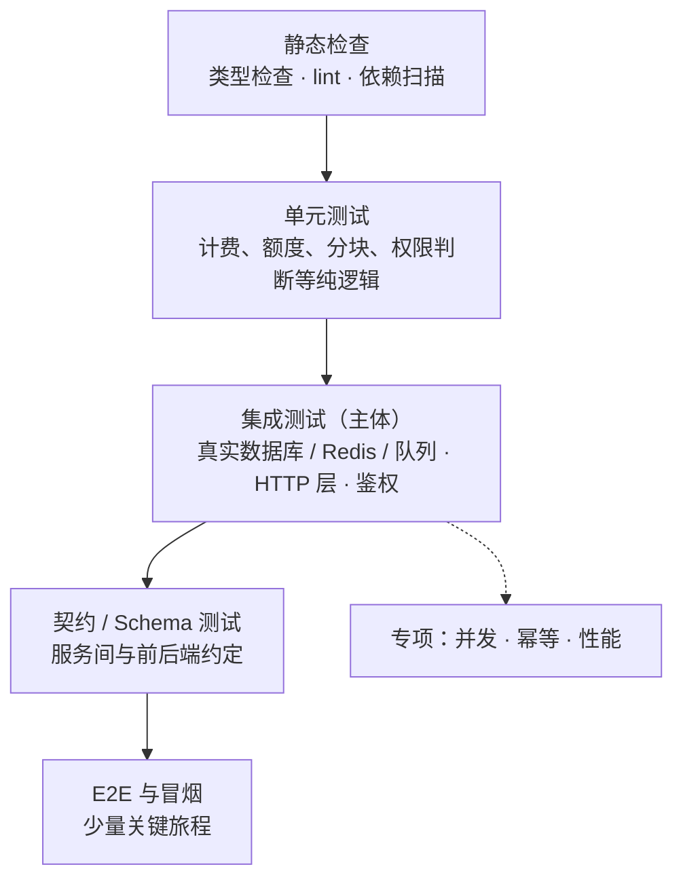
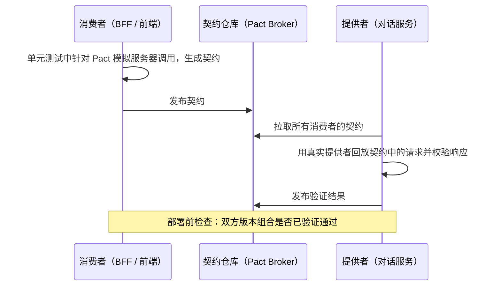
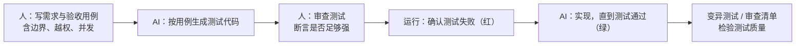

# 18 测试策略

> 本章目标：建立后端的**测试分层**判断，会用 **Testcontainers 跑真实依赖的集成测试**，能写出**暴露竞态与幂等缺陷**的测试，看懂压测报告；在 AI 写代码的工作流中，用**测试先行与变异测试**守住质量，而不是被"测试全绿"误导。
>
> 版本基线：JUnit 6（Spring Boot 4.0 默认，最低 Java 17）、Mockito 5、AssertJ 3.x、Testcontainers for Java 2.x、Vitest 4.x / Jest 30、pytest 9.x、pytest-asyncio 1.x。
>
> 边界：前端 E2E（Playwright 等）读者已熟悉，本章只讲与后端相关的部分；LLM 应用的效果评测见 [企业级 09 章第三节](../../企业级AI应用开发实战/09-LLMOps-可观测评测与AI网关.md#三评测量得准重点)；测试在流水线中的位置见 [16 章](./16-CICD与发布策略.md)。

---

## 一、测试的形状与投入

### 1.1 金字塔、奖杯与蜂巢

| 模型 | 提出者 | 主张 | 适合 |
|---|---|---|---|
| **测试金字塔** | Mike Cohn 提出，Martin Fowler 推广 | 大量单元测试，少量集成测试，极少 E2E | 业务规则复杂、领域逻辑多的系统 |
| **测试奖杯** | Kent C. Dodds | 静态检查打底，**集成测试为主体** | 前端与 BFF，前端读者可能更熟悉 |
| **测试蜂巢** | Spotify 工程团队 | 微服务中**以服务级集成测试为主**，细粒度单元测试很少 | 以 CRUD 和服务间协作为主的微服务 |

三种形状的分歧，本质是"**哪一层的测试性价比最高**"。对典型的 AI 应用后端，可以这样分配：



| 层 | 投入建议 | 说明 |
|---|---|---|
| 单元测试 | 集中在**有计算和分支的代码** | 计费、额度、文本分块、权限规则、状态机；没有逻辑的 Controller → Service → Repository 透传不值得单测 |
| 集成测试 | **主力**，每个接口至少覆盖成功、校验失败、越权三类 | 后端大部分 bug 出在 SQL、事务、序列化、配置上，只有真实依赖才能暴露 |
| 契约测试 | 多团队、多服务协作时引入 | 单体 + 自家前端可以用 OpenAPI Schema 测试代替 |
| E2E | 少量核心旅程 | 慢且脆弱，只覆盖"注册 → 对话 → 扣费"这类主链路 |
| 并发 / 幂等 | 涉及**钱、额度、库存**的代码必须有 | 普通测试永远不会自然暴露竞态 |
| 性能测试 | 上线前与大版本前 | 结合容量规划 |

### 1.2 测试替身：什么时候用，用哪种

> 📖 **测试替身（Test Double）**：测试中替代真实依赖的对象。按行为可分为 Stub（返回预设值）、Fake（真实行为的简化实现，如内存版仓库）、Mock（预设期望并验证调用）、Spy（包装真实对象并记录调用）。

| 依赖 | 推荐 | 原因 |
|---|---|---|
| 自己的数据库、Redis、队列 | **真实实例**（Testcontainers） | 你需要验证的正是 SQL、锁、事务这些行为 |
| 第三方 HTTP API（模型 API、支付、短信） | Stub / 本地模拟服务器（WireMock、MSW、respx） | 慢、收费、不稳定；但要模拟超时和错误 |
| 时间、随机数、UUID | 注入（`Clock`、种子） | 让测试可重复 |
| 同进程内的其他业务类 | **通常不替换** | 替换后测的只是"调用顺序"，不是行为 |

**过度 mock 是 AI 生成测试最常见的问题**：

```java
// 反例：把仓库也 mock 掉，测试只验证"代码调用了 save"
when(quotaRepo.findByUserId("u1")).thenReturn(Optional.of(new Quota("u1", 100)));
quotaService.deduct("u1", 30);
verify(quotaRepo).save(argThat(q -> q.balance() == 70));
// SQL 写错、条件更新缺失、并发超扣，这个测试统统发现不了；重构实现方式时它却会失败
```

判断标准：**测试应当在行为错误时失败，在行为不变的重构后通过**。大量 `verify(...)` 调用顺序的测试，往往两条都不满足。

---

## 二、单元测试：三栈写法

用一个计费函数作示例：按千 token 计价、向上取整到"分"，金额全程用整数，避免浮点误差。

**Java**（JUnit 6 + AssertJ）：

```java
class BillingCalculatorTest {
    private final BillingCalculator calc = new BillingCalculator(Map.of("model-a", new Price(2, 8)));  // 分 / 千 token

    @ParameterizedTest(name = "输入 {0} / 输出 {1} token → {2} 分")
    @CsvSource({"0,0,0", "1,0,1", "1000,0,2", "1500,500,7", "0,1000,8"})
    void 按千token计价并向上取整(long in, long out, long expectedFen) {
        assertThat(calc.costInFen("model-a", in, out)).isEqualTo(expectedFen);
    }

    @Test
    void 负数token直接拒绝() {
        assertThatThrownBy(() -> calc.costInFen("model-a", -1, 0))
            .isInstanceOf(IllegalArgumentException.class);
    }
}
```

只在外部边界使用 Mockito，内部依赖用 Fake：

```java
@ExtendWith(MockitoExtension.class)
class ChatServiceTest {
    @Mock LlmClient llm;                                     // 外部边界：mock
    InMemoryQuotaStore quota = new InMemoryQuotaStore();     // 内部依赖：fake

    @Test
    void 模型超时时退还预扣额度() {
        quota.set("u1", 1000);
        when(llm.complete(any())).thenThrow(new LlmTimeoutException());

        assertThatThrownBy(() -> new ChatService(llm, quota).chat("u1", "hi"))
            .isInstanceOf(LlmTimeoutException.class);
        assertThat(quota.get("u1")).isEqualTo(1000);         // 断言结果状态，而不是调用次数
    }
}
```

> ⚠️ **注意**：Mockito 5 默认使用 inline mock maker，运行时动态挂载 agent；在较新的 JDK 上会出现警告，未来版本将不再允许动态挂载。按 Mockito 文档在 Maven Surefire / Gradle 的测试 JVM 参数中显式配置 `-javaagent`。Spring Boot 4 中 `@MockBean` 已移除，改用 `@MockitoBean`。

**TypeScript**（Vitest；Jest 写法基本一致）：

```ts
describe('costInFen', () => {
  it.each([
    [0, 0, 0], [1, 0, 1], [1000, 0, 2], [1500, 500, 7], [0, 1000, 8],
  ])('输入 %i / 输出 %i token → %i 分', (input, output, expected) => {
    expect(costInFen('model-a', input, output)).toBe(expected);
  });

  it('负数 token 直接拒绝', () => {
    expect(() => costInFen('model-a', -1, 0)).toThrow(RangeError);
  });
});

it('模型超时时退还预扣额度', async () => {
  const quota = new InMemoryQuotaStore({ u1: 1000 });
  const llm = { complete: vi.fn().mockRejectedValue(new LlmTimeoutError()) };
  await expect(new ChatService(llm, quota).chat('u1', 'hi')).rejects.toThrow(LlmTimeoutError);
  expect(quota.get('u1')).toBe(1000);
});
```

**Python**（pytest）：

```python
@pytest.mark.parametrize(("inp", "out", "expected"), [
    (0, 0, 0), (1, 0, 1), (1000, 0, 2), (1500, 500, 7), (0, 1000, 8),
])
def test_cost_in_fen(inp, out, expected):
    assert cost_in_fen("model-a", inp, out) == expected

def test_negative_tokens_rejected():
    with pytest.raises(ValueError):
        cost_in_fen("model-a", -1, 0)
```

单元测试的几条硬要求：

- **边界值优先**：0、1、恰好等于阈值、阈值加一、负数、空字符串、超长输入
- **一个测试只验证一个行为**，测试名描述行为（"模型超时时退还预扣额度"），而不是方法名（`testChat2`）
- **不依赖执行顺序和共享可变状态**；不 `sleep`，时间通过 `Clock` 注入

---

## 三、集成测试：用真实的依赖

### 3.1 为什么不用 mock 或内存数据库

| 替代方案 | 会漏掉的问题 |
|---|---|
| mock Repository | SQL 本身是否正确、索引与约束、事务边界 |
| H2 / SQLite 代替 PostgreSQL | 方言差异（`ON CONFLICT`、`JSONB`、数组、`RETURNING`）、pgvector 等扩展、锁与隔离级别行为 |
| 内存 Map 代替 Redis | 过期、Lua 脚本原子性、序列化格式 |

> 🎯 **落地要点**：**测试用的数据库版本与生产一致**，并且用**与生产相同的迁移脚本**建表。这样集成测试同时验证了迁移脚本本身（[04 章](../L2-核心能力/04-数据库与数据建模.md)）。

### 3.2 Testcontainers：三栈示例

> 📖 **Testcontainers**：测试代码中启动一次性 Docker 容器（数据库、Redis、Kafka 等）的库，测试结束自动销毁。需要 CI 和本地有可用的 Docker 环境。

**Java**（Spring Boot 4 + Testcontainers 2.x，`@ServiceConnection` 自动把容器地址注入数据源配置）：

```java
// 依赖：org.testcontainers:testcontainers-postgresql、testcontainers-junit-jupiter、
//       org.springframework.boot:spring-boot-testcontainers（2.x 起模块名统一加 testcontainers- 前缀）
@SpringBootTest
@Testcontainers
class QuotaRepositoryIT {

    @Container
    @ServiceConnection
    static PostgreSQLContainer postgres = new PostgreSQLContainer("postgres:18");   // 2.x 包名为 org.testcontainers.postgresql

    @Autowired QuotaRepository repo;

    @Test
    void 余额不足时条件扣减返回0行() {
        repo.save(new Quota("u1", 5));
        assertThat(repo.deductIfEnough("u1", 10)).isZero();
        assertThat(repo.balanceOf("u1")).isEqualTo(5);
    }
}
```

> ⚠️ **注意**：Testcontainers for Java 2.0 改了模块坐标与包名，并移除了 JUnit 4 支持。AI 按旧资料生成的 `org.testcontainers:postgresql` 依赖、`org.testcontainers.containers.PostgreSQLContainer<?>` 写法，在新项目里要按迁移指南调整。

**TypeScript**（Vitest + `@testcontainers/postgresql`）：

```ts
let pg: StartedPostgreSqlContainer;
let db: Pool;

beforeAll(async () => {
  pg = await new PostgreSqlContainer('postgres:18').start();
  db = new Pool({ connectionString: pg.getConnectionUri() });
  await runMigrations(db);                       // 与生产相同的迁移
}, 60_000);

afterAll(async () => {
  await db.end();
  await pg.stop();
});

beforeEach(async () => {
  await db.query('TRUNCATE quotas, usage_records RESTART IDENTITY CASCADE');
});
```

**Python**（pytest + testcontainers-python）：

```python
@pytest.fixture(scope="session")
def engine():
    with PostgresContainer("postgres:18") as pg:
        url = pg.get_connection_url()
        alembic_upgrade_head(url)                # 与生产相同的迁移
        yield create_engine(url)

@pytest.fixture
def session(engine):
    with engine.connect() as conn:
        trans = conn.begin()
        s = Session(bind=conn, join_transaction_mode="create_savepoint")
        yield s                                  # 被测代码内部的 commit 只提交到保存点
        s.close()
        trans.rollback()                         # 每个测试结束整体回滚
```

### 3.3 测试数据管理与隔离

容器通常按测试类或整个测试会话启动一次（启动需要数秒），因此**测试之间必须隔离数据**：

| 策略 | 做法 | 优点 | 陷阱 |
|---|---|---|---|
| **事务回滚** | 每个测试包在事务里，结束时回滚（Spring 测试方法上的 `@Transactional`、上面的 Python fixture） | 快，零清理代码 | 见下方 |
| **清表** | 每个测试前 `TRUNCATE` | 行为与生产一致 | 表多时稍慢；不能并行跑共享库的测试 |
| **独立库 / schema** | 每个测试类或每个并行 worker 一个数据库 | 可并行 | 建库成本；用模板库加速 |
| **唯一数据** | 每个测试用随机前缀的用户、租户 | 可并行、无需清理 | 断言要限定在自己的数据范围内 |

> ⚠️ **注意**：**事务回滚策略会让一类 bug 隐身**：
> - 被测代码在**另一个线程或另一个事务**（`REQUIRES_NEW`、异步任务）中读不到测试事务里未提交的数据，测试结果与生产不一致
> - 数据从未真正提交，**提交时才触发的行为**（延迟约束检查、提交后回调、Outbox 发送）没有被测到
> - 并发测试在单个事务内毫无意义
>
> 涉及多事务、异步、并发的测试，改用清表或唯一数据策略。

### 3.4 外部 HTTP 依赖：模拟模型 API

模型 API 不应在常规测试中真实调用（收费、慢、结果不确定）。用本地模拟服务器返回**固定的流式响应**，并重点模拟异常：

| 栈 | 工具 |
|---|---|
| Java | WireMock（可作为 Testcontainers 模块运行） |
| TypeScript | MSW（前端熟悉的 Mock Service Worker，也支持 Node）、nock |
| Python | respx（httpx）、pytest-httpserver |

必测的异常场景：**连接超时、首字节超时、流式中途断开、429 限流、5xx、返回格式不符合预期**。这些正是线上级联故障的源头（[17 章案例四](./17-可观测性与线上排障.md)）。

---

## 四、API 测试与契约测试

### 4.1 HTTP 层的 API 测试

在进程内启动应用、通过 HTTP 层调用，验证路由、序列化、校验、错误模型与**鉴权**：

```java
// Java：MockMvc + spring-security-test
mockMvc.perform(get("/api/conversations/{id}", aliceConversationId).with(jwt().jwt(j -> j.subject("bob"))))
       .andExpect(status().isNotFound());              // 越权访问别人的资源
```

```ts
// TypeScript：Fastify inject，不占端口
const res = await app.inject({ method: 'GET', url: `/api/conversations/${aliceConvId}`, headers: authAs('bob') });
expect(res.statusCode).toBe(404);
```

```python
# Python：FastAPI TestClient
res = client.get(f"/api/conversations/{alice_conv_id}", headers=auth_as("bob"))
assert res.status_code == 404
```

> 🎯 **落地要点**：**越权测试是 AI 生成的接口最需要补的测试**。每个按 ID 访问资源的接口，至少有一个"用户 B 访问用户 A 的资源"的用例（[06 章](../L2-核心能力/06-认证授权与Web安全.md)）。AI 很少主动写这类测试，因为它通常只按"正常用户的正常操作"理解需求。

### 4.2 基于 OpenAPI 的 Schema 测试

如果接口有 OpenAPI 文档（契约优先见 [03 章](../L2-核心能力/03-API设计.md)），可以让工具**根据 Schema 自动生成大量输入**，检查服务是否返回 500、响应是否符合 Schema：

```bash
# Schemathesis：基于属性的 API 测试
schemathesis run http://localhost:8000/openapi.json -H "Authorization: Bearer $TEST_TOKEN"
```

它擅长发现 AI 代码中的边界缺陷：超长字符串导致 500、`null` 字段未处理、枚举外的值未校验、文档与实现不一致。

### 4.3 契约测试

> 📖 **消费者驱动契约（Consumer-Driven Contract）**：由调用方（消费者）把"我会发什么请求、期望什么响应"写成契约，提供方在自己的流水线中验证能否满足。代表工具 **Pact**。



| 方案 | 适合 | 成本 |
|---|---|---|
| OpenAPI + Schema 测试 | 单体或少量服务；接口由提供方主导 | 低 |
| **Pact 契约测试** | 多团队、多服务，消费者需要的字段各不相同 | 中：需要 Broker 与双方流水线配合 |
| 共享类型（tRPC、生成的客户端） | 前后端同仓、同语言 | 低，但仅限 TypeScript 等同栈场景 |

---

## 五、并发与幂等的测试方法

### 5.1 为什么普通测试发现不了竞态

单线程测试中，"读余额 → 判断 → 写余额"永远按顺序执行，读-改-写竞态（[08 章](../L2-核心能力/08-并发与可靠性.md)）**不会自然出现**。要暴露它，测试必须：

1. 使用**真实数据库**（锁、隔离级别是数据库的行为）
2. 让多个请求**真正同时**到达临界区（用栅栏同步出发）
3. 断言**不变量**（余额不为负、成功次数 × 单价 = 扣减总额），而不是单次返回值

### 5.2 并发扣减测试示例

```java
@Test
void 并发扣减不会超扣() throws Exception {
    repo.save(new Quota("u1", 100));
    int threads = 50;
    var start = new CountDownLatch(1);
    var pool = Executors.newFixedThreadPool(threads);
    var success = new AtomicInteger();
    var futures = new ArrayList<Future<?>>();

    for (int i = 0; i < threads; i++) {
        futures.add(pool.submit(() -> {
            start.await();                                   // 所有线程就位后同时出发
            if (quotaService.tryDeduct("u1", 10)) success.incrementAndGet();
            return null;
        }));
    }
    start.countDown();
    for (var f : futures) f.get(10, TimeUnit.SECONDS);       // 传播子线程中的异常

    assertThat(success.get()).isEqualTo(10);                 // 100 / 10，恰好 10 次成功
    assertThat(repo.balanceOf("u1")).isZero();               // 不变量：不超扣
}
```

用这个测试检验两种实现：

```java
// 反例：读-改-写。上面的测试会出现 success > 10 且余额为负（或丢失更新）
var q = repo.findByUserId(userId).orElseThrow();
if (q.balance() < amount) return false;
repo.save(q.withBalance(q.balance() - amount));
return true;

// 正例：条件更新，由数据库保证原子性
// UPDATE quotas SET balance = balance - :amount WHERE user_id = :uid AND balance >= :amount
return repo.deductIfEnough(userId, amount) == 1;
```

> ⚠️ **注意**：这个测试**不能**放在 `@Transactional` 测试方法里：子线程使用各自的连接与事务，看不到测试事务中未提交的初始数据。用清表策略。另外，一次通过不代表没有竞态，可以用 `@RepeatedTest` 重复执行，或在实现中可注入的位置人为插入延迟扩大竞态窗口。

TypeScript 中虽然是单线程，但多个 `await` 之间同样会交错，只要每个请求使用连接池中的不同连接，竞态一样存在：

```ts
it('并发扣减不会超扣', async () => {
  await seedQuota('u1', 100);
  const results = await Promise.all(Array.from({ length: 50 }, () => quotaService.tryDeduct('u1', 10)));
  expect(results.filter(Boolean)).toHaveLength(10);
  expect(await balanceOf('u1')).toBe(0);
});
```

### 5.3 幂等测试

同一个幂等键的请求**同时**到达两次（用户双击、网关重试），只能产生一次副作用（[03 章幂等键](../L2-核心能力/03-API设计.md)）：

```python
async def test_same_idempotency_key_charges_once(client, db):
    headers = {"Idempotency-Key": "k-123", **auth_as("u1")}
    r1, r2 = await asyncio.gather(
        client.post("/api/credits/purchase", json={"pack": "basic"}, headers=headers),
        client.post("/api/credits/purchase", json={"pack": "basic"}, headers=headers),
    )
    assert sorted([r1.status_code, r2.status_code]) in ([200, 200], [200, 409])   # 重放返回同一结果或冲突
    assert await count_charges(db, user_id="u1") == 1                              # 不变量：只扣一次
```

幂等测试的四个用例：**顺序重复、并发重复、同键不同参数（应拒绝）、首次请求失败后重试（应能成功）**。

---

## 六、性能测试

### 6.1 类型与工具

| 类型 | 目的 | 典型做法 |
|---|---|---|
| 负载测试 | 验证预期流量下是否达标 | 按预估峰值持续 10~30 分钟 |
| 压力测试 | 找到系统的极限与瓶颈 | 逐步加压直到错误率或延迟失控 |
| 尖峰测试 | 突发流量下能否扛住与恢复 | 瞬间放大数倍流量 |
| 稳定性测试（Soak） | 发现内存泄漏、连接泄漏 | 中等压力持续数小时 |

| 工具 | 脚本语言 | 特点 |
|---|---|---|
| **k6**（Grafana） | JavaScript | 前端读者上手最快，阈值可直接作为 CI 门禁 |
| **Gatling** | Java / Kotlin / Scala，另有 JS / TS SDK | 高并发效率高，报告详细，JVM 团队常用 |
| **Locust** | Python | 用 Python 代码描述用户行为，分布式压测简单 |

### 6.2 k6 示例

```js
import http from 'k6/http';
import { check } from 'k6';

export const options = {
  scenarios: {
    list_conversations: {
      executor: 'ramping-arrival-rate',          // 开放模型：按到达速率加压，而不是固定用户数
      startRate: 10, timeUnit: '1s', preAllocatedVUs: 200,
      stages: [{ target: 100, duration: '5m' }, { target: 100, duration: '10m' }],
    },
  },
  thresholds: {
    http_req_failed: ['rate<0.01'],
    http_req_duration: ['p(95)<500', 'p(99)<1500'],   // 不达标时进程以非零码退出，可作为 CI 门禁
  },
};

export default function () {
  const res = http.get(`${__ENV.BASE_URL}/api/conversations?limit=20`,
    { headers: { Authorization: `Bearer ${__ENV.TOKEN}` } });
  check(res, { 'status 200': (r) => r.status === 200 });
}
```

> 📖 **开放模型 vs 封闭模型**：封闭模型是固定数量的虚拟用户"收到响应才发下一个请求"，系统变慢时请求速率随之下降，会**掩盖延迟恶化**（协调遗漏问题）。开放模型按固定速率发请求，更接近真实流量。

### 6.3 读懂压测结果

| 指标 | 怎么看 |
|---|---|
| 吞吐量（RPS） | 随压力上升到某点后不再增长，即接近容量上限 |
| P95 / P99 延迟 | **拐点**比绝对值更重要：吞吐量还在涨、P99 已陡增，说明某处开始排队 |
| 错误率 | 区分超时、5xx、连接拒绝，分别对应不同瓶颈 |
| 服务端资源 | 同时看 CPU、内存、连接池等待、线程池活跃数、GC、数据库慢查询（[17 章](./17-可观测性与线上排障.md)） |
| 压测机自身 | 压测机 CPU 打满或带宽打满时，结果反映的是压测机的瓶颈 |

### 6.4 容量规划与 LLM 场景

**利特尔法则**：`并发数 = 吞吐量 × 平均响应时间`。

- 普通接口：200 RPS × 0.05s = 10 个并发请求
- LLM 流式对话：20 RPS × 30s = **600 个并发连接**

LLM 场景的吞吐量不高，但**并发连接数极高**，瓶颈通常在线程池、连接池、文件描述符、反代连接数、模型 API 的并发与速率限额，而不是 CPU。容量估算方法见 [11 章](../L3-架构与分布式/11-系统设计案例.md)。

### 6.5 压测环境注意事项

- **不要压真实的模型 API**：费用高、会触发限流、延迟不受控。用模拟服务器返回**真实分布的延迟与流式节奏**（如首 token 1~3 秒，每 30ms 一个 chunk）
- **数据量接近生产**：空表上的查询总是很快，索引问题只有在百万级数据上才暴露
- **环境隔离**：不与其他测试共享数据库；不在生产环境压测，除非有专门的压测流量标记与隔离方案
- **预热**：JVM 的 JIT、连接池、缓存需要预热，前几分钟的数据不计入结果
- **一次只改一个变量**：调参后对比要在相同的数据、相同的脚本下进行

---

## 七、E2E 与冒烟测试的边界

| | E2E 测试 | 冒烟测试 |
|---|---|---|
| 目的 | 验证完整用户旅程在集成环境中可用 | 验证**刚部署的这个环境**基本可用 |
| 时机 | 合并后或发布前，在 staging 运行 | **每次部署后立即**运行，失败即回滚（[16 章](./16-CICD与发布策略.md)） |
| 范围 | 关键旅程（注册 → 创建知识库 → 上传 → 提问 → 扣费） | 3~10 个关键接口：登录、核心读接口、一次最小的模型调用 |
| 数据 | 通过 API 准备测试数据，测试后清理 | 专用测试账号，只读或可安全重复的写操作 |

后端需要关注的几点：

- **健康检查不等于冒烟测试**：`/health` 返回 200 只说明进程活着，不说明数据库迁移成功、密钥正确、模型 API 可达
- **测试数据通过 API 或专用种子脚本准备**，不要直接改数据库绕过业务逻辑
- E2E 失败时，借助 traceId 从浏览器一路查到后端日志（[17 章第八节](./17-可观测性与线上排障.md)），而不是只看截图

---

## 八、AI 写代码时代的测试策略

### 8.1 先写测试，再让 AI 实现



测试先行在 AI 时代的价值比以前更大：

- **测试是给 AI 的精确规格**：比自然语言描述更不容易被误解
- **防止 AI "修改测试让它通过"**：先确认测试是红的、审查过的，实现阶段禁止 AI 修改测试文件（可在 Agent 的规则文件或 hook 中约束）
- **审查重点从实现转移到用例**：几十行用例比几百行实现更容易判断是否覆盖了需求

### 8.2 让 AI 写测试的陷阱

| 陷阱 | 表现 | 对策 |
|---|---|---|
| **测试迎合实现** | 先有实现再让 AI 补测试，AI 读实现后把"实际输出"写成"期望值"，bug 被固化为预期 | 期望值来自需求而非实现；关键用例的期望值由人给出 |
| **断言过弱** | `expect(result).toBeDefined()`、`assert response.status_code == 200` 就结束 | 断言具体的值、状态变化和副作用 |
| **过度 mock** | 所有依赖都 mock，只验证调用顺序 | 内部依赖用真实或 Fake，只在外部边界 mock |
| **只测快乐路径** | 没有越权、并发、超时、空值、超长输入 | 用例清单中强制包含这几类 |
| **吞掉失败** | `try { ... } catch {}` 包住断言，或把失败用例标为 `skip` | 审查时搜索 `skip`、`only`、空 `catch` |
| **快照滥用** | 用快照代替断言，快照更新时没人细看 | 后端响应用显式断言或 Schema 校验 |

```ts
// 反例：AI 生成的"测试"，几乎不可能失败
it('should deduct quota', async () => {
  const result = await quotaService.tryDeduct('u1', 10);
  expect(result).toBeDefined();
});

// 正例：断言结果、状态变化与边界
it('余额恰好等于扣减额时成功，余额归零', async () => {
  await seedQuota('u1', 10);
  expect(await quotaService.tryDeduct('u1', 10)).toBe(true);
  expect(await balanceOf('u1')).toBe(0);
});
it('余额不足时失败，余额不变', async () => {
  await seedQuota('u1', 9);
  expect(await quotaService.tryDeduct('u1', 10)).toBe(false);
  expect(await balanceOf('u1')).toBe(9);
});
```

### 8.3 变异测试：检验测试本身的质量

> 📖 **变异测试（Mutation Testing）**：工具自动对源码做微小修改（把 `>=` 改成 `>`、删除一行调用、把 `true` 改成 `false`），每个修改称为一个**变异体**，然后运行测试。测试失败称为"杀死"变异体；测试仍然通过说明**这处代码改错了也没有测试能发现**。

以上面的扣减为例：把 `balance >= amount` 变异为 `balance > amount`，如果没有"余额恰好等于扣减额"这个用例，变异体就会存活，暴露出边界未被测试。

| 栈 | 工具 | 常用命令 |
|---|---|---|
| Java | **PIT**（pitest），JUnit 5 / 6 需加 `pitest-junit5-plugin` | `mvn org.pitest:pitest-maven:mutationCoverage` |
| TypeScript | **StrykerJS**，有官方 Vitest / Jest runner | `npx stryker init`、`npx stryker run` |
| Python | **mutmut** | `mutmut run`、`mutmut results` |

使用建议：

- 变异测试很慢，**只对核心模块运行**（计费、额度、权限、状态机），或只对 PR 中改动的文件运行
- 关注**存活的变异体清单**而不是分数本身，逐个判断是缺用例还是等价变异（改了也不影响行为）
- 特别适合检验 **AI 生成的测试**：覆盖率 100% 但变异分数很低，说明测试只是"执行了代码"，没有"检查结果"

### 8.4 覆盖率的正确用法

- 覆盖率是**发现未测试代码的探测器**，不是质量指标。覆盖率低说明一定缺测试，覆盖率高不说明测试有效
- 设置**增量覆盖率**门槛（本次 PR 改动的代码），比全局覆盖率门槛更有意义
- 不追求 100%：为了数字补的测试通常断言很弱，还会增加重构成本
- 把覆盖率报告当作**审查辅助**：看核心分支（错误处理、权限拒绝、边界条件）是否被覆盖

### 8.5 与 LLM 应用评测的区别

| | 软件测试 | LLM 应用评测 |
|---|---|---|
| 对象 | 确定性代码 | 非确定性的模型输出 |
| 判定 | 断言精确相等或满足条件 | 打分（规则、LLM-as-Judge、人工），看通过率与分布 |
| 失败含义 | 有 bug | 质量下降，需要和基线对比 |
| 运行方式 | 每次提交，必须全部通过 | 改 prompt / 模型 / 检索策略时运行，与基线比较 |

两者都需要：围绕 LLM 的**确定性代码**（工具参数校验、计费、权限、流式协议、重试逻辑）用本章的软件测试方法；**模型输出质量**用评测方法，见 [企业级 09 章第三节](../../企业级AI应用开发实战/09-LLMOps-可观测评测与AI网关.md#三评测量得准重点)。

---

## 九、CI 中的测试分层与提速

| 阶段 | 运行内容 | 时间目标 |
|---|---|---|
| 本地提交前 | 格式化、lint、受影响的单元测试 | 秒级 |
| PR | 类型检查、全部单元测试、集成测试（Testcontainers）、Schema / 契约测试、增量覆盖率 | 10 分钟以内 |
| 合并主干后 | 构建镜像、部署 staging、E2E | 30 分钟以内 |
| 每次部署后 | 冒烟测试，失败自动回滚 | 几分钟 |
| 每晚 / 每周 | 性能测试、稳定性测试、核心模块变异测试、全量 Schema 模糊测试 | 不限 |

提速手段：

- **并行与分片**：测试按文件或按耗时分片到多个 job；各分片使用独立的数据库或唯一数据，避免互相干扰
- **容器复用**：同一测试进程内所有测试共享一个容器（会话级 fixture、静态 `@Container`），而不是每个测试启动一个
- **依赖缓存**：缓存 Maven / npm / pip 依赖与 Docker 镜像层（[16 章](./16-CICD与发布策略.md)）
- **只跑受影响的部分**：monorepo 中用 Nx、Turborepo 等工具按依赖图选择要测试的包
- **治理不稳定测试（flaky test）**：记录失败率，隔离并限期修复；**不允许自动重试掩盖问题**，重试通过的测试也要上报

> ⚠️ **注意**：不稳定的测试会迅速摧毁团队对测试的信任，最终所有人习惯性地点"重新运行"。并发、时间、执行顺序、共享数据是不稳定的四大来源，正好对应本章强调的隔离原则。

---

## 十、AI 代码审查清单

### 测试设计

- [ ] 有计算或分支的业务逻辑（计费、额度、权限、状态机）都有单元测试，且覆盖边界值
- [ ] 🔴 测试的期望值来自需求，而不是照抄实现的输出
- [ ] 🔴 断言检查具体值、状态变化与副作用，没有只断言 `toBeDefined()` / 状态码 200 就结束的测试
- [ ] 只在外部边界（模型 API、支付、短信）使用 mock，内部依赖使用真实实现或 Fake
- [ ] 测试名描述行为；测试之间无执行顺序依赖与共享可变状态
- [ ] 🔴 没有 `skip` / `only` / 空 `catch` 吞掉的失败；没有为了让测试通过而修改测试期望

### 集成测试

- [ ] 🔴 涉及 SQL 的代码由连接真实数据库（与生产同版本）的测试覆盖，而不是 mock Repository 或用 H2 / SQLite 代替
- [ ] 测试库通过生产相同的迁移脚本建表
- [ ] 测试数据隔离策略明确；涉及多事务、异步、并发的测试没有使用事务回滚策略
- [ ] 模型 API 的超时、流式中断、429、5xx 都有测试
- [ ] Testcontainers 依赖坐标与包名与所用主版本一致

### API 与契约

- [ ] 🔴 每个按 ID 访问资源的接口都有越权用例（用户 B 访问用户 A 的资源）
- [ ] 每个接口覆盖成功、参数校验失败、未认证三类用例
- [ ] 有 OpenAPI 文档的服务运行 Schema 测试，响应与文档一致
- [ ] 多服务协作时，服务间约定有契约测试或 Schema 校验

### 并发与幂等

- [ ] 🔴 涉及余额、额度、库存的写操作有并发测试，断言不变量（不超扣、总额守恒）
- [ ] 🔴 幂等接口覆盖顺序重复、并发重复、同键不同参数三类用例
- [ ] 并发测试使用栅栏同步出发，并收集子线程 / Promise 中的异常

### 性能

- [ ] 压测不调用真实模型 API，模拟服务器按真实分布返回延迟与流式节奏
- [ ] 压测数据量接近生产，阈值（P95 / P99 / 错误率）明确并作为门禁
- [ ] LLM 场景按利特尔法则估算并发连接数，并验证连接池、线程池、文件描述符上限

### 工程化

- [ ] PR 阶段的测试在 10 分钟内完成；更慢的测试移到合并后或定时任务
- [ ] 部署后有冒烟测试，且失败能触发回滚
- [ ] 不稳定的测试被记录与隔离，没有用自动重试掩盖
- [ ] 核心模块定期运行变异测试，存活变异体有人跟进

---

## 本章小结

- 后端测试以**集成测试为主体**：大部分 bug 出在 SQL、事务、序列化与鉴权上，只有真实依赖才能暴露
- 单元测试集中在**有计算和分支的逻辑**，边界值优先；mock 只用于外部边界，**过度 mock 的测试既抓不到 bug 又阻碍重构**
- 用 **Testcontainers** 启动与生产同版本的数据库，并用生产迁移建表；**事务回滚策略会隐藏多事务、异步与并发问题**
- **越权测试**是 AI 生成的接口最常缺失的测试；Schema 测试与契约测试守住接口约定
- 并发与幂等测试要用**真实数据库 + 同步出发 + 断言不变量**
- 压测用开放模型、不压真实模型 API；LLM 场景的瓶颈在**并发连接数**而非 CPU
- AI 时代：**先写测试再让 AI 实现**；警惕测试迎合实现与断言过弱，用**变异测试**检验测试质量；覆盖率只是探测器

## 练习

1. 为"额度扣减"写出读-改-写与条件更新两种实现，用 Testcontainers 和本章 5.2 的并发测试验证前者失败、后者通过；再用 `@RepeatedTest` 或循环执行 50 次，观察前者的失败比例
2. 让 AI 为你的一个已有服务补写单元测试，然后运行变异测试（PIT / StrykerJS / mutmut），列出存活的变异体，逐个判断是测试缺失还是等价变异，并补齐用例
3. 为对话接口搭建一个模拟模型 API（首 token 延迟 1~3 秒、每 30ms 输出一个 chunk、5% 概率中途断开），编写集成测试覆盖超时与断流，再用 k6 以开放模型压测，找出系统的并发连接上限及瓶颈所在
4. 为你的 API 服务的所有"按 ID 访问资源"接口生成越权测试用例清单，并实现其中至少 5 个
