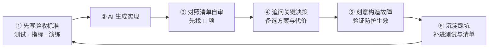
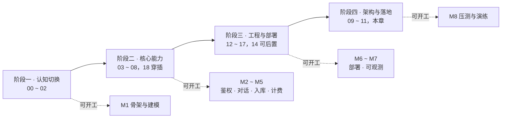
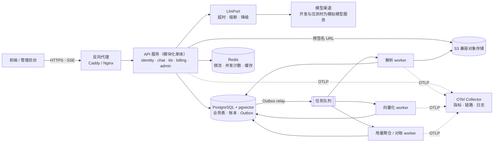
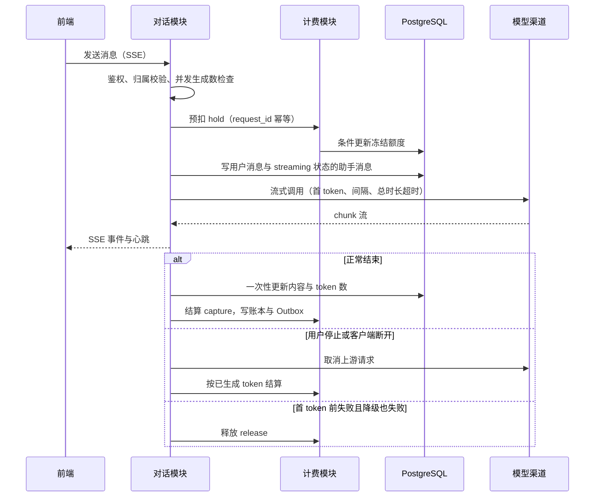

# 19 学习路线与实战项目

> 本章目标：把 00~18 章串成一条可执行的路线：按**四个阶段**推进，用"**AI 写、自己审**"的方法练习；通过一个贯穿式的 **AI 全栈实战项目**（8 个里程碑，每个都有量化验收与必做故障演练）把知识落到代码上；最后给出按审查场景组织的 **AI 后端代码审查总清单**与可直接粘贴的**自审提示词模板**。
>
> 本章不引入新知识点，清单与验收要求均来自前面各章，每条标注来源。AI 特有部分（RAG 检索、LLM tracing、提示注入）分别见 [企业级 07](../../企业级AI应用开发实战/07-企业级RAG落地.md)、[09](../../企业级AI应用开发实战/09-LLMOps-可观测评测与AI网关.md)、[10 章](../../企业级AI应用开发实战/10-安全权限与上线清单.md)；企业级系列的三个 AI 项目见 [企业级 11 章](../../企业级AI应用开发实战/11-实战项目方案.md)，可以与本章项目对接。

---

## 一、学习方法：用 AI 写，自己审

AI 让"写出来"的成本趋近于零，瓶颈转移到**判断**（[README 第一节](../README.md#一为什么用-ai-写代码之后后端反而更要学)）。学习方法随之改变：不追求手写熟练度，而追求**认出问题的速度与把握**。

### 1.1 学习闭环



- **第①步**：先写测试再让 AI 实现，是防止"测试迎合实现"最直接的手段（[18 章第八节](../L4-工程与部署/18-测试策略.md#八ai-写代码时代的测试策略)）
- **第③步**：审查顺序沿用 00 章的三个问题：**状态在哪、信了谁、失败怎么办**
- **第⑥步**：踩过的坑要变成可执行的东西（测试用例、架构约束、清单条目），复盘的改进项同理（[17 章第七节](../L4-工程与部署/17-可观测性与线上排障.md#七事故复盘)）

### 1.2 三个刻意练习

| 练习 | 做法 | 练的能力 |
|---|---|---|
| **让 AI 解释关键决策** | 生成代码后追问：事务边界、超时值、重试策略、索引、缓存失效分别怎么定的，有哪些备选，各自代价是什么 | 识别"看起来合理但站不住"的决策；AI 给不出依据的数值（超时、池大小）通常是随手写的 |
| **先自己定位，再问 AI** | 故障出现时先用 15 分钟按 17 章方法定位，写下假设与证据，再把日志交给 AI，对比两份结论 | 排障直觉；避免把 AI 的第一个猜测当作根因 |
| **刻意构造故障** | 每实现一个防护机制，就构造一次它要防的故障：并发脚本、`kill -9`、SIGTERM、Toxiproxy 注入延迟、模拟模型返回 503 | 确认防护真的会触发；"代码里写了"不等于"线上会生效" |

追问决策的提示词示例：

```text
不要修改代码。列出这段实现中的关键决策点（事务边界、锁、超时、重试、幂等、索引、缓存失效），
每项说明：当前选择、至少一个备选方案、当前选择在并发 / 重试 / 部分失败下的风险。
无法从代码中确认的标注"需确认"，不要猜测。
```

> ⚠️ **注意**：在同一会话里让 AI 审查自己刚写的代码，确认偏差很重，它倾向于为已有实现辩护。审查时换新会话或换模型，并使用第五节的提示词模板，要求每个"通过"都给出代码证据。

### 1.3 每章的使用方式

1. 先读**本章小结**与**审查清单**，明确这一章要你认得出什么
2. 带着清单读正文，看不懂的 🔴 项重点读对应小节
3. 在本章项目的对应里程碑中完成章末练习
4. 用清单审查自己或 AI 写的代码，把漏掉的项记下来，下一轮优先检查

---

## 二、分阶段学习路线

### 2.1 四个阶段总览



阶段顺序与 README 的标准路径一致：**L1 → L2 → L4 → L3 → L5**。L4 放在 L3 之前，是因为先把服务稳定跑在线上，架构取舍才有真实体感。

### 2.2 阶段一：认知切换（约 1 周）

- **目标**：建立服务端心智模型（共享进程、不可信客户端、多实例、一切会失败），能读懂三栈的同一个接口
- **章节**：[00](../L1-认知切换/00-前端到后端的思维切换.md)、[01](../L1-认知切换/01-网络与HTTP-服务端视角.md)、[02](../L1-认知切换/02-后端语言与框架选型.md)
- **产出物**：一张"一次 SSE 对话请求"的全链路图，标出每一跳的职责与超时；任选一栈跑通一个带超时与统一错误处理的最小接口（[02 章第二节](../L1-认知切换/02-后端语言与框架选型.md#二同一个接口的三栈对照)）
- **自测标准**：
  - 能解释 Python `async def` 里调用 `requests.get` 会发生什么，以及 Node 中 `readFileSync` 的同类问题
  - 能说明 HTTP 客户端为什么必须全局复用，keep-alive 空闲超时为什么要"接收方大于发送方"
  - 00~02 章清单中的每条 🔴 项，都能讲出"不这样做线上会出什么事"

### 2.3 阶段二：核心能力（约 3 周）

- **目标**：能审查 AI 写的接口、SQL、缓存、鉴权、异步与并发代码；这是全系列投入最大、回报最高的阶段
- **章节**：[03](../L2-核心能力/03-API设计.md)、[04](../L2-核心能力/04-数据库与数据建模.md)、[05](../L2-核心能力/05-缓存与Redis.md)、[06](../L2-核心能力/06-认证授权与Web安全.md)、[07](../L2-核心能力/07-异步任务与消息队列.md)、[08](../L2-核心能力/08-并发与可靠性.md)；[18](../L4-工程与部署/18-测试策略.md) 第一~五节穿插阅读
- **产出物**：项目 M1~M5；一组可复用的测试模板：越权矩阵、并发扣减、幂等三类用例
- **自测标准**：
  - 拿到一段 AI 生成的"扣费 + 调模型"接口，10 分钟内指出至少三类问题（先查后写、事务内调 LLM、缺幂等键、缺超时）
  - 自己写的并发测试在"先读后写"的错误实现上**稳定失败**，在条件更新实现上稳定通过
  - 能写出没有 Outbox 时"写库成功、消息丢失"的具体触发时序

### 2.4 阶段三：工程与部署（约 2 周）

- **目标**：能把服务独立部署上线，出问题时能从日志、指标、链路定位根因
- **章节**：[12](../L4-工程与部署/12-Linux与排障命令.md)、[13](../L4-工程与部署/13-Docker与Compose.md)、[15](../L4-工程与部署/15-部署架构与云.md)、[16](../L4-工程与部署/16-CICD与发布策略.md)、[17](../L4-工程与部署/17-可观测性与线上排障.md)；[14](../L4-工程与部署/14-Kubernetes核心与实践.md) 按需
- **产出物**：项目 M6~M7；至少覆盖"对话超时""入库积压""对账不平"三种告警的 runbook；一份按模板写的故障复盘
- **自测标准**：
  - 一天内从空服务器到 HTTPS 上线（含反代、证书自动续期、数据库不暴露公网）
  - 能口述 SIGTERM 之后的每一步，以及 systemd / Compose / K8s 中需要配对的时间参数
  - 给定一个 traceId，5 分钟内找到对应的日志、链路与慢 SQL

### 2.5 阶段四：架构与落地（约 2 周）

- **目标**：能评估方案、做出有依据的技术决策，并用压测与演练证明系统达到设计目标
- **章节**：[09](../L3-架构与分布式/09-架构模式.md)、[10](../L3-架构与分布式/10-分布式系统基础.md)、[11](../L3-架构与分布式/11-系统设计案例.md)、本章
- **产出物**：项目 M8；设计文档（估算表 + 架构图 + "第一版不做什么"）与至少 3 份 ADR；用第五节清单完成一次全量自审
- **自测标准**：
  - 45 分钟内完成一道系统设计题：需求澄清、数量级估算、高层设计、深挖一个瓶颈、说明取舍与演进条件（[11 章第一节](../L3-架构与分布式/11-系统设计案例.md#一系统设计方法论)）
  - 对 AI 给出的架构方案，能指出其中的不可逆决策与缺失的估算依据
  - 第五节清单中的每条 🔴 项，都能在自己的项目里找到对应的实现或测试

### 2.6 三种路径的周计划

**🚀 两周速成**（每天约 4~5 小时，目标：上线一个可靠的最小版本）

| 天 | 阅读 | 项目 | 当天检查点 |
|---|---|---|---|
| 1 | 00；01 第一~五节 | 建仓库，Compose 启动 PG 与 Redis | 能画出请求全链路 |
| 2 | 01 第六~七节；03 | M1：错误模型、配置校验、健康检查 | 未知异常只返回 traceId |
| 3 | 04 第一~八节 | M1：建表迁移、会话与消息接口 | 消息分页查询走索引 |
| 4 | 04 余下各节；06 第一~二节 | M2：登录与会话 | Cookie 属性与 CSRF 防护正确 |
| 5 | 06 第五~六节 | M2：资源级授权、租户隔离 | 越权矩阵全部通过 |
| 6 | 复习 01 第六~七节 | M3：SSE、停止生成、三类超时、模拟模型服务 | 断开后上游被取消 |
| 7 | 07 | M4 简化版：单队列串行入库、幂等、错误分类 | 重复投递不产生重复切片 |
| 8 | 11 第四节 | M5 简化版：预扣 / 结算 / 释放与并发测试 | 并发 100 次扣减零误差 |
| 9 | 13、15 | M6：Dockerfile、单机 Compose + Caddy、HTTPS | SIGTERM 后在途 SSE 正常结束 |
| 10 | 17 | M7 简化版：结构化日志、RED 指标、一条告警 | 凭 traceId 串起一次请求 |

速成路径跳过了 05、08、18 与 L3。上线后的第 3~4 周应补读 **08 与 18**：速成版里写下的超时、重试与并发测试，在这两章才有完整依据。

**📘 标准路径**（8 周，每周约 10~12 小时）

| 周 | 阅读 | 项目 | 周末自测 |
|---|---|---|---|
| 1 | 00、01、02 | M1 启动：选栈、仓库结构、ADR-0001 | 阶段一自测 |
| 2 | 03、04；18 第一~三节 | M1 完成 | 迁移在 Testcontainers 中从零执行 |
| 3 | 05、06 | M2 | 越权矩阵 100% 通过 |
| 4 | 07、08；18 第四~五节 | M3 | 三类超时与取消验证通过 |
| 5 | 11 第三~四节；18 第八节 | M4、M5 | 阶段二自测 |
| 6 | 12、13、15 | M6：单机或 PaaS 上线 | SIGTERM 与滚动发布验收 |
| 7 | 16、17；14 选读 | M6 流水线、M7 | 阶段三自测 |
| 8 | 09、10、11 | M8；设计文档、ADR、全量自审 | 阶段四自测 |

M4、M5 工作量最大，各占一周时整体顺延到 9~10 周，仍在 README 建议的"一到两个月"范围内。

**🎯 目标导向**

| 目标 | 章节顺序 | 两周安排 | 对应里程碑 | 完成标志 |
|---|---|---|---|---|
| 补后端短板，能审查 AI 写的服务端代码 | 00 → 03 → 04 → 06 → 08 → 18 | 第 1 周 00、03、04；第 2 周 06、08、18 | M1、M2、M5 | 越权、并发、幂等三类测试都能独立写出 |
| 自己部署运维一个线上服务 | 12 → 13 → 15 → 16 → 17 | 第 1 周 12、13、15；第 2 周 16、17 | M6、M7（后端可用简化版） | 从空服务器到带告警的 HTTPS 服务 |
| 进入大厂 / 云原生环境 | 13 → 14 → 16 → 17 → 10 | 第 1 周 13、14；第 2 周 16、17、10 | M6 的 K8s 版、M7、M8 | Gateway API 入口、HPA 按在途流伸缩、滚动发布零中断 |
| 提升架构与方案评审能力 | 08 → 09 → 10 → 11 | 第 1 周 08、09；第 2 周 10、11 | 为整个项目写设计文档与 ADR，评审 M4、M5 方案 | 方案附估算表、取舍说明与复审条件 |

---

## 三、贯穿项目：带知识库的 AI 对话应用

### 3.1 需求与范围

一个面向团队的 AI 对话产品：成员基于团队知识库对话，按 token 计费并扣减团队钱包。它覆盖了本系列几乎所有章节，也是 AI 应用最常见的形态。

| 模块 | 功能 |
|---|---|
| 用户与租户 | 注册登录；团队即租户，成员角色 owner / admin / member；团队 API Key |
| 对话 | 会话列表与历史；流式回答；停止生成、重新生成；按套餐选择模型；回答可引用知识库 |
| 知识库 | 上传文件与导入 URL；异步解析、切片、向量化；进度与失败原因；按文档权限检索 |
| 计费与额度 | 团队钱包；按实际 token 预扣与结算；今日用量；TPM 限流；每日对账 |
| 管理后台 | 租户与成员管理；充值与额度调整（只写账本）；用量报表；入库任务与死信重放；审计日志 |

非功能目标（示例值，按自己的环境调整）：服务自身引入的首 token 开销 P95 ≤ 200 ms；普通接口 P95 < 500 ms；对话成功率 SLO 99.9%；越权与资金类错误为 0。

**第一版不做**：多 Agent 与工具调用、多模态、真实支付渠道（用管理后台充值代替）、微服务拆分、多区域部署。写明"不做什么"本身就是设计评审的检查项（[11 章清单](../L3-架构与分布式/11-系统设计案例.md#七ai-代码审查清单设计评审)）。

> 🎯 **落地要点**：前端用自己熟悉的框架即可，本章不展开。后端可以单栈完成，也可以采用"**主栈 + Python AI 服务**"的组合（[02 章 5.2](../L1-认知切换/02-后端语言与框架选型.md#52-ai-应用的常见组合)）。无论哪种，动手前先写一份 ADR 记录选择与理由（[09 章 8.3](../L3-架构与分布式/09-架构模式.md#83-adr-模板与示例)）。

### 3.2 总体架构



- API 服务是**模块化单体**：五个模块按业务分包，模块之间只经公开接口调用，用架构约束测试守住边界（[09 章第七节](../L3-架构与分布式/09-架构模式.md#七守住依赖方向防止被-ai-写乱)）
- worker 与 API 共用代码仓库和镜像，以不同入口启动；解析 worker 单独限制内存，在隔离环境中处理不可信文件
- 模型调用全部经过 `LlmPort`，计费全部经过 `BillingPort`。M3 先用桩实现计费，M5 再替换为真实的预扣结算，这正是端口在演进中的价值

### 3.3 推荐技术栈组合

三套组合任选其一实现后端；具体版本以各章版本基线为准。

| 层 | Java 组合 | TypeScript 组合 | Python 组合 |
|---|---|---|---|
| Web 框架 | Spring Boot（Spring MVC + 虚拟线程） | Fastify 或 NestJS | FastAPI + Uvicorn |
| 校验与契约 | Bean Validation + OpenAPI 生成 | Zod + 由 schema 生成 OpenAPI | Pydantic（FastAPI 自动生成 OpenAPI） |
| 数据访问 | Spring Data JPA 或 MyBatis | Prisma 或 Drizzle | SQLAlchemy 2.x（异步） |
| 迁移 | Flyway / Liquibase | Prisma Migrate / Drizzle Kit | Alembic |
| 鉴权 | Spring Security，对接 OIDC IdP | Better Auth，或对接 OIDC IdP | Authlib 对接 OIDC IdP，授权自写 |
| 任务队列 | JobRunr，或 Spring + RabbitMQ | BullMQ（Redis） | Celery / Dramatiq |
| 韧性 | Resilience4j + Spring `@Retryable` | cockatiel | tenacity |
| 模型调用 | Spring AI（封装在 `LlmPort` 后） | Vercel AI SDK | 厂商 SDK 或 LangChain |
| 测试 | JUnit + Testcontainers + WireMock | Vitest + Testcontainers + MSW | pytest + Testcontainers + respx |
| 可观测 | OTel Java Agent + Micrometer | OTel Node 自动埋点 | `opentelemetry-instrument` |
| 架构约束 | ArchUnit / Spring Modulith | dependency-cruiser | import-linter |
| 文档解析 | 调用 Python 解析 worker | 调用 Python 解析 worker | 原生（工具选型见 [企业级 07 章 3.2](../../企业级AI应用开发实战/07-企业级RAG落地.md#32-解析工具选型)） |

公共基础设施：PostgreSQL + pgvector、Redis（或 Valkey）、S3 兼容对象存储、Caddy 或 Nginx、OTel Collector + Prometheus + Grafana（链路与日志后端按 17 章选型）、k6、Toxiproxy，用一份 `compose.yaml` 统一启动（[13 章第七节](../L4-工程与部署/13-Docker与Compose.md#七docker-compose本地编排一个-ai-应用)）。

> ⚠️ **注意**：自建对象存储不要默认选 MinIO，其社区版已停止维护（[10 章第八节](../L3-架构与分布式/10-分布式系统基础.md#八对象存储)）。本地开发可用其他 S3 兼容实现，生产优先云厂商对象存储，并逐项验证所用 API。

### 3.4 里程碑总览

| 里程碑 | 主题 | 建议用时 | 依赖 | 一句话验收 |
|---|---|---|---|---|
| M1 | 骨架与数据建模 | 3~4 天 | — | 迁移从零可执行，错误模型与配置校验到位 |
| M2 | 鉴权与多租户 | 3~4 天 | M1 | 越权矩阵 100% 通过 |
| M3 | 流式对话与超时降级 | 4~5 天 | M2 | 断开即取消上游，三类超时与降级可验证 |
| M4 | 异步入库流水线 | 4~5 天 | M2 | 重复投递与 worker 崩溃不产生重复切片 |
| M5 | 计费与并发扣减 | 4~5 天 | M3 | 并发 100 次扣减零误差，账本与余额一致 |
| M6 | 容器化与部署上线 | 3~4 天 | M3~M5 | SIGTERM 后在途 SSE 正常结束，坏版本自动回滚 |
| M7 | 可观测与告警 | 2~3 天 | M6 | 凭 traceId 跨 API 与 worker 定位问题 |
| M8 | 压测与故障演练 | 3 天 | M7 | 达标的压测报告与完整的演练记录 |

一次对话请求是 M3 与 M5 的交汇点，完整时序如下：



以下各里程碑的量化指标均为**建议目标**，在本地或测试环境用模拟模型服务验证；数值可按自己的硬件调整，但每项都必须有可重复执行的验证方式。

### 3.5 M1 骨架与数据建模

**要实现**：五个业务模块的骨架；统一错误模型；配置启动校验；liveness 与 readiness 两个端点；结构化日志与请求 ID；全部业务表的迁移（租户、用户、会话、消息、知识库、文档、切片、账户、预扣、账本、用量、Outbox、幂等键）；`compose.yaml` 一键启动依赖；架构约束测试接入 CI。

**涉及章节**：[02 第四节](../L1-认知切换/02-后端语言与框架选型.md#四项目结构与构建工具)、[03 第三节](../L2-核心能力/03-API设计.md#三统一错误模型)、[04 第三节](../L2-核心能力/04-数据库与数据建模.md#三实战建模ai-对话应用)、[09 第二节](../L3-架构与分布式/09-架构模式.md#二代码组织分层六边形与整洁架构)、[17 第二节](../L4-工程与部署/17-可观测性与线上排障.md#二结构化日志)

**关键设计决策**：

- 主键 UUIDv7、时间 `timestamptz`、金额与单价用 `bigint` 最小单位、每张业务表带 `tenant_id`
- 目录按业务模块组织而不是按技术分层，模块之间只经公开接口
- 单栈还是"主栈 + Python AI 服务"：写成 ADR-0001，附复审条件
- 错误码表与 Problem Details 格式在 M1 定下，后续里程碑只加不改

| 验收项 | 目标 | 验证方式 |
|---|---|---|
| 迁移 | 空库从零执行成功，测试库用同一套迁移建表 | CI 中用 Testcontainers 启动 PG 后执行 |
| 错误响应 | 未知异常的响应只含错误码与 traceId | 集成测试注入异常并断言响应体 |
| 配置 | 缺少任一必需配置时启动失败，退出码非 0 | 删除一个环境变量后启动 |
| 查询计划 | 100 万条消息下，会话消息分页查询没有 `Seq Scan` | 灌数据后 `EXPLAIN ANALYZE` |
| 架构约束 | chat 模块引用 billing 内部类时 CI 失败 | 故意写一个违规引用 |

**必做故障演练**：让 AI 生成"把 `title` 改名为 `name`"的迁移，检查它是否直接 `RENAME COLUMN`，再按 expand-contract 改写（[16 章第五节](../L4-工程与部署/16-CICD与发布策略.md#五数据库迁移如何随发布执行)）；数据库未就绪时启动服务，确认 readiness 失败而 liveness 正常。

### 3.6 M2 鉴权与多租户

**要实现**：注册登录（Session + HttpOnly Cookie，或对接 OIDC IdP）；团队、成员与角色；团队 API Key；所有资源接口的归属校验；登录限流；关键操作审计日志；可选的 RLS 兜底。

**涉及章节**：[06 第五节](../L2-核心能力/06-认证授权与Web安全.md#五授权模型与资源级权限检查重点)、[06 第六节](../L2-核心能力/06-认证授权与Web安全.md#六多租户隔离)、[06 第七节](../L2-核心能力/06-认证授权与Web安全.md#七密码与-api-key)、[03 第四节](../L2-核心能力/03-API设计.md#四输入校验与输出-dto)、[05 第七节](../L2-核心能力/05-缓存与Redis.md#七限流)

**关键设计决策**：

- 默认 Session + Cookie；前后端跨域部署时要同时评估 CSRF 与 CORS（[15 章 5.3](../L4-工程与部署/15-部署架构与云.md#53-前后端同域-vs-跨域部署)）
- 登录、MFA、找回密码优先用托管服务或成熟库，精力放在资源级授权（[06 章第四节](../L2-核心能力/06-认证授权与Web安全.md#四自建还是托管身份服务)）
- 共享表 + `tenant_id` 为主、RLS 兜底；越权统一返回 404，不泄露资源是否存在
- "加载资源 + 校验权限"合成仓储层的一个方法，而不是每个 Controller 各写一遍

| 验收项 | 目标 | 验证方式 |
|---|---|---|
| 越权矩阵 | 所有按 ID 访问的接口 × {他租户成员、同租户无权限成员、已移除成员} 均返回 404 / 403，通过率 100% | 参数化集成测试，按路由表生成用例 |
| 默认拒绝 | 未显式声明公开的路由，无凭据访问全部返回 401 | 遍历路由表的测试 |
| 令牌校验 | 篡改签名、`alg=none`、过期、`aud` 错误的令牌全部 401 | 单元测试 |
| API Key | 库中只有哈希与前缀；吊销后立即失效（有缓存时 ≤ 1 分钟） | 查库 + 集成测试 |
| 登录限流 | 同账号 1 分钟内第 6 次失败返回 429 与 `Retry-After` | 集成测试 |
| RLS（若启用） | 去掉查询中的 `tenant_id` 条件后仍查不到他租户数据 | 故意改坏查询 |

**必做故障演练**：只告诉 AI"加一个把会话导出为 Markdown 的接口"，不提权限要求，看越权矩阵能否自动拦下生成的代码；用低权限账号在批量接口里夹带他人资源 ID。

### 3.7 M3 流式对话与超时降级

**要实现**：会话 CRUD；发送消息并以 SSE 流式返回；停止生成、重新生成；按套餐路由模型；每用户并发生成数限制；一个 OpenAI 兼容的**模拟模型服务**（可配置首 token 延迟、chunk 间隔、输出长度、按比例返回 429 / 503、中途断流），后续测试与压测都依赖它。

**涉及章节**：[01 第六节](../L1-认知切换/01-网络与HTTP-服务端视角.md#六sse-与-websocket-的服务端实现)、[01 第七节](../L1-认知切换/01-网络与HTTP-服务端视角.md#七超时链路)、[08 第三节](../L2-核心能力/08-并发与可靠性.md#三超时)、[08 第五节](../L2-核心能力/08-并发与可靠性.md#五熔断舱壁与降级)、[11 第二节](../L3-架构与分布式/11-系统设计案例.md#二案例-aai-对话服务)；AI 事件模型与断线恢复见 [企业级 04 章](../../企业级AI应用开发实战/04-AI交互层-流式协议与生成式UI.md)

**关键设计决策**：

- 第一版直连（断开即中止）；需要断线续传时再做生成与连接解耦（[11 章 2.5](../L3-架构与分布式/11-系统设计案例.md#25-关键难点与方案)）
- 用户消息先落库；助手消息开始时插入 `streaming` 记录，结束时一次性更新，**不按 chunk 写库**
- 首 token 超时可以透明切换渠道；chunk 间隔超时与总时长上限直接终止并标记失败；**输出开始后不切换模型**
- 只对 429、5xx 与超时降级，4xx 参数错误不降级
- 计费先走 `BillingPort` 桩实现，接口按 M5 的预扣 / 结算 / 释放设计

| 验收项 | 目标 | 验证方式 |
|---|---|---|
| 流式透传 | 经反向代理访问，首个 SSE 事件与模拟模型首 token 的时间差 ≤ 200 ms，chunk 逐个到达 | `curl -N` + 服务端日志时间戳 |
| 取消 | 客户端断开或点击停止后 ≤ 1 秒，模拟服务记录到上游连接关闭 | 模拟服务计数 |
| 首 token 超时 | 主渠道首 token 超时后切换备用渠道，用户请求成功 | 模拟服务注入延迟 |
| 中途失败 | chunk 间隔超时后消息标记 `failed`，保留已生成内容 | 模拟服务中途停发 |
| 写库次数 | 一次 500 token 的回答，消息表写入 ≤ 3 次 | SQL 日志计数 |
| 并发限制 | 每用户第 N+1 个并发生成返回 429；进程异常退出后计数在 TTL 内恢复 | 集成测试 |
| 建流鉴权 | 用他人 `conversation_id` 建流，在发出任何事件之前返回 404 | 越权矩阵扩展 |

**必做故障演练**：用 Toxiproxy 在服务与模拟模型之间注入 30 秒延迟和中途断连；让模拟模型持续返回 503，确认熔断打开后快速失败，且熔断前单个用户请求在模拟服务端产生的调用次数等于"单层重试次数 + 1"，没有 SDK 与业务代码的重试叠加（[08 章第四节](../L2-核心能力/08-并发与可靠性.md#四重试)）。

### 3.8 M4 异步入库流水线

**要实现**：预签名直传与上传后校验；确认上传后写 `documents` 与 Outbox；解析与向量化两类 worker；切片携带 `document_version`、`embedding_model` 与权限元数据；新版本写完后切换 `active_version`；进度查询（轮询或 SSE）；错误分类与手动重试；死信与管理后台重放；URL 导入防 SSRF；带权限前置过滤的检索接口。

**涉及章节**：[07 第四节](../L2-核心能力/07-异步任务与消息队列.md#四投递语义与幂等消费重点)、[07 第六节](../L2-核心能力/07-异步任务与消息队列.md#六事务性发件箱-outbox重点)、[07 第八节](../L2-核心能力/07-异步任务与消息队列.md#八任务状态建模进度取消与超时)、[10 第八节](../L3-架构与分布式/10-分布式系统基础.md#八对象存储)、[11 第三节](../L3-架构与分布式/11-系统设计案例.md#三案例-b知识库入库流水线)、[06 8.3](../L2-核心能力/06-认证授权与Web安全.md#83-ssrfai-应用的高发区)；切片与检索策略见 [企业级 07 章](../../企业级AI应用开发实战/07-企业级RAG落地.md#五检索策略)，权限过滤见 [企业级 07 第六节](../../企业级AI应用开发实战/07-企业级RAG落地.md#六权限过滤重点)

**关键设计决策**：

- 队列复用已有基础设施；Postgres 足够时用 pg-boss / Procrastinate 可让"写业务数据 + 入队"同事务（[07 章 2.3](../L2-核心能力/07-异步任务与消息队列.md#23-选型路径)）
- 幂等键 `(document_id, version)`：重跑时先删除该版本切片再写入
- 429 / 5xx / 超时重试；加密、格式不支持、文件损坏直接失败并给出可读原因
- embedding 调用全局令牌桶限速，队列按租户轮转，单租户批量导入不独占 worker

| 验收项 | 目标 | 验证方式 |
|---|---|---|
| 重复投递 | 同一入库消息投递 3 次，切片数与投递 1 次一致 | 集成测试 |
| worker 崩溃 | 向量化阶段 `kill -9` worker，任务在可见性超时后被重新领取并完成，无重复切片 | 手动演练 + 查库 |
| 永久错误 | 加密 PDF 直接 `failed`，`error_code` 可读，重试次数为 0 | 集成测试 |
| 原子切换 | 文档更新期间持续检索，结果只来自单一版本 | 并发脚本 |
| 租户公平 | 租户 A 导入 1,000 个文档期间，租户 B 新上传的单个文档在 2 分钟内开始处理 | 压测脚本 |
| SSRF | `127.0.0.1`、`169.254.169.254`、内网域名、302 跳转到内网地址全部拒绝 | 参数化测试 |
| 检索权限 | 低权限账号检索，越权召回率 = 0 | 低权限测试账号 |

**必做故障演练**：在"业务写库成功、消息发出之前"杀掉进程，确认 Outbox 让消息最终仍被投递；调小 Redis 的 `maxmemory`，确认队列所在实例为 `noeviction`，写满时报错而不是静默丢任务。

### 3.9 M5 计费与并发扣减

**要实现**：`accounts` / `holds` / `ledger_entries` 三表；预扣、结算、释放与过期清理；所有资金操作带幂等键；结算写账本并经 Outbox 驱动 `usage_daily` 聚合；今日用量按账户时区切分；按 TPM 的 Redis Lua 令牌桶；每日对账任务；管理后台充值与调整只通过 `adjust` 账本记录完成。把 M3 的 `BillingPort` 桩替换为真实实现。

**涉及章节**：[11 第四节](../L3-架构与分布式/11-系统设计案例.md#四案例-c计费与额度系统)、[08 第一节](../L2-核心能力/08-并发与可靠性.md#一应用层竞态)、[04 第六节](../L2-核心能力/04-数据库与数据建模.md#六事务与隔离级别)、[05 7.4](../L2-核心能力/05-缓存与Redis.md#74-ai-应用按-token-限流与额度扣减)、[03 第七节](../L2-核心能力/03-API设计.md#七幂等键idempotency-key)、[18 第五节](../L4-工程与部署/18-测试策略.md#五并发与幂等的测试方法)

**关键设计决策**：

- 原子条件更新（`WHERE balance - frozen >= ?` 并检查影响行数）优先于 `FOR UPDATE`；分布式锁不作为正确性保证（[08 章 1.7](../L2-核心能力/08-并发与可靠性.md#17-选择指南)）
- 账本是事实来源、余额是快照，两者同事务写入；账本只追加，并记录价格快照
- 过期预扣被释放后才到达的结算照常入账：宁可小额透支，不可漏记账
- 余额不足与频率超限使用不同错误码（[03 章第十节](../L2-核心能力/03-API设计.md#十限流与配额的-api-表现)）

| 验收项 | 目标 | 验证方式 |
|---|---|---|
| 并发扣减 | 栅栏同时发起 100 次扣减，最终余额 = 初始余额 − 实际扣费总和，误差为 0 | 真实 PG 上的并发测试 |
| 防超扣 | 余额只够 10 次时并发预扣 100 次：恰好 10 次成功，`frozen ≤ balance` 始终成立 | 并发测试 + 约束 |
| 幂等 | 同一 `request_id` 顺序重复、并发重复均只扣一次；同键不同参数返回 422 | 幂等三类用例 |
| 崩溃恢复 | 预扣后杀进程，清理任务在 `expires_at` 后释放冻结；之后到达的结算仍入账 | 演练 + 查账本 |
| 对账 | `SUM(ledger.amount) = balance` 差异为 0；token 计量与模拟服务计数误差 ≤ 1% | 每日对账任务输出 |
| 时区 | 北京时间早上 7 点查询的"今日用量"不含前一天数据 | 固定时钟的单元测试 |
| TPM | 超出 TPM 返回 429 与 `Retry-After`，错误码与余额不足不同 | 集成测试 |

**必做故障演练**：让 AI 把扣减改成"先读余额、再写回"，确认并发测试稳定失败，抓不到就说明测试本身不合格；在数据库里直接改一个账户余额，确认对账任务发出告警。

### 3.10 M6 容器化与部署上线

**要实现**：多阶段 Dockerfile（非 root、exec 形式、固定基础镜像）；生产部署（单机 Compose + Caddy / Nginx 或 PaaS，进阶用托管 K8s）；HTTPS 自动续期与过期监控；优雅停机；GitHub Actions 流水线：lint → 测试 → 构建 → 扫描 → 推送 → staging → 冒烟 → prod；OIDC 云凭据；迁移在部署前单独执行；关键功能挂 Feature Flag。

**涉及章节**：[12](../L4-工程与部署/12-Linux与排障命令.md)、[13](../L4-工程与部署/13-Docker与Compose.md)、[15](../L4-工程与部署/15-部署架构与云.md)、[16](../L4-工程与部署/16-CICD与发布策略.md)、[08 第七节](../L2-核心能力/08-并发与可靠性.md#七优雅停机)；K8s 版本见 [14](../L4-工程与部署/14-Kubernetes核心与实践.md)

**关键设计决策**：

- 部署形态按运维能力选：验证期 PaaS 或单机 Compose，数据库尽早换托管（[15 章 1.3](../L4-工程与部署/15-部署架构与云.md#13-按阶段的推荐路径)）
- 前后端同域部署，绕开 CORS 与跨站 Cookie 问题
- 流式路径单独关闭缓冲、加长读超时，普通 API 保持短超时
- 停机时间逐层配对：宽限期 ≥ preStop + 应用停机超时 + 余量；超过宽限期的长流靠"通知重连"，而不是无限延长宽限期

| 验收项 | 目标 | 验证方式 |
|---|---|---|
| 镜像安全 | 非 root 运行；镜像历史中无密钥；高危且可修复的漏洞为 0 | 镜像扫描 + `docker history` |
| 优雅停机 | SIGTERM 后 readiness 立即失败、不再接新流；短于宽限期的在途 SSE 完整结束，更长的收到重连事件；退出码为 0 | 模拟 20 秒长回答期间停机 |
| 滚动发布 | 发布期间持续压测，非流式接口错误率为 0，在途流无静默截断，无重复计费 | k6 + 账本核对 |
| 网络暴露 | 从公网无法连通数据库、Redis、`/metrics` 与调试端口 | 外部 `nc` / `curl` |
| 发布一致 | staging 与 prod 部署同一镜像 digest | 部署记录 |
| 自动回滚 | 冒烟失败后自动回滚到上一个成功的 digest，耗时 ≤ 5 分钟 | 故意发布坏版本 |
| 迁移 | "重命名列"拆成多次发布，每一步新旧代码都正常运行 | 演练记录 |

**必做故障演练**：发布一个启动即崩溃的版本，验证冒烟失败与自动回滚；对同一个在途长回答分别执行 `kill -TERM` 与 `kill -9`，对比客户端表现与账本记录（[12 章 1.2](../L4-工程与部署/12-Linux与排障命令.md#12-进程与信号)）。

### 3.11 M7 可观测与告警

**要实现**：JSON 结构化日志，traceId 自动注入并跨队列传播；RED / USE 指标与业务指标（活跃流数、首 token 延迟直方图、队列积压与最老消息等待、预扣失败率、对账差异）；OTel 导出到 Collector；看板叠加发布事件；SLO 与燃烧率告警，紧急告警链接 runbook；前端 `traceparent` 接入。LLM 专属的 trace 与评测见 [企业级 09 章第二节](../../企业级AI应用开发实战/09-LLMOps-可观测评测与AI网关.md#二tracing看得见)、[第三节](../../企业级AI应用开发实战/09-LLMOps-可观测评测与AI网关.md#三评测量得准重点)。

**涉及章节**：[17 全章](../L4-工程与部署/17-可观测性与线上排障.md)、[12 第五节](../L4-工程与部署/12-Linux与排障命令.md#五日志查看)、[07 第九节](../L2-核心能力/07-异步任务与消息队列.md#九ai-代码审查清单)

**关键设计决策**：

- 对话内容与文档内容不进通用日志；需要回溯时进入有权限控制的 LLM trace 平台
- 指标标签只用有界维度（路由模板、模型、状态码）
- 告警基于用户可见症状（错误率、首 token 延迟、积压时长），而不是 CPU

| 验收项 | 目标 | 验证方式 |
|---|---|---|
| 链路贯通 | 一次"上传文档 → 入库 → 对话引用"能看到 API、worker 与 SQL 的 span | 链路后端查询 |
| 定位时效 | 给定用户报错的 traceId，5 分钟内定位到出错的一跳 | 计时演练 |
| 脱敏 | 用测试密钥与 Token 调用接口后，全部日志中检索命中数为 0 | 日志检索 |
| 基数 | 指标中没有用户 ID、会话 ID、traceId、原始 URL 标签 | 检查 `/metrics` 输出 |
| 告警 | 注入 5% 错误率后燃烧率告警在预期窗口内触发并带 runbook；恢复后自动解除 | 故障注入 |

**必做故障演练**：在一个接口的事务里加入模拟的 10 秒外部调用，压出连接池耗尽，只凭看板与链路定位根因，按模板写一份复盘（[17 章 6.3](../L4-工程与部署/17-可观测性与线上排障.md#63-案例二数据库连接池耗尽)）。

### 3.12 M8 压测与故障演练

**要实现**：k6 压测脚本（开放模型）；模拟模型按真实分布返回延迟与流式节奏；用利特尔法则估算并发连接数并核对各层上限；30 分钟以上的稳定性测试；把各里程碑的演练整理成固定清单，纳入发布前检查。

**涉及章节**：[18 第六节](../L4-工程与部署/18-测试策略.md#六性能测试)、[11 第一节](../L3-架构与分布式/11-系统设计案例.md#一系统设计方法论)、[08 9.2](../L2-核心能力/08-并发与可靠性.md#92-混沌工程)、[17 第六节](../L4-工程与部署/17-可观测性与线上排障.md#六排障方法论)

**关键设计决策**：

- 压测不调用真实模型 API；模拟服务首 token 1~3 秒、约每 30 ms 一个 chunk（[18 章 6.5](../L4-工程与部署/18-测试策略.md#65-压测环境注意事项)）
- 先估算再压测：例如 30 RPS × 15 秒 ≈ 450 个并发流，据此核对连接池、fd、反代连接数与 worker 数
- 一次只改一个变量，每次调参都保留前后对比

| 验收项 | 目标 | 验证方式 |
|---|---|---|
| 普通接口 | 会话列表 100 RPS 持续 10 分钟：P95 < 500 ms，P99 < 1,500 ms，错误率 < 1% | k6 thresholds 作为门禁 |
| 流式对话 | 500 个并发流：服务引入的首 token 开销 P95 ≤ 200 ms，流中断率 < 0.1% | k6 + 服务端指标 |
| 稳定性 | 中等压力 30 分钟以上，内存、fd、连接池占用无持续上涨 | 看板趋势 |
| 瓶颈报告 | 找到第一个瓶颈并给出调整前后对比 | 压测报告 |
| 演练清单 | 下表每一项都有执行记录与结论 | 演练记录 |

| 故障 | 注入方式 | 预期表现 | 来源 |
|---|---|---|---|
| 模型 429 / 503 风暴 | 模拟服务按比例返回 | 熔断打开、降级生效、无重试风暴 | M3 |
| 模型变慢 | Toxiproxy 注入延迟 | 首 token 超时触发切换，连接池不被占满 | M3 |
| 客户端批量断开 | 压测中随机断开连接 | 上游被取消，按已生成 token 结算 | M3、M5 |
| worker 被杀 | `kill -9` | 任务被重新领取，无重复切片 | M4 |
| Redis 不可用 | 停止 Redis 容器 | 缓存回源有并发上限；限流与额度检查按设计 fail closed 或降级 | M5 |
| 数据库重启 | 重启 PG 容器 | 获取连接快速失败，恢复后无连接泄漏 | M1 |
| 压测中发布 | 滚动更新 | 在途流按停机设计结束，无重复计费 | M6 |
| 日志盘写满 | 填充日志目录 | 告警先于服务故障触发 | M7 |

### 3.13 交付物

- 代码仓库：README 中写清一条命令启动本地环境、一条命令跑全部测试
- 设计文档（估算表、架构图、"第一版不做什么"）与 ADR；越权、并发、幂等测试报告；压测报告；演练记录；复盘；runbook
- 作品表达沿用 [企业级 11 章第五节](../../企业级AI应用开发实战/11-实战项目方案.md#五作品集与面试表达) 的结构；进阶时可以把企业级项目三的 AI 网关接在本项目的 `LlmPort` 之后

---

## 四、延伸阅读

只列确定存在且与本系列直接相关的资料。书籍偏原理，框架细节以官方文档为准。

| 书 / 资料 | 作者 | 对应章节 | 读什么 |
|---|---|---|---|
| 《数据密集型应用系统设计》（Designing Data-Intensive Applications；第 2 版 2026 年 3 月由 O'Reilly 出版） | Martin Kleppmann；第 2 版合著者 Chris Riccomini | 04、07、10 | 复制、分区、事务、一致性与流处理，L2 / L3 的理论底座 |
| Site Reliability Engineering（中文版《SRE：Google 运维解密》）、The Site Reliability Workbook、Building Secure and Reliable Systems | Google | 08、17 | SLO、错误预算、告警、On-call、复盘的源头；三本均可在 Google SRE 官网免费在线阅读 |
| 《凤凰架构：构建可靠的大型分布式系统》 | 周志明 | 09、10、14 | 中文原创，覆盖架构演进、分布式事务、服务治理与云原生；[icyfenix.cn](https://icyfenix.cn/) 免费在线阅读 |
| Release It!（第 2 版） | Michael Nygard | 08 | 稳定性模式与反模式：超时、熔断、舱壁 |
| Building Microservices（第 2 版） | Sam Newman | 09 | 何时拆、怎么拆，以及不拆的理由 |
| Fundamentals of Software Architecture | Mark Richards、Neal Ford | 09 | 架构特性、架构风格与权衡方法 |
| Database Internals | Alex Petrov | 04、10 | 存储引擎与分布式数据库的内部原理 |
| [Use The Index, Luke](https://use-the-index-luke.com/)（在线书） | Markus Winand | 04 | 面向开发者的 SQL 索引与执行计划 |
| API Design Patterns | JJ Geewax | 03 | 资源设计、分页、长任务等 API 模式 |
| Unit Testing Principles, Practices, and Patterns | Vladimir Khorikov | 18 | 什么值得测、mock 的边界、测试的抗重构性 |
| Observability Engineering | Charity Majors、Liz Fong-Jones、George Miranda | 17 | 以高基数事件为中心的可观测实践 |
| Systems Performance（第 2 版） | Brendan Gregg | 12 | Linux 性能分析方法论，USE 方法的出处 |

在线资料与官方文档：

| 类别 | 资料 |
|---|---|
| 框架 | [Spring Boot](https://docs.spring.io/spring-boot/)、[NestJS](https://docs.nestjs.com/)、[Fastify](https://fastify.dev/docs/latest/)、[FastAPI](https://fastapi.tiangolo.com/) 官方文档 |
| 数据与中间件 | [PostgreSQL 文档](https://www.postgresql.org/docs/)、[Redis 文档](https://redis.io/docs/latest/) |
| 部署与运维 | [Docker 文档](https://docs.docker.com/)、[Kubernetes 文档](https://kubernetes.io/docs/home/)、[The Twelve-Factor App](https://12factor.net/zh_cn/) |
| 可观测与测试 | [OpenTelemetry 文档](https://opentelemetry.io/docs/)、[Grafana k6 文档](https://grafana.com/docs/k6/latest/)、[Testcontainers](https://testcontainers.com/) |
| 安全 | [OWASP Top 10](https://owasp.org/Top10/)、[OWASP Cheat Sheet Series](https://cheatsheetseries.owasp.org/)、[OWASP ASVS](https://owasp.org/www-project-application-security-verification-standard/) |
| 架构与可靠性 | [AWS Builders' Library](https://aws.amazon.com/builders-library/)、[Azure 云设计模式](https://learn.microsoft.com/zh-cn/azure/architecture/patterns/)、[martinfowler.com](https://martinfowler.com/)、[Jepsen](https://jepsen.io/)（分布式数据库一致性测试报告） |
| 系统设计练习 | [system-design-primer](https://github.com/donnemartin/system-design-primer) |

> 🎯 **落地要点**：官方文档优先于书和博客。AI 生成的代码出现"看起来对、版本不对"的问题时（废弃 API、默认值变化），以当前版本的官方文档为准（[02 章清单](../L1-认知切换/02-后端语言与框架选型.md#六ai-代码审查清单)）。

---

## 五、AI 后端代码审查总清单

### 5.1 使用方式

- 本清单从 00~18 章的审查清单中去重合并而来，按**审查场景**而不是按章节组织，共 10 组；每项末尾是来源章节，展开细节回到原章
- 🔴 是"出现即阻断"项，作为合并门槛；其余为重要项，不满足时需要说明理由
- 按改动类型挑选分组：改接口看 5.2 与 5.5，改计费看 5.3、5.7，改部署配置看 5.9。**鉴权与安全（5.5）每次都看**
- 上线评审时与 [企业级 10 章上线清单](../../企业级AI应用开发实战/10-安全权限与上线清单.md#八上线-checklist) 合并使用：本清单管通用后端，那份管 AI 特有风险

### 5.2 接口与契约

- [ ] 🔴 所有入参经 schema 校验，并拒绝或剔除未声明字段（`.strict()`、`extra="forbid"`、`forbidNonWhitelisted`）（[02](../L1-认知切换/02-后端语言与框架选型.md#六ai-代码审查清单)、[03](../L2-核心能力/03-API设计.md#十一ai-代码审查清单)）
- [ ] 🔴 没有把请求体直接传给 ORM 的 `create` / `update`；响应不直接返回 ORM 实体，`passwordHash`、`tenantId`、内部成本等字段不出现在响应中（[03](../L2-核心能力/03-API设计.md#十一ai-代码审查清单)、[06](../L2-核心能力/06-认证授权与Web安全.md#十一ai-代码审查清单)）
- [ ] 🔴 未知异常的响应只含错误码与 `traceId`，不含 `e.message`、堆栈、SQL、内网地址与上游原始报错；服务端异常返回 5xx 而不是包装成 200（[02](../L1-认知切换/02-后端语言与框架选型.md#六ai-代码审查清单)、[03](../L2-核心能力/03-API设计.md#十一ai-代码审查清单)）
- [ ] 🔴 没有带副作用的 `GET` 接口（[03](../L2-核心能力/03-API设计.md#十一ai-代码审查清单)、[06](../L2-核心能力/06-认证授权与Web安全.md#十一ai-代码审查清单)）
- [ ] 🔴 扣费、支付、创建订单等接口支持幂等键，或有业务唯一约束兜底（[03](../L2-核心能力/03-API设计.md#十一ai-代码审查清单)、[11](../L3-架构与分布式/11-系统设计案例.md#七ai-代码审查清单设计评审)）
- [ ] 🔴 排序字段经过白名单映射，没有拼接进 SQL；64 位整数 ID 在 JSON 中以字符串传输（[03](../L2-核心能力/03-API设计.md#十一ai-代码审查清单)、[10](../L3-架构与分布式/10-分布式系统基础.md#十ai-代码审查清单架构评审)）
- [ ] 🔴 Webhook 接收方对原始请求体验签、常量时间比较、校验时间戳并按事件 ID 去重（[03](../L2-核心能力/03-API设计.md#十一ai-代码审查清单)）
- [ ] 字符串、数组、文件、prompt 长度与 `limit` 都有上限；大表列表用 keyset 分页且排序键含唯一列；时间为带时区的 ISO 8601，金额不是浮点数（[00](../L1-认知切换/00-前端到后端的思维切换.md#七ai-代码审查清单)、[03](../L2-核心能力/03-API设计.md#十一ai-代码审查清单)）
- [ ] 全局异常处理覆盖业务、校验、未知三类，统一为 Problem Details + 稳定字符串错误码；状态码语义正确（`201` / `202` / `204`，`401` 与 `403` 区分），`429` 带 `Retry-After`，额度耗尽与频率超限错误码不同（[02](../L1-认知切换/02-后端语言与框架选型.md#六ai-代码审查清单)、[03](../L2-核心能力/03-API设计.md#十一ai-代码审查清单)、[05](../L2-核心能力/05-缓存与Redis.md#十ai-代码审查清单)、[08](../L2-核心能力/08-并发与可靠性.md#十ai-代码审查清单)）
- [ ] 幂等键按用户 / 租户隔离、校验请求指纹、处理中返回 409、有过期清理，"完成标记"与业务写入同事务；没有删除、重命名字段或改变语义，否则走新版本或废弃流程（[03](../L2-核心能力/03-API设计.md#十一ai-代码审查清单)）

### 5.3 数据与事务

- [ ] 🔴 时间列用 `timestamptz`（MySQL 统一 UTC）；金额与 token 单价不用 `float` / `double`（[04](../L2-核心能力/04-数据库与数据建模.md#十四ai-代码审查清单)、[11](../L3-架构与分布式/11-系统设计案例.md#七ai-代码审查清单设计评审)）
- [ ] 🔴 多租户应用的每张业务表都有 `tenant_id`，所有查询都带上它（[04](../L2-核心能力/04-数据库与数据建模.md#十四ai-代码审查清单)、[06](../L2-核心能力/06-认证授权与Web安全.md#十一ai-代码审查清单)）
- [ ] 🔴 事务内没有 LLM 调用、HTTP 调用、文件上传、发消息等外部 I/O，采用"预占 → 事务外调用 → 结算"（[02](../L1-认知切换/02-后端语言与框架选型.md#六ai-代码审查清单)、[04](../L2-核心能力/04-数据库与数据建模.md#十四ai-代码审查清单)、[17](../L4-工程与部署/17-可观测性与线上排障.md#九ai-代码审查清单)）
- [ ] 🔴 原生 SQL 全部参数化（含 `$queryRawUnsafe`、f-string、MyBatis `${}`），动态列名走白名单（[04](../L2-核心能力/04-数据库与数据建模.md#十四ai-代码审查清单)、[06](../L2-核心能力/06-认证授权与Web安全.md#十一ai-代码审查清单)）
- [ ] 🔴 批量更新 / 删除的条件不可能因参数缺失（`undefined`、动态 SQL 全空）而变成全表操作（[04](../L2-核心能力/04-数据库与数据建模.md#十四ai-代码审查清单)）
- [ ] 🔴 迁移没有直接 `RENAME COLUMN`、删除仍被引用的列、对大表直接改类型；破坏性变更按 expand-contract 拆成多次发布，`DROP` 与重命名经过逐行确认（[04](../L2-核心能力/04-数据库与数据建模.md#十四ai-代码审查清单)、[16](../L4-工程与部署/16-CICD与发布策略.md#九ai-代码审查清单)）
- [ ] 🔴 大表建索引用 `CREATE INDEX CONCURRENTLY`，且该迁移不在事务中执行（[04](../L2-核心能力/04-数据库与数据建模.md#十四ai-代码审查清单)）
- [ ] 🔴 Prisma `$transaction` / TypeORM `transaction` 回调内全部使用 `tx` / `manager`，没有混用外层客户端（[04](../L2-核心能力/04-数据库与数据建模.md#十四ai-代码审查清单)）
- [ ] 🔴 余额、权限、额度等关键读走主库，不读副本（[10](../L3-架构与分布式/10-分布式系统基础.md#十ai-代码审查清单架构评审)）
- [ ] DDL 设置 `lock_timeout`，回填分批执行；对外 ID 不可枚举（UUIDv7 等），高频写入大表不用 UUIDv4 作主键；软删除表用部分唯一索引（[04](../L2-核心能力/04-数据库与数据建模.md#十四ai-代码审查清单)、[10](../L3-架构与分布式/10-分布式系统基础.md#十ai-代码审查清单架构评审)）
- [ ] Spring `@Transactional` 没有自调用、不在 `private` 方法上、没有 catch 后吞异常；列表接口没有 N+1，关闭 `open-in-view`，批量写入不循环单条 `save()`（[02](../L1-认知切换/02-后端语言与框架选型.md#六ai-代码审查清单)、[04](../L2-核心能力/04-数据库与数据建模.md#十四ai-代码审查清单)）
- [ ] 新增查询有匹配的索引（等值在前、范围 / 排序在后），外键列已建索引，慢查询经 `EXPLAIN ANALYZE` 验证（[04](../L2-核心能力/04-数据库与数据建模.md#十四ai-代码审查清单)）
- [ ] `实例数 × 进程数 × 池大小` 小于 `max_connections` 并留余量；Serverless 经连接池代理；设置了获取连接超时、`statement_timeout`、`idle_in_transaction_session_timeout`（[00](../L1-认知切换/00-前端到后端的思维切换.md#七ai-代码审查清单)、[04](../L2-核心能力/04-数据库与数据建模.md#十四ai-代码审查清单)、[15](../L4-工程与部署/15-部署架构与云.md#九ai-代码审查清单)）
- [ ] 资金类数据有只追加的账本，余额变更与账本写入在同一事务；计费流水有业务唯一键并保存价格快照（[04](../L2-核心能力/04-数据库与数据建模.md#十四ai-代码审查清单)、[11](../L3-架构与分布式/11-系统设计案例.md#七ai-代码审查清单设计评审)）

### 5.4 缓存与 Redis

- [ ] 🔴 缓存 key 包含租户、用户、权限范围等所有影响结果的维度（[05](../L2-核心能力/05-缓存与Redis.md#十ai-代码审查清单)）
- [ ] 🔴 余额、库存、权限等关键判断以数据库为准，不以缓存值做最终决定（[05](../L2-核心能力/05-缓存与Redis.md#十ai-代码审查清单)）
- [ ] 🔴 生产代码与脚本中没有 `KEYS *`，用 `SCAN` 迭代（[05](../L2-核心能力/05-缓存与Redis.md#十ai-代码审查清单)）
- [ ] 🔴 分布式锁用 `SET key token NX PX ttl` 一条命令加锁，释放时用 Lua 校验 token（[05](../L2-核心能力/05-缓存与Redis.md#十ai-代码审查清单)）
- [ ] 🔴 语义缓存按租户与权限隔离，个性化与多轮上下文问题不走语义缓存（[05](../L2-核心能力/05-缓存与Redis.md#十ai-代码审查清单)）
- [ ] 涉及资金、额度的正确性不只依赖 Redis 锁，存储侧有唯一约束、条件更新或 fencing token 兜底（[05](../L2-核心能力/05-缓存与Redis.md#十ai-代码审查清单)、[10](../L3-架构与分布式/10-分布式系统基础.md#十ai-代码审查清单架构评审)）
- [ ] 写路径是"事务提交后删除缓存"，删除失败有重试或告警；所有 key 有 TTL 且带随机抖动；进程内缓存同时有容量上限与 TTL（[00](../L1-认知切换/00-前端到后端的思维切换.md#七ai-代码审查清单)、[05](../L2-核心能力/05-缓存与Redis.md#十ai-代码审查清单)、[17](../L4-工程与部署/17-可观测性与线上排障.md#九ai-代码审查清单)）
- [ ] 不存在的数据有空值缓存或布隆过滤器，热点 key 回源有 singleflight；Redis 不可用时有降级，回源数据库有并发上限（[05](../L2-核心能力/05-缓存与Redis.md#十ai-代码审查清单)）
- [ ] 存放锁、限流、额度、任务队列的实例不用 `allkeys-*` 淘汰策略（BullMQ 需要 `noeviction` 与持久化），或与缓存实例分离；没有大 key，Redis 不是任何业务数据的唯一存储（[05](../L2-核心能力/05-缓存与Redis.md#十ai-代码审查清单)、[07](../L2-核心能力/07-异步任务与消息队列.md#九ai-代码审查清单)）
- [ ] LLM 精确缓存 key 包含模型、prompt 版本、参数、工具定义与完整消息；embedding 缓存 key 包含模型名、版本与维度（[05](../L2-核心能力/05-缓存与Redis.md#十ai-代码审查清单)）

### 5.5 鉴权与安全

- [ ] 🔴 用户 ID、租户 ID、角色来自服务端会话或令牌，不来自请求体、查询参数、自定义请求头或模型输出（[00](../L1-认知切换/00-前端到后端的思维切换.md#七ai-代码审查清单)、[企业 10](../../企业级AI应用开发实战/10-安全权限与上线清单.md#八上线-checklist)）
- [ ] 🔴 每个按 ID 访问资源的接口（详情、修改、删除、导出、订阅、建流）都校验归属或权限，列表与搜索带 `tenant_id` 与可见范围（[00](../L1-认知切换/00-前端到后端的思维切换.md#七ai-代码审查清单)、[01](../L1-认知切换/01-网络与HTTP-服务端视角.md#九ai-代码审查清单)、[03](../L2-核心能力/03-API设计.md#十一ai-代码审查清单)、[06](../L2-核心能力/06-认证授权与Web安全.md#十一ai-代码审查清单)）
- [ ] 🔴 每个 Server Action / Route Handler 内部独立做鉴权与参数校验（[09](../L3-架构与分布式/09-架构模式.md#九ai-代码审查清单架构评审)）
- [ ] 🔴 鉴权、授权、额度检查出错时拒绝（fail closed），没有 `catch { return true }`（[06](../L2-核心能力/06-认证授权与Web安全.md#十一ai-代码审查清单)）
- [ ] 🔴 JWT 用 `verify` 并固定算法，校验 `exp`、`iss`、`aud`；OAuth 授权码流程用 PKCE（S256）并校验 `state` / `nonce`；SPA 与移动端代码中没有 `client_secret`（[06](../L2-核心能力/06-认证授权与Web安全.md#十一ai-代码审查清单)）
- [ ] 🔴 会话 Cookie 设置 `HttpOnly`、`Secure`、`SameSite`，使用 Cookie 会话时没有关闭 CSRF 防护（[06](../L2-核心能力/06-认证授权与Web安全.md#十一ai-代码审查清单)）
- [ ] 🔴 密码用 Argon2id 或 bcrypt；API Key、重置令牌、session ID 用密码学安全随机数生成（[06](../L2-核心能力/06-认证授权与Web安全.md#十一ai-代码审查清单)）
- [ ] 🔴 抓取用户或模型提供的 URL 时：协议白名单、内网地址拦截、每跳重定向重新校验、超时与大小限制（[06](../L2-核心能力/06-认证授权与Web安全.md#十一ai-代码审查清单)、[11](../L3-架构与分布式/11-系统设计案例.md#七ai-代码审查清单设计评审)）
- [ ] 🔴 外部命令使用参数数组、不经过 shell；不对不可信数据使用 `pickle`、`ObjectInputStream`、`yaml.load`；非本地调试代码中没有 `verify=False`、`rejectUnauthorized: false`（[01](../L1-认知切换/01-网络与HTTP-服务端视角.md#九ai-代码审查清单)、[06](../L2-核心能力/06-认证授权与Web安全.md#十一ai-代码审查清单)）
- [ ] 🔴 代码、配置、镜像、提交历史、K8s Secret YAML 与前端产物（`VITE_` / `NEXT_PUBLIC_`）中没有服务端密钥（[06](../L2-核心能力/06-认证授权与Web安全.md#十一ai-代码审查清单)、[13](../L4-工程与部署/13-Docker与Compose.md#九配置审查清单)、[14](../L4-工程与部署/14-Kubernetes核心与实践.md#十二配置审查清单)）
- [ ] 🔴 存储桶私有，访问通过短期预签名 URL 或 CDN 回源鉴权；对象 key 由服务端生成（[10](../L3-架构与分布式/10-分布式系统基础.md#十ai-代码审查清单架构评审)）
- [ ] 🔴 允许凭据的 CORS 使用精确白名单，不反射任意 Origin，不用 `endsWith` / `includes` 校验；客户端 IP 通过可信代理配置获取，不直接取 `X-Forwarded-For` 首个值（[01](../L1-认知切换/01-网络与HTTP-服务端视角.md#九ai-代码审查清单)、[15](../L4-工程与部署/15-部署架构与云.md#九ai-代码审查清单)）
- [ ] 新接口默认需要认证，公开接口显式声明；授权不只存在于 `proxy.ts` / 中间件；批量接口逐个校验 ID；使用 RLS 时用事务级 `set_config`，应用连接角色没有 `BYPASSRLS`（[06](../L2-核心能力/06-认证授权与Web安全.md#十一ai-代码审查清单)、[09](../L3-架构与分布式/09-架构模式.md#九ai-代码审查清单架构评审)）
- [ ] API Key 只存哈希、只展示前缀、可吊销；登录、权限变更、Key 管理、数据导出有审计日志；生产密钥来自 Secret Manager 或平台注入（[06](../L2-核心能力/06-认证授权与Web安全.md#十一ai-代码审查清单)）
- [ ] 上传完成后服务端用 `HEAD` 校验；上传文件限制大小、检测魔数，在隔离 worker 中解析（[06](../L2-核心能力/06-认证授权与Web安全.md#十一ai-代码审查清单)、[10](../L3-架构与分布式/10-分布式系统基础.md#十ai-代码审查清单架构评审)）

### 5.6 异步与消息

- [ ] 🔴 重要且耗时的工作没有用进程内后台方式（不 await 的 Promise、`BackgroundTasks`、`@Async`）实现（[07](../L2-核心能力/07-异步任务与消息队列.md#九ai-代码审查清单)）
- [ ] 🔴 每个消费者都回答了"同一消息处理两次会怎样"，用去重表、唯一键或状态机保证幂等，去重记录与业务写入同事务（[07](../L2-核心能力/07-异步任务与消息队列.md#九ai-代码审查清单)）
- [ ] 🔴 消息在处理成功后才确认：手动 ack、处理后提交 offset、Celery 关键任务开启 `acks_late`（[07](../L2-核心能力/07-异步任务与消息队列.md#九ai-代码审查清单)）
- [ ] 🔴 "写库 + 发消息"没有直接双写，使用 Outbox、同库事务入队或 CDC（[07](../L2-核心能力/07-异步任务与消息队列.md#九ai-代码审查清单)、[09](../L3-架构与分布式/09-架构模式.md#九ai-代码审查清单架构评审)、[11](../L3-架构与分布式/11-系统设计案例.md#七ai-代码审查清单设计评审)）
- [ ] 🔴 配置了死信去向，失败消息不会被静默丢弃（[07](../L2-核心能力/07-异步任务与消息队列.md#九ai-代码审查清单)）
- [ ] 🔴 多副本部署时定时任务只执行一次（ShedLock、队列调度、单实例 beat、CronJob）（[07](../L2-核心能力/07-异步任务与消息队列.md#九ai-代码审查清单)）
- [ ] 🔴 队列的可见性超时 / 锁时长大于任务最长正常耗时，长任务有续租或心跳（[07](../L2-核心能力/07-异步任务与消息队列.md#九ai-代码审查清单)）
- [ ] 区分瞬时与永久错误，参数错误、格式错误、加密文件不进入重试；重试有上限、指数退避加抖动；死信有告警与按条件重放的工具（[07](../L2-核心能力/07-异步任务与消息队列.md#九ai-代码审查清单)、[11](../L3-架构与分布式/11-系统设计案例.md#七ai-代码审查清单设计评审)）
- [ ] 任务状态以业务表为准，多步骤任务每步落库、从失败步骤继续，有总超时、可取消、有僵尸回收；定时任务以业务时间窗口为幂等键并显式指定时区（[07](../L2-核心能力/07-异步任务与消息队列.md#九ai-代码审查清单)、[11](../L3-架构与分布式/11-系统设计案例.md#七ai-代码审查清单设计评审)、[14](../L4-工程与部署/14-Kubernetes核心与实践.md#十二配置审查清单)）
- [ ] 消息带全局唯一 ID 与 trace 上下文；外部副作用（支付、邮件、LLM 计费）向下游传递幂等键；Outbox relay 多实例时用 `FOR UPDATE SKIP LOCKED`（[07](../L2-核心能力/07-异步任务与消息队列.md#九ai-代码审查清单)、[17](../L4-工程与部署/17-可观测性与线上排障.md#九ai-代码审查清单)）
- [ ] 监控了队列深度 / lag、最老消息等待时长、处理耗时与失败率（[07](../L2-核心能力/07-异步任务与消息队列.md#九ai-代码审查清单)）

### 5.7 并发与可靠性

- [ ] 🔴 额度、余额、库存、计数的修改没有"先查后写"，使用原子条件更新、乐观锁或悲观锁，并检查影响行数（[04](../L2-核心能力/04-数据库与数据建模.md#十四ai-代码审查清单)、[05](../L2-核心能力/05-缓存与Redis.md#十ai-代码审查清单)、[08](../L2-核心能力/08-并发与可靠性.md#十ai-代码审查清单)、[11](../L3-架构与分布式/11-系统设计案例.md#七ai-代码审查清单设计评审)）
- [ ] 🔴 状态迁移使用带当前状态条件的更新（`WHERE status = ...`）（[08](../L2-核心能力/08-并发与可靠性.md#十ai-代码审查清单)）
- [ ] 🔴 单例组件（Spring Bean、NestJS provider、模块级变量）不存放请求数据；会话、对话历史、限流计数不放在进程内存（[00](../L1-认知切换/00-前端到后端的思维切换.md#七ai-代码审查清单)、[02](../L1-认知切换/02-后端语言与框架选型.md#六ai-代码审查清单)）
- [ ] 🔴 每个外部调用（HTTP、数据库、Redis、LLM）都设置了超时；HTTP 客户端、连接池、SDK 客户端在启动时创建并复用（[00](../L1-认知切换/00-前端到后端的思维切换.md#七ai-代码审查清单)、[01](../L1-认知切换/01-网络与HTTP-服务端视角.md#九ai-代码审查清单)、[08](../L2-核心能力/08-并发与可靠性.md#十ai-代码审查清单)、[10](../L3-架构与分布式/10-分布式系统基础.md#十ai-代码审查清单架构评审)）
- [ ] 🔴 应用对下游的总超时 < Nginx / 网关读超时 < LB / CDN 超时（[01](../L1-认知切换/01-网络与HTTP-服务端视角.md#九ai-代码审查清单)）
- [ ] 🔴 模型调用有首 token、chunk 间隔、总时长三类超时；客户端断开或用户停止时服务端中止上游调用（[01](../L1-认知切换/01-网络与HTTP-服务端视角.md#九ai-代码审查清单)、[11](../L3-架构与分布式/11-系统设计案例.md#七ai-代码审查清单设计评审)）
- [ ] 🔴 只重试超时、429、5xx 等可重试错误，有上限、退避与抖动；非幂等写操作不在超时后盲目重试；重试只在一层发生（[00](../L1-认知切换/00-前端到后端的思维切换.md#七ai-代码审查清单)、[01](../L1-认知切换/01-网络与HTTP-服务端视角.md#九ai-代码审查清单)、[08](../L2-核心能力/08-并发与可靠性.md#十ai-代码审查清单)）
- [ ] 🔴 liveness 不检查数据库、Redis、模型 API 等外部依赖（[08](../L2-核心能力/08-并发与可靠性.md#十ai-代码审查清单)、[14](../L4-工程与部署/14-Kubernetes核心与实践.md#十二配置审查清单)）
- [ ] 🔴 Python `async def` 中没有同步阻塞调用，Node 请求路径上没有 `*Sync` API 和大文本循环计算（[00](../L1-认知切换/00-前端到后端的思维切换.md#七ai-代码审查清单)、[02](../L1-认知切换/02-后端语言与框架选型.md#六ai-代码审查清单)）
- [ ] 唯一性由数据库唯一约束保证，"检查后插入"考虑了写偏斜；进程内锁不用于多副本互斥；跨 `await` 的"检查 → 写入"有 single-flight 或锁保护（[04](../L2-核心能力/04-数据库与数据建模.md#十四ai-代码审查清单)、[08](../L2-核心能力/08-并发与可靠性.md#十ai-代码审查清单)）
- [ ] 长链路传递 deadline 或 `AbortSignal`，多个下游串行时使用剩余预算；超时被当作"结果未知"，而不是直接执行反向逻辑（[01](../L1-认知切换/01-网络与HTTP-服务端视角.md#九ai-代码审查清单)、[08](../L2-核心能力/08-并发与可靠性.md#十ai-代码审查清单)、[10](../L3-架构与分布式/10-分布式系统基础.md#十ai-代码审查清单架构评审)）
- [ ] 不稳定的依赖配置了熔断与降级，降级路径经过实测；只对 429、5xx、超时降级，输出开始后不透明切换模型（[08](../L2-核心能力/08-并发与可靠性.md#十ai-代码审查清单)、[11](../L3-架构与分布式/11-系统设计案例.md#七ai-代码审查清单设计评审)）
- [ ] 依赖之间有舱壁隔离，虚拟线程或异步框架下显式限制下游并发；入口按用户 / 租户限流，过载时主动拒绝；流式写响应处理背压，SSE 心跳间隔小于链路最小空闲超时（[00](../L1-认知切换/00-前端到后端的思维切换.md#七ai-代码审查清单)、[01](../L1-认知切换/01-网络与HTTP-服务端视角.md#九ai-代码审查清单)、[08](../L2-核心能力/08-并发与可靠性.md#十ai-代码审查清单)）
- [ ] 应用处理 SIGTERM：停止接新请求、等待在途请求与流式连接、关闭资源，有强制退出兜底；队列 worker 停止领取新任务（[08](../L2-核心能力/08-并发与可靠性.md#十ai-代码审查清单)、[12](../L4-工程与部署/12-Linux与排障命令.md#九配置审查清单)、[14](../L4-工程与部署/14-Kubernetes核心与实践.md#十二配置审查清单)）

### 5.8 架构与依赖

- [ ] 🔴 新拆出的服务拥有自己的数据，没有直接读写其他服务的表（[09](../L3-架构与分布式/09-架构模式.md#九ai-代码审查清单架构评审)）
- [ ] 🔴 架构约束测试（ArchUnit / Spring Modulith / dependency-cruiser / import-linter）在 CI 中运行且通过（[09](../L3-架构与分布式/09-架构模式.md#九ai-代码审查清单架构评审)）
- [ ] 🔴 金额、额度等不变量由聚合方法或数据库约束保证，没有散落的 `setBalance`（[09](../L3-架构与分布式/09-架构模式.md#九ai-代码审查清单架构评审)）
- [ ] 🔴 AI 编排层不直接写业务库，通过业务 API / 工具接口并携带用户身份（[09](../L3-架构与分布式/09-架构模式.md#九ai-代码审查清单架构评审)）
- [ ] 🔴 没有"先调 A 服务、再调 B 服务、B 失败就算了"的无补偿多步写入（[10](../L3-架构与分布式/10-分布式系统基础.md#十ai-代码审查清单架构评审)）
- [ ] 🔴 没有使用已移除或过时的 API：`javax.*`、`WebSecurityConfigurerAdapter`、Pydantic v1 写法、FastAPI `on_event`（[02](../L1-认知切换/02-后端语言与框架选型.md#六ai-代码审查清单)）
- [ ] Controller / Router 中没有 SQL 与业务规则，Service 不依赖 HTTP 框架对象，领域对象中没有厂商 SDK 类型；跨模块只经公开接口；没有服务间同步循环调用与必须同时发布的改动（[09](../L3-架构与分布式/09-架构模式.md#九ai-代码审查清单架构评审)）
- [ ] 模型调用统一经过模型网关或 `LlmPort`，没有业务代码各自 `new OpenAI()`（[09](../L3-架构与分布式/09-架构模式.md#九ai-代码审查清单架构评审)）
- [ ] 跨服务一致性优先"本地事务 + Outbox"，确需回滚时用 Saga：每步与补偿都幂等、状态持久化、不可补偿步骤放最后、补偿耗尽有人工通道（[10](../L3-架构与分布式/10-分布式系统基础.md#十ai-代码审查清单架构评审)）
- [ ] 记忆提取、结算统计、标题生成、文档入库等非关键路径是异步的（[09](../L3-架构与分布式/09-架构模式.md#九ai-代码审查清单架构评审)、[11](../L3-架构与分布式/11-系统设计案例.md#七ai-代码审查清单设计评审)）
- [ ] 方案附估算表并写明"第一版不做什么"；不可逆决策附带 ADR 与复审条件；AI 方案中的性能数字有来源或标注"需压测验证"（[09](../L3-架构与分布式/09-架构模式.md#九ai-代码审查清单架构评审)、[10](../L3-架构与分布式/10-分布式系统基础.md#十ai-代码审查清单架构评审)、[11](../L3-架构与分布式/11-系统设计案例.md#七ai-代码审查清单设计评审)）

### 5.9 配置与部署

- [ ] 🔴 镜像中没有密钥（不用 `ARG` / `ENV` 传密钥、不 `COPY .env`），存在 `.dockerignore`，构建期凭据用 secret 挂载（[13](../L4-工程与部署/13-Docker与Compose.md#九配置审查清单)）
- [ ] 🔴 进程以非 root 运行（Dockerfile `USER` 数字 UID、systemd `User=`、K8s `runAsNonRoot`），没有为解决权限问题使用 root 或 `chmod 777`（[12](../L4-工程与部署/12-Linux与排障命令.md#九配置审查清单)、[13](../L4-工程与部署/13-Docker与Compose.md#九配置审查清单)、[14](../L4-工程与部署/14-Kubernetes核心与实践.md#十二配置审查清单)）
- [ ] 🔴 镜像使用不可变标签并按 digest 部署，不使用 `latest`（[14](../L4-工程与部署/14-Kubernetes核心与实践.md#十二配置审查清单)、[16](../L4-工程与部署/16-CICD与发布策略.md#九ai-代码审查清单)）
- [ ] 🔴 数据库与 Redis 没有公网地址，Compose 中没有 `"5432:5432"` 式绑定所有网卡的端口映射（[13](../L4-工程与部署/13-Docker与Compose.md#九配置审查清单)、[15](../L4-工程与部署/15-部署架构与云.md#九ai-代码审查清单)）
- [ ] 🔴 SSE 接口关闭代理缓冲并在生产链路实测；使用 Serverless 时逐跳核对超时能覆盖 LLM 流式最长时长；CDN 不缓存 `/api/*` 与任何带用户身份的响应（[15](../L4-工程与部署/15-部署架构与云.md#九ai-代码审查清单)）
- [ ] 🔴 所有证书（源站、负载均衡、CDN、网关）自动续期，续期后自动重载（[15](../L4-工程与部署/15-部署架构与云.md#九ai-代码审查清单)）
- [ ] 🔴 CI 顶层 `permissions` 只读，没有用 `pull_request_target` 执行 PR 代码，第三方 action 固定到完整 commit SHA，云凭据通过 OIDC 获取（[16](../L4-工程与部署/16-CICD与发布策略.md#九ai-代码审查清单)）
- [ ] 🔴 每个容器设置 CPU / 内存 requests 与内存 limits，数值来自实测（[14](../L4-工程与部署/14-Kubernetes核心与实践.md#十二配置审查清单)）
- [ ] 🔴 影子流量不会触发真实的扣费、通知等副作用（[16](../L4-工程与部署/16-CICD与发布策略.md#九ai-代码审查清单)）
- [ ] 🔴 sshd 禁用密码与 root 登录，调试端口只绑定 `127.0.0.1`；脚本不以 `kill -9` 起手，不对未确认的路径执行 `rm -rf`（[12](../L4-工程与部署/12-Linux与排障命令.md#九配置审查清单)）
- [ ] 配置从环境注入并在启动时集中校验，缺失即退出；代码中没有 `if (env === 'prod')` 式分支（[02](../L1-认知切换/02-后端语言与框架选型.md#六ai-代码审查清单)、[16](../L4-工程与部署/16-CICD与发布策略.md#九ai-代码审查清单)）
- [ ] 主进程以 exec 形式成为 PID 1；停机时间逐层配对（systemd `TimeoutStopSec`、Compose `stop_grace_period`、K8s 宽限期 ≥ preStop + 应用停机超时）；JVM、Node、Python 的运行时参数与内存限额配套；HPA 按在途请求或队列积压伸缩（[12](../L4-工程与部署/12-Linux与排障命令.md#九配置审查清单)、[13](../L4-工程与部署/13-Docker与Compose.md#九配置审查清单)、[14](../L4-工程与部署/14-Kubernetes核心与实践.md#十二配置审查清单)）
- [ ] 迁移在部署前单独执行，不在多副本启动时并发执行；回滚预案是"回滚代码 + 向前修复"；数据库开启 PITR 并演练过恢复（[15](../L4-工程与部署/15-部署架构与云.md#九ai-代码审查清单)、[16](../L4-工程与部署/16-CICD与发布策略.md#九ai-代码审查清单)）
- [ ] staging 与 prod 部署同一镜像 digest；部署后有冒烟测试且失败自动回滚；prompt 与模型切换经评测并灰度（[16](../L4-工程与部署/16-CICD与发布策略.md#九ai-代码审查清单)、[18](../L4-工程与部署/18-测试策略.md#十ai-代码审查清单)）
- [ ] 锁文件已提交，CI 用严格模式安装依赖；新引入的依赖确认真实存在；镜像扫描对高危且可修复的漏洞阻断发布（[02](../L1-认知切换/02-后端语言与框架选型.md#六ai-代码审查清单)、[06](../L2-核心能力/06-认证授权与Web安全.md#十一ai-代码审查清单)、[16](../L4-工程与部署/16-CICD与发布策略.md#九ai-代码审查清单)）

### 5.10 可观测

- [ ] 🔴 日志中没有密码、令牌、Cookie、`Authorization` 头与完整请求体，脱敏在日志库层统一完成；对话与文档内容不打到 INFO（[06](../L2-核心能力/06-认证授权与Web安全.md#十一ai-代码审查清单)、[17](../L4-工程与部署/17-可观测性与线上排障.md#九ai-代码审查清单)）
- [ ] 🔴 指标标签不包含用户 ID、会话 ID、traceId、原始 URL 等无界值（[17](../L4-工程与部署/17-可观测性与线上排障.md#九ai-代码审查清单)）
- [ ] 🔴 `/metrics`、`/actuator/*` 不暴露在公网（[17](../L4-工程与部署/17-可观测性与线上排障.md#九ai-代码审查清单)）
- [ ] 🔴 使用 MDC 或线程本地变量的地方，请求结束时在 `finally` 中清理（[17](../L4-工程与部署/17-可观测性与线上排障.md#九ai-代码审查清单)）
- [ ] 🔴 跨域部署时 CORS 允许 `traceparent` / `tracestate` 请求头（[17](../L4-工程与部署/17-可观测性与线上排障.md#九ai-代码审查清单)）
- [ ] 生产日志一行一个 JSON 并写 stdout，traceId 自动注入；没有空 `catch` / `except: pass`，每个异常只在处理它的那一层记录一次（[00](../L1-认知切换/00-前端到后端的思维切换.md#七ai-代码审查清单)、[02](../L1-认知切换/02-后端语言与框架选型.md#六ai-代码审查清单)、[17](../L4-工程与部署/17-可观测性与线上排障.md#九ai-代码审查清单)）
- [ ] 对外接口有 RED 指标，连接池、线程池、队列有 USE 指标；延迟用 Histogram，bucket 覆盖 LLM 长耗时（[17](../L4-工程与部署/17-可观测性与线上排障.md#九ai-代码审查清单)）
- [ ] 设置了 `service.name`、版本、环境，导出到 Collector，没有重复埋点；队列、线程池、定时任务处传播了上下文（[07](../L2-核心能力/07-异步任务与消息队列.md#九ai-代码审查清单)、[17](../L4-工程与部署/17-可观测性与线上排障.md#九ai-代码审查清单)）
- [ ] 核心接口有 SLO，告警基于燃烧率或用户可见症状，紧急告警链接 runbook；发布与配置变更事件叠加在看板上；证书有独立的过期监控（[15](../L4-工程与部署/15-部署架构与云.md#九ai-代码审查清单)、[16](../L4-工程与部署/16-CICD与发布策略.md#九ai-代码审查清单)、[17](../L4-工程与部署/17-可观测性与线上排障.md#九ai-代码审查清单)）
- [ ] LLM 调用记录模型、prompt 版本、token 与耗时，trace 中的敏感信息已脱敏（[企业 09](../../企业级AI应用开发实战/09-LLMOps-可观测评测与AI网关.md#二tracing看得见)）

### 5.11 测试

- [ ] 🔴 测试期望值来自需求而不是照抄实现输出；断言具体值、状态变化与副作用，不只断言状态码 200（[18](../L4-工程与部署/18-测试策略.md#十ai-代码审查清单)）
- [ ] 🔴 没有 `skip` / `only` / 空 `catch` 吞掉的失败，没有为了让测试通过而修改期望（[18](../L4-工程与部署/18-测试策略.md#十ai-代码审查清单)）
- [ ] 🔴 涉及 SQL 的代码由连接真实数据库（与生产同版本）的测试覆盖，不用 mock Repository 或 H2 / SQLite 代替（[18](../L4-工程与部署/18-测试策略.md#十ai-代码审查清单)）
- [ ] 🔴 每个按 ID 访问资源的接口都有越权用例（用户 B 访问用户 A 的资源）（[06](../L2-核心能力/06-认证授权与Web安全.md#十一ai-代码审查清单)、[18](../L4-工程与部署/18-测试策略.md#十ai-代码审查清单)）
- [ ] 🔴 余额、额度、库存的写操作有并发测试并断言不变量；幂等接口覆盖顺序重复、并发重复、同键不同参数（[18](../L4-工程与部署/18-测试策略.md#十ai-代码审查清单)）
- [ ] mock 只用于外部边界；模型 API 的超时、流式中断、429、5xx 都有测试；多事务、异步、并发测试不用事务回滚隔离（[18](../L4-工程与部署/18-测试策略.md#十ai-代码审查清单)）
- [ ] 计费、额度、权限、状态机等逻辑有覆盖边界值的单元测试；每个接口覆盖成功、校验失败、未认证三类用例（[18](../L4-工程与部署/18-测试策略.md#十ai-代码审查清单)）
- [ ] 压测不调用真实模型 API，P95 / P99 / 错误率阈值作为门禁，按利特尔法则核对连接池、线程池、fd 上限（[18](../L4-工程与部署/18-测试策略.md#十ai-代码审查清单)）
- [ ] PR 阶段测试在 10 分钟内完成；不稳定的测试被隔离，没有用自动重试掩盖（[18](../L4-工程与部署/18-测试策略.md#十ai-代码审查清单)）

### 5.12 给 AI 的审查提示词模板

把下面的模板连同相关分组的清单一起粘贴给 AI。审查范围用 `git diff` 限定，不要让 AI 泛扫整个仓库。

```text
你是资深后端代码审查者。只读审查，不修改任何代码。

【范围】只审查以下改动：<粘贴 git diff，或列出文件路径与比较的 ref>
【技术栈】<如 Java 25 + Spring Boot 4 / Node + Fastify / Python + FastAPI>
【业务背景】<一句话，如"团队钱包按 token 预扣结算">
【审查清单】<粘贴相关分组；"鉴权与安全"必须包含>

【要求】
1. 逐条对照清单，结论为：通过 / 不通过 / 不适用 / 无法确认。
   "通过"必须给出代码证据（文件:行号），没有证据只能标"无法确认"。
2. 每个问题给出：严重度（阻断 / 重要 / 建议）、文件:行号、触发条件
   （可构造的具体输入或并发时序）、影响、最小修复方向。
3. 报告前先自证：能否构造触发输入？框架默认行为、中间件、数据库约束
   是否已经防住？是否误读了上下文？不能确认的列为"疑问"，不要当作缺陷。
4. 风格问题与正确性问题分开列，风格问题不得标为阻断。
5. 列出清单之外发现的问题，以及本次未能覆盖的路径（残余风险）。

【输出格式】
## 结论：可合并 / 修复后合并 / 阻断
## 问题列表（按严重度排序）
## 清单逐条结果（表格：条目 | 结论 | 证据）
## 疑问、残余风险与建议补充的测试
```

> 🎯 **落地要点**："必须给出证据"与"先自证"两条最关键。缺了它们，AI 要么把每条都标为通过，要么为了显得有用而编造问题。把审查得到的阻断项转化为测试用例，比修复一次更有价值：同类错误下次会被 CI 直接拦下。

---

## 本章小结

- 学习方法是"**AI 写、自己审**"：先写验收标准，再让 AI 实现；追问关键决策、先自己定位再问 AI、刻意构造故障
- 路线分四个阶段，顺序为 **L1 → L2 → L4 → L3 → L5**；L2 投入最大，速成路径上线后要补读 08 与 18
- 贯穿项目用 **8 个里程碑**把系列串起来，每个里程碑都有可重复执行的量化验收与必做故障演练
- **模拟模型服务**是测试、演练与压测的共同基础设施；`LlmPort` / `BillingPort` 让实现可以分步替换
- 越权、资金正确性这类指标只有 **0 与 100%** 两种合格值；性能指标以压测报告为准，不以 AI 的估计为准
- 总清单 119 条，按 10 个审查场景组织，🔴 项是合并门槛；配合提示词模板让 AI 自审，但每个"通过"都要有代码证据
- 清单是活的：每次踩坑都转化为测试、架构约束或新的清单条目

## 练习

1. 选一个栈完成 M1~M3，再用另一个栈重写 M5 的计费模块，让它通过同一套并发与幂等测试（契约不变，实现可换）
2. 用第五节的提示词模板，让两个不同的模型审查同一个 M5 的 PR，对比结论：各自漏报与误报了什么，哪些"通过"没有给出代码证据
3. 选三条 🔴 项（如"事务内调用 LLM""先查后写扣减""liveness 检查数据库"），各自故意写出违规代码，设计能稳定暴露它的测试或演练，并记录它在压测中的表现
4. 把本项目的 `LlmPort` 接到企业级 11 章项目三的 AI 网关之后，验证网关切换渠道时，本项目的超时、降级与计费结算仍然正确
