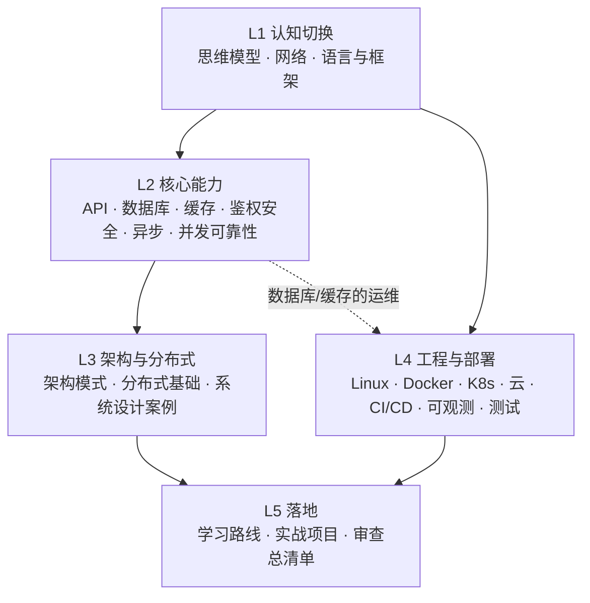
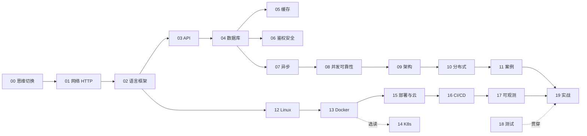

# 后端与工程化：AI 全栈开发必修

> 写给**前端出身、日常用 AI 写代码**的工程师：系统补齐做 AI 应用全栈所需的后端、架构与工程部署知识。目标不是从零手写后端，而是**看得懂 AI 写的代码、判断得了方案对不对、上得了线、排得了障**。
>
> 和同库另两套系列互补：[LangChain 系列](../LangChain-LangGraph入门到进阶/README.md) 讲框架用法，[企业级 AI 系列](../企业级AI应用开发实战/README.md) 讲 AI 特有的协议、RAG、LLMOps 与 AI 安全。本系列讲**任何后端系统都绕不开的通用基础**；AI 特有的部分直接链接过去，不重复。

- **编写时间**：2026 年 11 月
- **代码对照**：**Java（Spring Boot）/ TypeScript（Node）/ Python（FastAPI）** 三栈对照；Go 只在其生态有代表性时（云原生、基础设施）出现
- **版本基线**：以各章开头标注为准

> ⚠️ 框架与云产品迭代很快。凡涉及具体版本、默认值、命令参数的地方，动手前先对照官方文档。

---

## 一、为什么用 AI 写代码之后，后端反而更要学

AI 让"写出来"的成本趋近于零，瓶颈转移到了**判断**：

| 过去的瓶颈 | 现在的瓶颈 |
|---|---|
| 会不会写这个接口 | 这个接口在并发、重试、越权下是否正确 |
| 记不记得 API 怎么调 | 选的方案（同步 / 异步、缓存放哪、事务边界）是否合理 |
| 能不能把服务跑起来 | 线上出问题时能否从日志、指标、链路里定位根因 |

AI 生成的后端代码，最危险的错误往往**能跑、测试能过、上线才炸**：重复扣费、超卖、越权读到别人的数据、连接泄漏、没有超时导致雪崩。这些不需要你手写，但必须**在 review 时认得出来**。

> 🎯 **本系列的核心交付物**：每章末尾都有一份「**AI 代码审查清单**」，把这一章的知识翻译成 review 时要盯的具体检查点。[19 章](./L5-落地/19-学习路线与实战项目.md) 汇总为一份总清单。

---

## 二、五层知识结构

| 层 | 回答的问题 | 能力目标 |
|---|---|---|
| **L1 认知切换** | 后端和前端在思维上差在哪 | 建立服务端心智模型，读懂三种主流后端语言 |
| **L2 核心能力** | 一个后端服务由哪些基础能力组成 | 能审查 AI 写的接口、SQL、缓存、鉴权、异步与并发代码 |
| **L3 架构与分布式** | 系统怎么拆、怎么扩、怎么取舍 | 能评估架构方案，做出有依据的技术决策 |
| **L4 工程与部署** | 代码怎么变成稳定运行的线上服务 | 能独立部署、发布、监控、排障 |
| **L5 落地** | 怎么把以上知识串起来练 | 完成一个从零到上线的 AI 全栈项目 |

---

## 三、目录

重要度：⭐⭐⭐ 必须精通 ｜ ⭐⭐ 需要掌握 ｜ ⭐ 了解即可

### L1 认知切换

| 章节 | 内容 | 重要度 | 建议用时 |
|---|---|---|---|
| [00 前端到后端的思维切换](./L1-认知切换/00-前端到后端的思维切换.md) | 请求生命周期、进程 / 线程 / 协程、事件循环 vs 线程池、有状态 vs 无状态、跨领域术语表 | ⭐⭐⭐ | 2 小时 |
| [01 网络与 HTTP：服务端视角](./L1-认知切换/01-网络与HTTP-服务端视角.md) | TCP / TLS / DNS、HTTP/1.1 / 2 / 3、连接复用、反向代理与 CDN、服务端 CORS、SSE / WebSocket 服务端实现、超时链路 | ⭐⭐⭐ | 3 小时 |
| [02 后端语言与框架选型](./L1-认知切换/02-后端语言与框架选型.md) | Spring Boot / Node（NestJS、Fastify、Hono）/ FastAPI 并发模型对照、选型依据、读懂三种语言的最小语法 | ⭐⭐⭐ | 3 小时 |

### L2 核心能力

| 章节 | 内容 | 重要度 | 建议用时 |
|---|---|---|---|
| [03 API 设计](./L2-核心能力/03-API设计.md) | REST / gRPC / GraphQL / tRPC 选型、错误模型、分页、版本、幂等键、契约优先、长任务 API | ⭐⭐⭐ | 3 小时 |
| [04 数据库与数据建模](./L2-核心能力/04-数据库与数据建模.md) | 建模、索引与 EXPLAIN、事务与隔离级别、锁与 MVCC、迁移、ORM 陷阱、Postgres 生态 | ⭐⭐⭐ | 6 小时 |
| [05 缓存与 Redis](./L2-核心能力/05-缓存与Redis.md) | 缓存模式、穿透 / 击穿 / 雪崩、一致性、Redis 数据结构、分布式锁、限流 | ⭐⭐⭐ | 3 小时 |
| [06 认证、授权与 Web 安全](./L2-核心能力/06-认证授权与Web安全.md) | Session / JWT / OAuth 2.x / OIDC、RBAC / ABAC、多租户、OWASP Top 10、SSRF、密钥管理 | ⭐⭐⭐ | 4 小时 |
| [07 异步任务与消息队列](./L2-核心能力/07-异步任务与消息队列.md) | 任务队列、Kafka / RabbitMQ、投递语义、幂等消费、Outbox、死信、定时任务 | ⭐⭐⭐ | 4 小时 |
| [08 并发与可靠性](./L2-核心能力/08-并发与可靠性.md) | 竞态、乐观 / 悲观锁、超时 / 重试 / 熔断 / 降级、背压、优雅停机 | ⭐⭐⭐ | 3 小时 |

### L3 架构与分布式

| 章节 | 内容 | 重要度 | 建议用时 |
|---|---|---|---|
| [09 架构模式](./L3-架构与分布式/09-架构模式.md) | 单体 → 模块化单体 → 微服务、分层 / 六边形 / 轻量 DDD、BFF、CQRS、ADR | ⭐⭐⭐ | 3 小时 |
| [10 分布式系统基础](./L3-架构与分布式/10-分布式系统基础.md) | CAP / PACELC、一致性模型、Saga、负载均衡、读写分离与分库分表、对象存储 | ⭐⭐ | 4 小时 |
| [11 系统设计案例](./L3-架构与分布式/11-系统设计案例.md) | 容量估算 + 5 个案例：AI 对话服务、知识库入库流水线、计费与额度、通知系统、短链 | ⭐⭐⭐ | 4 小时 |

### L4 工程与部署

| 章节 | 内容 | 重要度 | 建议用时 |
|---|---|---|---|
| [12 Linux 与排障命令](./L4-工程与部署/12-Linux与排障命令.md) | 进程、端口、权限、systemd、日志、网络排查工具链 | ⭐⭐⭐ | 3 小时 |
| [13 Docker 与 Compose](./L4-工程与部署/13-Docker与Compose.md) | 镜像分层、多阶段构建、三栈 Dockerfile、镜像安全、Compose 本地编排 | ⭐⭐⭐ | 3 小时 |
| [14 Kubernetes 核心与实践](./L4-工程与部署/14-Kubernetes核心与实践.md) | 核心对象、调度与资源、探针、配置与密钥、Ingress / Gateway API、HPA、Helm、排障 | ⭐⭐ | 6 小时 |
| [15 部署架构与云](./L4-工程与部署/15-部署架构与云.md) | Nginx / Caddy、HTTPS、云服务器 / Serverless / PaaS / K8s 选型、域名与 CDN、托管数据库 | ⭐⭐⭐ | 3 小时 |
| [16 CI/CD 与发布策略](./L4-工程与部署/16-CICD与发布策略.md) | GitHub Actions、多环境、配置与密钥、数据库迁移发布、蓝绿 / 金丝雀、回滚、Feature Flag | ⭐⭐⭐ | 3 小时 |
| [17 可观测性与线上排障](./L4-工程与部署/17-可观测性与线上排障.md) | 日志 / 指标 / 链路、OpenTelemetry、Prometheus / Grafana、SLO 与告警、排障方法论、复盘 | ⭐⭐⭐ | 4 小时 |
| [18 测试策略](./L4-工程与部署/18-测试策略.md) | 测试金字塔、集成测试与 Testcontainers、契约测试、压测、AI 写代码时的测试策略 | ⭐⭐⭐ | 3 小时 |

### L5 落地

| 章节 | 内容 | 重要度 | 建议用时 |
|---|---|---|---|
| [19 学习路线与实战项目](./L5-落地/19-学习路线与实战项目.md) | 分阶段路线、一个 AI 全栈项目的里程碑与验收标准、AI 后端代码审查总清单 | ⭐⭐⭐ | 2~4 周 |

---

## 四、学习路径

- **🚀 两周速成**（先能上线一个可靠的 AI 应用）：00 → 01 → 03 → 04 → 06 → 07 → 13 → 15 → 17 → 19
- **📘 标准路径（一到两个月）**：L1 → L2 → L4（14 可后置）→ L3 → L5，18 章穿插在 L2 期间阅读
- **🎯 目标导向**：
  - **补后端短板**，能审查 AI 写的服务端代码 → 00 → 03 → 04 → 06 → 08 → 18
  - **自己部署运维**一个线上服务 → 12 → 13 → 15 → 16 → 17
  - 进入**大厂 / 云原生**环境 → 13 → 14 → 16 → 17 → 10
  - 提升**架构与方案评审能力** → 08 → 09 → 10 → 11

---

## 五、阅读约定

> 🎯 **落地要点**：真实项目中会踩、会被问、会决定成败的点。

> ⚠️ **注意**：坑、版本差异、反模式，尤其是 AI 生成代码的高发错误。

> 🔭 **先锋视角**：正在形成的新做法，值得提前了解，但要评估成熟度。

> 📖 **术语**：后端、数据库、运维、网络领域的术语，首次出现时简要说明。

代码约定：

- 同一概念尽量给出 **Java / TS / Python** 三栈对照，帮助读懂不同项目的代码；不追求三栈逐行等价
- 代码以讲清要点为目的，篇幅有限时省略 import 与错误处理的样板部分
- 命令默认在 Linux / macOS 下执行

---

## 六、与已有系列的对应关系

| 主题 | 本系列 | 其他系列 |
|---|---|---|
| SSE 流式输出 | 01 章讲协议与服务端实现、代理配置 | [企业级 04 AI 交互层](../企业级AI应用开发实战/04-AI交互层-流式协议与生成式UI.md) 讲 AI 事件模型与 AG-UI |
| 持久化执行 / 长任务 | 07 章讲通用队列与工作流引擎 | [企业级 06 Agent 工程化](../企业级AI应用开发实战/06-Agent工程化-从Loop到生产.md) 讲 Agent 场景下的持久化执行 |
| 向量检索 | 04 章讲 pgvector 作为 Postgres 扩展的运维视角 | [企业级 07 RAG](../企业级AI应用开发实战/07-企业级RAG落地.md) 讲检索策略 |
| 可观测性 | 17 章讲通用日志 / 指标 / 链路 | [企业级 09 LLMOps](../企业级AI应用开发实战/09-LLMOps-可观测评测与AI网关.md) 讲 LLM tracing、评测与 AI 网关 |
| 安全 | 06 章讲 Web 安全与鉴权 | [企业级 10 安全](../企业级AI应用开发实战/10-安全权限与上线清单.md) 讲提示注入与 Agent 权限 |
| 部署 | 13~16 章讲通用部署体系 | [LangChain 12](../LangChain-LangGraph入门到进阶/12-调试评估与生产部署.md) 讲 FastAPI + LangGraph 的具体部署示例 |
